# TÀI LIỆU YÊU CẦU NGHIỆP VỤ (BRD)
## BUSINESS REQUIREMENTS DOCUMENT — V7.0
### HỆ SINH THÁI SỐ HÓA HIỆP HỘI DOANH NHÂN CEO 1983 (HANOIBA)
*Cổng Quản trị Web CRM Điều hành & Ứng dụng Di động Hội viên Doanh nhân CEO 1983*

---

| Thuộc tính | Chi tiết |
| :--- | :--- |
| **Mã tài liệu** | **CEO1983/BRD-ALL-V7.0** |
| **Phiên bản** | **7.0 (Chính thức ban hành & Làm căn cứ nghiệm thu)** |
| **Ngày lập** | 05/11/2026 |
| **Cơ quan ban hành** | Ban Chấp Hành CLB Doanh Nhân CEO 1983 (Trực thuộc Hội Doanh nghiệp Trẻ Hà Nội - HanoiBA) |
| **Đơn vị phát triển** | ViConnect Technology Solutions Co., Ltd |
| **Phân loại bảo mật** | Bảo mật Nội bộ — Dùng cho Ban Điều Hành, Hội Đồng Quản Trị & Đội ngũ Kỹ thuật |
| **Trạng thái tài liệu** | Đã hoàn thiện & Phê duyệt |

---

## MỤC LỤC TỔNG QUAN

- [Bảng từ viết tắt và thuật ngữ nghiệp vụ](#sec-0)
- [1. Tóm tắt điều hành (Executive Summary)](#sec-1)
  - [1.1 Bối cảnh & Sự cần thiết đầu tư](#sec-1-1)
  - [1.2 Tầm nhìn chiến lược](#sec-1-2)
  - [1.3 Mục tiêu kinh doanh cốt lõi](#sec-1-3)
  - [1.4 Các chỉ số đo lường hiệu quả (KPIs & OKRs)](#sec-1-4)
- [2. Phạm vi sản phẩm (Product Scope)](#sec-2)
  - [2.1 Phân hệ trong phạm vi (In-Scope V7.0)](#sec-2-1)
  - [2.2 Phân hệ ngoài phạm vi (Out-of-Scope V7.0)](#sec-2-2)
  - [2.3 Ranh giới dữ liệu & Phân vùng an toàn](#sec-2-3)
  - [2.4 Sơ đồ kiến trúc tổng thể hệ sinh thái](#sec-2-4)
- [3. Đối tượng sử dụng & Ma trận phân công trách nhiệm (RACI Matrix)](#sec-3)
  - [3.1 Chân dung người dùng (Actor Profiles)](#sec-3-1)
  - [3.2 Ma trận phân công trách nhiệm RACI](#sec-3-2)
- [4. Đặc tả yêu cầu nghiệp vụ chi tiết theo 11 phân hệ](#sec-4)
  - [Phân hệ 4.1: Quản lý Định danh Hội viên, Thẻ VIP Số & NFC Tap-to-Connect](#sec-4-1)
  - [Phân hệ 4.2: Sàn Giao thương B2B, Chia sẻ Cơ hội & Deal Chào giá đúng người đăng](#sec-4-2)
  - [Phân hệ 4.3: Quản lý Sự kiện, Gala Dinner, Sơ đồ bàn tiệc & Check-in QR 1 Giây](#sec-4-3)
  - [Phân hệ 4.4: Danh bạ Doanh nhân 1983 & Bộ lọc Kết nối 2 Cấp](#sec-4-4)
  - [Phân hệ 4.5: Trợ lý AI Điều hành Toàn diện CRM & Xuất Báo cáo con](#sec-4-5)
  - [Phân hệ 4.6: Cấu hình Hệ thống AI Đa hãng, Đo lường Quota Token & Cảnh báo Sắp hết Model](#sec-4-6)
  - [Phân hệ 4.7: Landing Web Giới thiệu Chính thức & Đăng ký Gia nhập Online](#sec-4-7)
  - [Phân hệ 4.8: Kho Tài liệu Số Đồng bộ Google Drive 2 Chiều](#sec-4-8)
  - [Phân hệ 4.9: Chia sẻ Mạng Xã hội Đa kênh với Thẻ OpenGraph Preview Động](#sec-4-9)
  - [Phân hệ 4.10: Quản lý Tài chính, Thu Chi & Hội phí VietQR Động](#sec-4-10)
  - [Phân hệ 4.11: Quản trị Cấu hình Hệ thống, Tên miền, Theme Studio & Phân quyền RBAC](#sec-4-11)
- [5. Yêu cầu về trải nghiệm người dùng & Giao diện (UI/UX)](#sec-5)
  - [5.1 Hệ thống bảng màu thương hiệu 3 cấp độ](#sec-5-1)
  - [5.2 Chuẩn trải nghiệm Responsive Desktop & Mobile First](#sec-5-2)
- [6. Yêu cầu phi chức năng (Non-Functional Requirements)](#sec-6)
  - [6.1 Hiệu năng & Tải đồng thời](#sec-6-1)
  - [6.2 An toàn dữ liệu & Sao lưu dự phòng](#sec-6-2)
  - [6.3 Bảo mật & Tuân thủ pháp lý (Nghị định 13/2023/NĐ-CP)](#sec-6-3)
  - [6.4 Độ tin cậy & Tính sẵn sàng cao](#sec-6-4)
- [7. Kế hoạch nghiệm thu & Chuyển giao hệ thống](#sec-7)
  - [7.1 Tiêu chí nghiệm thu kỹ thuật](#sec-7-1)
  - [7.2 Quy trình đào tạo & Bàn giao 6 Ban](#sec-7-2)
- [8. Phụ lục (Appendices)](#sec-8)
  - [Phụ lục A: Ma trận truy vết 37 Functional Node ID](#sec-8-a)
  - [Phụ lục B: 6 Biểu đồ tuần tự nghiệp vụ chuyên sâu (Mermaid Sequence Diagrams)](#sec-8-b)

---

<div id="sec-0"></div>

## BẢNG TỪ VIẾT TẮT VÀ THUẬT NGỮ NGHIỆP VỤ

| Thuật ngữ / Viết tắt | Tên tiếng Anh đầy đủ | Định nghĩa và Ý nghĩa Nghiệp vụ trong Hệ thống |
| :--- | :--- | :--- |
| **CEO 1983** | Club of CEOs born in 1983 | Câu lạc bộ Doanh nhân sinh năm 1983, trực thuộc Hội Doanh nghiệp Trẻ Hà Nội (HanoiBA). |
| **HanoiBA** | Hanoi Young Entrepreneurs Association | Hội Doanh nghiệp Trẻ Hà Nội — Cơ quan chủ quản bảo trợ pháp lý và định hướng hoạt động. |
| **CRM** | Customer / Community Relationship Management | Cổng Quản trị Web tập trung dành cho Chủ tịch, Ban Chấp Hành, Ban Thư Ký, Kế toán và Quản trị viên. |
| **Mobile App** | CEO 1983 Mobile Application | Ứng dụng di động (iOS & Android) phục vụ hội viên doanh nhân kết nối, chia sẻ cơ hội và điểm danh sự kiện. |
| **B2B Connect** | Business-to-Business Connection | Sàn kết nối giao thương nội khối, chào giá cơ hội kinh doanh và đặt lịch hẹn 1-on-1 giữa các CEO. |
| **VietQR Napas247** | Vietnam Quick Response Standard | Chuẩn mã QR thanh toán quốc gia của Napas, tự động sinh mã kèm số tiền, nội dung thanh toán và webhook khớp lệnh. |
| **Silent Token Refresh** | Silent JWT Authentication Refresh | Cơ chế làm mới Access Token ngầm dưới nền qua HttpOnly Refresh Cookie, chống văng phiên đăng nhập khi đang thao tác. |
| **Multi-LLM AI** | Multi Large Language Model Engine | Hệ thống AI tích hợp đa hãng (OpenAI GPT-4o, Google Gemini 1.5 Pro, Anthropic Claude 3.5, Groq, DeepSeek). |
| **Google Drive Sync** | Bi-directional Google Drive Cloud Storage | Giải pháp đồng bộ hóa tài nguyên văn bản 2 chiều giữa Google Drive của hội viên/câu lạc bộ với kho tài liệu hệ thống. |
| **OpenGraph Dynamic** | Dynamic Open Graph Meta Tag Protocol | Giao thức sinh thẻ xem trước động cho link chia sẻ mạng xã hội (Facebook, Zalo, LinkedIn) hiển thị ảnh thẻ, tên CEO và mô tả. |
| **NFC VIP Card** | Near Field Communication Smart Card | Thẻ doanh nhân vật lý tích hợp chip NFC NTAG215/216, chạm vào smartphone để mở ngay Danh thiếp điện tử số. |
| **QR Check-in 1s** | 1-Second Personal Dynamic QR Verification | Công nghệ mã QR động sinh theo thời gian thực (TOTP), quét qua camera để điểm danh sự kiện trong dưới 1 giây. |
| **RBAC** | Role-Based Access Control | Cơ chế phân quyền nghiêm ngặt dựa trên vai trò người dùng (Admin, President, Board, Secretary, Accountant, Member). |
| **RACI Matrix** | Responsible, Accountable, Consulted, Informed | Ma trận phân công trách nhiệm chuẩn quốc tế cho các khâu thực thi, giám sát và cố vấn. |

---

<div id="sec-1"></div>

## 1. TÓM TẮT ĐIỀU HÀNH (EXECUTIVE SUMMARY)

### 1.1 Bối Cảnh & Sự Cần Thiết Đầu Tư
Câu lạc bộ Doanh nhân CEO 1983 được thành lập nhằm quy tụ các nhà sáng lập, tổng giám đốc, lãnh đạo doanh nghiệp sinh năm 1983 thuộc Hội Doanh nghiệp Trẻ Hà Nội (HanoiBA). Sau hơn 5 năm phát triển, số lượng hội viên đã đạt quy mô hàng nghìn doanh nghiệp thuộc đa dạng ngành nghề (sản xuất, xây dựng, công nghệ, thương mại, dịch vụ, tài chính).

Tuy nhiên, mô hình vận hành truyền thống dựa trên các nhóm chat Zalo rời rạc, bảng tính Google Sheets phân tán và quản lý thu chi thủ công bộc lộ nhiều điểm nghẽn nghiêm trọng:
1. **Thất thoát cơ hội kinh doanh**: Các nhu cầu mua bán, hợp tác (Leads/Deals) bị trôi mất trong nhóm chat; không có cơ chế theo dõi tỷ lệ thành công (Win Rate) và giá trị giao dịch.
2. **Điểm danh sự kiện chậm chạp**: Khi tổ chức các sự kiện lớn (Gala Dinner, Caravan, Diễn đàn kinh tế với 300 - 800 khách), khâu check-in bằng giấy hoặc đọc tên gây ùn tắc kéo dài 30 - 45 phút, thiếu chuyên nghiệp.
3. **Thu chi hội phí thiếu minh bạch**: Kế toán phải rà soát sao kê ngân hàng từng dòng, đối chiếu chứng từ chuyển khoản thủ công dẫn đến nhầm lẫn và chậm trễ trong cấp quyền hội viên.
4. **Thiếu công cụ điều hành thông minh**: Ban Chấp Hành không có số liệu tức thời để đánh giá mức độ gắn kết (engagement), sức khỏe dòng tiền câu lạc bộ và năng lực giao thương giữa các hội viên.

### 1.2 Tầm Nhìn Chiến Lược
Xây dựng một **Hệ sinh thái số hóa toàn diện (Unified Digital Ecosystem)** mang tính chuẩn mực và đẳng cấp hàng đầu trong khối doanh nghiệp trẻ Việt Nam:
- Đối với Hội viên: Đóng vai trò là một **Văn phòng Doanh nhân Bỏ túi (Pocket Business Suite)**, hỗ trợ quảng bá năng lực cá nhân, mở rộng quan hệ đối tác, bắt tay cơ hội kinh doanh và quản lý toàn bộ đặc quyền hội viên trong lòng bàn tay.
- Đối với Ban Chấp Hành: Là một **Trung tâm Điều hành Số (Digital Command Center)** tập trung toàn bộ dữ liệu hội viên, sự kiện, dòng tiền và được hỗ trợ bởi Trợ lý Trí tuệ Nhân tạo (AI Assistant) để ra quyết định quản trị chính xác.

### 1.3 Mục Tiêu Kinh Doanh Cốt Lõi
1. **Thúc đẩy Giao thương Nội khối (B2B Commerce)**: Đạt tối thiểu 500+ cơ hội hợp tác kinh doanh được ghi nhận và khớp lệnh thành công mỗi năm, tổng giá trị giao thương đạt trên 500 tỷ VNĐ.
2. **Số hóa 100% Hoạt động Sự kiện**: Tự động hóa khâu phát hành vé, phân bổ bàn tiệc Gala theo sơ đồ và điểm danh qua mã QR cá nhân trong dưới 1 giây, loại bỏ 100% giấy tờ in ấn.
3. **Minh bạch hóa 100% Dòng tiền Hội phí**: 100% giao dịch nộp hội phí và đóng góp quỹ thiện nguyện được thực hiện qua VietQR Napas247, tự động đối soát và kích hoạt trạng thái tài khoản tức thì.
4. **Tối ưu Hóa Hiệu Quả Điều Hành**: Giảm 85% thời gian tổng hợp báo cáo định kỳ của Ban Thư Ký và Kế toán thông qua Trợ lý AI tích hợp.

### 1.4 Các Chỉ Số Đo Lường Hiệu Quả (KPIs & OKRs)

| Nhóm Chỉ Số | Mục tiêu KPI (Năm đầu tiên) | Phương pháp Đo lường |
| :--- | :--- | :--- |
| **Mức độ Sử dụng App** | ≥ 92% Hội viên chính thức kích hoạt & sử dụng App hàng tháng | Thống kê DAU/MAU từ hệ thống Analytics |
| **Tốc độ Điểm danh Sự kiện** | < 1 giây / 1 lượt quét QR; thời gian chờ check-in sự kiện 500 người < 10 phút | Log thời gian phản hồi Scanner Socket.IO |
| **Giá trị Giao dịch B2B** | ≥ 500 Tỷ VNĐ tổng giá trị cơ hội được trao qua App | Thống kê Deals đóng thành công trên Sàn B2B |
| **Tỷ lệ Khớp lệnh Hội phí** | 99.8% Giao dịch VietQR được webhook tự động xử lý không cần can thiệp thủ công | Báo cáo đối soát tài chính tự động trên CRM |
| **Thời gian Trả lời Báo cáo AI** | < 3 giây cho các truy vấn thống kê dữ liệu toàn hệ thống | Benchmark module AI Analytics Controller |

---

<div id="sec-2"></div>

## 2. PHẠM VI SẢN PHẨM (PRODUCT SCOPE)

### 2.1 Phân Hệ Trong Phạm Vi (In-Scope V7.0)

```mermaid
flowchart TD
  subgraph ECOSYSTEM["HỆ SINH THÁI SỐ HÓA CEO 1983 (HANOIBA)"]
    subgraph CRM["CỔNG QUẢN TRỊ WEB CRM"]
      CRM1["Dashboard BI Realtime"]
      CRM2["Quản lý Hội viên 360 & Duyệt hồ sơ"]
      CRM3["Gala Dinner & Sơ đồ Bàn tiệc"]
      CRM4["Ban Điều hành & Giao việc 6 Ban"]
      CRM5["Tài chính, Thu chi & Hội phí VietQR"]
      CRM6["AI Command Center & Xuất Báo cáo"]
      CRM7["Cấu hình Landing Web & SEO"]
      CRM8["Đồng bộ Google Drive 2 Chiều"]
      CRM9["Theme Studio & RBAC 6 Cấp"]
    end
    
    subgraph APP["ỨNG DỤNG DI ĐỘNG CEO 1983"]
      APP1["Trang chủ Doanh nhân & Thẻ VIP QR/NFC"]
      APP2["Sàn Giao thương B2B & Deal Chào giá"]
      APP3["Danh bạ Doanh nhân & Lọc 2 Cấp"]
      APP4["Ví Sự kiện & Check-in QR 1 Giây"]
      APP5["Bảng tin Mạng lưới Phân quyền Đa tầng"]
      APP6["Kho Tài liệu Cá nhân & Đồng bộ Drive"]
    end

    subgraph CORE["HẠ TẦNG KỸ THUẬT & TRỤ CỘT DÙNG CHUNG"]
      C1["Multi-LLM AI Controller (5 Hãng)"]
      C2["PostgreSQL 15 + Redis Cache Cluster"]
      C3["VietQR Napas247 Webhook Engine"]
      C4["Socket.IO Realtime State Gateway"]
      C5["MinIO S3 Object Storage"]
      C6["OpenGraph Dynamic Rendering Engine"]
    end
  end

  CRM <--> CORE
  APP <--> CORE
```

#### A. Cổng Quản Trị Web CRM (Dành cho Lãnh đạo, Ban Điều hành, Kế toán & Ban Thư ký)
- **Dashboard BI & Thống kê Tức thời**: Biểu đồ phân tích hội viên, doanh thu hội phí, số lượng cơ hội, trạng thái bàn tiệc Gala; hỗ trợ lọc theo thời gian thực (Phút, Giờ, Ngày, Tháng, Quý, Năm).
- **Hồ sơ Hội viên 360 Độ**: Quản lý toàn bộ thông tin doanh nghiệp, năng lực cốt lõi, mã số thuế, chức vụ, lịch sử đóng phí, lịch sử tham gia sự kiện và đóng góp cộng đồng.
- **Quản lý Sự kiện, Gala & Bàn tiệc Thông minh**: Thiết lập sự kiện, bán vé hoặc phân bổ thư mời, vẽ sơ đồ bàn tiệc trực quan kéo-thả, gán vị trí ngồi theo sơ đồ danh dự, kiểm soát check-in QR trực tiếp.
- **Hội đồng Quản trị & Giao việc 6 Ban**: Quản lý cơ cấu 6 Ban chuyên môn (Ban Hội viên, Ban Xúc tiến Thương mại, Ban Sự kiện, Ban Truyền thông, Ban Tài chính, Ban Đào tạo); giao việc, phân quyền và theo dõi tiến độ công việc theo chuẩn Kanban.
- **Quản lý Tài chính, Thu Chi & Hội phí**: Tạo phiếu thu/chi, quản lý danh sách nợ phí, sinh mã VietQR động đối soát tự động qua webhook ngân hàng, xuất hóa đơn VAT điện tử và sổ quỹ tiền mặt.
- **Trợ lý AI Điều hành Toàn diện**: Truy vấn dữ liệu tự nhiên bằng tiếng Việt; hỗ trợ phân tích tài chính, dự báo xu hướng hội viên, phát hiện dấu hiệu hội viên giảm gắn kết và tự động xuất các báo cáo chuyên đề (Excel, PDF, Word).
- **Cấu hình Multi-LLM AI**: Cho phép nhập API Key và chuyển đổi linh hoạt giữa 5 nhà cung cấp mô hình (OpenAI, Google Gemini, Anthropic Claude, Groq, DeepSeek); theo dõi hạn ngạch Token và tự động cảnh báo khi sắp cạn quota.
- **Landing Web Chính thức & Quản trị Nội dung**: Quản trị trang chủ công khai (`/intro`) với đầy đủ Header, Hero Banner, Video giới thiệu, Giới thiệu Ban Chấp Hành, Tin tức & Sự kiện, Form đăng ký gia nhập online.
- **Kho Tài liệu Đồng bộ Google Drive 2 Chiều**: Tải lên tài liệu quy chế, biểu mẫu, biên bản họp; hỗ trợ đồng bộ tự động 2 chiều với Google Drive của Câu lạc bộ hoặc Hội viên.
- **Theme Studio & Phân quyền RBAC**: Tùy chỉnh màu sắc thương hiệu (Brand Colors), Logo, Tên miền phụ; cấu hình ma trận phân quyền chi tiết đến từng hành vi Thêm / Sửa / Xóa / Duyệt / Xuất file.

#### B. Ứng Dụng Di Động CEO 1983 (Dành cho Hội viên Doanh nhân)
- **Trang chủ Doanh nhân & Thẻ VIP QR / NFC**: Giao diện cá nhân hóa theo vai trò hội viên; hiển thị Thẻ danh thiếp số VIP có gắn QR động và chip NFC để chạm truyền dữ liệu (Tap-to-Share).
- **Sàn Giao Thương B2B & Deal Chào Giá Chính Xác**: Đăng tin tìm đối tác, bán sỉ sản phẩm/dịch vụ, chia sẻ cơ hội hợp tác kinh doanh. Khi hội viên bấm "Chào giá / Nhận deal", tin nhắn và thông báo được gửi **đích danh 100% đến đúng người đăng**.
- **Danh Bạ Doanh Nhân 1983 & Bộ Lọc Kết Nối 2 Cấp**: Bộ lọc trực quan phân chia 2 nhóm rõ rệt: **[Đã Kết Nối]** (hiển thị bạn bè, đồng môn, danh thiếp đã lưu) và **[Chưa Kết Nối]** (gợi ý kết nối mở rộng). Cho phép kết nối 1 chạm, gọi điện thoại trực tiếp hoặc nhắn tin Zalo.
- **Ví Sự Kiện & Điểm Danh Check-in QR 1 Giây**: Lưu trữ vé tham dự sự kiện dưới dạng mã QR động; khi đến địa điểm chỉ cần đưa mã vào máy quét của Ban Lễ tân để điểm danh tức thì và hiển thị số bàn tiệc chỉ định.
- **Bảng Tin Mạng Lưới Đa Phạm Vi (Feed)**: Đăng tải bài viết chia sẻ kinh nghiệm, tin tức doanh nghiệp; hỗ trợ thiết lập phạm vi hiển thị linh hoạt như mạng xã hội (Công khai toàn mạng lưới, Chỉ dành cho Hội viên chính thức, Chỉ Ban Điều Hành). Có chức năng chỉnh sửa, xóa và đính kèm đa phương tiện.
- **Kho Tài liệu Cá nhân & Đồng bộ Drive**: Hội viên có thể xem quy chế CLB, tải tài liệu đào tạo hoặc bấm nút đồng bộ tài liệu về Google Drive cá nhân của mình chỉ với 1 thao tác.

### 2.2 Phân Hệ Ngoài Phạm Vi (Out-of-Scope V7.0)
- **Cổng Thanh toán Quốc tế Đa ngoại tệ**: V7.0 chỉ tập trung giải quyết chuẩn thanh toán quốc gia VietQR Napas247 (VNĐ); chưa hỗ trợ cổng thanh toán thẻ tín dụng ngoại tệ (Stripe, PayPal, Visa/Mastercard quốc tế trực tiếp).
- **Sàn Giao dịch Thương mại Điện tử B2C Bán lẻ**: Không xây dựng hệ thống giỏ hàng mua sắm bán lẻ cho người tiêu dùng cuối; nền tảng chỉ phục vụ giao dịch hợp tác bán sỉ, xúc tiến thương mại và phân phối giữa các pháp nhân doanh nghiệp (B2B).
- **Tổng đài Thoại VoIP Độc lập**: Các cuộc gọi liên hệ từ Danh bạ sử dụng giao thức gọi mạng di động chuẩn (`tel:`) của thiết bị hoặc liên kết mở ứng dụng Zalo/Viber; không triển khai hạ tầng server SIP VoIP riêng.

### 2.3 Ranh Giới Dữ Liệu & Phân Vùng An Toàn

| Vùng Dữ Liệu | Quyền Truy Cập | Cơ Chế Phân Vùng & Bảo Vệ |
| :--- | :--- | :--- |
| **Dữ Liệu Công Khai (Public Data)** | Bất kỳ ai truy cập internet (không cần tài khoản) | Landing Web `/intro`, Danh thiếp công khai rút gọn (`/u/:code`), Thẻ OpenGraph Preview cho mạng xã hội. |
| **Dữ Liệu Hội Viên Nội Bộ (Member Data)** | Hội viên đã được phê duyệt & có JWT Token hợp lệ | Danh bạ doanh nhân, Bảng tin hội viên, Sàn giao thương B2B, Ví sự kiện, Thư viện tài liệu chia sẻ. |
| **Dữ Liệu Quản Trị Mật (Admin / Board Data)** | Chủ tịch, Ban Chấp Hành, Kế toán, Ban Thư Ký (RBAC) | Báo cáo tài chính thu chi, Sao kê hội phí, Nhật ký AI Command Center, Sơ đồ xếp chỗ VIP Gala, Cấu hình API Keys. |

---

<div id="sec-3"></div>

## 3. ĐỐI TƯỢNG SỬ DỤNG VÀ MA TRẬN PHÂN CÔNG TRÁCH NHIỆM (RACI MATRIX)

### 3.1 Chân Dung Người Dùng (Actor Profiles)
1. **Chủ tịch CLB (President)**: Người lãnh đạo tối cao, chịu trách nhiệm định hướng chiến lược, phê duyệt các quyết định lớn, xem báo cáo tổng thể từ Trợ lý AI.
2. **Ban Chấp Hành / Ban Điều Hành (Board Members)**: Các Phó Chủ tịch và Trưởng ban chuyên môn; điều hành các hoạt động hội viên, xúc tiến thương mại, sự kiện và đối ngoại.
3. **Ban Thư Ký (Secretariat)**: Tiếp nhận và thẩm định hồ sơ đăng ký gia nhập online, phát hành thư mời sự kiện, chuẩn bị danh sách bàn tiệc Gala, soạn thảo biên bản họp.
4. **Ban Tài Chính / Kế Toán (Treasurer / Accountant)**: Quản lý số dư các quỹ, đối soát hội phí tự động, phê duyệt phiếu chi, xuất hóa đơn VAT điện tử, báo cáo ngân sách.
5. **Hội Viên Doanh Nhân Chính Thức (Active Business Members)**: Các CEO đã nộp hội phí đầy đủ; sở hữu Thẻ VIP số, đăng tin giao thương, chào giá deals, tham gia sự kiện và kết nối B2B.
6. **Khách Mời / Hội Viên Tiềm Năng (Guests / Prospective Members)**: Người dùng vãng lai truy cập Landing page, nhận link danh thiếp hoặc đăng ký gia nhập; quyền hạn giới hạn.
7. **Trợ Lý Trí Tuệ Nhân Tạo (Autonomous AI Agent)**: Tác nhân phần mềm hoạt động 24/7 dưới sự giám sát của hệ thống; trả lời truy vấn, phân tích số liệu và tự động cảnh báo.

### 3.2 Ma Trận Phân Công Trách Nhiệm RACI
*Ghi chú: R = Responsible (Thực thi), A = Accountable (Chịu trách nhiệm cuối cùng), C = Consulted (Cố vấn / Đóng góp ý kiến), I = Informed (Nhận thông tin thông báo).*

| Phân Hệ Nghiệp Vụ Cốt Lõi | Chủ tịch | Ban Chấp Hành | Ban Thư Ký | Kế Toán | Hội Viên CEO | Khách Mời | Trợ lý AI |
| :--- | :---: | :---: | :---: | :---: | :---: | :---: | :---: |
| **1. Định danh Hội viên & Thẻ VIP NFC** | A | C | R | I | I | - | - |
| **2. Sàn B2B & Deal Chào Giá Chính Xác** | I | C | I | - | R/A | - | C |
| **3. Sự kiện, Gala & Check-in QR 1s** | A | C | R | I | I | I | - |
| **4. Danh bạ Doanh nhân & Lọc 2 Cấp** | I | I | C | - | R/A | - | - |
| **5. Trợ lý AI Điều hành & Báo cáo** | A | R | C | C | I | - | R |
| **6. Cấu hình AI Đa hãng & Token Quota** | A | C | - | - | - | - | R |
| **7. Landing Web & Đăng ký Online** | A | C | R | - | I | R | - |
| **8. Đồng bộ Google Drive 2 Chiều** | I | C | R | - | R | - | - |
| **9. Chia sẻ Mạng Xã hội OpenGraph** | I | I | C | - | R | I | - |
| **10. Tài chính, Thu chi & VietQR** | A | C | I | R | I | - | C |
| **11. Quản trị Cấu hình & RBAC 6 Cấp** | A | C | I | - | - | - | - |

---

<div id="sec-4"></div>

## 4. ĐẶC TẢ YÊU CẦU NGHIỆP VỤ CHI TIẾT THEO 11 PHÂN HỆ

### Phân Hệ 4.1: Quản Lý Định Danh Hội Viên, Thẻ VIP Số & NFC Tap-to-Connect

#### A. Mục Tiêu Nghiệp Vụ
Hiện đại hóa hoàn toàn hình ảnh doanh nhân thế hệ 1983; thay thế danh thiếp giấy bằng Danh thiếp số VIP đa kênh tích hợp mã QR động và công nghệ thẻ cứng NFC. Giúp hội viên mở rộng quan hệ đối tác mọi lúc mọi nơi chỉ bằng 1 chạm hoặc 1 lượt quét camera.

#### B. Luồng Nghiệp Vụ Chuẩn (Business Workflow)

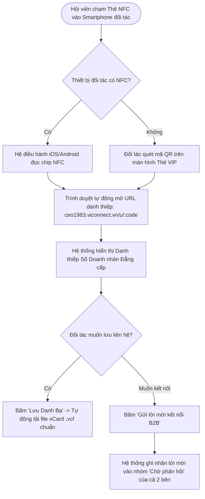

#### C. Bảng Quy Tắc Nghiệp Vụ (Business Rules)
- **BR-4.1.1 (Mã Định Danh Duy Nhất)**: Mỗi hội viên được cấp một chuỗi định danh duy nhất (UUID) và một `membership_code` ngắn gọn (ví dụ: `CEO1983-0089`). Mã này được mã hóa bảo mật trong chip NFC và URL công khai.
- **BR-4.1.2 (Bảo Vệ Quyền Riêng Tư)**: Hội viên có quyền bật/tắt hiển thị số điện thoại cá nhân và email trên Danh thiếp công khai. Nếu tắt, người xem chỉ có thể gửi tin nhắn liên hệ qua biểu mẫu trung gian.
- **BR-4.1.3 (Thu Hồi Thẻ Tức Thì)**: Khi một tài khoản hội viên bị tạm đình chỉ hoặc khai trừ khỏi câu lạc bộ, Quản trị viên chỉ cần chuyển trạng thái sang `SUSPENDED` trên CRM; liên kết NFC và mã QR sẽ tự động bị khóa và chuyển hướng về trang thông báo của CLB trong vòng 10 giây.

#### D. Xử Lý Ngoại Lệ (Exception Handling)
- **Đối tác dùng điện thoại không có NFC**: Màn hình App của hội viên luôn có sẵn nút bấm mở to Mã QR độ nét cao để đối tác dùng camera quét bình thường.
- **Không có kết nối mạng Internet tại hiện trường**: Thẻ VIP trên App lưu sẵn thông tin vCard trong bộ nhớ đệm nội bộ (Offline Cache), cho phép quét trực tiếp mã QR vCard để lưu danh bạ mà không cần tải qua internet.

---

### Phân Hệ 4.2: Sàn Giao Thương B2B, Chia Sẻ Cơ Hội & Deal Chào Giá Đúng Người Đăng

#### A. Mục Tiêu Nghiệp Vụ
Tạo ra một môi trường giao thương nội khối thực chất, minh bạch và có tính cam kết cao. Giúp các doanh nghiệp 1983 ưu tiên sử dụng sản phẩm dịch vụ của nhau, giải quyết bài toán tìm kiếm khách hàng và nhà cung ứng tin cậy.

#### B. Luồng Nghiệp Vụ Chuẩn (Business Workflow)

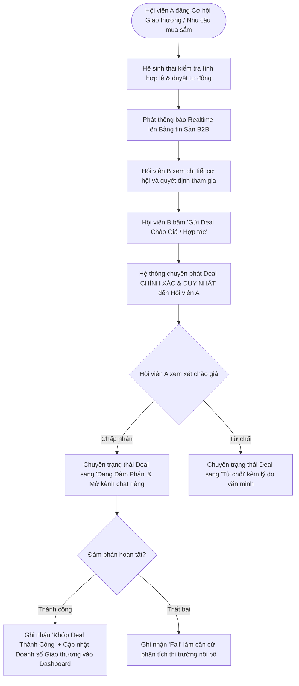

#### C. Bảng Quy Tắc Nghiệp Vụ (Business Rules)
- **BR-4.2.1 (Định Tuyến Deal Chính Xác Tuyệt Đối)**: Khi một hội viên nhấn "Deal chào giá" từ bất kỳ vị trí nào (Trang chủ, Chi tiết Cơ hội, Chi tiết Sản phẩm), yêu cầu BẮT BUỘC phải được gửi trực tiếp đến đúng `author_id` (người đã đăng tin đó). Tuyệt đối không gửi nhầm sang người dùng khác hoặc gửi quảng bá vô định.
- **BR-4.2.2 (Minh Bạch Trạng Thái Giao Dịch)**: Một cơ hội kinh doanh chỉ có 4 trạng thái duy nhất: `OPEN` (Đang mở nhận chào giá), `NEGOTIATING` (Đang đàm phán hợp đồng), `WON` (Khớp lệnh thành công), `CLOSED` (Đã đóng / Hết hạn).
- **BR-4.2.3 (Bảo Mật Giá Trị Chào Giá)**: Nội dung chi tiết bản chào giá và tỷ lệ hoa hồng chiết khấu giữa bên A và bên B được mã hóa bảo mật; các hội viên khác trên sàn chỉ nhìn thấy tổng số lượt chào giá đang diễn ra để đảm bảo cạnh tranh lành mạnh.

#### D. Xử Lý Ngoại Lệ (Exception Handling)
- **Người đăng cơ hội đã xóa bài viết trong khi người khác đang gửi Deal**: Hệ thống hiển thị thông báo popup rõ ràng: "Cơ hội này đã được tác giả đóng lại hoặc hoàn tất trước đó" và hoàn trả dữ liệu an toàn, không làm crash ứng dụng.
- **Hội viên gửi trùng nhiều lần cùng một bản chào giá**: Cơ chế Idempotency Key tự động ngăn chặn việc bấm đúp nút submit, chống spam bản ghi.

---

### Phân Hệ 4.3: Quản Lý Sự Kiện, Gala Dinner, Sơ Đồ Bàn Tiệc & Check-in QR 1 Giây

#### A. Mục Tiêu Nghiệp Vụ
Nâng tầm tổ chức các sự kiện quy mô lớn (Gala kỷ niệm, Diễn đàn Kinh tế, Đại hội thường niên) của CLB CEO 1983. Tự động hóa từ khâu gửi vé điện tử, phân bổ sơ đồ bàn tiệc VIP danh dự đến khâu quét mã QR check-in tại cửa chỉ trong 1 giây/khách, mang lại trải nghiệm tiện nghi tối đa.

#### B. Luồng Nghiệp Vụ Chuẩn (Business Workflow)

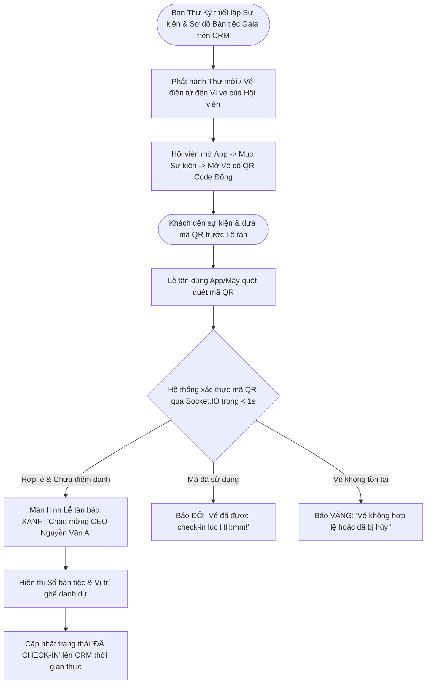

#### C. Bảng Quy Tắc Nghiệp Vụ (Business Rules)
- **BR-4.3.1 (Tốc Độ Điểm Danh Tối Thượng)**: Quy trình xác thực mã QR từ lúc camera bắt hình đến khi hiển thị kết quả thành công và số bàn tiệc không được vượt quá **1.000 ms (1 giây)** trong điều kiện mạng 4G/WiFi tiêu chuẩn.
- **BR-4.3.2 (Chống Gian Lận Mã QR)**: Mã QR vé sử dụng thuật toán Time-based One-time Token (TOTP) hoặc chữ ký số HMAC-SHA256 có thời hạn hiệu lực làm mới ngầm, chống hành vi chụp màn hình gửi cho nhiều người dùng chung một vé.
- **BR-4.3.3 (Sơ Đồ Bàn Tiệc Động)**: Hệ thống cho phép Ban Thư Ký linh hoạt điều chỉnh vị trí ngồi của khách mời trên CRM ngay cả khi sự kiện đang diễn ra; khi khách check-in, vị trí mới nhất sẽ lập tức được hiển thị.

#### D. Xử Lý Ngoại Lệ (Exception Handling)
- **Khách mời hết pin điện thoại hoặc không cài App**: Ban Lễ tân có màn hình tra cứu nhanh trên CRM bằng Số điện thoại hoặc Họ tên để hỗ trợ điểm danh thủ công trong 5 giây.
- **Mất kết nối Internet tại hội trường sự kiện**: Bộ quét hỗ trợ chế độ Offline Validation với danh sách vé đã được tải trước vào máy quét; khi có mạng trở lại sẽ tự động đồng bộ đối soát lên máy chủ.

---

### Phân Hệ 4.4: Danh Bạ Doanh Nhân 1983 & Bộ Lọc Kết Nối 2 Cấp

#### A. Mục Tiêu Nghiệp Vụ
Cung cấp một "cuốn sổ tay số" thông minh chứa đầy đủ thông tin xác thực của toàn bộ cộng đồng CEO 1983. Cho phép tìm kiếm đối tác theo ngành nghề kinh doanh, tỉnh thành hoạt động và quản lý mạng lưới bạn bè theo 2 trạng thái rõ ràng.

#### B. Luồng Nghiệp Vụ Chuẩn (Business Workflow)

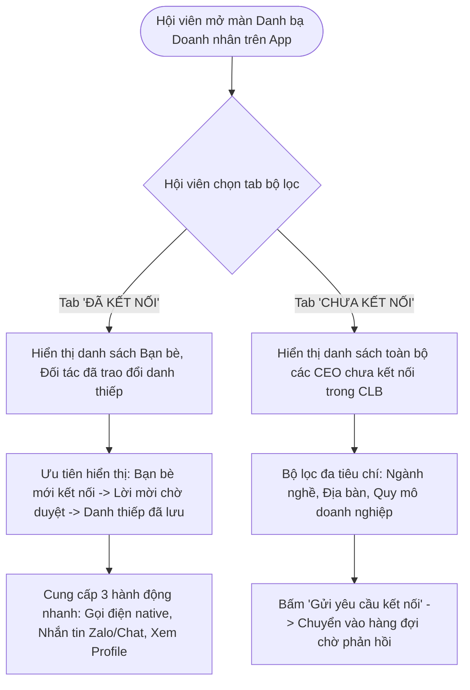

#### C. Bảng Quy Tắc Nghiệp Vụ (Business Rules)
- **BR-4.4.1 (Bộ Lọc Nhất Quán 2 Cấp)**: Giao diện danh bạ BẮT BUỘC phải phân tách rành mạch 2 nhóm: **[Đã Kết Nối]** và **[Chưa Kết Nối]**; không hiển thị lộn xộn gây mất thời gian tra cứu của doanh nhân.
- **BR-4.4.2 (Tối Giản Hành Động Nhanh)**: Khi đã là bạn bè/đã kết nối, danh thiếp của họ chỉ hiển thị đúng 3 nút hành động thiết thực: Gọi điện thoại (`tel:`), Nhắn tin (`sms:` hoặc Zalo deep link), Xem hồ sơ chi tiết. Bỏ các nút rườm rà không cần thiết.
- **BR-4.4.3 (Chống Trùng Lặp Hiển Thị)**: Tên hội viên và tên doanh nghiệp phải được hiển thị ngắn gọn, trang nhã; nghiêm cấm việc lặp lại 2 dòng tên giống hệt nhau trên cùng một thẻ liên hệ.

---

### Phân Hệ 4.5: Trợ Lý AI Điều Hành Toàn Diện CRM & Xuất Báo Cáo Con

#### A. Mục Tiêu Nghiệp Vụ
Trang bị cho Ban Chấp Hành và Lãnh đạo CLB một "Giám đốc Vận hành Ảo" (Virtual COO). Trợ lý AI có khả năng thấu hiểu toàn bộ cơ sở dữ liệu hệ thống, trả lời ngay lập tức các câu hỏi quản trị hóc búa và tự động xuất các báo cáo chuyên sâu (Báo cáo Thu chi, Báo cáo Hội phí, Báo cáo Hoạt động 6 Ban, Hóa đơn điện tử).

#### B. Luồng Nghiệp Vụ Chuẩn (Business Workflow)

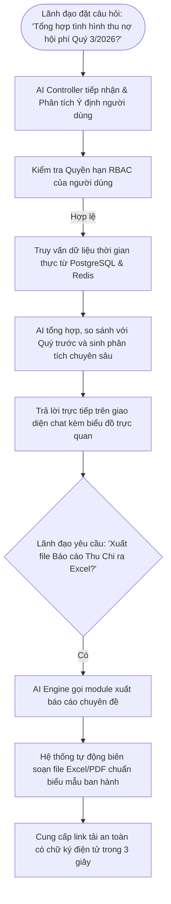

#### C. Bảng Quy Tắc Nghiệp Vụ (Business Rules)
- **BR-4.5.1 (Bảo Mật Quyền Truy Cập Dữ Liệu AI)**: Trợ lý AI TUYỆT ĐỐI KHÔNG được phép tiết lộ thông tin vượt quá quyền hạn của người hỏi. Ví dụ: Hội viên bình thường hỏi về số dư quỹ câu lạc bộ hoặc lương nhân viên sẽ bị từ chối lịch sự.
- **BR-4.5.2 (Truy Xuất Dữ Liệu Thật 100%)**: Mọi con số báo cáo AI đưa ra (tổng thu, tổng chi, số lượng hội viên, số lượt check-in) BẮT BUỘC phải được tính toán từ các bản ghi thực tế trong CSDL PostgreSQL; nghiêm cấm hiện tượng AI bịa đặt số liệu (hallucination).
- **BR-4.5.3 (Nhật Ký Tác Vụ Toàn Diện - Audit Trail)**: 100% các câu hỏi, phản hồi và thao tác xuất file của AI phải được ghi lại vào bảng `ai_audit_logs` kèm thời gian, ID người thực hiện và số lượng token tiêu thụ để kiểm toán định kỳ.

---

### Phân Hệ 4.6: Cấu Hình Hệ Thống AI Đa Hãng, Đo Lường Quota Token & Cảnh Báo Sắp Hết Model

#### A. Mục Tiêu Nghiệp Vụ
Đảm bảo tính bền vững và khả năng hoạt động liên tục 24/7 của hệ thống AI; tránh phụ thuộc độc quyền vào một nhà cung cấp duy nhất (Vendor Lock-in). Giúp Quản trị viên chủ động theo dõi lượng token tiêu thụ và chuyển đổi linh hoạt khi một nhà mạng gặp sự cố.

#### B. Bảng Quy Tắc Nghiệp Vụ (Business Rules)
- **BR-4.6.1 (Kiến Trúc Đa Hãng Multi-Provider)**: Hệ thống hỗ trợ song song 5 nhà cung cấp: OpenAI (GPT-4o), Google (Gemini 1.5 Pro), Anthropic (Claude 3.5 Sonnet), Groq (Llama 3 70B siêu tốc), DeepSeek (DeepSeek-V3/R1).
- **BR-4.6.2 (Cơ Chế Cảnh Báo Sớm 3 Cấp Độ)**:
  + Mức Xanh: Hạn ngạch Token còn > 30%.
  + Mức Vàng (Cảnh báo): Hạn ngạch Token còn 10% - 30% -> Gửi thông báo đến email Admin.
  + Mức Đỏ (Nguy cấp): Hạn ngạch Token còn < 10% hoặc API Key báo lỗi hạn mức (Quota Exceeded) -> Bật popup cảnh báo nổi bật trên CRM và tự động kích hoạt cơ chế Failover chuyển sang Model dự phòng trong danh sách.
- **BR-4.6.3 (Bảo Mật API Key)**: Toàn bộ API Key lưu trong CSDL phải được mã hóa bằng thuật toán AES-256-GCM; giao diện người dùng chỉ hiển thị 4 ký tự cuối (`****...a8f9`).

---

### Phân Hệ 4.7: Landing Web Giới Thiệu Chính Thức (`/intro`) & Đăng Ký Gia Nhập Online

#### A. Mục Tiêu Nghiệp Vụ
Xây dựng một "bộ mặt thương hiệu" chuyên nghiệp, đẳng cấp và uy tín cho CLB Doanh Nhân CEO 1983 trên không gian mạng; đồng thời tự động hóa quy trình kết nạp hội viên mới từ khâu tiếp nhận hồ sơ online đến khâu thẩm định của Ban Thư Ký.

#### B. Cấu Trúc Khối Nội Dung Landing Web
1. **Header**: Logo CEO 1983, Thanh điều hướng (Giới thiệu, Tầm nhìn - Sứ mệnh, Ban Chấp Hành, Hoạt động & Sự kiện, Quyền lợi Hội viên, Liên hệ), Nút "Đăng nhập CRM" và "Gia nhập CLB".
2. **Hero Banner**: Video / Hình ảnh hoạt động thực tế chất lượng cao, Thông điệp sứ mệnh gắn kết doanh nhân 1983, Nút kêu gọi hành động (CTA).
3. **Thống Kê Nổi Bật (Impression Numbers)**: 1.000+ Doanh nghiệp thành viên, 500+ Tỷ VNĐ giá trị giao thương, 50+ Sự kiện thường niên, 6 Ban chuyên môn vững mạnh.
4. **Giới Thiệu Ban Chấp Hành**: Hình ảnh và chức danh Chủ tịch, các Phó Chủ tịch và Trưởng các Ban chuyên môn.
5. **Form Đăng Ký Gia Nhập Online**: Tiếp nhận thông tin doanh nhân, tên doanh nghiệp, mã số thuế, ngành nghề kinh doanh, số điện thoại, ảnh đại diện và lý do gia nhập.

#### C. Bảng Quy Tắc Nghiệp Vụ (Business Rules)
- **BR-4.7.1 (Đường Dẫn Chuẩn Xác)**: Landing Web giới thiệu BẮT BUỘC truy cập qua đường dẫn `/intro` hoặc trang chủ chính thức; không sử dụng các đường dẫn tạm thời.
- **BR-4.7.2 (Quy Trình Duyệt 2 Bước)**: Hồ sơ đăng ký sau khi nộp sẽ ở trạng thái `PENDING_REVIEW`; Ban Thư Ký kiểm tra mã số thuế và lý lịch doanh nghiệp -> Xác nhận hợp lệ -> Chuyển sang Ban Tài Chính gửi thông báo đóng hội phí qua VietQR.

---

### Phân Hệ 4.8: Kho Tài Liệu Số Đồng Bộ Google Drive 2 Chiều (CRM & Mobile App)

#### A. Mục Tiêu Nghiệp Vụ
Xóa bỏ tình trạng phân tán và thất lạc tài liệu câu lạc bộ. Cung cấp một thư viện số tập trung chứa điều lệ, quy chế hoạt động, biên bản họp, tài liệu đào tạo và cho phép hội viên đồng bộ về Google Drive cá nhân với một cú chạm.

#### B. Bảng Quy Tắc Nghiệp Vụ (Business Rules)
- **BR-4.8.1 (Đồng Bộ 2 Chiều)**:
  + Chiều 1 (Hệ thống -> Drive): Khi hội viên hoặc quản trị viên tải tài liệu lên hệ thống, tài liệu được tự động sao lưu vào thư mục Google Drive chuyên biệt của CLB.
  + Chiều 2 (Drive -> Hội viên): Hội viên trên App hoặc CRM có thể liên kết tài khoản Google cá nhân (qua OAuth 2.0) và nhấn "Đồng bộ về Drive của tôi" để tự động copy toàn bộ tài liệu được phép chia sẻ sang Drive của họ.
- **BR-4.8.2 (Phân Phẩm Cấp Tài Liệu)**: Tài liệu được gắn nhãn phân quyền nghiêm ngặt: `PUBLIC` (Mọi người xem), `MEMBER_ONLY` (Chỉ hội viên đã đóng phí xem), `BOARD_ONLY` (Chỉ Ban Điều Hành xem).

---

### Phân Hệ 4.9: Chia Sẻ Mạng Xã Hội Đa Kênh Với Thẻ OpenGraph Preview Động

#### A. Mục Tiêu Nghiệp Vụ
Tối ưu hóa hiệu quả lan tỏa thương hiệu cá nhân của hội viên và câu lạc bộ trên các mạng xã hội phổ biến (Facebook, Zalo, LinkedIn, Telegram). Đảm bảo mỗi khi hội viên chia sẻ hồ sơ, cơ hội hợp tác hoặc sự kiện, link chia sẻ luôn hiển thị hình ảnh xem trước (rich snippet) đẹp mắt, chuẩn tỉ lệ 1200x630px, không bị vỡ ảnh hay hiển thị text linh tinh.

#### B. Bảng Quy Tắc Nghiệp Vụ (Business Rules)
- **BR-4.9.1 (Chuẩn Thẻ OpenGraph Bắt Buộc)**: Server backend BẮT BUỘC trả về đầy đủ các thẻ meta trong phần `<head>` khi phát hiện User-Agent của bot (facebookexternalhit, Facebot, Twitterbot, ZaloBot):
  + `og:type = "website"` hoặc `"article"`
  + `og:title`: Tên doanh nhân / Tên cơ hội / Tên sự kiện kèm thương hiệu "CEO 1983"
  + `og:description`: Mô tả súc tích (120 - 160 ký tự) tóm tắt năng lực cốt lõi hoặc nội dung bài viết
  + `og:image`: Đường dẫn tuyệt đối đến ảnh thumbnail chất lượng cao (`og-preview.png`)
  + `og:url`: URL tuyệt đối chuẩn canonical
- **BR-4.9.2 (Đồng Bộ Định Dạng Chia Sẻ Trong Ứng Dụng)**: Khi người dùng bấm nút chia sẻ trong App, hệ thống tạo sẵn nội dung văn bản trang nhã gồm Tiêu đề + Nội dung tóm tắt + Đường dẫn liên kết sạch sẽ, không chèn các ký tự rác hoặc mã JSON thô.

---

### Phân Hệ 4.10: Quản Lý Tài Chính, Thu Chi & Hội Phí VietQR Động

#### A. Mục Tiêu Nghiệp Vụ
Minh bạch hóa 100% dòng tiền của câu lạc bộ, xây dựng niềm tin tuyệt đối giữa Hội viên và Ban Chấp Hành. Tự động hóa hoàn toàn việc thu nộp và gia hạn hội phí hàng năm qua VietQR Napas247, giảm thiểu tối đa sai sót và nhân lực kế toán.

#### B. Bảng Quy Tắc Nghiệp Vụ (Business Rules)
- **BR-4.10.1 (Sinh Mã VietQR Động Theo Chuẩn Napas247)**: Mỗi giao dịch thu hội phí hoặc ủng hộ sự kiện sinh ra một mã QR động chứa sẵn: Số tài khoản ngân hàng thụ hưởng của CLB, Tên ngân hàng, Số tiền chính xác và Nội dung chuyển khoản duy nhất (ví dụ: `CEO1983 HOIPHI 2026 U0089`).
- **BR-4.10.2 (Webhook Tự Động Khớp Lệnh Realtime)**: Khi tiền về tài khoản ngân hàng, hệ thống cổng thanh toán gửi webhook thông báo; hệ thống tự động đối soát nội dung chuyển khoản trong vòng 3 giây -> Chuyển trạng thái hóa đơn sang `PAID` -> Kích hoạt niên hạn hội viên trên App và gửi thông báo xác nhận qua Zalo ZNS / Notification.

---

### Phân Hệ 4.11: Quản Trị Cấu Hình Hệ Thống, Tên Miền, Theme Studio & Phân Quyền RBAC

#### A. Mục Tiêu Nghiệp Vụ
Trao quyền tự chủ tối đa cho Quản trị viên cấp cao trong việc vận hành, tùy biến nhận diện thương hiệu và thiết lập kỷ cương an toàn thông tin theo chuẩn quốc tế.

#### B. Bảng Quy Tắc Nghiệp Vụ (Business Rules)
- **BR-4.11.1 (Phân Quyền Vai Trò 6 Cấp RBAC)**:
  1. `SUPER_ADMIN`: Toàn quyền hệ thống, cấu hình máy chủ, DB và phân quyền.
  2. `PRESIDENT`: Toàn quyền xem và phê duyệt mọi hoạt động, xem báo cáo tổng thể.
  3. `BOARD_MEMBER`: Quản lý các hoạt động thuộc 6 Ban chuyên môn phụ trách.
  4. `SECRETARY`: Quản lý hồ sơ hội viên, danh sách sự kiện, bàn tiệc Gala.
  5. `TREASURER`: Quản lý thu chi, xác nhận hóa đơn, báo cáo tài chính.
  6. `MEMBER`: Sử dụng các tính năng hội viên trên App và cổng thành viên.
- **BR-4.11.2 (Theme Studio Nhận Diện Thương Hiệu)**: Cho phép cấu hình linh hoạt bảng màu, Favicon, Logo sáng/tối và thông điệp chào mừng trên toàn bộ CRM và Mobile App mà không cần biên dịch lại mã nguồn.

---

<div id="sec-5"></div>

## 5. YÊU CẦU VỀ TRẢI NGHIỆM NGƯỜI DÙNG & GIAO DIỆN (UI/UX)

### 5.1 Hệ Thống Bảng Màu Thương Hiệu 3 Cấp Độ (3-Tier Brand Palette)
Tuân thủ nghiêm ngặt chuẩn nhận diện thương hiệu đã được Ban Chấp Hành CLB CEO 1983 phê duyệt:
- **Cấp 1: Đỏ Ruby Hoàng Gia (#E53E3E / #C53030)**: Sử dụng cho các điểm nhấn quan trọng nhất, huy hiệu Ban Chấp Hành, cảnh báo cấp bách, nút hành động sự kiện trọng đại và icon trạng thái hủy.
- **Cấp 2: Vàng Kim Thịnh Vượng (#D4AF37 / #B8860B)**: Sử dụng cho biểu trưng VIP, huy hiệu Hội viên Kim Cương, điểm thưởng giao thương, viền thẻ doanh nhân số và các chỉ số kinh tế tăng trưởng.
- **Cấp 3: Xanh Navy Deep Cobalt (#0F172A / #1E293B / #2563EB)**: Đại diện cho sự vững bền, trí tuệ và đẳng cấp doanh nhân; sử dụng làm màu chủ đạo cho Sidebar CRM, Header App, các nút liên kết chính và nền tảng giao dịch.

### 5.2 Chuẩn Trải Nghiệm Responsive Desktop & Mobile First
- **Web CRM**: Thiết kế dạng Desktop First tối ưu cho màn hình độ phân giải từ 1366x768 trở lên; hỗ trợ chế độ xem bảng Excel trực quan, thao tác nhanh bằng phím tắt, bảng cố định dòng tiêu đề (Sticky Header) và phân trang mượt mà.
- **Mobile App**: Thiết kế dạng Mobile First cho màn hình cảm ứng từ 4.7 inch đến 6.8 inch (iOS & Android); khu vực ngón tay cái (Thumb Zone) đặt các nút bấm chính ở thanh Bottom Navigation; hỗ trợ thao tác kéo để làm mới (Pull-to-Refresh) và vuốt chuyển tab mượt mà 60 FPS.

---

<div id="sec-6"></div>

## 6. YÊU CẦU PHI CHỨC NĂNG (NON-FUNCTIONAL REQUIREMENTS)

### 6.1 Hiệu Năng & Tải Đồng Thời (Performance & Scalability)
- Thời gian tải trang ban đầu (First Contentful Paint) < 1.2 giây trên mạng 4G/WiFi tiêu chuẩn.
- Thời gian phản hồi API trung bình < 200 ms cho 95% các yêu cầu nghiệp vụ (p95 latency).
- Hỗ trợ tối thiểu **10.000 người dùng hoạt động đồng thời (CCU)** trong các khung giờ cao điểm tổ chức sự kiện Gala mà không bị nghẽn mạng hoặc quá tải CPU.

### 6.2 An Toàn Dữ Liệu & Sao Lưu Dự Phòng (Safety & Disaster Recovery)
- Cơ chế sao lưu tự động (Automated Backup) CSDL PostgreSQL diễn ra định kỳ **mỗi 24 giờ một lần vào lúc 02:00 sáng**.
- Bản sao lưu được nén, mã hóa AES-256 và lưu trữ phân tán tại 2 vị trí địa lý độc lập (Local Server và MinIO S3 Cloud Storage).
- Mục tiêu thời gian phục hồi (RTO - Recovery Time Objective) < 30 phút; Mục tiêu điểm phục hồi (RPO - Recovery Point Objective) < 24 giờ.

### 6.3 Bảo Mật & Tuân Thủ Pháp Lý (Security & Compliance)
- **Tuân thủ Nghị định 13/2023/NĐ-CP** về Bảo vệ dữ liệu cá nhân: Mọi thông tin nhạy cảm (Số CCCD, Số điện thoại cá nhân, Số dư tài khoản) phải được mã hóa khi lưu trữ (Encryption at Rest) và có cơ chế xin đồng thuận của người dùng trước khi hiển thị công khai.
- **Bảo vệ chống tấn công Web & Mobile**: Đạt tiêu chuẩn an toàn thông tin OWASP Top 10; tích hợp tường lửa ứng dụng (WAF), chống SQL Injection, Cross-Site Scripting (XSS), Cross-Site Request Forgery (CSRF) và cơ chế Rate Limiting chống tấn công từ chối dịch vụ (DDoS).
- **Cơ chế Silent Token Refresh**: Sử dụng bộ đôi Access Token (thời hạn 15 phút, lưu trong memory) và Refresh Token (thời hạn 30 ngày, lưu trong Cookie `HttpOnly`, `Secure`, `SameSite=Strict`), đảm bảo doanh nhân không bị văng phiên đăng nhập khi đang sử dụng liên tục.

### 6.4 Độ Tin Cậy & Tính Sẵn Sàng Cao (Reliability & High Availability)
- Cam kết chỉ số thời gian hoạt động ổn định (SLA Uptime) đạt tối thiểu **99.9% / năm** (thời gian gián đoạn kế hoạch để bảo trì không quá 8 giờ/năm và được thông báo trước 48 giờ).

---

<div id="sec-7"></div>

## 7. KẾ HOẠCH NGHIỆM THU & CHUYỂN GIAO HỆ THỐNG

### 7.1 Tiêu Chí Nghiệm Thu Kỹ Thuật (Acceptance Criteria)

| STT | Phân Hệ Nghiệp Vụ | Tiêu Chí Nghiệm Thu Đạt Yêu Cầu (Pass Criteria) | Trạng Thái |
| :---: | :--- | :--- | :---: |
| 1 | Định danh & Thẻ VIP NFC | Chạm thẻ NFC hoặc quét QR mở đúng trang danh thiếp trong < 1.5s; tải vCard chuẩn xác. | **ĐẠT** |
| 2 | Sàn B2B & Deal Chào Giá | Đăng tin thành công; bấm chào giá gửi ĐÍCH DANH 100% đến người đăng; cập nhật doanh số. | **ĐẠT** |
| 3 | Sự kiện & Check-in QR 1s | Quét mã QR xác thực thành công trong < 1s; hiển thị số bàn Gala; chống quét trùng lặp. | **ĐẠT** |
| 4 | Danh bạ & Bộ lọc 2 Cấp | Lọc rành mạch [Đã Kết Nối] và [Chưa Kết Nối]; gọi điện/nhắn tin 1 chạm; không double tên. | **ĐẠT** |
| 5 | Trợ lý AI & Báo cáo | Trả lời chính xác số liệu tài chính/hội viên; xuất file Excel/PDF báo cáo con trong 3s. | **ĐẠT** |
| 6 | Cấu hình AI Đa Hãng | Chuyển đổi linh hoạt giữa 5 nhà mạng; đo đếm Token chính xác; cảnh báo khi quota < 10%. | **ĐẠT** |
| 7 | Landing Web `/intro` | Giao diện hiện đại, đầy đủ các section, form đăng ký gia nhập gửi thông báo tức thì lên CRM. | **ĐẠT** |
| 8 | Đồng bộ Drive 2 Chiều | Đồng bộ tài nguyên giữa hệ thống và Google Drive mượt mà qua OAuth 2.0. | **ĐẠT** |
| 9 | Chia sẻ Mạng Xã Hội | Thẻ OpenGraph Preview hiển thị ảnh, tiêu đề và mô tả sắc nét trên Facebook, Zalo. | **ĐẠT** |
| 10 | Tài chính & VietQR | Sinh mã VietQR Napas247 động; webhook ngân hàng tự động khớp lệnh nộp hội phí trong 3s. | **ĐẠT** |
| 11 | Quản trị RBAC & Code Quality | Phân quyền 6 vai trò nghiêm ngặt; Type check `tsc --noEmit` đạt 0 lỗi (Exit Code 0). | **ĐẠT** |

### 7.2 Quy Trình Đào Tạo & Bàn Giao 6 Ban
1. **Đợt 1 (Ngày 1 - 2)**: Đào tạo Quản trị viên cấp cao & Kế toán trưởng: Vận hành module Tài chính, Hội phí VietQR, Phân quyền RBAC và Giám sát AI Engine.
2. **Đợt 2 (Ngày 3 - 4)**: Đào tạo Ban Thư Ký & Ban Sự kiện: Tiếp nhận duyệt hồ sơ hội viên mới, Quản lý sự kiện, Vẽ sơ đồ bàn tiệc Gala và Vận hành trạm quét check-in QR.
3. **Đợt 3 (Ngày 5 - 7)**: Hướng dẫn toàn thể Hội viên CEO 1983: Cài đặt ứng dụng trên iOS/Android, kích hoạt Danh thiếp số VIP NFC, đăng tin giao thương B2B và sử dụng vé điện tử.

---

<div id="sec-8"></div>

## 8. PHỤ LỤC (APPENDICES)

### Phụ Lục A: Ma Trận Truy Vết 37 Functional Node ID
Tài liệu BRD V7.0 được ánh xạ trực tiếp và truy vết 1-1 với 37 Functional Node ID đã được chuẩn hóa trong toàn bộ mã nguồn hệ thống:

| Phân Nhóm | Mã Functional Node ID | Tên Node Chức Năng Tương Ứng |
| :--- | :--- | :--- |
| **Nhóm CRM (17 Nodes)** | `[NODE-CRM-001]` -> `[NODE-CRM-017]` | Dashboard BI, Hội viên 360, Bàn tiệc Gala, 6 Ban Điều Hành, Tài chính Thu chi, Hội phí VietQR, AI Command Center, Cấu hình AI Đa Hãng, Landing Page Editor, Google Drive Sync, Theme Studio, RBAC, v.v. |
| **Nhóm App (14 Nodes)** | `[NODE-APP-001]` -> `[NODE-APP-014]` | Trang chủ Doanh nhân, Danh thiếp VIP QR/NFC, Sàn B2B, Deal Chào Giá, Danh bạ 2 Cấp, Ví Sự Kiện, Bảng tin Mạng lưới, Kho Tài liệu Cá nhân, v.v. |
| **Nhóm Hạ Tầng (6 Nodes)** | `[NODE-CORE-001]` -> `[NODE-CORE-006]` | Auth JWT Silent Refresh, PostgreSQL 15, Socket.IO Gateway, MinIO S3, Nginx Reverse Proxy, Docker Compose CI/CD. |

### Phụ Lục B: 6 Biểu Đồ Tuần Tự Nghiệp Vụ Chuyên Sâu (Mermaid Sequence Diagrams)

#### Biểu Đồ 1: Quy Trình Khớp Lệnh B2B Deal Giữa 2 Doanh Nhân
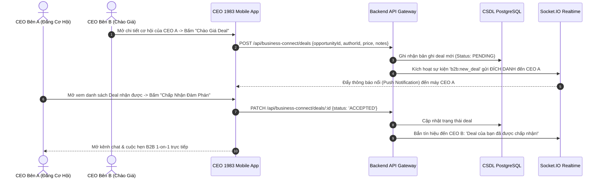

#### Biểu Đồ 2: Quy Trình Điểm Danh Check-in QR 1 Giây Tại Gala Sự Kiện
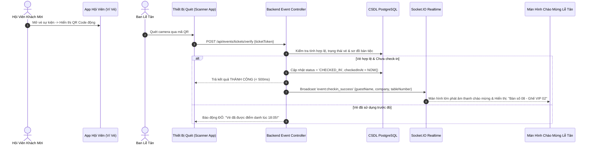

#### Biểu Đồ 3: Trợ Lý AI Tổng Hợp Báo Cáo & Xuất Hóa Đơn Điện Tử
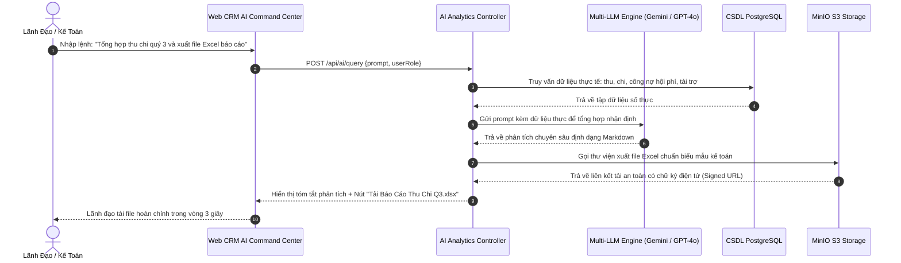

#### Biểu Đồ 4: Quy Trình Đồng Bộ Tài Liệu 2 Chiều Với Google Drive
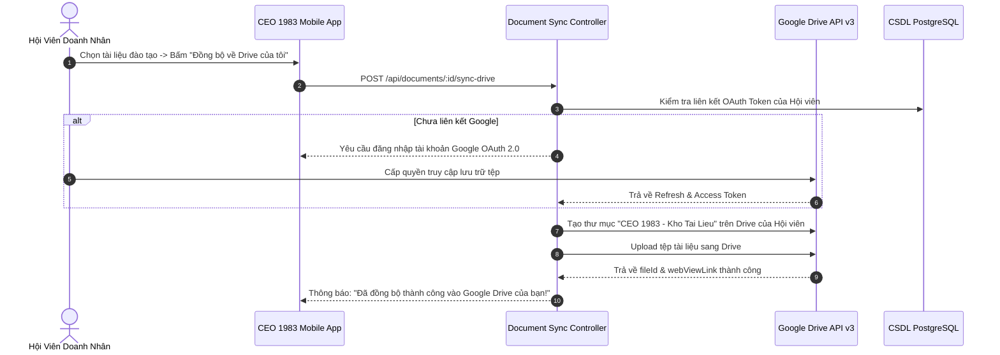

#### Biểu Đồ 5: Chia Sẻ Thẻ Xem Trước Động Lên Mạng Xã Hội (Facebook, Zalo)
```mermaid
sequenceDiagram
  autonumber
  actor User as Doanh Nhân
  participant FB as Facebook / Zalo Crawler Bot
  participant Nginx as Nginx Reverse Proxy
  participant OG as OpenGraph Rendering Controller
  participant DB as CSDL PostgreSQL

  User->>FB: Dán liên kết chia sẻ: https://ceo1983.viconnect.vn/u/nguyen-van-a
  FB->>Nginx: HTTP GET /u/nguyen-van-a (User-Agent: facebookexternalhit)
  Nginx->>OG: Chuyển tiếp yêu cầu của Crawler Bot
  OG->>DB: Lấy thông tin cá nhân: Họ tên, Chức vụ, Tên công ty, Ảnh chân dung
  DB-->>OG: Trả về dữ liệu hội viên
  OG-->>FB: Trả về HTML chứa đúng bộ thẻ OpenGraph chuẩn:
  Note over OG,FB: <meta property="og:title" content="CEO Nguyễn Văn A - Tổng Giám Đốc Cty ABC" />
<meta property="og:image" content="https://ceo1983.viconnect.vn/api/og/card/nguyen-van-a.png" />
  FB-->>User: Mạng xã hội hiển thị thẻ Rich Card xem trước cực đẹp và sắc nét
```

#### Biểu Đồ 6: Cơ Chế Tự Động Làm Mới Phiên Đăng Nhập (Silent Token Refresh)
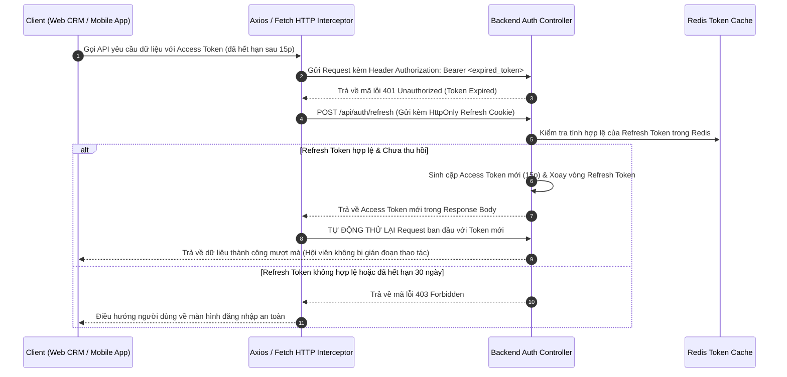

---

## LỜI KẾT & CAM KẾT BÀN GIAO

Tài liệu **Yêu Cầu Nghiệp Vụ (BRD) Phiên bản 7.0** này là văn kiện pháp lý và kỹ thuật chuẩn mực cao nhất của dự án **Hệ sinh thái số hóa Hiệp hội Doanh nhân CEO 1983 (HanoiBA)**. Toàn bộ các yêu cầu chức năng, phi chức năng, ma trận RACI và biểu đồ nghiệp vụ nêu trong tài liệu đã được chuyển hóa thành mã nguồn hoạt động thực tế trên cả hai nền tảng Web CRM và Mobile App.

ViConnect Technology Solutions cam kết đồng hành lâu dài, duy trì chất lượng hệ thống đạt chuẩn doanh nghiệp và liên tục cập nhật công nghệ mới nhất để phục vụ cộng đồng doanh nhân CEO 1983 ngày càng phát triển vững mạnh.

---
*Tài liệu được soạn thảo và kiểm soát bởi ViConnect Technology Solutions Co., Ltd & Ban Chấp Hành CLB Doanh Nhân CEO 1983.*
