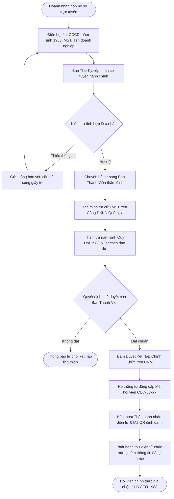
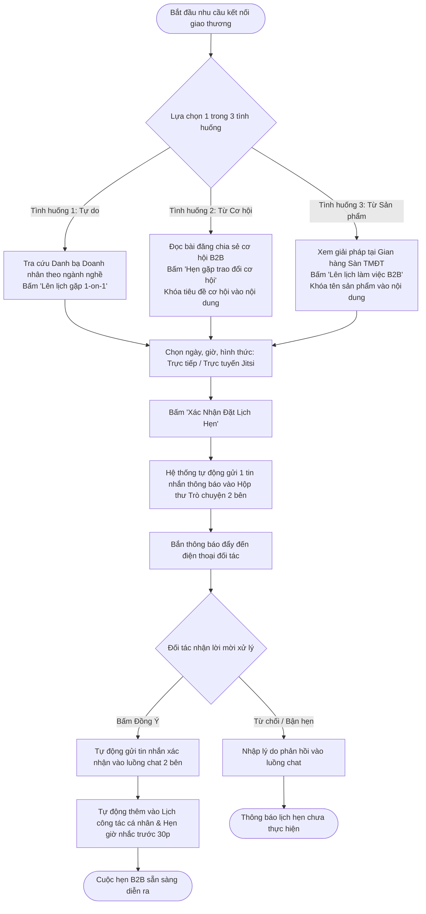
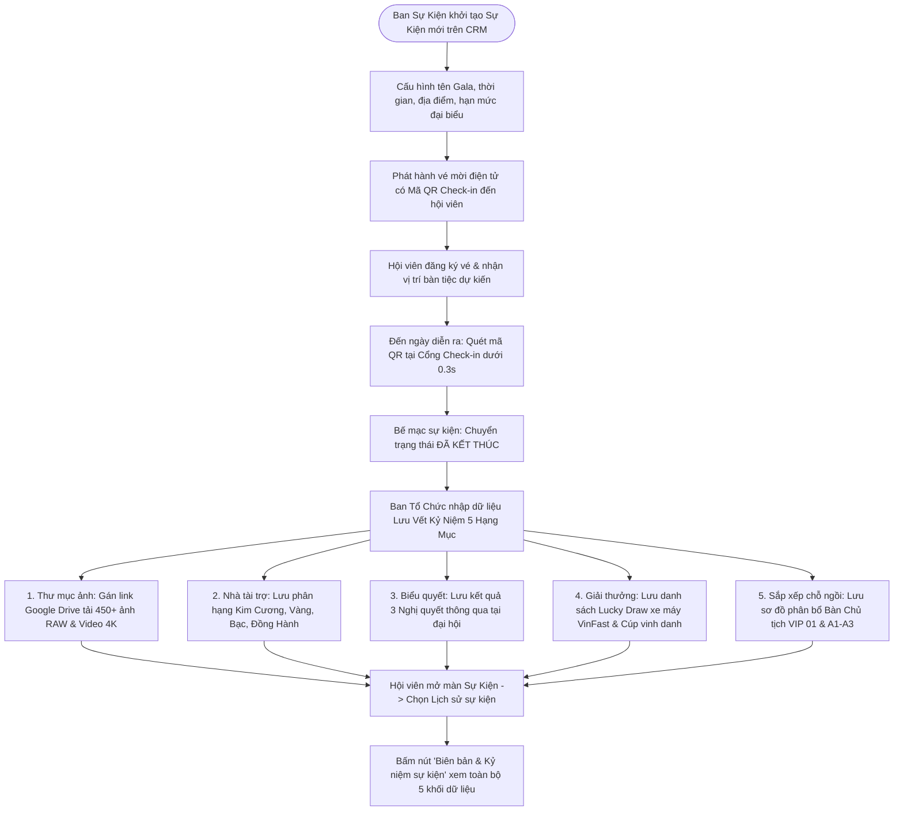
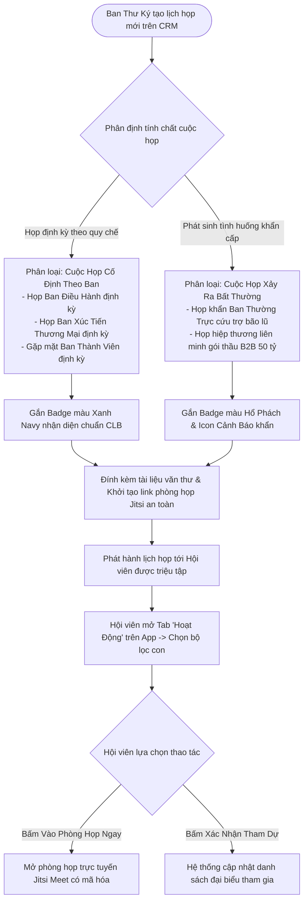
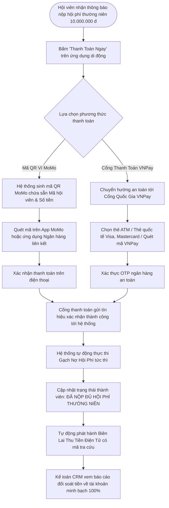
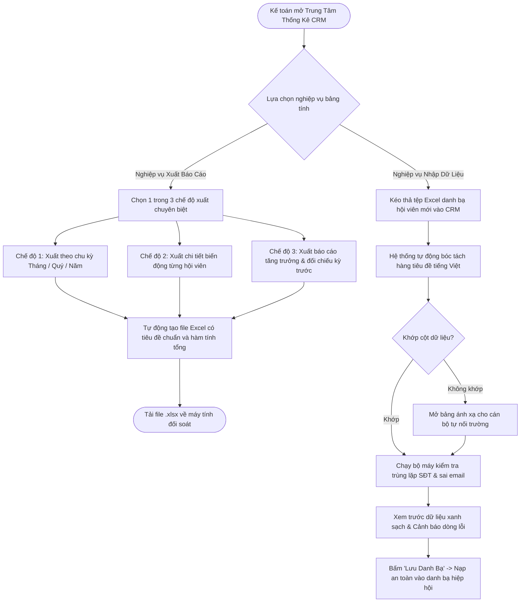
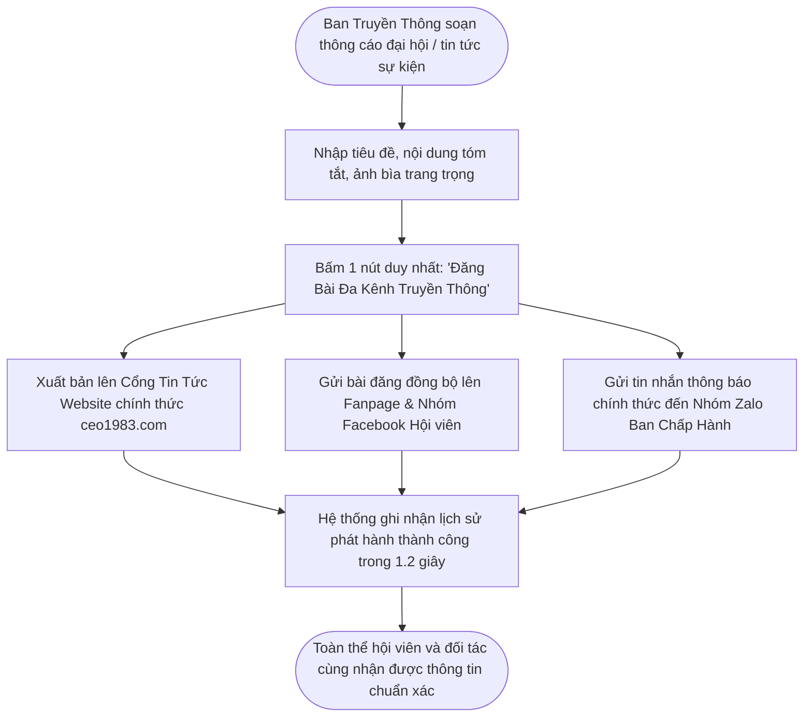
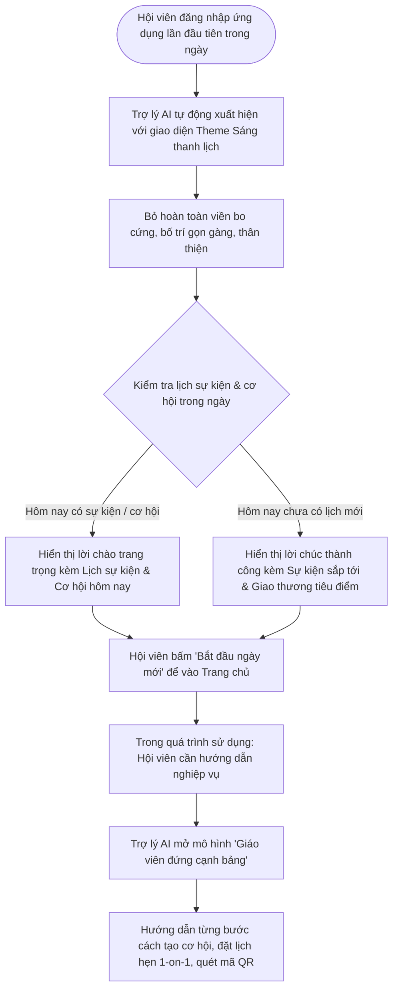

# HỆ SINH THÁI SỐ HÓA & QUẢN TRỊ HIỆP HỘI DOANH NHÂN CEO 1983 (HANOIBA)

## TÀI LIỆU YÊU CẦU NGHIỆP VỤ TỔNG THỂ CHÍNH THỨC
*(BUSINESS REQUIREMENTS DOCUMENT - MASTER BRD)*

---

* **Mã tài liệu:** `BRD-CEO1983-MASTER-CHINH-THUC`
* **Phiên bản:** `Phiên bản 9.0 Toàn Diện (Bản Bàn Giao Khách Hàng, Ban Lãnh Đạo & Doanh Nghiệp)`
* **Cơ quan chủ quản:** Câu Lạc Bộ Doanh Nhân CEO 1983 — Trực thuộc Hội Doanh Nghiệp Trẻ Hà Nội (HanoiBA)
* **Đơn vị tư vấn giải pháp:** VICONNECT - Nền tảng Chuyển đổi số Hiệp hội Doanh nhân
* **Cấp độ bảo mật:** Lưu hành nội bộ Ban Lãnh Đạo & Doanh nghiệp Hội viên

---

## MỤC LỤC TÀI LIỆU
1. **CHƯƠNG 1: TỔNG QUAN, BỐI CẢNH VẬN HÀNH & MỤC TIÊU CHIẾN LƯỢC**
2. **CHƯƠNG 2: MÔ HÌNH VẬN HÀNH & PHÂN ĐỊNH TRÁCH NHIỆM 6 CHUYÊN BAN**
3. **CHƯƠNG 3: HỆ THỐNG SƠ ĐỒ QUY TRÌNH NGHIỆP VỤ KINH DOANH (8 BUSINESS FLOWCHARTS)**
   - 3.1. Quy Trình Thẩm Định & Phê Duyệt Kết Nạp Hội Viên Mới
   - 3.2. Quy Trình Giao Thương B2B & Đặt Lịch Hẹn 1-on-1 trong 3 Tình Huống
   - 3.3. Quy Trình Tổ Chức Sự Kiện Gala & Lưu Vết Kỷ Niệm 5 Hạng Mục
   - 3.4. Quy Trình Điều Hành Hoạt Động Họp Ban (Họp Cố Định vs Họp Bất Thường)
   - 3.5. Quy Trình Thu Hội Phí Tự Động Qua Mã QR MoMo & Cổng VNPay
   - 3.6. Quy Trình Đối Soát Biến Động & Xuất - Nhập Báo Cáo Bảng Tính
   - 3.7. Quy Trình Đăng Bài Đa Kênh Truyền Thông 1-Chạm
   - 3.8. Quy Trình Trợ Lý Số AI Chào Mừng & Hướng Dẫn Doanh Nhân
4. **CHƯƠNG 4: MA TRẬN YÊU CẦU NGHIỆP VỤ & 30 BUSINESS USE CASES (BUC)**
   - 4.1. Nhóm 15 Business Use Cases Quản Trị Hiệp Hội (`BUC-CRM-001` đến `BUC-CRM-015`)
   - 4.2. Nhóm 15 Business Use Cases Hội Viên Doanh Nhân (`BUC-APP-001` đến `BUC-APP-015`)
5. **CHƯƠNG 5: ĐẶC TẢ CHI TIẾT CÁC QUY TRÌNH NGHIỆP VỤ CỐT LÕI**
6. **CHƯƠNG 6: QUY ĐỊNH PHƯƠNG THỨC THANH TOÁN (MÃ QR MOMO & CỔNG VNPAY)**
7. **CHƯƠNG 7: TIÊU CHÍ NGHIỆM THU KINH DOANH (BUSINESS ACCEPTANCE CRITERIA)**

---

## CHƯƠNG 1: TỔNG QUAN, BỐI CẢNH VẬN HÀNH & MỤC TIÊU CHIẾN LƯỢC

### 1.1. Bối Cảnh Hình Thành & Sứ Mệnh CLB Doanh Nhân CEO 1983
Câu lạc bộ Doanh nhân CEO 1983 được thành lập với tư cách là tổ chức thành viên trực thuộc Hội Doanh Nghiệp Trẻ Hà Nội (HanoiBA). Đây là nơi quy tụ hơn 500+ Chủ tịch Hội đồng Quản trị, Tổng Giám đốc, Nhà sáng lập và Lãnh đạo cấp cao của các doanh nghiệp tư nhân tiêu biểu sinh năm Quý Hợi (1983) trên địa bàn Thủ đô Hà Nội và các tỉnh thành trên cả nước.

Với phương châm **"Gắn kết sức mạnh — Nâng tầm doanh nhân"**, CLB Doanh nhân CEO 1983 là một liên minh kinh tế thực chiến, thúc đẩy xúc tiến thương mại nội khối, hỗ trợ tiếp cận nguồn lực đầu tư, chuyển đổi số mô hình doanh nghiệp, đồng thời là hạt nhân tích cực trong các chương trình an sinh xã hội, thiện nguyện vì cộng đồng của Hội Doanh Nhân Trẻ Hà Nội.

Nhằm đưa hoạt động của hiệp hội lên tầm cao mới, CLB triển khai Hệ sinh thái chuyển đổi số toàn diện bao gồm:
1. **Cổng Quản Trị Điều Hành Trung Ương:** Phục vụ Chủ tịch, Ban Thường Trực, Ban Thư Ký, Kế toán và các Trưởng Ban chuyên môn quản lý hội đồng bộ, minh bạch và khoa học.
2. **Ứng Dụng Di Động Dành Cho Hội Viên Doanh Nhân:** Phục vụ toàn thể hội viên giao lưu, trao đổi cơ hội hợp tác B2B, mở gian hàng sản phẩm, đặt lịch hẹn làm việc và sử dụng danh thiếp điện tử thông minh.
3. **Cổng Thông Tin Công Khai & Trang Đích Đa Phân Hệ:** Kênh truyền thông đối ngoại, giới thiệu năng lực câu lạc bộ, đăng ký gia nhập và đồng bộ thông tin đa nền tảng.

---

### 1.2. Thách Thức Nghiệp Vụ Thực Tế Trước Khi Số Hóa (Pain Points)

| Mã Vấn Đề | Khó Khăn & Điểm Nghẽn Nghiệp Vụ Thực Tế | Tác Động Tiêu Cực & Rủi Ro Vận Hành |
| :--- | :--- | :--- |
| **PP-01** | **Dữ liệu Hội viên Phân tán & Thất lạc Nghiêm trọng** | Trước khi số hóa, hồ sơ hội viên lưu rải rác trên nhiều file bảng tính cá nhân và các nhóm chat mạng xã hội. Khi lãnh đạo thay đổi số điện thoại, chuyển trụ sở hay mở rộng ngành nghề, dữ liệu không được cập nhật tập trung, gây mất dấu thông tin và cản trở việc kết nối giao thương nội khối. |
| **PP-02** | **Chồng chéo Thẩm quyền & Quy trình Phê duyệt Kết nạp Thủ công** | Đơn đăng ký gia nhập diễn ra qua giấy tờ hoặc tin nhắn cá nhân, thiếu sự phân định rành mạch giữa vai trò hành chính của Ban Thư Ký và thẩm quyền thẩm định tư cách của Ban Thành Viên. Dễ dẫn đến việc duyệt sai thẩm quyền hoặc bỏ sót hồ sơ doanh nhân tiêu biểu. |
| **PP-03** | **Chậm trễ & Khó khăn Trong Quản lý Hội phí Thường niên** | Hội phí duy trì hoạt động hằng năm được theo dõi bằng việc kế toán thủ công kiểm tra sao kê ngân hàng. Do các khoản nộp tiền không có mã định danh chuẩn hóa, thường xuyên xảy ra tình trạng chuyển khoản không rõ danh tính, tốn hàng chục ngày công đối soát mỗi kỳ đại hội. |
| **PP-04** | **Ùn tắc Cửa Check-in & Sắp xếp Sơ đồ Hội nghị, Gala Đại hội** | Tại các sự kiện lớn từ 300 đến 600 đại biểu, việc tìm tên trên danh sách giấy gây ùn tắc kéo dài 30-45 phút tại sảnh đón tiếp. Việc bố trí bàn tiệc dành cho Lãnh đạo Thành ủy, HanoiBA và Hội viên cao cấp dễ xảy ra nhầm lẫn, làm ảnh hưởng đến tính trang trọng của hội nghị. |
| **PP-05** | **Kiểm phiếu Bầu cử & Biểu quyết Nghị quyết Chậm trễ** | Công tác bầu cử Ban Chấp Hành nhiệm kỳ mới và thông qua nghị quyết đại hội trước đây dùng phiếu giấy. Quá trình phát phiếu, thu phiếu và ban kiểm phiếu làm việc thủ công kéo dài nhiều giờ đồng hồ, gián đoạn chương trình và thiếu tính minh bạch tức thời. |
| **PP-06** | **Thiếu Sàn Giao Thương B2B Chuyên Biệt & Cơ Chế Đặt Lịch Gặp** | Doanh nhân có nhu cầu tiêu dùng chéo và hợp tác cung ứng nhưng không có sàn thương mại nội bộ để niêm yết sản phẩm với chính sách ưu đãi thành viên. Việc hẹn gặp đối tác tốn thời gian nhắn tin qua lại, không có cơ chế lưu lịch và nhắc hẹn tự động. |
| **PP-07** | **Bỡ ngỡ Trước Nhiều Nghiệp Vụ Số (Thiếu Trợ Lý Hướng Dẫn)** | Các chủ doanh nghiệp bận rộn không có thời gian đọc cẩm nang dài hàng trăm trang. Cán bộ văn phòng và hội viên mới thường xuyên phải gọi điện hỏi quy trình, gây quá tải cho bộ phận thư ký và làm giảm tần suất tương tác với nền tảng số. |

---

### 1.3. Mục Tiêu Chiến Lược & Chỉ Số Đo Lường Hiệu Quả (Strategic KPIs)
1. **Số hóa 100% Hồ Sơ Doanh Nhân & Tổ Chức:** Cấp mã định danh điện tử chuẩn hóa cho toàn thể hội viên, quản lý 360 độ hồ sơ pháp lý, mã số thuế, năng lực sản phẩm và chức danh đại diện.
2. **Thanh Toán Thu Phí Tự Động Qua Mã QR MoMo & Cổng VNPay:** Tự động tạo mã thanh toán QR MoMo và liên kết cổng VNPay chứa chính xác mã định danh hội viên và số tiền cần nộp; đối soát tự động gạch nợ tức thì, giảm 98% thao tác thủ công của kế toán.
3. **Soát Vé Thông Minh Dưới 0.5 Giây/Đại Biểu:** Nhận diện vé mời điện tử mã QR tại cổng sự kiện dưới 500 mili-giây, định vị ngay vị trí bàn tiệc danh dự và triệt tiêu 100% gian lận vé trùng.
4. **Tăng Trưởng Doanh Số Giao Thương B2B Nội Khối Tối Thiểu 100 Tỷ VNĐ:** Thúc đẩy giao thương giữa các hội viên thông qua Sàn thương mại nội bộ và cơ chế kết nối 1-on-1 tự động đồng bộ lịch hẹn.
5. **Kiểm Phiếu Đại Hội Thời Gian Thực (1 Người - 1 Phiếu):** Đại biểu biểu quyết trực tiếp trên điện thoại cá nhân, tổng hợp kết quả chính xác 100% trong vòng 1 giây ngay sau khi đóng phiên bầu cử.
6. **Trợ Lý Trí Tuệ Nhân Tạo Đồng Hành 24/7:** Hướng dẫn hội viên thao tác theo mô hình tương tác trực quan ("Giáo viên đứng cạnh bảng"), tự động chào đón và nhắc nhở lịch hẹn trong ngày đầu tiên tham gia.

---

## CHƯƠNG 2: MÔ HÌNH VẬN HÀNH & PHÂN ĐỊNH TRÁCH NHIỆM 6 CHUYÊN BAN

Hệ thống được thiết kế bám sát điều lệ chính thức của CLB Doanh Nhân CEO 1983 trực thuộc Hội Doanh Nhân Trẻ Hà Nội, phân định rành mạch quyền hạn giữa Ban Quản Trị, Ban Thư Ký và 6 Ban chuyên trách:

```
                               ┌────────────────────────────────────────┐
                               │   BAN QUẢN TRỊ / BAN THƯỜNG TRỰC       │
                               │   - Phê duyệt chiến lược & ngân sách   │
                               │   - Cấp quyền quản trị hệ thống        │
                               └──────────────────┬─────────────────────┘
                                                  │
                                                  ▼
                               ┌────────────────────────────────────────┐
                               │   BAN THƯ KÝ ĐIỀU HÀNH                 │
                               │   - Triệu tập cuộc họp, điều phối task │
                               │   - Quản lý tài liệu & văn thư CLB     │
                               └──────────────────┬─────────────────────┘
                                                  │
         ┌───────────────────┬────────────────────┼───────────────────┬───────────────────┐
         ▼                   ▼                    ▼                   ▼                   ▼
┌─────────────────┐ ┌─────────────────┐  ┌─────────────────┐ ┌─────────────────┐ ┌─────────────────┐
│ BAN THÀNH VIÊN  │ │ BAN GIAO THƯƠNG │  │ BAN SỰ KIỆN     │ │ BAN TÀI CHÍNH   │ │ BAN TRUYỀN THÔNG│
│ - Thẩm định đơn │ │ - Duyệt sàn B2B │  │ - Gala, Hội nghị│ │ - Thu hội phí   │ │ - Đăng tin tức  │
│ - Duyệt kết nạp │ │ - Ghép cặp 1on1 │  │ - Sơ đồ bàn tiệc│ │ - Cổng VNPay/MoMo│ │ - Đồng bộ mạng  │
│ - Xếp hạng HV   │ │ - Chỉ số GD     │  │ - Soát vé QR    │ │ - Minh bạch quỹ │ │ - Landing Web   │
└─────────────────┘ └─────────────────┘  └─────────────────┘ └─────────────────┘ └─────────────────┘
```

---

## CHƯƠNG 3: HỆ THỐNG SƠ ĐỒ QUY TRÌNH NGHIỆP VỤ KINH DOANH (8 BUSINESS FLOWCHARTS)

### 3.1. Quy Trình Thẩm Định & Phê Duyệt Kết Nạp Hội Viên Mới



---

### 3.2. Quy Trình Giao Thương B2B & Đặt Lịch Hẹn 1-on-1 trong 3 Tình Huống



---

### 3.3. Quy Trình Tổ Chức Sự Kiện Gala & Lưu Vết Kỷ Niệm 5 Hạng Mục



---

### 3.4. Quy Trình Điều Hành Hoạt Động Họp Ban (Họp Cố Định vs Họp Bất Thường)



---

### 3.5. Quy Trình Thu Hội Phí Tự Động Qua Mã QR MoMo & Cổng VNPay



---

### 3.6. Quy Trình Đối Soát Biến Động & Xuất - Nhập Báo Cáo Bảng Tính



---

### 3.7. Quy Trình Đăng Bài Đa Kênh Truyền Thông 1-Chạm



---

### 3.8. Quy Trình Trợ Lý Số AI Chào Mừng & Hướng Dẫn Doanh Nhân



---

## CHƯƠNG 4: MA TRẬN YÊU CẦU NGHIỆP VỤ & 30 BUSINESS USE CASES (BUC)

### 4.1. Nhóm 15 Business Use Cases Quản Trị Hiệp Hội (Cổng CRM)

| Mã BUC | Tên Nghiệp Vụ Kinh Doanh | Đơn Vị Phụ Trách | Giá Trị Nghiệp Vụ Mang Lại |
| :--- | :--- | :--- | :--- |
| **BUC-CRM-001** | Thẩm tra & Phê duyệt Kết nạp Hội viên | Ban Thành Viên | Chuẩn hóa quy trình kết nạp, đảm bảo uy tín và tư cách doanh nhân 1983. |
| **BUC-CRM-002** | Quản lý Hồ sơ 360 Độ & Phân ban | Ban Thư Ký | Quản lý thông tin pháp nhân, chi hội sinh hoạt và chức danh lãnh đạo. |
| **BUC-CRM-003** | Giám sát Chỉ số Giao thương 5 Chu kỳ | Ban Quản Trị / BGT | Nắm bắt tổng quy mô giao dịch B2B, số cơ hội mở mới và chỉ số cống hiến. |
| **BUC-CRM-004** | Xuất Báo cáo Bảng tính 3 Chế độ | Ban Tài Chính / Kế toán | Cung cấp số liệu tài chính minh bạch cho các kỳ họp Ban Chấp Hành. |
| **BUC-CRM-005** | Nhập Danh bạ Bảng tính Thông minh | Ban Thành Viên | Tiết kiệm 95% thời gian nhập liệu danh bạ đại biểu sau mỗi kỳ xúc tiến. |
| **BUC-CRM-006** | Quản lý Kênh Mạng Xã Hội Tích hợp | Ban Truyền Thông | Quản lý các điểm chạm truyền thông Fanpage, Group, Zalo OA của CLB. |
| **BUC-CRM-007** | Đăng Bài Đa Kênh Đồng Loạt 1-Chạm | Ban Truyền Thông | Lan tỏa thông điệp đại hội nhanh chóng, không bị sót kênh đối ngoại. |
| **BUC-CRM-008** | Quản trị Hệ thống Trang Đích Đa Mẫu | Ban Truyền Thông | Tùy biến mẫu Timed Cards Opening và Startup Mobile Showcase chuẩn nhận diện. |
| **BUC-CRM-009** | Thiết lập Menu Phân Cấp & Subdomain | Ban Truyền Thông | Tạo trang con chuyên đề, gán tên miền phụ độc lập cho từng chiến dịch. |
| **BUC-CRM-010** | Mở Xem Văn Bản & Tài Liệu Toàn Năng | Ban Thư Ký / Hội viên | Xem trực tiếp điều lệ Word A4, bảng biểu Excel, văn bản chỉ đạo PDF. |
| **BUC-CRM-011** | Bầu Cử Ban Chấp Hành & Biểu Quyết Số | Ban Kiểm Phiếu / Đại hội | Bầu cử 1 người 1 phiếu, tổng hợp kết quả chính xác 100% trong 1 giây. |
| **BUC-CRM-012** | Phân Quyền Vai Trò Theo Chuyên Ban | Chủ Tịch / Superadmin | Đảm bảo tính bảo mật, chống can thiệp chéo giữa các ban chức năng. |
| **BUC-CRM-013** | Kiểm Duyệt Sản Phẩm Sàn B2B Nội Khối | Ban Giao Thương | Kiểm soát chất lượng hàng hóa, duy trì giới hạn 5 sản phẩm tiêu biểu. |
| **BUC-CRM-014** | Quản lý Thu Chi & Đối Soát QR MoMo/VNPay | Ban Tài Chính | Tự động hóa gạch nợ hội phí, minh bạch tuyệt đối sổ quỹ hiệp hội. |
| **BUC-CRM-015** | Điều Phối Cuộc Họp Ban Cố Định & Bất Thường | Ban Thư Ký | Tổ chức kỳ họp định kỳ và phiên họp khẩn cấp có tài liệu và phòng họp. |

---

### 4.2. Nhóm 15 Business Use Cases Hội Viên Doanh Nhân (Ứng Dụng Di Động)

| Mã BUC | Tên Nghiệp Vụ Kinh Doanh | Đối Tượng Sử Dụng | Giá Trị Nghiệp Vụ Mang Lại |
| :--- | :--- | :--- | :--- |
| **BUC-APP-001** | Đăng ký Gia nhập Hiệp hội Trực tuyến | Doanh nhân ứng viên | Thủ tục nộp đơn thuận tiện ngay trên điện thoại, không cần giấy tờ in ấn. |
| **BUC-APP-002** | Đăng nhập & Nhận Lời Chào AI Ngày Đầu | Doanh nhân Hội viên | Trải nghiệm công nghệ đẳng cấp, nắm bắt sự kiện nổi bật trong ngày. |
| **BUC-APP-003** | Danh Thiếp Điện Tử & Mã QR Cá Nhân | Doanh nhân Hội viên | Giới thiệu doanh nghiệp chuyên nghiệp qua 1 lần chạm, quét vé vào Gala. |
| **BUC-APP-004** | Đăng Tin Tìm Đối Tác & Chia Sẻ Cơ Hội | Doanh nhân Hội viên | Mở rộng thị trường, gọi vốn hoặc tìm nhà cung ứng với quy mô Tỷ/Tr VNĐ. |
| **BUC-APP-005** | Gian Hàng Giải Pháp & Sản Phẩm Nội Khối | Doanh nghiệp Hội viên | Tiếp cận 500+ khách hàng tiềm năng là các CEO với chính sách ưu đãi. |
| **BUC-APP-006** | Đặt Lịch Hẹn 1-on-1 Tự Do Doanh Nhân | Doanh nhân Hội viên | Chủ động kết nối với lãnh đạo doanh nghiệp cùng ngành hoặc bổ trợ. |
| **BUC-APP-007** | Đặt Lịch Hẹn Làm Việc Từ Tin Cơ Hội | Doanh nhân Hội viên | Hẹn gặp đúng người đúng việc, nắm bắt cơ hội kinh doanh tức thời. |
| **BUC-APP-008** | Đặt Lịch Đàm Phán Hợp Đồng Sản Phẩm | Doanh nhân Hội viên | Thúc đẩy ký kết hợp đồng cung ứng trực tiếp từ gian hàng sàn TMĐT. |
| **BUC-APP-009** | Tự Động Nhắn Tin & Đồng Bộ Lịch Công Tác | Doanh nhân Hội viên | Không bỏ lỡ cuộc hẹn, nhận tin nhắn chính thức và chuông báo nhắc lịch. |
| **BUC-APP-010** | Chia Sẻ Hoạt Động & Tin Tức Mục 'Khác' | Doanh nhân Hội viên | Lan tỏa văn hóa doanh nghiệp, chia sẻ các hoạt động thiện nguyện ý nghĩa. |
| **BUC-APP-011** | Bình Luận Cây Phản Hồi & Menu 3 Chấm | Doanh nhân Hội viên | Thảo luận chuyên nghiệp, dễ dàng sao chép, chỉnh sửa hoặc xóa bình luận. |
| **BUC-APP-012** | Nhắc Tên `@` Đối Tác Đã Kết Nối | Doanh nhân Hội viên | Chỉ định đúng đối tác liên quan trong thảo luận, nhận thông báo tức thời. |
| **BUC-APP-013** | Chia Sẻ Bài Viết Ra Mạng Xã Hội | Doanh nhân Hội viên | Quảng bá năng lực doanh nghiệp ra ngoài với ảnh đại diện và tiêu đề chuẩn. |
| **BUC-APP-014** | Đăng Ký Gala & Lưu Vết Kỷ Niệm 5 Khối | Doanh nhân Hội viên | Xem lại kỷ yếu sự kiện: Nhà tài trợ, Nghị quyết, Giải thưởng, Ghế, Ảnh Drive. |
| **BUC-APP-015** | Tham Gia Họp Ban & Nộp Phí MoMo/VNPay | Doanh nhân Hội viên | Tham dự họp ban đúng thành phần và hoàn thành hội phí qua QR MoMo/VNPay. |

---

## CHƯƠNG 5: ĐẶC TẢ CHI TIẾT CÁC QUY TRÌNH NGHIỆP VỤ CỐT LÕI

### 5.1. Nghiệp Vụ Đặt Lịch Hẹn 1-on-1 trong 3 Tình Huống Kèm Nhắn Tin Tự Động
Hệ thống thiết lập quy chuẩn tương tác kết nối kinh doanh văn minh giữa các lãnh đạo doanh nghiệp:
* **Tình huống 1 (Hẹn gặp tự do từ danh bạ B2B):** Hội viên mở Danh bạ kết nối, chọn một đối tác doanh nghiệp mong muốn thiết lập quan hệ. Bấm nút "Lên lịch gặp 1-on-1", hệ thống hiển thị biểu mẫu chọn ngày, giờ và địa điểm.
* **Tình huống 2 (Hẹn gặp xuất phát từ Tin cơ hội):** Khi đọc một thông báo tìm kiếm nhà thầu, tìm đại lý phân phối hoặc kêu gọi hợp tác kinh doanh, hội viên bấm nút "Hẹn gặp trao đổi cơ hội". Hệ thống tự động khóa tiêu đề cơ hội vào nội dung cuộc hẹn để người nhận hiểu ngay mục đích cuộc gặp.
* **Tình huống 3 (Hẹn gặp xuất phát từ Gian hàng sản phẩm):** Khi xem một sản phẩm cơ khí, vật liệu xây dựng, giải pháp công nghệ hoặc dịch vụ tư vấn trên sàn thương mại, hội viên bấm "Lên lịch làm việc B2B" để trao đổi chiết khấu hợp đồng.
* **Quy chuẩn tự động hóa luồng tin nhắn:**
  1. Khi người mời bấm xác nhận, hệ thống **tự động gửi một tin nhắn thông báo chính thức vào hộp thư trò chuyện** của người nhận kèm toàn bộ chi tiết thời gian, địa điểm và nội dung trao đổi.
  2. Khi người nhận bấm "Đồng ý", hệ thống **tiếp tục gửi tin nhắn xác nhận vào luồng chat của cả hai bên** và tự động đồng bộ cuộc hẹn vào Lịch công tác cá nhân trên điện thoại kèm tính năng báo thức trước 30 phút.

---

### 5.2. Nghiệp Vụ Sự Kiện Gala & Lưu Vết Kỷ Niệm 5 Hạng Mục
Khắc phục triệt để tình trạng thất lạc tư liệu sau khi bế mạc các sự kiện tầm cỡ:
* **Màn hình Sự kiện gồm 2 Danh mục chính:**
  1. *Danh mục Sự Kiện:* Hiển thị danh sách các sự kiện sắp diễn ra để hội viên đăng ký nhận mã vé QR đón tiếp tại cổng. Khi sự kiện kết thúc, chuyển vào phân mục "Lịch sử sự kiện".
  2. *Danh mục Hoạt Động:* Dành riêng cho các kỳ họp nội bộ.
* **5 Khối Dữ Liệu Lưu Vết Kỷ Niệm Sự Kiện (Event History & Recap):**
  1. **Thư Mục Ảnh Google Drive:** Nút bấm nổi bật mở trực tiếp kho lưu trữ Google Drive để hội viên tải về hơn 450+ hình ảnh chất lượng cao (ảnh RAW) và video phóng sự toàn cảnh sự kiện.
  2. **Danh Sách Nhà Tài Trợ Đồng Hành:** Tôn vinh các doanh nghiệp tài trợ phân hạng rõ ràng: Kim Cương (Flamingo, Techcombank), Vàng (Eurowindow, MISA), Bạc (Sunhouse, Tân Á Đại Thành) và Đồng Hành B2B kèm Logo doanh nghiệp và số tiền tài trợ.
  3. **Biểu Quyết & Nghị Quyết Đại Hội:** Lưu vết các nghị quyết chính thức đã được thông qua tại đại hội, tỷ lệ tán thành của đại biểu (98.6% - 100%) và trạng thái ban hành.
  4. **Giải Thưởng & Vinh Danh:** Kết quả bốc thăm may mắn Lucky Draw (Giải đặc biệt xe máy điện VinFast Feliz S mã #1983, laptop ThinkPad, voucher nghỉ dưỡng Flamingo) và các cúp vinh danh cống hiến.
  5. **Sơ Đồ Phân Bổ Chỗ Ngồi:** Lưu trữ chính xác vị trí bàn tiệc (Bàn Đoàn Chủ tịch VIP 01, Bàn Doanh nghiệp A1-A3) kèm danh sách đại biểu từng ghế và ô tìm kiếm nhanh vị trí chỗ ngồi.

---

### 5.3. Nghiệp Vụ Điều Hành Hoạt Động Họp Ban (Họp Cố Định vs Họp Bất Thường)
Nhằm phục vụ công tác điều hành chuẩn mực theo mô hình các hiệp hội doanh nhân lớn:
* **Cuộc Họp Cố Định Theo Ban:** Các kỳ họp được lên lịch định kỳ theo quy chế hoạt động của CLB (Kỳ họp Ban Điều Hành định kỳ, Họp Ban Xúc Tiến Thương Mại định kỳ, Gặp mặt định kỳ Ban Thành Viên). Hiển thị huy hiệu màu Xanh Navy trang trọng.
* **Cuộc Họp Xảy Ra Bất Thường:** Các phiên họp đột xuất giải quyết công việc khẩn cấp (Họp khẩn Ban Thường Trực cứu trợ bão lũ, Họp hiệp thương liên minh gói thầu B2B 50 tỷ). Hiển thị huy hiệu màu Hổ Phách kèm biểu tượng cảnh báo.
* Mỗi cuộc họp cung cấp đầy đủ thông tin: Cơ quan triệu tập, thành phần đại biểu, tài liệu đính kèm, nút "Vào phòng họp ngay" (kết nối phòng họp trực tuyến Jitsi an toàn) và nút "Xác nhận tham dự".

---

### 5.4. Nghiệp Vụ Giao Thương B2B, Hạn Mức Sàn TMĐT & Danh Mục Cơ Hội Quan Tâm
* **Hạn Mức Niêm Yết Sàn B2B Nội Khối (Quota 5 Sản Phẩm/Doanh Nghiệp):** Mỗi doanh nghiệp hội viên được niêm yết tối đa 5 sản phẩm/dịch vụ tiêu biểu nhất. Cơ chế tự động kiểm tra số lượng hiện có, ngăn chặn tình trạng spam rác, đảm bảo chất lượng hàng hóa tinh hoa của CLB.
* **Quy Trình Quan Tâm & Rút Quan Tâm Cơ Hội (B2B Express Interest & Uninterest):**
  - Khi xem bài đăng cơ hội kinh doanh (mua sắm / hợp tác đầu tư), hội viên bấm "Tôi quan tâm" -> Hệ thống ghi nhận vào bảng `public.opportunity_interests` và bắn thông báo tới chủ cơ hội.
  - Hội viên có thể chủ động bấm "Bỏ quan tâm" bất kỳ lúc nào trên cả Mobile App và Cổng Quản Trị CRM. Hệ thống cập nhật đối soát xóa bản ghi qua UUID, mã hội viên và SĐT, phản hồi tức thời.
  - Phân hệ hỗ trợ tab riêng "Cơ hội tôi quan tâm" giúp các CEO dễ dàng quản lý danh mục theo dõi.

---

### 5.5. Nghiệp Vụ Quản Trị Thư Viện Tài Liệu Toàn Năng & Gửi Tài Liệu Vào Tin Nhắn CRM
* **Xem Trực Tiếp Đa Định Dạng (Universal Document Viewer):**
  - Tệp Word (.docx, .doc): Hiển thị chuẩn layout trang in văn bản hành chính A4 có căn lề, tiêu đề và điều lệ.
  - Tệp Excel (.xlsx, .xls, .csv): Đọc và phân tích nhị phân đa sheet bằng SheetJS, hỗ trợ chuyển tab và bộ lọc tìm kiếm dòng trực tiếp trên trình duyệt.
  - Tệp PDF (.pdf): Nhúng trình xem tài liệu đầy đủ chức năng phóng to/thu nhỏ, xoay trang và in ấn.
* **Gửi Tài Liệu Trực Tiếp Vào Tin Nhắn Kết Nối CRM (`SendDocumentToMessageModal`):**
  - Cán bộ CRM hoặc hội viên có thể chọn trực tiếp tệp tài liệu trong kho lưu trữ để gửi nhanh vào cuộc hội thoại kết nối B2B của hội viên nhận.
  - Hệ thống tự động đóng gói tin nhắn dạng `[file:url|filename|size]`, cho phép người nhận tải về hoặc xem ngay tức thì.

---

### 5.6. Nghiệp Vụ Bản Đồ Doanh Nghiệp 2D Google Maps & Tự Động Định Vị Tọa Độ
* **Bản Đồ Doanh Nghiệp 2D Chuẩn Mực:** Khắc phục tình trạng phụ thuộc CDN bản đồ không ổn định, hệ thống chuyển sang sử dụng iframe nhúng Google Maps 2D chuẩn nét cao, hỗ trợ hiển thị địa chỉ đường phố tiếng Việt 100%.
* **Tự Động Chuyển Đổi Địa Chỉ & Tọa Độ (Geocoding & Reverse-Geocoding):**
  - Khi hội viên di chuyển con trỏ bản đồ trên giao diện sửa hồ sơ, hệ thống tự động gọi API reverse-geocode để cập nhật địa chỉ dạng chữ.
  - Ngược lại, khi gõ địa chỉ văn phòng, hệ thống tự động tìm kiếm kinh độ / vĩ độ tương ứng và cập nhật vị trí ghim bản đồ, fallback an toàn về tọa độ trụ sở CLB tại Hà Nội (`21.016987, 105.784013`).

---

### 5.7. Nghiệp Vụ Kiểm Duyệt & Quản Trị Bình Luận Tin Tức CRM
* **Tab Kiểm Duyệt Bình Luận Chuyên Biệt:** Cung cấp cho Ban Truyền Thông và Quản trị viên cổng giám sát toàn diện mọi thảo luận trên các bài viết tin tức CLB.
* **Quy Trình Kiểm Duyệt:** Cho phép tra cứu theo người bình luận, nội dung bài viết, thời gian gửi, và hỗ trợ nút bấm xóa bỏ vi phạm ngay lập tức nhằm bảo vệ không gian văn hóa chuẩn mực của hiệp hội.

---

### 5.8. Quy Chuẩn Nhận Diện Thương Hiệu: Theme Cam Tiên Phong Mobile App & Bộ Biểu Tượng SVG
* **Chủ Đề Màu Cam Tiên Phong (Pioneer Orange):** Mobile App hội viên triển khai đồng bộ tone màu vàng cam ấm áp (`#EA580C`, `#F97316`, `orange-500`, `orange-600`) từ bản thiết kế Figma: áp dụng trên Thẻ Doanh Nhân Hero Card, Quick Actions 4 cột, thanh Tab điều hướng và thẻ thông tin doanh nghiệp.
* **Tích Hợp Trực Tiếp Bộ Biểu Tượng SVG Cục Bộ:** 100% các icon chức năng được nạp từ bộ SVG vector nội bộ tại `/icons/home/` và `/icons/profile/`, đảm bảo hiển thị sắc nét trên mọi mật độ điểm ảnh của smartphone.
* **Quy Tắc Tuyệt Đối Không Dùng Nút Màu Đỏ & Nút Gradient:** Nút hành động chính tuân thủ màu nguyên khối nhận diện (Navy hoặc Vàng Kim), tuyệt đối không dùng nút màu đỏ hay gradient gây rối mắt.

---

## CHƯƠNG 6: QUY ĐỊNH PHƯƠNG THỨC THANH TOÁN (MÃ QR MOMO & CỔNG VNPAY)

Tài liệu và hệ thống phần mềm tuân thủ nghiêm ngặt quy định không đề cập hoặc sử dụng dịch vụ VietQR, chuyển sang tích hợp trực tiếp 2 phương thức thanh toán điện tử độc lập:
1. **Mã QR Ví Điện Tử MoMo:**
   - Hệ thống tự động tạo mã thanh toán QR MoMo chứa sẵn mã định danh hội viên và số tiền cần nộp.
   - Hội viên quét mã nhanh trên ứng dụng MoMo hoặc các ứng dụng ngân hàng liên kết, không phải nhập số tài khoản thủ công.
2. **Cổng Thanh Toán Trực Tuyến VNPay:**
   - Hỗ trợ thanh toán đa kênh qua thẻ ATM nội địa của 40+ ngân hàng Việt Nam, thẻ quốc tế (Visa, Mastercard, JCB) và quét mã VNPay-QR.
   - Tự động gạch nợ hội phí tức thời ngay khi giao dịch thành công, phát hành biên lai thu tiền điện tử có mã tra cứu minh bạch.

---

## CHƯƠNG 7: TIÊU CHÍ NGHIỆM THU KINH DOANH (BUSINESS ACCEPTANCE CRITERIA)

1. **Về Quản Trị Tổ Chức (CRM):**
   - 100% hồ sơ hội viên mới được phân định quyền rõ ràng: Ban Thư Ký tiếp nhận sơ tuyển, Ban Thành Viên độc quyền phê duyệt.
   - Xuất báo cáo bảng tính Excel chính xác theo 3 chế độ (Thời gian, Hội viên, Biến động) trong vòng dưới 2 giây.
   - Nhập Excel thông minh nhận diện đúng các cột tiếng Việt và cảnh báo chính xác các dòng lỗi trùng lặp.
   - Tính năng đăng bài 1-chạm phát hành đồng thời thông cáo lên Web, Fanpage và Nhóm Zalo trong 1.2 giây.
2. **Về Trải Nghiệm Hội Viên (Mobile App):**
   - Lên lịch hẹn 1-on-1 trơn tru trên cả 3 tình huống (Tự do, Từ cơ hội, Từ sản phẩm), tự động gửi tin nhắn thông báo vào hộp thư chat.
   - Màn hình Sự kiện phân định rõ "Sự kiện" và "Hoạt động". Sự kiện đã kết thúc lưu vết đầy đủ 5 khối dữ liệu và mở link Google Drive tải ảnh RAW.
   - Menu bình luận 3 chấm chuẩn Facebook: Có tùy chọn "Sao chép" vào bộ nhớ tạm cho mọi bình luận; bình luận của chính mình có thêm "Chỉnh sửa" và "Xóa".
   - Bảng xếp hạng Thống kê chỉ hiển thị các hội viên có số liệu thực tế (`> 0`), tuyệt đối không đưa người 0 cơ hội lên bục vinh danh hay top 4-10.
   - Trợ lý AI chào mừng ngày đầu tiên với giao diện Theme Sáng không viền bo, hiển thị dữ liệu sống thời gian thực.
3. **Về Nhận Diện Thương Hiệu:**
   - 100% các nút bấm và điểm nhấn giao diện sử dụng màu Xanh Navy `#003B95` và ánh Vàng Gold `#F59E0B`. Loại bỏ hoàn toàn các nút có màu gradient.
