# CẨM NANG HƯỚNG DẪN SỬ DỤNG ỨNG DỤNG DI ĐỘNG (MOBILE APP)
## HỆ SINH THÁI SỐ & MẠNG LƯỚI GIAO THƯƠNG CLB DOANH NHÂN CEO 1983 (HANOIBA)
*Phiên bản: 4.5 — Chuẩn hóa quy trình vận hành thực tế — Áp dụng chính thức từ tháng 10/2026*

---

## LỜI NÓI ĐẦU & TỔNG QUAN ỨNG DỤNG

Ứng dụng di động **CEO 1983** (truy cập tại Subdomain chính thức: `https://ceo1983.viconnect.vn` hoặc tải qua gói cài đặt PWA/Mobile) là nền tảng số hóa toàn diện được thiết kế riêng biệt cho các Doanh nhân, Lãnh đạo doanh nghiệp thuộc thế hệ Quý Hợi 1983 trực thuộc Hiệp Hội Doanh Nghiệp Trẻ Hà Nội (HanoiBA).

Mục tiêu cốt lõi của ứng dụng:
1. **Định danh số hội viên**: Thẻ hội viên VIP điện tử dập nổi ánh kim, tích hợp mã QR động chống giả mạo, cho phép chia sẻ danh thiếp điện tử thông minh (vCard/VCF) chỉ sau 1 giây quét camera.
2. **Xúc tiến thương mại & Kết nối B2B**: Mạng lưới doanh bạ mở rộng, sàn trưng bày sản phẩm hội viên, kênh đăng tin cơ hội kinh doanh và công cụ đặt lịch hẹn gặp 1-on-1 bảo mật.
3. **Quản trị tham gia sự kiện & Hội nghị**: Đăng ký vé tham dự trực tuyến, phân bàn tiệc Gala giao thương, cấp mã bốc thăm may mắn (Lucky Draw), ví vé điện tử E-Ticket và soát vé tự động qua cổng QR Gatekeeper.
4. **Tương tác biểu quyết & Minh bạch thông tin**: Biểu quyết trực tiếp các nghị quyết CLB theo thời gian thực, đọc văn kiện điều lệ, cập nhật tin tức nội bộ và gia hạn hội phí thường niên qua cổng thanh toán tự động VietQR Napas 24/7.

---

## MỤC LỤC CHI TIẾT

- [PHẦN 0: HƯỚNG DẪN CÀI ĐẶT ỨNG DỤNG LÊN ĐIỆN THOẠI (PWA)](#phần-0-hướng-dẫn-cài-đặt-ứng-dụng-lên-điện-thoại-pwa)
- [PHẦN 1: ĐƠN ĐĂNG KÝ GIA NHẬP CLB DOANH NHÂN CEO 1983](#phần-1-đơn-đăng-ký-gia-nhập-clb-doanh-nhân-ceo-1983)
- [PHẦN 2: ĐĂNG NHẬP ỨNG DỤNG & THIẾT LẬP AN TOÀN](#phần-2-đăng-nhập-ứng-dụng--thiết-lập-an-toàn)
- [PHẦN 3: BẢNG ĐIỀU KHIỂN TRANG CHỦ HỘI VIÊN (HOME DASHBOARD)](#phần-3-bảng-điều-khiển-trang-chủ-hội-viên-home-dashboard)
- [PHẦN 4: THẺ HỘI VIÊN VIP ĐIỆN TỬ & MÃ QR ĐỊNH DANH ĐỘNG](#phần-4-thẻ-hội-viên-vip-điện-tử--mã-qr-định-danh-động)
- [PHẦN 5: TRA CỨU DANH BẠ DOANH NHÂN & KẾT NỐI GIAO THƯƠNG 1-ON-1](#phần-5-tra-cứu-danh-bạ-doanh-nhân--kết-nối-giao-thương-1-on-1)
- [PHẦN 6: THAM GIA SỰ KIỆN, ĐĂNG KÝ VÉ & CHỌN BÀN TIỆC GALA](#phần-6-tham-gia-sự-kiện-đăng-ký-vé--chọn-bàn-tiệc-gala)
- [PHẦN 7: VÍ VÉ ĐIỆN TỬ E-TICKET & SOÁT VÉ CHECK-IN QR](#phần-7-ví-vé-điện-tử-e-ticket--soát-vé-check-in-qr)
- [PHẦN 8: SÀN GIAO THƯƠNG SẢN PHẨM HỘI VIÊN B2B](#phần-8-sàn-giao-thương-sản-phẩm-hội-viên-b2b)
- [PHẦN 9: SÀN CƠ HỘI KINH DOANH & KÊU GỌI HỢP TÁC ĐẦU TƯ](#phần-9-sàn-cơ-hội-kinh-doanh--kêu-gọi-hợp-tác-đầu-tư)
- [PHẦN 10: BÌNH CHỌN & BIỂU QUYẾT TRỰC TIẾP THỜI GIAN THỰC](#phần-10-bình-chọn--biểu-quyết-trực-tiếp-thời-gian-thực)
- [PHẦN 11: BẢN TIN HOẠT ĐỘNG HIỆP HỘI & THƯ VIỆN ĐIỀU LỆ](#phần-11-bản-tin-hoạt-động-hiệp-hội--thư-viện-điều-lệ)
- [PHẦN 12: TRA CỨU & GIA HẠN HỘI PHÍ QUA CỔNG VIETQR NAPAS 24/7](#phần-12-tra-cứu--gia-hạn-hội-phí-qua-cổng-vietqr-napas-247)
- [PHẦN 13: QUẢN LÝ HỒ SƠ DOANH NGHIỆP & CÀI ĐẶT TÀI KHOẢN](#phần-13-quản-lý-hồ-sơ-doanh-nghiệp--cài-đặt-tài-khoản)

---

## PHẦN 0: HƯỚNG DẪN CÀI ĐẶT ỨNG DỤNG LÊN ĐIỆN THOẠI (PWA)

### 1. Mục đích chức năng
Ứng dụng CEO 1983 ứng dụng công nghệ Progressive Web App (PWA) hiện đại bậc nhất. Hội viên không bắt buộc phải tải từ App Store hay Google Play Store phức tạp, mà có thể cài trực tiếp ứng dụng với đầy đủ icon nhận diện, chế độ toàn màn hình không có thanh địa chỉ duyệt web và nhận thông báo đẩy nhanh chóng.

### 2. Giao diện thực tế
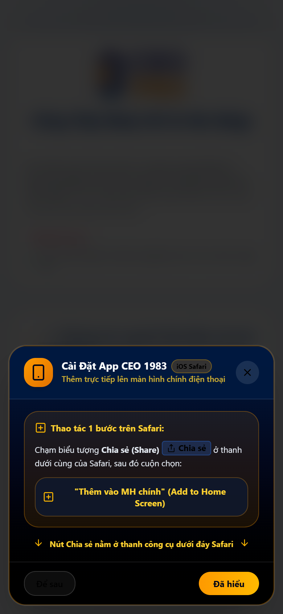

### 3. Thao tác thực hiện trên từng dòng máy
- **Đối với thiết bị iOS (iPhone / iPad)**:
  1. Mở trình duyệt **Safari** và truy cập: `https://ceo1983.viconnect.vn`
  2. Bấm vào biểu tượng **Chia sẻ (Share)** (hình ô vuông có mũi tên chỉ lên ở thanh công cụ dưới đáy Safari).
  3. Cuộn menu xuống và chọn dòng **"Thêm vào MH chính" (Add to Home Screen)**.
  4. Xác nhận đặt tên là **CEO 1983** và bấm **Thêm (Add)** ở góc phải trên. Icon CEO 1983 vàng - xanh navy sang trọng sẽ xuất hiện ngay tại màn hình chính điện thoại.
- **Đối với thiết bị Android (Samsung, Xiaomi, Oppo, v.v.)**:
  1. Mở trình duyệt **Google Chrome** và truy cập: `https://ceo1983.viconnect.vn`
  2. Hệ thống sẽ tự động hiển thị thanh thông báo dưới đáy: *"Cài đặt ứng dụng CEO 1983"*.
  3. Nhấn nút **"Cài đặt"** (hoặc mở menu 3 chấm góc phải trên Chrome -> chọn *"Cài đặt ứng dụng"*). Ứng dụng sẽ được tích hợp vào danh sách ứng dụng Android như ứng dụng bản địa.

---

## PHẦN 1: ĐƠN ĐĂNG KÝ GIA NHẬP CLB DOANH NHÂN CEO 1983

### 1. Mục đích chức năng
Dành cho các Doanh nhân, Chủ tịch, Tổng giám đốc thế hệ sinh năm 1983 mong muốn nộp hồ sơ xin kết nạp vào CLB Doanh Nhân CEO 1983 trực thuộc Hiệp Hội Doanh Nghiệp Trẻ Hà Nội. Dữ liệu sau khi nộp sẽ được chuyển thẳng về phân hệ Quản lý Hội viên trên CRM để Ban Thành Viên và Ban Thư Ký tiến hành thẩm định.

- **Đường dẫn truy cập trực tiếp**: `https://ceo1983.viconnect.vn/landing`

### 2. Giao diện thực tế thao tác
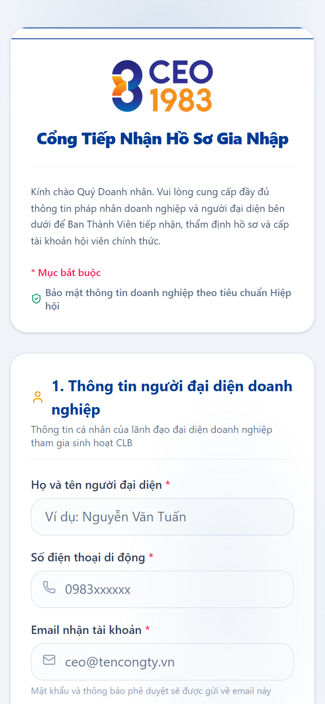

### 3. Mô tả chi tiết từng trường nhập liệu & Mục đích sử dụng

| STT | Tên trường nhập liệu | Bắt buộc | Mô tả & Hướng dẫn nhập | Mục đích trường dữ liệu |
| :---: | :--- | :---: | :--- | :--- |
| **1** | **Họ và tên người đại diện** | **Có (*)** | Nhập đầy đủ họ và tên theo CCCD (Ví dụ: *Nguyễn Văn Tuấn*). | Định danh chính xác hội viên trên hệ thống và in phôi Thẻ hội viên VIP. |
| **2** | **Số điện thoại di động** | **Có (*)** | Nhập số điện thoại chính chủ (Ví dụ: *0983198383*). | Nhận mã OTP, liên hệ thẩm định và tích hợp nút gọi điện trong danh bạ. |
| **3** | **Email nhận tài khoản** | **Có (*)** | Nhập địa chỉ email doanh nghiệp hoặc email thường dùng (Ví dụ: *tuan.nguyen@vione.vn*). | Nhận thư chúc mừng kết nạp, tài khoản đăng nhập và thông báo hội phí. |
| **4** | **Chức vụ trong doanh nghiệp** | **Có (*)** | Chọn từ danh sách: *Chủ tịch HĐQT, Tổng Giám Đốc / CEO, Phó Tổng Giám Đốc, Giám đốc điều hành* hoặc nhập chức vụ khác. | Xác định vị thế lãnh đạo doanh nghiệp đạt tiêu chuẩn hội viên CLB CEO. |
| **5** | **Ngày sinh (Sinh năm 1983)** | **Có (*)** | Nhập ngày tháng năm sinh định dạng `DD/MM/YYYY` (Ví dụ: *19/08/1983*). | Tiêu chí bắt buộc để xác thực điều kiện hội viên tuổi Quý Hợi 1983. |
| **6** | **Tên doanh nghiệp / Công ty** | **Có (*)** | Nhập tên pháp nhân đầy đủ theo ĐKKD (Ví dụ: *Tập Đoàn Công Nghệ & Thương Mại VIONE*). | Hiển thị trong hồ sơ doanh nghiệp B2B và xuất hóa đơn hội phí. |
| **7** | **Ngành nghề hoạt động chính** | **Có (*)** | Chọn ngành nghề: *Thương mại & Bán lẻ, CNTT & Viễn thông, Bất động sản, Sản xuất, F&B, Logistics, v.v.* | Phân bổ hội viên vào đúng Ban chuyên môn và phục vụ thuật toán ghép đôi B2B Matchmaking. |
| **8** | **Địa chỉ trụ sở doanh nghiệp** | Tùy chọn | Nhập địa chỉ văn phòng, trụ sở công ty. | Bản đồ hóa vị trí doanh nghiệp trên mạng lưới giao thương CLB. |
| **9** | **Website / Fanpage** | Tùy chọn | Nhập URL website công ty (Ví dụ: *https://vione.vn*). | Cung cấp liên kết để các hội viên khác tìm hiểu năng lực doanh nghiệp. |
| **10** | **Quy mô nhân sự** | Tùy chọn | Chọn các mức: *Dưới 10 nhân sự, 10 - 50 nhân sự, 50 - 200 nhân sự, Trên 200 nhân sự*. | Phân nhóm quy mô doanh nghiệp để Ban Xúc Tiến Thương Mại xây dựng gói kết nối phù hợp. |
| **11** | **Nhu cầu kết nối & Giao thương** | Tùy chọn | Nhập ngắn gọn các sản phẩm cần tìm đối tác phân phối hoặc nhu cầu hợp tác đầu tư. | Ban Thư Ký chủ động giới thiệu cơ hội ngay sau khi kết nạp. |

### 4. Quy trình thao tác
1. Người dùng cuộn trang điền đầy đủ các thông tin bắt buộc có dấu sao đỏ `*`.
2. Kiểm tra lại tính chính xác của Số điện thoại và Email.
3. Nhấn nút **"Gửi Hồ Sơ Gia Nhập CLB"**.
4. Màn hình thông báo tiếp nhận hồ sơ thành công xuất hiện. Ban Thành Viên sẽ liên hệ thẩm định trong vòng 24 - 48 giờ làm việc.

---

## PHẦN 2: ĐĂNG NHẬP ỨNG DỤNG & THIẾT LẬP AN TOÀN

### 1. Mục đích chức năng
Cổng xác thực định danh dành cho Hội viên chính thức đã được Ban Điều Hành phê duyệt. Sau khi đăng nhập, hệ thống sẽ cấp quyền truy cập toàn bộ tài nguyên số của CLB.

- **Đường dẫn truy cập**: `https://ceo1983.viconnect.vn/association/login`

### 2. Giao diện thực tế thao tác
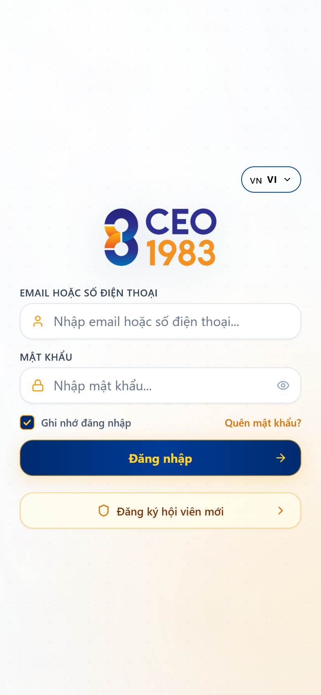

### 3. Hướng dẫn thao tác đăng nhập
1. **Trường "Email hoặc số điện thoại"**:
   - Nhập Email đã đăng ký với hiệp hội (Ví dụ: `admin@connect.vn` hoặc email cá nhân được cấp).
   - Có thể nhập số điện thoại đã kích hoạt tài khoản.
2. **Trường "Mật khẩu"**:
   - Nhập mật khẩu bảo mật (Mật khẩu mặc định khởi tạo hoặc mật khẩu do bạn đổi).
   - Nhấn icon **Mắt** bên phải để xem lại mật khẩu tránh gõ sai ký tự.
3. **Tùy chọn "Ghi nhớ đăng nhập"**: Tích chọn để lưu phiên làm việc, không cần đăng nhập lại ở các lần mở app sau.
4. **Quên mật khẩu**: Nhấn vào dòng chữ *"Quên mật khẩu?"* bên dưới nút đăng nhập, hệ thống sẽ gửi liên kết khôi phục mật khẩu vào email của bạn.
5. Nhấn nút **"Đăng nhập"** màu xanh Navy. Hệ thống sẽ tự động kiểm tra quyền hạn và chuyển hướng tới Trang Chủ Hội Viên.

---

## PHẦN 3: BẢNG ĐIỀU KHIỂN TRANG CHỦ HỘI VIÊN (HOME DASHBOARD)

### 1. Mục đích chức năng
Trang chủ là trung tâm điều hướng của ứng dụng, tổng hợp thông tin quan trọng nhất giúp hội viên nắm bắt lịch sự kiện, đặc quyền và truy cập nhanh mọi chức năng chỉ bằng 1 cú chạm.

- **Đường dẫn**: `https://ceo1983.viconnect.vn/association`

### 2. Giao diện thực tế thao tác
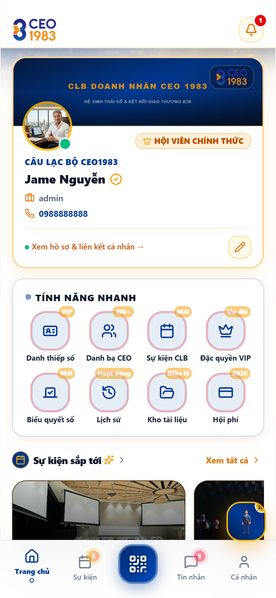

### 3. Cấu trúc các khối chức năng trên màn hình Trang Chủ

#### 3.1. Thanh Tiêu Đề (Header Bar)
- **Logo CEO 1983**: Nhận diện thương hiệu CLB Doanh Nhân 1983.
- **Chuông Thông Báo (Notification Icon)**: Có badge đỏ đếm số thông báo mới chưa đọc (nhắc nợ hội phí, phê duyệt hồ sơ, lời mời tham gia cuộc họp, tin tức mới).

#### 3.2. Khối Thẻ Hội Viên VIP Điện Tử Thu Nhỏ (Member Header Card)
- **Ảnh đại diện Avatar**: Ảnh chân dung đại diện của doanh nhân có viền trạng thái hoạt động online màu xanh.
- **Tên doanh nhân & Huy hiệu**: Hiển thị họ tên (Ví dụ: *Jame Nguyễn*), tích xanh chính chủ và huy hiệu vàng `👑 HỘI VIÊN CHÍNH THỨC`.
- **Chức vụ & Số điện thoại**: Hiển thị vai trò trong CLB và hotline liên hệ.
- **Xem hồ sơ & Liên kết cá nhân ->**: Chạm vào để xem chi tiết danh thiếp điện tử hoặc bấm biểu tượng bút chì để chỉnh sửa hồ sơ.

#### 3.3. Lưới Phím Tắt Tiện Ích Nhanh (Quick Actions Grid)
Gồm 8 phím tắt cốt lõi được gắn huy hiệu trạng thái nổi bật:
1. **Danh thiếp số (VIP)**: Mở Thẻ hội viên VIP điện tử và mã QR kết nối.
2. **Danh bạ CEO (100+)**: Mở danh bạ tra cứu toàn thể lãnh đạo, doanh nhân trong CLB.
3. **Sự kiện CLB (Mới)**: Xem lịch các hội nghị, Gala và chương trình đào tạo sắp diễn ra.
4. **Đặc quyền VIP (Ưu đãi)**: Tra cứu các ưu đãi chiết khấu nội bộ giữa các doanh nghiệp 1983.
5. **Biểu quyết số (Mới)**: Tham gia các phiên bỏ phiếu, bình chọn nghị quyết trực tuyến.
6. **Lịch sử (Hoạt động)**: Xem lại dòng thời gian các hoạt động hội viên đã tham gia.
7. **Kho tài liệu (Điều lệ)**: Tải về các văn bản quy chế, điều lệ hoạt động của CLB.
8. **Hội phí (2026)**: Xem hạn mức niên liễm và thực hiện thanh toán qua VietQR.

#### 3.4. Khối Sự Kiện Sắp Tới (Upcoming Events Carousel)
Hiển thị hình ảnh thực tế của khán phòng tổ chức sự kiện, tên sự kiện, thời gian đếm ngược và nút **"Xem tất cả >"** để mở toàn bộ danh sách sự kiện.

#### 3.5. Thanh Điều Hướng Đáy (Bottom Navigation Bar)
Cố định ở đáy màn hình với 5 nút điều hướng chính:
- **Trang chủ**: Về màn hình chính.
- **Sự kiện**: Xem lịch sự kiện (kèm badge thông báo số sự kiện mới).
- **Phím Quét QR (Trung tâm nổi bật)**: Mở camera quét mã QR danh thiếp đối tác hoặc mã QR tại cổng sự kiện để check-in tức thì.
- **Tin nhắn**: Mở hộp thư trò chuyện 1-on-1 với các hội viên khác.
- **Cá nhân**: Mở trang cài đặt tài khoản và hồ sơ doanh nghiệp.

---

## PHẦN 4: THẺ HỘI VIÊN VIP ĐIỆN TỬ & MÃ QR ĐỊNH DANH ĐỘNG

### 1. Mục đích chức năng
Thay thế hoàn toàn thẻ nhựa truyền thống bằng Thẻ Hội Viên VIP Điện Tử công nghệ cao. Thẻ tích hợp mã QR cá nhân hóa động, giúp kết nối danh bạ 1 chạm, chống giả mạo danh tính và khẳng định đẳng cấp lãnh đạo CLB Doanh Nhân CEO 1983.

- **Đường dẫn**: `https://ceo1983.viconnect.vn/association/card`

### 2. Giao diện thực tế thao tác
| Mặt trước Thẻ VIP | Mặt sau Thẻ VIP & Mã QR |
| :---: | :---: |
| 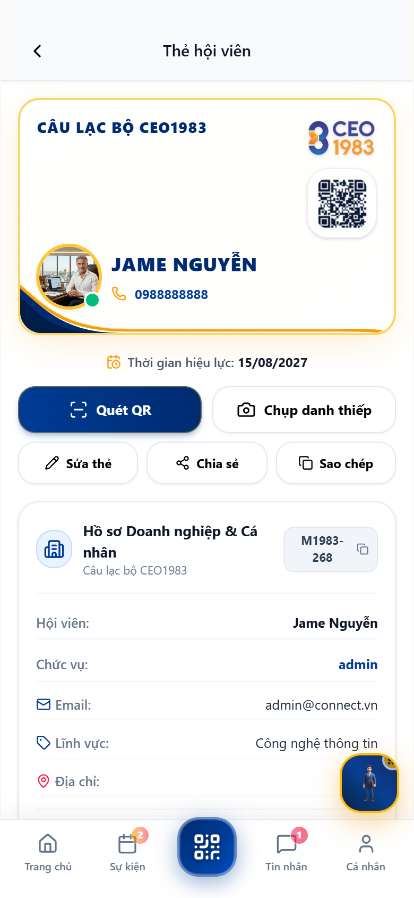 | 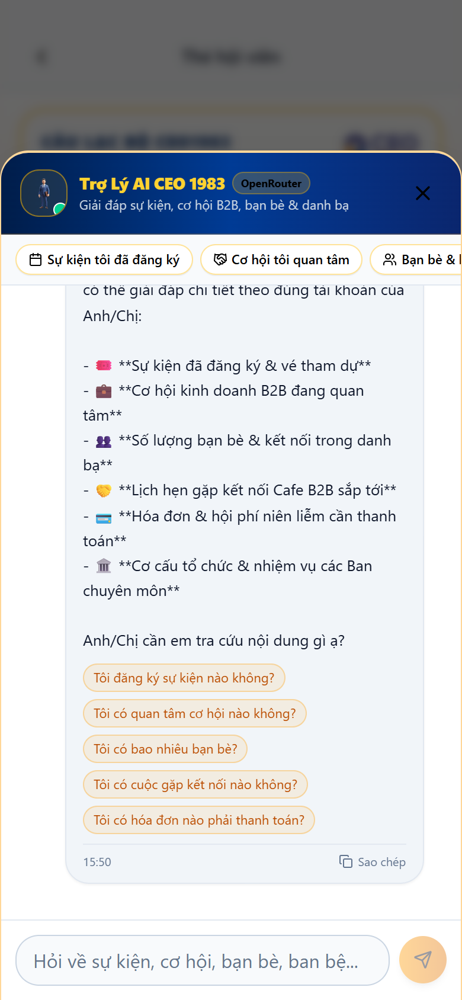 |

### 3. Thao tác sử dụng thẻ
1. **Lật mặt thẻ**: Chạm nhẹ vào bất kỳ vị trí nào trên thẻ điện tử để thực hiện hiệu ứng lật 3D 360 độ chuyển đổi mượt mà giữa mặt trước và mặt sau.
2. **Xem thông tin mặt trước**:
   - Logo HanoiBA & CLB Doanh Nhân CEO 1983.
   - Ảnh đại diện, Họ tên, Mã số hội viên duy nhất (Ví dụ: `M1983-001`).
   - Tên Doanh nghiệp & Ban chuyên môn trực thuộc (Ví dụ: *Ban Điều Hành*, *Ban Xúc Tiến Thương Mại*).
   - Thời hạn hiệu lực của thẻ (Ví dụ: *Valid Thru: 10/2027*).
3. **Mặt sau thẻ & Quét mã QR kết nối**:
   - Chứa mã QR động mã hóa thông tin liên hệ của doanh nhân.
   - Đối tác chỉ cần mở Camera điện thoại thông thường hoặc Zalo quét mã QR này -> Trang danh thiếp điện tử công khai sẽ lập tức mở ra mà đối tác không cần cài đặt bất kỳ ứng dụng nào.
4. **Nút "Lưu Danh Bạ Điện Thoại (.vcf)"**: Khi đối tác bấm nút này, toàn bộ Họ tên, Số điện thoại, Email, Chức vụ và Tên công ty của bạn sẽ được tự động lưu vào danh bạ điện thoại của họ trong 1 giây.

---

## PHẦN 5: TRA CỨU DANH BẠ DOANH NHÂN & KẾT NỐI GIAO THƯƠNG 1-ON-1

### 1. Mục đích chức năng
Cung cấp danh bạ số hóa toàn bộ hội viên của CLB CEO 1983. Cho phép tra cứu nhanh lãnh đạo doanh nghiệp theo ngành nghề, lĩnh vực kinh doanh, ban chuyên môn; từ đó hỗ trợ gửi lời mời hẹn gặp giao thương 1-on-1 hoặc gọi điện thoại/video nội bộ bảo mật.

- **Đường dẫn**: `https://ceo1983.viconnect.vn/association/members`

### 2. Giao diện thực tế thao tác
| Danh bạ Hội viên theo Ban | Chi tiết Hồ sơ Doanh nhân |
| :---: | :---: |
| 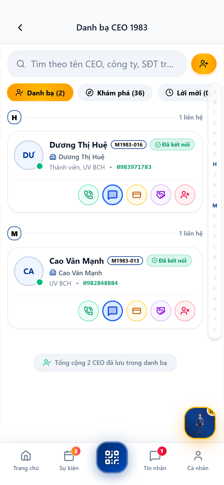 | 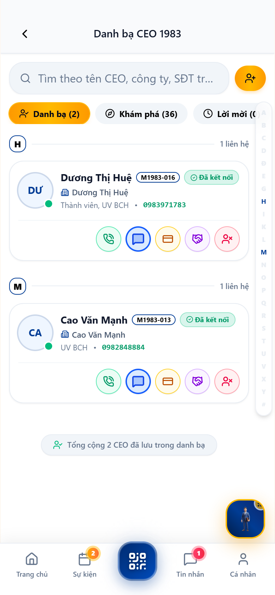 |

### 3. Thao tác tra cứu & Kết nối
1. **Ô Tìm kiếm thông minh**: Gõ tên doanh nhân, mã số hội viên, tên công ty hoặc ngành nghề kinh doanh để lọc kết quả tức thời.
2. **Bộ lọc theo Ban chuyên môn**: Bấm chọn các tab ngang để lọc hội viên trực thuộc từng ban:
   - *Tất cả*, *Ban Điều Hành*, *Ban Thành Viên*, *Ban Truyền Thông*, *Ban Xúc Tiến Thương Mại*, *Ban Tài Chính*, *Ban Thiện Nguyện*, *Ban Thư Ký*.
3. **Thao tác nhanh trên từng thẻ hội viên**:
   - Bấm icon **Điện thoại**: Gọi trực tiếp tới số di động của hội viên.
   - Bấm icon **Tin nhắn**: Mở hộp thoại chat 1-on-1 trực tiếp.
4. **Xem Chi tiết hồ sơ doanh nhân**:
   - Chạm vào thẻ hội viên để mở hồ sơ chi tiết.
   - Đọc tiểu sử doanh nhân, sứ mệnh công ty, sản phẩm dịch vụ chủ lực, địa chỉ nhà máy/văn phòng.
   - Bấm nút **"Đặt lịch hẹn 1-on-1"**: Chọn thời gian rảnh và địa điểm (trực tiếp tại văn phòng UniWork Hub hoặc online qua Zoom) để gửi lời mời làm việc tới doanh nhân đó.

---

## PHẦN 6: THAM GIA SỰ KIỆN, ĐĂNG KÝ VÉ & CHỌN BÀN TIỆC GALA

### 1. Mục đích chức năng
Giúp hội viên cập nhật toàn bộ các chương trình Dạ tiệc Gala, Diễn đàn kinh tế, Workshop đào tạo và Hội nghị giao thương B2B của CLB. Hỗ trợ đăng ký vé tham dự trực tuyến, lựa chọn vị trí bàn tiệc Gala và nhận mã số quay thưởng Lucky Draw may mắn.

- **Đường dẫn**: `https://ceo1983.viconnect.vn/association/events`

### 2. Giao diện thực tế thao tác
| Danh sách Sự kiện CLB | Chi tiết Sự kiện & Đăng ký |
| :---: | :---: |
| 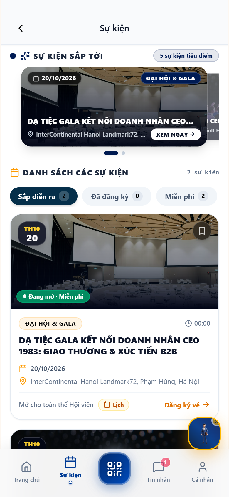 | 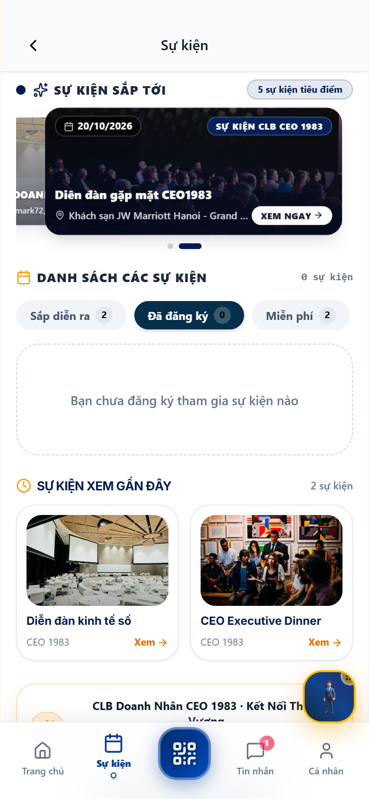 |

### 3. Hướng dẫn các bước đăng ký vé tham dự sự kiện
1. Tại danh sách sự kiện, bấm vào sự kiện bạn muốn tham dự (Ví dụ: *DẠ TIỆC GALA KẾT NỐI DOANH NHÂN CEO 1983*).
2. Đọc kỹ thông tin chương trình: Thời gian tổ chức, Địa điểm (Ví dụ: *Khách sạn InterContinental Hanoi Landmark72*), Số chỗ còn trống và danh sách các Nhà tài trợ đồng hành.
3. Bấm nút **"Đăng ký tham dự"** để mở form đăng ký:
   - **Họ và tên**: Hệ thống tự động điền theo tài khoản của bạn.
   - **Số điện thoại**: Tự động điền.
   - **Tên công ty**: Tự động điền.
   - **Chọn Bàn tiệc Gala**: Chọn số bàn mong muốn (Bàn VIP 1, Bàn Ban Điều Hành, Bàn Giao thương B2B ngành Xây dựng, CNTT, v.v.).
4. Nhấn **"Xác nhận đăng ký vé"**:
   - Nếu là sự kiện miễn phí: Hệ thống lập tức sinh **Mã vé điện tử E-Ticket** và **Mã số bốc thăm trúng thưởng Lucky Number** (Ví dụ: `#198383`).
   - Nếu là sự kiện có thu phí: Màn hình hiển thị mã VietQR động để quét chuyển khoản thanh toán, vé sẽ được kích hoạt ngay khi chuyển khoản thành công.

---

## PHẦN 7: VÍ VÉ ĐIỆN TỬ E-TICKET & SOÁT VÉ CHECK-IN QR

### 1. Mục đích chức năng
Dành cho đại biểu khi đến tham dự sự kiện xuất trình vé điện tử để vào cửa; đồng thời hỗ trợ Ban Tổ Chức / Ban Lễ Tân chuyển sang chế độ quét soát vé (QR Gatekeeper) để điểm danh đại biểu chỉ trong 1 giây.

- **Đường dẫn**: `https://ceo1983.viconnect.vn/association/checkin`

### 2. Giao diện thực tế thao tác
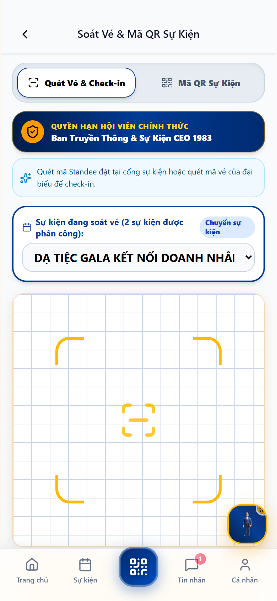

### 3. Hướng dẫn thao tác theo vai trò
- **Đối với Hội viên / Đại biểu tham dự sự kiện**:
  1. Chuyển sang tab **"Mã QR Sự Kiện"**.
  2. Màn hình hiển thị vé điện tử gồm: Mã QR check-in cá nhân hóa, Tên sự kiện, Họ tên đại biểu, Số bàn tiệc được bố trí và Mã quay số trúng thưởng Lucky Draw.
  3. Xuất trình màn hình vé này cho nhân viên lễ tân tại bàn đón tiếp.
- **Đối với Cán bộ Ban Tổ Chức (Ban Lễ Tân / Ban Thư Ký)**:
  1. Chuyển sang tab **"Quét Vé & Check-in"**.
  2. Chọn sự kiện được phân công soát vé từ dropdown (Ví dụ: *Dạ tiệc Gala Kết nối Doanh nhân*).
  3. Hướng camera vào mã QR trên vé của đại biểu hoặc mã QR trên thư mời điện tử.
  4. Hệ thống phát âm thanh *"Bíp"* thông báo check-in thành công, hiển thị tên đại biểu kèm số bàn tiệc và tự động cập nhật trạng thái điểm danh lên CRM tổng.

---

## PHẦN 8: SÀN GIAO THƯƠNG SẢN PHẨM HỘI VIÊN B2B

### 1. Mục đích chức năng
Không gian trưng bày và giao thương sản phẩm, dịch vụ B2B độc quyền giữa các doanh nghiệp thuộc CLB CEO 1983. Thúc đẩy phương châm *"Người 1983 ưu tiên dùng hàng của người 1983"*.

- **Đường dẫn**: `https://ceo1983.viconnect.vn/association/products`

### 2. Giao diện thực tế thao tác
| Sàn Giao Thương B2B | Modal Đăng Sản Phẩm Mới |
| :---: | :---: |
| 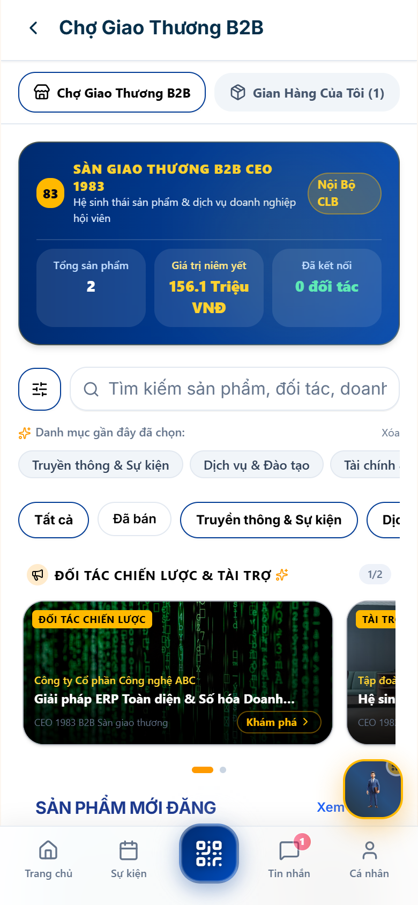 |  |

### 3. Hướng dẫn mua hàng & Đăng tải sản phẩm mới
- **Thao tác tìm kiếm & Mua hàng ưu đãi**:
  1. Duyệt danh mục sản phẩm theo ngành: *Công nghệ, Quà tặng doanh nghiệp, Xây dựng, Dịch vụ tài chính, F&B, v.v.*
  2. Xem giá niêm yết công khai và **Mức chiết khấu đặc quyền dành riêng cho hội viên 1983** (thường từ 10% - 30%).
  3. Bấm **"Yêu cầu báo giá B2B"** hoặc **"Liên hệ ngay"** để kết nối trực tiếp với chủ doanh nghiệp cung cấp.
- **Thao tác Đăng sản phẩm mới (Dành cho doanh nghiệp hội viên)**:
  1. Bấm nút **"+ Đăng sản phẩm mới"**.
  2. Nhập các trường thông tin:
     - **Tên sản phẩm / Dịch vụ**: Tên thương mại chính xác.
     - **Ngành hàng**: Chọn danh mục phù hợp.
     - **Ảnh sản phẩm**: Tải từ thư viện ảnh điện thoại (tối đa 5 ảnh sắc nét).
     - **Giá niêm yết (VND)** và **% Chiết khấu ưu đãi cho hội viên CLB**.
     - **Mô tả chi tiết năng lực & Tiêu chuẩn chất lượng**.
     - **Hotline & Người phụ trách kinh doanh**.
  3. Bấm **"Gửi duyệt sản phẩm"**. Ban Xúc Tiến Thương Mại sẽ kiểm duyệt thông tin và cho hiển thị lên sàn trong vòng 24 giờ.

---

## PHẦN 9: SÀN CƠ HỘI KINH DOANH & KÊU GỌI HỢP TÁC ĐẦU TƯ

### 1. Mục đích chức năng
Kênh đăng tải các nhu cầu thực tế: Chào mua số lượng lớn, Tìm nhà phân phối độc quyền, Kêu gọi vốn đầu tư dự án, Tìm kiếm mặt bằng hoặc Chuyển nhượng dự án.

- **Đường dẫn**: `https://ceo1983.viconnect.vn/association/opportunities`

### 2. Giao diện thực tế thao tác
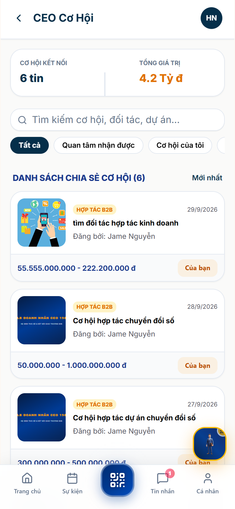

### 3. Quy trình tương tác cơ hội giao thương
1. **Duyệt bảng tin cơ hội**: Xem các tin đăng được gắn nhãn phân loại rõ ràng:
   - 🟢 `CHÀO MUA`: Doanh nghiệp đang cần tìm nguồn cung cấp nguyên vật liệu, dịch vụ.
   - 🔵 `CHÀO BÁN`: Doanh nghiệp cung cấp giải pháp, năng lực sản xuất lớn.
   - 🟠 `HỢP TÁC ĐẦU TƯ`: Dự án liên doanh, mở rộng chuỗi, nhượng quyền thương hiệu.
2. **Xem chi tiết cơ hội**: Đọc yêu cầu kỹ thuật, ngân sách dự kiến, thời hạn chót nộp hồ sơ hợp tác.
3. **Gửi đề xuất hợp tác**: Bấm nút **"Gửi đề xuất kết nối"**, điền ngắn gọn phương án của doanh nghiệp bạn. Thông tin sẽ được chuyển thẳng tới số điện thoại và email của người đăng tin.

---

## PHẦN 10: BÌNH CHỌN & BIỂU QUYẾT TRỰC TIẾP THỜI GIAN THỰC

### 1. Mục đích chức năng
Phục vụ công tác dân chủ trong CLB: Bỏ phiếu thông qua các Nghị quyết của Đại hội, Bầu cử Ban Chấp Hành nhiệm kỳ mới hoặc Bình chọn các danh hiệu Doanh nhân tiêu biểu của năm.

- **Đường dẫn**: `https://ceo1983.viconnect.vn/association/voting`

### 2. Giao diện thực tế thao tác
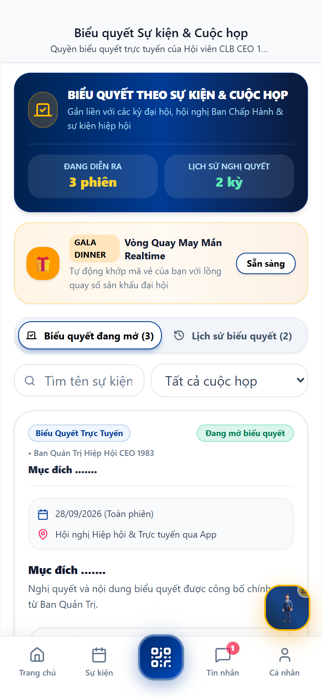

### 3. Hướng dẫn tham gia biểu quyết
1. Khi có phiên biểu quyết đang mở, ứng dụng sẽ gửi thông báo đẩy đến điện thoại của hội viên.
2. Hội viên vào tab **Biểu quyết**, chọn phiên bỏ phiếu đang diễn ra.
3. Đọc kỹ nội dung tờ trình, nghị quyết hoặc danh sách ứng viên.
4. Chọn phương án biểu quyết:
   - 🟢 **Tán thành (Đồng ý)**
   - 🔴 **Không tán thành**
   - ⚪ **Ý kiến khác / Phiếu trắng**
5. Bấm nút **"Xác nhận gửi phiếu bầu"**.
6. Hệ thống hiển thị biểu đồ tỷ lệ % kết quả kiểm phiếu trực tiếp thời gian thực, đảm bảo nguyên tắc minh bạch, mỗi hội viên chỉ được bỏ 1 phiếu duy nhất.

---

## PHẦN 11: BẢN TIN HOẠT ĐỘNG HIỆP HỘI & THƯ VIỆN ĐIỀU LỆ

### 1. Mục đích chức năng
Cập nhật những tin tức nóng hổi nhất về hoạt động của HanoiBA và CLB CEO 1983: Lễ kỷ niệm thành lập, các chuyến caravan xúc tiến thương mại, hoạt động thiện nguyện vì cộng đồng, giải golf giao lưu và văn bản điều lệ chính thức.

- **Đường dẫn**: `https://ceo1983.viconnect.vn/association/news`

### 2. Giao diện thực tế thao tác
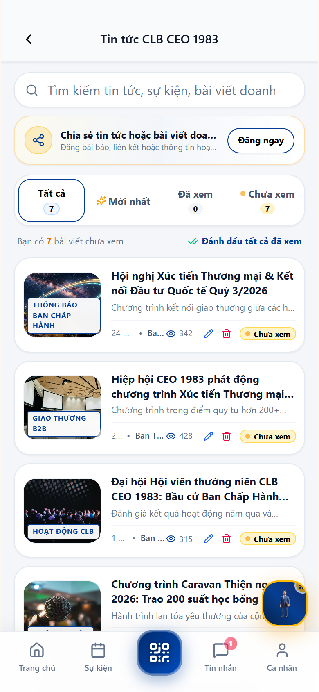

### 3. Thao tác xem tin tức & Tải văn kiện
1. Lướt xem danh sách các bài viết với hình ảnh trực quan và ngày đăng bài.
2. Chạm vào bài viết để đọc bài viết đầy đủ, xem album ảnh hoạt động chất lượng cao.
3. Chia sẻ bài viết sang Zalo, Facebook hoặc sao chép liên kết nhanh để lan tỏa hình ảnh CLB.
4. Vào mục **"Kho tài liệu"**: Tải về các file quy chế hoạt động, mẫu đơn đề nghị hỗ trợ và điều lệ hiệp hội định dạng PDF/Word.

---

## PHẦN 12: TRA CỨU & GIA HẠN HỘI PHÍ QUA CỔNG VIETQR NAPAS 24/7

### 1. Mục đích chức năng
Giúp hội viên chủ động tra cứu thời hạn thẻ hội viên của mình và thực hiện nộp hội phí niên liễm thường niên thông qua mã thanh toán VietQR chuẩn Napas 24/7. Hệ thống tự động gạch nợ và gia hạn thời hạn thẻ ngay sau khi tiền vào tài khoản.

- **Đường dẫn**: `https://ceo1983.viconnect.vn/association/renew`

### 2. Giao diện thực tế thao tác
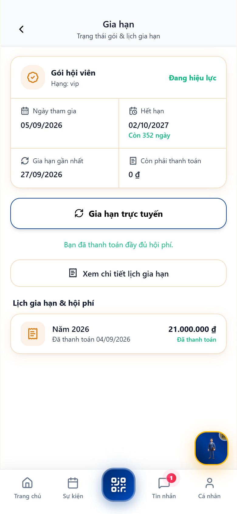

### 3. Các trường thông tin & Hướng dẫn thanh toán

| Thông số hiển thị | Ý nghĩa chi tiết |
| :--- | :--- |
| **Gói hội viên** | Hạng hội viên chính thức (Ví dụ: `Hạng VIP`). |
| **Trạng thái thẻ** | `Đang hiệu lực` hoặc `Sắp hết hạn` hoặc `Đã hết hạn`. |
| **Ngày tham gia** | Ngày chính thức được kết nạp vào CLB. |
| **Hạn sử dụng thẻ** | Ngày hết hạn kỳ hội phí hiện tại (kèm số ngày còn lại, ví dụ: *Còn 352 ngày*). |
| **Số tiền còn phải thanh toán** | Thể hiện `0 đ` nếu đã hoàn tất niên liễm năm nay; hoặc số tiền cần đóng (Ví dụ: `21.000.000 đ`). |
| **Lịch sử gia hạn** | Bảng kê chi tiết các năm đã đóng phí kèm ngày giờ giao dịch chuẩn xác. |

#### Quy trình thanh toán tự động qua VietQR:
1. Bấm nút **"Gia hạn trực tuyến"**.
2. Hệ thống tự động sinh một mã **VietQR động** chứa:
   - Ngân hàng thụ hưởng của CLB (Ví dụ: *Ngân hàng TMCP Quân Đội - MBBank*).
   - Số tài khoản và Tên chủ tài khoản: `CLB DOANH NHAN CEO 1983`.
   - Số tiền hội phí chính xác.
   - Nội dung chuyển khoản chuẩn hóa chứa mã hội viên: `CEO1983 M1983001 HOIPHI2026`.
3. Hội viên mở ứng dụng ngân hàng bất kỳ (Vietcombank, MB, Techcombank, BIDV, v.v.), quét mã VietQR trên màn hình.
4. Tiền được chuyển đi và trong vòng **3 - 5 giây**, hệ thống tự động gạch nợ, gia hạn thêm 1 năm và gửi hóa đơn điện tử về email của hội viên.

---

## PHẦN 13: QUẢN LÝ HỒ SƠ DOANH NGHIỆP & CÀI ĐẶT TÀI KHOẢN

### 1. Mục đích chức năng
Cho phép hội viên quản lý thông tin tài khoản cá nhân, cập nhật sự thay đổi về ngành nghề, địa chỉ văn phòng công ty, đổi mật khẩu và đăng xuất khỏi các thiết bị khác.

- **Đường dẫn**: `https://ceo1983.viconnect.vn/association/profile`

### 2. Giao diện thực tế thao tác
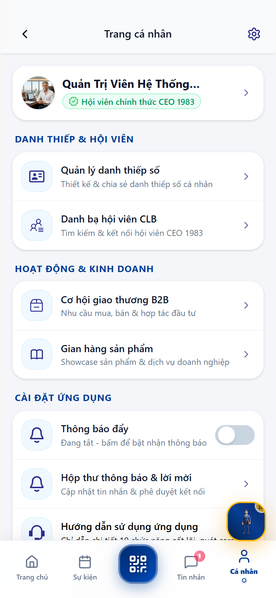

### 3. Các chức năng chi tiết trong màn hình cá nhân
1. **Chỉnh sửa thông tin cá nhân**:
   - Thay đổi ảnh đại diện Avatar sắc nét.
   - Cập nhật số điện thoại liên hệ, email nhận thông báo.
2. **Cập nhật Hồ sơ Doanh nghiệp**:
   - Thay đổi tên công ty, bổ sung sản phẩm mới, cập nhật website hoặc fanpage.
3. **Bảo mật & Mật khẩu**:
   - Nhập mật khẩu hiện tại, nhập mật khẩu mới và xác nhận để đổi mật khẩu định kỳ.
   - Quản lý các phiên đăng nhập trên các thiết bị khác nhau.
4. **Cài đặt thông báo**: Bật/tắt thông báo đẩy sự kiện, thông báo sinh nhật hội viên, thông báo nhắc hạn hội phí.
5. **Đăng xuất**: Đăng xuất an toàn khỏi ứng dụng khi cần đổi máy.

---
*Tài liệu được phát hành và quản lý bởi Ban Thư Ký & Ban Công Nghệ Thông Tin CLB Doanh Nhân CEO 1983.*
