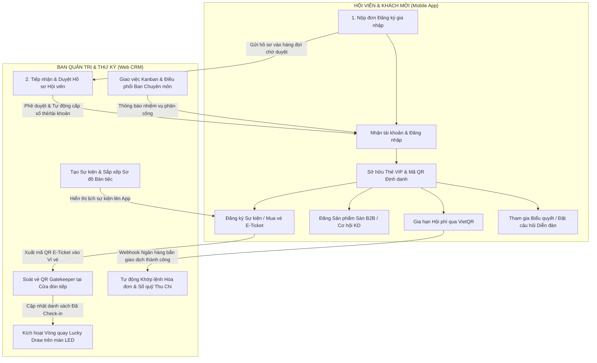
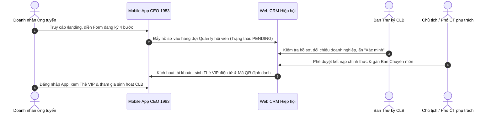
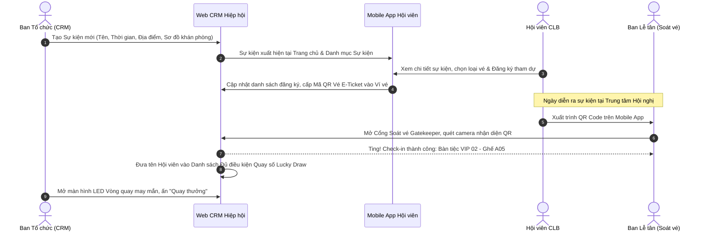
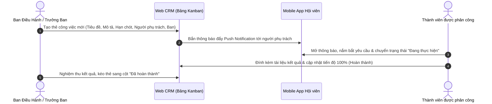
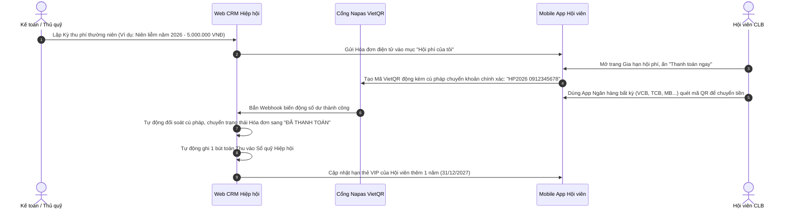

# HƯỚNG DẪN SỬ DỤNG TỔNG THỂ HỆ THỐNG (MASTER SYSTEM GUIDE)
## HỆ SINH THÁI SỐ CLB DOANH NHÂN CEO 1983 - HANOIBA
*Phiên bản: 4.0 - Năm cập nhật: 2026*  
*Mã tài liệu: CEO1983-DOC-MASTER-2026*

---

## MỤC LỤC TỔNG THỂ
1. [GIỚI THIỆU HỆ SINH THÁI SỐ CEO 1983](#1-giới-thiệu-hệ-sinh-thái-số-ceo-1983)
2. [CẤU TRÚC HAI NỀN TẢNG VÀ MÔ HÌNH LUỒNG DỮ LIỆU](#2-cấu-trúc-hai-nền-tảng-và-mô-hình-luồng-dữ-liệu)
3. [MA TRẬN PHÂN QUYỀN VÀ VAI TRÒ NGƯỜI DÙNG (RBAC MATRIX)](#3-ma-trận-phân-quyền-và-vai-trò-người-dùng-rbac-matrix)
4. [CÁC QUY TRÌNH NGHIỆP VỤ MẪU XUYÊN SUỐT (END-TO-END WORKFLOWS)](#4-các-quy-trình-nghiệp-vụ-mẫu-xuyên-suốt-end-to-end-workflows)
   - [4.1. Quy trình Gia nhập & Cấp phát Thẻ Hội viên VIP](#41-quy-trình-gia-nhập--cấp-phát-thẻ-hội-viên-vip)
   - [4.2. Quy trình Vận hành Vòng đời Sự kiện Toàn diện](#42-quy-trình-vận-hành-vòng-đời-sự-kiện-toàn-diện)
   - [4.3. Quy trình Giao việc & Điều phối Nhiệm vụ Ban Chuyên môn](#43-quy-trình-giao-việc--điều-phối-nhiệm-vụ-ban-chuyên-môn)
   - [4.4. Quy trình Thu nợ & Gia hạn Hội phí Niên liễm Tự động VietQR](#44-quy-trình-thu-nợ--gia-hạn-hội-phí-niên-liễm-tự-động-vietqr)
5. [CẨM NANG CHI TIẾT TỪNG PHÂN HỆ](#5-cẩm-nang-chi-tiết-từng-phân-hệ)
6. [HƯỚNG DẪN XỬ LÝ SỰ CỐ & HỖ TRỢ KỸ THUẬT (TROUBLESHOOTING)](#6-hướng-dẫn-xử-lý-sự-cố--hỗ-trợ-kỹ-thuật-troubleshooting)

---

## 1. GIỚI THIỆU HỆ SINH THÁI SỐ CEO 1983

Hệ sinh thái số **CLB Doanh nhân CEO 1983** (thuộc Hội Doanh nghiệp trẻ Hà Nội - HanoiBA) là nền tảng công nghệ toàn diện được thiết kế chuyên biệt cho thế hệ doanh nhân sinh năm 1983 (Quý Hợi). Nền tảng giải quyết triệt để bài toán:
- **Số hóa danh bạ & kết nối giao thương 1-on-1**: Thay thế hoàn toàn danh bạ giấy, card visit truyền thống bằng Thẻ Hội viên VIP điện tử tích hợp công nghệ QR Code động.
- **Tự động hóa vận hành Hiệp hội**: Khép kín từ khâu xét duyệt hồ sơ, thu niên liễm qua VietQR Napas 24/7, giao việc liên ban chuyên môn dạng Kanban đến biểu quyết trực tuyến bảo mật.
- **Tổ chức sự kiện & đại hội quy mô lớn**: Hỗ trợ thiết lập sơ đồ khán phòng bàn tiệc, phát hành vé điện tử mã hóa, cổng soát vé Gatekeeper QR siêu tốc và vòng quay may mắn Lucky Draw sân khấu.

---

## 2. CẤU TRÚC HAI NỀN TẢNG VÀ MÔ HÌNH LUỒNG DỮ LIỆU

Hệ thống được thiết kế theo kiến trúc đồng bộ thời gian thực 2 chiều giữa 2 cổng thông tin:

| Nền tảng | Địa chỉ truy cập | Đối tượng sử dụng chính | Công nghệ nền tảng |
| :--- | :--- | :--- | :--- |
| **Cổng Quản trị Hiệp hội (CRM)** | `https://crm.ceo1983.viconnect.vn` | Ban Thư ký, Ban Điều hành, Trưởng các Ban, Kế toán, Super Admin | React/Vite SPA, Tailwind/Vanilla CSS, Hệ thống phân quyền RBAC |
| **Ứng dụng Di động Hội viên (App)** | `https://ceo1983.viconnect.vn` | Toàn thể Hội viên CLB, Khách mời, Doanh nhân ứng tuyển | Progressive Web App (PWA) / Capacitor Mobile, Hỗ trợ Offline-first |

### Sơ đồ Luồng Dữ liệu Liên thông (End-to-End Data Flow)

---

## 3. MA TRẬN PHÂN QUYỀN VÀ VAI TRÒ NGƯỜI DÙNG (RBAC MATRIX)

Hệ thống triển khai mô hình phân quyền chuẩn doanh nghiệp Role-Based Access Control (RBAC) với 5 nhóm quyền hạn chính:

| Chức năng / Module | Hội viên / Khách (App) | Trưởng Ban Chuyên Môn | Ban Thư Ký CLB | Kế toán / Thủ Quỹ | Chủ tịch / Ban Điều Hành | Super Admin |
| :--- | :---: | :---: | :---: | :---: | :---: | :---: |
| **Đăng nhập App & Xem Danh bạ** | Có | Có | Có | Có | Có | Có |
| **Sở hữu Thẻ VIP & Chia sẻ vCard** | Có | Có | Có | Có | Có | Có |
| **Đăng ký Sự kiện & Nhận vé QR** | Có | Có | Có | Có | Có | Có |
| **Đăng tin B2B / Cơ hội kết nối** | Có | Có | Có | Có | Có | Có |
| **Truy cập Cổng Quản trị CRM** | Không | Có (giới hạn) | Có | Có | Có | Toàn quyền |
| **Phê duyệt Hồ sơ Hội viên mới** | Không | Xem xét ban | Có | Không | Có | Toàn quyền |
| **Khởi tạo & Quản trị Sự kiện** | Không | Sự kiện ban | Có | Không | Có | Toàn quyền |
| **Soát vé Gatekeeper QR** | Không | Có | Có | Không | Có | Toàn quyền |
| **Điều hành Vòng quay Lucky Draw** | Không | Không | Có | Không | Có | Toàn quyền |
| **Giao việc & Quản lý Thẻ Kanban** | Không | Phân việc trong ban | Có | Không | Có | Toàn quyền |
| **Quản lý Sổ quỹ Thu - Chi** | Không | Xem báo cáo | Xem | Có | Phê duyệt chi | Toàn quyền |
| **Quản lý Hóa đơn & Thu Niên liễm**| Xem hóa đơn của mình | Không | Có | Có | Có | Toàn quyền |
| **Thiết lập Cấu hình & Ngân hàng VietQR**| Không | Không | Không | Không | Có | Toàn quyền |
| **Quản lý Tài khoản & Phân quyền RBAC** | Không | Không | Không | Không | Không | Toàn quyền |

---

## 4. CÁC QUY TRÌNH NGHIỆP VỤ MẪU XUYÊN SUỐT (END-TO-END WORKFLOWS)

### 4.1. Quy trình Gia nhập & Cấp phát Thẻ Hội viên VIP

**Chi tiết các bước thực hiện:**
1. **Bước 1 (Doanh nhân)**: Truy cập trang đăng ký gia nhập trên ứng dụng di động (`/landing`). Khai báo đầy đủ: Họ tên, Số điện thoại, Email, Tên doanh nghiệp, Mã số thuế, Ngành nghề và Ban chuyên môn mong muốn tham gia.
2. **Bước 2 (Ban Thư ký)**: Truy cập CRM mục **Hội viên** -> Lọc danh sách `Chờ duyệt`. Kiểm tra tính pháp lý của doanh nghiệp (Mã số thuế, website) và ấn `Xác minh sơ bộ`.
3. **Bước 3 (Ban Điều hành)**: Chủ tịch hoặc Phó Chủ tịch phụ trách thẩm định, ấn `Phê duyệt chính thức`. Hệ thống tự động cấp Số hiệu thẻ hội viên (Ví dụ: `VIP-1983-099`).
4. **Bước 4 (Kích hoạt)**: Hệ thống tự động gửi thông báo chào mừng qua Email/SMS. Hội viên đăng nhập trên App di động, thẻ VIP lập tức hiển thị với huy hiệu dập nổi và mã QR định danh cá nhân.

---

### 4.2. Quy trình Vận hành Vòng đời Sự kiện Toàn diện

**Các giai đoạn vận hành then chốt:**
1. **Khởi tạo sự kiện trên CRM**:
   - Khai báo thông số tổ chức (Tên sự kiện, Thời lượng, Đơn vị tổ chức, Hạn đăng ký).
   - Thiết kế sơ đồ khán phòng và bàn tiệc: Đặt tên khu vực (VIP, Khách mời, Hội viên), định mức số ghế/bàn để hệ thống tự động gán vị trí ngồi thông minh.
2. **Hội viên đăng ký trên Mobile App**:
   - Xem thông tin diễn giả, nội dung chương trình (Agenda) và thực đơn bàn tiệc.
   - Ấn `Đăng ký tham gia`. Vé điện tử có mã QR bảo mật lập tức lưu vào ví `Vé của tôi`.
3. **Đón tiếp & Soát vé Check-in siêu tốc**:
   - Đội ngũ lễ tân sử dụng máy tính bảng hoặc laptop truy cập cổng soát vé Gatekeeper trên CRM.
   - Đưa camera quét mã QR của hội viên. Hệ thống tự động hiển thị âm thanh thông báo thành công cùng thông tin chi tiết: Họ tên, Tên công ty, Vị trí bàn tiệc chỉ định.
4. **Quay số trúng thưởng Lucky Draw trên sân khấu**:
   - Kết nối cổng CRM tới màn hình LED sân khấu.
   - Hệ thống tự động lọc ra chỉ những đại biểu **đã thực tế check-in** tại cửa đón tiếp.
   - Nhấn nút quay thưởng: Hiệu ứng âm thanh kịch tính cùng đồ họa quay 3D chọn ra đại biểu may mắn, đảm bảo tính minh bạch 100%.

---

### 4.3. Quy trình Giao việc & Điều phối Nhiệm vụ Ban Chuyên môn

**Quy chuẩn quản lý tiến độ:**
- **Thẻ việc chuẩn hóa**: Mọi nhiệm vụ đều phải có Tiêu đề rõ ràng, Độ ưu tiên (Thấp/Trung bình/Cao/Khẩn cấp), Thời hạn hoàn thành (Deadline) và Người chịu trách nhiệm chính.
- **Trực quan hóa Kanban 4 cột**:
  - `Cần làm (To Do)`: Công việc mới được giao, chờ phân bổ nguồn lực.
  - `Đang làm (In Progress)`: Đang trong quá trình triển khai thực tế.
  - `Đang duyệt (In Review)`: Đã hoàn thành báo cáo, chờ Trưởng ban hoặc Ban Thư ký nghiệm thu.
  - `Hoàn thành (Done)`: Nhiệm vụ đạt yêu cầu và được đóng lại.

---

### 4.4. Quy trình Thu nợ & Gia hạn Hội phí Niên liễm Tự động VietQR

**Ưu điểm vượt trội của quy trình:**
- **Không nhầm lẫn nội dung**: Mã VietQR động tự động điền sẵn chính xác 100% số tiền và nội dung chuyển khoản mã hóa.
- **Tiết kiệm 95% thời gian thủ công**: Kế toán không cần ngồi dò sao kê ngân hàng từng dòng. Hệ thống tự động gạch nợ và gia hạn hạn dùng thẻ ngay trong 3 giây.

---

## 5. CẨM NANG CHI TIẾT TỪNG PHÂN HỆ

Để xem hướng dẫn chi tiết từng màn hình, từng nút bấm và giải thích tường tận từng trường nhập liệu kèm hình ảnh minh họa thực tế 100%, xin vui lòng tra cứu 2 cẩm nang chuyên sâu dưới đây:

### 📱 1. [CẨM NANG HƯỚNG DẪN ỨNG DỤNG DI ĐỘNG HỘI VIÊN (MOBILE APP)](./HDSD_MOBILE_APP_CEO1983.md)
*Dành cho: Toàn thể Hội viên Doanh nhân, Khách mời, Ban Lễ tân*
- **Bài 1**: Cài đặt ứng dụng PWA trên iPhone (iOS) và Android không cần qua App Store/Google Play.
- **Bài 2**: Quy trình nộp đơn đăng ký gia nhập CLB dành cho Doanh nhân mới.
- **Bài 3**: Đăng nhập hệ thống bằng Số điện thoại & Mật khẩu bảo mật.
- **Bài 4**: Khám phá Bảng điều khiển Trang chủ & Thanh điều hướng nhanh.
- **Bài 5**: Sử dụng Thẻ Hội viên VIP điện tử & Mã QR động định danh cá nhân.
- **Bài 6**: Tra cứu Danh bạ Doanh nhân theo 8 Ban chuyên môn & Kết nối 1-on-1.
- **Bài 7**: Khám phá Sự kiện, Xem lịch trình & Đăng ký tham gia.
- **Bài 8**: Quản lý Ví vé điện tử E-Ticket & Xuất trình soát vé QR tại cửa.
- **Bài 9**: Sàn giao thương sản phẩm B2B & Đăng tải sản phẩm giới thiệu hội viên.
- **Bài 10**: Sàn cơ hội kinh doanh & Đăng tin tìm kiếm đối tác hợp tác đầu tư.
- **Bài 11**: Tham gia Bình chọn & Biểu quyết trực tiếp Đại hội trực tuyến.
- **Bài 12**: Cập nhật Tin tức hoạt động, Thông báo & Thư chúc mừng sinh nhật.
- **Bài 13**: Gia hạn Hội phí Niên liễm tự động siêu tốc qua VietQR Napas 24/7.
- **Bài 14**: Thiết lập Hồ sơ Doanh nhân, Đổi mật khẩu & Cài đặt thông báo.

---

### 💻 2. [CẨM NANG HƯỚNG DẪN CỔNG QUẢN TRỊ HIỆP HỘI (WEB CRM)](./HDSD_WEB_CRM_CEO1983.md)
*Dành cho: Ban Thư ký, Ban Điều hành, Trưởng Ban Chuyên môn, Kế toán, Quản trị viên*
- **Bài 1**: Đăng nhập Cổng Quản trị CRM & Bảo mật tài khoản Quản trị.
- **Bài 2**: Bảng điều khiển Tổng quan (Dashboard) & Phân tích chỉ số tăng trưởng CLB.
- **Bài 3**: Quản lý Cơ cấu Tổ chức & 8 Ban Chuyên Môn Hiệp hội.
- **Bài 4**: Quản lý Danh sách Người dùng & Phân cấp Tài khoản Nội bộ.
- **Bài 5**: Ma trận Phân quyền Vai trò RBAC (Role-Based Access Control).
- **Bài 6**: Quản trị Hồ sơ Hội viên & Quy trình Xét duyệt Kết nạp 3 bước.
- **Bài 7**: Quản trị Sự kiện & Thiết lập Thông số Tổ chức.
- **Bài 8**: Thiết kế Sơ đồ Khán phòng & Sắp xếp Bàn tiệc Đại hội.
- **Bài 9**: Quản lý Danh sách Đại biểu Đăng ký & Cổng Soát vé Gatekeeper QR.
- **Bài 10**: Cấu hình & Vận hành Vòng quay May mắn Lucky Draw sân khấu.
- **Bài 11**: Quản lý Lịch họp & Đặt phòng họp Sapphire UniWork / Zoom Online.
- **Bài 12**: Quản trị Tiến độ Công việc dạng Bảng Kanban liên phòng ban.
- **Bài 13**: Quản lý Tài chính, Sổ quỹ Thu - Chi & Đối soát Dòng tiền.
- **Bài 14**: Quản lý Hóa đơn & Thu phí Niên liễm Tự động VietQR.
- **Bài 15**: Quản trị Kho Văn kiện số & Tài liệu Pháp lý Hiệp hội.
- **Bài 16**: Quản lý Mẫu Thư Tự động (Email Templates) với Chip biến số.
- **Bài 17**: Mạng lưới Doanh nhân & Hệ thống Nhắn tin Trao đổi 1-on-1.
- **Bài 18**: Quản trị Hồ sơ Gói Tài trợ & Quyền lợi Nhà tài trợ Kim Cương/Vàng/Bạc.
- **Bài 19**: Cài đặt Hệ thống, Cấu hình Ngân hàng VietQR & Bật/Tắt Tính năng Toàn cục.

---

## 6. HƯỚNG DẪN XỬ LÝ SỰ CỐ & HỖ TRỢ KỸ THUẬT (TROUBLESHOOTING)

### 6.1. Sự cố khi Check-in Sự kiện tại Cửa đón tiếp
- **Hiện tượng**: Quét mã QR của hội viên nhưng màn hình Gatekeeper báo lỗi hoặc không phản hồi.
- **Nguyên nhân & Cách xử lý**:
  1. *Độ sáng màn hình điện thoại hội viên quá thấp*: Nhắc hội viên tăng độ sáng màn hình lên mức 80 - 100%.
  2. *Hội viên mở nhầm QR cá nhân thay vì QR Vé sự kiện*: Hướng dẫn hội viên vào mục **Sự kiện** -> **Vé của tôi** -> Mở đúng mã QR của sự kiện đó.
  3. *Mất kết nối Internet tại sảnh hội nghị*: Hệ thống CRM hỗ trợ chế độ Offline Cache. Lễ tân có thể chuyển sang chế độ tìm kiếm nhanh bằng **Số điện thoại** hoặc **Họ tên** của hội viên trên thanh tìm kiếm và tích chọn Check-in thủ công.

### 6.2. Sự cố Thanh toán Hội phí VietQR
- **Hiện tượng**: Hội viên đã chuyển khoản thành công từ ngân hàng nhưng trạng thái trên App vẫn báo "Chờ thanh toán".
- **Nguyên nhân & Cách xử lý**:
  1. *Chuyển khoản thiếu nội dung*: Hội viên tự gõ nội dung chuyển khoản mà không quét mã QR, dẫn đến sai cú pháp mã hóa `HP...`.
  2. *Cách xử lý nhanh*: Kế toán truy cập CRM mục **Quản lý Hội phí** -> Tìm hóa đơn tương ứng -> Bấm nút `Xác nhận thủ công` -> Điền mã giao dịch ngân hàng để hoàn tất gạch nợ ngay lập tức cho hội viên.

### 6.3. Sự cố Quên Mật khẩu Truy cập
- **Đối với Hội viên**: Tại màn hình Đăng nhập App, nhấn vào nút `Quên mật khẩu?`, hệ thống sẽ gửi mã OTP xác thực qua Zalo ZNS hoặc SMS để thiết lập mật khẩu mới trong 60 giây.
- **Đối với Cán bộ Quản trị CRM**: Liên hệ Super Admin hệ thống để cấp lại mật khẩu tạm thời thông qua module **Quản lý Tài khoản**.

---

### KÊNH HỖ TRỢ KỸ THUẬT CHÍNH THỨC
- **Ban Thư ký CLB Doanh nhân CEO 1983**:
  - Địa chỉ văn phòng: Tòa nhà Hội Doanh nghiệp Trẻ Hà Nội (HanoiBA), TP. Hà Nội.
  - Email tiếp nhận yêu cầu: `admin@connect.vn` / `bientap@connect.vn`
  - Hotline kỹ thuật: `0983.19.1983` (Hỗ trợ 24/7)
- **Đơn vị phát triển nền tảng**: ViConnect Ecosystem Technology.

---
*Bản quyền tài liệu thuộc về CLB Doanh nhân CEO 1983 - HanoiBA. Nghiêm cấm sao chép dưới mọi hình thức khi chưa có sự chấp thuận bằng văn bản từ Ban Điều Hành CLB.*
