# CẨM NANG HƯỚNG DẪN SỬ DỤNG HỆ THỐNG QUẢN TRỊ CRM (WEB CRM)
## DÀNH CHO LÃNH ĐẠO, BAN ĐIỀU HÀNH, BAN THƯ KÝ & TRƯỞNG CÁC BAN CHUYÊN MÔN
### HIỆP HỘI DOANH NHÂN CLB CEO 1983 (HANOIBA)
*Phiên bản: 4.5 — Chuẩn hóa quy trình quản trị số hóa — Áp dụng chính thức từ tháng 10/2026*

---

## TỔNG QUAN HỆ THỐNG QUẢN TRỊ CRM HIỆP HỘI

Hệ thống **CRM CLB Doanh Nhân CEO 1983** (truy cập tại Subdomain quản trị: `https://crm.ceo1983.viconnect.vn`) là nền tảng quản trị điều hành tập trung (Executive Management Platform), đóng vai trò "bộ não số" vận hành toàn bộ hoạt động của Hiệp hội.

Hệ thống được thiết kế theo mô hình phân quyền đa tầng RBAC (Role-Based Access Control) với các năng lực nghiệp vụ then chốt:
1. **Quản trị Hội viên & Thẩm định hồ sơ**: Tiếp nhận trực tuyến hồ sơ đăng ký gia nhập từ cổng ngoài, phê duyệt, cấp mã định danh M1983-xxx và tự động phát hành danh thiếp điện tử.
2. **Cơ cấu tổ chức & Ban chuyên môn**: Quản lý 8 Ban chuyên môn độc lập, chỉ định lãnh đạo ban, phân bổ nhân sự và quản trị ma trận phân quyền.
3. **Quản trị Sự kiện, Sơ đồ khán phòng & Lucky Draw**: Khởi tạo sự kiện 3 bước, bố trí bàn tiệc Gala giao thương, cấp mã QR Zalo cho khách ngoài, kiểm soát cổng soát vé QR Gatekeeper và điều khiển chương trình Vòng quay may mắn thời gian thực.
4. **Điều hành Lịch họp & Giao việc Kanban**: Đặt phòng họp UniWork Hub / Zoom bảo mật, phân công nhiệm vụ cho từng ban, đính kèm văn bản Word/Excel/PDF, theo dõi tiến độ và nghiệm thu công việc.
5. **Tài chính sổ quỹ & Thu phí tự động Napas 24/7**: Quản lý phiếu thu, phiếu chi, hóa đơn đỏ, tự động phát hành thông báo nộp niên liễm kèm mã VietQR động gạch nợ tức thì.
6. **Truyền thông số & Mạng lưới B2B**: Quản lý kho văn kiện số, thiết kế mẫu email tự động hóa bằng Chip Biến Số thông minh, nhắn tin trao đổi nghiệp vụ 1-on-1 không giới hạn giữa các cán bộ ban.

---

## MỤC LỤC BÀI HỌC VẬN HÀNH

- [BÀI 1: ĐĂNG NHẬP CỔNG QUẢN TRỊ CRM & NHẬN DIỆN QUYỀN HẠN](#bài-1-đăng-nhập-cổng-quản-trị-crm--nhận-diện-quyền-hạn)
- [BÀI 2: BẢNG ĐIỀU KHIỂN TỔNG QUAN (EXECUTIVE DASHBOARD & KPIS)](#bài-2-bảng-điều-khiển-tổng-quan-executive-dashboard--kpis)
- [BÀI 3: QUẢN LÝ BAN CHUYÊN MÔN ĐỘC LẬP (/departments)](#bài-3-quản-lý-ban-chuyên-môn-độc-lập-departments)
- [BÀI 4: QUẢN LÝ TÀI KHOẢN VẬN HÀNH & GÁN VAI TRÒ ROLE (/accounts)](#bài-4-quản-lý-tài-khoản-vận-hành--gán-vai-trò-role-accounts)
- [BÀI 5: MA TRẬN PHÂN QUYỀN VAI TRÒ ĐA TẦNG RBAC (/permissions)](#bài-5-ma-trận-phân-quyền-vai-trò-đa-tầng-rbac-permissions)
- [BÀI 6: QUẢN TRỊ HỘI VIÊN & THẨM ĐỊNH PHÊ DUYỆT HỒ SƠ (/members)](#bài-6-quản-trị-hội-viên--thẩm-định-phê-duyệt-hồ-sơ-members)
- [BÀI 7: QUẢN TRỊ SỰ KIỆN & HỘI NGHỊ GIAO THƯƠNG (/events)](#bài-7-quản-trị-sự-kiện--hội-nghị-giao-thương-events)
- [BÀI 8: SƠ ĐỒ KHÁN PHÒNG & BÀN TIỆC GALA GIAO THƯƠNG (/events/:id)](#bài-8-sơ-đồ-khán-phòng--bàn-tiệc-gala-giao-thương-eventsid)
- [BÀI 9: QUẢN LÝ NGƯỜI ĐĂNG KÝ & ĐIỂM DANH SOÁT VÉ QR (/event-registrations)](#bài-9-quản-lý-người-đăng-ký--điểm-danh-soát-vé-qr-event-registrations)
- [BÀI 10: CẤU HÌNH VÒNG QUAY MAY MẮN LUCKY DRAW (/lucky-draw)](#bài-10-cấu-hình-vòng-quay-may-mắn-lucky-draw-lucky-draw)
- [BÀI 11: QUẢN LÝ LỊCH HỌP & ĐẶT PHÒNG HỌP UNIWORK HUB (/meetings)](#bài-11-quản-lý-lịch-họp--đặt-phòng-họp-uniwork-hub-meetings)
- [BÀI 12: GIAO VIỆC & THEO DÕI TIẾN ĐỘ NHIỆM VỤ KANBAN (/tasks)](#bài-12-giao-việc--theo-dõi-tiến-độ-nhiệm-vụ-kanban-tasks)
- [BÀI 13: QUẢN LÝ TÀI CHÍNH & SỔ QUỸ THU CHI MINH BẠCH (/income, /expenses)](#bài-13-quản-lý-tài-chính--sổ-quỹ-thu-chi-minh-bạch-income-expenses)
- [BÀI 14: QUẢN LÝ HỘI PHÍ NIÊN LIỄM & HÓA ĐƠN ĐIỆN TỬ (/fees)](#bài-14-quản-lý-hội-phí-niên-liễm--hóa-đơn-điện-tử-fees)
- [BÀI 15: KHO VĂN KIỆN SỐ & BIỂU MẪU QUY CHẾ HIỆP HỘI (/documents)](#bài-15-kho-văn-kiện-số--biểu-mẫu-quy-chế-hiệp-hội-documents)
- [BÀI 16: QUẢN LÝ MẪU THƯ ĐIỆN TỬ TỰ ĐỘNG GẮN BIẾN SỐ (MAIL TEMPLATE)](#bài-16-quản-lý-mẫu-thư-điện-tử-tự-động-gắn-biến-số-mail-template)
- [BÀI 17: MẠNG LƯỚI DOANH NHÂN & NHẮN TIN TRAO ĐỔI NGHIỆP VỤ 1-ON-1 (/network)](#bài-17-mạng-lưới-doanh-nhân--nhắn-tin-trao-đổi-nghiệp-vụ-1-on-1-network)
- [BÀI 18: QUẢN TRỊ NHÀ TÀI TRỢ & CÁC GÓI TÀI TRỢ (/sponsors)](#bài-18-quản-trị-nhà-tài-trợ--các-gói-tài-trợ-sponsors)
- [BÀI 19: CÀI ĐẶT HỆ THỐNG & CẤU HÌNH TÀI KHOẢN VIETQR NGÂN HÀNG (/settings)](#bài-19-cài-đặt-hệ-thống--cấu-hình-tài-khoản-vietqr-ngân-hàng-settings)

---

## BÀI 1: ĐĂNG NHẬP CỔNG QUẢN TRỊ CRM & NHẬN DIỆN QUYỀN HẠN

### 1. Mục đích chức năng
Bảo vệ an ninh thông tin hiệp hội, xác thực tài khoản của cán bộ điều hành, phân tách quyền hạn chính xác theo chức vụ và ghi nhận nhật ký truy cập (Audit Logs).

- **Đường dẫn truy cập**: `https://crm.ceo1983.viconnect.vn/auth`

### 2. Giao diện thực tế thao tác
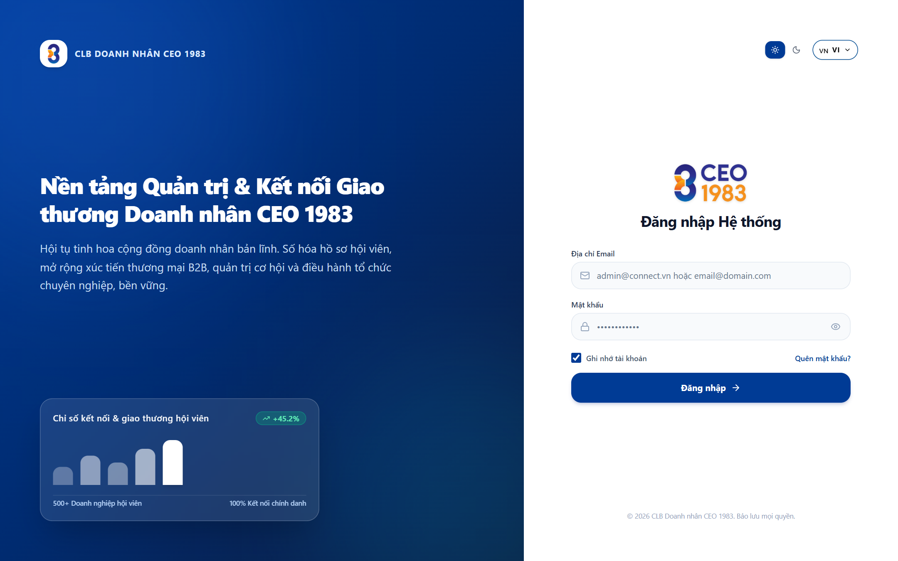

### 3. Thao tác đăng nhập & Phân quyền mặc định
1. **Trường "Địa chỉ Email"**:
   - Nhập tài khoản quản trị được cấp: `admin@connect.vn` (hoặc email cán bộ thuộc ban).
2. **Trường "Mật khẩu"**:
   - Nhập mật khẩu quản trị (Mặc định: `123456`).
3. **Tùy chọn "Ghi nhớ tài khoản"**: Giữ phiên đăng nhập không bị tự ngắt kết nối trong ca làm việc.
4. **Nút "Đăng nhập ->"**: Bấm để vào hệ thống. Nút được thiết kế tông màu xanh Navy đậm `#003B95` biểu trưng cho sự tin cậy và chuyên nghiệp.

> **Lưu ý bảo mật:** Ngay sau lần đầu đăng nhập, cán bộ quản trị bắt buộc phải vào mục **Cài đặt cá nhân** để đổi mật khẩu phức tạp gồm chữ hoa, chữ thường, chữ số và ký tự đặc biệt.

---

## BÀI 2: BẢNG ĐIỀU KHIỂN TỔNG QUAN (EXECUTIVE DASHBOARD & KPIS)

### 1. Mục đích chức năng
Cung cấp cái nhìn toàn cảnh tức thời (Real-time Snapshot) về sức khỏe tài chính, quy mô hội viên và tiến độ tổ chức sự kiện cho Chủ tịch, Tổng thư ký và Ban Điều Hành.

- **Đường dẫn**: `https://crm.ceo1983.viconnect.vn/`

### 2. Giao diện thực tế thao tác
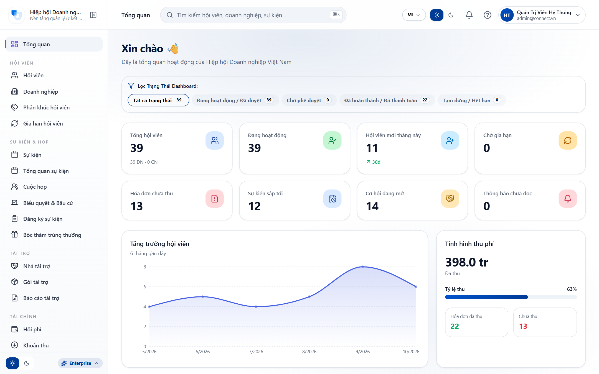

### 3. Ý nghĩa các chỉ số KPI then chốt

| Chỉ số hiển thị | Ý nghĩa nghiệp vụ | Hành động khuyến nghị |
| :--- | :--- | :--- |
| **Tổng số Hội viên** | Số lượng doanh nghiệp hội viên chính thức đã gia nhập. | Theo dõi tốc độ phát triển mạng lưới hàng tháng. |
| **Tổng Quỹ & Hội phí** | Số dư tài chính thực tế và tổng thu hội phí năm 2026. | Đánh giá ngân sách phục vụ các hoạt động xúc tiến. |
| **Sự kiện đang mở** | Số lượng hội nghị, Gala đang tiếp nhận đại biểu đăng ký. | Kiểm soát tỷ lệ lấp đầy ghế khán phòng. |
| **Chỉ số Tương tác B2B** | Tỷ lệ giao thương, số cuộc hẹn 1-on-1 và cơ hội kinh doanh. | Đo lường giá trị thực tế CLB mang lại cho hội viên. |

---

## BÀI 3: QUẢN LÝ BAN CHUYÊN MÔN ĐỘC LẬP (/departments)

### 1. Mục đích chức năng
Quản trị cơ cấu 8 Ban chuyên môn của CLB CEO 1983. Cho phép thành lập ban mới, chỉ định Trưởng ban phụ trách, gán màu nhận diện và mô tả chức năng nhiệm vụ.

- **Đường dẫn**: `https://crm.ceo1983.viconnect.vn/departments`

### 2. Giao diện thực tế thao tác
| Danh sách Ban Chuyên Môn | Modal Thêm Ban Mới |
| :---: | :---: |
| 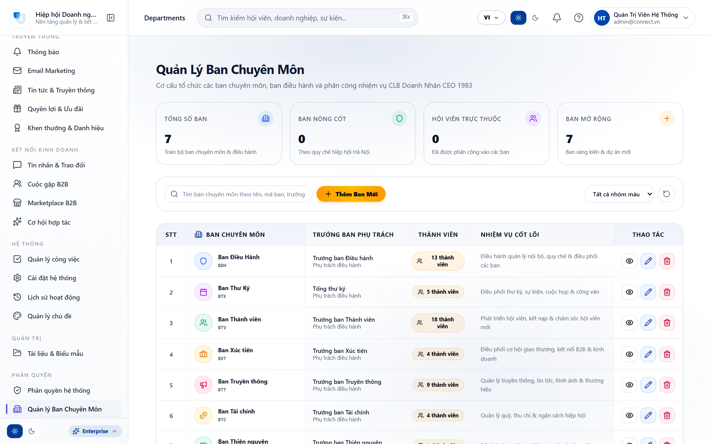 | 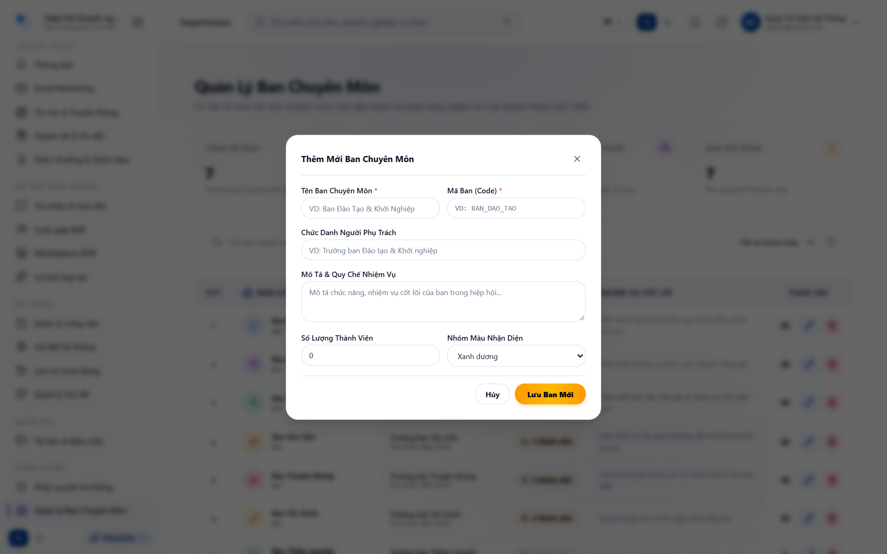 |

### 3. Mô tả chi tiết form Thêm Ban Chuyên Môn Mới

| Tên trường nhập | Bắt buộc | Nhập dữ liệu gì? | Mục đích trường này để làm gì? |
| :--- | :---: | :--- | :--- |
| **Mã ban chuyên môn** | **Có (*)** | Nhập mã viết tắt viết hoa không dấu (Ví dụ: `BXTTM`, `BTT`, `BTC`). | Định danh hệ thống và làm tiền tố lọc dữ liệu trong luồng giao việc. |
| **Tên ban chuyên môn** | **Có (*)** | Nhập tên đầy đủ (Ví dụ: *Ban Xúc Tiến Thương Mại*). | Hiển thị trên cây cơ cấu tổ chức và thẻ hội viên. |
| **Màu sắc nhận diện** | **Có (*)** | Chọn mã màu Hex (Ví dụ: `#003B95` xanh navy, `#D97706` vàng ánh kim). | Tô màu nhãn phân loại ban trên bảng Kanban và thẻ hội viên. |
| **Trưởng ban phụ trách** | **Có (*)** | Chọn từ dropdown danh sách lãnh đạo hiệp hội. | Xác định người có thẩm quyền phê duyệt việc và đại diện ban. |
| **Mô tả chức năng nhiệm vụ** | Tùy chọn | Nhập chi tiết phạm vi quyền hạn và trách nhiệm của ban. | Định hướng mục tiêu công việc nội bộ ban. |

---

## BÀI 4: QUẢN LÝ TÀI KHOẢN VẬN HÀNH & GÁN VAI TRÒ ROLE (/accounts)

### 1. Mục đích chức năng
Quản trị toàn bộ tài khoản đăng nhập của nhân sự điều hành và hội viên. Cấp phát vai trò (Role), kích hoạt hoặc khóa tài khoản vi phạm quy chế.

- **Đường dẫn**: `https://crm.ceo1983.viconnect.vn/accounts`

### 2. Giao diện thực tế thao tác
| Quản lý Danh sách Tài khoản | Modal Thêm Tài Khoản Mới |
| :---: | :---: |
| 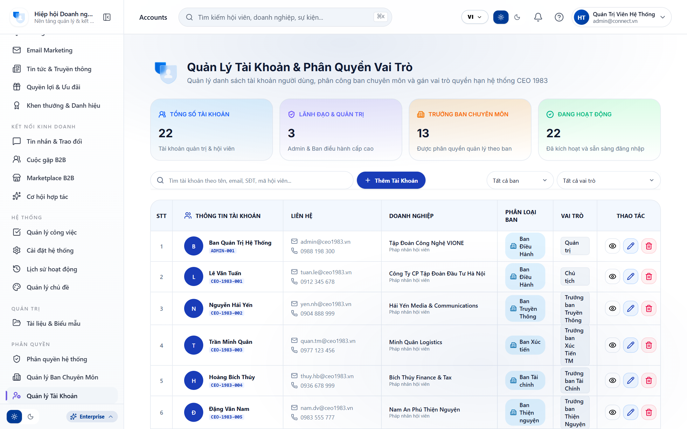 | 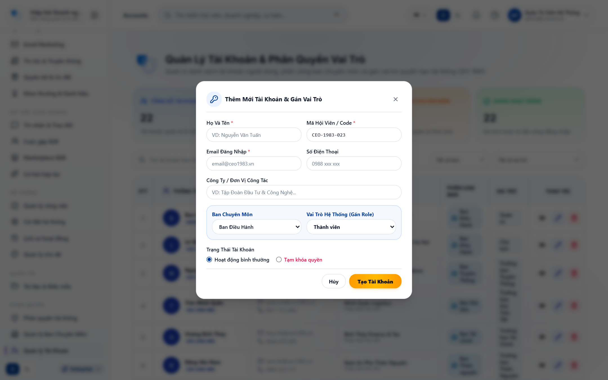 |

### 3. Mô tả chi tiết form Thêm Tài Khoản Mới

| Tên trường | Bắt buộc | Hướng dẫn nhập | Mục đích trường dữ liệu |
| :--- | :---: | :--- | :--- |
| **Họ và tên** | **Có (*)** | Nhập tên đầy đủ cán bộ (Ví dụ: *Lê Văn Tuấn*). | Tên đại diện hiển thị trên toàn hệ thống CRM và Mobile. |
| **Mã nhân sự / Hội viên** | **Có (*)** | Nhập mã định danh (Ví dụ: `ADMIN-001` hoặc `M1983-001`). | Khóa chính duy nhất chống trùng lặp dữ liệu. |
| **Email đăng nhập** | **Có (*)** | Nhập email chính xác (Ví dụ: *tuan.le@ceo1983.vn*). | Tên đăng nhập và nhận thông báo hệ thống. |
| **Số điện thoại** | **Có (*)** | Nhập số di động (Ví dụ: *0912345678*). | Phục vụ liên hệ công tác và xác thực OTP. |
| **Tên doanh nghiệp** | Tùy chọn | Nhập tên công ty trực thuộc. | Hiển thị thông tin đối tác thương mại. |
| **Ban chuyên môn** | **Có (*)** | Chọn 1 trong 8 ban (Ví dụ: *Ban Điều Hành*). | Giới hạn phạm vi dữ liệu trong phân hệ Giao việc và Họp ban. |
| **Vai trò phân quyền (Role)** | **Có (*)** | Chọn vai trò: *Chủ tịch, Admin, Ban Điều Hành, Tổng thư ký, Trưởng ban, Ban thư ký, Hội viên*. | Kích hoạt ma trận phân quyền tương ứng trên hệ thống. |
| **Mật khẩu khởi tạo** | **Có (*)** | Nhập mật khẩu ban đầu (Ví dụ: `123456`). | Cung cấp cho người dùng đăng nhập lần đầu. |

---

## BÀI 5: MA TRẬN PHÂN QUYỀN VAI TRÒ ĐA TẦNG RBAC (/permissions)

### 1. Mục đích chức năng
Thiết lập quyền thao tác (Xem, Thêm, Sửa, Xóa, Phê duyệt, Xuất báo cáo) trên từng phân hệ đối với 7 vai trò chủ chốt.

- **Đường dẫn**: `https://crm.ceo1983.viconnect.vn/permissions`

### 2. Giao diện thực tế thao tác
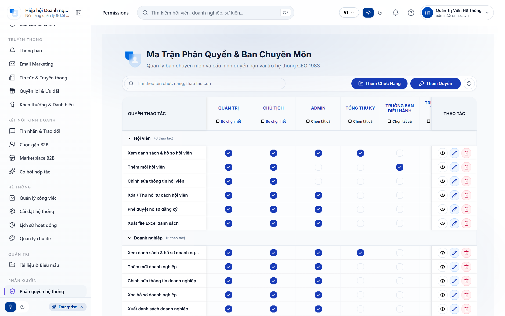

### 3. Quy tắc vận hành ma trận phân quyền
1. **Tích chọn quyền hạn**: Cán bộ quản trị tích chọn hoặc bỏ tích các ô vuông tương ứng giữa *Tính năng* và *Vai trò*.
2. **Cảnh báo thay đổi chưa lưu**: Khi có chỉnh sửa chưa bấm Lưu, nếu cố tình chuyển trang, hệ thống sẽ bật modal cảnh báo: *"Bạn có thay đổi phân quyền chưa lưu! Bấm Lưu & Chuyển để tránh mất dữ liệu"*.
3. **Cơ chế cập nhật thời gian thực**: Khi phân quyền của một tài khoản bị thay đổi, hệ thống sẽ tự động gửi tín hiệu WebSocket đẩy thông báo giữa màn hình của người đó để làm mới quyền hạn ngay lập tức mà không cần đăng xuất.

---

## BÀI 6: QUẢN TRỊ HỘI VIÊN & THẨM ĐỊNH PHÊ DUYỆT HỒ SƠ (/members)

### 1. Mục đích chức năng
Quản lý danh sách hội viên chính thức, phân khúc hội viên (VIP, Tiêu biểu, Thường niên) và xử lý quy trình thẩm định hồ sơ đăng ký mới từ cổng tiếp nhận `https://ceo1983.viconnect.vn/landing`.

- **Đường dẫn**: `https://crm.ceo1983.viconnect.vn/members`

### 2. Giao diện thực tế thao tác
| Quản lý Hội viên | Phê duyệt Hồ sơ Chi tiết |
| :---: | :---: |
| 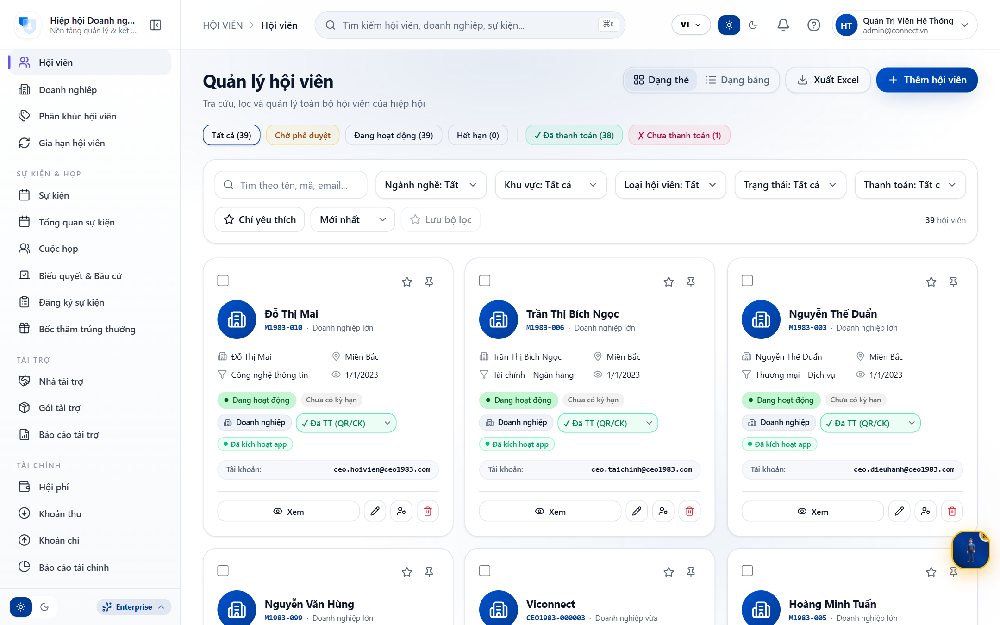 | 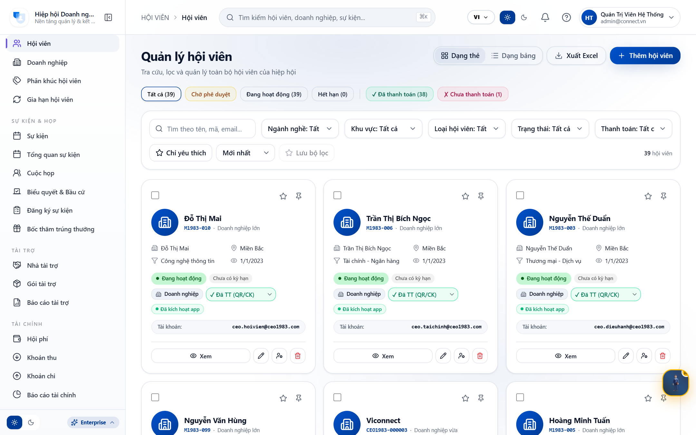 |

### 3. Quy trình thẩm định & Phê duyệt kết nạp hội viên mới
1. Vào tab **"Chờ xét duyệt"**: Xem danh sách các hồ sơ mới nộp từ cổng online.
2. Bấm nút **"Xem hồ sơ"**: Kiểm tra các tiêu chuẩn:
   - Năm sinh đúng 1983 (Quý Hợi).
   - Chức vụ đại diện pháp nhân hợp lệ.
   - Ngành nghề không vi phạm điều lệ CLB.
3. Bấm nút **"Phê duyệt kết nạp"**:
   - Hệ thống tự động sinh Mã hội viên chuẩn: `M1983-xxx`.
   - Sinh phôi Thẻ hội viên VIP điện tử với mã QR cá nhân hóa.
   - Tự động kích hoạt tài khoản đăng nhập trên Mobile App.
   - Bắn email thông báo chúc mừng gia nhập kèm thông tin nộp hội phí niên liễm.

---

## BÀI 7: QUẢN TRỊ SỰ KIỆN & HỘI NGHỊ GIAO THƯƠNG (/events)

### 1. Mục đích chức năng
Trung tâm khởi tạo và điều phối các sự kiện của CLB: Diễn đàn kinh tế, Dạ tiệc Gala xúc tiến thương mại, Workshop thực chiến và Khóa đào tạo lãnh đạo.

- **Đường dẫn**: `https://crm.ceo1983.viconnect.vn/events`

### 2. Giao diện thực tế thao tác
| Quản trị Danh sách Sự kiện | Modal Tạo Sự Kiện 3 Bước |
| :---: | :---: |
| 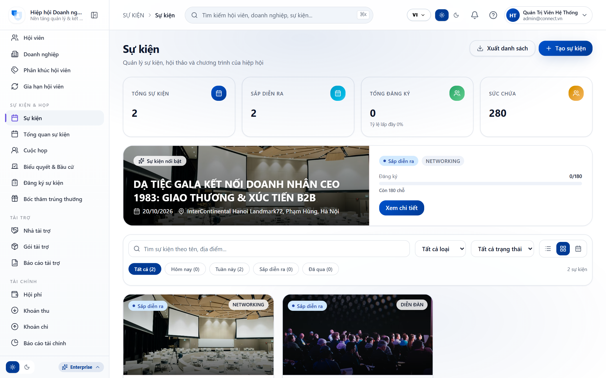 | 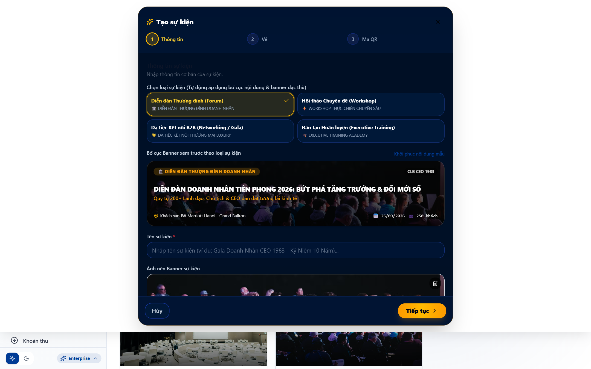 |

### 3. Quy trình Tạo sự kiện mới qua 3 bước (Wizard Modal)

#### Bước 1: Thông tin cơ bản (Event Details)
- **Chọn loại sự kiện**: Bấm chọn 1 trong 4 loại hình:
  - *Diễn đàn Thượng đỉnh (Forum)*: Bố cục trang trọng dành cho hội nghị lớn.
  - *Hội thảo Chuyên đề (Workshop)*: Chương trình thực chiến đào tạo chuyên sâu.
  - *Dạ tiệc Kết nối B2B (Networking / Gala)*: Đêm tiệc thương mại Luxury.
  - *Đào tạo Huấn luyện (Executive Training)*: Khóa học nâng cao kỹ năng lãnh đạo.
- **Tên sự kiện (*)**: Nhập tiêu đề sự kiện (Ví dụ: *Dạ Tiệc Gala Kết Nối Doanh Nhân CEO 1983*).
- **Thời gian & Địa điểm (*)**: Chọn ngày giờ bắt đầu/kết thúc và địa chỉ khán phòng (Ví dụ: *InterContinental Hanoi Landmark72*).
- **Ảnh nền Banner sự kiện**: Tải lên banner tỷ lệ chuẩn 16:9 sắc nét.

#### Bước 2: Cấu hình Vé & Sức chứa (Tickets & Capacity)
- **Sức chứa tối đa (*)**: Nhập số lượng chỗ ngồi (Ví dụ: `180` khách).
- **Giá vé Hội viên chính thức**: Thường áp dụng `0 đ` theo đặc quyền hội viên.
- **Giá vé Khách mời ngoài**: Nhập số tiền thu đối với khách chưa phải hội viên (Ví dụ: `1.500.000 đ`).
- **Hạn chót đăng ký vé**: Thời điểm tự động đóng cổng đăng ký online.

#### Bước 3: Đơn vị Đồng Hành & Nhà Tài Trợ (Sponsors)
- Tích chọn các Nhà tài trợ Kim Cương, Vàng, Bạc đồng hành cùng chương trình để hiển thị logo vinh danh trên trang chi tiết sự kiện và vé E-Ticket.
- Bấm **"Hoàn tất & Xuất bản sự kiện"**.

---

## BÀI 8: SƠ ĐỒ KHÁN PHÒNG & BÀN TIỆC GALA GIAO THƯƠNG (/events/:id)

### 1. Mục đích chức năng
Điều phối không gian khán phòng, sắp xếp bàn tiệc Gala giao thương B2B, quản lý danh sách đại biểu tại từng bàn và cung cấp mã QR Zalo cho khách ngoài đăng ký.

- **Đường dẫn**: `https://crm.ceo1983.viconnect.vn/events/:eventId`

### 2. Giao diện thực tế thao tác
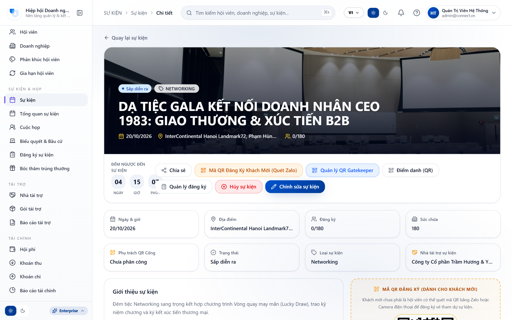

### 3. Các tính năng độc quyền tại màn hình chi tiết sự kiện
1. **Mã QR Đăng Ký Khách Mời (Quét Zalo)**:
   - Nút màu cam nổi bật trên thanh công cụ.
   - Nhấn để lấy mã QR chuyên dụng hoặc sao chép liên kết đăng ký khách ngoài: `https://ceo1983.viconnect.vn/events/:id/register`. Khách mời chỉ cần dùng Camera điện thoại hoặc Zalo quét mã là đăng ký được ngay.
2. **Quản lý QR Gatekeeper**: Cấp quyền cho nhân viên lễ tân mở chế độ quét vé tại cửa khán phòng.
3. **Phân bổ Bàn tiệc Gala**:
   - Bố trí các bàn tròn 10 người: Bàn VIP Danh dự (Chủ tịch, Ban cố vấn), Bàn Ban Điều Hành, Bàn Giao thương Xây dựng, Bàn Công nghệ...
   - Kéo thả chuyển đại biểu giữa các bàn linh hoạt theo yêu cầu ngoại giao.

---

## BÀI 9: QUẢN LÝ NGƯỜI ĐĂNG KÝ & ĐIỂM DANH SOÁT VÉ QR (/event-registrations)

### 1. Mục đích chức năng
Quản trị danh sách toàn bộ đại biểu đã đăng ký tham gia sự kiện. Theo dõi trạng thái nộp tiền vé, cấp phát mã quay thưởng Lucky Number và kiểm soát điểm danh thực tế tại cổng sự kiện.

- **Đường dẫn**: `https://crm.ceo1983.viconnect.vn/event-registrations`

### 2. Giao diện thực tế thao tác
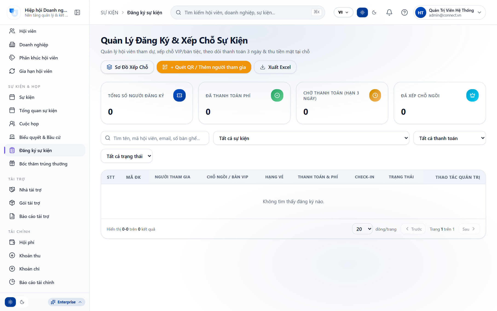

### 3. Thao tác trên danh sách đại biểu
1. **Lọc dữ liệu**: Lọc theo sự kiện cụ thể, trạng thái thanh toán (*Đã thanh toán / Miễn phí / Chờ thanh toán*) và trạng thái điểm danh (*Đã check-in / Chưa check-in*).
2. **Điểm danh thủ công**: Bấm nút **Check-in** nhanh tại dòng của đại biểu trong trường hợp đại biểu quên mang điện thoại.
3. **Xuất danh sách đại biểu (Excel)**: Bấm nút **Xuất Excel** để in danh sách dán tại bàn lễ tân đón tiếp.
4. **Hủy / Xóa người đăng ký**: Bấm nút **Xóa** nếu đại biểu báo bận không tham dự được, giải phóng chỗ ngồi cho người khác trong danh sách chờ.

---

## BÀI 10: CẤU HÌNH VÒNG QUAY MAY MẮN LUCKY DRAW (/lucky-draw)

### 1. Mục đích chức năng
Quản trị chương trình Bốc thăm trúng thưởng (Lucky Draw) tại các đêm tiệc Gala. Cho phép tải ảnh phần quà thực tế từ máy tính, cấu hình cơ cấu giải và kích hoạt màn hình quay thưởng trực tiếp trên màn hình LED lớn của hội trường.

- **Đường dẫn**: `https://crm.ceo1983.viconnect.vn/lucky-draw`

### 2. Giao diện thực tế thao tác
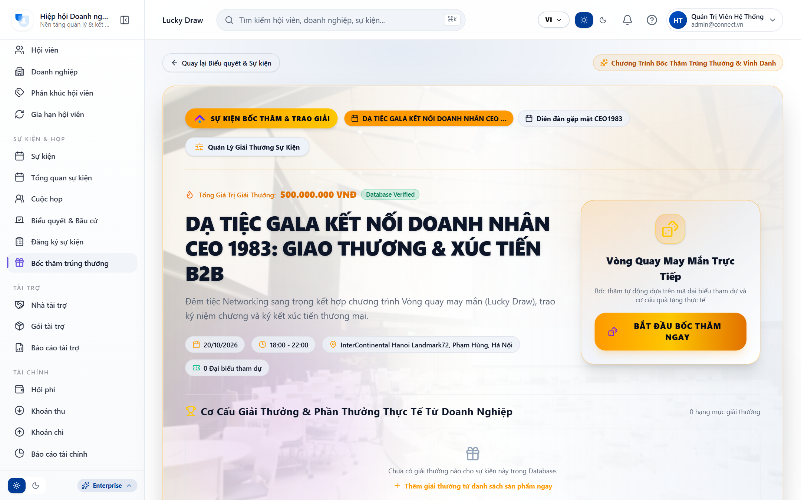

### 3. Các bước thiết lập giải thưởng & Vận hành quay số

#### Bước 1: Cấu hình cơ cấu giải thưởng
1. Chọn sự kiện cần tổ chức bốc thăm (Ví dụ: *Dạ tiệc Gala Kết nối Doanh nhân CEO 1983*).
2. Nhấn nút **"+ Thêm giải thưởng từ danh sách sản phẩm ngay"**.
3. Điền thông tin giải thưởng:
   - **Hạng giải**: *Giải Đặc Biệt, Giải Nhất, Giải Nhì, Giải Ba, Giải May Mắn*.
   - **Tên phần quà**: Tên sản phẩm hiện vật (Ví dụ: *Đồng hồ Thụy Sĩ Longines, Tranh vàng Bát mã truy phong, Bộ Golf TaylorMade*).
   - **Giá trị phần thưởng (VND)**: Tổng giá trị giải thưởng.
   - **Số lượng giải**: Số phần quà trao thưởng.
   - **Tải ảnh phần quà từ máy tính**: Bấm nút *"Tải ảnh từ máy"* để đưa hình ảnh hiện vật sắc nét lên hệ thống (có khung xem trước ảnh và nút xóa ảnh).
4. Bấm **"Lưu giải thưởng"**.

#### Bước 2: Trình chiếu & Bốc thăm trực tiếp trên màn hình LED
1. Kết nối máy tính điều khiển với màn hình LED sân khấu.
2. Bấm nút màu cam lớn: **"BẮT ĐẦU BỐC THĂM NGAY"**.
3. Màn hình sân khấu hiển thị Vòng quay may mắn ánh kim hoành tráng. Hệ thống sẽ quay ngẫu nhiên dựa trên kho số vé Lucky Number của các đại biểu **đã check-in thực tế tại cổng**.
4. Khi bấm Dừng quay, hệ thống chúc mừng người trúng giải kèm hình ảnh đại diện, tên doanh nghiệp và số bàn tiệc để MC mời lên sân khấu nhận giải.

---

## BÀI 11: QUẢN LÝ LỊCH HỌP & ĐẶT PHÒNG HỌP UNIWORK HUB (/meetings)

### 1. Mục đích chức năng
Số hóa công tác họp hành của CLB. Hỗ trợ đặt trước phòng họp Sapphire/Ruby tại trụ sở UniWork Hub hoặc tạo phòng họp Zoom trực tuyến mã hóa bảo mật, đính kèm tài liệu và gửi thông báo triệu tập tới thành viên.

- **Đường dẫn**: `https://crm.ceo1983.viconnect.vn/meetings`

### 2. Giao diện thực tế thao tác
| Quản lý Danh sách Cuộc họp | Modal Đặt Phòng Họp & Lên Lịch |
| :---: | :---: |
| 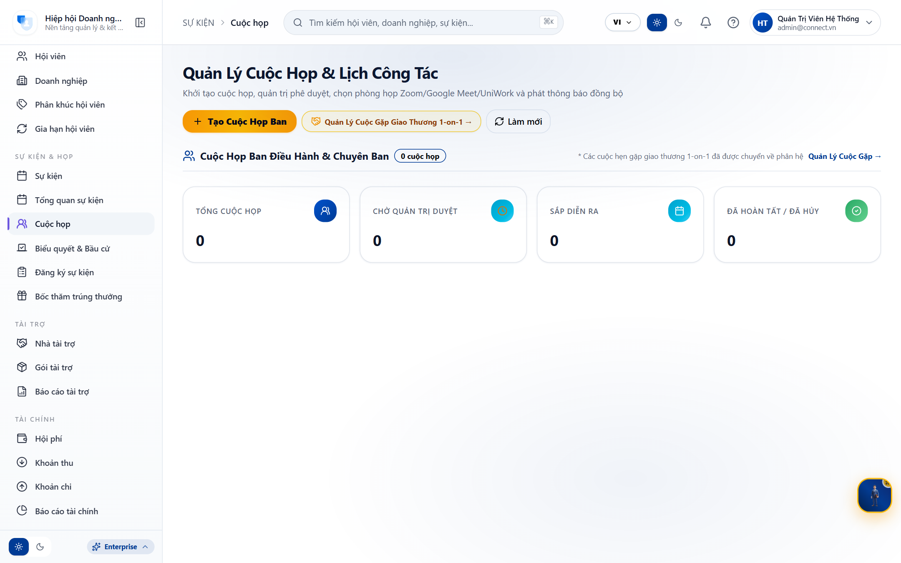 | 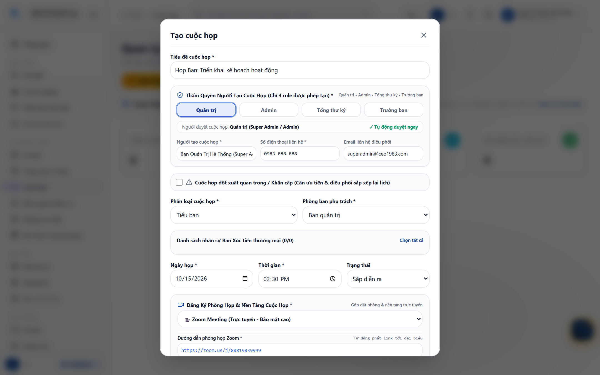 |

### 3. Mô tả chi tiết form Tạo Cuộc Họp Ban

| Tên trường nhập | Bắt buộc | Nhập dữ liệu gì? | Mục đích trường dữ liệu |
| :--- | :---: | :--- | :--- |
| **Tiêu đề cuộc họp** | **Có (*)** | Nhập nội dung chính (Ví dụ: *Họp Ban: Triển khai kế hoạch hoạt động Quý 4*). | Giúp thành viên nắm rõ mục đích buổi làm việc. |
| **Thẩm quyền người tạo** | **Có (*)** | Chọn 1 trong 4 quyền: `Quản trị`, `Admin`, `Tổng thư ký`, `Trưởng ban`. | Xác định tính chính thống của cuộc họp theo quy chế. |
| **Người tạo cuộc họp** | **Có (*)** | Tự động điền tên cán bộ đang đăng nhập. | Định danh đầu mối chủ trì. |
| **Số điện thoại & Email** | **Có (*)** | Nhập thông tin liên hệ điều phối. | Đại biểu liên hệ khi cần xin phép hoặc tài liệu gấp. |
| **Cuộc họp đột xuất khẩn cấp** | Tùy chọn | Tích chọn nếu là cuộc họp khẩn. | Hệ thống gửi thông báo ưu tiên cao độ vào điện thoại. |
| **Phân loại & Phòng ban phụ trách** | **Có (*)** | Chọn: *Họp toàn thể CLB, Họp Ban Điều Hành, Họp Tiểu ban chuyên môn*. | Khoanh vùng phạm vi cán bộ triệu tập. |
| **Ngày họp & Giờ bắt đầu** | **Có (*)** | Chọn ngày và giờ họp (Ví dụ: *15/10/2026 lúc 14:30*). | Lên lịch biểu và đồng bộ vào lịch cá nhân. |
| **Đăng ký phòng họp & Nền tảng** | **Có (*)** | Chọn hình thức:  - *Trực tiếp: Phòng Họp Sapphire - Trụ sở UniWork Hub (25 chỗ, TV 85" Polycom 4K)*. - *Trực tuyến: Zoom Meeting (Trực tuyến bảo mật cao)*. | Đặt chỗ tránh trùng phòng hoặc tự sinh link Zoom. |
| **Đường dẫn phòng họp Zoom** | Tùy chọn | Nhập URL Zoom (Ví dụ: `https://zoom.us/j/88819839999`). | Tự động phát link tới đại biểu trước giờ họp 15 phút. |

---

## BÀI 12: GIAO VIỆC & THEO DÕI TIẾN ĐỘ NHIỆM VỤ KANBAN (/tasks)

### 1. Mục đích chức năng
Công cụ điều hành công việc chuyên nghiệp chuẩn Agile/Kanban dành cho Ban Điều Hành. Cho phép giao việc có dự toán kinh phí, người phụ trách, thời hạn (Deadline), tệp đính kèm Word/Excel/PDF và tiêu chí nghiệm thu rõ ràng.

- **Đường dẫn**: `https://crm.ceo1983.viconnect.vn/tasks`

### 2. Giao diện thực tế thao tác
| Bảng Kanban Giao việc | Form Giao Việc Mới |
| :---: | :---: |
| 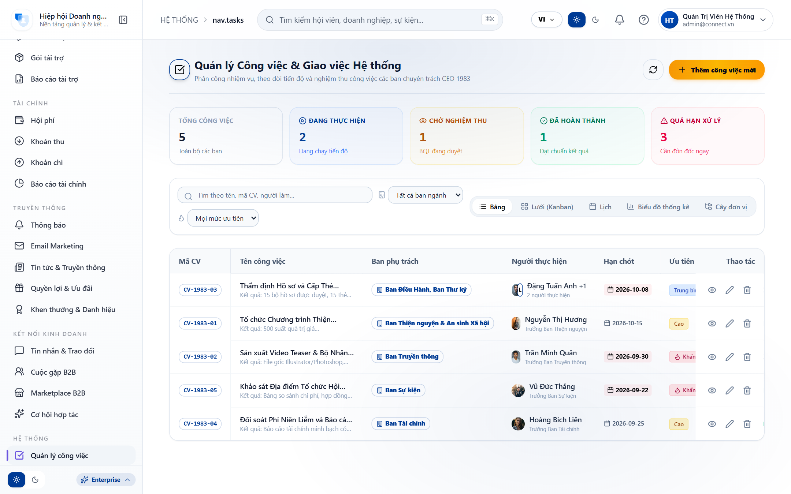 | 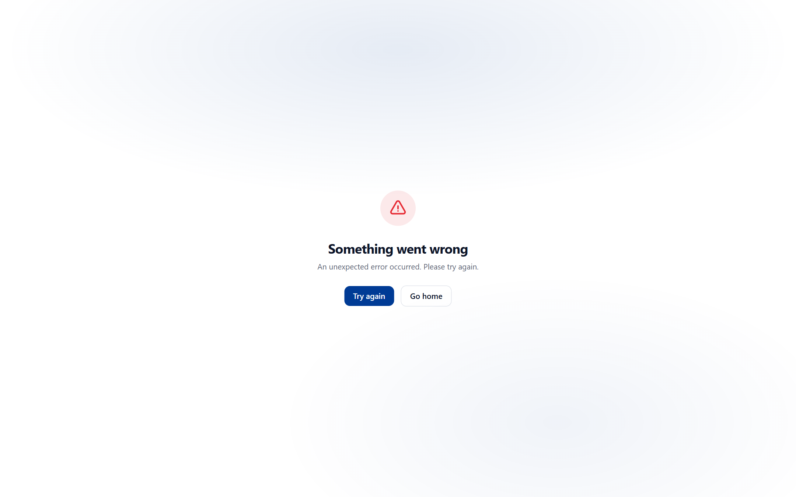 |

### 3. Mô tả các trường trong quy trình giao việc mới
1. **Tiêu đề công việc (*)**: Tên nhiệm vụ cụ thể (Ví dụ: *Thiết kế phôi Kỷ niệm chương & Ấn phẩm Gala 10 năm*).
2. **Ban chuyên môn phụ trách (*)**: Hệ thống tự động khóa theo quyền hạn của người giao (Ví dụ: Trưởng ban Truyền thông chỉ giao việc trong Ban Truyền thông; Chủ tịch/Tổng thư ký có quyền giao toàn bộ các ban).
3. **Người phụ trách chính (*)**: Chọn cán bộ nhận việc từ danh sách nhân sự của ban.
4. **Hạn hoàn thành (Deadline) (*)**: Ngày giờ phải bàn giao kết quả.
5. **Đính kèm tài liệu (*)**: Bấm tải lên các file đề án, kịch bản (.docx), bảng dự toán (.xlsx), file thuyết minh (.pdf) hoặc ảnh thiết kế.
6. **Dự toán kinh phí thực hiện (VND)**: Nhập số tiền được duyệt chi (Ví dụ: `15.000.000 đ`).
7. **Tiêu chuẩn nghiệm thu**: Liệt kê các tiêu chí cụ thể để Ban Điều Hành căn cứ nghiệm thu công việc.

### 4. Quản lý tiến độ trên bảng Kanban 4 cột
- Cột 1: **Chờ thực hiện (TODO)**: Nhiệm vụ mới giao, cán bộ nhận việc tiếp nhận.
- Cột 2: **Đang tiến hành (IN PROGRESS)**: Nhiệm vụ đang được triển khai thực tế.
- Cột 3: **Chờ nghiệm thu (REVIEW)**: Cán bộ hoàn thành, nộp báo cáo kết quả lên Trưởng ban/Chủ tịch.
- Cột 4: **Đã hoàn thành (DONE)**: Nhiệm vụ đạt chuẩn nghiệm thu, tự động cập nhật điểm thi đua.

---

## BÀI 13: QUẢN LÝ TÀI CHÍNH & SỔ QUỸ THU CHI MINH BẠCH (/income, /expenses)

### 1. Mục đích chức năng
Minh bạch tài chính 100% là tôn chỉ của CLB CEO 1983. Phân hệ giúp Ban Tài Chính quản lý dòng tiền vào (hội phí, tài trợ sự kiện, ủng hộ thiện nguyện) và dòng tiền ra (chi phí tổ chức hội nghị, văn phòng, quà tặng), lưu trữ hóa đơn chứng từ điện tử.

- **Đường dẫn**: `https://crm.ceo1983.viconnect.vn/income` (Sổ Thu) & `/expenses` (Sổ Chi)

### 2. Giao diện thực tế thao tác
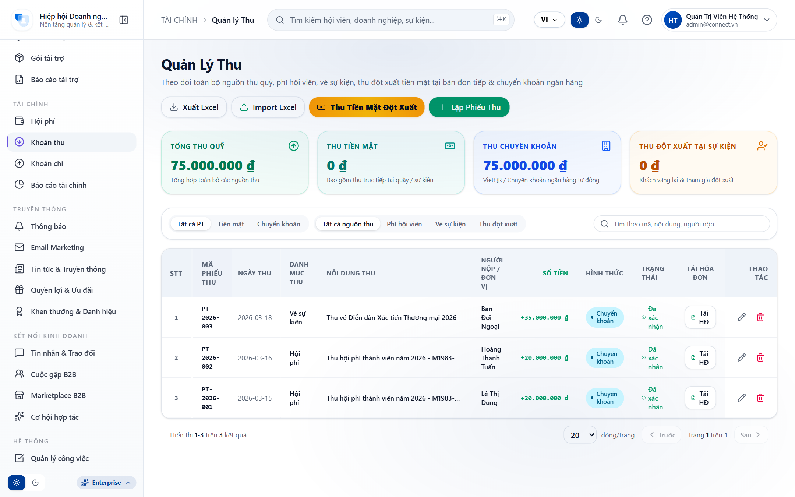

### 3. Quy trình lập phiếu thu / phiếu chi
1. Bấm nút **"+ Lập Phiếu Mới"**.
2. Điền thông tin:
   - **Khoản mục thu / chi**: Chọn theo danh mục chuẩn (Hội phí, Tài trợ, Thuê hội trường, Tiệc mặn, In ấn, Quà tặng).
   - **Số tiền (VND)**: Nhập số tiền giao dịch chính xác.
   - **Đối tượng nộp / nhận**: Tên doanh nhân hoặc đơn vị cung cấp dịch vụ.
   - **Hình thức thanh toán**: Chuyển khoản ngân hàng hoặc Tiền mặt.
   - **Tải lên chứng từ / Hóa đơn đỏ**: Đính kèm ảnh chụp sao kê hoặc hóa đơn VAT.
3. Bấm **"Lưu & Xuất phiếu"**. Dữ liệu lập tức được cộng trừ vào Sổ quỹ chung và phản ánh lên báo cáo tài chính tổng quan.

---

## BÀI 14: QUẢN LÝ HỘI PHÍ NIÊN LIỄM & HÓA ĐƠN ĐIỆN TỬ (/fees)

### 1. Mục đích chức năng
Theo dõi nghĩa vụ đóng hội phí thường niên của toàn bộ hội viên. Quản lý kỳ thu phí năm 2026, phân loại trạng thái nộp tiền và tự động gửi thông báo nhắc hạn kèm mã VietQR Napas 24/7.

- **Đường dẫn**: `https://crm.ceo1983.viconnect.vn/fees`

### 2. Giao diện thực tế thao tác
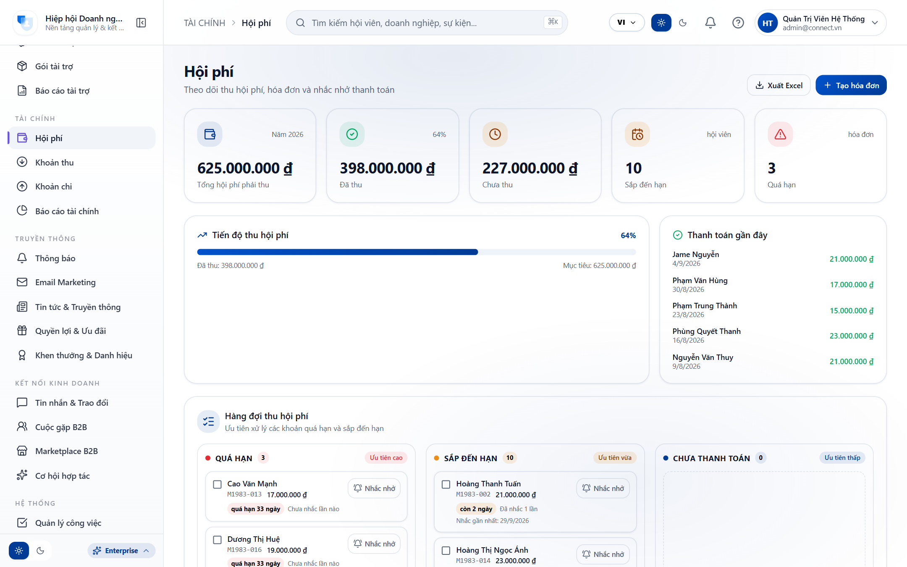

### 3. Thao tác gửi nhắc hội phí tự động qua VietQR
1. Trên bảng dữ liệu, lọc các hội viên có trạng thái `Chờ thanh toán` hoặc `Quá hạn`.
2. Bấm nút **"Gửi nhắc hội phí VietQR"**:
   - Hệ thống tự động tạo mã VietQR động chứa số tiền hội phí (Ví dụ: `21.000.000 đ`) và cú pháp nộp tiền riêng cho từng hội viên.
   - Gửi đồng thời qua Email và Thông báo đẩy trên ứng dụng di động của hội viên.
3. Khi hội viên quét QR chuyển tiền thành công, hệ thống Napas gửi tín hiệu webhook tự động gạch nợ trên CRM và chuyển trạng thái hội viên sang `Đã hoàn thành`.

---

## BÀI 15: KHO VĂN KIỆN SỐ & BIỂU MẪU QUY CHẾ HIỆP HỘI (/documents)

### 1. Mục đích chức năng
Lưu trữ và phân loại các văn bản pháp quy, điều lệ CLB, biên bản đại hội, quyết định bổ nhiệm và các biểu mẫu hành chính phục vụ công tác điều hành.

- **Đường dẫn**: `https://crm.ceo1983.viconnect.vn/documents`

### 2. Giao diện thực tế thao tác
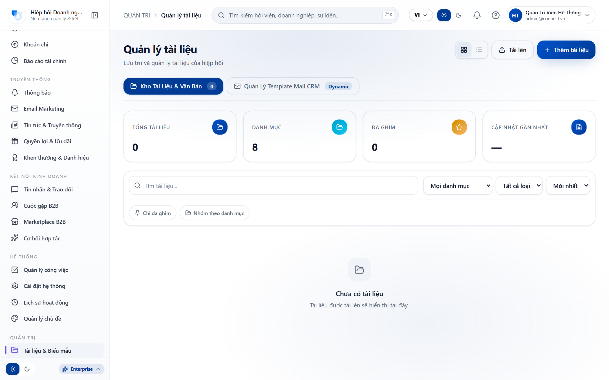

### 3. Hướng dẫn khai thác & Tải lên tài liệu
1. **Lọc văn kiện theo 8 Ban chuyên môn**: Chọn tab của Ban Điều Hành, Ban Thành Viên, Ban Xúc Tiến Thương Mại, v.v. để xem các văn bản chuyên trách.
2. **Lọc theo định dạng tệp**: Lọc nhanh các file `PDF`, `DOCX`, `XLSX`, `PPTX`.
3. **Tải lên tài liệu mới**:
   - Bấm **"+ Tải lên tài liệu"**.
   - Nhập Tên văn bản, Số hiệu ban hành, Ngày ký và tải tệp đính kèm.
   - Chọn đối tượng được phép xem: *Toàn bộ hội viên* hoặc *Chỉ Ban Điều Hành*.

---

## BÀI 16: QUẢN LÝ MẪU THƯ ĐIỆN TỬ TỰ ĐỘNG GẮN BIẾN SỐ (MAIL TEMPLATE)

### 1. Mục đích chức năng
Tự động hóa công tác gửi thư thông báo của Ban Thư Ký. Cung cấp trình soạn thảo mẫu thư kèm bộ **Chip Biến Số Thông Minh** (Dynamic Merge Tags) tự động chèn thông tin cá nhân của từng hội viên và khung xem trước Executive Card phong cách tối giản thanh lịch.

- **Đường dẫn**: Tab *"Quản Lý Template Mail CRM"* tại `https://crm.ceo1983.viconnect.vn/documents`

### 2. Giao diện thực tế thao tác
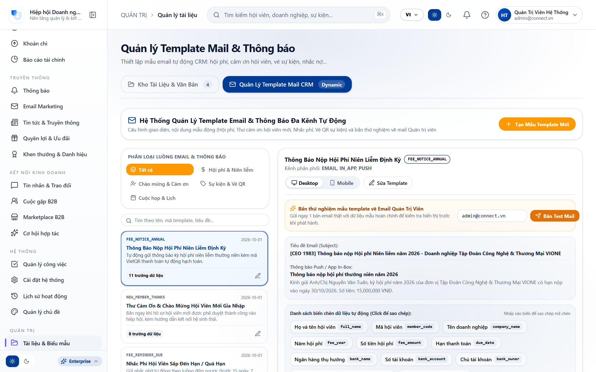

### 3. Danh mục Chip Biến Số Thông Minh & Chức năng

| Chip Biến Số | Cú pháp hệ thống | Dữ liệu tự động thay thế |
| :--- | :--- | :--- |
| **Họ và tên hội viên** | `[full_name]` | Họ tên chính thức của hội viên nhận thư. |
| **Mã hội viên** | `[member_code]` | Mã định danh CLB (Ví dụ: `M1983-001`). |
| **Tên doanh nghiệp** | `[company_name]` | Tên công ty/tập đoàn của hội viên. |
| **Năm hội phí** | `[fee_year]` | Năm thu niên liễm (Ví dụ: `2026`). |
| **Số tiền hội phí** | `[fee_amount]` | Số tiền phải nộp định dạng chuẩn (Ví dụ: `21.000.000 VNĐ`). |
| **Hạn thanh toán** | `[due_date]` | Ngày chót chuyển khoản (Ví dụ: `30/10/2026`). |
| **Ngân hàng thụ hưởng** | `[bank_name]` | Tên ngân hàng CLB mở tài khoản. |
| **Số tài khoản** | `[bank_account]` | Số tài khoản nhận hội phí. |
| **Chủ tài khoản** | `[bank_owner]` | Tên pháp nhân sở hữu tài khoản. |

#### Quy trình tạo & Bắn thử nghiệm (Test Mail):
1. Chọn luồng thông báo: *Hội phí & Niên liễm*, *Chào mừng & Cảm ơn*, *Sự kiện & Vé QR*, *Cuộc họp & Lịch*.
2. Nhấp vào các **Chip Biến Số** bên dưới để tự động chèn biến số vào tiêu đề và nội dung thư.
3. Nhập email của bạn vào ô *"Bắn thử nghiệm mẫu template về Email Quản Trị Viên"* và bấm **"Bắn Test Mail"** để kiểm tra định dạng hiển thị thực tế trên điện thoại trước khi gửi hàng loạt.

---

## BÀI 17: MẠNG LƯỚI DOANH NHÂN & NHẮN TIN TRAO ĐỔI NGHIỆP VỤ 1-ON-1 (/network)

### 1. Mục đích chức năng
Kết nối không rào cản giữa các cán bộ điều hành và hội viên. Hiển thị toàn bộ tài khoản thuộc 8 Ban chuyên môn, cho phép mở luồng chat 1-on-1 tức thì mà **không cần gửi yêu cầu kết bạn trước**.

- **Đường dẫn**: `https://crm.ceo1983.viconnect.vn/network`

### 2. Giao diện thực tế thao tác
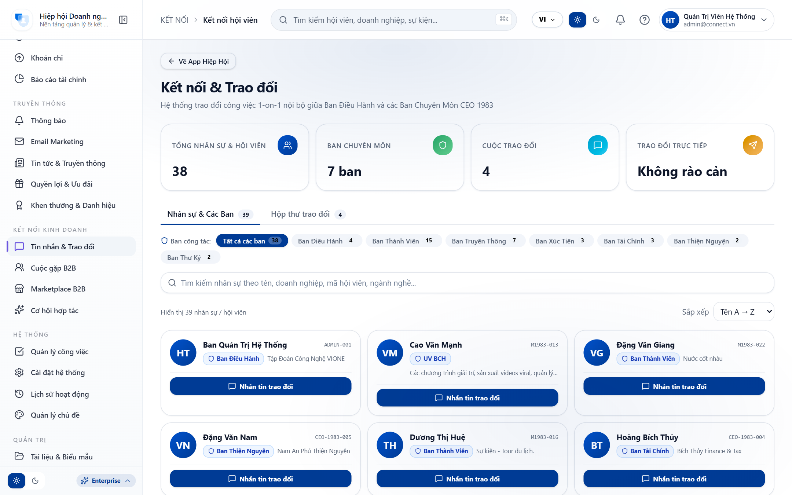

### 3. Quy chuẩn giao diện & Thao tác trò chuyện
- **Hiển thị tên Ban duy nhất**: Mỗi thẻ tài khoản được chuẩn hóa hiển thị tên Ban trực thuộc chính xác đúng 1 lần, không bị trùng lặp nhãn.
- **Nút "Nhắn tin trao đổi"**: Nhấn trực tiếp trên bất kỳ thẻ nhân sự nào để mở khung chat thời gian thực.
- Hỗ trợ gửi tin nhắn văn bản, tệp tài liệu Word/Excel/PDF và liên kết công việc phục vụ trao đổi nghiệp vụ nhanh chóng.

---

## BÀI 18: QUẢN TRỊ NHÀ TÀI TRỢ & CÁC GÓI TÀI TRỢ (/sponsors)

### 1. Mục đích chức năng
Quản trị nguồn lực xã hội hóa của hiệp hội. Thiết lập cơ cấu các gói tài trợ (Kim Cương, Vàng, Bạc, Đồng), theo dõi danh sách doanh nghiệp tài trợ cho từng sự kiện và lập báo cáo giải ngân quyền lợi.

- **Đường dẫn**: `https://crm.ceo1983.viconnect.vn/sponsors`

### 2. Giao diện thực tế thao tác
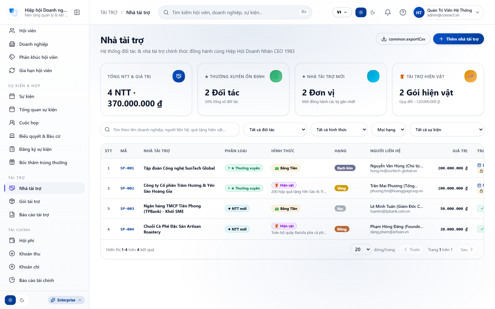

### 3. Thao tác thiết lập gói tài trợ
1. Cấu hình các gói tài trợ:
   - **Gói Kim Cương (Diamond)**: Quyền lợi phát biểu khai mạc Gala, chiếu TVC 3 phút trên màn hình LED lớn, logo ở vị trí trung tâm sân khấu, bàn tiệc VIP 1.
   - **Gói Vàng (Gold)**: Logo trên backdrop, phóng sự báo chí, bàn tiệc VIP 2.
   - **Gói Bạc (Silver)**: Logo trên vé điện tử E-Ticket, ấn phẩm kỷ yếu.
2. Gán nhà tài trợ vào sự kiện để hệ thống tự động vinh danh trên trang chi tiết sự kiện của Mobile App và Vé QR.

---

## BÀI 19: CÀI ĐẶT HỆ THỐNG & CẤU HÌNH TÀI KHOẢN VIETQR NGÂN HÀNG (/settings)

### 1. Mục đích chức năng
Cấu hình các thông số nền tảng của CLB Doanh Nhân CEO 1983: Thông tin pháp nhân, thông tin liên hệ, logo thương hiệu và đặc biệt là **Tài khoản ngân hàng thụ hưởng** để tự động sinh mã thanh toán VietQR Napas 24/7.

- **Đường dẫn**: `https://crm.ceo1983.viconnect.vn/settings`

### 2. Giao diện thực tế thao tác
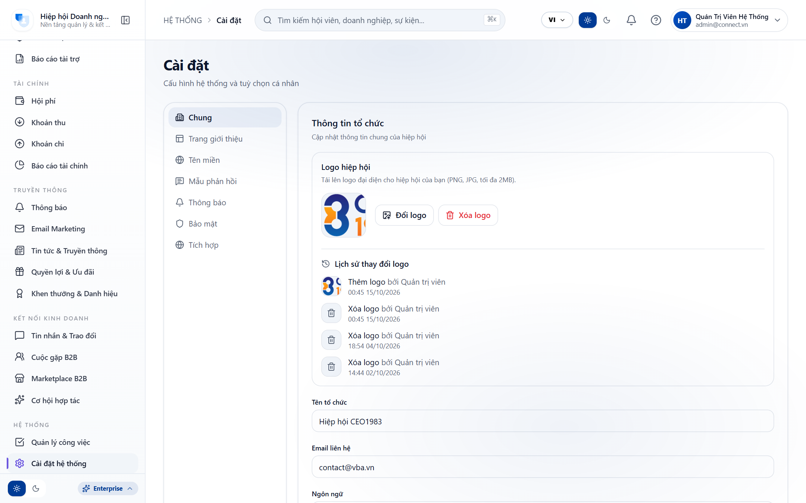

### 3. Mô tả các trường cấu hình cốt lõi

| Khối cài đặt | Trường dữ liệu | Hướng dẫn nhập | Mục đích vận hành |
| :--- | :--- | :--- | :--- |
| **Thông tin CLB** | Tên tổ chức | `CLB DOANH NHÂN CEO 1983 - HANOIBA` | Tiêu đề hiển thị trên văn bản và ứng dụng. |
| | Địa chỉ trụ sở | `Tầng 6, Tòa nhà V-Tower, 649 Kim Mã, Ba Đình, Hà Nội` | Thông tin xuất hóa đơn và pháp lý. |
| | Hotline & Email | `0983 1983 83` — `info@ceo1983.vn` | Kênh tiếp nhận hỗ trợ hội viên. |
| **Tài khoản VietQR** | Ngân hàng | Chọn ngân hàng (Ví dụ: `MBBank` hoặc `Vietcombank`). | Mã định danh BIN của ngân hàng chuyển mạch Napas. |
| | Số tài khoản nhận | Nhập số tài khoản chính xác của CLB. | Nơi nhận hội phí và tiền vé sự kiện. |
| | Tên chủ tài khoản | `CLB DOANH NHAN CEO 1983` (In hoa không dấu). | Khớp với tài khoản ngân hàng để sinh mã VietQR hợp lệ. |

---
*Tài liệu được phát hành và quản lý bởi Ban Quản Trị Hệ Thống CRM & Ban Thư Ký CLB Doanh Nhân CEO 1983.*