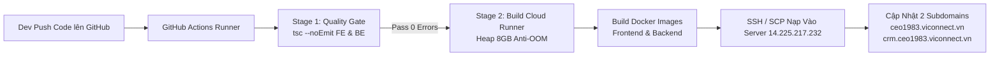

# HƯỚNG DẪN VẬN HÀNH, KIỂM THỬ DEV & AUTO DEPLOY 2 SUBDOMAIN CEO 1983

Tài liệu chuẩn hóa kiến trúc định tuyến, môi trường kiểm thử Dev và quy trình tự động triển khai (CI/CD Git) cho 2 subdomain chính thức của hệ thống Hiệp Hội Doanh Nhân CEO 1983 (HanoiBA):
1. **Mobile Web App CEO 1983**: `https://ceo1983.viconnect.vn`
2. **Hệ Thống Quản Trị CRM Hiệp Hội**: `https://crm.ceo1983.viconnect.vn`

---

## 1. Mô Hình Kiến Trúc & Phân Lập Môi Trường (Dev vs Subdomains)

Máy chủ hạ tầng: **IP 14.225.217.232** (Ubuntu Server / Docker Engine).
Hạ tầng mạng nội bộ: **`ceo1983-network`** (Đã loại bỏ triệt để và vĩnh viễn `vione-network`).

```
                                      Internet
                                         │
                    ┌────────────────────┴────────────────────┐
                    ▼                                         ▼
         ceo1983.viconnect.vn                      crm.ceo1983.viconnect.vn
         (Port 80/443 SSL)                         (Port 80/443 SSL)
                    │                                         │
                    └────────────────────┬────────────────────┘
                                         ▼
                     ┌──────────────────────────────────────┐
                     │ Nginx Reverse Proxy (ceo1983-ssl-proxy)│
                     │ Cổng 80: Tự động chuyển hướng sang 443│
                     │ Cổng 443: SSL SNI 2 Subdomain        │
                     │ Cổng 5443: Dev HTTPS Web CRM         │
                     │ Cổng 5444: Dev HTTPS Mobile CEO 1983 │
                     │ Cổng 5445: Cổng HTTPS dự phòng       │
                     │ Mạng nội bộ: ceo1983-network         │
                     └──────────────────┬───────────────────┘
                                        │
           ┌────────────────────────────┴────────────────────────────┐
           ▼                                                         ▼
[ceo1983.viconnect.vn & Dev Mobile]                       [crm.ceo1983.viconnect.vn & Dev CRM]
 ├─ Frontend: ceo1983-frontend-prod:8080                   ├─ Frontend: crm-frontend-prod:8080
 │   • Subdomain: https://ceo1983.viconnect.vn             │   • Subdomain: https://crm.ceo1983.viconnect.vn
 │   • Dev Test HTTP : http://14.225.217.232:5002          │   • Dev Test HTTP : http://14.225.217.232:5004
 │   • Dev Test HTTPS: https://14.225.217.232:5444         │   • Dev Test HTTPS: https://14.225.217.232:5443
 │   • Scope: association_app (Redirect / -> /association) │   • Scope: crm_platform (Portal /auth?portal=crm)
 └─ Backend: ceo1983-backend-prod:4000 (Port 5003)         └─ Backend: crm-backend-prod:4000 (Port 5005)
    • Mạng: ceo1983-network                                   • Mạng: ceo1983-network
```

---

## 2. Bảng Danh Sách Đường Dẫn Kiểm Thử Dev & Subdomain Chính Thức

> [!IMPORTANT]
> **Toàn bộ cổng và đường dẫn server dev cũ được giữ nguyên 100%** để lập trình viên và kiểm thử viên kiểm tra tính đúng đắn trước khi đẩy hoặc công bố lên subdomain chính thức.

| Phân Hệ | Subdomain Chính Thức | Link Test Dev (HTTPS) | Link Test Dev (HTTP Trực Tiếp) | Ghi Chú |
| :--- | :--- | :--- | :--- | :--- |
| **Mobile App CEO 1983** | `https://ceo1983.viconnect.vn` | `https://14.225.217.232:5444` | `http://14.225.217.232:5002` | Tự động chuyển vào `/association` |
| **Web CRM Hiệp Hội** | `https://crm.ceo1983.viconnect.vn` | `https://14.225.217.232:5443` | `http://14.225.217.232:5004` | Cổng quản trị hội viên, sự kiện, sổ quỹ |
| **Backend API Mobile** | `https://ceo1983.viconnect.vn/api/` | `https://14.225.217.232:5444/api/` | `http://14.225.217.232:5003` | Cụm NestJS API Mobile |
| **Backend API CRM** | `https://crm.ceo1983.viconnect.vn/api/` | `https://14.225.217.232:5443/api/` | `http://14.225.217.232:5005` | Cụm NestJS API CRM |

---

## 3. Quy Trình Triển Khai Subdomain: 100% Tự Động Qua GitHub Actions (Không Deploy Ở Máy Cá Nhân)

> [!IMPORTANT]
> **QUY CHUẨN BẮT BUỘC**:
> - **KHÔNG DEPLOY SUBDOMAIN Ở MÁY CÁ NHÂN**: Máy cá nhân của lập trình viên chỉ phục vụ viết mã nguồn, kiểm thử type check và chạy thử trên môi trường dev nội bộ.
> - **SUBDOMAIN CHỈ ĐƯỢC DEPLOY QUA GITHUB ACTIONS**: Khi hoàn thành code và kiểm thử, lập trình viên chỉ cần chạy `git push` lên GitHub. Toàn bộ tiến trình build, đóng gói Docker và cập nhật lên 2 subdomain sẽ do **GitHub Actions tự động thực hiện trên đám mây của GitHub**, không tốn tài nguyên máy cá nhân.

---

### Cơ Chế Hoạt Động Của GitHub Actions Workflow (`.github/workflows/auto-deploy-subdomains.yml`):

Khi lập trình viên push code lên nhánh `main` hoặc `master`, GitHub Actions sẽ tự động khởi chạy pipeline gồm 2 giai đoạn:



1. **Giai đoạn 1 - Kiểm tra chất lượng (Quality Gate)**:
   - GitHub Actions chạy `tsc --noEmit` cho cả Frontend và Backend.
   - Nếu phát hiện bất kỳ lỗi gạch đỏ, thiếu biến hoặc cú pháp, pipeline dừng ngay lập tức để bảo vệ hệ thống subdomain.
2. **Giai đoạn 2 - Build trên Cloud Runner (8GB Heap Memory)**:
   - Sử dụng tài nguyên đám mây của GitHub (16GB RAM) để build `npm run build --prefix apps/ceo1983_app_fe` với cờ `--max-old-space-size=8192`.
   - Máy cá nhân và server VPS đều không bị treo hay quá tải bộ nhớ.
3. **Giai đoạn 3 - Đóng gói Docker Images**:
   - Tự động đóng gói `ceo1983-frontend`, `crm-frontend`, `ceo1983-backend`, `crm-backend`.
   - Nén images thành định dạng `.tar.gz` tốc độ cao.
4. **Giai đoạn 4 - Triển khai tự động tới máy chủ VPS (14.225.217.232)**:
   - Kết nối an toàn qua SSH/SCP bằng GitHub Secrets.
   - Tự động nạp Docker images và gọi lệnh tái khởi động không mất dữ liệu:
     ```bash
     docker compose -f docker-compose.yml up -d --force-recreate
     ```
   - Cập nhật Nginx SSL Proxy và mở thông toàn bộ 2 subdomain.

---

### Hướng Dẫn Cấu Hình GitHub Secrets (Chỉ Cần Làm 1 Lần Duy Nhất Trên GitHub):

Để GitHub Actions có quyền kết nối và cập nhật tự động lên VPS `14.225.217.232`, bạn vào kho chứa trên GitHub:
1. Mở Repository trên GitHub -> Bấm vào tab **Settings** (Cài đặt).
2. Ở thanh bên trái, chọn **Secrets and variables** -> Chọn **Actions**.
3. Bấm nút **New repository secret** màu xanh và tạo 2 biến sau:
   - Tên biến: **`SSH_PRIVATE_KEY`**
     - Giá trị: Nội dung Private Key của VPS (nếu đăng nhập bằng SSH Key).
     *(Hoặc nếu VPS dùng mật khẩu root thì tạo biến tên **`SSH_PASSWORD`** với giá trị là mật khẩu root của VPS).*
   - Tên biến: **`REMOTE_HOST`** (Tùy chọn, mặc định đã là `14.225.217.232`).
   - Tên biến: **`REMOTE_USER`** (Tùy chọn, mặc định đã là `root`).

---

### Trải Nghiệm Của Lập Trình Viên Từ Nay:
1. Lập trình viên code và kiểm thử thoải mái trên máy cá nhân hoặc link dev (`:5002`, `:5004`).
2. Khi muốn đưa code lên 2 subdomain:
   ```bash
   git add .
   git commit -m "Tính năng mới cho CEO 1983 & CRM"
   git push origin main
   ```
3. Mở tab **Actions** trên GitHub để theo dõi tiến trình chạy tự động (khoảng 2-3 phút là toàn bộ 2 subdomain được cập nhật code mới hoàn toàn). Lập trình viên **không cần chạy bất kỳ lệnh deploy nào từ máy cá nhân**.

---

## 4. Cấu Hình Bản Ghi Tên Miền DNS (Domain DNS Records)

Để 2 subdomain trỏ chính xác về máy chủ `14.225.217.232`, cấu hình tại trang quản trị DNS nhà cung cấp tên miền của `viconnect.vn`:

| Loại Record | Tên Host (Name) | Giá trị (Value / IPv4) | TTL | Mục đích |
| :--- | :--- | :--- | :--- | :--- |
| **A** | `ceo1983` | `14.225.217.232` | 300 / Auto | Subdomain Mobile App CEO 1983 |
| **A** | `crm.ceo1983` | `14.225.217.232` | 300 / Auto | Subdomain Quản Trị CRM Hiệp Hội |

---

## 5. Quy Chuẩn Đặt Tên & Xóa Bỏ Hoàn Toàn `vione-network`
- Mạng Docker: Đổi thành **`ceo1983-network`** (Đảm bảo tất cả container `ceo1983-frontend-prod`, `ceo1983-backend-prod`, `crm-frontend-prod`, `crm-backend-prod` và `ceo1983-ssl-proxy` thông mạng với nhau).
- Tên Container Proxy: **`ceo1983-ssl-proxy`**.
- Khối lượng lưu trữ ảnh tải lên: **`ceo1983-uploads-data`**.
