# CẨM NANG HƯỚNG DẪN SỬ DỤNG ỨNG DỤNG DI ĐỘNG HỘI VIÊN
## HỆ THỐNG GIAO THƯƠNG & KẾT NỐI DOANH NHÂN CEO 1983 (HANOIBA)
*Phiên bản: 5.0 — Thiết kế Mobile-First tối ưu trải nghiệm Doanh nhân*
*Subdomain chính thức: `https://ceo1983.viconnect.vn`*

---

## MỤC LỤC TỔNG QUAN

- [1. TỔNG QUAN ỨNG DỤNG DI ĐỘNG & ĐĂNG NHẬP HỘI VIÊN](#1-tổng-quan-ứng-dụng-di-động--đăng-nhập-hội-viên)
- [2. HƯỚNG DẪN CHI TIẾT 17 PHÂN HỆ CHỨC NĂNG (FUNCTIONAL NODES)](#2-hướng-dẫn-chi-tiết-17-phân-hệ-chức-năng-functional-nodes)
  - [NODE-APP-001: Trang Chủ Ticker Nến Realtime & Shortcut Tin Nhắn Nhanh](#node-app-001-trang-chủ-ticker-nến-realtime--shortcut-tin-nhắn-nhanh)
  - [NODE-APP-002: Thẻ Hội Viên VIP Số, QR Cá Nhân Hóa & Quyền Riêng Tư](#node-app-002-thẻ-hội-viên-vip-số-qr-cá-nhân-hóa--quyền-riêng-tư)
  - [NODE-APP-003: Trang Quét Danh Thiếp Công Khai Bảo Mật](#node-app-003-trang-quét-danh-thiếp-công-khai-bảo-mật)
  - [NODE-APP-004: Danh Bạ Hội Viên & Bản Đồ 2D Google Maps Dẫn Đường GPS](#node-app-004-danh-bạ-hội-viên--bản-đồ-2d-google-maps-dẫn-đường-gps)
  - [NODE-APP-005: Cơ Hội Giao Thương B2B Strip 3 Thẻ Ngang](#node-app-005-cơ-hội-giao-thương-b2b-strip-3-thẻ-ngang)
  - [NODE-APP-006: Trung Tâm Thống Kê 5 Phân Loại Nghiệp Vụ & Bục Vinh Danh Top 3](#node-app-006-trung-tâm-thống-kê-5-phân-loại-nghiệp-vụ--bục-vinh-danh-top-3)
  - [NODE-APP-007: Sàn Giao Thương B2B Marketplace Giới Hạn 5 Sản Phẩm/DN](#node-app-007-sàn-giao-thương-b2b-marketplace-giới-hạn-5-sản-phẩmdn)
  - [NODE-APP-008: Sự Kiện CLB Lớn & Cuộc Họp Gặp Mặt 2 Kiểu YBA](#node-app-008-sự-kiện-clb-lớn--cuộc-họp-gặp-mặt-2-kiểu-yba)
  - [NODE-APP-009: Biểu Quyết Trực Tuyến Gắn Liền Với Sự Kiện / Cuộc Họp](#node-app-009-biểu-quyết-trực-tuyến-gắn-liền-với-sự-kiện--cuộc-họp)
  - [NODE-APP-010: Bảng Tin Mạng Lưới Moments, Thẻ Điểm Danh & Nhận Phát Thanh CRM](#node-app-010-bảng-tin-mạng-lưới-moments-thẻ-điểm-danh--nhận-phát-thanh-crm)
  - [NODE-APP-011: Hồ Sơ Cá Nhân Tối Giản, Thẻ Trạng Thái Theme CRM & Hợp Đồng](#node-app-011-hồ-sơ-cá-nhân-tối-giản-thẻ-trạng-thái-theme-crm--hợp-đồng)
  - [NODE-APP-012: Cài Đặt Hệ Thống, Trợ Lý AI & Đổi Mật Khẩu Bắt Buộc](#node-app-012-cài-đặt-hệ-thống-trợ-lý-ai--đổi-mật-khẩu-bắt-buộc)
  - [NODE-APP-013: Danh Sách Ưu Đãi QR Động & Bản Đồ Điểm Sử Dụng](#node-app-013-danh-sách-ưu-đãi-qr-động--bản-đồ-điểm-sử-dụng)
  - [NODE-APP-014: Cầu Nối Native Android / iOS & Push Notification Service Worker](#node-app-014-cầu-nối-native-android--ios--push-notification-service-worker)
  - [NODE-APP-015: Phân Hệ Gặp Gỡ Kết Nối B2B 1-on-1 Độc Lập](#node-app-015-phân-hệ-gặp-gỡ-kết-nối-b2b-1-on-1-độc-lập)
  - [NODE-APP-016: Đào Tạo Di Động & Phòng Họp Video Call Jitsi](#node-app-016-đào-tạo-di-động--phòng-họp-video-call-jitsi)
  - [NODE-APP-017: Lịch Hoạt Động & Công Cụ Nhắc Hẹn Active Reminder](#node-app-017-lịch-hoạt-động--công-cụ-nhắc-hẹn-active-reminder)
- [3. HƯỚNG DẪN CÀI ĐẶT PWA LÊN MÀN HÌNH CHÍNH (HOMESCREEN)](#3-hướng-dẫn-cài-đặt-pwa-lên-màn-hình-chính-homescreen)

---

## 1. TỔNG QUAN ỨNG DỤNG DI ĐỘNG & ĐĂNG NHẬP HỘI VIÊN

### 1.1. Mục Tiêu & Triết Lý Thiết Kế Ứng Dụng
Ứng dụng Di động Hội viên CLB Doanh Nhân CEO 1983 (HanoiBA) được xây dựng theo triết lý **Mobile-First VIP Member Shell**, hướng tới phục vụ trực tiếp các Chủ tịch, Tổng Giám Đốc, CEO doanh nhân với trải nghiệm tinh tế, tốc độ cao và thao tác 1 chạm:
- **Thanh Điều Hướng Đáy 5 Tab Cốt Lõi (Bottom Navigation)**:
  1. **Tab 1: Trang Chủ** (`Home`)
  2. **Tab 2: Thống Kê** (`Analytics`)
  3. **Tab 3: Sàn B2B** (`B2B Marketplace`)
  4. **Tab 4: Mạng Lưới** (`Network Moments`)
  5. **Tab 5: Cá Nhân** (`Profile`)
- **Bộ Nhận Diện 3 Màu Doanh Nhân**:
  - Đỏ Ruby: Điểm nhấn năng động, cờ hiệu, nút kêu gọi hành động (CTA).
  - Vàng Hoàng Gia: Viền bục vinh danh Top 1, huy hiệu VIP, xếp hạng hội viên.
  - Xanh Sapphire: Nền thẻ danh thiếp, thanh tiêu đề và khối điều hướng trang trọng.

### 1.2. Hướng Dẫn Đăng Nhập Hội Viên
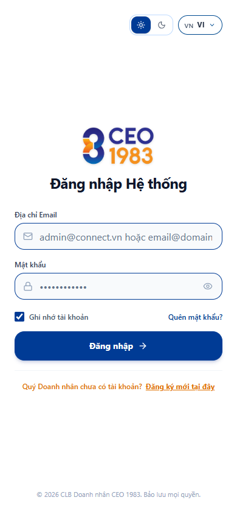

- **Bước 1**: Mở trình duyệt điện thoại (Safari trên iOS hoặc Chrome trên Android), truy cập `https://ceo1983.viconnect.vn/auth`.
- **Bước 2**: Nhập Email hội viên đã được Ban Thư Ký phê duyệt (ví dụ: `vuvp090120@gmail.com` hoặc email doanh nghiệp của bạn).
- **Bước 3**: Nhập Mật khẩu được cấp.
- **Bước 4**: Nhấn nút **[Đăng nhập]**.
  - Hệ thống tự động xác thực và đưa bạn vào ngay **Trang Chủ Ticker Nến Realtime**.
  - *Lưu ý*: Với tài khoản đăng nhập lần đầu có cờ `must_change_password = true`, ứng dụng sẽ tự động yêu cầu bạn thiết lập mật khẩu mới để đảm bảo tính an toàn dữ liệu cá nhân.

---

## 2. HƯỚNG DẪN CHI TIẾT 17 PHÂN HỆ CHỨC NĂNG (FUNCTIONAL NODES)

---

### [NODE-APP-001]: Trang Chủ Ticker Nến Realtime, Trung Tâm Thông Báo & Tùy Biến Giao Diện Brandbook

#### 1. Mục đích Nghiệp Vụ
Màn hình trung tâm chào đón doanh nhân với đồ thị hình nến Ticker biến động giá trị giao thương B2B của hiệp hội theo thời gian thực, lối tắt nhanh đến tin nhắn kết nối, trung tâm thông báo thời gian thực và bộ điều khiển tùy biến màu sắc thương hiệu Brandbook (Đỏ Ruby, Vàng Hoàng Gia, Xanh Doanh Nhân, Cam Tiên Phong, Chế độ Tối Dark Mode).

#### 2. Đường Dẫn & Vị Trí
- **Route Trang Chủ**: `/association`
- **Route Trung Tâm Thông Báo**: `/association/notifications`
- **Route Cấu Hình Giao Diện**: `/association/system-config`
- **Bottom Tab**: **Tab 1 — Trang Chủ** (Biểu tượng `Home`).

#### 3. Bộ Giao Diện Thực Tế Chi Tiết
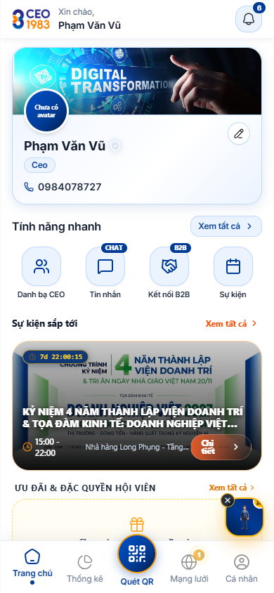
*Hình 1.1: Trang chủ ứng dụng di động với đồ thị nến Ticker giao thương và các phím tắt nhanh.*

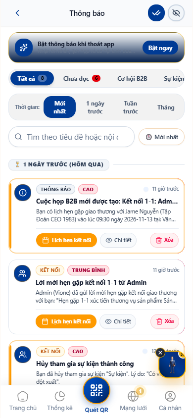
*Hình 1.2: Trung tâm thông báo đẩy (/association/notifications): Thông báo hệ thống, lời mời kết nối, giao thương mới và cập nhật sự kiện.*

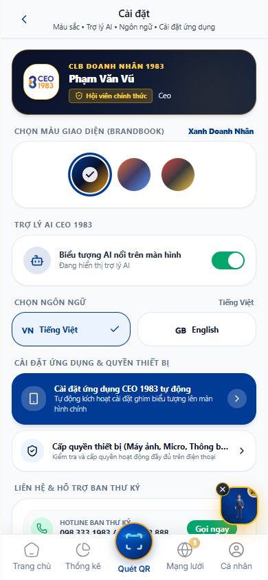
*Hình 1.3: Màn hình cài đặt giao diện (/association/system-config): Lựa chọn 4 màu chủ đề Brandbook, chuyển đổi Sáng/Tối và cấu hình trợ lý AI.*

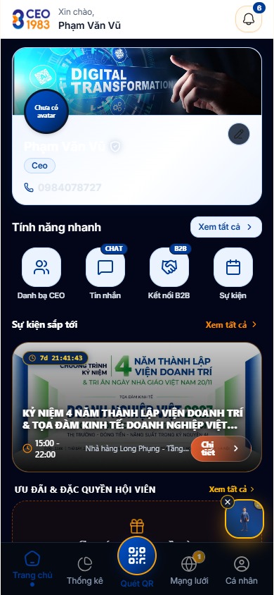
*Hình 1.4: Giao diện ứng dụng ở chế độ Tối (Dark Mode): Tối ưu trải nghiệm sử dụng ban đêm, sang trọng, đẳng cấp doanh nhân.*

#### 4. Các Thao Tác Chi Tiết Toàn Bộ Phân Hệ
1. **Theo Dõi Đồ Thị Nến Ticker Giao Thương (Candlestick Widget)**:
   - Thể hiện sự biến động và tổng giá trị cơ hội kinh doanh phát sinh trong ngày, tuần, tháng.
   - Nến xanh thể hiện phiên giao thương tăng trưởng, nến đỏ thể hiện sự chững lại trong kết nối.
2. **Quản Lý & Xem Thông Báo Hội Viên (/association/notifications)**:
   - Ở góc trên màn hình, chạm vào **Biểu tượng Chuông Thông Báo (Bell Icon)**:
     - Chấm đỏ kèm con số thể hiện số lượng thông báo chưa đọc.
     - Danh sách thông báo phân loại rõ ràng: *Thông báo sự kiện*, *Tin nhắn cơ hội hợp tác*, *Lịch hẹn gặp 1-on-1*, *Thông báo nộp phí niên liễm*.
     - Chạm vào từng thông báo để mở trực tiếp nội dung chi tiết hoặc đánh dấu "Đã đọc tất cả".
3. **Tùy Biến Màu Sắc Thương Hiệu Brandbook (/association/system-config)**:
   - Vào mục **Cá Nhân** -> chọn **Cài đặt Hệ thống** (hoặc truy cập `/association/system-config`):
   - **Lựa chọn 4 Màu Chủ Đề Cốt Lõi**:
     - 🔴 **Đỏ Nhiệt Huyết (Ruby Red)**: Truyền cảm hứng năng động, quyết liệt.
     - 🟡 **Vàng Hoàng Gia (Royal Gold)**: Sang trọng, thịnh vượng, đẳng cấp quý phái.
     - 🔵 **Xanh Doanh Nhân (Sapphire Blue)**: Bền vững, trí tuệ, tin cậy.
     - 🟠 **Cam Tiên Phong (Pioneer Orange)**: Đột phá, sáng tạo, dẫn dắt xu thế.
   - Khi chọn màu, toàn bộ viền thẻ, nút bấm CTA, biểu đồ và hiệu ứng ánh sáng trong ứng dụng lập tức chuyển đổi đồng bộ trong tích tắc.
4. **Chuyển Đổi Giao Diện Sáng / Tối (Light Mode / Dark Mode)**:
   - Tại màn hình Cài đặt, gạt công tắc chuyển đổi giữa **Theme Sáng (Light)** và **Theme Tối (Dark)**.
   - Giao diện Dark Mode sử dụng tông màu đen sâu kết hợp ánh viền vàng hoàng gia, giúp tiết kiệm pin màn hình OLED và bảo vệ mắt khi sử dụng buổi tối.
5. **Cấu Hình Trợ Lý Giọng Nói AI & Ngôn Ngữ**:
   - Bật / tắt tính năng Giọng nói AI chào mừng buổi sáng.
   - Chuyển đổi ngôn ngữ hiển thị giữa Tiếng Việt (`vi`) và Tiếng Anh (`en`).

---

### [NODE-APP-002]: Thẻ Hội Viên VIP Số, QR Cá Nhân Hóa & Quyền Riêng Tư

#### 1. Mục đích Nghiệp Vụ
Cung cấp Thẻ danh thiếp số điện tử (Digital Business Card) thay thế danh thiếp giấy truyền thống. Tích hợp mã QR cá nhân hóa để đối tác quét kết bạn và công tắc bảo vệ quyền riêng tư số điện thoại / email.

#### 2. Đường Dẫn & Vị Trí
- **Route**: `/association/card`
- **Cách mở**: Nhấp vào biểu tượng Thẻ VIP trên Trang Chủ hoặc vào Menu Hồ sơ cá nhân.

#### 3. Giao Diện Thực Tế
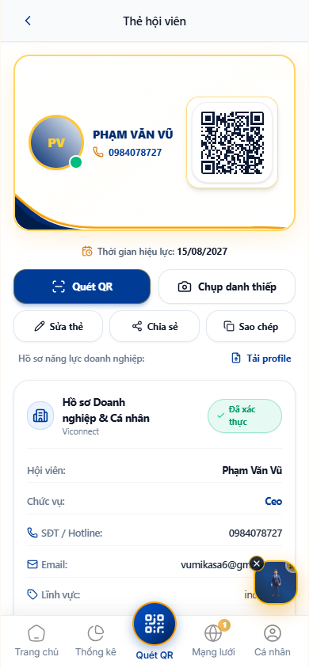

#### 4. Các Thao Tác Chi Tiết
1. **Trải Nghiệm Thẻ Danh Thiếp VIP Xoay 2 Mặt**:
   - Mặt trước: Ảnh chân dung doanh nhân, Họ tên, Chức danh trong CLB (ví dụ: Trưởng Ban Truyền Thông), Tên doanh nghiệp thành viên và Logo công ty đặt ở góc trên bên phải.
   - Mã QR định danh cá nhân hóa: Cho phép chạm vào để phóng to toàn màn hình khi đi dự sự kiện giao lưu.
2. **Thiết Lập Quyền Riêng Tư (Privacy Toggles)**:
   - Gạt công tắc **"Ẩn / Hiện Số Điện Thoại"**: Khi tắt, người ngoài quét thẻ sẽ không thấy số di động.
   - Gạt công tắc **"Ẩn / Hiện Email"**: Bảo vệ hộp thư cá nhân khỏi spam quảng cáo.
3. **Quét Mã QR Đối Tác (Scan QR Button)**:
   - Nhấp nút **[Quét QR]** để mở camera trực tiếp trên ứng dụng, quét danh thiếp số của CEO khác và tự động lưu danh bạ đối tác vào mục Kết nối.

---

### [NODE-APP-003]: Trang Quét Danh Thiếp Công Khai Bảo Mật

#### 1. Mục đích Nghiệp Vụ
Trang đích hiển thị công khai khi người ngoài (chưa có tài khoản app) quét mã QR trên danh thiếp của bạn. Tôn trọng 100% các cài đặt quyền riêng tư bạn đã thiết lập.

#### 2. Đường Dẫn & Vị Trí
- **Route**: `/card/$code` (Ví dụ: `https://ceo1983.viconnect.vn/card/MBMWD8P4NX`)

#### 3. Giao Diện Thực Tế
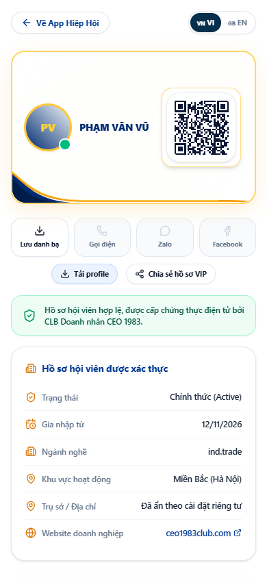

#### 4. Các Thao Tác Chi Tiết
1. **Xem Thông Tin Nhận Diện Doanh Nhân**:
   - Người quét nhìn thấy thẻ danh thiếp chuẩn nhận diện CLB CEO 1983 (HanoiBA).
   - Nếu bạn bật chế độ ẩn số điện thoại, màn hình sẽ hiển thị biểu tượng: `🔒 Đã ẩn theo cài đặt riêng tư của chủ thẻ`.
2. **Lưu Danh Bạ Vào Danh Bạ Điện Thoại (.vcf)**:
   - Người quét nhấp nút **[Lưu vào Danh bạ]**: Điện thoại tự động tải file vCard và mở ứng dụng Contacts trên iOS/Android để lưu ngay họ tên, công ty và chức vụ của bạn.
3. **Nút "Đăng Ký Gia Nhập CLB CEO 1983"**:
   - Giúp lan tỏa thương hiệu hiệp hội tới các đối tác doanh nhân bên ngoài.

---

### [NODE-APP-004]: Danh Bạ Hội Viên & Bản Đồ 2D Google Maps Dẫn Đường GPS

#### 1. Mục đích Nghiệp Vụ
Tìm kiếm và tra cứu thông tin toàn bộ các doanh nhân thành viên trong CLB theo họ tên, doanh nghiệp, ngành nghề. Tích hợp Bản đồ 2D Google Maps định vị trụ sở doanh nghiệp và dẫn đường chỉ đường GPS thời gian thực.

#### 2. Đường Dẫn & Vị Trí
- **Route**: `/association/members`
- **Cách mở**: Chọn mục **"Danh Bạ Hội Viên"** từ Trang Chủ.

#### 3. Giao Diện Thực Tế
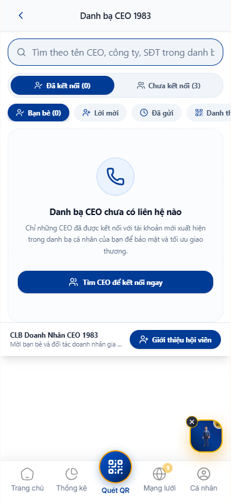

#### 4. Các Thao Tác Chi Tiết
1. **Tra Cứu Danh Bạ Thông Minh**:
   - Nhập từ khóa: Tên doanh nhân, tên công ty hoặc từ khóa ngành nghề (ví dụ: "Xây dựng", "Công nghệ", "Luật", "Bất động sản").
   - Lọc nhanh theo Ban chuyên môn hoặc Phân hạng hội viên.
2. **Chuyển Đổi Sang Chế Độ Bản Đồ (Map View)**:
   - Nhấp vào biểu tượng **[Bản Đồ]** ở góc trên danh sách.
   - Ứng dụng mở modal bản đồ tương tác Google Maps 2D (`CeoInteractiveMapModal`):
     - Hiển thị các chấm ghim đại diện cho văn phòng/trụ sở của từng công ty thành viên.
     - Có 2 phạm vi: "Tổng thể CLB" hoặc "Khu vực quanh tôi".
3. **Dẫn Đường Trực Tiếp (GPS Geolocation Navigation)**:
   - Chạm vào một điểm ghim doanh nghiệp, thông tin tóm tắt xuất hiện kèm nút **[Chỉ đường Google Maps]**.
   - Ứng dụng tự động kích hoạt ứng dụng Google Maps hoặc Apple Maps trên điện thoại để dẫn đường bạn đến tận văn phòng đối tác.

---

### [NODE-APP-005]: Cơ Hội Giao Thương B2B Strip 3 Thẻ Ngang

#### 1. Mục đích Nghiệp Vụ
Không gian trao đổi các cơ hội hợp tác kinh doanh, giới thiệu khách hàng tiềm năng giữa các doanh nhân trong hiệp hội. Giao diện thiết kế dải 3 thẻ ngang gọn gàng, không gây rối mắt.

#### 2. Đường Dẫn & Vị Trí
- **Route**: `/association/opportunities`
- **Cách mở**: Chọn **"Cơ Hội B2B"** trên màn hình chính.

#### 3. Giao Diện Thực Tế
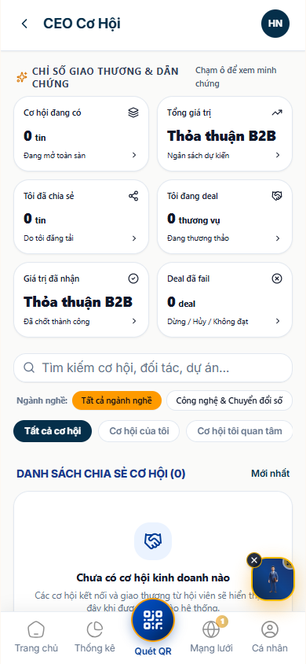

#### 4. Các Thao Tác Chi Tiết
1. **Quan Sát Dải 3 Thẻ Chỉ Số Ngang (Top Strip Cards)**:
   - **Thẻ 1 — "Tổng Chia Sẻ"**: Số lượng cơ hội kinh doanh đã phát sinh trong toàn CLB.
   - **Thẻ 2 — "Deal Đã Chốt"**: Tổng số thương vụ đã ký kết thành công giữa các thành viên.
   - **Thẻ 3 — "Tôi Share Đi"**: Điểm số cống hiến cá nhân của bạn đối với mạng lưới.
2. **Trao Cơ Hội Mới (Give an Opportunity)**:
   - Nhấp nút **[+ Trao Cơ Hội]**.
   - Chọn Người nhận trong danh bạ CLB.
   - Nhập Tiêu đề nhu cầu (Ví dụ: "Cần tìm nhà thầu cơ điện công trình 15 tầng tại Cầu Giấy").
   - Nhập Quy mô giá trị hợp đồng ước tính và Thông tin liên hệ đầu mối.
   - Nhấn **[Gửi ngay]**: Người nhận lập tức nhận được thông báo đẩy trên điện thoại.
3. **Theo Dõi Tiến Độ Hợp Tác**:
   - Cập nhật trạng thái: "Đã liên hệ" -> "Đang đàm phán" -> "Ký hợp đồng thành công".

---

### [NODE-APP-006]: Trung Tâm Thống Kê 5 Phân Loại Nghiệp Vụ & Bục Vinh Danh Top 3

#### 1. Mục đích Nghiệp Vụ
Báo cáo minh bạch hóa hiệu quả hoạt động hiệp hội trên thiết bị cầm tay: Doanh thu B2B, tăng trưởng hội viên, tần suất gặp gỡ 1-on-1, chuyên cần điểm danh và đào tạo. Tôn vinh các doanh nhân cống hiến xuất sắc nhất.

#### 2. Đường Dẫn & Vị Trí
- **Route**: `/association/analytics`
- **Bottom Tab**: **Tab 2 — Thống Kê** (Biểu tượng `BarChart3`).

#### 3. Giao Diện Thực Tế
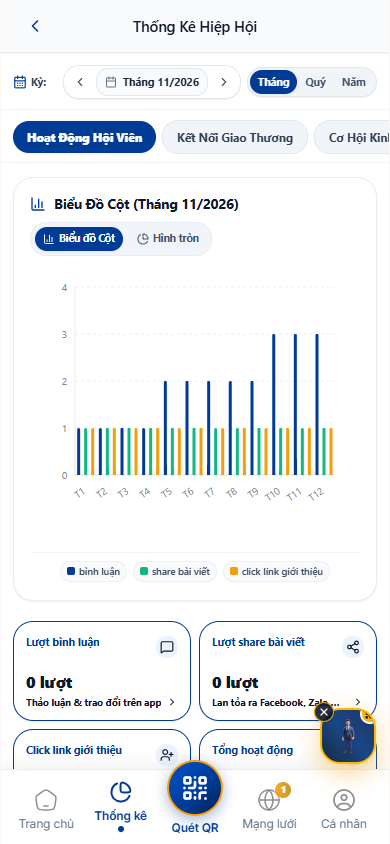

#### 4. Các Thao Tác Chi Tiết
1. **Lướt Xem 5 Danh Mục Báo Cáo Nghiệp Vụ**:
   - Chạm chuyển đổi giữa 5 tab: Giao Thương B2B, Hội Viên, Kết Nối 1-1, Điểm Danh, Đào Tạo.
2. **Xem Biểu Đồ Tăng Trưởng Trực Quan**:
   - Biểu đồ nén gọn chuẩn tỉ lệ di động với cột màu xanh tăng trưởng và đường chỉ số bình quân.
3. **Chiêm Ngưỡng Bục Vinh Danh Top 3 Doanh Nhân Giver**:
   - Vị trí số 1 (Top 1) đặt ở giữa với bục vinh danh vàng rực rỡ, kèm vương miện và ảnh đại diện viền Amber Gold.
   - Vị trí số 2 và số 3 đặt đối xứng hai bên tạo nên bố cục trang trọng chuẩn phong cách giải thưởng doanh nhân.

---

### [NODE-APP-007]: Sàn Giao Thương B2B Marketplace Giới Hạn 5 Sản Phẩm/DN

#### 1. Mục đích Nghiệp Vụ
Chợ thương mại nội bộ B2B giúp các doanh nghiệp quảng bá sản phẩm, dịch vụ chủ lực tới mạng lưới lãnh đạo doanh nghiệp. Áp dụng quy tắc vàng: **Mỗi doanh nghiệp giới hạn tối đa 5 sản phẩm tiêu biểu** nhằm chống spam tin rác và nâng cao chất lượng sản phẩm.

#### 2. Đường Dẫn & Vị Trí
- **Route**: `/association/products`
- **Bottom Tab**: **Tab 3 — Sàn B2B** (Biểu tượng `ShoppingBag`).

#### 3. Giao Diện Thực Tế
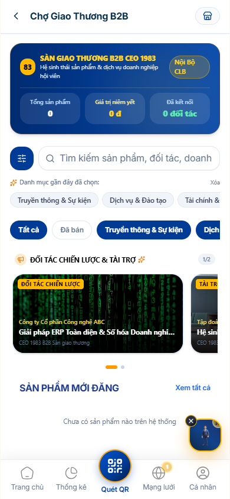

#### 4. Các Thao Tác Chi Tiết
1. **Lướt Gian Hàng & Lọc Danh Mục**:
   - Danh sách sản phẩm hiển thị dạng lưới thẻ sang trọng: Ảnh sản phẩm sắc nét, Giá ưu đãi nội bộ cho hội viên CEO 1983, Tên công ty cung cấp.
2. **Đăng Sản Phẩm Mới (Huy hiệu X/5 Sản Phẩm)**:
   - Nhấp nút **[+ Đăng Sản Phẩm]**.
   - Hệ thống hiển thị huy hiệu giới hạn (Ví dụ: `Đã đăng 2/5 sản phẩm`).
   - Tải lên tối đa 3 ảnh minh họa, nhập Tên sản phẩm, Giá niêm yết, Mức chiết khấu cho Hội viên CLB và Mô tả đặc tính nổi bật.
   - Nhấn **[Đăng sản phẩm]** để duyệt niêm yết lên sàn.
3. **Liên Hệ Trực Tiếp Người Bán (1 Chạm)**:
   - Nhấp vào nút **[Nhắn Tin]** hoặc **[Gọi Ngay]** trên thẻ sản phẩm để kết nối ngay với vị CEO chủ doanh nghiệp đó.

---

### [NODE-APP-008]: Sự Kiện CLB Lớn, Cuộc Họp Gặp Mặt & Vé Điện Tử QR Check-in

#### 1. Mục đích Nghiệp Vụ
Theo dõi lịch hoạt động toàn diện của Hiệp hội phân tách thành 2 loại hình chuẩn theo mô hình Hội Doanh nhân Trẻ (YBA):
1. **Sự Kiện Lớn Của CLB**: Gala thường niên, Diễn đàn kinh tế, Caravan kết nối đầu tư, Ngày Hội Doanh Trí.
2. **Cuộc Họp & Gặp Mặt Thường Kỳ**: Họp Ban Chấp Hành, Họp 6 Ban chuyên môn, Cafe kết nối sáng thứ Bảy, Thăm doanh nghiệp hội viên.
Tích hợp hệ thống quản lý vé điện tử đa phân hạng (VIP/Standard), mã QR Check-in cá nhân hóa hiển thị chính xác vị trí bàn tiệc / hàng ghế sân khấu đã được Ban Tổ Chức xếp sẵn trên CRM.

#### 2. Đường Dẫn & Vị Trí
- **Route**: `/association/events`
- **Cách mở**: Chọn mục **"Sự Kiện & Lịch Họp"** trên Trang Chủ.

#### 3. Bộ Giao Diện Thực Tế Chi Tiết
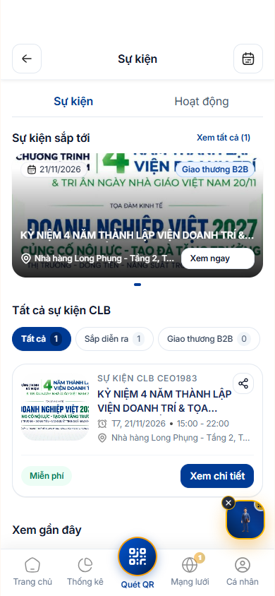
*Hình 8.1: Danh sách sự kiện toàn thể CLB và các phiên gặp mặt ban chuyên môn.*

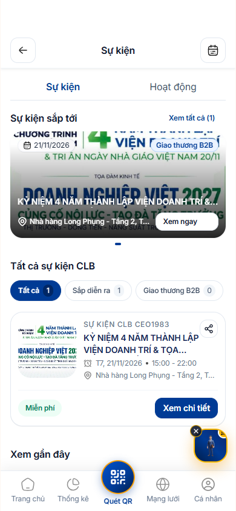
*Hình 8.2: Màn hình chi tiết sự kiện Ngày Hội Doanh Trí kèm vé QR check-in điện tử hiển thị mã vé, hạng vé và số bàn tiệc.*

#### 4. Các Thao Tác Chi Tiết Toàn Bộ Phân Hệ
1. **Chuyển Đổi Giữa 2 Tab Hoạt Động**:
   - **Tab "Sự Kiện Lớn"**: Hiển thị poster toàn màn hình, thời gian đếm ngược (countdown), địa điểm trung tâm hội nghị và số ghế còn lại.
   - **Tab "Cuộc Họp & Gặp Mặt"**: Hiển thị lịch sinh hoạt ban chuyên môn, chương trình thảo luận và nút điểm danh.
2. **Đăng Ký Tham Dự & Nhận Vé QR Check-in**:
   - Nhấp vào sự kiện bạn muốn tham dự, đọc kỹ Lịch trình Agenda chi tiết và danh sách các nhà tài trợ.
   - Nhấp **[Đăng Ký Tham Gia]**:
     - *Với sự kiện miễn phí*: Ứng dụng lập tức sinh Vé điện tử có mã QR check-in kèm số bàn tiệc.
     - *Với sự kiện có phí*: Màn hình hiển thị mã VietQR chuyển khoản MB Bank 1983000000; ngay khi kế toán xác nhận tiền về, vé QR sẽ tự động kích hoạt trên máy bạn.
3. **Sử Dụng Vé QR & Tìm Vị Trí Bàn Tiệc Khi Đến Sự Kiện**:
   - Tại quầy lễ tân đón tiếp, mở ứng dụng -> nhấp vào **[Vé Của Tôi]**:
   - Xuất trình mã QR trên màn hình điện thoại cho nhân sự Gatekeeper quét điểm danh.
   - Ứng dụng hiển thị thông tin rõ ràng: *Họ tên đại biểu, Phân hạng vé (VIP / Standard), Vị trí bàn tiệc (Ví dụ: Bàn VIP 01 - Ghế 03)* giúp đại biểu di chuyển vào đúng vị trí chỗ ngồi đã được ban tổ chức bố trí.
4. **Thêm Vào Lịch Điện Thoại (Add to Calendar)**:
   - Nhấp **[Lưu vào Lịch]** để tự động đồng bộ giờ họp vào ứng dụng Google Calendar hoặc Apple Calendar trên máy.

---

### [NODE-APP-009]: Biểu Quyết Trực Tuyến Gắn Liền Với Sự Kiện / Cuộc Họp

#### 1. Mục đích Nghiệp Vụ
Bỏ phiếu điện tử dân chủ, minh bạch, bảo mật cao. Mọi phiên biểu quyết đều gắn liền với Cuộc họp Ban Chấp Hành hoặc Sự kiện Đại hội cụ thể để nghị quyết có giá trị pháp lý thực thi.

#### 2. Đường Dẫn & Vị Trí
- **Route**: `/association/voting`
- **Cách mở**: Chọn mục **"Biểu Quyết Số"** từ menu tính năng.

#### 3. Giao Diện Thực Tế
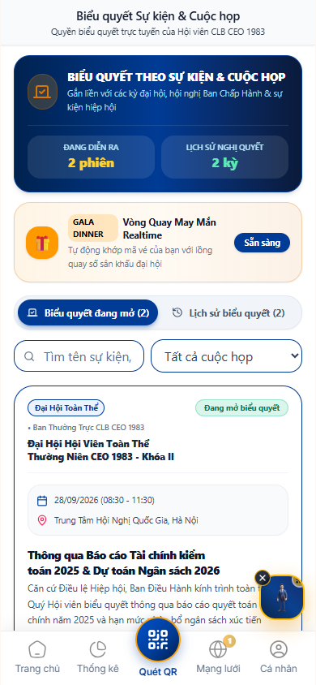

#### 4. Các Thao Tác Chi Tiết
1. **Xem Các Phiên Biểu Quyết Đang Mở**:
   - Đọc kỹ Tiêu đề nghị quyết, Tờ trình đính kèm và Thời hạn đóng hòm phiếu điện tử.
2. **Tiến Hành Bỏ Phiếu (1 Hội Viên = 1 Phiếu)**:
   - Chạm chọn một trong các phương án:
     - 🟢 **Tán thành (Đồng ý)**
     - 🔴 **Không tán thành**
     - ⚪ **Ý kiến khác / Bảo lưu**
   - Nhấn **[Xác Nhận Biểu Quyết]**.
3. **Theo Dõi Kết Quả Thời Gian Thực (Live Realtime Result)**:
   - Ngay sau khi bỏ phiếu, thanh biểu đồ % tỷ lệ đồng thuận tự động cập nhật thời gian thực qua giao thức Socket.IO.

---

### [NODE-APP-010]: Bảng Tin Mạng Lưới Moments, Tin Nhắn Trò Chuyện 1-on-1 & Thẻ Điểm Danh Check-in

#### 1. Mục đích Nghiệp Vụ
Không gian kết nối và trao đổi thông tin toàn diện của cộng đồng doanh nhân CEO 1983:
1. **Bảng tin Mạng lưới (Moments Feed)**: Chia sẻ khoảnh khắc kinh doanh, chúc mừng sinh nhật, ghi nhận giao thương, tiếp nhận thẻ điểm danh sự kiện và nhận các bài viết phát thanh từ Ban Thường Vụ CRM.
2. **Kênh Tin Nhắn & Trò Chuyện 1-on-1 (Private B2B Direct Messages)**: Trao đổi kín trực tiếp giữa 2 CEO, thương thảo hợp đồng, gửi lời mời hẹn gặp cafe, chia sẻ tài liệu và số liên lạc cá nhân an toàn.

#### 2. Đường Dẫn & Vị Trí
- **Route Bảng Tin Feed**: `/association/messages?tab=feed`
- **Route Tin Nhắn 1-on-1**: `/association/messages?tab=messages`
- **Bottom Tab**: **Tab 4 — Mạng Lưới** (Biểu tượng `Globe` / `MessageSquare`).

#### 3. Bộ Giao Diện Thực Tế Chi Tiết
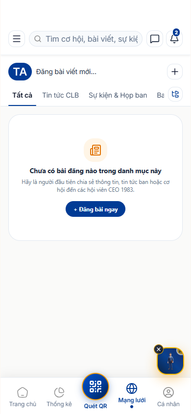
*Hình 10.1: Bảng tin khoảnh khắc giao thương nội bộ B2B và các bài viết phát thanh từ Ban Điều Hành.*

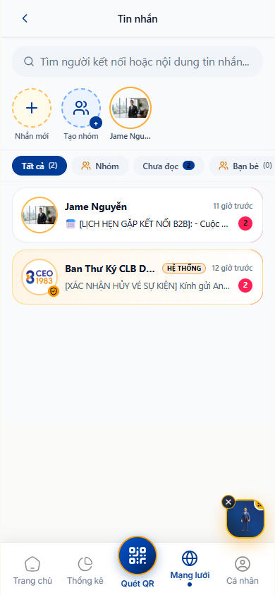
*Hình 10.2: Giao diện danh sách hội thoại và khung trò chuyện 1-on-1 thời gian thực giữa các lãnh đạo doanh nghiệp.*

#### 4. Các Thao Tác Chi Tiết Toàn Bộ Phân Hệ

##### A. Bảng Tin Mạng Lưới (Feed Moments)
1. **Đăng Bài Viết Chia Sẻ Khoảnh Khắc (Share Moments)**:
   - Chạm vào ô *"Hôm nay doanh nghiệp của bạn có tin gì mới?"*.
   - Viết nội dung chia sẻ, đính kèm tối đa 5 hình ảnh hoạt động sản xuất kinh doanh hoặc lễ ký kết hợp đồng.
   - Nhấn **[Đăng bài]** để hiển thị ngay trên bảng tin mạng lưới.
2. **Thẻ Điểm Danh Check-in Sự Kiện (@HọTên [✓ Đã Check-in])**:
   - Khi bạn quét mã QR tại cổng sự kiện, hệ thống tự động sinh một bài đăng thông báo chúc mừng bạn đã đến tham dự để các đối tác khác trong hội trường biết và chủ động tới giao lưu.
3. **Tương Tác & Thả Tim Doanh Nhân**:
   - Thả biểu cảm Thích, Chúc mừng, Bắt tay hợp tác và bình luận dưới bài viết của đồng nghiệp.

##### B. Trò Chuyện & Nhắn Tin 1-on-1 (Direct Messages)
1. **Mở Hộp Thoại Tin Nhắn**:
   - Chuyển sang Tab **"Tin Nhắn"** trên thanh tiêu đề hoặc nhấp nút **[Nhắn Tin]** trên Danh bạ hội viên / Thẻ danh thiếp của đối tác.
2. **Trò Chuyện Trực Tiếp Thời Gian Thực (Socket.IO Realtime)**:
   - Gửi tin nhắn văn bản, biểu tượng cảm xúc. Tin nhắn được mã hóa và chuyển phát tức thời qua Socket.IO.
   - Nhận thông báo đẩy (Push Notification) ngay khi có tin nhắn mới từ đối tác.
3. **Hẹn Gặp Cafe & Chia Sẻ Cơ Hội Hợp Tác**:
   - Trong khung chat, bạn có thể gửi nhanh đề xuất cuộc hẹn 1-on-1 hoặc liên kết dẫn tới sản phẩm trên Sàn Giao Thương B2B để đối tác tham khảo.

---

### [NODE-APP-011]: Hồ Sơ Cá Nhân Tối Giản, Thẻ Trạng Thái Theme CRM & Hợp Đồng

#### 1. Mục đích Nghiệp Vụ
Quản lý thông tin định danh lãnh đạo doanh nghiệp, xem quá trình công tác tại hiệp hội, quản lý hợp đồng hội viên điện tử và thẻ trạng thái đồng bộ giao diện Theme từ CRM.

#### 2. Đường Dẫn & Vị Trí
- **Route**: `/association/profile`
- **Bottom Tab**: **Tab 5 — Cá Nhân** (Biểu tượng `User`).

#### 3. Giao Diện Thực Tế
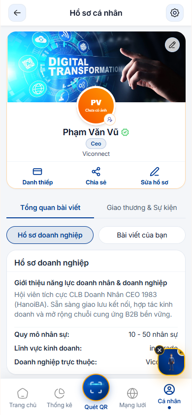

#### 4. Các Thao Tác Chi Tiết
1. **Xem Thông Tin Nhận Diện Lãnh Đạo**:
   - Ảnh đại diện chất lượng cao, Họ tên, Chức vụ trong hiệp hội (ví dụ: `Ủy Viên Ban Chấp Hành`, `Trưởng Ban Tài Chính`).
   - Thẻ trạng thái niên liễm: Hiển thị ngày hết hạn và số ngày còn hiệu lực.
2. **Chỉnh Sửa Nhanh Thông Tin (Quick Edit Profile)**:
   - Nhấp vào biểu tượng chỉnh sửa (cây bút).
   - Cập nhật số điện thoại liên lạc, giới thiệu vắn tắt về bản thân và triết lý kinh doanh.
3. **Xem Hợp Đồng & Giấy Chứng Nhận Hội Viên Điện Tử**:
   - Chạm mục **[Hợp Đồng Hội Viên]** để xem bản số hóa có chữ ký số của Chủ tịch CLB.

---

### [NODE-APP-012]: Cài Đặt Hệ Thống, Trợ Lý AI & Đổi Mật Khẩu Bắt Buộc

#### 1. Mục đích Nghiệp Vụ
Tùy biến trải nghiệm cá nhân: Bật/tắt thông báo đẩy, thay đổi ngôn ngữ (Tiếng Việt / English), kích hoạt Trợ lý ảo AI tư vấn kết nối giao thương và đổi mật khẩu bảo mật tài khoản.

#### 2. Đường Dẫn & Vị Trí
- **Route**: `/association/settings`
- **Cách mở**: Nhấp biểu tượng Bánh răng cài đặt ở góc trên màn hình Hồ sơ cá nhân.

#### 3. Giao Diện Thực Tế
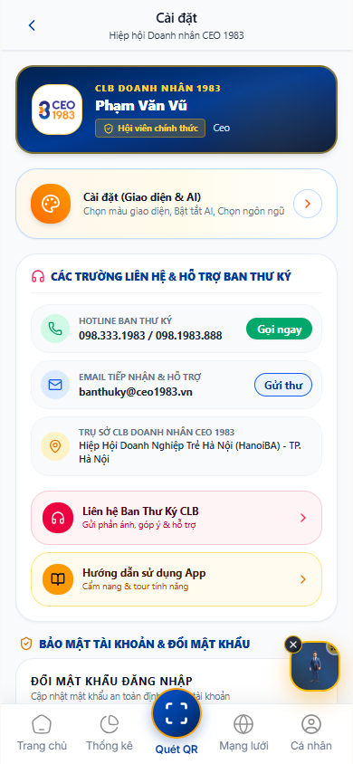

#### 4. Các Thao Tác Chi Tiết
1. **Tùy Chọn Thông Báo (Push Notification Settings)**:
   - Bật/tắt thông báo khi có: Sự kiện mới, Cuộc họp ban, Cơ hội B2B được trao cho bạn, Tin nhắn chat 1-on-1.
2. **Đổi Mật Khẩu Tài Khoản (Security Best Practice)**:
   - Nhập Mật khẩu hiện tại.
   - Nhập Mật khẩu mới (tối thiểu 6 ký tự, khuyến nghị có chữ hoa, chữ thường và số).
   - Nhập lại Mật khẩu mới để xác nhận.
   - Nhấn **[Lưu Mật Khẩu Mới]**.
3. **Hỗ Trợ Trực Tuyến 24/7**:
   - Nhấp vào hotline Ban Thư Ký để được hỗ trợ kỹ thuật và thủ tục hành chính.

---

### [NODE-APP-013]: Danh Sách Ưu Đãi QR Động & Bản Đồ Điểm Sử Dụng

#### 1. Mục đích Nghiệp Vụ
Đặc quyền dành riêng cho Hội viên CEO 1983: Tiếp cận hàng trăm ưu đãi giảm giá (từ 10% - 50%) tại các nhà hàng, khách sạn, resort, sân golf, dịch vụ nha khoa, chăm sóc sức khỏe của các doanh nghiệp thành viên. Tích hợp mã QR ưu đãi động và bản đồ dẫn đường.

#### 2. Đường Dẫn & Vị Trí
- **Route**: `/association/perks`
- **Cách mở**: Chọn mục **"Ưu Đãi Đặc Quyền"** trên Trang Chủ.

#### 3. Giao Diện Thực Tế
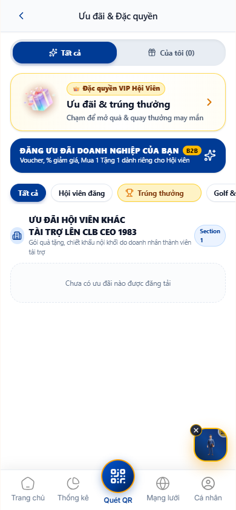

#### 4. Các Thao Tác Chi Tiết
1. **Tìm Kiếm Ưu Đãi Theo Ngành Dịch Vụ**:
   - Chọn danh mục: Ẩm thực & Nhà hàng, Nghỉ dưỡng & Khách sạn, Thể thao & Golf, Dịch vụ Doanh nghiệp.
2. **Sinh Mã QR Động Để Sử Dụng (Dynamic QR Code)**:
   - Chọn ưu đãi muốn dùng, nhấp nút **[Nhận Mã Ưu Đãi QR]**.
   - Màn hình hiển thị mã QR có hiệu lực trong 5 phút. Xuất trình mã này cho nhân viên thu ngân tại điểm dịch vụ để được áp dụng giảm giá ngay.
3. **Chỉ Đường Đến Điểm Áp Dụng**:
   - Nhấp nút **[Bản Đồ Điểm Đến]** để xem chi nhánh gần bạn nhất và dẫn đường Google Maps.

---

### [NODE-APP-014]: Cầu Nối Native Android / iOS & Push Notification Service Worker

#### 1. Mục đích Nghiệp Vụ
Vận hành nền tảng di động đa nền tảng (PWA kết hợp Native Wrapper Capacitor): Đảm bảo thông báo đẩy (Push Notifications) hoạt động ổn định, mượt mà như ứng dụng gốc, ngay cả khi điện thoại đang khóa màn hình.

#### 2. Kỹ Thuật & Trải Nghiệm
- Tự động đồng bộ token Firebase Cloud Messaging (FCM) và Web Push API.
- Hỗ trợ thao tác vuốt chạm cảm ứng (Touch gestures), rung phản hồi xúc giác (Haptic feedback) khi quét mã QR thành công.

---

### [NODE-APP-015]: Phân Hệ Gặp Gỡ Kết Nối B2B 1-on-1 Độc Lập

#### 1. Mục đích Nghiệp Vụ
Tổ chức các buổi gặp gỡ riêng giữa hai CEO (1-on-1 Business Matching) để tìm hiểu sâu về năng lực của nhau, xây dựng niềm tin và tiến tới hợp tác kinh doanh bền vững.

#### 2. Đường Dẫn & Vị Trí
- **Route**: `/association/connect`
- **Cách mở**: Chọn mục **"Kết Nối 1-on-1"** từ menu tính năng.

#### 3. Giao Diện Thực Tế
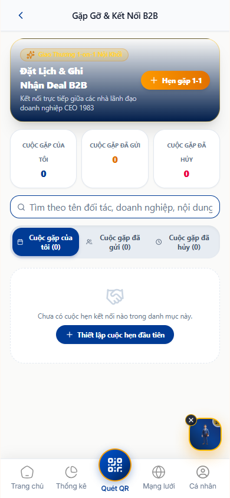

#### 4. Các Thao Tác Chi Tiết
1. **Gửi Lời Mời Gặp Mặt (Schedule a 1-on-1 Meeting)**:
   - Nhấp nút **[+ Đặt Lịch Hẹn]**.
   - Chọn Đối tác muốn gặp trong danh bạ CLB.
   - Chọn Ngày, Khung giờ và Địa điểm (ví dụ: Văn phòng công ty đối tác, Cafe Doanh nhân).
   - Nhập Mục tiêu thảo luận hợp tác.
   - Nhấn **[Gửi Lời Mời]**.
2. **Quản Lý 3 Tab Lịch Hẹn**:
   - **Tab "Lời mời đã nhận"**: Xem ai muốn gặp bạn, nhấn [Đồng ý] hoặc [Đổi giờ].
   - **Tab "Lời mời đã gửi"**: Theo dõi đối tác đã phản hồi hay chưa.
   - **Tab "Lịch sử cuộc gặp"**: Ghi chép biên bản cuộc gặp và số thương vụ tiềm năng.

---

### [NODE-APP-016]: Đào Tạo Di Động & Phòng Họp Video Call Jitsi

#### 1. Mục đích Nghiệp Vụ
Học tập mọi lúc mọi nơi: Theo dõi các khóa đào tạo quản trị doanh nghiệp, đọc tài liệu giáo trình và tham gia trực tiếp vào phòng họp trực tuyến Video Call Jitsi nhúng ngay trong ứng dụng di động mà không cần cài đặt thêm phần mềm Zoom hay Teams.

#### 2. Đường Dẫn & Vị Trí
- **Route**: `/association/training`
- **Cách mở**: Chọn mục **"Đào Tạo Di Động"** trên Trang Chủ.

#### 3. Giao Diện Thực Tế
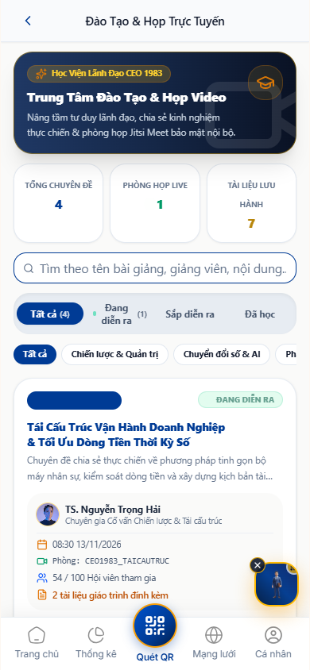

#### 4. Các Thao Tác Chi Tiết
1. **Xem Danh Sách Khóa Học**:
   - Xem tên chuyên đề, giảng viên chuyên gia và khung giờ diễn ra lớp học.
2. **Tải Giáo Trình & Tài Liệu**:
   - Chạm vào bài giảng để tải về file PDF hoặc slide tóm tắt kiến thức.
3. **Tham Gia Lớp Học Trực Tuyến 1 Chạm (Join Video Call)**:
   - Khi đến giờ học, nút **[Tham Gia Phòng Học Trực Tuyến]** chuyển sang màu xanh nổi bật.
   - Chạm vào nút: Ứng dụng tự động kết nối vào phòng video call Jitsi Meet bảo mật:
     - Bật/tắt Micro và Camera.
     - Giơ tay phát biểu ý kiến.
     - Khung chat trao đổi trực tiếp với diễn giả.

---

### [NODE-APP-017]: Lịch Hoạt Động & Công Cụ Nhắc Hẹn Active Reminder

#### 1. Mục đích Nghiệp Vụ
Trợ lý lịch trình cá nhân dành riêng cho CEO bận rộn: Tổng hợp toàn bộ các sự kiện bạn đã đăng ký, các cuộc họp ban bạn là thành viên và các cuộc hẹn kết nối 1-on-1 đã chốt. Tự động gửi thông báo nhắc nhở trước giờ diễn ra.

#### 2. Đường Dẫn & Vị Trí
- **Route**: `/association/calendar`
- **Cách mở**: Chọn mục **"Lịch Hoạt Động"** trên thanh lối tắt.

#### 3. Giao Diện Thực Tế
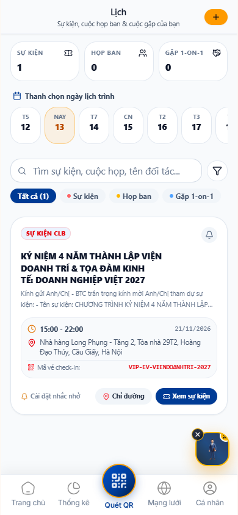

#### 4. Các Thao Tác Chi Tiết
1. **Xem Lịch Theo Dòng Thời Gian (Agenda Timeline)**:
   - Hiển thị trực quan theo thứ tự thời gian từ sáng đến tối.
   - Nhận diện màu sắc:
     - Màu Đỏ: Sự kiện lớn của CLB.
     - Màu Xanh: Cuộc họp Ban Chấp Hành.
     - Màu Vàng: Lịch hẹn giao thương B2B 1-on-1.
2. **Cài Đặt Thời Gian Nhắc Nhở Chủ Động (Active Reminder Engine)**:
   - Với mỗi lịch hẹn, chạm vào biểu tượng chuông nhắc nhở để chọn mốc báo trước:
     - [x] Trước 15 phút (chuẩn bị vào phòng)
     - [x] Trước 1 giờ (bắt đầu di chuyển)
     - [x] Trước 1 ngày (chuẩn bị tài liệu)
     - [x] Trước 3 ngày (sắp xếp công việc)
3. **Nhận Thông Báo Đẩy Thời Gian Thực**:
   - Khi chạm mốc đã hẹn, điện thoại tự động hiển thị thông báo đẩy kèm chuông báo nhắc bạn không bỏ sót bất kỳ cuộc gặp quan trọng nào.

---

## 3. HƯỚNG DẪN CÀI ĐẶT PWA LÊN MÀN HÌNH CHÍNH (HOMESCREEN)

Để sử dụng ứng dụng di động mượt mà như một ứng dụng Native trên điện thoại mà không cần tải từ App Store hay Google Play, Quý Doanh nhân vui lòng thực hiện 3 bước sau:

### 3.1. Đối Với Thiết Bị iPhone / iPad (iOS Safari)
1. Mở trình duyệt **Safari**, truy cập địa chỉ: `https://ceo1983.viconnect.vn`
2. Nhấn vào biểu tượng **Chia Sẻ (Share)** ở thanh điều hướng đáy màn hình (Biểu tượng ô vuông có mũi tên chỉ lên).
3. Cuộn xuống và chọn dòng **"Thêm vào Màn hình chính" (Add to Home Screen)**.
4. Nhấn **[Thêm] (Add)** ở góc trên bên phải.
   - *Biểu tượng ứng dụng CEO 1983 sẽ xuất hiện ngay trên màn hình chính của bạn, mở ra toàn màn hình và nhận thông báo đẩy nhanh chóng.*

### 3.2. Đối Với Thiết Bị Android (Samsung, Xiaomi, Oppo - Chrome)
1. Mở trình duyệt **Google Chrome**, truy cập địa chỉ: `https://ceo1983.viconnect.vn`
2. Nhấn vào biểu tượng **Ba chấm (Menu)** ở góc trên bên phải trình duyệt.
3. Chọn dòng **"Cài đặt ứng dụng" (Install App)** hoặc **"Thêm vào Màn hình chính"**.
4. Nhấn **[Cài đặt]**.
   - *Hệ thống tự động tải icon ứng dụng ra màn hình chính để bạn truy cập thuận tiện hàng ngày.*

