# CẨM NANG HƯỚNG DẪN SỬ DỤNG CỔNG QUẢN TRỊ WEB CRM
## HỆ THỐNG ĐIỀU HÀNH & KẾT NỐI DOANH NHÂN CLB CEO 1983 (HANOIBA)
*Phiên bản: 5.0 — Cập nhật chuẩn hóa theo Functional Node Traceability Matrix*
*Subdomain chính thức: `https://crm.ceo1983.viconnect.vn`*

---

## MỤC LỤC TỔNG QUAN

- [1. THÔNG TIN CHUNG & QUY CHUẨN AN TOÀN TRUY CẬP](#1-thông-tin-chung--quy-chuẩn-an-toàn-truy-cập)
- [2. HƯỚNG DẪN CHI TIẾT 24 PHÂN HỆ CHỨC NĂNG (FUNCTIONAL NODES)](#2-hướng-dẫn-chi-tiết-24-phân-hệ-chức-năng-functional-nodes)
  - [NODE-CRM-001: Tổng Quan & Dashboard KPI CLB](#node-crm-001-tổng-quan--dashboard-kpi-clb)
  - [NODE-CRM-002: Trung Tâm Thống Kê Chuyên Sâu 5 Danh Mục](#node-crm-002-trung-tâm-thống-kê-chuyên-sâu-5-danh-mục)
  - [NODE-CRM-003: Quản Trị Danh Bạ Hội Viên 360° & Phê Duyệt Hồ Sơ](#node-crm-003-quản-trị-danh-bạ-hội-viên-360-và-phê-duyệt-hồ-sơ)
  - [NODE-CRM-004: Quản Trị Doanh Nghiệp Thành Viên](#node-crm-004-quản-trị-doanh-nghiệp-thành-viên)
  - [NODE-CRM-005: Quản Lý Tài Khoản & Gán 6 Ban Chuyên Môn](#node-crm-005-quản-lý-tài-khoản--gán-6-ban-chuyên-môn)
  - [NODE-CRM-006: Ma Trận Phân Quyền RBAC 2 Tab Độc Lập](#node-crm-006-ma-trận-phân-quyền-rbac-2-tab-độc-lập)
  - [NODE-CRM-007: Quản Trị Sự Kiện, Sơ Đồ Vé Check-in, Lucky Draw & Bắn Mạng Lưới](#node-crm-007-quản-trị-sự-kiện-sơ-đồ-vé-check-in-lucky-draw--bắn-mạng-lưới)
  - [NODE-CRM-008: Quản Lý Cuộc Họp Ban & Gặp Gỡ CLB (Bản Đồ Nominatim)](#node-crm-008-quản-lý-cuộc-họp-ban--gặp-gỡ-clb-bản-đồ-nominatim)
  - [NODE-CRM-009: Quản Lý Thu Ngân Sách, Phí Niên Liễm, Vé & Excel Import/Export](#node-crm-009-quản-lý-thu-ngân-sách-phí-niên-liễm-vé--excel-importexport)
  - [NODE-CRM-010: Quản Lý Chi Ngân Sách, Tạm Ứng & Hoàn Ứng](#node-crm-010-quản-lý-chi-ngân-sách-tạm-ứng--hoàn-ứng)
  - [NODE-CRM-011: Báo Cáo Tài Chính Tổng Hợp & Quyết Toán Dòng Tiền](#node-crm-011-báo-cáo-tài-chính-tổng-hợp--quyết-toán-dòng-tiền)
  - [NODE-CRM-012: Giao Việc Ban Chuyên Môn & Trình Xem File Excel/PDF](#node-crm-012-giao-việc-ban-chuyên-môn--trình-xem-file-excelpdf)
  - [NODE-CRM-013: Quản Trị Nhà Tài Trợ 4 Phân Hạng & VietQR Tri Ân](#node-crm-013-quản-trị-nhà-tài-trợ-4-phân-hạng--vietqr-tri-ân)
  - [NODE-CRM-014: Kho Tài Liệu CLB & Universal Document Viewer (Word, SheetJS, PDF)](#node-crm-014-kho-tài-liệu-clb--universal-document-viewer-word-sheetjs-pdf)
  - [NODE-CRM-015: Quản Trị Biểu Quyết & Vòng Quay May Mắn Lucky Draw](#node-crm-015-quản-trị-biểu-quyết--vòng-quay-may-mắn-lucky-draw)
  - [NODE-CRM-016: Quản Lý Bản Tin & Truyền Thông CLB](#node-crm-016-quản-lý-bản-tin--truyền-thông-clb)
  - [NODE-CRM-017: Gia Hạn Hội Viên & Xử Lý Nợ Phí Niên Liễm](#node-crm-017-gia-hạn-hội-viên--xử-lý-nợ-phí-niên-liễm)
  - [NODE-CRM-018: Quản Trị Đào Tạo Đa Thức & Phòng Video Call Jitsi](#node-crm-018-quản-trị-đào-tạo-đa-thức--phòng-video-call-jitsi)
  - [NODE-CRM-019: Nhật Ký Lịch Sử Thao Tác Toàn Hệ Thống (Audit Log)](#node-crm-019-nhật-ký-lịch-sử-thao-tác-toàn-hệ-thống-audit-log)
  - [NODE-CRM-020: Trao Cơ Hội B2B Đa Đối Tượng & Nhóm Ban Chuyên Môn](#node-crm-020-trao-cơ-hội-b2b-đa-đối-tượng--nhóm-ban-chuyên-môn)
  - [NODE-CRM-021: Theme Studio, Icon Picker 14 Tính Năng & Live Preview](#node-crm-021-theme-studio-icon-picker-14-tính-năng--live-preview)
  - [NODE-CRM-022: Trung Tâm Thông Báo Quản Trị & Cảnh Báo Hội Phí / Hồ Sơ](#node-crm-022-trung-tâm-thông-báo-quản-trị--cảnh-báo-hội-phí--hồ-sơ)
  - [NODE-CRM-023: Quản Lý Landing Web Dynamic Pinterest Showcase](#node-crm-023-quản-lý-landing-web-dynamic-pinterest-showcase)
  - [NODE-CRM-024: Omnichannel Page & Invitation Studio (Thư Mời, Zalo OA/ZNS, Email v3)](#node-crm-024-omnichannel-page--invitation-studio-thư-mời-zalo-oazns-email-v3)
- [3. QUY TRÌNH PHỐI HỢP LIÊN BAN & XỬ LÝ SỰ CỐ](#3-quy-trình-phối-hợp-liên-ban--xử-lý-sự-cố)

---

## 1. THÔNG TIN CHUNG & QUY CHUẨN AN TOÀN TRUY CẬP

### 1.1. Mục đích Cổng Quản Trị Web CRM
Cổng Quản Trị Web CRM CLB Doanh Nhân CEO 1983 (HanoiBA) là phân hệ điều hành lõi dành riêng cho:
- **Chủ tịch CLB & Ban Thường Vụ**: Giám sát toàn diện hoạt động, chỉ số phát triển, phê duyệt nhân sự và tài chính.
- **Tổng Thư Ký & Ban Thư Ký**: Điều phối hành chính, lịch họp, phê duyệt hồ sơ hội viên mới, quản trị văn kiện và biểu mẫu.
- **Trưởng 6 Ban Chuyên Môn**: Ban Thành Viên, Ban Tài Chính, Ban Xúc Tiến Thương Mại, Ban Sự Kiện, Ban Truyền Thông, Ban Thiện Nguyện.
- **Kế Toán & Ban Thủ Quỹ**: Quản lý thu - chi, theo dõi hội phí niên liễm, quyết toán tài chính sự kiện và nhà tài trợ.
- **Quản Trị Viên Kỹ Thuật (Admin)**: Quản trị tài khoản, ma trận phân quyền RBAC, cấu hình giao diện Theme Studio và tích hợp đa kênh.

### 1.2. Môi trường & Thiết bị Khuyến nghị
- **Địa chỉ truy cập**: `https://crm.ceo1983.viconnect.vn`
- **Trình duyệt tối ưu**: Google Chrome, Microsoft Edge, Mozilla Firefox, Safari (khuyến nghị phiên bản mới nhất).
- **Độ phân giải chuẩn**: Desktop / Laptop màn hình rộng từ 1366x768 trở lên (tối ưu nhất ở 1920x1080 hoặc 1440x900).

### 1.3. Đăng nhập An toàn & Xác thực Vai trò
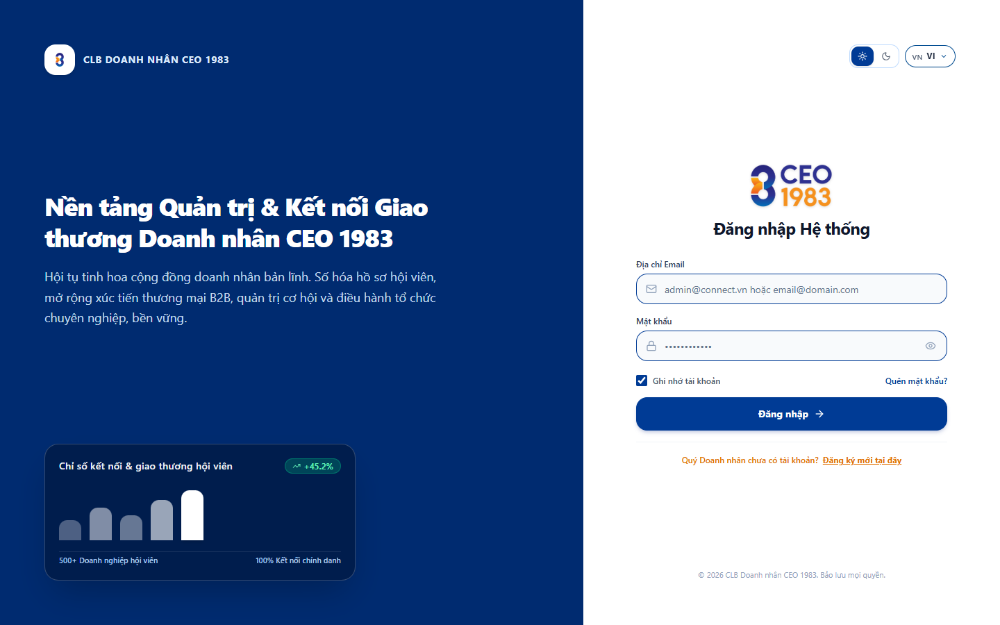

- **Bước 1**: Mở trình duyệt, truy cập `https://crm.ceo1983.viconnect.vn/auth`.
- **Bước 2**: Nhập Email quản trị (Ví dụ: `admin@connect.vn` hoặc email chức danh ban chuyên trách).
- **Bước 3**: Nhập Mật khẩu được cấp. Tích chọn **"Ghi nhớ đăng nhập"** nếu sử dụng máy tính cá nhân an toàn.
- **Bước 4**: Nhấp nút **[Đăng nhập]**.
  - Hệ thống tự động kiểm tra chứng chỉ JWT, tải thông tin `executive_role` và giải nén ma trận phân quyền.
  - Sau khi xác thực hợp lệ, hệ thống điều hướng trực tiếp vào **Dashboard Tổng Quan**.

---

## 2. HƯỚNG DẪN CHI TIẾT 24 PHÂN HỆ CHỨC NĂNG (FUNCTIONAL NODES)

---

### [NODE-CRM-001]: Tổng Quan & Dashboard KPI CLB

#### 1. Mục đích Nghiệp Vụ
Hiển thị bức tranh toàn cảnh sức khỏe hoạt động của CLB Doanh Nhân CEO 1983 theo thời gian thực: quy mô hội viên, dòng tiền quỹ, sự kiện sắp diễn ra, lịch họp Ban Chấp Hành và danh sách cảnh báo nợ phí niên liễm.

#### 2. Đường Dẫn & Vị Trí Menu
- **Route**: `/` hoặc `/dashboard`
- **Menu Sidebar**: Mục **"Tổng Quan"** (Biểu tượng `LayoutDashboard` trên cùng thanh điều hướng).

#### 3. Giao Diện Thực Tế
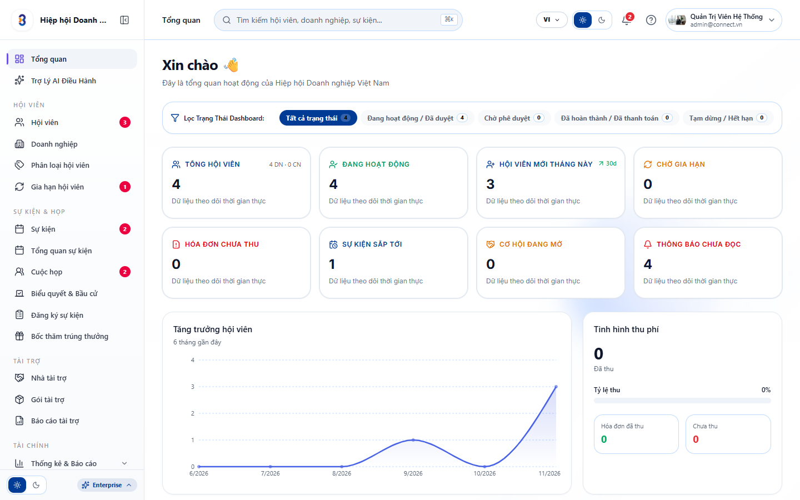

#### 4. Các Thao Tác Chi Tiết
1. **Theo dõi 4 Khối Chỉ Số KPI Trọng Yếu**:
   - **Tổng Hội Viên Doanh Nhân**: Số lượng hội viên chính thức đang hoạt động kèm tỉ lệ tăng trưởng theo tháng.
   - **Doanh Nghiệp Thành Viên**: Tổng số công ty đại diện trong hệ sinh thái CEO 1983.
   - **Tổng Quỹ CLB & Doanh Thu Sự Kiện**: Dòng tiền hiện hữu trong tài khoản quỹ hiệp hội.
   - **Tỉ Lệ Gắn Kết & Tham Dự (Attendance Rate)**: Tỉ lệ check-in trung bình các sự kiện và cuộc họp gần nhất.
2. **Xem Lịch Hoạt Động & Sự Kiện Tháng**:
   - Bảng lịch tương tác hiển thị rõ ngày tổ chức Gala, Họp ban, Cafe kết nối, Thăm doanh nghiệp hội viên.
   - Nhấp vào một ngày có chấm tròn sự kiện để xem chi tiết tên sự kiện, khung giờ và địa điểm.
3. **Tiếp Nhận Cảnh Báo Nhanh**:
   - Khối widget bên phải tự động quét và hiển thị danh sách hồ sơ đăng ký mới đang chờ Ban Thư Ký duyệt, cùng các hội viên đến hạn đóng niên liễm.

---

### [NODE-CRM-002]: Trung Tâm Thống Kê Chuyên Sâu 5 Danh Mục

#### 1. Mục đích Nghiệp Vụ
Phân tích dữ liệu nghiệp vụ đa chiều, trực quan hóa sức lan tỏa giao thương B2B, điểm danh và bục vinh danh Top thành viên có cống hiến kết nối lớn nhất.

#### 2. Đường Dẫn & Vị Trí Menu
- **Route**: `/analytics`
- **Menu Sidebar**: Mục **"Thống Kê CLB"** (Biểu tượng `BarChart3`).

#### 3. Giao Diện Thực Tế
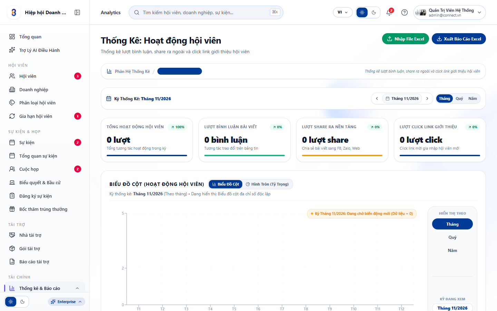

#### 4. Các Thao Tác Chi Tiết
1. **Lọc Dữ Liệu Theo 5 Danh Mục Nghiệp Vụ**:
   - **Danh mục 1: Doanh Thu Giao Thương B2B**: Thống kê giá trị các cơ hội kinh doanh (deal) đã trao và ký kết thành công.
   - **Danh mục 2: Tăng Trưởng Hội Viên**: Biểu đồ phân bổ theo từng ngành nghề kinh doanh và phân hạng hội viên.
   - **Danh mục 3: Chỉ Số Kết Nối 1-on-1**: Số lượt gặp gỡ giữa các CEO và số cơ hội kinh doanh phát sinh.
   - **Danh mục 4: Tỉ Lệ Điểm Danh Check-in**: Thống kê mức độ chuyên cần tham dự họp ban và sự kiện.
   - **Danh mục 5: Hiệu Quả Đào Tạo**: Đánh giá số giờ học và lượt tải tài liệu tri thức doanh nghiệp.
2. **Theo dõi Biểu Đồ Hỗn Hợp ComposedChart**:
   - Cột xanh biểu thị tăng trưởng vượt chỉ tiêu, cột đỏ cảnh báo chỉ số suy giảm so với kỳ trước.
3. **Bục Vinh Danh Top 3 Doanh Nhân Giver Lớn Nhất**:
   - Top 1: Bục vàng trung tâm ghim Avatar tròn viền Amber Gold.
   - Top 2 & Top 3: Sắp xếp gọn gàng trên cùng một hàng ngang trực quan.
4. **Xuất Báo Cáo Định Dạng A4 & Excel**:
   - Nhấp nút **[Xuất Báo Cáo]** ở góc trên bên phải để tải file Excel đối soát hoặc in bản PDF A4 trình Ban Thường Vụ.

---

### [NODE-CRM-003]: Quản Trị Danh Bạ Hội Viên 360° & Phê Duyệt Hồ Sơ

#### 1. Mục đích Nghiệp Vụ
Quản lý toàn bộ thông tin cá nhân của các hội viên doanh nhân, tiếp nhận đơn gia nhập từ Landing page, thẩm định hồ sơ và phê duyệt cấp tài khoản tự động.

#### 2. Đường Dẫn & Vị Trí Menu
- **Route**: `/members`
- **Menu Sidebar**: Mục **"Quản Lý Hội Viên"** (Biểu tượng `Users`).

#### 3. Giao Diện Thực Tế
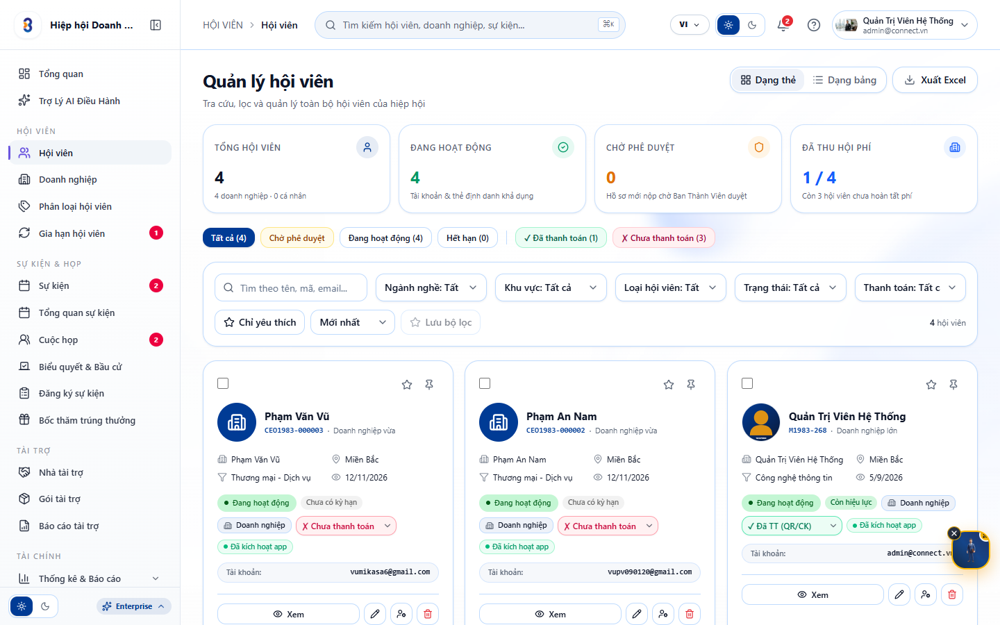

#### 4. Các Thao Tác Chi Tiết
1. **Tìm Kiếm & Bộ Lọc Nâng Cao**:
   - Nhập tên, mã hội viên (ví dụ `M1983-089`), email hoặc số điện thoại vào ô tìm kiếm nhanh.
   - Lọc theo Ban Chuyên Môn, Ngành Nghề hoặc Trạng Thái (Đang hoạt động, Chờ duyệt, Tạm dừng, Quá hạn).
2. **Xem Hồ Sơ 360° Bằng Drawer Bên Phải**:
   - Nhấp chuột trực tiếp vào dòng của một hội viên trên bảng dữ liệu.
   - Ngăn kéo (Drawer) mở ra từ cạnh phải hiển thị: Ảnh chân dung, Chức vụ doanh nghiệp, Quá trình tham gia, Lịch sử nộp niên liễm và Thẻ danh thiếp điện tử.
3. **Quy Trình Phê Duyệt Hồ Sơ Mới**:
   - Chuyển sang tab **"Hồ sơ chờ duyệt"**.
   - Mở hồ sơ hội viên ứng tuyển, kiểm tra hồ sơ pháp lý công ty và văn kiện đính kèm.
   - Nhấp nút **[Phê duyệt & Cấp tài khoản]**.
   - *Hệ thống tự động kích hoạt*: Sinh mật khẩu an toàn tạm thời, gắn mã hội viên định danh, tạo bản ghi xác thực trong CSDL PostgreSQL và tự động gửi Thư Chúc Mừng kèm mã QR qua email hội viên.
4. **Xóa & Lưu Trữ Hội Viên An Toàn**:
   - Hệ thống cung cấp 2 cơ chế: (1) Xóa thông tin cá nhân nhưng giữ lại hồ sơ doanh nghiệp; (2) Xóa Cascade toàn bộ nếu hồ sơ bị lỗi trùng lặp.

---

### [NODE-CRM-004]: Quản Trị Doanh Nghiệp Thành Viên

#### 1. Mục đích Nghiệp Vụ
Quản lý thông tin pháp nhân của các doanh nghiệp trong hệ sinh thái CLB CEO 1983: Mã số thuế (MST), ngành nghề kinh doanh, quy mô nhân sự, trụ sở và liên kết website thương mại.

#### 2. Đường Dẫn & Vị Trí Menu
- **Route**: `/companies`
- **Menu Sidebar**: Mục **"Doanh Nghiệp"** (Biểu tượng `Building2`).

#### 3. Giao Diện Thực Tế
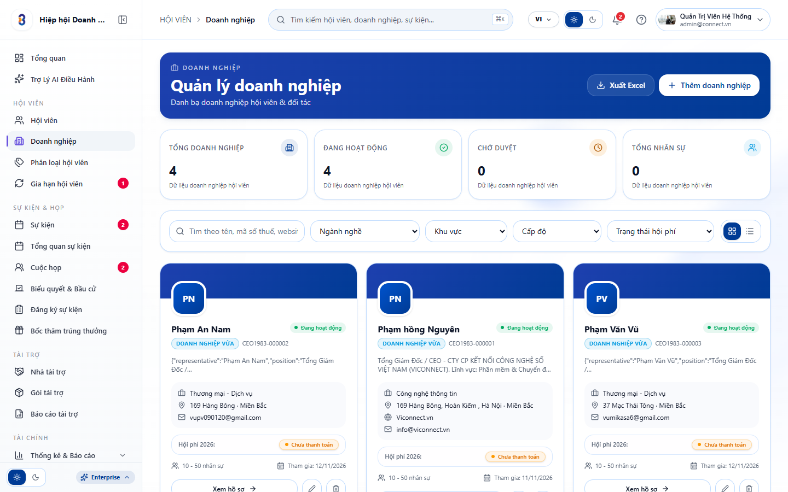
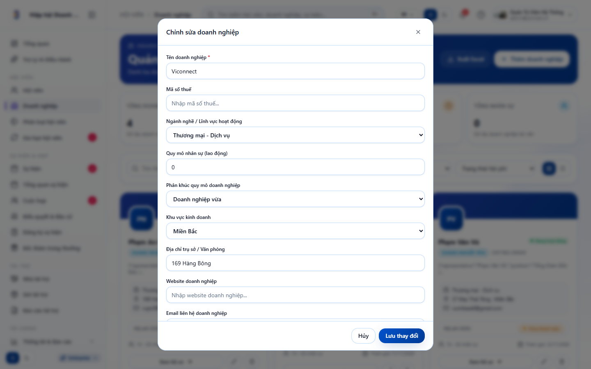

#### 4. Các Thao Tác Chi Tiết
1. **Theo dõi Danh Sách Doanh Nghiệp**:
   - Cột thứ 3 là **Tên Doanh Nghiệp** chính thức theo Giấy chứng nhận đăng ký kinh doanh.
   - Cột Mã số thuế có tính năng bấm sao chép nhanh (Copy) để kế toán đối soát hóa đơn VAT.
2. **Chỉnh Sửa Thông Tin Doanh Nghiệp**:
   - Nhấp nút **[Sửa]** trên dòng công ty cần cập nhật.
   - Cập nhật Địa chỉ trụ sở, Đường dẫn Website doanh nghiệp, Lĩnh vực chuyên sâu và Tải lên Logo sắc nét (PNG định dạng trong suốt để đồng bộ hiển thị lên thẻ VIP hội viên).
   - Nhấn **[Lưu thay đổi]** để ghi nhận vào CSDL.

---

### [NODE-CRM-005]: Quản Lý Tài Khoản & Gán 6 Ban Chuyên Môn

#### 1. Mục đích Nghiệp Vụ
Quản trị tài khoản đăng nhập hệ thống, phân bổ hội viên vào đúng 6 Ban Chuyên Môn chính thức và Ban Điều Hành.

#### 2. Đường Dẫn & Vị Trí Menu
- **Route**: `/accounts`
- **Menu Sidebar**: Mục **"Tài Khoản & Ban"** (Biểu tượng `ShieldCheck`).

#### 3. Giao Diện Thực Tế
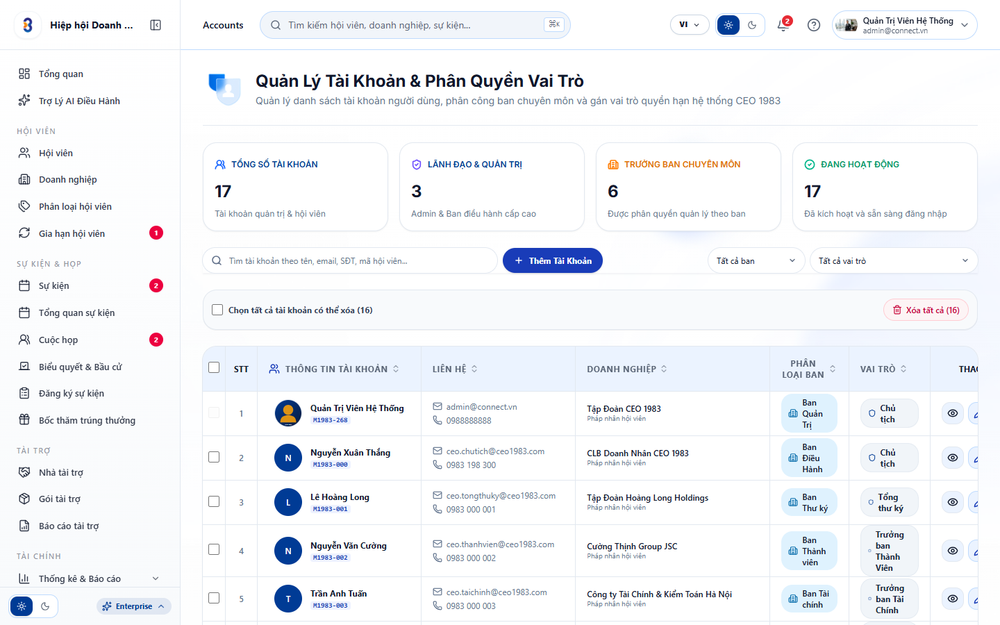

#### 4. Các Thao Tác Chi Tiết
1. **Phân Bổ Vào 6 Ban Chuyên Môn**:
   - Danh sách gồm:
     1. Ban Điều Hành & Ban Thư Ký
     2. Ban Thành Viên
     3. Ban Xúc Tiến Thương Mại
     4. Ban Tài Chính
     5. Ban Sự Kiện
     6. Ban Truyền Thông
     7. Ban Thiện Nguyện
2. **Gán Vai Trò Điều Hành (Chỉ 1 Click)**:
   - Nhấp nút **[Gán vai trò / Phân ban]** tại tài khoản chỉ định.
   - Chọn Vai trò điều hành: Chủ tịch, Tổng Thư Ký, Phó Chủ Tịch, Trưởng Ban, Phó Trưởng Ban, Ủy Viên, Hội Viên.
   - Nhấp **[Cập nhật ngay]** (`PATCH /api/members/:id/role-dept`). Quyền hạn và menu truy cập được đồng bộ hóa tức thì mà không cần đăng xuất.

---

### [NODE-CRM-006]: Ma Trận Phân Quyền RBAC 2 Tab Độc Lập

#### 1. Mục đích Nghiệp Vụ
Thiết lập ma trận phân quyền chi tiết (Role-Based Access Control) đảm bảo an toàn tuyệt đối, phân lập quyền xem, thêm, sửa, xóa, duyệt cho từng cấp bậc lãnh đạo trên Web CRM và ứng dụng di động Mobile App.

#### 2. Đường Dẫn & Vị Trí Menu
- **Route**: `/permissions`
- **Menu Sidebar**: Mục **"Phân Quyền RBAC"** (Biểu tượng `SlidersHorizontal`).

#### 3. Giao Diện Thực Tế
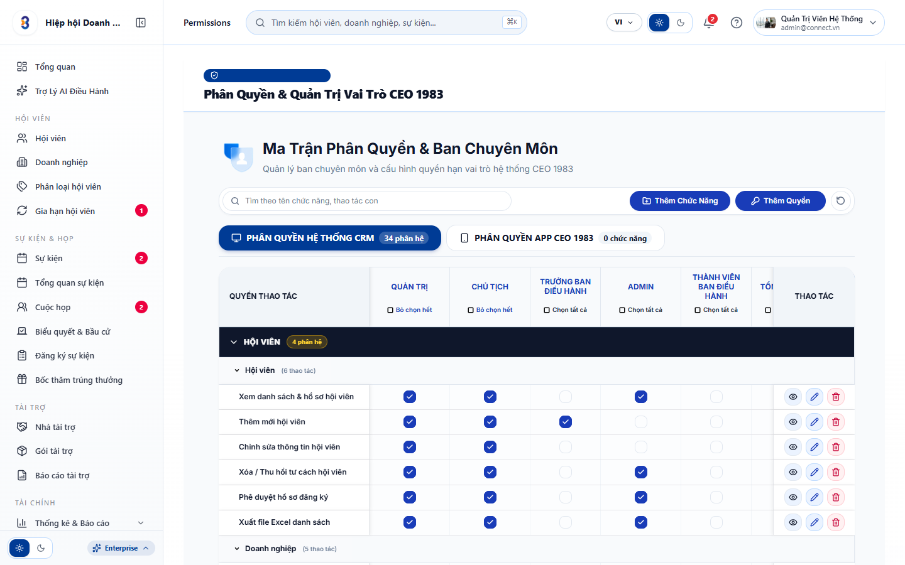

#### 4. Các Thao Tác Chi Tiết
1. **Chuyển Đổi Giữa 2 Tab Phân Quyền Riêng Biệt**:
   - **Tab 1 — "Phân Quyền CRM Web"**: Quản trị quyền hạn trên cổng desktop dành cho Ban Điều Hành và Ban Thư Ký.
   - **Tab 2 — "Phân Quyền App Mobile"**: Quản trị quyền hạn của Hội viên Doanh nhân khi sử dụng ứng dụng di động.
2. **Tùy Biến 5 Thao Tác Cốt Lõi**:
   - Tích chọn hoặc bỏ tích các ô tương ứng: `Xem (Read)`, `Thêm (Create)`, `Sửa (Update)`, `Xóa (Delete)`, `Phê Duyệt (Approve)`.
3. **Áp Dụng Cấu Hình Tức Thời**:
   - Nhấp nút **[Lưu Ma Trận Quyền]**. Hệ thống lưu nguyên tử vào bảng `role_permissions` của PostgreSQL và phát tín hiệu socket cập nhật phiên làm việc của người dùng.

---

### [NODE-CRM-007]: Quản Trị Sự Kiện, Sơ Đồ Chỗ Ngồi, Quản Lý Vé, QR Gatekeeper & Bắn Mạng Lưới

#### 1. Mục đích Nghiệp Vụ
Tổ chức và điều hành các sự kiện tầm cỡ của hiệp hội: Gala kỷ niệm, Hội thảo kinh tế, Diễn đàn B2B, Ngày Hội Doanh Trí. Quản lý toàn diện vòng đời sự kiện: thiết lập sơ đồ chỗ ngồi & bàn tiệc tương tác (Cinema Seating Map), phát hành và quản lý vé mời đa phân hạng (VIP/Standard), quét mã QR Gatekeeper điểm danh tại cửa theo thời gian thực, trình chiếu mã QR cho khách đăng ký nhanh qua Zalo, quay thưởng may mắn Lucky Draw và bắn truyền thông tức thì lên ứng dụng di động của hội viên.

#### 2. Đường Dẫn & Vị Trí Menu
- **Route Sự Kiện**: `/events`
- **Route Chi Tiết Sự Kiện Hub**: `/events/$eventId` (Ví dụ: `/events/EV-VIENDOANHTRI-2027`)
- **Route Quản Lý Vé & Đăng Ký**: `/event-registrations`
- **Menu Sidebar**: Mục **"Sự Kiện & Vé"** (Biểu tượng `CalendarDays`).

#### 3. Bộ Giao Diện Thực Tế Chi Tiết
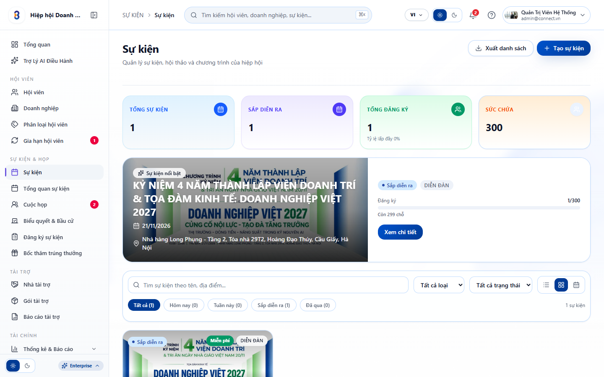
*Hình 7.1: Bảng điều hành tổng quan danh sách sự kiện, bộ đếm countdown và các nút thao tác.*

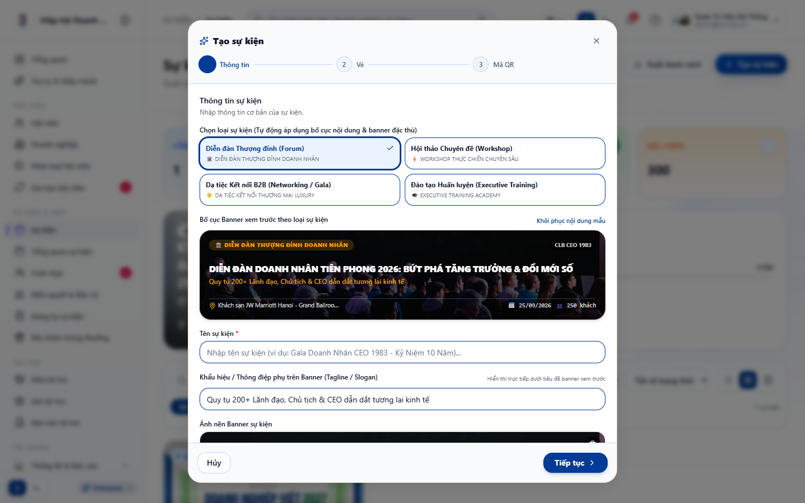
*Hình 7.2: Modal tạo lập sự kiện 3 bước chuẩn hóa (Thông tin tổng quan, Thiết kế Poster & Lịch trình Agenda, Phân hạng vé & VietQR).*

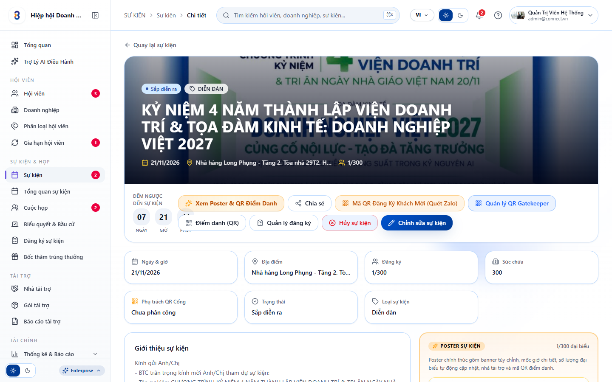
*Hình 7.3: Màn hình trung tâm điều hành sự kiện Ngày Hội Doanh Trí (Hiển thị đồng hồ đếm ngược, poster, mã QR cổng kiểm soát Gatekeeper, danh sách đăng ký và lịch trình).*

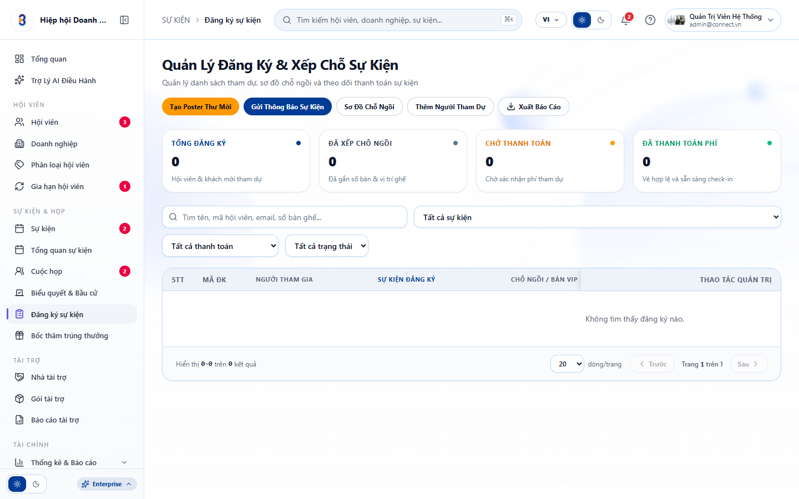
*Hình 7.4: Giao diện quản lý vé và đăng ký đại biểu (/event-registrations): Phân loại vé VIP/Thường, mã QR vé cá nhân, trạng thái thanh toán [✓ Đã thanh toán], thu tiền mặt walk-in tại bàn tiếp tân.*

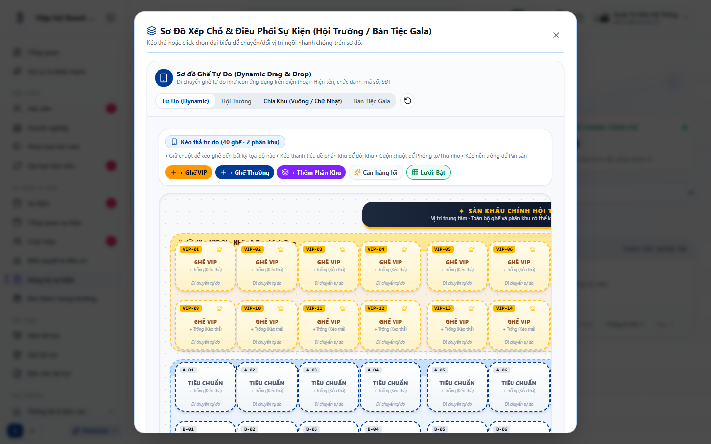
*Hình 7.5: Studio sơ đồ bố trí chỗ ngồi tương tác (CinemaSeatingMap): Sắp xếp vị trí đại biểu theo từng bàn tiệc/hàng ghế, hỗ trợ kéo thả đổi chỗ trực quan, tự động đồng bộ lên vé QR check-in.*

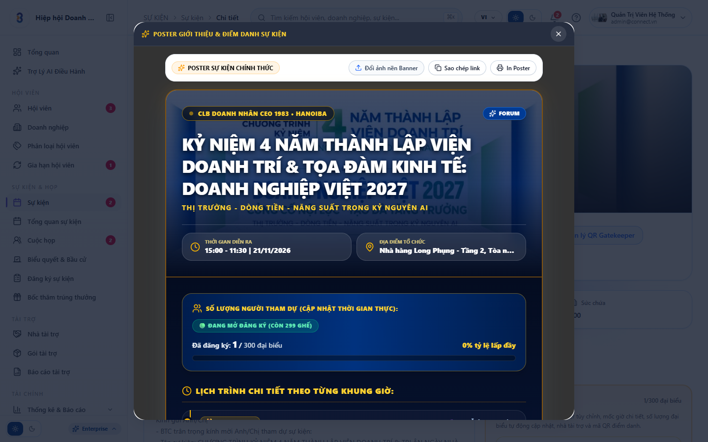
*Hình 7.6: Modal trình chiếu Poster sự kiện khổ lớn tích hợp mã QR điểm danh tự động phục vụ quầy lễ tân check-in.*

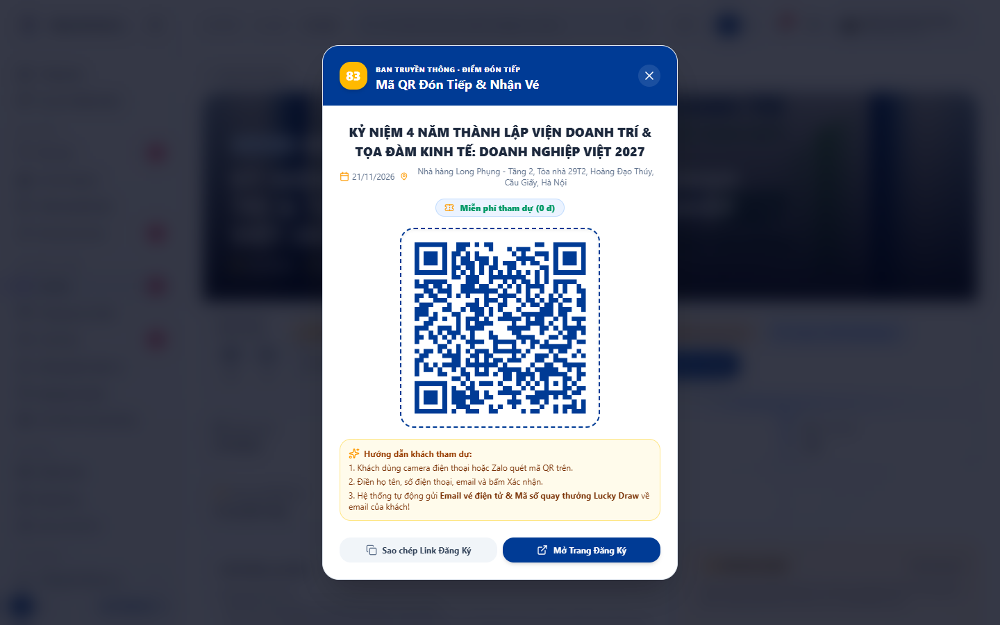
*Hình 7.7: Modal phát mã QR độc quyền dành cho khách mời vãng lai quét đăng ký tức thì qua điện thoại di động.*

#### 4. Các Thao Tác Chi Tiết Toàn Bộ Quy Trình

##### A. Khởi Tạo Sự Kiện Mới (3 Bước Chuẩn Hóa)
1. **Bước 1 — Thông tin tổng quát**:
   - Nhập Tiêu đề sự kiện (ví dụ: *“Ngày Hội Doanh Trí 2027 — CEO 1983 HanoiBA”*).
   - Chọn Loại hình: Gala Dinner, Diễn đàn B2B, Hội thảo chuyên đề, Giải Golf kết nối.
   - Cài đặt Thời gian bắt đầu - kết thúc, Địa điểm tổ chức, Tọa độ bản đồ ghim GPS.
2. **Bước 2 — Thiết kế Poster & Lịch trình (Agenda)**:
   - Tải lên ảnh bìa / poster độ phân giải cao tỷ lệ 16:9 hoặc ảnh đứng 9:16.
   - Thêm từng mốc lịch trình Agenda (ví dụ: `17:30 - Đón tiếp & Check-in QR Gatekeeper`, `18:15 - Khai mạc & Tuyên bố lý do`, `19:00 - Tiệc Gala & Xúc tiến thương mại`).
3. **Bước 3 — Cấu hình Phân hạng Vé & Thanh toán**:
   - Thiết lập các loại vé: Vé VIP Miễn phí dành cho Hội viên Kim Cương/Ban Điều Hành, Vé Tiêu Chuẩn (có phí) dành cho Khách mời vãng lai.
   - Nhập giá vé (VNĐ). Hệ thống tự sinh mã VietQR liên kết tài khoản MB Bank `1983000000` với nội dung chuyển khoản tự động nhận diện giao dịch.

##### B. Thiết Lập Sơ Đồ Chỗ Ngồi & Bàn Tiệc (Cinema Seating Map Setup)
1. **Mở Studio Sơ Đồ Chỗ Ngồi**:
   - Truy cập `/event-registrations`, nhấp nút **[Sơ Đồ Chỗ Ngồi]** (Biểu tượng ghế rạp / bàn tiệc).
2. **Bố Trí Vị Trí Ngồi Trực Quan**:
   - Hệ thống hiển thị mô hình sân khấu trung tâm (Stage) kèm các khu vực bàn tiệc VIP (bàn tròn 10 người) và các dãy ghế khán phòng.
   - **Mã màu trạng thái ghế**:
     - *Màu Xám*: Ghế trống sẵn sàng đón đại biểu.
     - *Màu Vàng / Đỏ*: Ghế VIP đã có đại biểu được chỉ định.
     - *Màu Xanh*: Ghế tiêu chuẩn đã có người ngồi.
3. **Kéo Thả & Gán Chỗ Cho Đại Biểu**:
   - Nhấp vào một đại biểu trong danh sách chưa xếp chỗ, sau đó nhấp vào vị trí ghế mong muốn trên sơ đồ để gán (ví dụ: `Bàn VIP 01 - Ghế 03`).
   - Hỗ trợ kéo thả (drag & drop) đại biểu giữa các ghế để đổi chỗ linh hoạt khi ban tổ chức có thay đổi vào phút chót.
   - Nhấn **[Lưu Sơ Đồ]**: Vị trí bàn ghế sẽ tự động gán vào thông tin vé điện tử của đại biểu và hiển thị trên ứng dụng di động của họ.

##### C. Quản Trị Danh Sách Vé & Thanh Toán Walk-in
1. **Theo Dõi Danh Sách Đăng Ký (/event-registrations)**:
   - Xem đầy đủ thông tin: Họ tên đại biểu, Tên doanh nghiệp, Số điện thoại, Hạng vé, Vị trí chỗ ngồi được phân bổ.
   - Trạng thái thanh toán: `[✓ Đã thanh toán]` (Thanh toán qua VietQR/VNPay tự động đối soát) hoặc `[Chưa thanh toán]`.
2. **Xác Nhận Thanh Toán Tiền Mặt Tại Chỗ (Walk-in Cash Payment)**:
   - Đối với khách vãng lai đến quầy lễ tân đóng tiền mặt trực tiếp: Lễ tân chỉ cần tìm tên khách trên bảng tính, nhấp nút **[Thu Tiền Mặt]** -> Hệ thống lập tức cập nhật trạng thái thành `Đã thanh toán` và phát hành vé QR hợp lệ.
3. **Xuất Danh Sách & In Thẻ Đại Biểu**:
   - Nhấp nút **[Xuất Excel]** để trích xuất file `.xlsx` báo cáo tài chính sự kiện.
   - Nhấp nút **[In Thẻ Đại Biểu]** để in hàng loạt thẻ đeo ngực có sẵn mã QR cá nhân hóa.

##### D. Vận Hành Điểm Danh QR Gatekeeper & Trình Chiếu Khách Mời
1. **Kiểm Soát Check-in Tại Cổng (Gatekeeper Scanner)**:
   - Nhân sự lễ tân sử dụng điện thoại hoặc đầu đọc mã vạch quét mã QR trên vé của đại biểu.
   - Khi quét thành công: Màn hình hiển thị âm thanh thông báo "Ting", popup hiện khuôn mặt đại biểu, công ty, phân hạng vé và **Vị trí bàn tiệc chính xác** để lễ tân hướng dẫn đại biểu vào chỗ ngồi.
2. **Trình Chiếu Mã QR Khách Mời (Guest QR Presenter)**:
   - Trên màn hình lớn hoặc máy tính bảng đặt tại bàn lễ tân, mở modal **[QR Khách Mời]**: Khách chưa kịp đăng ký trước chỉ cần quét mã QR này qua camera điện thoại hoặc Zalo để điền thông tin và nhận vé vào cửa trong 30 giây.

##### E. Tính Năng Độc Quyền: [Bắn Mạng Lưới] (Broadcast to Feed)
- Tại danh sách sự kiện, nhấp nút **[Bắn Mạng Lưới]** (Biểu tượng `Send` / `Radio`).
- Hệ thống tự động tạo một bài viết phát thanh trang trọng lên Bảng tin Mạng lưới (`Feed`) của toàn bộ Hội viên trên Mobile App kèm ảnh poster, đồng hồ đếm ngược và liên kết đăng ký vé 1 chạm.

---

### [NODE-CRM-008]: Quản Lý Cuộc Họp Ban & Gặp Gỡ CLB (Bản Đồ Nominatim)

#### 1. Mục đích Nghiệp Vụ
Tổ chức và lưu trữ biên bản các cuộc họp Ban Chấp Hành, họp 6 Ban Chuyên Môn, Cafe Doanh nhân định kỳ. Tích hợp bản đồ trực quan ghim vị trí gặp mặt.

#### 2. Đường Dẫn & Vị Trí Menu
- **Route**: `/meetings`
- **Menu Sidebar**: Mục **"Lịch Họp & Gặp Mặt"** (Biểu tượng `Clock3`).

#### 3. Giao Diện Thực Tế
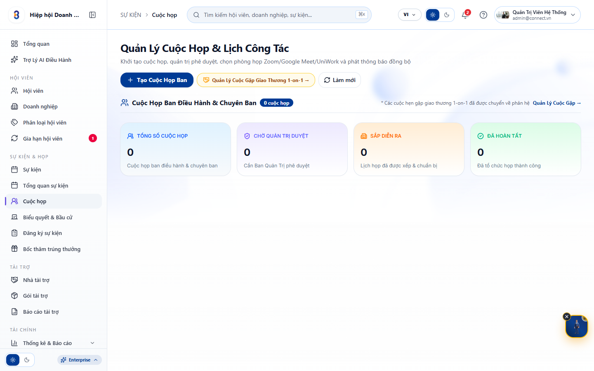
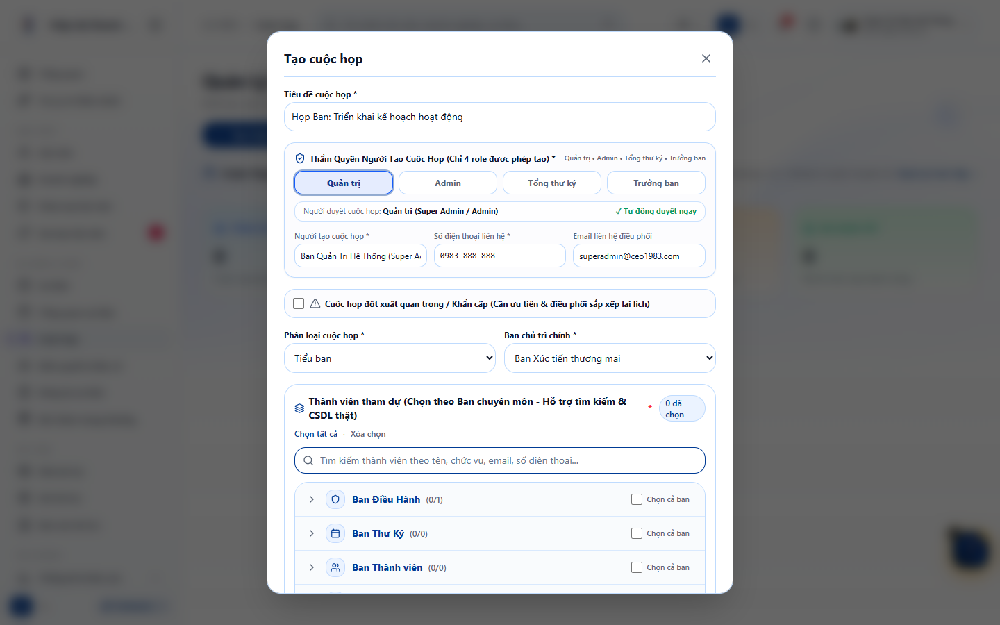

#### 4. Các Thao Tác Chi Tiết
1. **Lập Lịch Cuộc Họp Ban**:
   - Nhấp nút **[+ Tạo Cuộc Họp Mới]**.
   - Chọn Ban chủ trì (ví dụ: Ban Thường Vụ, Ban Xúc Tiến Thương Mại).
   - Nhập Tiêu đề cuộc họp, Mục tiêu thảo luận và Tài liệu dự thảo đính kèm.
2. **Ghim Vị Trí Trên Bản Đồ Tương Tác (Nominatim Leaflet)**:
   - Nhập tên địa điểm (ví dụ: "Khách sạn Daewoo Hà Nội" hoặc "Tháp CEO Phạm Hùng").
   - Kéo thả điểm ghim màu đỏ trên bản đồ để xác định tọa độ GPS chính xác.
   - Dữ liệu tọa độ này sẽ tự động hiển thị nút **[Chỉ đường Google Maps]** trên điện thoại của hội viên tham gia.
3. **Đồng Bộ Tự Động Sang Mobile App**:
   - Cuộc họp được lưu sẽ tự động xuất hiện trong mục "Cuộc Họp & Gặp Mặt" trên Mobile App với tiền tố `[Họp Ban]`.

---

### [NODE-CRM-009]: Quản Lý Thu Ngân Sách, Phí Niên Liễm, Vé & Excel Import/Export

#### 1. Mục đích Nghiệp Vụ
Quản trị toàn bộ các khoản thu: Phí niên liễm hội viên thường niên, Tiền vé sự kiện, Đóng góp tài trợ và thu hồi quỹ.

#### 2. Đường Dẫn & Vị Trí Menu
- **Route**: `/income`
- **Menu Sidebar**: Mục **"Quản Lý Thu Quỹ"** (Biểu tượng `TrendingUp`).

#### 3. Giao Diện Thực Tế
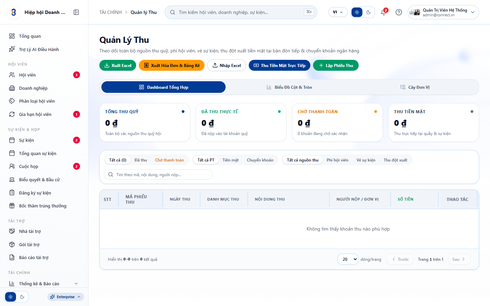

#### 4. Các Thao Tác Chi Tiết
1. **Lập Phiếu Thu Mới**:
   - Nhấp **[+ Thêm Khoản Thu]**.
   - Chọn Hội viên/Đơn vị nộp tiền, Số tiền (VNĐ), Ngày chứng từ, Tài khoản quỹ thụ hưởng.
   - Chọn Hình thức: Chuyển khoản (VietQR), Tiền mặt hoặc Hiện vật quy đổi.
2. **Xuất Bảng Kê Excel Chuẩn Thông Tư 200/2014/TT-BTC**:
   - Nhấp nút **[Xuất Excel]** để kết xuất tệp `.xlsx` có đầy đủ tiêu đề CLB, mã số phiếu thu và các cột định dạng kế toán chuẩn.
3. **Nhập Tự Động Từ File Excel (Import Excel)**:
   - Nhấp **[Nhập Excel]**, tải tệp sao kê ngân hàng hoặc danh sách thu nợ phí.
   - Hệ thống tự động phân tích các cột Họ tên, Số tiền, Ngày nộp và hiển thị bảng đối soát trước khi ghi nhận chính thức.

---

### [NODE-CRM-010]: Quản Lý Chi Ngân Sách, Tạm Ứng & Hoàn Ứng

#### 1. Mục đích Nghiệp Vụ
Kiểm soát dòng tiền chi tiêu của hiệp hội: Chi tổ chức sự kiện, chi phí quà tặng, chi tiếp khách giao thương, các khoản tạm ứng công việc của các ban và thanh quyết toán hoàn ứng.

#### 2. Đường Dẫn & Vị Trí Menu
- **Route**: `/expenses`
- **Menu Sidebar**: Mục **"Quản Lý Chi Quỹ"** (Biểu tượng `TrendingDown`).

#### 3. Giao Diện Thực Tế
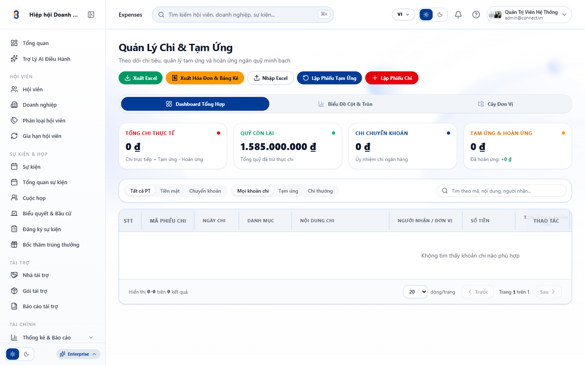

#### 4. Các Thao Tác Chi Tiết
1. **Lập Phiếu Chi & Tạm Ứng**:
   - Chọn Hạng mục chi phí (Chi sự kiện, Chi văn phòng, Chi thiện nguyện).
   - Chọn Người nhận tạm ứng và Hạn hoàn ứng dự kiến.
   - Tải lên ảnh hóa đơn đỏ VAT hoặc chứng từ chuyển khoản hợp lệ.
2. **Quy Trình Hoàn Ứng Quyết Toán**:
   - Khi hoàn thành công việc, mở phiếu chi tạm ứng, nhấp **[Hoàn Ứng]**.
   - Nhập số tiền chi thực tế và số tiền thừa nộp lại quỹ. Hệ thống tự động tính số dư và đóng trạng thái phiếu chi.

---

### [NODE-CRM-011]: Báo Cáo Tài Chính Tổng Hợp & Quyết Toán Dòng Tiền

#### 1. Mục đích Nghiệp Vụ
Cung cấp bức tranh toàn diện về thu chi, quỹ tồn tích lũy, phân bổ tài trợ và sổ quỹ tiền mặt theo chuẩn quy định tài chính doanh nghiệp.

#### 2. Đường Dẫn & Vị Trí Menu
- **Route**: `/finance-report`
- **Menu Sidebar**: Mục **"Báo Cáo Tài Chính"** (Biểu tượng `PieChart`).

#### 3. Giao Diện Thực Tế
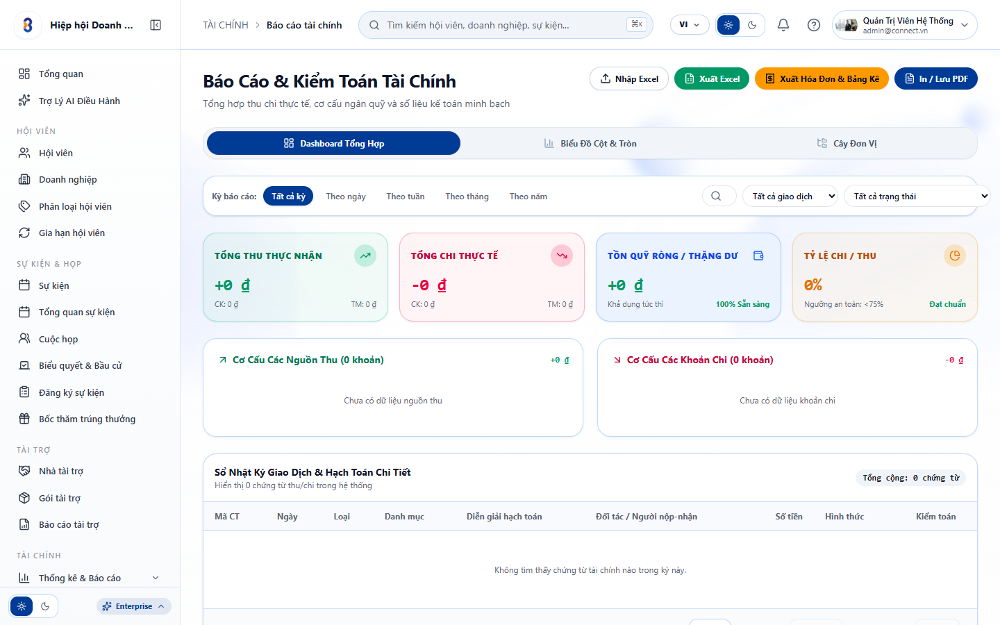

#### 4. Các Thao Tác Chi Tiết
1. **Xem Biểu Đồ Dòng Tiền Đa Chiều (ComposedChart)**:
   - Cột xanh: Doanh thu thực tế.
   - Cột cam: Chi phí thực tế.
   - Đường cong tím: Thặng dư ngân sách tích lũy qua các quý.
2. **Phân Tích 4 Hạng Tài Trợ (Kim Cương, Vàng, Bạc, Đồng)**:
   - Bảng tổng hợp hiển thị rõ giá trị hợp đồng đã cam kết so với số tiền thực tế đã giải ngân vào tài khoản MB Bank.
3. **In Ấn & Quyết Toán Niên Độ**:
   - Nhấp nút **[In Báo Cáo Quyết Toán]** để xem bản hiển thị trực tiếp dạng A4, sẵn sàng xuất bản tại Đại hội thường niên CLB.

---

### [NODE-CRM-012]: Giao Việc Ban Chuyên Môn & Trình Xem File Excel/PDF

#### 1. Mục đích Nghiệp Vụ
Quản lý các nhiệm vụ hành động của CLB theo quy trình Kanban trực quan: Việc cần làm (To Do), Đang thực hiện (In Progress), Chờ nghiệm thu (Under Review), Đã hoàn thành (Done). Tích hợp trình xem trước tài liệu văn kiện.

#### 2. Đường Dẫn & Vị Trí Menu
- **Route**: `/tasks`
- **Menu Sidebar**: Mục **"Giao Việc & Nhiệm Vụ"** (Biểu tượng `CheckSquare`).

#### 3. Giao Diện Thực Tế
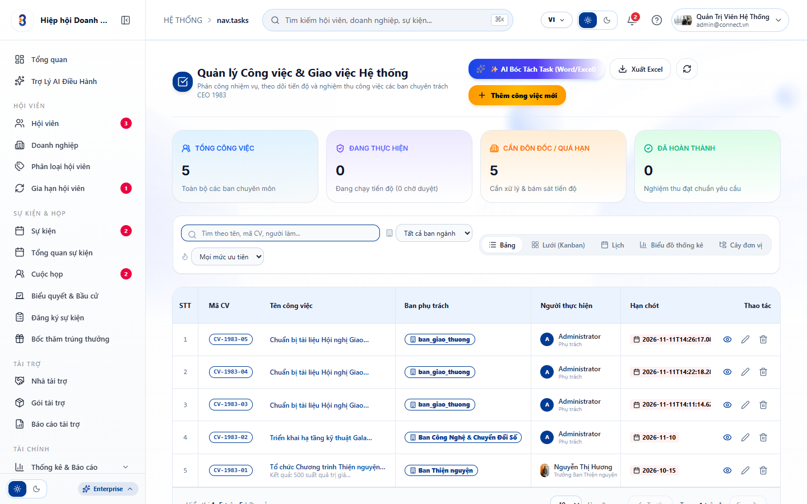

#### 4. Các Thao Tác Chi Tiết
1. **Giao Nhiệm Vụ Mới**:
   - Nhấp **[+ Giao Việc Mới]**.
   - Nhập Tiêu đề, Nội dung yêu cầu và Tiêu chí nghiệm thu công việc.
   - Chọn Ban phụ trách và Trưởng ban/Hội viên chịu trách nhiệm chính.
   - Đặt Deadline hoàn thành và dự toán kinh phí nếu có.
   - Tải tệp đính kèm: Word (.docx), Excel (.xlsx), PDF hoặc ảnh.
2. **Kéo Thả Trạng Thái Kanban**:
   - Kéo thẻ công việc giữa các cột tương ứng khi tiến độ thay đổi.
3. **Trình Xem Tệp Trực Tiếp (Eye Icon)**:
   - Nhấp biểu tượng con mắt trên từng thẻ việc để mở ngay bảng Excel hoặc văn bản PDF để xem trực tiếp trên trình duyệt mà không cần tải về máy.

---

### [NODE-CRM-013]: Quản Trị Nhà Tài Trợ 4 Phân Hạng & VietQR Tri Ân

#### 1. Mục đích Nghiệp Vụ
Quản lý các thương hiệu đồng hành cùng CLB CEO 1983 theo 4 hạng: Kim Cương, Vàng, Bạc, Đồng. Bàn giao logo quyền lợi truyền thông và phát hành thư cảm ơn kèm VietQR tự động.

#### 2. Đường Dẫn & Vị Trí Menu
- **Route**: `/sponsors`
- **Menu Sidebar**: Mục **"Nhà Tài Trợ"** (Biểu tượng `Award`).

#### 3. Giao Diện Thực Tế
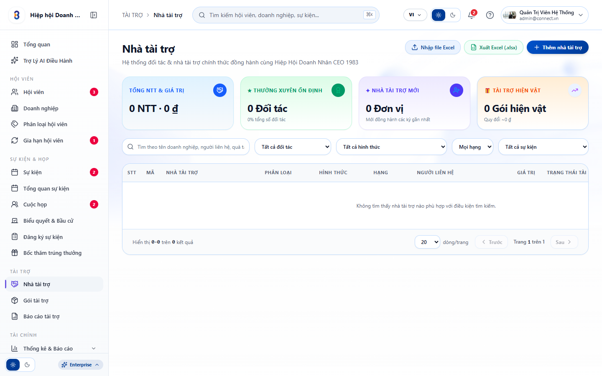

#### 4. Các Thao Tác Chi Tiết
1. **Thêm Mới Nhà Tài Trợ**:
   - Chọn Phân Hạng: Kim Cương (Diamond), Vàng (Gold), Bạc (Silver), Đồng (Bronze).
   - Chọn Hình thức đóng góp: Chuyển khoản, Tiền mặt hoặc Hiện vật (quà tặng sự kiện).
   - Nhập Số tiền thực tế (hệ thống cho phép nhập linh hoạt theo hợp đồng thực tế).
   - Nhập Email và Số điện thoại của lãnh đạo doanh nghiệp tài trợ.
2. **Cơ Chế Bắn Email Tri Ân Kèm VietQR Tự Động**:
   - Ngay khi bấm lưu, hệ thống tự động sinh mã VietQR chuẩn quốc gia dẫn vào STK MB Bank `1983000000` với cú pháp tài trợ chuẩn xác và gửi email trang trọng tri ân đối tác.
3. **Gửi Lại Thư Tri Ân**:
   - Nhấp nút biểu tượng lá thư ✉️ trên từng dòng để gửi lại thư tri ân nếu đối tác cần.

---

### [NODE-CRM-014]: Kho Tài Liệu CLB & Universal Document Viewer (Word, SheetJS, PDF)

#### 1. Mục đích Nghiệp Vụ
Lưu trữ toàn bộ văn kiện, nghị quyết, quy chế hoạt động, mẫu đơn từ của Hiệp hội. Tích hợp Trình xem tài liệu toàn năng (Universal Document Viewer) mở trực tiếp mọi định dạng văn bản.

#### 2. Đường Dẫn & Vị Trí Menu
- **Route**: `/documents`
- **Menu Sidebar**: Mục **"Kho Văn Kiện"** (Biểu tượng `FolderOpen`).

#### 3. Giao Diện Thực Tế
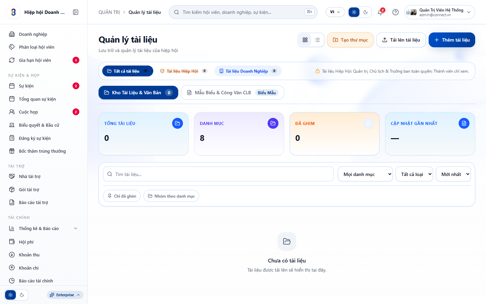

#### 4. Các Thao Tác Chi Tiết
1. **Tải Lên Tài Liệu Mới**:
   - Nhấp nút **[+ Tải Lên Văn Kiện]**.
   - Chọn Phân loại: Quy chế CLB, Nghị quyết Ban Chấp Hành, Mẫu biểu gia nhập, Biên bản họp.
   - Chọn phạm vi xem: Công khai toàn hội viên hoặc Nội bộ Ban Điều Hành.
2. **Trình Xem Toàn Năng (Universal Document Viewer)**:
   - **Xem File Word (.doc, .docx)**: Hiển thị giao diện trang A4 chuẩn format, giữ nguyên định dạng bảng biểu và chân trang.
   - **Xem File Excel (.xls, .xlsx)**: Tích hợp công nghệ SheetJS chia tab đa sheet, hỗ trợ lọc, tìm kiếm ô tính ngay trên modal.
   - **Xem File PDF**: Nhúng khung đọc tương tác có thanh cuộn mượt, phóng to thu nhỏ (zoom in/out) sắc nét.

---

### [NODE-CRM-015]: Quản Trị Biểu Quyết & Vòng Quay May Mắn Lucky Draw

#### 1. Mục đích Nghiệp Vụ
Quản lý các cuộc bỏ phiếu tín nhiệm, biểu quyết nghị quyết Đại hội và điều hành vòng quay số may mắn (Lucky Draw) trúng thưởng hiện vật tại các đêm tiệc Gala.

#### 2. Đường Dẫn & Vị Trí Menu
- **Route**: `/voting`
- **Menu Sidebar**: Mục **"Biểu Quyết & Vòng Quay"** (Biểu tượng `Vote`).

#### 3. Giao Diện Thực Tế
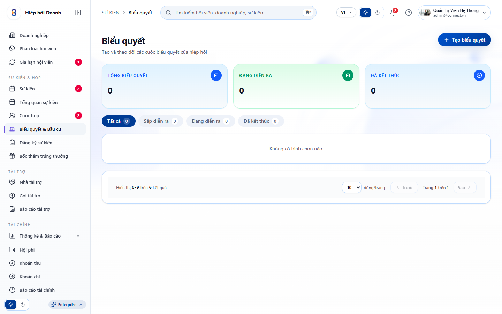

#### 4. Các Thao Tác Chi Tiết
1. **Tạo Cuộc Biểu Quyết Mới**:
   - Nhập Tiêu đề Nghị quyết, Nội dung chi tiết cần biểu quyết.
   - Thiết lập các phương án chọn: Tán thành, Không tán thành, Ý kiến khác.
   - Gắn phiên biểu quyết với Cuộc họp Ban hoặc Sự kiện cụ thể.
2. **Vận Hành Vòng Quay May Mắn (Lucky Draw Wheel)**:
   - Danh sách giải thưởng được nạp động từ CSDL nhà tài trợ (Giải Đặc Biệt, Nhất, Nhì, Ba).
   - Nhấp nút **[Quay Số]** trên màn hình chiếu LED sân khấu: Hệ thống quay ngẫu nhiên giữa các hội viên đã quét QR check-in tại sự kiện.
   - Khi có người trúng giải, hệ thống tự động loại trừ để tránh trúng lặp và gửi email chúc mừng nhận quà.

---

### [NODE-CRM-016]: Quản Lý Bản Tin & Truyền Thông CLB

#### 1. Mục đích Nghiệp Vụ
Soạn thảo và phát hành các bài viết tin tức, thông cáo báo chí, hoạt động phong trào của Hiệp hội Doanh nhân CEO 1983 (HanoiBA).

#### 2. Đường Dẫn & Vị Trí Menu
- **Route**: `/news-admin`
- **Menu Sidebar**: Mục **"Tin Tức & Truyền Thông"** (Biểu tượng `Newspaper`).

#### 3. Giao Diện Thực Tế
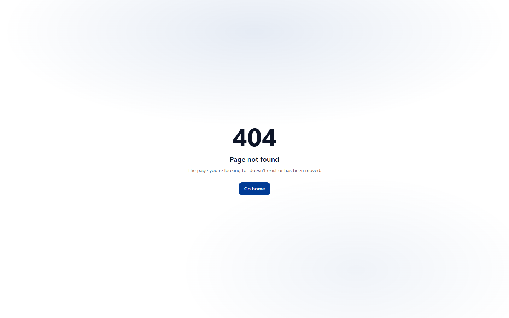

#### 4. Các Thao Tác Chi Tiết
1. **Soạn Bài Viết Mới**:
   - Nhấp nút **[+ Viết Bài Mới]**.
   - Nhập Tiêu đề bài viết, Trích dẫn ngắn và Nội dung chi tiết (hỗ trợ Rich Text Editor định dạng in đậm, chèn bảng, danh sách).
   - Tải lên Ảnh đại diện sắc nét và chèn các hình ảnh hoạt động liên quan.
2. **Xuất Bản Đa Kênh**:
   - Chọn chế độ xuất bản: "Lưu bản nháp" hoặc "Xuất bản chính thức".
   - Khi xuất bản chính thức, bài viết lập tức hiển thị trên Bảng tin Mobile App của toàn thể hội viên.

---

### [NODE-CRM-017]: Gia Hạn Hội Viên & Xử Lý Nợ Phí Niên Liễm

#### 1. Mục đích Nghiệp Vụ
Theo dõi chu kỳ niên liễm của từng hội viên, tự động tính toán số ngày còn lại đến hạn đóng phí, xử lý nợ đọng và kích hoạt gửi thông báo nhắc phí đa kênh.

#### 2. Đường Dẫn & Vị Trí Menu
- **Route**: `/renewal`
- **Menu Sidebar**: Mục **"Gia Hạn & Niên Liễm"** (Biểu tượng `RefreshCw`).

#### 3. Giao Diện Thực Tế
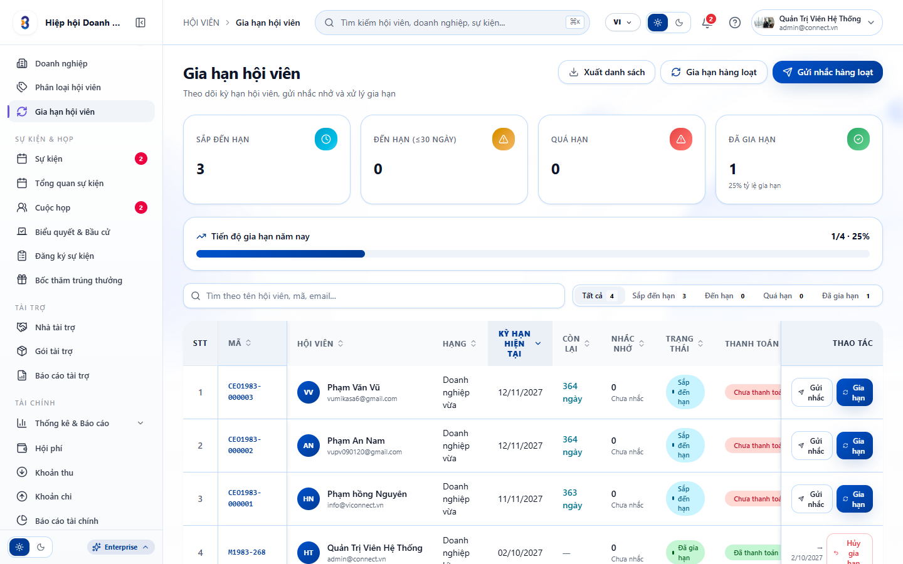

#### 4. Các Thao Tác Chi Tiết
1. **Phân Loại Trạng Thái Theo Màu Sắc Trực Quan**:
   - **Xanh lục (Active)**: Hội viên đã hoàn thành niên liễm năm hiện tại.
   - **Vàng hổ phách (Pending)**: Sắp đến hạn đóng phí trong vòng 30 ngày.
   - **Đỏ ruby (Overdue)**: Đã quá hạn niên liễm trên 30 ngày.
2. **Gửi Thông Báo Nhắc Phí Tự Động**:
   - Nhấp nút **[Gửi thông báo gia hạn]** trên dòng hội viên quá hạn.
   - Hệ thống tự động gửi email trang trọng kèm mã VietQR ngân hàng định danh (tự điền chính xác số tiền niên liễm và nội dung chuyển khoản).
3. **Cập Nhật Trạng Thái Khi Đã Thu Tiền**:
   - Khi kế toán xác nhận tiền đã vào tài khoản, nhấp **[Gia Hạn 1 Năm]** để cộng thời hạn hội viên sang chu kỳ tiếp theo.

---

### [NODE-CRM-018]: Quản Trị Đào Tạo Đa Thức & Phòng Video Call Jitsi

#### 1. Mục đích Nghiệp Vụ
Tổ chức các khóa đào tạo nâng cao năng lực lãnh đạo, chia sẻ kinh nghiệm quản trị doanh nghiệp (hình thức Trực tiếp, Trực tuyến hoặc Kết hợp Hybrid). Tích hợp phòng gọi Video Call trực tuyến nhúng Jitsi Meet bảo mật.

#### 2. Đường Dẫn & Vị Trí Menu
- **Route**: `/trainings`
- **Menu Sidebar**: Mục **"Đào Tạo Doanh Nghiệp"** (Biểu tượng `GraduationCap`).

#### 3. Giao Diện Thực Tế
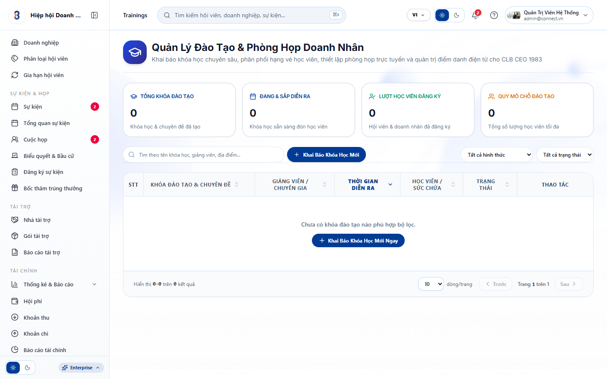

#### 4. Các Thao Tác Chi Tiết
1. **Tạo Khóa Đào Tạo Mới**:
   - Nhập Tên khóa học, Tên Chuyên gia / Diễn giả chia sẻ.
   - Chọn Hình thức: `Online (Video Call)`, `Offline (Tại Hội trường)` hoặc `Hybrid`.
   - Nhập thời gian bắt đầu, link tài liệu bài giảng giáo trình.
2. **Kích Hoạt Phòng Video Call Jitsi Meet**:
   - Nếu chọn hình thức Online, hệ thống tự động sinh phòng họp video bảo mật chuẩn WebRTC.
   - Quản trị viên nhấp **[Vào Phòng Giảng Dạy]** để điều phối cuộc gọi, chia sẻ slide bài giảng.
3. **Bắn Mạng Lưới Đào Tạo**:
   - Nhấp nút **[Bắn Mạng Lưới]** để thông báo lớp học đến tất cả hội viên trên Mobile App.

---

### [NODE-CRM-019]: Nhật Ký Lịch Sử Thao Tác Toàn Hệ Thống (Audit Log)

#### 1. Mục đích Nghiệp Vụ
Giám sát an ninh, ghi nhận toàn bộ dấu vết lịch sử thao tác của tất cả các tài khoản trên hệ thống: ai đã thêm, sửa, xóa, duyệt dữ liệu gì, vào thời điểm nào và từ địa chỉ IP nào.

#### 2. Đường Dẫn & Vị Trí Menu
- **Route**: `/activity-logs`
- **Menu Sidebar**: Mục **"Nhật Ký Hệ Thống"** (Biểu tượng `FileClock`).

#### 3. Giao Diện Thực Tế
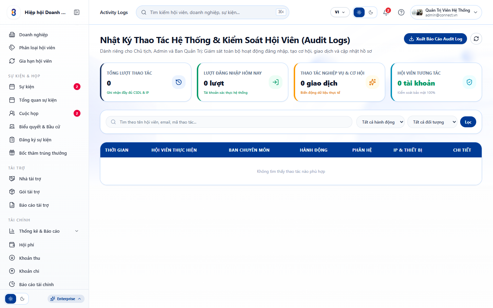

#### 4. Các Thao Tác Chi Tiết
1. **Tra Cứu Lịch Sử Theo Bộ Lọc**:
   - Lọc theo Người thực hiện (User), Hành vi (Tạo mới, Cập nhật, Xóa, Đăng nhập, Xuất file).
   - Lọc theo Đối tượng nghiệp vụ (Hội viên, Sự kiện, Phiếu thu, Phiếu chi, Phân quyền).
2. **Kiểm Tra Chi Tiết Sai Lệch Dữ Liệu**:
   - Nhấp vào một dòng nhật ký để xem bảng so sánh giá trị cũ (Old Data) và giá trị mới (New Data) để dễ dàng khôi phục khi có sự cố thao tác nhầm.

---

### [NODE-CRM-020]: Trao Cơ Hội B2B Đa Đối Tượng & Nhóm Ban Chuyên Môn

#### 1. Mục đích Nghiệp Vụ
Cho phép Ban Điều Hành và Ban Xúc Tiến Thương Mại trao các gói cơ hội kinh doanh lớn cho nhiều hội viên cùng lúc (Batch Sharing) hoặc chuyển giao cơ hội cho cả một Ban Chuyên Môn cùng tiếp cận.

#### 2. Đường Dẫn & Vị Trí Menu
- **Route**: `/opportunities`
- **Menu Sidebar**: Mục **"Cơ Hội Giao Thương"** (Biểu tượng `Handshake`).

#### 3. Giao Diện Thực Tế
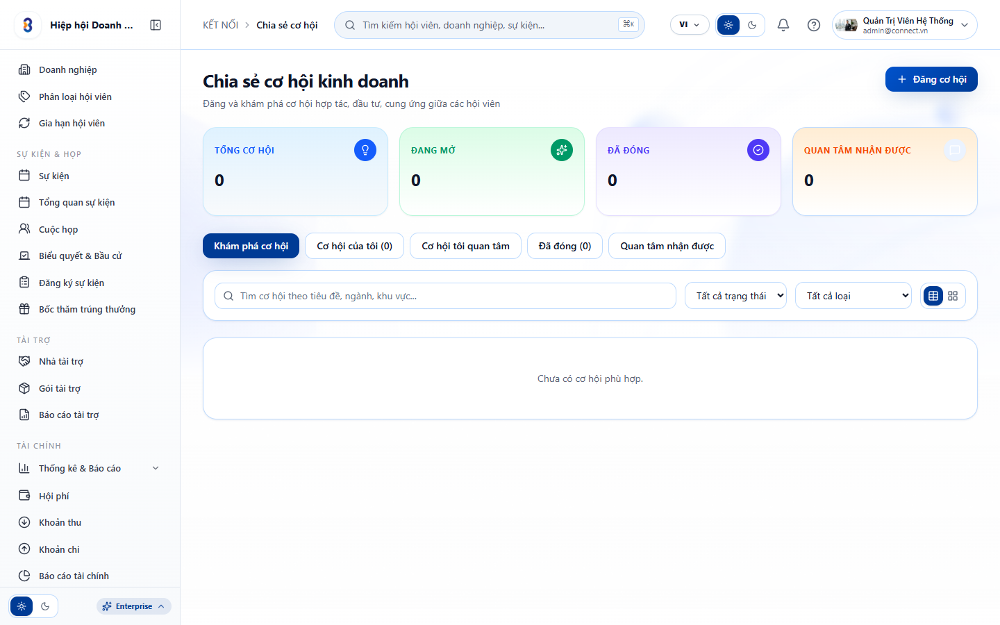

#### 4. Các Thao Tác Chi Tiết
1. **Khởi Tạo Cơ Hội Trao Đa Điểm**:
   - Nhấp **[+ Trao Cơ Hội Kinh Doanh]**.
   - Chọn Chế độ trao: "Trao cho từng người được chọn (Multi-select)" hoặc "Trao cho Toàn Ban Chuyên Môn".
   - Nhập Tiêu đề nhu cầu hợp tác, Giá trị deal ước tính (VNĐ), Thông tin liên hệ đối tác thứ 3.
2. **Theo Dõi Tiến Trình Khép Kín (Closed Deal)**:
   - Theo dõi trạng thái từng cơ hội: Đã trao -> Đang kết nối -> Đã ký kết thành công.
   - Khi deal thành công, hệ thống tự động ghi nhận điểm cống hiến cho người trao vào Bảng vinh danh Top Giver.

---

### [NODE-CRM-021]: Theme Studio, Icon Picker 14 Tính Năng & Live Preview

#### 1. Mục đích Nghiệp Vụ
Trung tâm thiết kế giao diện linh hoạt của CLB CEO 1983: Tùy biến bộ màu nhận diện, cấu hình 5 VIP Presets (Hoàng Gia, Dạ Hội, Thép Titan, Sen Vàng, Mùa Lễ Hội), tùy biến bộ icon 14 tính năng và đồng bộ thời gian thực xuống toàn bộ Mobile App.

#### 2. Đường Dẫn & Vị Trí Menu
- **Route**: `/admin/landing-templates`
- **Menu Sidebar**: Mục **"Theme Studio"** (Biểu tượng `Palette`).

#### 3. Giao Diện Thực Tế
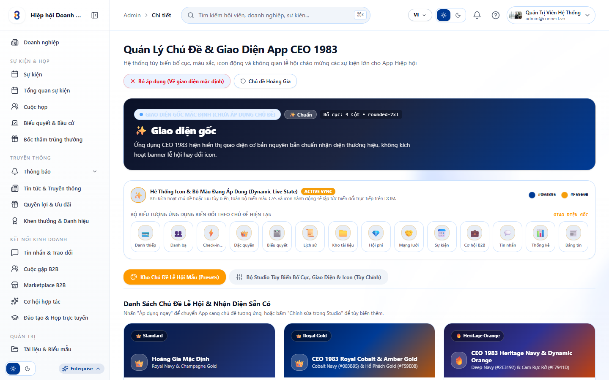

#### 4. Các Thao Tác Chi Tiết
1. **Lựa Chọn 5 Bộ Theme VIP Sẵn Có**:
   - **Hoàng Gia (Royal Gold)**: Nền xanh đen Sapphire phối viền Amber Gold.
   - **Dạ Hội (Obsidian Gala)**: Nền tối sang trọng chuẩn phong cách sự kiện đêm.
   - **Thép Titan (Titanium Steel)**: Phong cách hiện đại, thanh lịch công nghệ.
   - **Sen Vàng (Golden Lotus)**: Nét đẹp văn hóa doanh nhân Việt Nam.
   - **Mùa Lễ Hội (Festival Season)**: Tự động kích hoạt biến CSS `--festival-bg-image` hiển thị hoa mai hoa đào chào đón năm mới.
2. **Khung Live Preview Mobile Frame Thời Gian Thực**:
   - Cột bên phải mô phỏng trực tiếp màn hình iPhone: Mọi thay đổi về màu sắc, icon, kích thước chữ đều phản ánh ngay lập tức trên khung mẫu để người quản trị kiểm tra trước khi lưu.
3. **Áp Dụng Toàn Hệ Thống**:
   - Nhấp nút **[Áp Dụng Giao Diện Toàn App]** để đồng bộ ngay lập tức tới tất cả thiết bị của hội viên.

---

### [NODE-CRM-022]: Trung Tâm Thông Báo Quản Trị & Cảnh Báo Hội Phí / Hồ Sơ

#### 1. Mục đích Nghiệp Vụ
Trung tâm tiếp nhận và xử lý tập trung mọi cảnh báo khẩn cấp của hệ thống: Đơn kết nạp mới chưa xử lý, hội viên đến hạn niên liễm trong 30 ngày, các sự cố đăng ký vé hoặc yêu cầu hỗ trợ kỹ thuật.

#### 2. Đường Dẫn & Vị Trí Menu
- **Route**: `/notifications`
- **Menu Sidebar**: Mục **"Thông Báo Quản Trị"** (Biểu tượng `Bell`).

#### 3. Giao Diện Thực Tế
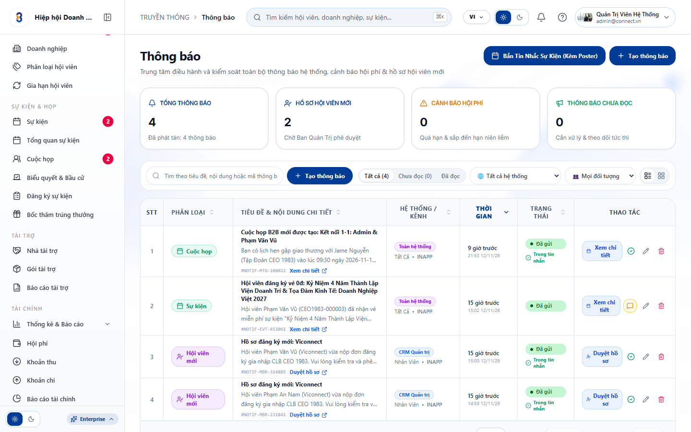

#### 4. Các Thao Tác Chi Tiết
1. **Theo dõi 4 Thẻ KPI Gradient Thông Báo**:
   - Tổng thông báo, Hồ sơ mới chờ duyệt, Cảnh báo niên liễm, Thông báo hoàn thành.
2. **Xử Lý Nhanh Bằng 1 Thao Tác (Quick Action)**:
   - Nhấp trực tiếp vào dòng cảnh báo để mở ngay màn hình xử lý tương ứng (Ví dụ: bấm vào cảnh báo hồ sơ mới để mở ngay Drawer duyệt hội viên).
3. **Đánh Dấu Đã Đọc / Đã Xử Lý**:
   - Nhấp vào biểu tượng kiểm tra để xóa cảnh báo khỏi hàng chờ ưu tiên.

---

### [NODE-CRM-024]: Omnichannel Page & Invitation Studio (Thư Mời, Zalo OA/ZNS, Email v3)

#### 1. Mục đích Nghiệp Vụ
Studio tạo mẫu trang và gửi thư mời đa kênh tự động: Tải lên hoặc thiết kế poster thư mời trực tuyến, phát hành qua 3 kênh đồng bộ: Thông báo ứng dụng di động (Push App), Tin nhắn thương hiệu Zalo OA/ZNS và Email HTML chuẩn v3 kèm QR Code.

#### 2. Đường Dẫn & Vị Trí Menu
- **Route**: `/templates`
- **Menu Sidebar**: Mục **"Studio Mẫu & Thư Mời"** (Biểu tượng `SendHorizontal`).

#### 3. Giao Diện Thực Tế
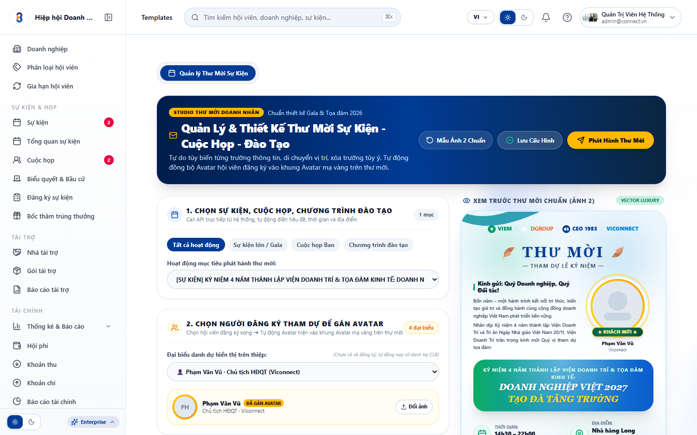

#### 4. Các Thao Tác Chi Tiết
1. **Thiết Lập Mẫu Thư Mời (Invitation Template)**:
   - Tải lên ảnh poster sự kiện hoặc tùy chọn màu nền, khung viền theo thương hiệu.
   - Chèn các biến động: `{TEN_HOI_VIEN}`, `{TEN_DOANH_NGHIEP}`, `{THOI_GIAN}`, `{DIA_DIEM}`, `{MA_VE_QR}`.
2. **Cấu Hình Tin Nhắn Zalo ZNS & Zalo OA**:
   - Chọn mã mẫu ZNS đã được Zalo duyệt, thiết lập ánh xạ tham số (parameter map).
3. **Thực Hiện Phát Hành Đa Kênh (Omnichannel Broadcast)**:
   - Nhấp nút **[Bắn Thông Báo Đa Kênh]**.
   - Tích chọn các kênh muốn gửi:
     - [x] Gửi thông báo đẩy về ứng dụng di động (App Mobile)
     - [x] Gửi tin nhắn thương hiệu Zalo OA / ZNS
     - [x] Gửi Email thư mời HTML sang trọng
   - Chọn đối tượng nhận: Toàn thể hội viên, Khách mời VIP hoặc Danh sách nợ phí.
   - Nhấn **[Xác nhận gửi]** để tiến hành phát tán thông điệp tức thời.

---

## 3. GIAO DIỆN ĐA THIẾT BỊ & KHẢ NĂNG ĐÁP ỨNG RESPONSIVE (DESKTOP, TABLET, MOBILE)

Cổng Quản trị Web CRM CLB CEO 1983 được phát triển dựa trên kiến trúc **Responsive Layout Tiên Tiến (Tailwind CSS v4 Grid & Flexbox)**, đảm bảo hiển thị hoàn mỹ và tự động thích ứng trên mọi loại thiết bị làm việc của Ban Lãnh Đạo và Ban Thư Ký.

### 3.1. Giao Diện Chuẩn Màn Hình Lớn Desktop (1440x900 / 1920x1080)
- **Đặc điểm hiển thị**:
  - Thanh Sidebar cố định bên trái hiển thị đầy đủ 24 module nghiệp vụ cùng icon Lucide trực quan và nhãn tên phân hệ rõ ràng.
  - Bảng dữ liệu SheetJS hiển thị đa cột không bị che khuất, tích hợp bộ lọc nhanh, ô tìm kiếm và các nút xuất báo cáo Excel, PDF.
  - Các khối thống kê Recharts (Biểu đồ tròn doanh thu, biểu đồ cột tăng trưởng) phân bố dạng lưới 4 cột rộng rãi.
- **Hình ảnh thực tế**:
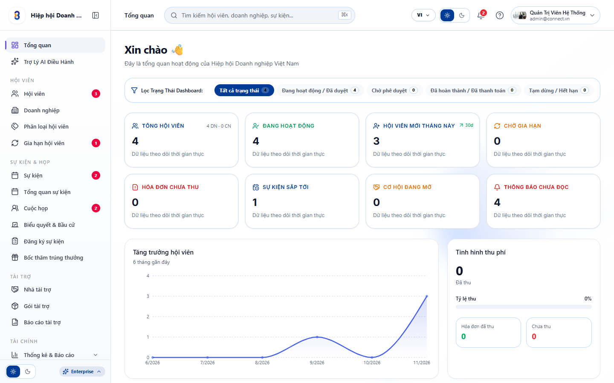
*Hình 3.1: Giao diện Web CRM trên máy tính Desktop với đầy đủ Sidebar và không gian bảng tính mở rộng.*

---

### 3.2. Giao Diện Máy Tính Bảng Tablet / iPad (1024x768 / 768x1024)
- **Đặc điểm hiển thị**:
  - Sidebar tự động co dãn thông minh (Collapsed Sidebar hoặc tự ẩn) để giải phóng tối đa không gian làm việc cho khu vực bảng biểu và biểu đồ.
  - Các thẻ số liệu KPI (StatCard) tự động chuyển đổi từ bố cục 4 cột sang bố cục 2 cột cân đối.
  - Thanh công cụ thao tác nhanh (Làm mới, Thêm mới, Lọc trạng thái) gom nhóm gọn gàng, hỗ trợ cử chỉ chạm vuốt (touch-friendly) mượt mà.
- **Hình ảnh thực tế**:
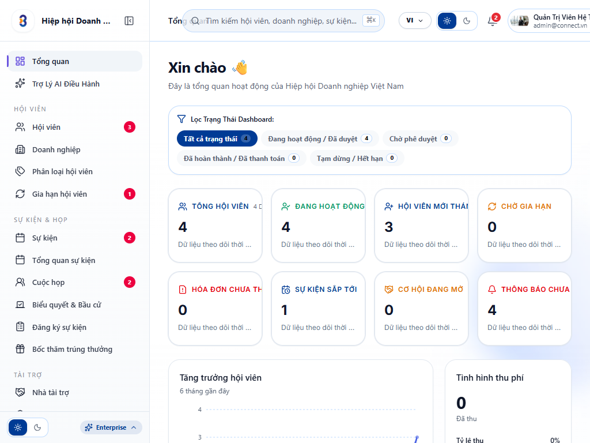
*Hình 3.2: Giao diện Web CRM trên máy tính bảng Tablet với bố cục co dãn linh hoạt, tối ưu thao tác cảm ứng.*

---

### 3.3. Giao Diện Điện Thoại Di Động Mobile Smartphone (390x844 / Màn Hình Dọc)
- **Đặc điểm hiển thị**:
  - Thanh điều hướng chuyển sang dạng **Menu Ngăn Kéo (Drawer Navigation / Hamburger Icon ☰)** ở góc trên, cho phép mở ra toàn bộ danh mục quản trị khi cần và đóng lại để tiết kiệm diện tích.
  - Bảng dữ liệu tự động cho phép cuộn ngang (horizontal scroll) mượt mà hoặc chuyển đổi sang dạng thẻ danh thiếp tóm tắt (Card list) giúp người dùng dễ dàng thao tác bằng một tay.
  - Các nút hành động chính (Duyệt hội viên, Xem chi tiết, Quét QR) được phóng to diện tích chạm, giúp Ban Thư Ký xử lý công việc khẩn cấp ngay khi đang di chuyển ngoài đường.
- **Hình ảnh thực tế**:
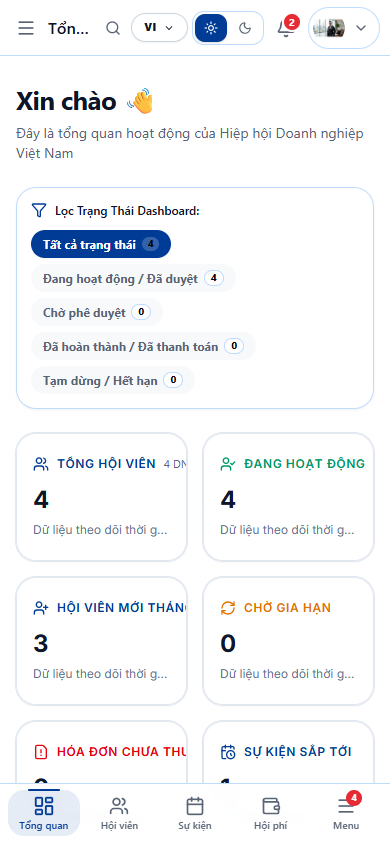
*Hình 3.3: Giao diện Web CRM trên điện thoại thông minh với menu ngăn kéo và bố cục 1 cột tiện dụng.*

---

## 4. QUY TRÌNH PHỐI HỢP LIÊN BAN & XỬ LÝ SỰ CỐ

### 3.1. Ma trận Phối hợp Nghiệp vụ giữa các Ban
| Bước | Nghiệp Vụ | Ban Chịu Trách Nhiệm Chính | Ban Phối Hợp | Phân Hệ Thao Tác |
| :---: | :--- | :--- | :--- | :--- |
| **1** | Tiếp nhận & Phê duyệt Hội viên mới | Ban Thư Ký | Ban Thành Viên | `[NODE-CRM-003]`, `[NODE-CRM-005]` |
| **2** | Thu phí Niên Liễm & Cấp thẻ | Ban Tài Chính (Kế toán) | Ban Thư Ký | `[NODE-CRM-009]`, `[NODE-CRM-017]` |
| **3** | Tổ chức Sự kiện & Bán vé | Ban Sự Kiện | Ban Truyền Thông, Tài Chính | `[NODE-CRM-007]`, `[NODE-CRM-013]` |
| **4** | Phát thanh Mạng lưới & Viết tin tức | Ban Truyền Thông | Ban Thư Ký | `[NODE-CRM-016]`, `[NODE-CRM-024]` |
| **5** | Xúc tiến Thương mại & Cơ hội B2B | Ban Xúc Tiến Thương Mại | Tất cả các Ban | `[NODE-CRM-020]`, `[NODE-CRM-002]` |
| **6** | Quản trị Hệ thống & Phân quyền | Quản Trị Viên (Admin) | Chủ tịch CLB | `[NODE-CRM-006]`, `[NODE-CRM-021]` |

### 3.2. Xử Lý Các Sự Cố Thường Gặp (Troubleshooting)
1. **Lỗi không đăng nhập được (Báo 401 hoặc Mật khẩu không chính xác)**:
   - Kiểm tra xem phím CapsLock có đang bật không.
   - Xác nhận email đã được Ban Thư Ký kích hoạt trạng thái `active`.
   - Nếu quên mật khẩu, liên hệ Admin kỹ thuật để cấp lại mật khẩu tạm thời.
2. **Dữ liệu bảng tính Excel không hiển thị sau khi F5**:
   - Nhấp vào nút **[Làm Mới Dữ Liệu]** trên thanh công cụ góc trên để gọi lại API từ PostgreSQL.
3. **Không nhận được Email khi gửi thư mời / thông báo**:
   - Kiểm tra hòm thư rác (Spam / Junk) của đối tác.
   - Đảm bảo địa chỉ email đối tác đã nhập chính xác không chứa khoảng trắng thừa.

