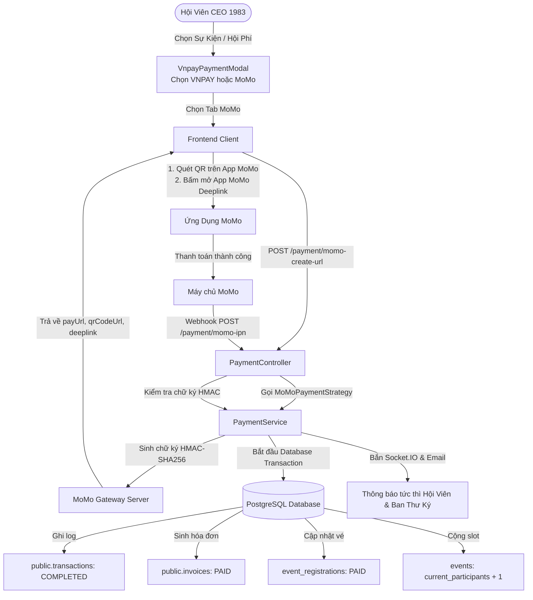

# HƯỚNG DẪN CẤU HÌNH VÀ SỬ DỤNG CỔNG THANH TOÁN MOMO (ALL-IN-ONE)
## HỆ THỐNG CLB DOANH NHÂN CEO 1983 (HANOIBA)
*Phiên bản tài liệu: 1.0 - Chuẩn hóa kiến trúc Strategy Pattern & Thanh toán đa kênh (MoMo + VNPAY)*

---

## 1. TỔNG QUAN TÍCH HỢP MOMO

Hệ thống CLB Doanh Nhân CEO 1983 đã hoàn tất tích hợp chuẩn cổng thanh toán **MoMo Payment Gateway v2 (All In One)**, hoạt động song song với cổng **VNPAY-QR**. 

Cổng MoMo phục vụ các giao dịch trọng yếu của hội viên:
1. **Đóng Hội phí định kỳ**: Đóng hội phí năm, nâng hạng gói thành viên (Member, Premium, Diamond).
2. **Mua vé & Đăng ký sự kiện (Events)**: Hội thảo xúc tiến thương mại, gala kết nối, giải golf, caravan.
3. **Ủng hộ & Tài trợ Quỹ từ thiện**: Quỹ Trẻ Em Vùng Cao, Quỹ Phát Triển Hội Viên CEO 1983.
4. **Gian hàng B2B & Voucher ưu đãi**: Thanh toán trực tuyến sản phẩm, dịch vụ giữa các doanh nghiệp hội viên.

---

## 2. QUY TRÌNH ĐĂNG KÝ VÀ LẤY BỘ KHÓA KẾT NỐI TỪ MOMO

### Bước 1: Đăng ký tài khoản Doanh nghiệp MoMo
1. Truy cập cổng MoMo Doanh Nghiệp: [https://business.momo.vn/](https://business.momo.vn/) hoặc Cổng Lập Trình Viên MoMo: [https://developers.momo.vn/](https://developers.momo.vn/).
2. Đăng ký tài khoản với pháp nhân của CLB Doanh Nhân CEO 1983 / Doanh nghiệp điều hành.
3. Nộp hồ sơ KYC doanh nghiệp:
   - Giấy phép đăng ký kinh doanh.
   - CMND/CCCD/Hộ chiếu người đại diện pháp luật.
   - Tài khoản ngân hàng nhận tiền quyết toán của CLB/Công ty.

### Bước 2: Tạo ứng dụng thanh toán & Nhận thông tin API
1. Đăng nhập vào **MoMo Merchant Portal** > Chọn mục **Tích Hợp Kỹ Thuật** (Technical Integration).
2. Chọn loại giải pháp: **All-In-One (AIO) Gateway v2** (Hỗ trợ quét mã QR, mở trực tiếp App MoMo qua Deeplink, thẻ ATM, Visa/Mastercard).
3. Hệ thống MoMo sẽ cấp cho CLB bộ thông tin bảo mật:
   - **Partner Code** (Mã đối tác, ví dụ: `MOMO_CEO1983`)
   - **Access Key** (Khóa truy cập API)
   - **Secret Key** (Khóa bí mật dùng để sinh chữ ký số HMAC-SHA256 - **BẢO MẬT TUYỆT ĐỐI**)
   - **Public Key** (Khóa công khai dùng để mã hóa thông tin nhạy cảm nếu cần)

### Bước 3: Đăng ký URL Nhận Thông Báo (IPN Webhook) & Return URL
Trên MoMo Merchant Portal, cấu hình 2 đường dẫn callback:
- **IPN URL (Server-to-Server Webhook)**:
  `https://api.ceo1983.vn/payment/momo-ipn`
  *(MoMo sẽ gửi kết quả thanh toán tức thời ngầm về URL này, hệ thống sẽ xác thực chữ ký HMAC-SHA256 và kích hoạt vé/hội phí tự động)*.
- **Redirect / Return URL (Client URL)**:
  `https://app.ceo1983.vn/payment-return`
  *(Sau khi hội viên thanh toán xong trên MoMo, trình duyệt sẽ tự động chuyển hướng về trang này để hiển thị thông báo thành công)*.

---

## 3. CẤU HÌNH BIẾN MÔI TRƯỜNG BACKEND

Mở file môi trường `apps/ceo1983_app_be/.env` và cập nhật các tham số sau:

```bash
# ==============================================================================
# CẤU HÌNH CỔNG THANH TOÁN MOMO (PAYMENT GATEWAY V2)
# ==============================================================================
# Mã đối tác do MoMo cấp
MOMO_PARTNER_CODE=MOMO_CEO1983_TEST

# Khóa truy cập do MoMo cấp
MOMO_ACCESS_KEY=F8BBA842ECF85_SAMPLE

# Khóa bí mật ký chữ ký HMAC-SHA256 (TUYỆT ĐỐI KHÔNG LỘ RA NGOÀI)
MOMO_SECRET_KEY=K951B6PE1waDMi640xX0huBt3C0/Pars_SAMPLE

# Đường dẫn API tạo đơn hàng của MoMo:
# - Môi trường Test: https://test-payment.momo.vn/v2/gateway/api/create
# - Môi trường Production: https://payment.momo.vn/v2/gateway/api/create
MOMO_ENDPOINT=https://test-payment.momo.vn/v2/gateway/api/create

# Đường dẫn URL chuyển hướng hội viên sau khi thanh toán trên MoMo
MOMO_RETURN_URL=https://app.ceo1983.vn/payment-return

# Đường dẫn URL nhận Webhook IPN từ máy chủ MoMo
MOMO_IPN_URL=https://api.ceo1983.vn/payment/momo-ipn
```

> [!NOTE]
> Hệ thống có sẵn bộ cấu hình Sandbox mặc định của MoMo. Khi triển khai lên máy chủ thật, ban quản trị chỉ cần thay thế 3 thông số: `MOMO_PARTNER_CODE`, `MOMO_ACCESS_KEY`, `MOMO_SECRET_KEY` và đổi `MOMO_ENDPOINT` sang endpoint Production.

---

## 4. KIẾN TRÚC KỸ THUẬT VÀ LUỒNG XỬ LÝ (STRATEGY PATTERN)

Hệ thống được thiết kế theo mô hình **Design Pattern: Strategy Pattern**, tách biệt độc lập giữa logic giao diện và các cổng thanh toán:



### Các Endpoint Backend Đã Xây Dựng:
1. **`POST /payment/momo-create-url`**:
   - Nhận payload: `{ orderId, amount, orderInfo, returnUrl, ipnUrl }`.
   - Sinh chữ ký `HMAC-SHA256` định dạng MoMo v2.
   - Gửi request tạo giao dịch sang MoMo và trả về link thanh toán (`payUrl`), link mở app (`deeplink`), mã QR (`qrCodeUrl`).
2. **`POST /payment/momo-ipn`**:
   - Nhận Webhook từ máy chủ MoMo.
   - Xác thực chữ ký `signature` theo chuẩn:
     `accessKey=...&amount=...&extraData=...&message=...&orderId=...&orderInfo=...&orderType=...&partnerCode=...&payType=...&requestId=...&responseTime=...&resultCode=...&transId=...`
   - Kích hoạt giao dịch Database nguyên tử nếu `resultCode === 0`.
3. **`GET /payment/momo-return`**:
   - Nhận redirect từ trình duyệt của người dùng.
   - Kiểm tra kết quả hiển thị thông báo thành công hoặc thất bại.
4. **`POST /payment/simulate-momo-success`**:
   - API tiện ích cho phép tester / developer kiểm thử luồng hoàn tất giao dịch MoMo trong môi trường phát triển nội bộ mà không cần tài khoản ngân hàng thực tế.

---

## 5. TRẢI NGHIỆM NGƯỜI DÙNG TRÊN FRONTEND (UI/UX)

Thành phần `VnpayPaymentModal.tsx` đã được nâng cấp thành **Modal Đa Cổng Thanh Toán Chuẩn Thương Hiệu**:
- **Tab Cổng VNPAY-QR**: Nhận diện màu xanh Navy hoàng gia CEO 1983 `#003B95`, hỗ trợ hơn 40 ứng dụng ngân hàng tại Việt Nam.
- **Tab Ví Điện Tử MoMo**: Nhận diện màu hồng cánh sen đặc trưng của MoMo `#A50064`, hỗ trợ:
  - **Mã QR MoMo**: Hội viên có thể dùng điện thoại khác mở MoMo quét ngay.
  - **Nút "Mở ứng dụng MoMo thanh toán"**: Tự động gọi Deep link `momo://app?...` mở thẳng MoMo trên điện thoại người dùng không cần quét QR.
  - **Tự động bắt trạng thái thành công**: Ngay khi giao dịch hoàn tất trên MoMo, popup tự động đóng và chuyển người dùng đến vé điện tử hoặc xác nhận đăng ký.

---

## 6. QUY TRÌNH KIỂM THỬ THỰC TẾ (SANDBOX TESTING)

1. Mở App CEO 1983 > Chọn một Sự Kiện (hoặc Đóng Hội Phí).
2. Bấm nút **"Đăng ký & Thanh toán"**.
3. Tại Modal thanh toán:
   - Bấm vào tab **"Ví MoMo"**.
   - Màn hình sẽ sinh mã QR MoMo và thông tin số tiền tương ứng.
4. Trên môi trường máy thật (Sandbox):
   - Mở ứng dụng MoMo Sandbox (Test App).
   - Đăng nhập số điện thoại MoMo Test (ví dụ: `0963000001` - OTP mặc định `000000`).
   - Quét mã QR hiển thị trên màn hình.
   - Bấm "Xác nhận thanh toán".
5. Kiểm tra kết quả:
   - Modal trên App CEO 1983 nhận thông báo xác nhận thành công tức thì.
   - Giao dịch được lưu với trạng thái `COMPLETED` tại bảng `public.transactions` với `payment_method = 'MOMO'`.

---

## 7. BẢO MẬT VÀ QUY CHUẨN AN TOÀN THÔNG TIN (PCI-DSS & ATTT)

- **Không lưu trữ thông tin thẻ**: Hệ thống CEO 1983 không lưu bất kỳ thông tin thẻ tín dụng/ATM nào, toàn bộ quá trình nhập thông tin bảo mật được thực hiện trên hạ tầng đạt chuẩn PCI-DSS của MoMo.
- **Bảo vệ chữ ký số HMAC-SHA256**: Chữ ký được sinh và xác thực tại tầng Server-side (NestJS), `MOMO_SECRET_KEY` được bảo vệ nghiêm ngặt trong biến môi trường máy chủ backend, tuyệt đối không xuất hiện ở mã nguồn Frontend.
- **Idempotency & Chống gian lận (Anti-replay)**: MoMo Webhook IPN kiểm tra trùng lặp `orderId` và đối soát số tiền `amount`, ngăn chặn hoàn toàn việc callback giả mạo hoặc trừ tiền nhiều lần.

