# HỆ SINH THÁI NỀN TẢNG SỐ CLB DOANH NHÂN CEO 1983 (HANOIBA)

## TÀI LIỆU ĐẶC TẢ YÊU CẦU PHẦN MỀM TỔNG THỂ CHÍNH THỨC
*(SOFTWARE REQUIREMENTS SPECIFICATION - MASTER SRS)*

---

* **Mã tài liệu:** `SRS-CEO1983-MASTER-CHINH-THUC`
* **Phiên bản:** `Phiên bản 9.0 Toàn Diện (Chuẩn IEEE 830 - Bản Bàn Giao Khách Hàng, Ban Lãnh Đạo & Kỹ Sư Vận Hành)`
* **Cơ quan chủ quản:** Câu Lạc Bộ Doanh Nhân CEO 1983 — Trực thuộc Hội Doanh Nghiệp Trẻ Hà Nội (HanoiBA)
* **Đơn vị phát triển giải pháp:** VICONNECT - Đội ngũ Kiến trúc sư Hệ thống & Chuyên gia Phân tích Nghiệp vụ
* **Phân loại:** Đặc tả Kỹ thuật, Luồng Dữ liệu, Ma trận Use Case & Hệ thống Sơ đồ Mô hình hóa Chi tiết

---

## MỤC LỤC TÀI LIỆU
1. **CHƯƠNG 1: HỆ THỐNG SƠ ĐỒ MÔ HÌNH HÓA TOÀN DIỆN (15 MERMAID DIAGRAMS)**
   - 1.1. Sơ Đồ Tổng Quan Kiến Trúc Đa Tầng (System Architecture)
   - 1.2. Sơ Đồ Tổng Thể Use Case Phân Hệ Quản Trị CRM (CRM Use Case Diagram)
   - 1.3. Sơ Đồ Tổng Thể Use Case Phân Hệ Ứng Dụng Di Động (Mobile App Use Case Diagram)
   - 1.4. Sơ Đồ Luồng Dữ Liệu Đầu-cuối (End-to-End Data Flow Sequence)
   - 1.5. Sơ Đồ Tuần Tự: Quy Trình Đặt Lịch Hẹn 1-on-1 trong 3 Tình Huống & Tự Động Nhắn Tin
   - 1.6. Sơ Đồ Tuần Tự: Sự Kiện & Lưu Vết Kỷ Niệm 5 Hạng Mục (Sponsors, Polls, Awards, Seating, Drive)
   - 1.7. Sơ Đồ Tuần Tự: Đăng Bài Đa Kênh 1-Click (Facebook, Group, Zalo OA, Web)
   - 1.8. Sơ Đồ Tuần Tự: Thanh Toán Điện Tử QR MoMo & VNPay Gạch Nợ Tự Động
   - 1.9. Sơ Đồ Tuần Tự: Bình Luận Cây 3 Cấp, Menu 3 Chấm & Tag `@` Đối Tác Đã Kết Nối
   - 1.10. Sơ Đồ Trạng Thái: Vòng Đời Hồ Sơ Hội Viên (Member Lifecycle State Diagram)
   - 1.11. Sơ Đồ Trạng Thái: Vòng Đời Cơ Hội Giao Thương B2B (Opportunity Lifecycle State Diagram)
   - 1.12. Sơ Đồ Trạng Thái: Vòng Đời Sự Kiện & Hoạt Động (Event & Meeting Lifecycle State Diagram)
   - 1.13. Sơ Đồ Thực Thể Mối Quan Hệ CSDL (Entity-Relationship Diagram - ERD)
   - 1.14. Sơ Đồ Luồng Hoạt Động: Phân Loại Hoạt Động Họp Cố Định vs Họp Bất Thường
   - 1.15. Sơ Đồ Luồng Hoạt Động: Nhập Bảng Tính & Bóc Tách Trường Thông Minh (Smart Import)
2. **CHƯƠNG 2: MA TRẬN USE CASE & ĐẶC TẢ CHI TIẾT 30 USE CASES CHUẨN IEEE 830**
   - 2.1. Ma Trận Use Case Phân Hệ Quản Trị Web CRM (`UC-CRM-001` đến `UC-CRM-015`)
   - 2.2. Đặc Tả Chi Tiết 15 Use Cases Quản Trị CRM
   - 2.3. Ma Trận Use Case Phân Hệ Ứng Dụng Di Động (`UC-APP-001` đến `UC-APP-015`)
   - 2.4. Đặc Tả Chi Tiết 15 Use Cases Mobile App
3. **CHƯƠNG 3: ĐẶC TẢ YÊU CẦU CHỨC NĂNG CHI TIẾT (FUNCTIONAL REQUIREMENTS)**
   - 3.1. Nhóm Chức Năng Quản Trị Trung Ương CRM
   - 3.2. Nhóm Chức Năng Ứng Dụng Di Động Hội Viên
4. **CHƯƠNG 4: ĐẶC TẢ CỔNG THANH TOÁN ĐIỆN TỬ (MÃ QR MOMO & CỔNG VNPAY)**
5. **CHƯƠNG 5: YÊU CẦU PHI CHỨC NĂNG (NON-FUNCTIONAL REQUIREMENTS - NFR)**
6. **CHƯƠNG 6: MA TRẬN TRUY XUẤT TÍNH NĂNG (TRACEABILITY MATRIX)**

---

## CHƯƠNG 1: HỆ THỐNG SƠ ĐỒ MÔ HÌNH HÓA TOÀN DIỆN (15 MERMAID DIAGRAMS)

### 1.1. Sơ Đồ Tổng Quan Kiến Trúc Đa Tầng (System Architecture)
Hệ thống triển khai theo mô hình Monorepo Domain-Driven Design (DDD) phân tầng độc lập:

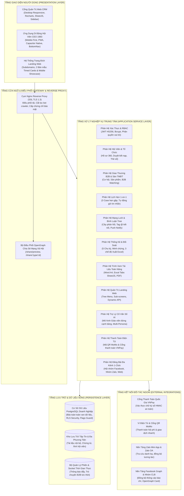

---

### 1.2. Sơ Đồ Tổng Thể Use Case Phân Hệ Quản Trị CRM
Thể hiện mối liên kết giữa các tác nhân quản trị và các Use Case cốt lõi:

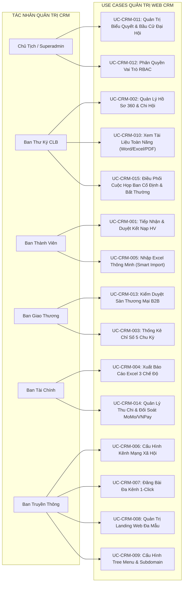

---

### 1.3. Sơ Đồ Tổng Thể Use Case Phân Hệ Ứng Dụng Di Động
Mô hình hóa các chức năng tương tác của Hội viên doanh nhân:

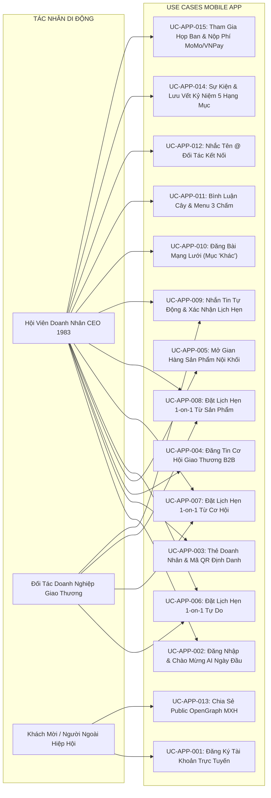

---

### 1.4. Sơ Đồ Luồng Dữ Liệu Đầu-cuối (End-to-End Data Flow Sequence)

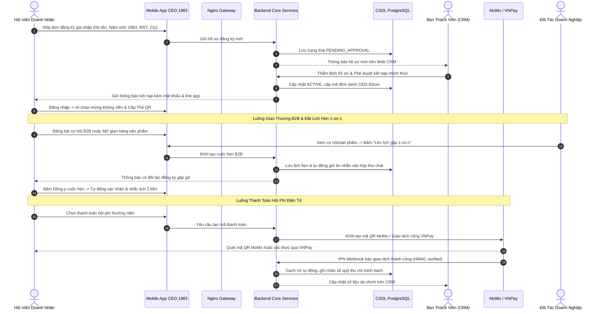

---

### 1.5. Sơ Đồ Tuần Tự: Quy Trình Đặt Lịch Hẹn 1-on-1 trong 3 Tình Huống & Tự Động Nhắn Tin

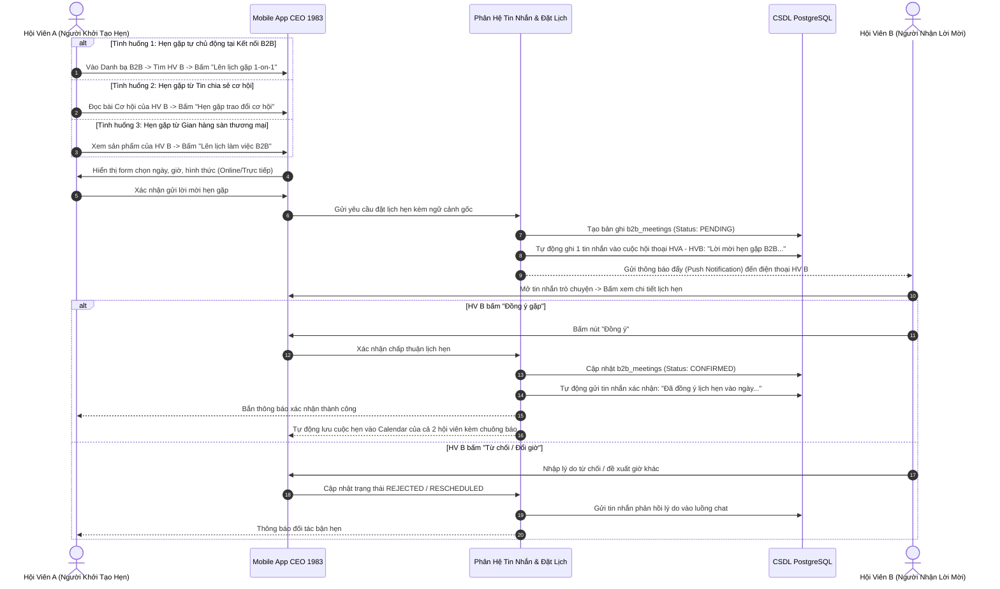

---

### 1.6. Sơ Đồ Tuần Tự: Sự Kiện & Lưu Vết Kỷ Niệm 5 Hạng Mục

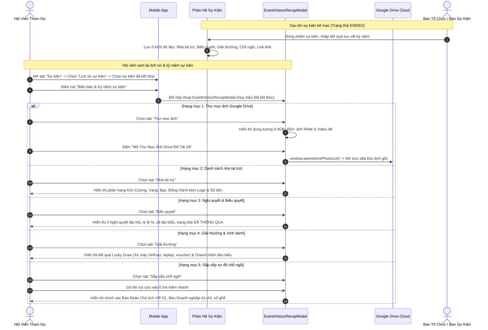

---

### 1.7. Sơ Đồ Tuần Tự: Đăng Bài Đa Kênh 1-Click (Facebook, Group, Zalo OA, Web)

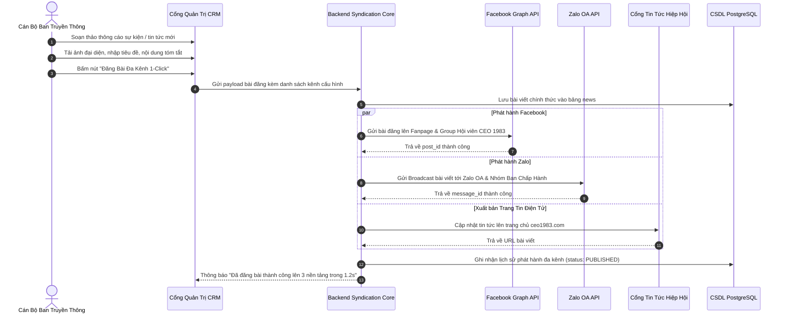

---

### 1.8. Sơ Đồ Tuần Tự: Thanh Toán Điện Tử QR MoMo & VNPay Gạch Nợ Tự Động

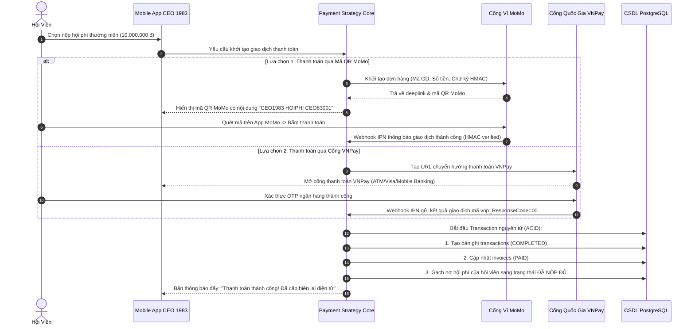

---

### 1.9. Sơ Đồ Tuần Tự: Bình Luận Cây 3 Cấp, Menu 3 Chấm & Tag `@` Đối Tác Đã Kết Nối

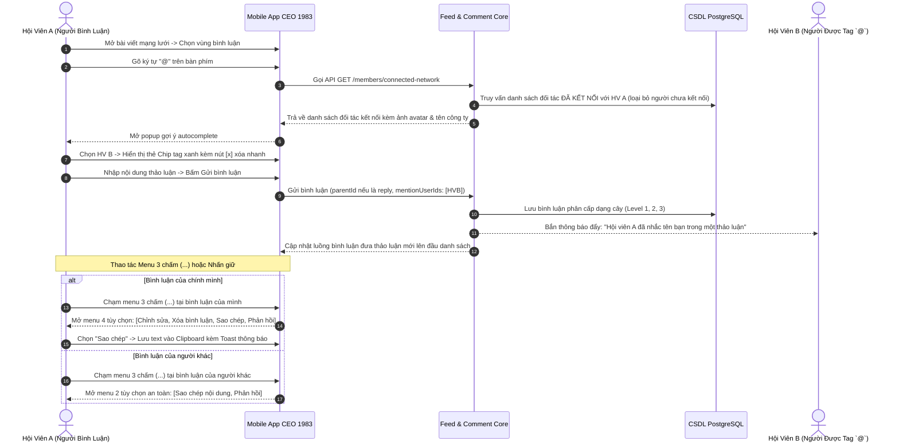

---

### 1.10. Sơ Đồ Trạng Thái: Vòng Đời Hồ Sơ Hội Viên (Member Lifecycle State Diagram)

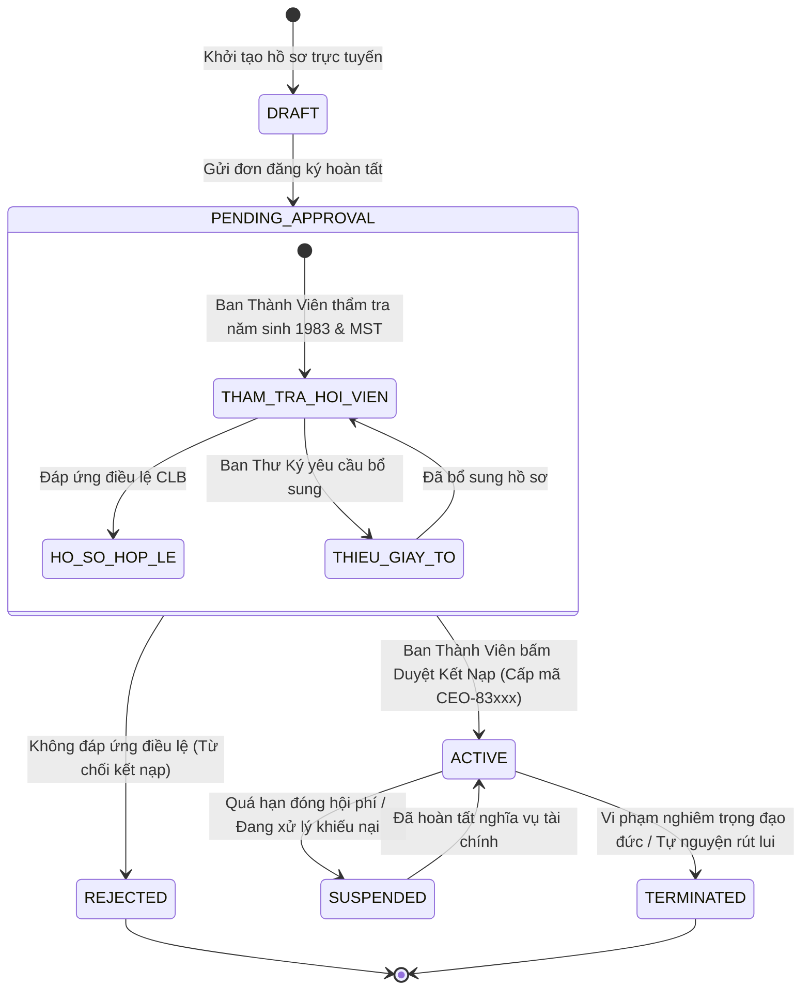

---

### 1.11. Sơ Đồ Trạng Thái: Vòng Đời Cơ Hội Giao Thương B2B (Opportunity Lifecycle State Diagram)

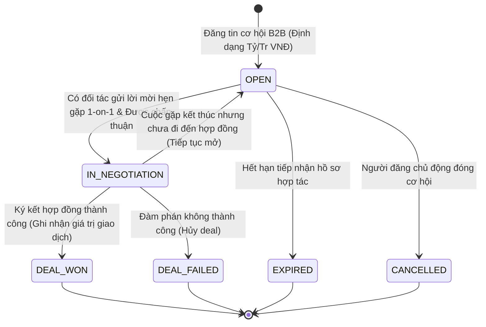

---

### 1.12. Sơ Đồ Trạng Thái: Vòng Đời Sự Kiện & Hoạt Động (Event & Meeting Lifecycle State Diagram)

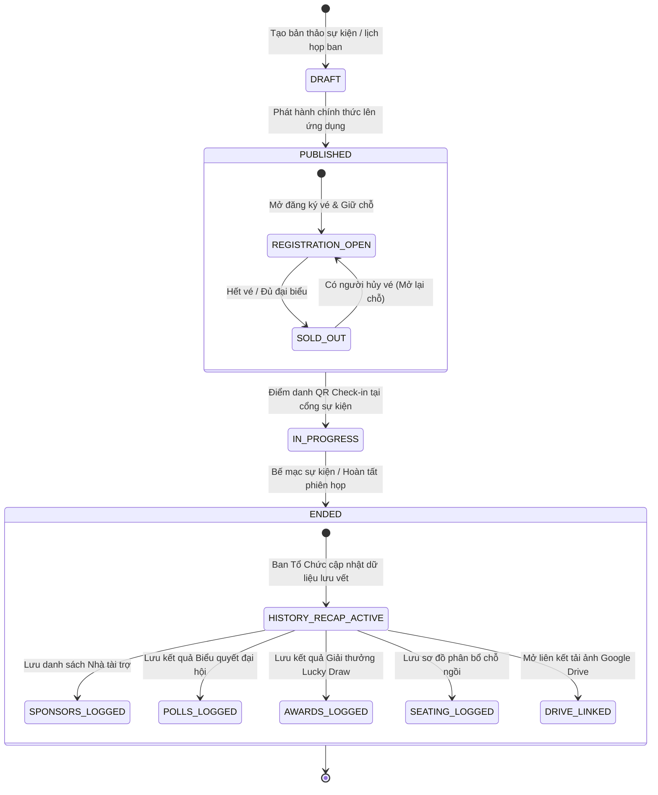

---

### 1.13. Sơ Đồ Thực Thể Mối Quan Hệ CSDL (Entity-Relationship Diagram - ERD)

```mermaid
erDiagram
    MEMBERS ||--o{ COMPANIES : owns
    MEMBERS ||--o{ OPPORTUNITIES : posts
    MEMBERS ||--o{ PRODUCTS : lists
    MEMBERS ||--o{ B2B_MEETINGS : initiates
    MEMBERS ||--o{ COMMENTS : writes
    MEMBERS ||--o{ NOTIFICATIONS : receives
    MEMBERS ||--o{ EVENT_REGISTRATIONS : books
    MEMBERS ||--o{ TRANSACTIONS : pays

    EVENTS ||--o{ EVENT_REGISTRATIONS : contains
    EVENTS ||--o{ EVENT_RECAPS : has
    EVENTS ||--o{ EVENT_SPONSORS : sponsored_by

    MEETINGS ||--o{ MEETING_ATTENDEES : invites

    MEMBERS {
        uuid id PK
        string member_code UK "CEO-83xxx"
        string full_name
        string email UK
        string phone UK
        int birth_year "1983"
        string role "ADMIN, BTK, BTV, BGT, BTC, BTT, MEMBER"
        string membership_status "ACTIVE, PENDING, SUSPENDED"
        string avatar_url
    }

    COMPANIES {
        uuid id PK
        uuid member_id FK
        string company_name
        string tax_id UK
        string industry
        string address
        string website
    }

    OPPORTUNITIES {
        uuid id PK
        uuid creator_id FK
        string title
        string trade_type "BUY, SELL"
        bigint budget_vnd
        string status "OPEN, IN_NEGOTIATION, DEAL_WON, DEAL_FAILED"
        timestamp created_at
    }

    PRODUCTS {
        uuid id PK
        uuid company_id FK
        string product_name
        bigint public_price
        bigint member_discount_price
        int display_order "Max 5 per company"
    }

    B2B_MEETINGS {
        uuid id PK
        uuid initiator_id FK
        uuid receiver_id FK
        string meeting_type "DIRECT, OPPORTUNITY_LINKED, PRODUCT_LINKED"
        uuid source_id "ID of Opportunity or Product"
        timestamp meeting_time
        string location
        string status "PENDING, CONFIRMED, REJECTED, COMPLETED"
    }

    EVENTS {
        uuid id PK
        string title
        string category "GALA, WORKSHOP, B2B_MATCHING, REGULAR"
        timestamp start_date
        string location
        int max_seats
        bigint ticket_price
        string status "UPCOMING, IN_PROGRESS, ENDED"
    }

    EVENT_RECAPS {
        uuid id PK
        uuid event_id FK
        string drive_photos_url
        jsonb voting_resolutions
        jsonb award_winners
        jsonb seating_chart
    }

    MEETINGS {
        uuid id PK
        string title
        string meeting_type "FIXED_COMMITTEE, EXTRAORDINARY"
        string committee_name "BAN_DIEU_HANH, BAN_XUC_TIEN, BAN_THANH_VIEN"
        timestamp meeting_time
        string online_meet_link
        string documents_list
    }
```

---

### 1.14. Sơ Đồ Luồng Hoạt Động: Phân Loại Hoạt Động Họp Cố Định vs Họp Bất Thường

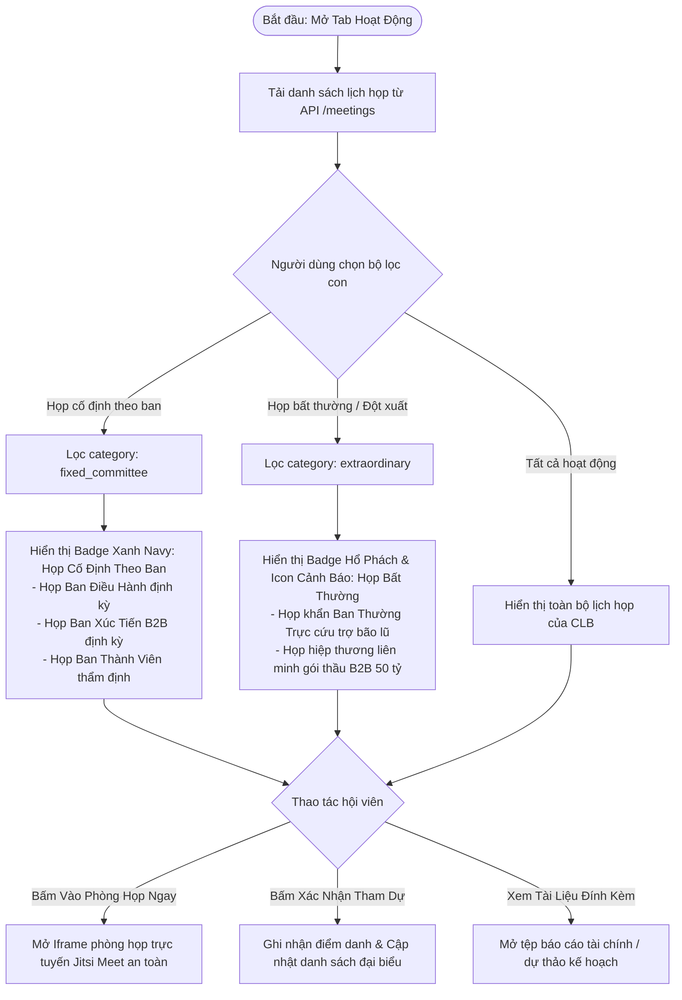

---

### 1.15. Sơ Đồ Luồng Hoạt Động: Nhập Bảng Tính & Bóc Tách Trường Thông Minh (Smart Import)

---

## CHƯƠNG 2: MA TRẬN USE CASE & ĐẶC TẢ CHI TIẾT 30 USE CASES CHUẨN IEEE 830

### 2.1. Ma Trận Use Case Phân Hệ Quản Trị Web CRM

| Mã Use Case | Tên Use Case Nghiệp Vụ | Tác Nhân Chính | Mục Tiêu Nghiệp Vụ Cốt Lõi | Mức Ưu Tiên |
| :--- | :--- | :--- | :--- | :--- |
| **UC-CRM-001** | Tiếp Nhận & Phê Duyệt Kết Nạp Hội Viên Mới | Ban Thành Viên | Xác minh năm sinh 1983, MST, phê duyệt và cấp mã CEO-83xxx | Bắt buộc (P1) |
| **UC-CRM-002** | Quản Lý Hồ Sơ 360 Độ & Chi Hội Trực Thuộc | Ban Thư Ký | Quản lý danh bạ doanh nhân, cập nhật chức vụ và phân ban | Bắt buộc (P1) |
| **UC-CRM-003** | Trung Tâm Thống Kê Chỉ Số Đa Chiều 5 Chu Kỳ | Ban Quản Trị / BGT | Phân tích số liệu cơ hội, doanh số, lượt tham dự và cống hiến | Bắt buộc (P1) |
| **UC-CRM-004** | Xuất Báo Cáo Bảng Tính Excel 3 Chế Độ | Ban Tài Chính / Kế toán | Xuất theo chu kỳ, theo hội viên chi tiết và phân tích biến động | Bắt buộc (P1) |
| **UC-CRM-005** | Nhập Dữ Liệu Bảng Tính Thông Minh (Smart Import) | Ban Thành Viên / BTK | Tự động bóc tách cột, phát hiện trùng lặp và nạp danh bạ nhanh | Bắt buộc (P1) |
| **UC-CRM-006** | Cấu Hình Kênh Mạng Xã Hội (FB, Group, Zalo OA) | Ban Truyền Thông | Thiết lập liên kết fanpage, nhóm Zalo và tham số tích hợp | Bắt buộc (P1) |
| **UC-CRM-007** | Đăng Bài Đa Kênh Đồng Loạt 1-Click Syndication | Ban Truyền Thông | Phát hành thông cáo, sự kiện đồng thời lên Web, FB, Zalo trong 1s | Bắt buộc (P1) |
| **UC-CRM-008** | Quản Trị Hệ Thống Trang Đích Landing Web Đa Mẫu | Ban Truyền Thông | Tạo trang đích, chọn mẫu Timed Cards hoặc Startup Mobile Showcase | Bắt buộc (P1) |
| **UC-CRM-009** | Cấu Hình Dynamic Tree Menu & Gán Subdomain | Ban Truyền Thông | Thiết lập menu đa cấp mở màn con, gán tên miền phụ độc lập | Bắt buộc (P1) |
| **UC-CRM-010** | Trình Xem Tài Liệu Toàn Năng (Word/Excel/PDF) | Ban Thư Ký / Hội viên | Xem trực tiếp tài liệu Word A4, Excel đa tabs, PDF nhúng trực quan | Bắt buộc (P1) |
| **UC-CRM-011** | Quản Trị Bầu Cử Ban Chấp Hành & Biểu Quyết | Ban Quản Trị / Đại hội | Tạo hòm phiếu điện tử, kiểm phiếu realtime, khóa cờ xóa sạch | Bắt buộc (P1) |
| **UC-CRM-012** | Phân Quyền Vai Trò An Toàn RBAC Matrix | Quản Trị Viên Tối Cao | Gán quyền theo chuyên ban, hiển thị badge bảo vệ, nút lưu an toàn | Bắt buộc (P1) |
| **UC-CRM-013** | Kiểm Duyệt & Quản Trị Sàn Thương Mại B2B | Ban Giao Thương | Kiểm soát chất lượng sản phẩm, giới hạn 5 sản phẩm/doanh nghiệp | Bắt buộc (P1) |
| **UC-CRM-014** | Quản Lý Sổ Quỹ Thu Chi & Đối Soát MoMo/VNPay | Ban Tài Chính | Gạch nợ tự động, theo dõi dòng tiền minh bạch, xuất sao kê | Bắt buộc (P1) |
| **UC-CRM-015** | Điều Phối Cuộc Họp Ban Cố Định & Bất Thường | Ban Thư Ký | Tạo lịch họp định kỳ và khẩn cấp, tài liệu, link Jitsi Meet | Bắt buộc (P1) |

---

### 2.2. Đặc Tả Chi Tiết Các Use Cases Quản Trị CRM Điển Hình

#### UC-CRM-001: Tiếp Nhận & Phê Duyệt Kết Nạp Hội Viên Mới
* **Tác nhân chính:** Cán bộ Ban Thành Viên (Người có thẩm quyền duyệt).
* **Tác nhân phụ:** Ban Thư Ký (Hỗ trợ thẩm tra ban đầu), Ứng viên doanh nhân.
* **Điều kiện tiên quyết:** Ứng viên đã nộp đơn đăng ký trực tuyến kèm đầy đủ ảnh CCCD, năm sinh 1983 và Giấy phép ĐKKD.
* **Điều kiện sau khi thực hiện:** Tài khoản hội viên được kích hoạt trạng thái `ACTIVE`, sinh mã `CEO-83xxx`, gửi email chào mừng và thông tin đăng nhập app.
* **Luồng sự kiện chính (Main Flow):**
  1. Cán bộ Ban Thành Viên đăng nhập Cổng Quản Trị CRM và truy cập danh mục "Quản lý Hội viên" -> Tab "Chờ Phê Duyệt".
  2. Hệ thống hiển thị danh sách hồ sơ mới nộp kèm chỉ số cảnh báo thời gian chờ duyệt.
  3. Cán bộ chọn một hồ sơ để mở bảng thông tin chi tiết 360 độ.
  4. Cán bộ kiểm tra đối soát:
     - Xác thực năm sinh: Đúng năm Quý Hợi 1983.
     - Tra cứu Mã số thuế trên Cổng thông tin Quốc gia về Đăng ký Doanh nghiệp.
     - Xác nhận chức danh điều hành doanh nghiệp (Chủ tịch HĐQT, Tổng Giám Đốc, Giám Đốc Điều Hành).
  5. Cán bộ bấm nút "Phê Duyệt Kết Nạp Chính Thức".
  6. Hệ thống hiển thị hộp thoại xác nhận kèm số thứ tự tự tăng tiếp theo.
  7. Cán bộ bấm "Xác Nhận". Hệ thống khởi tạo Database Transaction:
     - Cập nhật trạng thái `membership_status = 'ACTIVE'`.
     - Sinh mã định danh chính thức: `CEO-83xxx`.
     - Khởi tạo ví danh thiếp điện tử và cấp mã QR cá nhân hóa.
     - Kích hoạt dịch vụ gửi thư điện tử phát hành thông cáo kết nạp.
  8. Hệ thống thông báo: "Đã phê duyệt kết nạp thành công Hội viên [Tên] - Mã số: CEO-83xxx".
* **Luồng rẽ nhánh / Ngoại lệ (Alternative & Exception Flows):**
  - *4a. Hồ sơ thiếu giấy tờ:* Cán bộ bấm "Yêu Cầu Bổ Sung" -> Nhập lý do (ví dụ: "Thiếu ảnh giấy phép ĐKKD") -> Hệ thống gửi thông báo và giữ nguyên trạng thái `PENDING_APPROVAL`.
  - *4b. Ứng viên không đúng năm sinh 1983:* Cán bộ bấm "Từ Chối Kết Nạp" -> Nhập lý do vi phạm điều lệ -> Hệ thống chuyển trạng thái `REJECTED`.
* **Quy tắc nghiệp vụ (Business Rules):**
  - Ban Thư Ký tuyệt đối không thể nhìn thấy nút bấm phê duyệt chính thức (chỉ có quyền xem và ghi chú).
  - Mã hội viên là bất biến, không trùng lặp và không bị xóa bỏ ngay cả khi hội viên rút lui.

---

#### UC-CRM-004: Xuất Báo Cáo Bảng Tính Excel 3 Chế Độ
* **Tác nhân chính:** Kế toán CLB / Cán bộ Ban Tài Chính.
* **Điều kiện tiên quyết:** Đã đăng nhập CRM với vai trò Kế toán hoặc Ban Tài Chính.
* **Luồng sự kiện chính (Main Flow):**
  1. Người dùng truy cập phân hệ "Thống Kê Tài Chính & Đối Soát" trên CRM.
  2. Bấm nút "Xuất Báo Cáo Excel".
  3. Hệ thống mở hộp thoại tùy chọn với 3 chế độ xuất chuyên biệt:
     - *Chế độ 1: Xuất theo chu kỳ thời gian (Tháng, Quý, Năm).*
     - *Chế độ 2: Xuất phân tích chi tiết từng hội viên (Mỗi hội viên 1 dòng/sheet).*
     - *Chế độ 3: Xuất báo cáo biến động tăng trưởng & so sánh kỳ trước.*
  4. Người dùng chọn chế độ mong muốn và thiết lập mốc thời gian.
  5. Bấm "Tải Báo Cáo Excel".
  6. Hệ thống tổng hợp dữ liệu thời gian thực từ CSDL PostgreSQL, sử dụng thư viện SheetJS để dựng file `.xlsx` chuẩn mẫu văn bản tài chính (tiêu đề hiệp hội, ngày giờ xuất, bảng số liệu định dạng phân cách hàng nghìn, công thức hàm SUM tự động).
  7. Trình duyệt tự động tải tệp tin về máy tính người dùng trong vòng dưới 2 giây.

---

### 2.3. Ma Trận Use Case Phân Hệ Ứng Dụng Di Động

| Mã Use Case | Tên Use Case Nghiệp Vụ | Tác Nhân Chính | Mục Tiêu Nghiệp Vụ Cốt Lõi | Mức Ưu Tiên |
| :--- | :--- | :--- | :--- | :--- |
| **UC-APP-001** | Đăng Ký Tài Khoản & Nộp Hồ Sơ Trực Tuyến | Khách mời / Doanh nhân | Nộp hồ sơ gia nhập, upload giấy phép kinh doanh trên điện thoại | Bắt buộc (P1) |
| **UC-APP-002** | Đăng Nhập & Chào Mừng AI Ngày Đầu Tiên | Doanh nhân Hội viên | Đăng nhập sinh trắc học, AI chào đón theme sáng, tải dữ liệu sống | Bắt buộc (P1) |
| **UC-APP-003** | Thẻ Doanh Nhân Điện Tử & Mã QR Cá Nhân | Doanh nhân Hội viên | Thẻ nhận diện số, quét QR danh thiếp và check-in sự kiện | Bắt buộc (P1) |
| **UC-APP-004** | Đăng Tin Cơ Hội Giao Thương B2B | Doanh nhân Hội viên | Tạo bài đăng tìm đối tác, tự động format ngân sách Tỷ/Tr VNĐ | Bắt buộc (P1) |
| **UC-APP-005** | Mở Gian Hàng Sản Phẩm Doanh Nghiệp | Doanh nhân Hội viên | Niêm yết sản phẩm tiêu biểu (tối đa 5), ưu đãi đặc quyền nội khối | Bắt buộc (P1) |
| **UC-APP-006** | Đặt Lịch Hẹn 1-on-1 Tình Huống 1: Tự Do B2B | Doanh nhân Hội viên | Tra cứu đối tác theo ngành và chủ động đặt lịch làm việc | Bắt buộc (P1) |
| **UC-APP-007** | Đặt Lịch Hẹn 1-on-1 Tình Huống 2: Từ Cơ Hội | Doanh nhân Hội viên | Bấm hẹn gặp trực tiếp từ tin cơ hội, tự động gắn tiêu đề cơ hội | Bắt buộc (P1) |
| **UC-APP-008** | Đặt Lịch Hẹn 1-on-1 Tình Huống 3: Từ Sản Phẩm | Doanh nhân Hội viên | Bấm hẹn làm việc từ gian hàng sản phẩm để đàm phán hợp đồng | Bắt buộc (P1) |
| **UC-APP-009** | Tự Động Nhắn Tin & Xác Nhận Lịch Hẹn | Hệ thống / Hội viên | Tự động gửi tin nhắn vào hộp thư chat khi tạo và đồng ý lịch gặp | Bắt buộc (P1) |
| **UC-APP-010** | Bản Tin Mạng Lưới & Đăng Bài Mục 'Khác' | Doanh nhân Hội viên | Chia sẻ hoạt động, bài học quản trị, đính kèm đa phương tiện | Bắt buộc (P1) |
| **UC-APP-011** | Bình Luận Cây & Menu 3 Chấm Chuẩn Facebook | Doanh nhân Hội viên | Bình luận đa cấp, menu 3 chấm Sao chép/Chỉnh sửa/Xóa/Phản hồi | Bắt buộc (P1) |
| **UC-APP-012** | Nhắc Tên `@` Đối Tác Đã Kết Nối & Tag Chip | Doanh nhân Hội viên | Autocomplete chỉ gợi ý hội viên đã kết nối, gắn chip xóa nhanh | Bắt buộc (P1) |
| **UC-APP-013** | Chia Sẻ Public OpenGraph Mạng Xã Hội | Doanh nhân Hội viên | Chia sẻ link bài viết/cơ hội ra FB/Zalo hiển thị đúng card ảnh | Bắt buộc (P1) |
| **UC-APP-014** | Sự Kiện & Lưu Vết Kỷ Niệm 5 Hạng Mục | Doanh nhân Hội viên | Đăng ký vé QR, xem kỷ yếu: Nhà tài trợ, Biểu quyết, Giải, Ghế, Drive | Bắt buộc (P1) |
| **UC-APP-015** | Tham Gia Họp Ban & Nộp Phí MoMo/VNPay | Doanh nhân Hội viên | Lọc họp ban cố định vs bất thường, vào Jitsi, nộp phí qua QR MoMo | Bắt buộc (P1) |

---

### 2.4. Đặc Tả Chi Tiết Các Use Cases Mobile App Điển Hình

#### UC-APP-006 / 007 / 008: Đặt Lịch Hẹn Giao Thương 1-on-1 (3 Tình Huống)
* **Tác nhân chính:** Hội viên A (Người khởi xướng cuộc hẹn).
* **Tác nhân phụ:** Hội viên B (Đối tác được mời hẹn).
* **Luồng sự kiện chính (Main Flow):**
  1. Hội viên A tiếp cận chức năng lên lịch gặp thông qua 1 trong 3 tình huống nghiệp vụ:
     - *Tình huống 1 (Tự do):* Truy cập tab "Mạng Lưới" -> Mục "Gặp Mặt B2B" -> Tìm kiếm Hội viên B -> Bấm "Lên lịch gặp 1-on-1".
     - *Tình huống 2 (Từ Cơ hội):* Đọc bài viết cơ hội hợp tác của Hội viên B -> Bấm nút "Hẹn gặp trao đổi cơ hội".
     - *Tình huống 3 (Từ Sản phẩm):* Xem chi tiết giải pháp/sản phẩm trên Sàn thương mại -> Bấm "Lên lịch làm việc B2B".
  2. Hệ thống hiển thị biểu mẫu thiết lập cuộc hẹn:
     - Ngữ cảnh gốc (tiêu đề cơ hội hoặc tên sản phẩm) được tự động điền sẵn và khóa chỉnh sửa để tránh nhầm lẫn.
     - Chọn ngày gặp (sử dụng lịch tương tác kiểm tra không trùng lịch cá nhân).
     - Chọn khung giờ (buổi sáng, buổi chiều hoặc giờ hẹn chính xác).
     - Chọn hình thức: *Trực tiếp (Tại văn phòng, Cafe, Trụ sở HanoiBA)* hoặc *Trực tuyến (Phòng họp bảo mật Jitsi Meet)*.
     - Nhập nội dung trao đổi trọng tâm.
  3. Hội viên A bấm nút "Xác Nhận Đặt Lịch Hẹn".
  4. Hệ thống thực thi xử lý nghiệp vụ tự động:
     - Khởi tạo bản ghi cuộc hẹn trong cơ sở dữ liệu với trạng thái `PENDING`.
     - **Tự động gửi một tin nhắn văn bản chính thức vào hộp thư trò chuyện giữa Hội viên A và Hội viên B** với nội dung: *"Lời mời hẹn gặp B2B: [Nội dung] - Thời gian: [Giờ/Ngày] - Địa điểm: [Địa điểm]"*.
     - Bắn thông báo đẩy (Push Notification) đến điện thoại của Hội viên B.
  5. Hội viên B nhận thông báo, mở hộp thư tin nhắn và bấm "Đồng Ý Gặp":
     - Hệ thống cập nhật trạng thái cuộc hẹn thành `CONFIRMED`.
     - **Tiếp tục tự động gửi một tin nhắn xác nhận vào luồng chat của cả hai bên:** *"Hội viên B đã đồng ý cuộc hẹn B2B vào lúc [Giờ/Ngày]"*.
     - Tự động bổ sung sự kiện vào Lịch công tác cá nhân của cả 2 hội viên kèm bộ đếm ngược báo thức nhắc hẹn trước 30 phút.

---

#### UC-APP-014: Sự Kiện & Lưu Vết Kỷ Niệm 5 Hạng Mục
* **Tác nhân chính:** Doanh nhân Hội viên.
* **Tác nhân phụ:** Ban Tổ Chức sự kiện, Ban Truyền Thông.
* **Điều kiện tiên quyết:** Sự kiện đã diễn ra và được đánh dấu trạng thái kết thúc (`ENDED`).
* **Luồng sự kiện chính (Main Flow):**
  1. Hội viên mở màn hình "Sự Kiện" -> Chuyển sang danh mục con "Lịch sử sự kiện".
  2. Danh sách các sự kiện đã kết thúc hiển thị kèm huy hiệu "Kỷ yếu sự kiện".
  3. Hội viên chạm vào thẻ sự kiện hoặc bấm nút "Biên bản & Kỷ niệm".
  4. Hệ thống mở hộp thoại toàn màn hình `EventHistoryRecapModal`, mặc định mở tab "Thư mục ảnh".
  5. Hội viên tương tác với 5 hạng mục lưu vết toàn diện:
     - **Hạng mục 1 (Thư mục ảnh Google Drive):** Thể hiện dung lượng 8.4 GB, 450+ ảnh RAW và video recap 4K. Bấm nút "Mở Thư Mục Ảnh Drive Để Tải Về", hệ thống gọi lệnh `window.open(drivePhotosUrl, '_blank')` để tải ảnh trực tiếp không bị giảm độ phân giải.
     - **Hạng mục 2 (Nhà tài trợ đồng hành):** Xem danh sách phân hạng theo Kim Cương, Vàng, Bạc, Đồng Hành B2B kèm Logo doanh nghiệp, người đại diện và số tiền tài trợ.
     - **Hạng mục 3 (Biểu quyết đại hội):** Xem toàn văn 3 Nghị quyết đại hội được thông qua, tỷ lệ tán thành 98.6% - 100%, số đại biểu tán thành và trạng thái ban hành.
     - **Hạng mục 4 (Giải thưởng & Vinh danh):** Xem kết quả bốc thăm trúng thưởng Lucky Draw (Giải đặc biệt xe máy điện VinFast Feliz S mã #1983, laptop Lenovo ThinkPad, voucher Flamingo Resort) và cúp vinh danh lãnh đạo cống hiến.
     - **Hạng mục 5 (Sắp xếp chỗ ngồi):** Xem sơ đồ bố trí bàn tiệc VIP 01, Bàn Doanh nghiệp A1-A3, đại biểu từng ghế; hỗ trợ ô tra cứu nhanh theo tên hội viên hoặc tên công ty.

---

## CHƯƠNG 3: ĐẶC TẢ YÊU CẦU CHỨC NĂNG CHI TIẾT (FUNCTIONAL REQUIREMENTS)

### 3.1. Nhóm Chức Năng Quản Trị Trung Ương CRM
* **FR-CRM-01 (Quản lý Hồ sơ Hội viên):** Thu thập thông tin 360 độ (MST, ngành nghề, pháp nhân, năm sinh 1983). Phân định ranh giới giữa quyền thẩm tra của Ban Thư Ký và quyền phê duyệt duy nhất của Ban Thành Viên.
* **FR-CRM-02 (Trung tâm Thống kê & 3 Chế độ Xuất Excel):** Báo cáo theo chu kỳ (Tháng, Quý, Năm); Báo cáo chi tiết từng hội viên; Báo cáo biến động tăng trưởng. Cơ chế Nhập Excel thông minh (Smart Import) tự động bóc tách và ánh xạ cột.
* **FR-CRM-03 (Tích hợp Đa kênh 1-Click):** Cấu hình đường dẫn Fanpage, Group, Zalo OA. Bấm 1 nút duy nhất để đồng loạt phát hành bài viết lên toàn bộ mạng xã hội.
* **FR-CRM-04 (Quản lý Landing Web Đa Mẫu):** Cung cấp sẵn 2 bản mẫu chuẩn quốc tế: *Timed Cards Opening* (lăn chuột/vuốt chuyển thẻ) và *Startup Mobile Showcase* (khung iPhone 16, ruy băng 4 chỉ số vàng, 3D cards chuẩn `ceo1983.com`).
* **FR-CRM-05 (Trình Xem Tài Liệu Toàn Năng):** Mở xem trực tiếp tệp Word định dạng trang giấy A4 tiêu chuẩn; Bảng tính Excel hiển thị nhiều sheet tabs và ô lọc; Tài liệu PDF nhúng trực quan.
* **FR-CRM-06 (Bầu Cử & Phân Quyền Vai Trò):** Quản lý biểu quyết đại hội với cơ chế bảo vệ cờ hệ thống (xóa sạch không bao giờ tự nạp lại dữ liệu ảo). Cột vai trò hiển thị huy hiệu bảo vệ, không cho chọn select trực tiếp để chống thao tác nhầm.

### 3.2. Nhóm Chức Năng Ứng Dụng Di Động Hội Viên
* **FR-APP-01 (Thẻ Doanh Nhân & QR Code):** Thẻ số nhận diện chuẩn màu Navy & Vàng Gold. Mã QR cá nhân hóa tích hợp xem danh thiếp và check-in sự kiện dưới 0.3s.
* **FR-APP-02 (Sàn B2B & Cơ Hội Hợp Tác):** Đăng tin cơ hội format thông minh (Tỷ/Tr VNĐ). Gian hàng sản phẩm giới hạn tối đa 5 sản phẩm tiêu biểu mỗi doanh nghiệp, chiết khấu đặc quyền thành viên.
* **FR-APP-03 (Lên Lịch Hẹn 1-on-1 trong 3 Case):** Hẹn tự do, hẹn từ cơ hội, hẹn từ sản phẩm. Tự động gửi tin nhắn thông báo và xác nhận vào luồng chat 2 bên, đồng bộ lịch điện thoại.
* **FR-APP-04 (Bản Tin Mạng Lưới & Bình Luận Cây):** Đăng bài chuyên mục (Kinh doanh, Đào tạo, Sự kiện, "Khác"). Bình luận phân cấp cây 3 tầng, menu 3 chấm (Sao chép, Chỉnh sửa, Xóa, Phản hồi), tag `@` đối tác đã kết nối.
* **FR-APP-05 (Chia Sẻ Public Ra Ngoài):** Tạo liên kết OpenGraph chuẩn thẻ ảnh, tiêu đề và mô tả chính xác của bài đăng khi chia sẻ sang Facebook, Zalo.
* **FR-APP-06 (Trung Tâm Thống Kê & Minh Chứng):** Biểu đồ 5 chu kỳ (Ngày/Tuần/Tháng/Quý/Năm), nhãn trục X nghiêng 35 độ, tooltip thẻ Card nền trắng phân định rõ số lượng tin và giá trị tiền Tỷ VNĐ. Chạm từng ô để mở danh sách minh chứng thực tế.
* **FR-APP-07 (Trợ Lý AI Không Viền & Theme Sáng):** Lời chào mừng đăng nhập ngày đầu tiên với giao diện không viền bo, nền trắng sáng, tải dữ liệu sống thời gian thực về sự kiện và cơ hội hôm nay.

---

## CHƯƠNG 4: ĐẶC TẢ CỔNG THANH TOÁN ĐIỆN TỬ (MÃ QR MOMO & CỔNG VNPAY)

1. **Chuẩn Hóa Cổng Thanh Toán Độc Lập:**
   - Hệ thống loại bỏ hoàn toàn dịch vụ VietQR, chuyển sang tích hợp trực tiếp 2 giải pháp thanh toán điện tử hàng đầu Việt Nam:
     * **Mã QR Ví Điện Tử MoMo:** Tự động phát sinh mã QR MoMo mang mã hóa định danh hội viên và số tiền chính xác, tương thích ứng dụng Ví MoMo và 40+ ứng dụng ngân hàng.
     * **Cổng Thanh Toán Quốc Gia VNPay:** Hỗ trợ thanh toán bảo mật đa kênh qua thẻ ATM nội địa, thẻ quốc tế (Visa, Mastercard, JCB) và quét mã VNPay-QR trên ứng dụng ngân hàng.
2. **Cơ Chế Gạch Nợ & Đối Soát Tự Động:**
   - Xác thực chữ ký số băm mật mã học HMAC-SHA256 trên Webhook IPN gửi từ cổng thanh toán.
   - Khi giao dịch thành công, hệ thống thực thi Database Transaction tự động gạch nợ hội phí, phát hành hóa đơn điện tử và gửi thông báo xác nhận tới hội viên ngay lập tức.

---

## CHƯƠNG 5: YÊU CẦU PHI CHỨC NĂNG (NON-FUNCTIONAL REQUIREMENTS - NFR)

* **NFR-01 (Hiệu năng):** Phản hồi API dưới 800ms cho 95% yêu cầu; Quét mã QR check-in sự kiện dưới 300ms.
* **NFR-02 (Bảo mật Zero-Trust):** Mã hóa mật khẩu Bcrypt (Cost 10); Xác thực Token JWT HS256 có kiểm tra thời hạn; Chống tấn công XSS, SQL Injection và kiểm soát IDOR trên toàn bộ các Endpoint ghi dữ liệu.
* **NFR-03 (Tính sẵn sàng & Khôi phục):** Độ sẵn sàng hệ thống đạt 99.9%; Tự động sao lưu CSDL PostgreSQL định kỳ 24h/lần.
* **NFR-04 (Nhận diện thương hiệu & Thân thiện):** Toàn bộ giao diện Web CRM và Mobile App tuân thủ nghiêm ngặt bảng màu chuẩn: Xanh Navy `#003B95`, Xanh Đậm `#1F3864`, Vàng Gold `#F59E0B`. Loại bỏ hoàn toàn các nút có màu gradient, đảm bảo tính trang nhã và đẳng cấp doanh nhân.

---

## CHƯƠNG 6: MA TRẬN TRUY XUẤT TÍNH NĂNG (TRACEABILITY MATRIX)

| Mã Yêu Cầu Chức Năng | Mã Use Case Tương Ứng | Thành Phần Frontend | Module Backend | Bảng CSDL PostgreSQL |
| :--- | :--- | :--- | :--- | :--- |
| **FR-CRM-01** | `UC-CRM-001`, `UC-CRM-002` | `admin.members.tsx` | `members.service.ts` | `public.members` |
| **FR-CRM-02** | `UC-CRM-003`, `UC-CRM-004`, `UC-CRM-005` | `admin.analytics.tsx` | `analytics.service.ts` | `public.analytics`, `public.invoices` |
| **FR-CRM-03** | `UC-CRM-006`, `UC-CRM-007` | `admin.integration.tsx` | `syndication.service.ts` | `public.app_settings` |
| **FR-CRM-04** | `UC-CRM-008`, `UC-CRM-009` | `admin.landing-webs.tsx` | `landing.service.ts` | `public.landing_webs` |
| **FR-CRM-05** | `UC-CRM-010` | `UniversalDocumentViewerModal.tsx` | `documents.service.ts` | `public.documents` |
| **FR-CRM-06** | `UC-CRM-011`, `UC-CRM-012` | `admin.elections.tsx`, `admin.users.tsx` | `elections.service.ts` | `public.polls`, `public.users` |
| **FR-APP-01** | `UC-APP-003` | `association.card.tsx` | `members.service.ts` | `public.members` |
| **FR-APP-02** | `UC-APP-004`, `UC-APP-005` | `association.opportunities.tsx` | `opportunities.service.ts` | `public.opportunities`, `public.products` |
| **FR-APP-03** | `UC-APP-006`, `UC-APP-007`, `UC-APP-008`, `UC-APP-009` | `association.messages.tsx` | `meetings.service.ts`, `messages.service.ts` | `public.b2b_meetings`, `public.messages` |
| **FR-APP-04** | `UC-APP-010`, `UC-APP-011`, `UC-APP-012` | `CommentTreeSection.tsx` | `feed.service.ts` | `public.comments`, `public.notifications` |
| **FR-APP-05** | `UC-APP-013` | `ShareModal.tsx`, `SharePreview.tsx` | `share.controller.ts` | `public.shares` |
| **FR-APP-06** | `UC-APP-014` | `association.events.tsx`, `EventHistoryRecapModal.tsx` | `events.service.ts` | `public.events`, `public.event_recaps` |
| **FR-APP-07** | `UC-APP-002`, `UC-APP-015` | `FirstDayAiWelcomeModal.tsx`, `payment.tsx` | `payment.service.ts` | `public.transactions` |
