# HỆ SINH THÁI NỀN TẢNG SỐ CLB DOANH NHÂN CEO 1983 (HANOIBA)

## TÀI LIỆU ĐẶC TẢ YÊU CẦU PHẦN MỀM TỔNG THỂ CHÍNH THỨC
*(SOFTWARE REQUIREMENTS SPECIFICATION - MASTER SRS)*

---

* **Mã tài liệu:** `SRS-CEO1983-MASTER-CHINH-THUC`
* **Phiên bản:** `Phiên bản 9.0 Toàn Diện (Chuẩn IEEE 830 - Bản Bàn Giao Khách Hàng, Ban Lãnh Đạo & Kỹ Sư Vận Hành)`
* **Cơ quan chủ quản:** Câu Lạc Bộ Doanh Nhân CEO 1983 — Trực thuộc Hội Doanh Nghiệp Trẻ Hà Nội (HanoiBA)
* **Đơn vị phát triển giải pháp:** VICONNECT - Đội ngũ Kiến trúc sư Hệ thống & Chuyên gia Phân tích Nghiệp vụ
* **Phân loại:** Đặc tả Kỹ thuật, Luồng Dữ liệu, Ma trận Use Case & Hệ thống Sơ đồ Mô hình hóa Chi tiết

---

## MỤC LỤC TÀI LIỆU
1. **CHƯƠNG 1: HỆ THỐNG SƠ ĐỒ MÔ HÌNH HÓA TOÀN DIỆN (15 MERMAID DIAGRAMS)**
   - 1.1. Sơ Đồ Tổng Quan Kiến Trúc Đa Tầng (System Architecture)
   - 1.2. Sơ Đồ Tổng Thể Use Case Phân Hệ Quản Trị CRM (CRM Use Case Diagram)
   - 1.3. Sơ Đồ Tổng Thể Use Case Phân Hệ Ứng Dụng Di Động (Mobile App Use Case Diagram)
   - 1.4. Sơ Đồ Luồng Dữ Liệu Đầu-cuối (End-to-End Data Flow Sequence)
   - 1.5. Sơ Đồ Tuần Tự: Quy Trình Đặt Lịch Hẹn 1-on-1 trong 3 Tình Huống & Tự Động Nhắn Tin
   - 1.6. Sơ Đồ Tuần Tự: Sự Kiện & Lưu Vết Kỷ Niệm 5 Hạng Mục (Sponsors, Polls, Awards, Seating, Drive)
   - 1.7. Sơ Đồ Tuần Tự: Đăng Bài Đa Kênh 1-Click (Facebook, Group, Zalo OA, Web)
   - 1.8. Sơ Đồ Tuần Tự: Thanh Toán Điện Tử QR MoMo & VNPay Gạch Nợ Tự Động
   - 1.9. Sơ Đồ Tuần Tự: Bình Luận Cây 3 Cấp, Menu 3 Chấm & Tag `@` Đối Tác Đã Kết Nối
   - 1.10. Sơ Đồ Trạng Thái: Vòng Đời Hồ Sơ Hội Viên (Member Lifecycle State Diagram)
   - 1.11. Sơ Đồ Trạng Thái: Vòng Đời Cơ Hội Giao Thương B2B (Opportunity Lifecycle State Diagram)
   - 1.12. Sơ Đồ Trạng Thái: Vòng Đời Sự Kiện & Hoạt Động (Event & Meeting Lifecycle State Diagram)
   - 1.13. Sơ Đồ Thực Thể Mối Quan Hệ CSDL (Entity-Relationship Diagram - ERD)
   - 1.14. Sơ Đồ Luồng Hoạt Động: Phân Loại Hoạt Động Họp Cố Định vs Họp Bất Thường
   - 1.15. Sơ Đồ Luồng Hoạt Động: Nhập Bảng Tính & Bóc Tách Trường Thông Minh (Smart Import)
2. **CHƯƠNG 2: MA TRẬN USE CASE & ĐẶC TẢ CHI TIẾT 30 USE CASES CHUẨN IEEE 830**
   - 2.1. Ma Trận Use Case Phân Hệ Quản Trị Web CRM (`UC-CRM-001` đến `UC-CRM-015`)
   - 2.2. Đặc Tả Chi Tiết 15 Use Cases Quản Trị CRM
   - 2.3. Ma Trận Use Case Phân Hệ Ứng Dụng Di Động (`UC-APP-001` đến `UC-APP-015`)
   - 2.4. Đặc Tả Chi Tiết 15 Use Cases Mobile App
3. **CHƯƠNG 3: ĐẶC TẢ YÊU CẦU CHỨC NĂNG CHI TIẾT (FUNCTIONAL REQUIREMENTS)**
   - 3.1. Nhóm Chức Năng Quản Trị Trung Ương CRM
   - 3.2. Nhóm Chức Năng Ứng Dụng Di Động Hội Viên
4. **CHƯƠNG 4: ĐẶC TẢ CỔNG THANH TOÁN ĐIỆN TỬ (MÃ QR MOMO & CỔNG VNPAY)**
5. **CHƯƠNG 5: YÊU CẦU PHI CHỨC NĂNG (NON-FUNCTIONAL REQUIREMENTS - NFR)**
6. **CHƯƠNG 6: MA TRẬN TRUY XUẤT TÍNH NĂNG (TRACEABILITY MATRIX)**

---

## CHƯƠNG 1: HỆ THỐNG SƠ ĐỒ MÔ HÌNH HÓA TOÀN DIỆN (15 MERMAID DIAGRAMS)

### 1.1. Sơ Đồ Tổng Quan Kiến Trúc Đa Tầng (System Architecture)
Hệ thống triển khai theo mô hình Monorepo Domain-Driven Design (DDD) phân tầng độc lập:

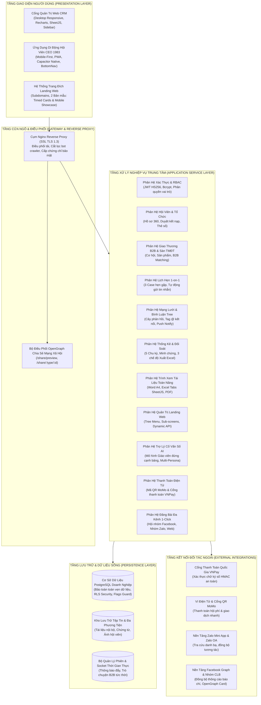

---

### 1.2. Sơ Đồ Tổng Thể Use Case Phân Hệ Quản Trị CRM
Thể hiện mối liên kết giữa các tác nhân quản trị và các Use Case cốt lõi:

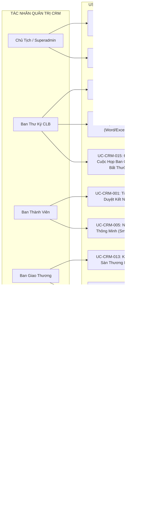

---

### 1.3. Sơ Đồ Tổng Thể Use Case Phân Hệ Ứng Dụng Di Động
Mô hình hóa các chức năng tương tác của Hội viên doanh nhân:

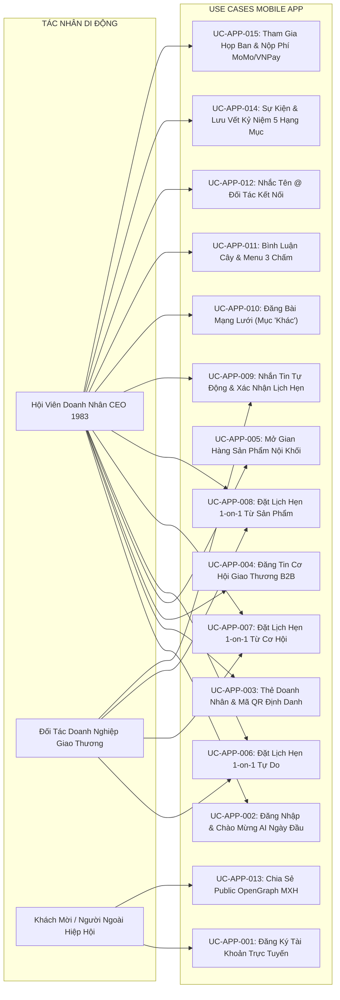

---

### 1.4. Sơ Đồ Luồng Dữ Liệu Đầu-cuối (End-to-End Data Flow Sequence)

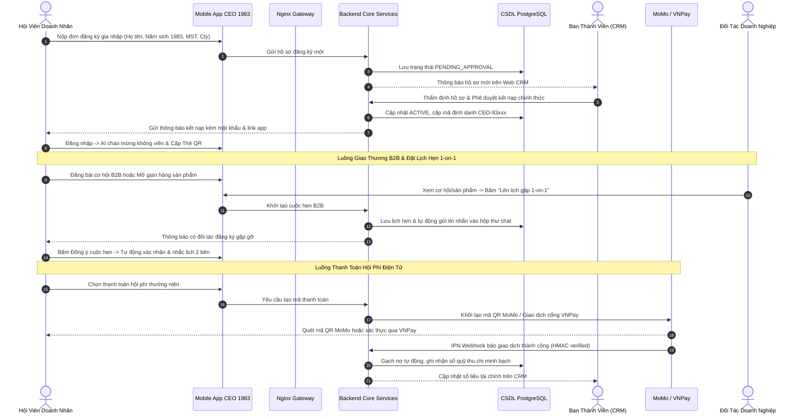

---

### 1.5. Sơ Đồ Tuần Tự: Quy Trình Đặt Lịch Hẹn 1-on-1 trong 3 Tình Huống & Tự Động Nhắn Tin

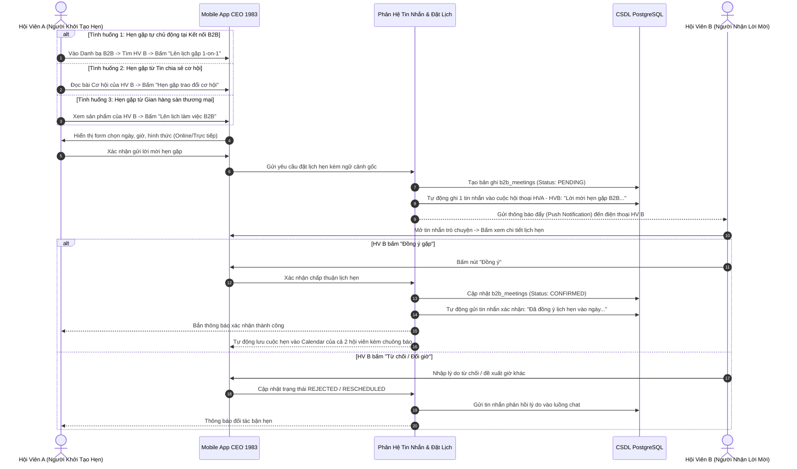

---

### 1.6. Sơ Đồ Tuần Tự: Sự Kiện & Lưu Vết Kỷ Niệm 5 Hạng Mục

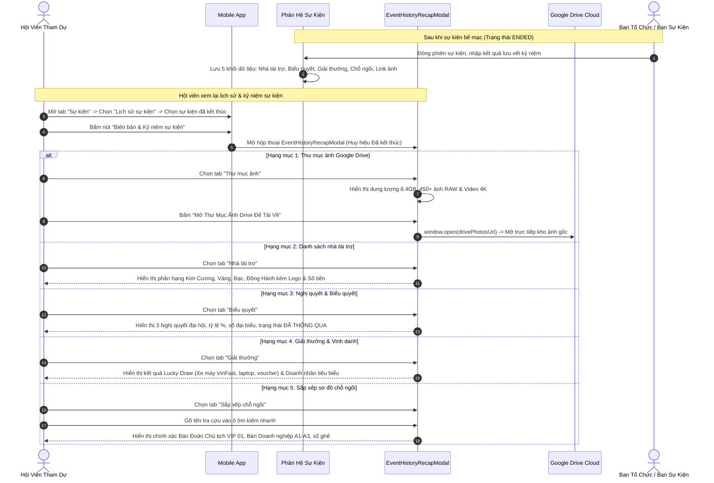

---

### 1.7. Sơ Đồ Tuần Tự: Đăng Bài Đa Kênh 1-Click (Facebook, Group, Zalo OA, Web)

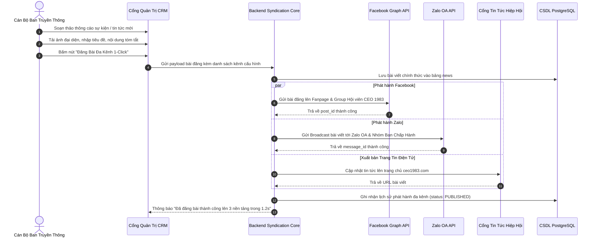

---

### 1.8. Sơ Đồ Tuần Tự: Thanh Toán Điện Tử QR MoMo & VNPay Gạch Nợ Tự Động

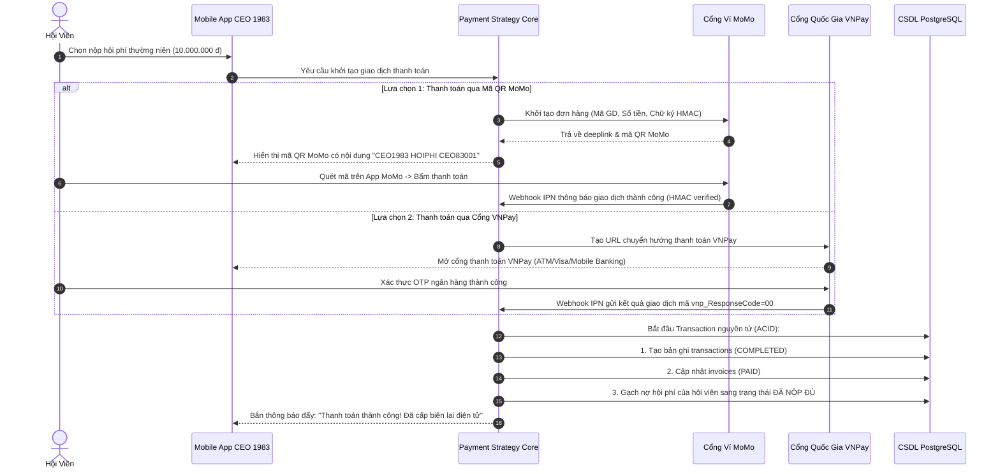

---

### 1.9. Sơ Đồ Tuần Tự: Bình Luận Cây 3 Cấp, Menu 3 Chấm & Tag `@` Đối Tác Đã Kết Nối

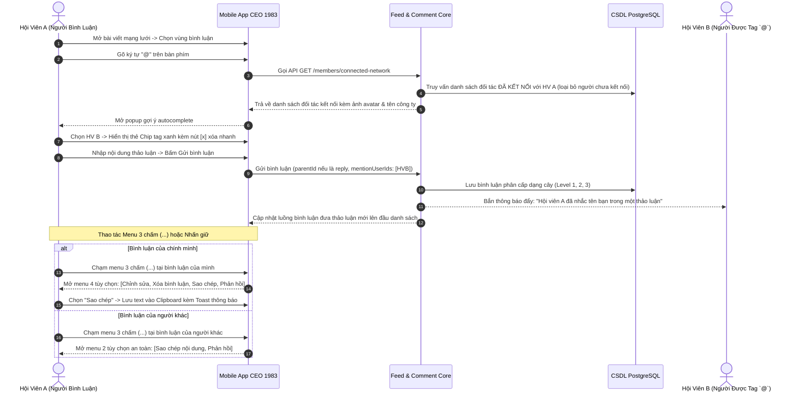

---

### 1.10. Sơ Đồ Trạng Thái: Vòng Đời Hồ Sơ Hội Viên (Member Lifecycle State Diagram)

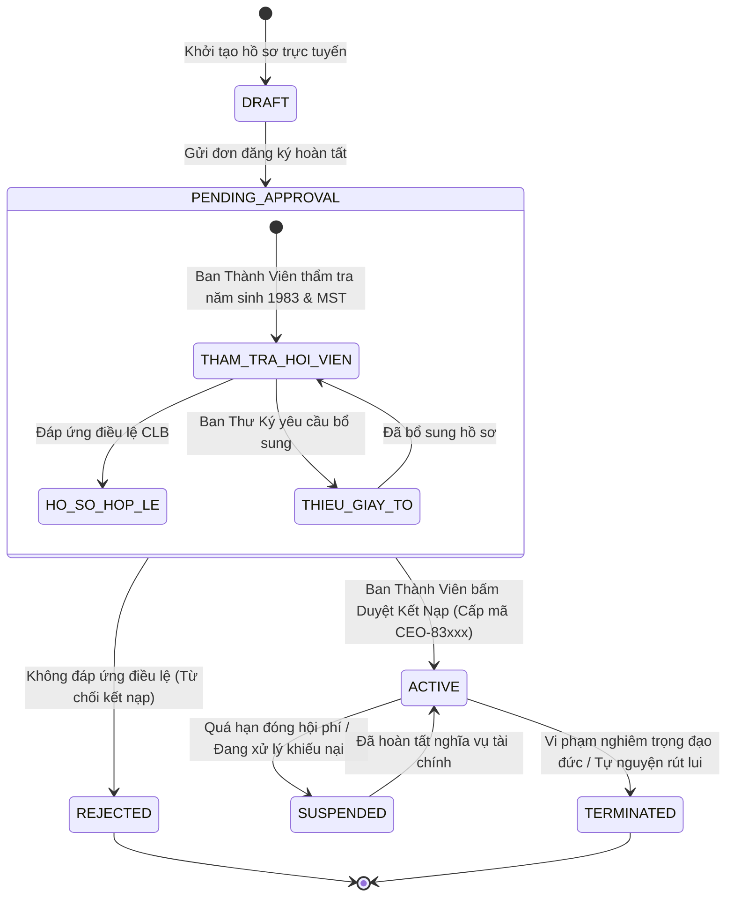

---

### 1.11. Sơ Đồ Trạng Thái: Vòng Đời Cơ Hội Giao Thương B2B (Opportunity Lifecycle State Diagram)

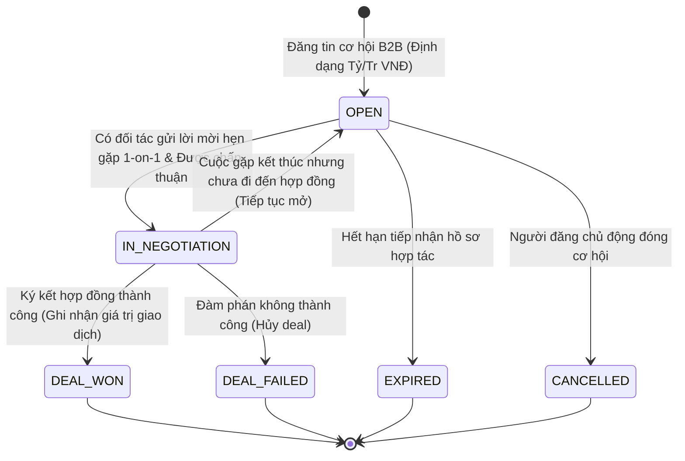

---

### 1.12. Sơ Đồ Trạng Thái: Vòng Đời Sự Kiện & Hoạt Động (Event & Meeting Lifecycle State Diagram)

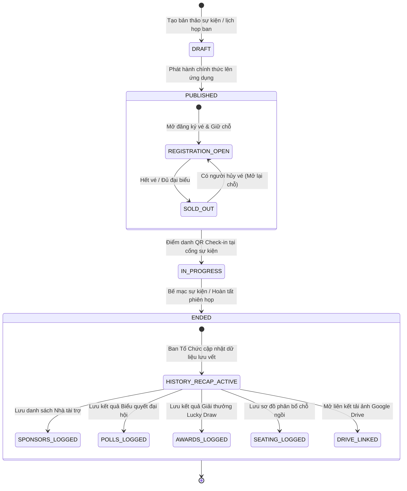

---

### 1.13. Sơ Đồ Thực Thể Mối Quan Hệ CSDL (Entity-Relationship Diagram - ERD)


---

### 1.14. Sơ Đồ Luồng Hoạt Động: Phân Loại Hoạt Động Họp Cố Định vs Họp Bất Thường


---

### 1.15. Sơ Đồ Luồng Hoạt Động: Nhập Bảng Tính & Bóc Tách Trường Thông Minh (Smart Import)

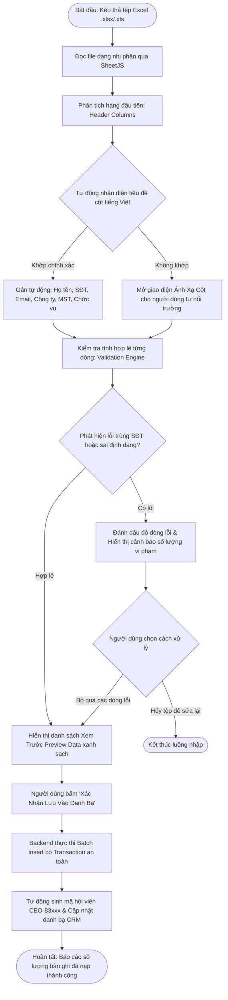

---

## CHƯƠNG 2: MA TRẬN USE CASE & ĐẶC TẢ CHI TIẾT 30 USE CASES CHUẨN IEEE 830

### 2.1. Ma Trận Use Case Phân Hệ Quản Trị Web CRM

| Mã Use Case | Tên Use Case Nghiệp Vụ | Tác Nhân Chính | Mục Tiêu Nghiệp Vụ Cốt Lõi | Mức Ưu Tiên |
| :--- | :--- | :--- | :--- | :--- |
| **UC-CRM-001** | Tiếp Nhận & Phê Duyệt Kết Nạp Hội Viên Mới | Ban Thành Viên | Xác minh năm sinh 1983, MST, phê duyệt và cấp mã CEO-83xxx | Bắt buộc (P1) |
| **UC-CRM-002** | Quản Lý Hồ Sơ 360 Độ & Chi Hội Trực Thuộc | Ban Thư Ký | Quản lý danh bạ doanh nhân, cập nhật chức vụ và phân ban | Bắt buộc (P1) |
| **UC-CRM-003** | Trung Tâm Thống Kê Chỉ Số Đa Chiều 5 Chu Kỳ | Ban Quản Trị / BGT | Phân tích số liệu cơ hội, doanh số, lượt tham dự và cống hiến | Bắt buộc (P1) |
| **UC-CRM-004** | Xuất Báo Cáo Bảng Tính Excel 3 Chế Độ | Ban Tài Chính / Kế toán | Xuất theo chu kỳ, theo hội viên chi tiết và phân tích biến động | Bắt buộc (P1) |
| **UC-CRM-005** | Nhập Dữ Liệu Bảng Tính Thông Minh (Smart Import) | Ban Thành Viên / BTK | Tự động bóc tách cột, phát hiện trùng lặp và nạp danh bạ nhanh | Bắt buộc (P1) |
| **UC-CRM-006** | Cấu Hình Kênh Mạng Xã Hội (FB, Group, Zalo OA) | Ban Truyền Thông | Thiết lập liên kết fanpage, nhóm Zalo và tham số tích hợp | Bắt buộc (P1) |
| **UC-CRM-007** | Đăng Bài Đa Kênh Đồng Loạt 1-Click Syndication | Ban Truyền Thông | Phát hành thông cáo, sự kiện đồng thời lên Web, FB, Zalo trong 1s | Bắt buộc (P1) |
| **UC-CRM-008** | Quản Trị Hệ Thống Trang Đích Landing Web Đa Mẫu | Ban Truyền Thông | Tạo trang đích, chọn mẫu Timed Cards hoặc Startup Mobile Showcase | Bắt buộc (P1) |
| **UC-CRM-009** | Cấu Hình Dynamic Tree Menu & Gán Subdomain | Ban Truyền Thông | Thiết lập menu đa cấp mở màn con, gán tên miền phụ độc lập | Bắt buộc (P1) |
| **UC-CRM-010** | Trình Xem Tài Liệu Toàn Năng (Word/Excel/PDF) | Ban Thư Ký / Hội viên | Xem trực tiếp tài liệu Word A4, Excel đa tabs, PDF nhúng trực quan | Bắt buộc (P1) |
| **UC-CRM-011** | Quản Trị Bầu Cử Ban Chấp Hành & Biểu Quyết | Ban Quản Trị / Đại hội | Tạo hòm phiếu điện tử, kiểm phiếu realtime, khóa cờ xóa sạch | Bắt buộc (P1) |
| **UC-CRM-012** | Phân Quyền Vai Trò An Toàn RBAC Matrix | Quản Trị Viên Tối Cao | Gán quyền theo chuyên ban, hiển thị badge bảo vệ, nút lưu an toàn | Bắt buộc (P1) |
| **UC-CRM-013** | Kiểm Duyệt & Quản Trị Sàn Thương Mại B2B | Ban Giao Thương | Kiểm soát chất lượng sản phẩm, giới hạn 5 sản phẩm/doanh nghiệp | Bắt buộc (P1) |
| **UC-CRM-014** | Quản Lý Sổ Quỹ Thu Chi & Đối Soát MoMo/VNPay | Ban Tài Chính | Gạch nợ tự động, theo dõi dòng tiền minh bạch, xuất sao kê | Bắt buộc (P1) |
| **UC-CRM-015** | Điều Phối Cuộc Họp Ban Cố Định & Bất Thường | Ban Thư Ký | Tạo lịch họp định kỳ và khẩn cấp, tài liệu, link Jitsi Meet | Bắt buộc (P1) |

---

### 2.2. Đặc Tả Chi Tiết 15 Use Cases Quản Trị CRM Chuẩn IEEE 830 (Kèm Biểu Đồ)

#### UC-CRM-001: Tiếp Nhận & Phê Duyệt Kết Nạp Hội Viên Mới

* **Mã Use Case:** `UC-CRM-001`
* **Tác nhân chính (Primary Actor):** Cán bộ Ban Thành Viên (Người có thẩm quyền phê duyệt)
* **Tác nhân phụ (Secondary Actors):** Ban Thư Ký (Thẩm tra sơ bộ), Ứng viên Doanh nhân
* **Mục tiêu cốt lõi (Goal):** Thẩm định năm sinh Quý Hợi 1983, tính pháp lý của doanh nghiệp (MST, GPKD), phê duyệt chính thức và cấp mã hội viên bất biến CEO-83xxx.
* **Mô tả tổng quan (Description):** Quy trình xem xét đơn gia nhập CLB của các CEO sinh năm 1983. Ban Thành Viên đối soát tính xác thực của hồ sơ, ra quyết định kết nạp và hệ thống tự động kích hoạt tài khoản, sinh mã định danh và cấp quyền truy cập.
* **Điều kiện tiên quyết (Preconditions):** Ứng viên đã nộp đơn trực tuyến trên App hoặc Web kèm ảnh CCCD, ĐKKD và thông tin liên hệ.
* **Điều kiện sau khi thực hiện (Postconditions):** Tài khoản hội viên chuyển trạng thái ACTIVE, cấp mã CEO-83xxx, khởi tạo ví danh thiếp số và gửi thư chào mừng qua Email/Zalo.

* **Sơ Đồ Biểu Đồ Use Case (Use Case Diagram):**

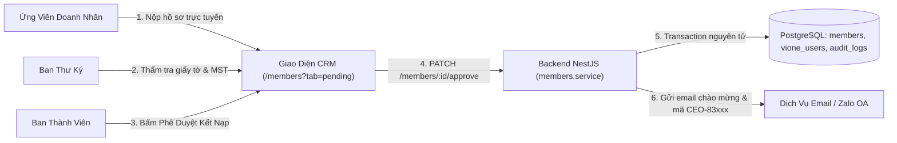

* **Luồng sự kiện chính (Main Flow):**
  1. Cán bộ Ban Thành Viên truy cập mục 'Quản lý Hội viên' trên CRM, chọn tab 'Chờ Phê Duyệt'.
  2. Hệ thống tải danh sách các ứng viên đang chờ duyệt kèm chỉ số thời gian chờ.
  3. Cán bộ bấm vào một ứng viên để mở modal Hồ sơ 360 độ chi tiết.
  4. Đối soát các thông tin bắt buộc: Ngày tháng năm sinh (đúng năm 1983), Mã số thuế tra cứu Cổng Quốc Gia, Chức danh lãnh đạo (Chủ tịch/CEO).
  5. Cán bộ bấm nút 'Phê Duyệt Kết Nạp Chính Thức'.
  6. Hệ thống hiển thị hộp thoại xác nhận số thứ tự tiếp theo và phân ban chuyên môn.
  7. Cán bộ bấm 'Xác Nhận'. Backend thực thi Transaction: đổi trạng thái 'active', cấp mã 'CEO-83xxx', tạo hồ sơ doanh nghiệp.
  8. Hệ thống phát thông báo Email/Zalo chào mừng và cập nhật danh bạ thời gian thực.

* **Luồng rẽ nhánh & Ngoại lệ (Alternative & Exception Flows):**
  - *4a. Hồ sơ thiếu ảnh ĐKKD hoặc CCCD: Bấm 'Yêu cầu bổ sung' -> Nhập ghi chú yêu cầu -> Ứng viên nhận thông báo cập nhật lại.*
  - *4b. Ứng viên không đúng năm sinh 1983: Bấm 'Từ chối kết nạp' -> Nhập lý do vi phạm điều lệ -> Hồ sơ chuyển sang REJECTED và lưu vết kiểm toán.*

* **Quy tắc nghiệp vụ chi phối (Business Rules):**
  - **BR-01:**  Chỉ tài khoản có vai trò 'ban_thanh_vien', 'chu_tich' hoặc 'admin' mới có quyền duyệt kết nạp. Ban Thư Ký chỉ có quyền xem và ghi chú.
  - **BR-02:**  Mã số hội viên 'CEO-83xxx' được sinh tuần tự, duy nhất, không trùng lặp và bất biến vĩnh viễn.

* **Liên kết kỹ thuật (Technical Implementation):**
  - **Giao diện (Frontend UI):** `apps/ceo1983_app_fe/src/routes/members.index.tsx, MemberApprovalModal.tsx`
  - **Điểm cuối API (Endpoints):** `POST /members/:id/approve, POST /members/:id/reject, GET /members?status=pending`
  - **Bảng CSDL PostgreSQL:** `public.members, public.vione_users, public.companies`

---

#### UC-CRM-002: Quản Lý Hồ Sơ 360 Độ & Chi Hội Trực Thuộc

* **Mã Use Case:** `UC-CRM-002`
* **Tác nhân chính (Primary Actor):** Ban Thư Ký CLB, Quản Trị Viên
* **Tác nhân phụ (Secondary Actors):** Ban Điều Hành, Trưởng các Chi Hội
* **Mục tiêu cốt lõi (Goal):** Quản trị danh bạ số toàn diện của 500+ doanh nhân hội viên, điều phối phân ban chuyên môn và theo dõi lịch sử sinh hoạt.
* **Mô tả tổng quan (Description):** Cung cấp cái nhìn toàn cảnh 360 độ về từng hội viên: Thông tin pháp lý, chức danh công ty, ngành nghề cốt lõi, ban chuyên môn trực thuộc (Ban Xúc tiến, Ban Đào tạo, Ban Truyền thông, Ban Sự kiện, Ban Tài chính), tình trạng đóng hội phí và điểm cống hiến.
* **Điều kiện tiên quyết (Preconditions):** Hội viên đã được kích hoạt trong hệ thống.
* **Điều kiện sau khi thực hiện (Postconditions):** Thông tin hồ sơ, chi hội và vai trò được cập nhật đồng bộ sang CSDL và phát sóng Socket.IO tới toàn hệ thống.

* **Sơ Đồ Biểu Đồ Use Case (Use Case Diagram):**

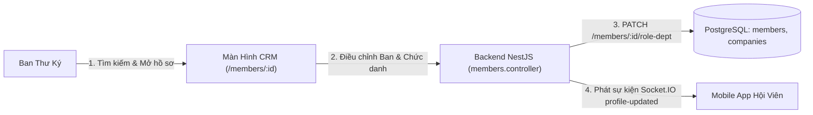

* **Luồng sự kiện chính (Main Flow):**
  1. Ban Thư Ký truy cập danh sách 'Hội Viên CLB' trên CRM.
  2. Sử dụng thanh tìm kiếm thông minh theo Họ tên, SĐT, Tên công ty hoặc Mã số hội viên.
  3. Bấm vào hồ sơ hội viên để xem thẻ 360 độ: Thông tin cá nhân, Doanh nghiệp, Lịch sử tham gia họp/sự kiện, Hóa đơn hội phí.
  4. Bấm 'Chỉnh sửa phân ban & chức vụ': Chọn Ban chuyên môn trực thuộc và chức vụ trong Ban Điều Hành.
  5. Bấm 'Lưu Thay Đổi'. Hệ thống cập nhật PostgreSQL và tự động đồng bộ avatar/ảnh bìa sang Mobile App hội viên.

* **Luồng rẽ nhánh & Ngoại lệ (Alternative & Exception Flows):**
  - *3a. Hội viên chuyển trụ sở doanh nghiệp: Ban Thư Ký cập nhật địa chỉ -> Hệ thống tự động geocode kinh độ/vĩ độ bản đồ 2D Google.*
  - *3b. Khóa tài khoản tạm thời: Khi hội viên tạm ngừng sinh hoạt, thư ký chuyển status sang 'suspended' -> Hội viên bị giới hạn quyền giao thương trên App.*

* **Quy tắc nghiệp vụ chi phối (Business Rules):**
  - **BR-03:**  Mọi thao tác cập nhật Ban chuyên môn hoặc chức vụ lãnh đạo đều được ghi vết vào bảng audit_logs kèm IP và timestamp.
  - **BR-04:**  Thay đổi địa chỉ doanh nghiệp bắt buộc chuẩn hóa định dạng hành chính tiếng Việt.

* **Liên kết kỹ thuật (Technical Implementation):**
  - **Giao diện (Frontend UI):** `apps/ceo1983_app_fe/src/routes/members.detail.tsx, MemberProfileDrawer.tsx`
  - **Điểm cuối API (Endpoints):** `GET /members/:id, PATCH /members/:id/role-dept, PUT /members/:id`
  - **Bảng CSDL PostgreSQL:** `public.members, public.companies, public.audit_logs`

---

#### UC-CRM-003: Trung Tâm Thống Kê Chỉ Số Đa Chiều 5 Chu Kỳ

* **Mã Use Case:** `UC-CRM-003`
* **Tác nhân chính (Primary Actor):** Ban Quản Trị, Ban Giao Thương, Chủ Tịch CLB
* **Tác nhân phụ (Secondary Actors):** Toàn thể Ban Điều Hành
* **Mục tiêu cốt lõi (Goal):** Giám sát trực quan hóa các chỉ số hoạt động, giá trị giao thương B2B, số lượng cuộc họp và tỷ lệ gắn kết theo 5 chu kỳ thời gian.
* **Mô tả tổng quan (Description):** Cung cấp bảng điều khiển BI thông minh với các biểu đồ cột chồng, đường timeline kết hợp Recharts thể hiện: Số cơ hội mở mới, giá trị deal đàm phán, deal thành công (tỷ VNĐ), tỷ lệ tham dự họp và Top 10 Doanh nhân cống hiến nhiều nhất.
* **Điều kiện tiên quyết (Preconditions):** Người dùng đăng nhập với quyền xem thống kê phân hệ CRM.
* **Điều kiện sau khi thực hiện (Postconditions):** Dữ liệu thống kê thời gian thực được tổng hợp và hiển thị trực quan không có độ trễ.

* **Sơ Đồ Biểu Đồ Use Case (Use Case Diagram):**

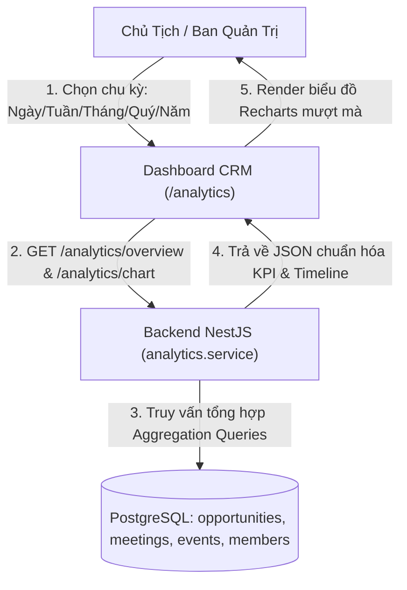

* **Luồng sự kiện chính (Main Flow):**
  1. Lãnh đạo truy cập phân hệ 'Báo Cáo & Thống Kê' trên Cổng Quản Trị CRM.
  2. Hệ thống mặc định nạp dữ liệu thống kê tổng quan (Tổng hội viên, Tổng giá trị giao thương, Số cuộc gặp 1-on-1, Tỷ lệ active).
  3. Chọn bộ lọc chu kỳ mong muốn: Hôm nay (Ngày), Tuần này, Tháng này, Quý này, hoặc Năm nay.
  4. Hệ thống tải dữ liệu từ CSDL PostgreSQL và render các biểu đồ Recharts tương tác: Biểu đồ nến cơ hội, biểu đồ cột ghép cuộc gặp và tỷ lệ chốt deal.
  5. Xem bảng xếp hạng Top Doanh nhân giao thương xuất sắc (chỉ hiển thị những người có số liệu thực tế > 0).

* **Luồng rẽ nhánh & Ngoại lệ (Alternative & Exception Flows):**
  - *3a. Lọc theo chuyên ban cụ thể: Lựa chọn Ban Xúc Tiến hoặc Ban Sự Kiện để xem riêng các chỉ số chuyên môn.*
  - *4a. Xuất dữ liệu biểu đồ: Bấm icon tải ảnh SVG/PNG để đưa biểu đồ vào slide báo cáo giao ban.*

* **Quy tắc nghiệp vụ chi phối (Business Rules):**
  - **BR-05:**  Tuyệt đối không hiển thị hội viên có chỉ số bằng 0 lên bục vinh danh hoặc top xếp hạng cống hiến.
  - **BR-06:**  Dữ liệu thống kê được cache thông minh 60s để tối ưu hiệu năng CSDL khi hàng trăm người cùng truy cập.

* **Liên kết kỹ thuật (Technical Implementation):**
  - **Giao diện (Frontend UI):** `apps/ceo1983_app_fe/src/routes/analytics.index.tsx, RechartsBarChart.tsx`
  - **Điểm cuối API (Endpoints):** `GET /analytics/overview, GET /analytics/chart?range=month, GET /analytics/top-members`
  - **Bảng CSDL PostgreSQL:** `public.opportunities, public.user_connections, public.events, public.members`

---

#### UC-CRM-004: Xuất Báo Cáo Bảng Tính Excel 3 Chế Độ

* **Mã Use Case:** `UC-CRM-004`
* **Tác nhân chính (Primary Actor):** Kế toán CLB, Ban Tài Chính
* **Tác nhân phụ (Secondary Actors):** Ban Thư Ký, Ban Kiểm Tra
* **Mục tiêu cốt lõi (Goal):** Xuất khẩu dữ liệu tài chính, sổ quỹ thu chi và danh bạ sang tệp Excel (.xlsx) chuẩn mẫu văn bản tài chính doanh nghiệp.
* **Mô tả tổng quan (Description):** Cung cấp công cụ xuất báo cáo bảng tính với 3 chế độ chuyên biệt: Xuất theo chu kỳ thời gian (Tháng/Quý/Năm), Xuất phân tích chi tiết từng hội viên (mỗi hội viên 1 dòng kèm lịch sử đóng phí), và Xuất báo cáo biến động tăng trưởng so sánh kỳ trước.
* **Điều kiện tiên quyết (Preconditions):** Tài khoản có quyền kế toán hoặc tài chính.
* **Điều kiện sau khi thực hiện (Postconditions):** Tệp Excel .xlsx được biên dịch nhị phân tải về máy tính trong dưới 2 giây.

* **Sơ Đồ Biểu Đồ Use Case (Use Case Diagram):**

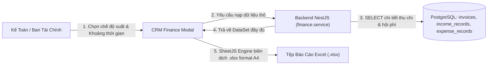

* **Luồng sự kiện chính (Main Flow):**
  1. Kế toán truy cập danh mục 'Quản Lý Tài Chính & Sổ Quỹ' trên CRM.
  2. Bấm nút 'Xuất Báo Cáo Excel'. Hệ thống mở modal tùy chọn 3 chế độ xuất.
  3. Chọn chế độ: Chế độ 1 (Theo chu kỳ Tháng/Quý), Chế độ 2 (Chi tiết từng hội viên), hoặc Chế độ 3 (So sánh tăng trưởng).
  4. Chọn định dạng năm tài chính và tài khoản ngân hàng quỹ cần đối soát.
  5. Bấm 'Tải Báo Cáo Excel'.
  6. Thư viện SheetJS phía client/server tổng hợp dữ liệu, tự động định dạng tiêu đề hiệp hội, ngày giờ xuất, căn lề tiền tệ (VNĐ), và chèn công thức SUM.
  7. Trình duyệt kích hoạt tải tệp .xlsx về máy tính người dùng trong vòng 1.5 giây.

* **Luồng rẽ nhánh & Ngoại lệ (Alternative & Exception Flows):**
  - *3a. Dữ liệu kỳ được chọn trống (chưa phát sinh thu chi): Hệ thống hiển thị thông báo toast 'Không có dữ liệu trong khoảng thời gian đã chọn' và ngăn tạo file rác.*

* **Quy tắc nghiệp vụ chi phối (Business Rules):**
  - **BR-07:**  File Excel xuất ra bắt buộc có đầy đủ chữ ký số định danh người xuất, mã số kiểm toán và ngày giờ xuất chính xác từng giây.
  - **BR-08:**  Định dạng số tiền bắt buộc phân cách hàng nghìn bằng dấu chấm hoặc phẩy chuẩn tài chính Việt Nam.

* **Liên kết kỹ thuật (Technical Implementation):**
  - **Giao diện (Frontend UI):** `apps/ceo1983_app_fe/src/routes/finance.index.tsx, ExportExcelModal.tsx`
  - **Điểm cuối API (Endpoints):** `GET /finance/invoices/export-data, GET /finance/reports/summary`
  - **Bảng CSDL PostgreSQL:** `public.invoices, public.income_records, public.expense_records, public.members`

---

#### UC-CRM-005: Nhập Dữ Liệu Bảng Tính Thông Minh (Smart Import)

* **Mã Use Case:** `UC-CRM-005`
* **Tác nhân chính (Primary Actor):** Ban Thành Viên, Ban Thư Ký
* **Tác nhân phụ (Secondary Actors):** Ban Tổ Chức Sự Kiện
* **Mục tiêu cốt lõi (Goal):** Nhập danh bạ hàng trăm đại biểu hoặc hội viên mới từ file Excel với khả năng tự bóc tách cột và kiểm tra lỗi trùng lặp.
* **Mô tả tổng quan (Description):** Cho phép cán bộ kéo thả file .xlsx danh bạ. Hệ thống tự động phân tích hàng tiêu đề tiếng Việt (Họ tên, SĐT, Email, Công ty, MST, Chức vụ), tự động map cột hoặc cho phép nối cột thủ công, kiểm tra tính hợp lệ từng dòng, cảnh báo lỗi và batch insert với transaction an toàn.
* **Điều kiện tiên quyết (Preconditions):** Có file Excel danh bạ theo mẫu hoặc cấu trúc bất kỳ.
* **Điều kiện sau khi thực hiện (Postconditions):** Các dòng hợp lệ được nạp vào bảng members, sinh mã tự động và báo cáo kết quả chi tiết.

* **Sơ Đồ Biểu Đồ Use Case (Use Case Diagram):**

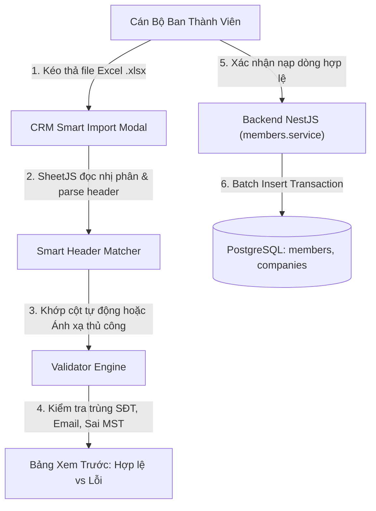

* **Luồng sự kiện chính (Main Flow):**
  1. Cán bộ truy cập Quản lý Hội viên -> Bấm nút 'Nhập Bảng Tính Thông Minh'.
  2. Kéo thả tệp .xlsx từ máy tính vào khung tải lên.
  3. Hệ thống phân tích hàng đầu tiên: Tự động nhận diện các cột 'Họ và tên', 'Số điện thoại', 'Doanh nghiệp', 'Mã số thuế'.
  4. Nếu có cột lạ, mở bảng ánh xạ trực quan cho người dùng tự kéo thả chọn trường tương ứng.
  5. Chạy bộ máy kiểm tra: Soát lỗi định dạng SĐT (10-11 số), kiểm tra trùng SĐT đã tồn tại trong CSDL, kiểm tra định dạng email.
  6. Hiển thị bảng xem trước (Preview): Dòng xanh (Hợp lệ sẵn sàng nạp), Dòng đỏ (Có lỗi kèm giải thích chi tiết).
  7. Cán bộ chọn 'Bỏ qua dòng lỗi và nạp dòng hợp lệ' -> Bấm 'Xác Nhận Lưu'.
  8. Backend thực thi Transaction nạp hàng loạt, sinh mã CEO-83xxx tuần tự và thông báo kết quả thành công.

* **Luồng rẽ nhánh & Ngoại lệ (Alternative & Exception Flows):**
  - *6a. Toàn bộ file đều bị lỗi: Báo lỗi cấu trúc tệp -> Cung cấp nút 'Tải file Excel mẫu chuẩn' để người dùng điền lại.*

* **Quy tắc nghiệp vụ chi phối (Business Rules):**
  - **BR-09:**  Tuyệt đối không cho phép nạp trùng Số điện thoại của hội viên đã kích hoạt trong CSDL.
  - **BR-10:**  Mọi thao tác import hàng loạt đều phải nằm trong Database Transaction để rollback nếu gặp sự cố sập mạng.

* **Liên kết kỹ thuật (Technical Implementation):**
  - **Giao diện (Frontend UI):** `apps/ceo1983_app_fe/src/components/members/SmartImportModal.tsx`
  - **Điểm cuối API (Endpoints):** `POST /members/batch-import, POST /members/validate-import`
  - **Bảng CSDL PostgreSQL:** `public.members, public.companies, public.audit_logs`

---

#### UC-CRM-006: Cấu Hình Kênh Mạng Xã Hội (Facebook, Group, Zalo OA)

* **Mã Use Case:** `UC-CRM-006`
* **Tác nhân chính (Primary Actor):** Ban Truyền Thông CLB
* **Tác nhân phụ (Secondary Actors):** Ban Thư Ký
* **Mục tiêu cốt lõi (Goal):** Quản lý và thiết lập thông số kết nối các kênh truyền thông chính thống của CLB (Fanpage, Group, Zalo OA, Zalo Mini App).
* **Mô tả tổng quan (Description):** Cung cấp giao diện cấu hình tập trung các URL và Access Token của Fanpage Facebook Hội viên CEO 1983, Group kín nội bộ, Zalo Official Account và Zalo Mini App. Hệ thống hỗ trợ nút 'Kiểm tra kết nối' để xác thực API Token hợp lệ.
* **Điều kiện tiên quyết (Preconditions):** Tài khoản có vai trò 'ban_truyen_thong' hoặc 'admin'.
* **Điều kiện sau khi thực hiện (Postconditions):** Thông số kênh được mã hóa lưu trữ vào bảng app_settings và sẵn sàng cho tính năng đăng bài 1-chạm.

* **Sơ Đồ Biểu Đồ Use Case (Use Case Diagram):**

```mermaid
flowchart LR
    MEDIA["Ban Truyền Thông"] -->|"1. Nhập URL Fanpage, Group, Zalo Token"| UI["CRM Social Settings"]
    UI -->|"2. Bấm 'Kiểm Tra Kết Nối'"| BE["Backend NestJS (social.service)"]
    BE -->|"3. Ping Facebook Graph / Zalo API"| EXT["Nền Tảng Facebook & Zalo"]
    EXT -->|"4. Trả về kết quả Active"| BE
    BE -->|"5. Lưu an toàn cấu hình"| DB[("PostgreSQL: app_settings")]
```

* **Luồng sự kiện chính (Main Flow):**
  1. Ban Truyền Thông truy cập phân hệ 'Cấu Hình Hệ Thống' -> Tab 'Kênh Truyền Thông'.
  2. Nhập liên kết Fanpage Facebook CLB CEO 1983 (HanoiBA).
  3. Nhập liên kết Nhóm Facebook Doanh Nhân 1983.
  4. Cấu hình thông số Zalo OA: OA ID, Secret Key, Access Token.
  5. Bấm 'Kiểm Tra Kết Nối': Hệ thống gửi ping test tới Graph API và Zalo Server, hiển thị tích xanh 'Kết nối thành công'.
  6. Bấm 'Lưu Cấu Hình'. Dữ liệu được ghi an toàn vào CSDL.

* **Luồng rẽ nhánh & Ngoại lệ (Alternative & Exception Flows):**
  - *5a. Access Token Zalo hết hạn: Hệ thống cảnh báo đỏ 'Token hết hạn' kèm hướng dẫn làm mới token trên cổng Zalo Developers.*

* **Quy tắc nghiệp vụ chi phối (Business Rules):**
  - **BR-11:**  Access Token và Secret Key của các nền tảng mạng xã hội bắt buộc được mã hóa một chiều hoặc mã hóa AES-256 trong CSDL.
  - **BR-12:**  Mọi thay đổi kênh truyền thông đều phải được kiểm tra tính hợp lệ URL trước khi lưu.

* **Liên kết kỹ thuật (Technical Implementation):**
  - **Giao diện (Frontend UI):** `apps/ceo1983_app_fe/src/routes/settings.social.tsx`
  - **Điểm cuối API (Endpoints):** `GET /settings/social-channels, PUT /settings/social-channels, POST /settings/social-channels/test`
  - **Bảng CSDL PostgreSQL:** `public.app_settings`

---

#### UC-CRM-007: Đăng Bài Đa Kênh Đồng Loạt 1-Click Syndication

* **Mã Use Case:** `UC-CRM-007`
* **Tác nhân chính (Primary Actor):** Ban Truyền Thông CLB
* **Tác nhân phụ (Secondary Actors):** Hội viên theo dõi tin tức
* **Mục tiêu cốt lõi (Goal):** Phát hành thông cáo, tin tức đại hội hoặc sự kiện đồng thời lên Website, Fanpage, Group và Zalo OA chỉ với 1 thao tác.
* **Mô tả tổng quan (Description):** Khi có tin tức quan trọng hoặc thông cáo báo chí, cán bộ truyền thông soạn thảo nội dung một lần duy nhất. Bấm nút 'Đăng Bài Đa Kênh 1-Click', backend đồng thời phát tán tin tức qua các API đối tác trong vòng dưới 1.5 giây, giảm 90% công sức đăng bài thủ công.
* **Điều kiện tiên quyết (Preconditions):** Các kênh mạng xã hội đã được cấu hình thành công tại UC-CRM-006.
* **Điều kiện sau khi thực hiện (Postconditions):** Bài viết xuất hiện đồng loạt trên Web, Fanpage, Group và Zalo; ghi nhận trạng thái PUBLISHED vào lịch sử.

* **Sơ Đồ Biểu Đồ Use Case (Use Case Diagram):**

```mermaid
flowchart TD
    MEDIA["Ban Truyền Thông"] -->|"1. Soạn bài, tải ảnh, chọn kênh"| UI["CRM News Editor"]
    UI -->|"2. Bấm 'Đăng Bài Đa Kênh 1-Click'"| BE["Backend Syndication Engine"]
    BE -->|"3. Lưu bài viết chính thức"| DB[("PostgreSQL: news, syndication_logs")]
    BE -->|"4a. Post to Web Portal"| WEB["Website ceo1983.com"]
    BE -->|"4b. Post to FB Fanpage & Group"| FB["Facebook Graph API"]
    BE -->|"4c. Broadcast to Zalo OA"| ZALO["Zalo OA API"]
    BE -->|"5. Báo cáo hoàn tất trong 1.2s"| UI
```

* **Luồng sự kiện chính (Main Flow):**
  1. Ban Truyền Thông mở trình soạn thảo tin tức trên CRM.
  2. Nhập tiêu đề thông cáo, chuyên mục (Sự kiện, Tin hiệp hội, Vinh danh), tóm tắt và nội dung chi tiết.
  3. Tải ảnh đại diện bài viết (ảnh sắc nét tỷ lệ 16:9).
  4. Tích chọn các kênh phát hành: [x] Cổng Tin Tức Web, [x] Fanpage Facebook, [x] Group Facebook, [x] Zalo OA.
  5. Bấm nút 'Đăng Bài Đa Kênh 1-Click'.
  6. Backend Syndication Engine lưu bản ghi vào bảng news, đồng thời phát lệnh song song (Promise.allSettled) tới các nền tảng.
  7. Hệ thống hiển thị popup kết quả: Đã đăng thành công trên 4/4 kênh trong 1.2 giây kèm liên kết trực tiếp tới từng bài đăng.

* **Luồng rẽ nhánh & Ngoại lệ (Alternative & Exception Flows):**
  - *6a. Có 1 kênh mạng xã hội bị lỗi mạng: Hệ thống vẫn hoàn tất các kênh còn lại, ghi nhận log lỗi riêng cho kênh bị thất bại và cung cấp nút 'Thử lại kênh này'.*

* **Quy tắc nghiệp vụ chi phối (Business Rules):**
  - **BR-13:**  Bài đăng bắt buộc có tiêu đề tối thiểu 10 ký tự và tối thiểu 1 ảnh minh họa hợp lệ.
  - **BR-14:**  Nhật ký phát hành (syndication_logs) lưu lại đầy đủ ID bài đăng trả về từ Facebook và Zalo để phục vụ đối soát.

* **Liên kết kỹ thuật (Technical Implementation):**
  - **Giao diện (Frontend UI):** `apps/ceo1983_app_fe/src/routes/news.create.tsx, SyndicationPublishModal.tsx`
  - **Điểm cuối API (Endpoints):** `POST /news, POST /news/syndicate, GET /news/syndication-logs`
  - **Bảng CSDL PostgreSQL:** `public.news, public.syndication_logs`

---

#### UC-CRM-008: Quản Trị Hệ Thống Trang Đích Landing Web Đa Mẫu

* **Mã Use Case:** `UC-CRM-008`
* **Tác nhân chính (Primary Actor):** Ban Truyền Thông, Quản Trị Viên
* **Tác nhân phụ (Secondary Actors):** Đối tác B2B, Khách vãng lai xem Landing
* **Mục tiêu cốt lõi (Goal):** Quản lý và tùy biến 2 bản mẫu trang đích chuẩn quốc tế: Mẫu 1 (Timed Cards Opening) và Mẫu 2 (Startup Mobile Showcase) độc lập hoàn toàn.
* **Mô tả tổng quan (Description):** Cung cấp hệ thống thiết lập Dynamic Setup Builder chuyên biệt cho từng mẫu. Mẫu 1 gồm 5 tab (Thương hiệu, Cây menu, Slide thẻ bung toàn màn hình, API động, Màn con chi tiết); Mẫu 2 gồm 5 tab chuyên sâu (Hero & Bàn tay cầm iPhone 3D, Dải ruy băng 4 chỉ số vàng, Mạng lưới điểm cầu bản đồ, 8 Avatar doanh nhân 3D, Băng chuyền đánh giá CEO & FAQ). Tích hợp công cụ tải ảnh trực tiếp từ máy tính (LandingImageUploadField).
* **Điều kiện tiên quyết (Preconditions):** Tài khoản có quyền quản trị Landing Web.
* **Điều kiện sau khi thực hiện (Postconditions):** Cấu hình được lưu vào landing_web_configs và hiển thị theo đường dẫn path-based crm.ceo1983.viconnect.vn/landing/web-v1 hoặc web-v2.

* **Sơ Đồ Biểu Đồ Use Case (Use Case Diagram):**

```mermaid
flowchart TD
    MEDIA["Ban Truyền Thông"] -->|"1. Chọn Mẫu 1 hoặc Mẫu 2"| UI["CRM Landing Builder"]
    UI -->|"2. Thiết lập 5 Tab chuyên sâu & Tải ảnh trực tiếp"| FIELD["LandingImageUploadField"]
    FIELD -->|"3. Upload ảnh tới /api/upload/file"| STORAGE["File Storage Server"]
    UI -->|"4. Bấm 'Xuất Bản Landing Page'"| BE["Backend NestJS (landing.service)"]
    BE -->|"5. Lưu JSON startupConfig"| DB[("PostgreSQL: landing_web_configs")]
    BE -->|"6. Render thời gian thực đường dẫn path-based"| LANDING["Landing Web Portal"]
```

* **Luồng sự kiện chính (Main Flow):**
  1. Ban Truyền Thông truy cập 'Quản Trị Landing Web' trên Cổng CRM.
  2. Lựa chọn mẫu muốn cấu hình: 'Mẫu 1: Khám Phá Toàn Cầu' hoặc 'Mẫu 2: Startup Mobile Showcase'.
  3. Điều chỉnh các tab cấu hình: Tab 1 (Hero tiêu đề, phụ đề, tải ảnh bàn tay cầm iPhone 3D), Tab 2 (Dải ruy-băng thống kê và 4 tab app), Tab 3 (Mạng lưới điểm cầu bản đồ), Tab 4 (8 Avatar doanh nhân 3D bay quanh máy), Tab 5 (Đánh giá CEO và FAQ).
  4. Sử dụng công cụ `LandingImageUploadField` tải ảnh trực tiếp từ máy tính có thanh tiến trình và khung xem trước (Live Preview).
  5. Bấm 'Lưu Cấu Hình' và 'Kích Hoạt Xuất Bản'.
  6. Hệ thống lưu trữ cấu hình vào PostgreSQL và cập nhật tức thì trên trang đích công khai.

* **Luồng rẽ nhánh & Ngoại lệ (Alternative & Exception Flows):**
  - *3a. Xem trước giao diện: Bấm nút 'Xem Trước' để mở tab mới hiển thị trang đích độc lập không bị ảnh hưởng bởi theme tối của CRM.*

* **Quy tắc nghiệp vụ chi phối (Business Rules):**
  - **BR-15:**  Toàn bộ các trang Landing Web hoạt động trực tiếp dưới tên miền chính theo định dạng đường dẫn path-based (crm.ceo1983.viconnect.vn/landing/web-v1, web-v2), loại bỏ hoàn toàn việc phụ thuộc subdomain.
  - **BR-16:**  Mỗi mẫu sở hữu bộ cấu hình dynamic tách biệt, không dùng chung trường dữ liệu để tránh xung đột giao diện.

* **Liên kết kỹ thuật (Technical Implementation):**
  - **Giao diện (Frontend UI):** `apps/ceo1983_app_fe/src/routes/landing-webs.index.tsx, LandingBuilder.tsx`
  - **Điểm cuối API (Endpoints):** `GET /landing/config/:template, PUT /landing/config/:template, POST /api/upload/file?folder=landing`
  - **Bảng CSDL PostgreSQL:** `public.landing_web_configs`

---

#### UC-CRM-009: Cấu Hình Dynamic Tree Menu & Gán Tên Miền / Đường Dẫn

* **Mã Use Case:** `UC-CRM-009`
* **Tác nhân chính (Primary Actor):** Ban Truyền Thông
* **Tác nhân phụ (Secondary Actors):** Khách truy cập Landing Web
* **Mục tiêu cốt lõi (Goal):** Xây dựng cây menu điều hướng phân cấp (Tree Menu) đa tầng và liên kết các trang nội dung chuyên đề (Sub-screens).
* **Mô tả tổng quan (Description):** Cho phép người dùng tạo cấu trúc cây thư mục menu cho thanh Header của Landing Web (Trang chủ, Giới thiệu, Lĩnh vực, Hội viên, Thư viện, Liên hệ). Mỗi mục menu có thể liên kết tới một Sub-screen độc lập chứa văn bản và hình ảnh chuyên đề.
* **Điều kiện tiên quyết (Preconditions):** Đã khởi tạo bản ghi Landing Web.
* **Điều kiện sau khi thực hiện (Postconditions):** Cây menu phân cấp hiển thị chuẩn xác trên thanh điều hướng của Landing Web.

* **Sơ Đồ Biểu Đồ Use Case (Use Case Diagram):**

```mermaid
flowchart LR
    MEDIA["Ban Truyền Thông"] -->|"1. Kéo thả phân cấp Cây Menu"| UI["CRM Tree Menu Builder"]
    UI -->|"2. Gán liên kết Sub-screen chuyên đề"| BE["Backend NestJS (landing.service)"]
    BE -->|"3. Cập nhật mảng nav_tree JSONB"| DB[("PostgreSQL: landing_web_configs")]
    BE -->|"4. Render Header Navbar đa cấp"| USER["Khách Truy Cập Landing Web"]
```

* **Luồng sự kiện chính (Main Flow):**
  1. Truy cập Tab 'Cây Menu Phân Cấp' trong trình cấu hình Landing Web.
  2. Bấm 'Thêm Mục Menu Mới': Nhập tên mục hiển thị tiếng Việt (VD: 'Về CLB CEO 1983').
  3. Kéo thả vị trí sắp xếp hoặc kéo vào trong một mục khác để tạo Menu con cấp 2.
  4. Chọn đích đến của menu: Điều hướng cuộn trang (Anchor ID) hoặc Mở trang con Sub-screen chi tiết.
  5. Bấm 'Lưu Cây Menu'. Hệ thống cập nhật mảng JSON nav_tree vào CSDL.

* **Luồng rẽ nhánh & Ngoại lệ (Alternative & Exception Flows):**
  - *4a. Tạo Sub-screen mới: Nếu chưa có trang con, bấm 'Tạo Trang Con Mới' -> Soạn tiêu đề và nội dung HTML -> Tự động gắn liên kết vào menu.*

* **Quy tắc nghiệp vụ chi phối (Business Rules):**
  - **BR-17:**  Cây menu hỗ trợ tối đa 3 cấp độ phân cấp để đảm bảo trải nghiệm người dùng di động và desktop không bị vỡ layout.

* **Liên kết kỹ thuật (Technical Implementation):**
  - **Giao diện (Frontend UI):** `apps/ceo1983_app_fe/src/components/landing/TreeMenuEditor.tsx`
  - **Điểm cuối API (Endpoints):** `PATCH /landing/config/menu, GET /landing/subscreens`
  - **Bảng CSDL PostgreSQL:** `public.landing_web_configs`

---

#### UC-CRM-010: Trình Xem Tài Liệu Toàn Năng (Word A4/Excel Tabs/PDF)

* **Mã Use Case:** `UC-CRM-010`
* **Tác nhân chính (Primary Actor):** Ban Thư Ký, Hội viên, Quản trị viên
* **Tác nhân phụ (Secondary Actors):** Ban Tài Chính, Ban Điều Hành
* **Mục tiêu cốt lõi (Goal):** Mở xem trực tiếp mọi định dạng tệp tin văn kiện CLB (Word, Excel, PDF) và gửi tài liệu trực tiếp vào tin nhắn CRM.
* **Mô tả tổng quan (Description):** Cung cấp trình xem tài liệu không cần cài đặt phần mềm ngoài: Tệp Word (.docx, .doc) hiển thị theo bố cục trang in A4 tiêu chuẩn hành chính; Tệp Excel (.xlsx, .xls) đọc qua SheetJS phân tích đa sheet tabs kèm thanh tìm kiếm dòng; Tệp PDF nhúng thanh điều hướng zoom in/out. Tích hợp tính năng gửi tệp trực tiếp vào tin nhắn kết nối CRM.
* **Điều kiện tiên quyết (Preconditions):** Tài liệu đã được tải lên kho lưu trữ CLB.
* **Điều kiện sau khi thực hiện (Postconditions):** Tài liệu hiển thị sắc nét, hỗ trợ tải về dạng blob và gửi tin nhắn tệp tới hội viên chỉ định.

* **Sơ Đồ Biểu Đồ Use Case (Use Case Diagram):**

```mermaid
flowchart TD
    USER["Ban Thư Ký / Hội Viên"] -->|"1. Chọn xem tệp tài liệu"| MODAL["UniversalDocumentViewerModal"]
    MODAL -->|"2a. Nếu tệp .docx"| WORD["Word A4 Canvas Engine"]
    MODAL -->|"2b. Nếu tệp .xlsx"| EXCEL["SheetJS Multi-Tab Table"]
    MODAL -->|"2c. Nếu tệp .pdf"| PDF["PDF Viewer Engine"]
    USER -->|"3. Bấm 'Gửi Vào Tin Nhắn CRM'"| SEND_MODAL["SendDocumentToMessageModal"]
    SEND_MODAL -->|"4. Chọn hội viên nhận & Bấm Gửi"| BE["Backend NestJS (messenger.service)"]
    BE -->|"5. Ghi tin nhắn [file:url|name|size]"| DB[("PostgreSQL: messages")]
```

* **Luồng sự kiện chính (Main Flow):**
  1. Người dùng truy cập phân hệ 'Thư Viện Tài Liệu' trên Cổng CRM.
  2. Duyệt cây thư mục hoặc gõ từ khóa tìm kiếm tên văn bản.
  3. Bấm nút 'Xem Chi Tiết' tại tệp tin: Modal UniversalDocumentViewerModal mở toàn màn hình.
  4. Hệ thống phát hiện định dạng tệp tự động: Render Word A4 chuẩn trang in, Excel bảng tính đa tabs SheetJS, hoặc PDF.
  5. Người dùng có thể bấm 'Tải Về' (tự động fetch blob tránh lỗi chặn cross-origin).
  6. Hoặc bấm nút 'Gửi Vào Tin Nhắn': Mở hộp thoại chọn hội viên nhận, tìm theo tên/công ty, bấm 'Xác Nhận Gửi'.
  7. Backend gửi tin nhắn định dạng tệp tới hội viên và bắn thông báo thời gian thực.

* **Luồng rẽ nhánh & Ngoại lệ (Alternative & Exception Flows):**
  - *4a. Tệp tin là đường dẫn Google Drive: Hệ thống mở trực tiếp liên kết Google Drive trong tab mới an toàn.*

* **Quy tắc nghiệp vụ chi phối (Business Rules):**
  - **BR-18:**  Quyền xem tài liệu tuân thủ nghiêm ngặt cờ shareScope (ALL, BOD_ONLY, SECRETARY, INTERNAL).
  - **BR-19:**  Tải xuống tài liệu bắt buộc chuẩn hóa đuôi mở rộng tệp (.pdf, .docx, .xlsx) để người dùng mở được bằng phần mềm máy tính.

* **Liên kết kỹ thuật (Technical Implementation):**
  - **Giao diện (Frontend UI):** `apps/ceo1983_app_fe/src/components/documents/UniversalDocumentViewerModal.tsx, SendDocumentToMessageModal.tsx`
  - **Điểm cuối API (Endpoints):** `GET /documents/:id, POST /dm/member/messages`
  - **Bảng CSDL PostgreSQL:** `public.documents, public.messages`

---

#### UC-CRM-011: Quản Trị Bầu Cử Ban Chấp Hành & Biểu Quyết Số

* **Mã Use Case:** `UC-CRM-011`
* **Tác nhân chính (Primary Actor):** Ban Kiểm Phiếu, Ban Quản Trị Đại Hội
* **Tác nhân phụ (Secondary Actors):** Toàn thể Đại biểu tham dự đại hội
* **Mục tiêu cốt lõi (Goal):** Khởi tạo hòm phiếu điện tử, kiểm soát tiến độ bỏ phiếu thời gian thực và khóa cờ bảo vệ dữ liệu khi làm sạch.
* **Mô tả tổng quan (Description):** Phục vụ các kỳ Đại hội nhiệm kỳ CLB Doanh Nhân CEO 1983: Tạo phiên bầu cử Ban Chấp Hành, bầu Ban Kiểm Tra hoặc biểu quyết thông qua Nghị Quyết. Cung cấp màn hình kiểm phiếu thời gian thực (Live Tally) với cơ chế bảo mật '1 người - 1 phiếu', chống gian lận và khóa cờ bảo vệ khi người dùng xóa hết biểu quyết.
* **Điều kiện tiên quyết (Preconditions):** Đại hội đang diễn ra và đại biểu đã điểm danh qua mã QR.
* **Điều kiện sau khi thực hiện (Postconditions):** Kết quả biểu quyết được chốt, lưu vào bảng polls/poll_votes và ghi nhận vào biên bản đại hội.

* **Sơ Đồ Biểu Đồ Use Case (Use Case Diagram):**

```mermaid
flowchart TD
    ELEC["Ban Kiểm Phiếu"] -->|"1. Tạo phiên bầu cử / biểu quyết"| UI["CRM Elections Manager"]
    UI -->|"2. POST /polls (Thiết lập ứng viên & Thời gian)"| BE["Backend NestJS (voting.service)"]
    BE -->|"3. Mở phiên bỏ phiếu"| DB[("PostgreSQL: polls, poll_options")]
    VOTERS["Đại Biểu Trên Mobile App"] -->|"4. Bấm Biểu Quyết (1 Người - 1 Phiếu)"| BE
    BE -->|"5. Ghi nhận phiếu bầu nguyên tử"| DB
    BE -->|"6. Bắn Socket.IO cập nhật kết quả %"| LIVE["Màn Hình Chiếu Trực Tiếp Đại Hội"]
```

* **Luồng sự kiện chính (Main Flow):**
  1. Ban Kiểm Phiếu truy cập mục 'Bầu Cử & Biểu Quyết' trên CRM.
  2. Bấm 'Tạo Phiên Biểu Quyết Mới': Nhập tiêu đề nghị quyết/bầu cử, danh sách ứng viên/phương án, thời gian bắt đầu và kết thúc.
  3. Bấm 'Mở Hòm Phiếu': Toàn bộ điện thoại của đại biểu tham dự đại hội nhận được thông báo mời biểu quyết.
  4. Hệ thống hiển thị màn hình giám sát (Live Tally Board): Tỷ lệ đại biểu đã bỏ phiếu, số phiếu tán thành/không tán thành cập nhật realtime theo từng giây.
  5. Hết giờ bỏ phiếu: Hệ thống tự động khóa hòm phiếu và xuất biên bản kiểm phiếu PDF có xác nhận của Trưởng Ban Kiểm Phiếu.

* **Luồng rẽ nhánh & Ngoại lệ (Alternative & Exception Flows):**
  - *1a. Quản trị viên xóa sạch biểu quyết thử nghiệm: Hệ thống kích hoạt cờ bảo vệ empty_poll_cleared giữ nguyên trạng thái trống, tuyệt đối không tự ý nạp lại dữ liệu mẫu.*

* **Quy tắc nghiệp vụ chi phối (Business Rules):**
  - **BR-20:**  Mỗi hội viên chỉ được bỏ phiếu duy nhất 1 lần trong mỗi phiên bầu cử. Hệ thống kiểm soát tính duy nhất qua composite key (poll_id, member_id).
  - **BR-21:**  Phiếu bầu đã nộp là ẩn danh và bất biến, không thể sửa đổi hay hủy bỏ.

* **Liên kết kỹ thuật (Technical Implementation):**
  - **Giao diện (Frontend UI):** `apps/ceo1983_app_fe/src/routes/elections.index.tsx`
  - **Điểm cuối API (Endpoints):** `POST /polls, GET /polls/:id/live-results, POST /polls/:id/close`
  - **Bảng CSDL PostgreSQL:** `public.polls, public.poll_options, public.poll_votes`

---

#### UC-CRM-012: Phân Quyền Vai Trò An Toàn RBAC Matrix

* **Mã Use Case:** `UC-CRM-012`
* **Tác nhân chính (Primary Actor):** Quản Trị Viên Tối Cao (Superadmin), Chủ Tịch CLB
* **Tác nhân phụ (Secondary Actors):** Cán bộ các ban chuyên môn
* **Mục tiêu cốt lõi (Goal):** Quản trị ma trận phân quyền tài khoản theo chuyên ban, hiển thị huy hiệu bảo vệ và áp dụng cơ chế lưu an toàn.
* **Mô tả tổng quan (Description):** Kiểm soát chặt chẽ quyền truy cập của các tài khoản quản trị theo vai trò (Chủ tịch, Ban Điều Hành, Ban Thành Viên, Ban Giao Thương, Ban Sự Kiện, Ban Tài Chính, Ban Truyền Thông, Kế toán). Cột vai trò hiển thị dạng badge bảo vệ chống click nhầm; banner cảnh báo chưa lưu biến mất tức thì sau khi lưu; quyền bị gỡ biến mất ngay trên sidebar mà không bị bypass cứng.
* **Điều kiện tiên quyết (Preconditions):** Đăng nhập bằng tài khoản Superadmin.
* **Điều kiện sau khi thực hiện (Postconditions):** Quyền hạn tài khoản được cập nhật trong vba_member_permissions và áp dụng ngay lập tức.

* **Sơ Đồ Biểu Đồ Use Case (Use Case Diagram):**

```mermaid
flowchart LR
    ADMIN["Superadmin"] -->|"1. Mở Ma Trận Quyền RBAC"| UI["CRM Accounts & RBAC Matrix"]
    UI -->|"2. Tích/Bỏ tích quyền chuyên ban"| STATE["Dirty State Checker (hasUnsavedChanges)"]
    ADMIN -->|"3. Bấm 'Lưu Thay Đổi Phân Quyền'"| BE["Backend NestJS (rbac.service)"]
    BE -->|"4. PUT /rbac/user-permissions"| DB[("PostgreSQL: vba_member_permissions, user_roles")]
    BE -->|"5. Làm mới quyền tức thì"| UI
    UI -->|"6. Cập nhật Sidebar & Route Guards"| TARGET["Tài Khoản Được Phân Quyền"]
```

* **Luồng sự kiện chính (Main Flow):**
  1. Superadmin truy cập phân hệ 'Quản Lý Tài Khoản & Phân Quyền' trên CRM.
  2. Hệ thống hiển thị danh sách tài khoản kèm Badge vai trò chuyên môn nổi bật.
  3. Bấm nút 'Chỉnh sửa quyền' tại một tài khoản để mở Ma Trận Phân Quyền RBAC (Ma trận các module: Hội viên, Tài chính, Sự kiện, Giao thương, Truyền thông).
  4. Tích chọn hoặc bỏ tích các quyền tương ứng. Banner amber màu cam xuất hiện thông báo 'Bạn có thay đổi chưa lưu'.
  5. Bấm 'Lưu Phân Quyền'. Backend cập nhật CSDL và trả về thông báo thành công.
  6. Banner amber biến mất ngay lập tức; quyền vừa bị gỡ bị ẩn tức thì trên menu và giao diện của tài khoản đó.

* **Luồng rẽ nhánh & Ngoại lệ (Alternative & Exception Flows):**
  - *4a. Người dùng bấm 'Hủy bỏ thay đổi': Hệ thống khôi phục trạng thái quyền ban đầu từ CSDL và ẩn banner cảnh báo.*

* **Quy tắc nghiệp vụ chi phối (Business Rules):**
  - **BR-22:**  Tuyệt đối không bypass quyền cứng cho tài khoản admin trong mã nguồn, bảo đảm khi thu hồi quyền thì tính năng biến mất ngay.
  - **BR-23:**  Nút lưu phân quyền chỉ gửi cập nhật đối với các tài khoản có thay đổi thực tế (dirty records), tránh ghi đè dữ liệu hàng loạt.

* **Liên kết kỹ thuật (Technical Implementation):**
  - **Giao diện (Frontend UI):** `apps/ceo1983_app_fe/src/routes/accounts.index.tsx, RbacPermissionMatrixModal.tsx`
  - **Điểm cuối API (Endpoints):** `GET /rbac/matrix, PUT /rbac/user-permissions, GET /auth/me/permissions`
  - **Bảng CSDL PostgreSQL:** `public.vba_member_permissions, public.user_roles, public.roles`

---

#### UC-CRM-013: Kiểm Duyệt & Quản Trị Sàn Thương Mại B2B

* **Mã Use Case:** `UC-CRM-013`
* **Tác nhân chính (Primary Actor):** Ban Giao Thương CLB
* **Tác nhân phụ (Secondary Actors):** Doanh nghiệp niêm yết sản phẩm
* **Mục tiêu cốt lõi (Goal):** Giám sát chất lượng sản phẩm niêm yết trên Sàn B2B nội khối và thực thi quy chuẩn giới hạn tối đa 5 sản phẩm/doanh nghiệp.
* **Mô tả tổng quan (Description):** Ban Giao Thương kiểm soát danh mục sản phẩm, dịch vụ và giải pháp được các CEO đăng bán. Kiểm tra tính phù hợp của hàng hóa, xác nhận chính sách ưu đãi đặc quyền nội khối (tối thiểu 10-20% cho hội viên) và kích hoạt chặn cứng sản phẩm thứ 6 của mỗi doanh nghiệp.
* **Điều kiện tiên quyết (Preconditions):** Doanh nghiệp hội viên đã đăng sản phẩm lên sàn.
* **Điều kiện sau khi thực hiện (Postconditions):** Sản phẩm được duyệt chuyển trạng thái ACTIVE và xuất hiện trên Sàn B2B của Mobile App.

* **Sơ Đồ Biểu Đồ Use Case (Use Case Diagram):**

```mermaid
flowchart LR
    SELLER["Doanh Nghiệp Hội Viên"] -->|"1. Đăng sản phẩm từ App/CRM"| BE["Backend NestJS (marketplace.service)"]
    BE -->|"2. Kiểm tra Quota <= 5 SP/DN"| QUOTA{"Đã có đủ 5 SP?"}
    QUOTA -->|"Đã đủ 5"| ERR["Trả về lỗi 400: Đã đạt hạn mức tối đa"]
    QUOTA -->|"Chưa đủ"| DB[("PostgreSQL: products (status: pending)")]
    BGT["Ban Giao Thương"] -->|"3. Xem chi tiết & Duyệt sản phẩm"| UI["CRM Marketplace Admin"]
    UI -->|"4. PATCH /marketplace/products/:id/status"| BE
    BE -->|"5. Kích hoạt sản phẩm ACTIVE"| DB
```

* **Luồng sự kiện chính (Main Flow):**
  1. Ban Giao Thương truy cập 'Sàn Thương Mại B2B' trên Cổng Quản Trị CRM.
  2. Xem danh sách sản phẩm mới đăng đang ở trạng thái chờ duyệt.
  3. Mở chi tiết sản phẩm: Xem ảnh mô tả, giá niêm yết công khai, giá ưu đãi hội viên và chứng chỉ chất lượng.
  4. Kiểm tra hạn mức doanh nghiệp: Hệ thống hiển thị số lượng sản phẩm doanh nghiệp này đang niêm yết (tối đa 5).
  5. Bấm nút 'Phê Duyệt Niêm Yết' hoặc 'Từ Chối' (kèm lý do).
  6. Sản phẩm được duyệt lập tức hiển thị trên Sàn Thương Mại của Mobile App kèm huy hiệu 'Ưu đãi Hội viên CEO 1983'.

* **Luồng rẽ nhánh & Ngoại lệ (Alternative & Exception Flows):**
  - *4a. Doanh nghiệp vi phạm chất lượng: Ban Giao Thương bấm 'Gỡ sản phẩm' -> Sản phẩm bị ẩn tức thì và giải phóng hạn mức quota cho doanh nghiệp.*

* **Quy tắc nghiệp vụ chi phối (Business Rules):**
  - **BR-24:**  Mỗi doanh nghiệp hội viên chỉ được phép niêm yết tối đa 5 sản phẩm/dịch vụ tiêu biểu cùng một thời điểm.
  - **BR-25:**  Giá ưu đãi dành riêng cho hội viên bắt buộc phải thấp hơn giá niêm yết công khai trên thị trường.

* **Liên kết kỹ thuật (Technical Implementation):**
  - **Giao diện (Frontend UI):** `apps/ceo1983_app_fe/src/routes/marketplace.admin.tsx`
  - **Điểm cuối API (Endpoints):** `GET /marketplace/admin/products, PATCH /marketplace/products/:id/status, DELETE /marketplace/products/:id`
  - **Bảng CSDL PostgreSQL:** `public.products, public.companies`

---

#### UC-CRM-014: Quản Lý Sổ Quỹ Thu Chi & Đối Soát MoMo/VNPay

* **Mã Use Case:** `UC-CRM-014`
* **Tác nhân chính (Primary Actor):** Kế toán CLB, Ban Tài Chính
* **Tác nhân phụ (Secondary Actors):** Hội viên nộp niên liễm
* **Mục tiêu cốt lõi (Goal):** Quản lý dòng tiền hiệp hội minh bạch, gạch nợ hội phí tự động qua Webhook HMAC và xuất sao kê sổ quỹ thu chi.
* **Mô tả tổng quan (Description):** Theo dõi toàn bộ các khoản thu (Hội phí thường niên 10.000.000đ, Tiền vé Gala, Tiền tài trợ) và các khoản chi (Thuê địa điểm, truyền thông, từ thiện, vận hành văn phòng). Cơ chế Webhook IPN nhận tín hiệu thanh toán từ MoMo và VNPay, tự động gạch nợ hội phí và cấp biên lai điện tử.
* **Điều kiện tiên quyết (Preconditions):** Tài khoản có quyền kế toán hoặc thủ quỹ.
* **Điều kiện sau khi thực hiện (Postconditions):** Giao dịch được ghi nhận nguyên tử, số dư quỹ cập nhật thời gian thực.

* **Sơ Đồ Biểu Đồ Use Case (Use Case Diagram):**

```mermaid
flowchart TD
    HV["Hội Viên Nộp Tiền"] -->|"1. Quét QR MoMo / Cổng VNPay"| GATEWAY["Cổng Thanh Toán MoMo / VNPay"]
    GATEWAY -->|"2. Webhook IPN (Kèm chữ ký HMAC-SHA256)"| BE["Backend NestJS (payment.service)"]
    BE -->|"3. Xác thực chữ ký an toàn"| VERIFY{"Chữ ký hợp lệ?"}
    VERIFY -->|"Hợp lệ"| TRANS["Database Transaction nguyên tử"]
    TRANS -->|"3a. Tạo bản ghi transactions"| DB[("PostgreSQL")]
    TRANS -->|"3b. Cập nhật invoices -> PAID"| DB
    TRANS -->|"3c. Đổi trạng thái hội phí ĐÃ NỘP"| DB
    BE -->|"4. Bắn Push Notify & Cấp hóa đơn điện tử"| HV
    ACC["Kế Toán CRM"] -->|"5. Xem sổ quỹ & Xuất báo cáo sao kê"| DB
```

* **Luồng sự kiện chính (Main Flow):**
  1. Kế toán truy cập 'Sổ Quỹ & Tài Chính Hiệp Hội' trên CRM.
  2. Xem bảng theo dõi công nợ hội phí thường niên của toàn thể hội viên.
  3. Khi hội viên quét mã QR MoMo hoặc thanh toán qua Cổng VNPay, cổng thanh toán gửi Webhook IPN về server.
  4. Backend xác thực chữ ký HMAC-SHA256: Khởi tạo Transaction tự động gạch nợ hóa đơn, đổi trạng thái sang 'paid'.
  5. Hệ thống phát sinh biên lai điện tử có mã tra cứu và gửi email/push notification tới hội viên.
  6. Kế toán ghi nhận các khoản chi ngân sách (có phê duyệt của Chủ tịch/Tổng thư ký) và đối soát cân đối thu chi hàng tháng.

* **Luồng rẽ nhánh & Ngoại lệ (Alternative & Exception Flows):**
  - *3a. Hội viên chuyển khoản trực tiếp qua ngân hàng không qua cổng: Kế toán bấm 'Xác nhận thu tiền thủ công' -> Tải ảnh ủy nhiệm chi -> Hệ thống gạch nợ kèm ghi chú kiểm toán.*

* **Quy tắc nghiệp vụ chi phối (Business Rules):**
  - **BR-26:**  Tuyệt đối không sử dụng dịch vụ VietQR trong toàn bộ tài liệu và giao diện, chỉ áp dụng Mã QR MoMo và Cổng VNPay.
  - **BR-27:**  Mọi khoản chi ngân sách từ 20.000.000 VNĐ trở lên bắt buộc phải có chữ ký điện tử hoặc phê duyệt của Chủ tịch CLB.

* **Liên kết kỹ thuật (Technical Implementation):**
  - **Giao diện (Frontend UI):** `apps/ceo1983_app_fe/src/routes/finance.index.tsx, InvoiceManager.tsx`
  - **Điểm cuối API (Endpoints):** `POST /payment/webhook/momo, POST /payment/webhook/vnpay, GET /finance/invoices, POST /finance/expense`
  - **Bảng CSDL PostgreSQL:** `public.invoices, public.transactions, public.income_records, public.expense_records`

---

#### UC-CRM-015: Điều Phối Cuộc Họp Ban Cố Định & Bất Thường

* **Mã Use Case:** `UC-CRM-015`
* **Tác nhân chính (Primary Actor):** Ban Thư Ký CLB
* **Tác nhân phụ (Secondary Actors):** Ban Điều Hành, Hội đồng Cố vấn
* **Mục tiêu cốt lõi (Goal):** Lên lịch triệu tập các phiên họp ban định kỳ hoặc họp khẩn cấp, đính kèm nghị trình và phòng họp trực tuyến Jitsi an toàn.
* **Mô tả tổng quan (Description):** Phục vụ công tác điều hành chuyên nghiệp: Cho phép phân định rõ ràng giữa 'Cuộc họp cố định theo ban' (Ban Điều Hành, Ban Xúc Tiến, Ban Thành Viên - gắn badge Navy) và 'Cuộc họp xảy ra bất thường' (Họp khẩn cứu trợ bão lũ, họp hiệp thương liên minh gói thầu 50 tỷ - gắn badge Hổ phách). Tích hợp phòng họp Jitsi Meet và tài liệu đính kèm.
* **Điều kiện tiên quyết (Preconditions):** Tài khoản có quyền thư ký hoặc trưởng ban.
* **Điều kiện sau khi thực hiện (Postconditions):** Lịch họp được phát hành, thông báo đẩy gửi tới đại biểu được triệu tập.

* **Sơ Đồ Biểu Đồ Use Case (Use Case Diagram):**

```mermaid
flowchart LR
    SEC["Ban Thư Ký"] -->|"1. Tạo lịch họp mới"| UI["CRM Meeting Form"]
    UI -->|"2. Chọn loại: Họp Cố Định vs Họp Bất Thường"| BE["Backend NestJS (meetings.service)"]
    BE -->|"3. POST /meetings (Đính kèm tài liệu & Link Jitsi)"| DB[("PostgreSQL: meetings, meeting_attendees")]
    BE -->|"4. Bắn Push Notification tới đại biểu"| APP["Mobile App Hội Viên Được Mời"]
    APP -->|"5. Bấm 'Vào phòng họp ngay' (Jitsi Meet)"| JITSI["Phòng Họp Trực Tuyến Jitsi"]
```

* **Luồng sự kiện chính (Main Flow):**
  1. Ban Thư Ký truy cập 'Quản Lý Cuộc Họp & Nghị Trình' trên CRM.
  2. Bấm nút 'Tạo Cuộc Họp Mới'.
  3. Chọn phân loại tính chất cuộc họp: 'Họp cố định theo ban' (gắn badge Xanh Navy) hoặc 'Họp bất thường / Đột xuất' (gắn badge Hổ Phách).
  4. Nhập tiêu đề phiên họp, thời gian bắt đầu, thời lượng dự kiến, thành phần đại biểu được triệu tập.
  5. Chọn hình thức: Họp trực tiếp (nhập địa chỉ phòng họp) hoặc Họp trực tuyến (hệ thống tự sinh phòng họp Jitsi Meet bảo mật).
  6. Tải lên tài liệu nghị trình cuộc họp (Word/PDF).
  7. Bấm 'Phát Hành Cuộc Họp'. Hệ thống bắn thông báo đẩy tới điện thoại của các đại biểu được mời.

* **Luồng rẽ nhánh & Ngoại lệ (Alternative & Exception Flows):**
  - *4a. Chỉnh sửa nghị trình họp: Ban Thư Ký cập nhật tài liệu bổ sung -> Hệ thống bắn thông báo cập nhật tới các đại biểu.*

* **Quy tắc nghiệp vụ chi phối (Business Rules):**
  - **BR-28:**  Cuộc họp bất thường bắt buộc phải nêu rõ lý do khẩn cấp và căn cứ triệu tập trong nội dung thông báo.
  - **BR-29:**  Đại biểu được triệu tập có thể bấm 'Xác nhận tham dự' hoặc 'Báo bận kèm lý do' trên Mobile App để thư ký nắm sĩ số trước giờ họp.

* **Liên kết kỹ thuật (Technical Implementation):**
  - **Giao diện (Frontend UI):** `apps/ceo1983_app_fe/src/routes/meetings.index.tsx, MeetingCreateModal.tsx`
  - **Điểm cuối API (Endpoints):** `POST /meetings, GET /meetings, PATCH /meetings/:id`
  - **Bảng CSDL PostgreSQL:** `public.meetings, public.meeting_attendees`

---

### 2.3. Ma Trận Use Case Phân Hệ Ứng Dụng Di Động

| Mã Use Case | Tên Use Case Nghiệp Vụ | Tác Nhân Chính | Mục Tiêu Nghiệp Vụ Cốt Lõi | Mức Ưu Tiên |
| :--- | :--- | :--- | :--- | :--- |
| **UC-APP-001** | Đăng Ký Tài Khoản & Nộp Hồ Sơ Trực Tuyến | Khách mời / Doanh nhân | Nộp hồ sơ gia nhập, upload giấy phép kinh doanh trên điện thoại | Bắt buộc (P1) |
| **UC-APP-002** | Đăng Nhập & Chào Mừng AI Ngày Đầu Tiên | Doanh nhân Hội viên | Đăng nhập sinh trắc học, AI chào đón theme sáng, tải dữ liệu sống | Bắt buộc (P1) |
| **UC-APP-003** | Thẻ Doanh Nhân Điện Tử & Mã QR Cá Nhân | Doanh nhân Hội viên | Thẻ nhận diện số, quét QR danh thiếp và check-in sự kiện | Bắt buộc (P1) |
| **UC-APP-004** | Đăng Tin Cơ Hội Giao Thương B2B | Doanh nhân Hội viên | Tạo bài đăng tìm đối tác, tự động format ngân sách Tỷ/Tr VNĐ | Bắt buộc (P1) |
| **UC-APP-005** | Mở Gian Hàng Sản Phẩm Doanh Nghiệp | Doanh nhân Hội viên | Niêm yết sản phẩm tiêu biểu (tối đa 5), ưu đãi đặc quyền nội khối | Bắt buộc (P1) |
| **UC-APP-006** | Đặt Lịch Hẹn 1-on-1 Tình Huống 1: Tự Do B2B | Doanh nhân Hội viên | Tra cứu đối tác theo ngành và chủ động đặt lịch làm việc | Bắt buộc (P1) |
| **UC-APP-007** | Đặt Lịch Hẹn 1-on-1 Tình Huống 2: Từ Cơ Hội | Doanh nhân Hội viên | Bấm hẹn gặp trực tiếp từ tin cơ hội, tự động gắn tiêu đề cơ hội | Bắt buộc (P1) |
| **UC-APP-008** | Đặt Lịch Hẹn 1-on-1 Tình Huống 3: Từ Sản Phẩm | Doanh nhân Hội viên | Bấm hẹn làm việc từ gian hàng sản phẩm để đàm phán hợp đồng | Bắt buộc (P1) |
| **UC-APP-009** | Tự Động Nhắn Tin & Xác Nhận Lịch Hẹn | Hệ thống / Hội viên | Tự động gửi tin nhắn vào hộp thư chat khi tạo và đồng ý lịch gặp | Bắt buộc (P1) |
| **UC-APP-010** | Bản Tin Mạng Lưới & Đăng Bài Mục 'Khác' | Doanh nhân Hội viên | Chia sẻ hoạt động, bài học quản trị, đính kèm đa phương tiện | Bắt buộc (P1) |
| **UC-APP-011** | Bình Luận Cây & Menu 3 Chấm Chuẩn Facebook | Doanh nhân Hội viên | Bình luận đa cấp, menu 3 chấm Sao chép/Chỉnh sửa/Xóa/Phản hồi | Bắt buộc (P1) |
| **UC-APP-012** | Nhắc Tên `@` Đối Tác Đã Kết Nối & Tag Chip | Doanh nhân Hội viên | Autocomplete chỉ gợi ý hội viên đã kết nối, gắn chip xóa nhanh | Bắt buộc (P1) |
| **UC-APP-013** | Chia Sẻ Public OpenGraph Mạng Xã Hội | Doanh nhân Hội viên | Chia sẻ link bài viết/cơ hội ra FB/Zalo hiển thị đúng card ảnh | Bắt buộc (P1) |
| **UC-APP-014** | Sự Kiện & Lưu Vết Kỷ Niệm 5 Hạng Mục | Doanh nhân Hội viên | Đăng ký vé QR, xem kỷ yếu: Nhà tài trợ, Biểu quyết, Giải, Ghế, Drive | Bắt buộc (P1) |
| **UC-APP-015** | Tham Gia Họp Ban & Nộp Phí MoMo/VNPay | Doanh nhân Hội viên | Lọc họp ban cố định vs bất thường, vào Jitsi, nộp phí qua QR MoMo | Bắt buộc (P1) |

---

### 2.4. Đặc Tả Chi Tiết 15 Use Cases Mobile App Chuẩn IEEE 830 (Kèm Biểu Đồ)

#### UC-APP-001: Đăng Ký Tài Khoản & Nộp Hồ Sơ Gia Nhập Trực Tuyến

* **Mã Use Case:** `UC-APP-001`
* **Tác nhân chính (Primary Actor):** Doanh nhân Quý Hợi 1983 có nguyện vọng gia nhập
* **Tác nhân phụ (Secondary Actors):** Ban Thành Viên CLB (Thẩm tra)
* **Mục tiêu cốt lõi (Goal):** Nộp hồ sơ gia nhập hiệp hội trực tiếp trên smartphone, tải ảnh CCCD, ĐKKD và chờ xét duyệt.
* **Mô tả tổng quan (Description):** Cung cấp biểu mẫu đăng ký tối giản chuẩn mobile: Nhập họ tên, số điện thoại (chỉ nhập số), ngày sinh (bắt buộc năm 1983), tên doanh nghiệp, mã số thuế, chức vụ và tải ảnh giấy phép kinh doanh. Hồ sơ được lưu ở trạng thái PENDING_APPROVAL và thông báo tới Ban Thành Viên.
* **Điều kiện tiên quyết (Preconditions):** Doanh nhân cài đặt ứng dụng hoặc truy cập Web App trên di động.
* **Điều kiện sau khi thực hiện (Postconditions):** Tài khoản cơ sở được khởi tạo ở trạng thái chờ duyệt, gửi thông báo xác nhận đã nhận hồ sơ.

* **Sơ Đồ Biểu Đồ Use Case (Use Case Diagram):**

```mermaid
flowchart LR
    GUEST["Doanh Nhân 1983"] -->|"1. Điền form đăng ký trên điện thoại"| APP["Mobile App (/register)"]
    APP -->|"2. Tải ảnh ĐKKD & CCCD"| STORAGE["File Storage Server"]
    APP -->|"3. POST /auth/register"| BE["Backend NestJS (auth.service)"]
    BE -->|"4. Tạo tài khoản PENDING_APPROVAL"| DB[("PostgreSQL: vione_users, members")]
    BE -->|"5. Bắn thông báo đẩy hồ sơ mới"| NOTIF["Ban Thành Viên CRM"]
```

* **Luồng sự kiện chính (Main Flow):**
  1. Ứng viên mở ứng dụng di động CEO 1983, chọn 'Đăng ký tài khoản'.
  2. Nhập thông tin cá nhân: Họ và tên, Ngày tháng năm sinh (bắt buộc đúng năm 1983), Số điện thoại (chỉ cho phép nhập ký tự số), Email liên hệ.
  3. Nhập thông tin doanh nghiệp: Tên pháp nhân, Mã số thuế, Chức vụ lãnh đạo (Chủ tịch/CEO), Lĩnh vực kinh doanh.
  4. Chụp ảnh hoặc chọn ảnh tải lên: Ảnh đại diện chân dung và Ảnh chụp Giấy phép ĐKKD.
  5. Tích chọn 'Tôi cam kết tuân thủ Điều lệ CLB Doanh Nhân CEO 1983 (HanoiBA)'.
  6. Bấm 'Nộp Hồ Sơ Gia Nhập'.
  7. Backend kiểm tra: Xác thực năm sinh 1983, kiểm tra số điện thoại chưa tồn tại, lưu hồ sơ với trạng thái 'pending'.
  8. Màn hình hiển thị thông báo thành công: 'Hồ sơ đã được gửi tới Ban Thành Viên. Kết quả thẩm định sẽ được gửi qua SMS/Email trong vòng 24h'.

* **Luồng rẽ nhánh & Ngoại lệ (Alternative & Exception Flows):**
  - *2a. Người dùng nhập năm sinh khác 1983: Hệ thống chặn ngay lập tức kèm thông báo 'CLB Doanh Nhân CEO 1983 chỉ tiếp nhận hội viên sinh năm Quý Hợi 1983 theo Điều lệ HanoiBA'.*
  - *2b. Số điện thoại đã được đăng ký: Cảnh báo tài khoản đã tồn tại và gợi ý chuyển sang màn hình Đăng nhập hoặc Quên mật khẩu.*

* **Quy tắc nghiệp vụ chi phối (Business Rules):**
  - **BR-30:**  Ràng buộc năm sinh 1983 là điều kiện tiên quyết không thể thay đổi.
  - **BR-31:**  Ô nhập số điện thoại chỉ chấp nhận chữ số, tự động lọc bỏ ký tự đặc biệt.

* **Liên kết kỹ thuật (Technical Implementation):**
  - **Giao diện (Frontend UI):** `apps/ceo1983_app_fe/src/routes/register.tsx, RegisterForm.tsx`
  - **Điểm cuối API (Endpoints):** `POST /auth/register, POST /api/upload/file?folder=kyc`
  - **Bảng CSDL PostgreSQL:** `public.vione_users, public.members, public.companies`

---

#### UC-APP-002: Đăng Nhập & Chào Mừng AI Ngày Đầu Tiên

* **Mã Use Case:** `UC-APP-002`
* **Tác nhân chính (Primary Actor):** Hội viên Doanh nhân
* **Tác nhân phụ (Secondary Actors):** Trợ Lý Trí Tuệ Nhân Tạo (AI Assistant)
* **Mục tiêu cốt lõi (Goal):** Đăng nhập bảo mật qua sinh trắc học FaceID/Vân tay và nhận lời chào mừng cá nhân hóa từ Trợ lý AI trong lần đầu tiên trong ngày.
* **Mô tả tổng quan (Description):** Hội viên đăng nhập nhanh chóng bằng SĐT và mật khẩu hoặc sinh trắc học. Nếu là lần đầu tiên mở ứng dụng trong ngày, Trợ lý AI tự động xuất hiện với giao diện Theme Sáng thanh lịch, hiển thị tóm tắt các sự kiện nổi bật và cơ hội giao thương phù hợp trong ngày.
* **Điều kiện tiên quyết (Preconditions):** Tài khoản hội viên đã được kích hoạt ACTIVE.
* **Điều kiện sau khi thực hiện (Postconditions):** Tạo phiên làm việc JWT và mở Trang Chủ với dữ liệu thời gian thực.

* **Sơ Đồ Biểu Đồ Use Case (Use Case Diagram):**

```mermaid
flowchart TD
    HV["Hội Viên"] -->|"1. Xác thực FaceID / SĐT & Mật khẩu"| APP["Mobile App (/login)"]
    APP -->|"2. POST /auth/login"| BE["Backend NestJS (auth.service)"]
    BE -->|"3. Cấp Token JWT & Quyền hạn"| APP
    APP -->|"4. Kiểm tra lần đầu trong ngày"| AI{"Đã chào hôm nay chưa?"}
    AI -->|"Chưa chào"| MODAL["FirstDayAiWelcomeModal (Theme Sáng)"]
    MODAL -->|"5. AI tóm tắt Sự kiện & Cơ hội hôm nay"| HV
    AI -->|"Đã chào"| HOME["Trang Chủ Mobile App (/association)"]
```

* **Luồng sự kiện chính (Main Flow):**
  1. Hội viên mở ứng dụng di động trên điện thoại.
  2. Xác thực qua FaceID/Vân tay hoặc nhập SĐT và mật khẩu.
  3. Backend xác thực thông tin, trả về JWT Access Token và danh sách quyền hạn.
  4. Ứng dụng kiểm tra lịch sử đăng nhập trong ngày lưu tại bộ nhớ cục bộ.
  5. Nếu là lần đầu trong ngày: Mở modal Trợ lý AI 'FirstDayAiWelcomeModal' với giao diện phong cách doanh nhân thanh lịch, không viền bo cứng.
  6. Trợ lý AI gửi lời chào trang trọng: 'Kính chúc Doanh nhân [Họ Tên] ngày mới hồng phát! Hôm nay CLB có 1 cuộc họp Ban Điều Hành lúc 14:00 và 3 cơ hội giao thương mới'.
  7. Hội viên bấm 'Khám phá ngay' để chuyển vào Trang Chủ Mobile App.

* **Luồng rẽ nhánh & Ngoại lệ (Alternative & Exception Flows):**
  - *2a. Sai mật khẩu quá 5 lần: Khóa tạm thời tài khoản trong 15 phút để chống tấn công brute-force và gửi cảnh báo bảo mật.*

* **Quy tắc nghiệp vụ chi phối (Business Rules):**
  - **BR-32:**  Giao diện chào mừng AI bắt buộc sử dụng Theme Sáng trang nhã, không dùng từ ngữ kỹ thuật máy chủ.
  - **BR-33:**  Trợ lý AI chỉ chào tối đa 1 lần mỗi ngày để tránh làm gián đoạn trải nghiệm của lãnh đạo doanh nghiệp.

* **Liên kết kỹ thuật (Technical Implementation):**
  - **Giao diện (Frontend UI):** `apps/ceo1983_app_fe/src/routes/login.tsx, FirstDayAiWelcomeModal.tsx`
  - **Điểm cuối API (Endpoints):** `POST /auth/login, GET /association/home-feed, GET /association/home-stats`
  - **Bảng CSDL PostgreSQL:** `public.vione_users, public.members`

---

#### UC-APP-003: Thẻ Doanh Nhân Điện Tử & Mã QR Cá Nhân

* **Mã Use Case:** `UC-APP-003`
* **Tác nhân chính (Primary Actor):** Hội viên Doanh nhân
* **Tác nhân phụ (Secondary Actors):** Đối tác quét danh thiếp, Nhân sự soát vé Gala
* **Mục tiêu cốt lõi (Goal):** Hiển thị thẻ nhận diện doanh nhân số và mã QR cá nhân hóa để kết nối 1-chạm hoặc quét vé vào cửa sự kiện dưới 0.3s.
* **Mô tả tổng quan (Description):** Thẻ doanh nhân điện tử được thiết kế sang trọng với màu Xanh Navy `#003B95` và ánh Vàng Kim `#B8860B`. Hiển thị Logo công ty, Mã hội viên CEO-83xxx, Họ tên, Chức vụ và Mã QR sinh cục bộ siêu tốc (<5ms) để quét danh thiếp điện tử và check-in Gala.
* **Điều kiện tiên quyết (Preconditions):** Hội viên đã đăng nhập tài khoản.
* **Điều kiện sau khi thực hiện (Postconditions):** Thẻ số và mã QR phóng to toàn màn hình sẵn sàng để quét.

* **Sơ Đồ Biểu Đồ Use Case (Use Case Diagram):**

```mermaid
flowchart LR
    HV["Hội Viên"] -->|"1. Mở Tab 'Cá Nhân' hoặc 'Thẻ Số'"| APP["Mobile App (/association/card)"]
    APP -->|"2. Render Thẻ Navy Gold chuẩn nhận diện"| CARD["CeoBusinessCardVisit"]
    HV -->|"3. Chạm vào thẻ"| POPUP["QrEnlargeModal (Mã QR Toàn Màn Hình)"]
    PARTNER["Đối Tác / Ban Soát Vé"] -->|"4. Quét mã QR"| SCANNER["Máy Quét / Camera Smartphone"]
    SCANNER -->|"5. Truy cập /card/:code hoặc Check-in Gala <0.3s"| BE["Backend NestJS"]
```

* **Luồng sự kiện chính (Main Flow):**
  1. Hội viên mở tab 'Thẻ Số' hoặc chạm vào thẻ hội viên trên Trang Chủ.
  2. Màn hình hiển thị Thẻ Doanh Nhân Số: Màu xanh Navy phối ánh vàng, huy hiệu HanoiBA, mã QR trung tâm và logo doanh nghiệp.
  3. Hội viên chạm vào thẻ để mở hộp thoại phóng to mã QR toàn màn hình (QrEnlargeModal).
  4. Đối tác hướng camera điện thoại quét mã QR.
  5. Trình duyệt đối tác lập tức mở trang danh thiếp công khai bảo mật `/card/:code` hiển thị đầy đủ hồ sơ năng lực và nút 'Lưu Danh Bạ Điện Thoại' (vCard .vcf).
  6. Tại sự kiện Gala, nhân viên soát vé quét mã QR này để điểm danh đón tiếp dưới 0.3 giây.

* **Luồng rẽ nhánh & Ngoại lệ (Alternative & Exception Flows):**
  - *3a. Bật chế độ bảo vệ quyền riêng tư: Hội viên có thể tắt hiển thị SĐT hoặc Email cá nhân trên danh thiếp công khai trong phần Cài đặt riêng tư.*

* **Quy tắc nghiệp vụ chi phối (Business Rules):**
  - **BR-34:**  Mã QR được sinh trực tiếp bằng buffer cục bộ nội bộ hệ thống, tuyệt đối không gọi qua dịch vụ bên ngoài để triệt tiêu độ trễ mạng.
  - **BR-35:**  Tuyệt đối không dùng từ 'VIP' trên thẻ, sử dụng danh xưng chuẩn 'Hội viên chính thức' hoặc 'Hạng thành viên cao cấp'.

* **Liên kết kỹ thuật (Technical Implementation):**
  - **Giao diện (Frontend UI):** `apps/ceo1983_app_fe/src/routes/association.card.tsx, QrEnlargeModal.tsx`
  - **Điểm cuối API (Endpoints):** `GET /association/card-profile, GET /events/qr?code=..., PUT /association/card-privacy`
  - **Bảng CSDL PostgreSQL:** `public.members, public.companies`

---

#### UC-APP-004: Đăng Tin Cơ Hội Giao Thương B2B & Rút Quan Tâm

* **Mã Use Case:** `UC-APP-004`
* **Tác nhân chính (Primary Actor):** Hội viên Doanh nhân
* **Tác nhân phụ (Secondary Actors):** Các đối tác tìm kiếm cơ hội B2B
* **Mục tiêu cốt lõi (Goal):** Đăng tải nhu cầu mua bán, tìm nhà cung ứng hoặc hợp tác đầu tư với ngân sách định dạng Tỷ/Tr VNĐ và quản lý danh mục quan tâm.
* **Mô tả tổng quan (Description):** Cho phép hội viên đăng bài tìm đối tác kinh doanh với giao diện chuyên nghiệp. Hệ thống tự động nhận diện giá trị giao dịch thành tỷ/triệu VNĐ, hỗ trợ chọn người giới thiệu từ danh sách đã kết nối. Cung cấp tính năng bày tỏ 'Quan tâm' và 'Bỏ quan tâm' hai chiều phản ánh thời gian thực.
* **Điều kiện tiên quyết (Preconditions):** Hội viên có tài khoản chính thức.
* **Điều kiện sau khi thực hiện (Postconditions):** Cơ hội xuất hiện trên sàn B2B và thông báo được gửi tới cộng đồng doanh nhân.

* **Sơ Đồ Biểu Đồ Use Case (Use Case Diagram):**

```mermaid
flowchart TD
    HV["Hội Viên Đăng Tin"] -->|"1. Soạn nhu cầu: Mua/Bán/Hợp tác"| APP["Mobile App (/association/opportunities)"]
    APP -->|"2. Tự động format Tỷ/Tr VNĐ"| FORMATTER["Smart Currency Engine"]
    APP -->|"3. Chọn Người giới thiệu đã kết nối"| CONN["API /network/connections"]
    APP -->|"4. POST /community/opportunities"| BE["Backend NestJS (opportunity.service)"]
    BE -->|"5. Lưu CSDL trạng thái OPEN"| DB[("PostgreSQL: opportunities")]
    PARTNER["Hội Viên Khác"] -->|"6. Bấm 'Quan tâm' / 'Bỏ quan tâm'"| BE
    BE -->|"7. Cập nhật bảng opportunity_interests"| DB
```

* **Luồng sự kiện chính (Main Flow):**
  1. Hội viên truy cập phân hệ 'Giao Thương B2B' trên App, bấm nút 'Chia Sẻ Cơ Hội'.
  2. Chọn tính chất: 'Bên mua' (cần tìm nhà cung ứng) hoặc 'Bên bán' (cung cấp giải pháp).
  3. Nhập tiêu đề cơ hội, mô tả chi tiết yêu cầu kỹ thuật và tiến độ mong muốn.
  4. Nhập quy mô ngân sách: Hệ thống tự động định dạng thông minh thành '2 Tỷ VNĐ' hoặc '850 Tr VNĐ'.
  5. Chọn 'Người giới thiệu': Hệ thống gợi ý danh sách đối tác ĐÃ KẾT NỐI chính thức của hội viên.
  6. Bấm 'Đăng Tin Cơ Hội'. Cơ hội lập tức hiển thị trên sàn B2B và bảng tin mạng lưới.
  7. Hội viên khác bấm 'Tôi quan tâm' -> Hệ thống ghi nhận và thông báo cho chủ cơ hội.
  8. Hội viên có thể bấm 'Bỏ quan tâm' bất kỳ lúc nào để rút khỏi danh sách theo dõi.

* **Luồng rẽ nhánh & Ngoại lệ (Alternative & Exception Flows):**
  - *4a. Ngân sách thỏa thuận: Chọn 'Thỏa thuận B2B' -> Hệ thống hiển thị nhãn 'Thỏa thuận nội khối'.*
  - *7a. Chủ cơ hội đóng deal: Bấm 'Hoàn tất giao dịch' -> Cơ hội chuyển trạng thái DEAL_WON và ghi nhận giá trị vào bảng thống kê.*

* **Quy tắc nghiệp vụ chi phối (Business Rules):**
  - **BR-36:**  Trường 'Người giới thiệu' chỉ cho phép chọn những hội viên đã kết nối chính thức (connectedOnly=true) hoặc nhập thủ công có xác nhận.
  - **BR-37:**  Rút quan tâm cơ hội phải xóa triệt để bản ghi trong opportunity_interests đối soát qua UUID, mã hội viên và SĐT.

* **Liên kết kỹ thuật (Technical Implementation):**
  - **Giao diện (Frontend UI):** `apps/ceo1983_app_fe/src/routes/association.opportunities.tsx, OpportunityDetailModal.tsx`
  - **Điểm cuối API (Endpoints):** `POST /community/opportunities, POST /opportunities/:id/interest, DELETE /opportunities/:id/interests`
  - **Bảng CSDL PostgreSQL:** `public.opportunities, public.opportunity_interests`

---

#### UC-APP-005: Mở Gian Hàng Sản Phẩm Doanh Nghiệp (Quota 5 SP)

* **Mã Use Case:** `UC-APP-005`
* **Tác nhân chính (Primary Actor):** Hội viên Doanh nhân
* **Tác nhân phụ (Secondary Actors):** Hội viên mua sắm nội khối
* **Mục tiêu cốt lõi (Goal):** Quảng bá tối đa 5 sản phẩm/dịch vụ tiêu biểu của doanh nghiệp với chính sách giá ưu đãi đặc quyền nội bộ.
* **Mô tả tổng quan (Description):** Mỗi doanh nghiệp hội viên được cấp một gian hàng điện tử trên Sàn Thương Mại Nội Khối CEO 1983. Doanh nghiệp đăng tải tối đa 5 sản phẩm tinh hoa nhất kèm ảnh, thông số kỹ thuật, giá niêm yết và giá ưu đãi hội viên. Hệ thống kích hoạt chặn cứng sản phẩm thứ 6 để chống spam.
* **Điều kiện tiên quyết (Preconditions):** Hội viên đại diện cho một pháp nhân doanh nghiệp đã xác thực.
* **Điều kiện sau khi thực hiện (Postconditions):** Sản phẩm được niêm yết và sẵn sàng tiếp nhận yêu cầu đặt lịch đàm phán B2B.

* **Sơ Đồ Biểu Đồ Use Case (Use Case Diagram):**

```mermaid
flowchart LR
    SELLER["Doanh Nghiệp Hội Viên"] -->|"1. Thêm sản phẩm mới"| APP["Mobile App (/association/marketplace)"]
    APP -->|"2. POST /marketplace/products"| BE["Backend NestJS (marketplace.service)"]
    BE -->|"3. Đếm số sản phẩm hiện có"| CHECK{"Count >= 5?"}
    CHECK -->|"Đúng"| REJECT["Báo lỗi: Quota tối đa 5 sản phẩm"]
    CHECK -->|"Sai"| ACCEPT["Lưu sản phẩm thành công"]
    ACCEPT -->|"4. Ghi nhận giá ưu đãi hội viên"| DB[("PostgreSQL: products")]
    BUYER["Hội Viên Mua Hàng"] -->|"5. Bấm 'Hẹn đàm phán hợp đồng'"| BE
```

* **Luồng sự kiện chính (Main Flow):**
  1. Hội viên vào tab 'Sàn B2B' trên ứng dụng, chọn 'Gian hàng của tôi'.
  2. Bấm nút 'Đăng Sản Phẩm Mới'.
  3. Nhập tên sản phẩm/dịch vụ, danh mục ngành nghề, mô tả giải pháp.
  4. Tải ảnh sản phẩm (tối đa 4 ảnh chất lượng cao).
  5. Nhập giá niêm yết thị trường và Giá đặc quyền Hội viên CEO 1983 (chiết khấu tối thiểu 10%).
  6. Bấm 'Đăng Sản Phẩm'.
  7. Backend kiểm tra hạn mức: Nếu số lượng sản phẩm của công ty < 5, lưu thành công vào CSDL.
  8. Sản phẩm hiển thị nổi bật trên sàn thương mại kèm nhãn 'Ưu Đãi Hội Viên'.

* **Luồng rẽ nhánh & Ngoại lệ (Alternative & Exception Flows):**
  - *6a. Doanh nghiệp đã đăng đủ 5 sản phẩm: Hệ thống hiển thị cảnh báo 'Bạn đã sử dụng tối đa 5/5 sản phẩm. Vui lòng gỡ bớt sản phẩm cũ để đăng mới' và vô hiệu hóa nút nộp.*

* **Quy tắc nghiệp vụ chi phối (Business Rules):**
  - **BR-38:**  Hạn mức tối đa 5 sản phẩm/doanh nghiệp được thực thi nghiêm ngặt tại cả tầng frontend và tầng backend service.
  - **BR-39:**  Giá ưu đãi hội viên bắt buộc phải thấp hơn giá niêm yết thị trường.

* **Liên kết kỹ thuật (Technical Implementation):**
  - **Giao diện (Frontend UI):** `apps/ceo1983_app_fe/src/routes/association.marketplace.tsx, ProductFormModal.tsx`
  - **Điểm cuối API (Endpoints):** `POST /marketplace/products, GET /marketplace/my-products, DELETE /marketplace/products/:id`
  - **Bảng CSDL PostgreSQL:** `public.products, public.companies`

---

#### UC-APP-006: Đặt Lịch Hẹn 1-on-1 Tình Huống 1: Tự Do B2B

* **Mã Use Case:** `UC-APP-006`
* **Tác nhân chính (Primary Actor):** Hội viên A (Người khởi tạo hẹn)
* **Tác nhân phụ (Secondary Actors):** Hội viên B (Đối tác nhận lời mời)
* **Mục tiêu cốt lõi (Goal):** Chủ động tra cứu đối tác trong danh bạ và thiết lập cuộc hẹn làm việc 1-on-1 có mục đích rõ ràng.
* **Mô tả tổng quan (Description):** Hội viên A mở danh bạ hội viên, tìm kiếm đối tác doanh nghiệp mong muốn hợp tác. Bấm 'Lên lịch gặp 1-on-1', chọn ngày giờ, hình thức gặp (Online Jitsi / Trực tiếp tại trụ sở hoặc quán cafe) và gửi lời mời.
* **Điều kiện tiên quyết (Preconditions):** Cả 2 hội viên đều là thành viên chính thức.
* **Điều kiện sau khi thực hiện (Postconditions):** Tạo bản ghi cuộc hẹn PENDING, tự động gửi tin nhắn vào hộp chat của cả hai bên và bắn thông báo đẩy.

* **Sơ Đồ Biểu Đồ Use Case (Use Case Diagram):**

```mermaid
flowchart LR
    HVA["Hội Viên A"] -->|"1. Chọn đối tác B trong Danh bạ"| APP["Mobile App (/association/members)"]
    APP -->|"2. Bấm 'Lên lịch gặp 1-on-1'"| MODAL["ScheduleMeetingModal (Tình huống 1)"]
    HVA -->|"3. Chọn ngày, giờ, hình thức"| MODAL
    MODAL -->|"4. POST /meetings/1on1"| BE["Backend NestJS (meetings.service)"]
    BE -->|"5. Tạo bản ghi b2b_meetings"| DB[("PostgreSQL: meetings, messages")]
    BE -->|"6. Tự động gửi tin nhắn chat & Push notify"| HVB["Hội Viên B"]
```

* **Luồng sự kiện chính (Main Flow):**
  1. Hội viên A truy cập 'Danh Bạ CEO 1983' trên Mobile App.
  2. Tìm kiếm Hội viên B theo ngành nghề hoặc tên công ty.
  3. Mở thẻ hồ sơ của Hội viên B -> Bấm nút 'Lên lịch gặp 1-on-1'.
  4. Chọn thời gian: Ngày họp, giờ bắt đầu, thời lượng dự kiến (30p, 45p, 60p).
  5. Chọn hình thức: Gặp trực tiếp (nhập địa chỉ) hoặc Gặp trực tuyến (hệ thống tự tạo link Jitsi Meet).
  6. Nhập nội dung tóm tắt muốn trao đổi.
  7. Bấm 'Gửi Lời Mời Hẹn Gặp'.
  8. Hệ thống tạo cuộc hẹn trạng thái 'pending', tự động gửi 1 tin nhắn thông báo vào luồng chat giữa A và B, đồng thời bắn Push Notification đến điện thoại của Hội viên B.

* **Luồng rẽ nhánh & Ngoại lệ (Alternative & Exception Flows):**
  - *5a. Trùng lịch đã có: Hệ thống cảnh báo 'Bạn đã có một lịch hẹn khác trong khung giờ này. Bạn có muốn tiếp tục?' kèm cờ confirmOverlap.*

* **Quy tắc nghiệp vụ chi phối (Business Rules):**
  - **BR-40:**  Lời mời hẹn gặp bắt buộc có đầy đủ ngày, giờ, hình thức và nội dung trao đổi tối thiểu 10 ký tự.
  - **BR-41:**  Tự động ghi 1 tin nhắn vào cuộc hội thoại hai bên để làm bằng chứng lịch sử.

* **Liên kết kỹ thuật (Technical Implementation):**
  - **Giao diện (Frontend UI):** `apps/ceo1983_app_fe/src/components/meetings/ScheduleMeetingModal.tsx`
  - **Điểm cuối API (Endpoints):** `POST /meetings/1on1, GET /members/:id`
  - **Bảng CSDL PostgreSQL:** `public.meetings, public.messages`

---

#### UC-APP-007: Đặt Lịch Hẹn 1-on-1 Tình Huống 2: Từ Cơ Hội Kinh Doanh

* **Mã Use Case:** `UC-APP-007`
* **Tác nhân chính (Primary Actor):** Hội viên A (Người xem cơ hội)
* **Tác nhân phụ (Secondary Actors):** Hội viên B (Chủ cơ hội)
* **Mục tiêu cốt lõi (Goal):** Đặt lịch hẹn gặp trực tiếp từ màn hình chi tiết cơ hội, tự động khóa ngữ cảnh cơ hội vào cuộc hẹn.
* **Mô tả tổng quan (Description):** Khi đọc một bài đăng cơ hội hợp tác hoặc gói thầu B2B của Hội viên B, Hội viên A bấm 'Hẹn gặp trao đổi cơ hội'. Hệ thống tự động khóa tiêu đề cơ hội vào nội dung cuộc hẹn để đối tác nắm bắt ngay mục tiêu cuộc gặp mà không cần giải thích lại.
* **Điều kiện tiên quyết (Preconditions):** Cơ hội kinh doanh đang ở trạng thái OPEN.
* **Điều kiện sau khi thực hiện (Postconditions):** Tạo cuộc hẹn gắn liền với ID cơ hội, cập nhật tiến độ cơ hội và gửi tin nhắn tự động.

* **Sơ Đồ Biểu Đồ Use Case (Use Case Diagram):**

```mermaid
flowchart TD
    HVA["Hội Viên A"] -->|"1. Xem cơ hội B2B của HV B"| DETAIL["Màn Hình Chi Tiết Cơ Hội"]
    DETAIL -->|"2. Bấm 'Hẹn gặp trao đổi cơ hội'"| MODAL["ScheduleMeetingModal (Khóa context cơ hội)"]
    HVA -->|"3. Chọn thời gian & địa điểm"| MODAL
    MODAL -->|"4. POST /meetings/1on1?source=opportunity"| BE["Backend NestJS"]
    BE -->|"5. Lưu cuộc hẹn liên kết opportunity_id"| DB[("PostgreSQL: meetings, opportunities")]
    BE -->|"6. Tự động gửi tin nhắn chat mang ngữ cảnh cơ hội"| HVB["Hội Viên B (Chủ cơ hội)"]
```

* **Luồng sự kiện chính (Main Flow):**
  1. Hội viên A xem chi tiết một cơ hội kinh doanh (Ví dụ: 'Cần tìm đối tác thi công nhôm kính 2.5 Tỷ').
  2. Bấm nút 'Hẹn Gặp Trao Đổi Cơ Hội'.
  3. Modal đặt lịch mở ra với tiêu đề cơ hội đã được khóa cứng tự động: 'Trao đổi về cơ hội: Cần tìm đối tác thi công nhôm kính 2.5 Tỷ'.
  4. Hội viên A chọn ngày, giờ và hình thức gặp mặt.
  5. Bấm 'Xác Nhận Đặt Hẹn'.
  6. Backend ghi nhận cuộc hẹn liên kết với `opportunity_id`.
  7. Tự động gửi tin nhắn vào hộp thư của Hội viên B: 'Doanh nhân A đề xuất lịch hẹn trao đổi về cơ hội [Tiêu đề cơ hội] vào lúc [Thời gian]'.

* **Luồng rẽ nhánh & Ngoại lệ (Alternative & Exception Flows):**
  - *6a. Cơ hội đã đóng (WON/CLOSED): Hệ thống thông báo 'Cơ hội này đã kết thúc tiếp nhận hồ sơ hợp tác' và ẩn nút đặt hẹn.*

* **Quy tắc nghiệp vụ chi phối (Business Rules):**
  - **BR-42:**  Cuộc hẹn khởi tạo từ cơ hội bắt buộc lưu trữ ID cơ hội gốc để theo dõi tỷ lệ chuyển đổi từ cơ hội sang hợp đồng.

* **Liên kết kỹ thuật (Technical Implementation):**
  - **Giao diện (Frontend UI):** `apps/ceo1983_app_fe/src/components/opportunities/OpportunityDetailModal.tsx`
  - **Điểm cuối API (Endpoints):** `POST /meetings/1on1?sourceId=:oppId&sourceType=opportunity`
  - **Bảng CSDL PostgreSQL:** `public.meetings, public.opportunities, public.messages`

---

#### UC-APP-008: Đặt Lịch Hẹn 1-on-1 Tình Huống 3: Từ Gian Hàng Sản Phẩm

* **Mã Use Case:** `UC-APP-008`
* **Tác nhân chính (Primary Actor):** Hội viên A (Bên có nhu cầu mua)
* **Tác nhân phụ (Secondary Actors):** Hội viên B (Chủ gian hàng sản phẩm)
* **Mục tiêu cốt lõi (Goal):** Đặt lịch hẹn đàm phán hợp đồng cung ứng trực tiếp từ màn hình chi tiết sản phẩm trên Sàn B2B.
* **Mô tả tổng quan (Description):** Khi xem một sản phẩm, dịch vụ hoặc giải pháp trên sàn thương mại, Hội viên A bấm 'Lên lịch làm việc B2B'. Hệ thống tự động gắn tên sản phẩm và mức giá ưu đãi vào nội dung cuộc hẹn để chuẩn bị nghị trình đàm phán.
* **Điều kiện tiên quyết (Preconditions):** Sản phẩm đang hiển thị ACTIVE trên sàn.
* **Điều kiện sau khi thực hiện (Postconditions):** Tạo cuộc hẹn gắn liền với product_id, gửi tin nhắn tự động và thông báo đẩy.

* **Sơ Đồ Biểu Đồ Use Case (Use Case Diagram):**

```mermaid
flowchart TD
    HVA["Hội Viên A"] -->|"1. Xem sản phẩm trên Sàn B2B"| PROD["Màn Hình Chi Tiết Sản Phẩm"]
    PROD -->|"2. Bấm 'Lên lịch làm việc B2B'"| MODAL["ScheduleMeetingModal (Khóa context sản phẩm)"]
    HVA -->|"3. Chọn ngày giờ & Số lượng dự kiến"| MODAL
    MODAL -->|"4. POST /meetings/1on1?source=product"| BE["Backend NestJS"]
    BE -->|"5. Lưu cuộc hẹn liên kết product_id"| DB[("PostgreSQL: meetings, products")]
    BE -->|"6. Gửi tin nhắn tự động kèm chiết khấu hội viên"| HVB["Hội Viên B (Chủ sản phẩm)"]
```

* **Luồng sự kiện chính (Main Flow):**
  1. Hội viên A xem chi tiết sản phẩm trên Sàn B2B (Ví dụ: 'Hệ thống ERP Doanh nghiệp ViOne Tech').
  2. Bấm nút 'Lên Lịch Làm Việc B2B'.
  3. Modal đặt hẹn hiển thị tiêu đề mặc định: 'Làm việc về giải pháp: Hệ thống ERP Doanh nghiệp ViOne Tech (Ưu đãi Hội viên 20%)'.
  4. Hội viên A chọn thời gian và hình thức gặp (Online Jitsi Meet / Gặp tại văn phòng nhà máy).
  5. Bấm 'Gửi Đề Xuất Cuộc Hẹn'.
  6. Backend lưu cuộc hẹn liên kết `product_id`.
  7. Tự động gửi tin nhắn đàm phán vào hộp thư của Hội viên B kèm Push Notification.

* **Luồng rẽ nhánh & Ngoại lệ (Alternative & Exception Flows):**
  - *6a. Sản phẩm tạm hết hàng: Hệ thống hiển thị cảnh báo nhưng vẫn cho phép hẹn gặp để đàm phán đơn hàng kỳ tiếp theo.*

* **Quy tắc nghiệp vụ chi phối (Business Rules):**
  - **BR-43:**  Cuộc hẹn từ sản phẩm tự động áp dụng chính sách giá ưu đãi hội viên đã niêm yết trong nội dung tóm tắt hợp đồng.

* **Liên kết kỹ thuật (Technical Implementation):**
  - **Giao diện (Frontend UI):** `apps/ceo1983_app_fe/src/routes/association.marketplace.tsx, ProductDetailModal.tsx`
  - **Điểm cuối API (Endpoints):** `POST /meetings/1on1?sourceId=:prodId&sourceType=product`
  - **Bảng CSDL PostgreSQL:** `public.meetings, public.products, public.messages`

---

#### UC-APP-009: Tự Động Nhắn Tin & Xác Nhận Lịch Hẹn Giao Thương

* **Mã Use Case:** `UC-APP-009`
* **Tác nhân chính (Primary Actor):** Hệ thống điều phối tin nhắn (Tự động), Hội viên nhận hẹn
* **Tác nhân phụ (Secondary Actors):** Hội viên khởi tạo hẹn
* **Mục tiêu cốt lõi (Goal):** Tự động gửi tin nhắn thông báo vào hộp thư trò chuyện, đồng bộ lịch công tác điện tử và kích hoạt chuông báo trước 30 phút.
* **Mô tả tổng quan (Description):** Đảm bảo không bỏ sót bất kỳ cuộc hẹn nào: Khi có lời mời hẹn gặp, hệ thống tự động ghi 1 tin nhắn kèm thẻ lịch hẹn vào luồng chat giữa hai bên. Khi đối tác bấm 'Đồng ý', hệ thống tự động gửi tin nhắn xác nhận, cập nhật trạng thái CONFIRMED, lưu vào Calendar và hẹn giờ nhắc trước 30 phút.
* **Điều kiện tiên quyết (Preconditions):** Đã có lời mời hẹn gặp tạo từ UC-APP-006, 007 hoặc 008.
* **Điều kiện sau khi thực hiện (Postconditions):** Trạng thái cuộc hẹn là CONFIRMED, đồng bộ lịch cá nhân của cả 2 bên.

* **Sơ Đồ Biểu Đồ Use Case (Use Case Diagram):**

```mermaid
flowchart TD
    HVB["Hội Viên B"] -->|"1. Mở tin nhắn chat có Thẻ Lịch Hẹn"| CHAT["Màn Hình Trò Chuyện B2B"]
    CHAT -->|"2. Bấm nút 'Đồng Ý Gặp'"| BE["Backend NestJS (meetings.service)"]
    BE -->|"3. PATCH /meetings/:id/respond (status: CONFIRMED)"| DB[("PostgreSQL: meetings")]
    BE -->|"4. Tự động gửi tin nhắn xác nhận vào chat"| DB
    BE -->|"5. Bắn Push Notification cho Hội viên A"| HVA["Hội Viên A"]
    BE -->|"6. Đồng bộ Lịch công tác & Báo thức 30p"| CALENDAR["Lịch Công Tác Cá Nhân Cả 2 Bên"]
```

* **Luồng sự kiện chính (Main Flow):**
  1. Hội viên B nhận được Push Notification và mở hộp thư trò chuyện với Hội viên A.
  2. Trong luồng chat hiển thị Thẻ Lịch Hẹn trang trọng có đầy đủ ngày, giờ, hình thức, nội dung và 2 nút: 'Đồng Ý' & 'Từ Chối / Đổi Giờ'.
  3. Hội viên B bấm nút 'Đồng Ý'.
  4. Backend cập nhật trạng thái cuộc hẹn thành `CONFIRMED` trong bảng `meetings`.
  5. Hệ thống tự động phát sinh tin nhắn xác nhận: 'Hội viên B đã đồng ý cuộc hẹn vào lúc [Thời gian]. Cuộc hẹn đã được ghi nhận'.
  6. Bắn Push Notification tức thời đến điện thoại của Hội viên A: 'Đối tác B đã đồng ý cuộc hẹn 1-on-1'.
  7. Cả hai bên tự động thấy sự kiện xuất hiện trên Lịch Công Tác Cá Nhân với chuông nhắc trước 30 phút.

* **Luồng rẽ nhánh & Ngoại lệ (Alternative & Exception Flows):**
  - *3a. Hội viên B bấm 'Từ chối / Bận hẹn': Mở hộp thoại nhập lý do -> Hệ thống chuyển trạng thái CANCELLED, gửi tin nhắn thông báo lý do vào chat cho Hội viên A.*

* **Quy tắc nghiệp vụ chi phối (Business Rules):**
  - **BR-44:**  Không cho phép xác nhận cuộc hẹn đã quá giờ bắt đầu trên thực tế.
  - **BR-45:**  Khi cuộc hẹn chuyển sang trạng thái CONFIRMED, link phòng họp trực tuyến Jitsi Meet (nếu có) được kích hoạt cho cả 2 bên.

* **Liên kết kỹ thuật (Technical Implementation):**
  - **Giao diện (Frontend UI):** `apps/ceo1983_app_fe/src/routes/association.messages.tsx, MeetingMessageBubble.tsx`
  - **Điểm cuối API (Endpoints):** `PATCH /meetings/:id/respond, POST /dm/member/messages`
  - **Bảng CSDL PostgreSQL:** `public.meetings, public.messages, public.notifications`

---

#### UC-APP-010: Bản Tin Mạng Lưới & Đăng Bài Đa Phương Tiện Mục 'Khác'

* **Mã Use Case:** `UC-APP-010`
* **Tác nhân chính (Primary Actor):** Hội viên Doanh nhân
* **Tác nhân phụ (Secondary Actors):** Cộng đồng hội viên theo dõi mạng lưới
* **Mục tiêu cốt lõi (Goal):** Chia sẻ bài viết quản trị, hình ảnh hoạt động doanh nghiệp và các bài viết văn hóa, thiện nguyện trong chuyên mục 'Khác'.
* **Mô tả tổng quan (Description):** Cung cấp bảng tin mạng xã hội nội bộ (Feed Network): Cho phép đăng bài kèm nhiều ảnh, video ngắn, liên kết website. Hỗ trợ chuyên mục 'Khác' gắn biểu tượng ngôi sao lấp lánh dành riêng cho các chia sẻ văn hóa, từ thiện hoặc sinh nhật. Tác giả bài viết hiển thị tên thật và avatar thật 100%.
* **Điều kiện tiên quyết (Preconditions):** Hội viên đã kích hoạt tài khoản.
* **Điều kiện sau khi thực hiện (Postconditions):** Bài viết xuất hiện tức thì trên Bản Tin Mạng Lưới và thông báo tới người theo dõi.

* **Sơ Đồ Biểu Đồ Use Case (Use Case Diagram):**

```mermaid
flowchart LR
    HV["Hội Viên"] -->|"1. Soạn bài viết, chọn chuyên mục"| APP["Mobile App (/association/messages?tab=feed)"]
    APP -->|"2. Tải ảnh & video ngắn"| STORAGE["File Storage Server"]
    APP -->|"3. POST /association/feed/posts"| BE["Backend NestJS (feed.service)"]
    BE -->|"4. Lưu bản ghi bài viết"| DB[("PostgreSQL: feed_posts")]
    BE -->|"5. Bắn Socket.IO 'new-feed-post'"| NETWORK["Toàn Thể Hội Viên Mạng Lưới"]
```

* **Luồng sự kiện chính (Main Flow):**
  1. Hội viên truy cập tab 'Mạng Lưới' trên ứng dụng di động.
  2. Chạm vào ô 'Chia sẻ điều gì đó cùng cộng đồng CEO 1983...'.
  3. Chọn chuyên mục bài viết: Quản Trị, Giao Thương, Sự Kiện, hoặc mục 'Khác' (biểu tượng ngôi sao vàng).
  4. Nhập tiêu đề và nội dung bài viết.
  5. Đính kèm hình ảnh (tối đa 10 ảnh) hoặc video clip ngắn.
  6. Bấm nút 'Đăng Bài'.
  7. Backend lưu trữ vào bảng feed_posts, tự động tối ưu hóa hiển thị layout ảnh (1 ảnh toàn khổ, 2 ảnh 50/50, 4+ ảnh lưới 2x2).
  8. Bài viết xuất hiện ngay đầu Bảng tin và phát tín hiệu Socket.IO tới toàn bộ thành viên đang online.

* **Luồng rẽ nhánh & Ngoại lệ (Alternative & Exception Flows):**
  - *5a. Đính kèm liên kết web: Hệ thống tự động fetch OpenGraph metadata để hiển thị thẻ tóm tắt website chuyên nghiệp.*

* **Quy tắc nghiệp vụ chi phối (Business Rules):**
  - **BR-46:**  Tên tác giả và avatar bắt buộc là dữ liệu sống thực tế từ tài khoản hội viên, tuyệt đối không dùng tài khoản ảo.
  - **BR-47:**  Chuyên mục 'Khác' được ưu tiên hiển thị biểu tượng ngôi sao nhận diện để tôn vinh các nghĩa cử thiện nguyện.

* **Liên kết kỹ thuật (Technical Implementation):**
  - **Giao diện (Frontend UI):** `apps/ceo1983_app_fe/src/routes/association.messages.tsx, PostCreatorModal.tsx`
  - **Điểm cuối API (Endpoints):** `POST /association/feed/posts, GET /association/feed, POST /api/upload/file?folder=feed`
  - **Bảng CSDL PostgreSQL:** `public.feed_posts, public.members`

---

#### UC-APP-011: Bình Luận Cây Phân Cấp & Menu 3 Chấm Chuẩn Facebook

* **Mã Use Case:** `UC-APP-011`
* **Tác nhân chính (Primary Actor):** Hội viên Doanh nhân
* **Tác nhân phụ (Secondary Actors):** Tác giả bài viết, Hội viên cùng thảo luận
* **Mục tiêu cốt lõi (Goal):** Thảo luận chuyên sâu dạng cây phân cấp (Threaded Tree) và thao tác menu 3 chấm chuẩn mạng xã hội chuyên nghiệp.
* **Mô tả tổng quan (Description):** Bình luận trên bài viết được tổ chức dạng cây phân cấp 3 tầng với đường chỉ dẫn trực quan. Luồng thảo luận có tương tác mới nhất tự động được đẩy lên đầu. Menu 3 chấm (...) chuẩn mực: Với bình luận của người khác có 'Sao chép' và 'Phản hồi'; với bình luận của chính mình có đầy đủ 'Chỉnh sửa', 'Xóa', 'Sao chép' và 'Phản hồi'.
* **Điều kiện tiên quyết (Preconditions):** Bài viết tồn tại và đang mở bình luận.
* **Điều kiện sau khi thực hiện (Postconditions):** Bình luận mới được ghi nhận vào CSDL, bắn Push Notification tới tác giả bài viết.

* **Sơ Đồ Biểu Đồ Use Case (Use Case Diagram):**

```mermaid
flowchart TD
    HV["Hội Viên Bình Luận"] -->|"1. Nhập nội dung phản hồi"| APP["CommentSection"]
    APP -->|"2. POST /association/feed/comments"| BE["Backend NestJS (feed.service)"]
    BE -->|"3. Lưu parent_id nếu là trả lời"| DB[("PostgreSQL: feed_comments")]
    BE -->|"4. Đẩy luồng thảo luận lên đầu"| APP
    BE -->|"5. Bắn Push Notification cho tác giả bài viết"| AUTHOR["Tác Giả Bài Viết"]
    HV -->|"6. Nhấn giữ hoặc chạm 3 chấm (...)"| MENU["Action Sheet 3 Chấm: Sao chép, Sửa, Xóa"]
```

* **Luồng sự kiện chính (Main Flow):**
  1. Hội viên mở một bài viết trên bản tin mạng lưới.
  2. Bấm nút 'Bình luận' hoặc bấm 'Phản hồi' dưới một bình luận của người khác.
  3. Nhập nội dung thảo luận, có thể đính kèm ảnh hoặc biểu tượng cảm xúc.
  4. Bấm 'Gửi Bình Luận'.
  5. Backend ghi nhận bản ghi vào feed_comments (kèm parent_id nếu là phản hồi con).
  6. Hệ thống tự động sắp xếp lại: Đưa nhánh thảo luận có bình luận mới lên vị trí đầu tiên.
  7. Bắn Push Notification cho tác giả bài viết: 'Doanh nhân [Tên] đã bình luận về bài viết của bạn'.
  8. Khi cần thao tác: Chạm menu 3 chấm (...) để sao chép văn bản, chỉnh sửa hoặc xóa bình luận của mình.

* **Luồng rẽ nhánh & Ngoại lệ (Alternative & Exception Flows):**
  - *8a. Xóa bình luận có các phản hồi con: Hệ thống đánh dấu is_deleted=true và hiển thị 'Bình luận này đã bị xóa bởi tác giả' để bảo toàn tính toàn vẹn của nhánh con.*

* **Quy tắc nghiệp vụ chi phối (Business Rules):**
  - **BR-48:**  Phân cấp bình luận hỗ trợ tối đa 3 cấp độ thụt đầu dòng để không làm tràn màn hình điện thoại.
  - **BR-49:**  Menu 3 chấm của bình luận người khác tuyệt đối không hiển thị tùy chọn 'Chỉnh sửa' hoặc 'Xóa'.

* **Liên kết kỹ thuật (Technical Implementation):**
  - **Giao diện (Frontend UI):** `apps/ceo1983_app_fe/src/components/feed/CommentTreeSection.tsx, CommentItem.tsx`
  - **Điểm cuối API (Endpoints):** `POST /association/feed/comments, PATCH /association/feed/comments/:id, DELETE /association/feed/comments/:id`
  - **Bảng CSDL PostgreSQL:** `public.feed_comments, public.feed_posts, public.notifications`

---

#### UC-APP-012: Nhắc Tên `@` Đối Tác Đã Kết Nối & Tag Chip Xóa Nhanh

* **Mã Use Case:** `UC-APP-012`
* **Tác nhân chính (Primary Actor):** Hội viên Doanh nhân
* **Tác nhân phụ (Secondary Actors):** Hội viên được nhắc tên (`@`)
* **Mục tiêu cốt lõi (Goal):** Gắn thẻ tag tên đối tác trong thảo luận với danh sách gợi ý CHỈ DÀNH CHO người đã kết nối chính thức.
* **Mô tả tổng quan (Description):** Khi gõ ký tự `@` trên ô nhập bình luận, popup autocomplete tự động mở ra CHỈ GỢI Ý các đối tác ĐÃ KẾT NỐI (connectedOnly=true) với tài khoản, loại trừ hoàn toàn người lạ. Khi chọn đối tác, hiển thị dạng thẻ Chip màu xanh có nút [x] xóa nhanh. Khi gửi, hệ thống bắn Push Notification riêng cho người được nhắc tên.
* **Điều kiện tiên quyết (Preconditions):** Hội viên đã có kết nối bạn bè/đối tác trong hệ sinh thái.
* **Điều kiện sau khi thực hiện (Postconditions):** Thẻ chip được gắn vào nội dung và thông báo đẩy được gửi tới người được tag.

* **Sơ Đồ Biểu Đồ Use Case (Use Case Diagram):**

```mermaid
flowchart LR
    HV["Hội Viên"] -->|"1. Gõ ký tự '@' trong ô bình luận"| INPUT["Comment Input Box"]
    INPUT -->|"2. GET /members/connected-network"| BE["Backend NestJS"]
    BE -->|"3. Truy vấn bảng user_connections"| DB[("PostgreSQL")]
    BE -->|"4. Trả về danh sách đối tác ĐÃ KẾT NỐI"| POPUP["Autocomplete Popup"]
    HV -->|"5. Chọn đối tác B"| CHIP["Hiển thị Thẻ Chip Xanh [@Tên Đối Tác x]"]
    HV -->|"6. Bấm Gửi bình luận"| BE
    BE -->|"7. Bắn Push Notification cho Đối tác B"| NOTIF["Điện Thoại Đối Tác B"]
```

* **Luồng sự kiện chính (Main Flow):**
  1. Hội viên mở khung bình luận tại bất kỳ bài viết nào.
  2. Gõ ký tự `@` trên bàn phím.
  3. Hệ thống gọi API `/members/connected-network` tải danh sách đối tác đã kết nối.
  4. Hiển thị danh sách gợi ý dạng popup nổi có ảnh avatar và tên doanh nghiệp.
  5. Hội viên chọn đối tác muốn nhắc tên.
  6. Hệ thống tự động thay thế cụm từ bằng một Thẻ Chip màu xanh trang trọng `[@Họ Tên x]` có nút [x] xóa nhanh nếu muốn hủy tag.
  7. Gõ tiếp nội dung thảo luận và bấm 'Gửi'.
  8. Backend trích xuất danh sách user ID được tag trong bài, lưu vào CSDL và bắn Push Notification ngay lập tức: 'Hội viên A đã nhắc tên bạn trong một thảo luận'.

* **Luồng rẽ nhánh & Ngoại lệ (Alternative & Exception Flows):**
  - *3a. Chưa có kết nối nào: Popup hiển thị thông báo 'Bạn chưa có kết nối nào. Hãy vào Danh bạ để kết nối cùng các CEO'.*

* **Quy tắc nghiệp vụ chi phối (Business Rules):**
  - **BR-50:**  Danh sách gợi ý nhắc tên bắt buộc chỉ lọc các hội viên có trạng thái kết nối ACCEPTED với tài khoản hiện tại.
  - **BR-51:**  Thẻ chip có nút xóa nhanh [x] chỉ xóa nhãn tag mà không làm mất nội dung văn bản xung quanh.

* **Liên kết kỹ thuật (Technical Implementation):**
  - **Giao diện (Frontend UI):** `apps/ceo1983_app_fe/src/components/feed/MentionInput.tsx, TagChip.tsx`
  - **Điểm cuối API (Endpoints):** `GET /members/connected-network, POST /association/feed/comments`
  - **Bảng CSDL PostgreSQL:** `public.user_connections, public.feed_comments, public.notifications`

---

#### UC-APP-013: Chia Sẻ Public OpenGraph Mạng Xã Hội (Facebook, Zalo)

* **Mã Use Case:** `UC-APP-013`
* **Tác nhân chính (Primary Actor):** Hội viên Doanh nhân
* **Tác nhân phụ (Secondary Actors):** Người dùng mạng xã hội bên ngoài (Khách vãng lai)
* **Mục tiêu cốt lõi (Goal):** Chia sẻ bài viết hoặc cơ hội kinh doanh ra Facebook, Zalo với thẻ OpenGraph hiển thị đúng ảnh đại diện sắc nét và trọn vẹn nội dung.
* **Mô tả tổng quan (Description):** Khi chia sẻ liên kết ra mạng xã hội, hệ thống điều phối proxy OpenGraph `/share/preview/:type/:id` tự động truy vấn dữ liệu đầy đủ từ CSDL, phục vụ đúng meta tags `og:image`, `og:title`, `og:description` cho bot crawler của Facebook và Zalo. Người ngoài khi bấm vào liên kết được xem bản xem trước chuẩn mực có quốc hiệu CLB và nút mở app.
* **Điều kiện tiên quyết (Preconditions):** Bài viết hoặc cơ hội được công khai trong CLB.
* **Điều kiện sau khi thực hiện (Postconditions):** Thẻ Card chia sẻ trên Facebook/Zalo hiển thị đúng 100% hình ảnh và định dạng văn bản.

* **Sơ Đồ Biểu Đồ Use Case (Use Case Diagram):**

```mermaid
flowchart TD
    HV["Hội Viên"] -->|"1. Bấm 'Chia Sẻ Ra Ngoài'"| APP["Mobile App"]
    APP -->|"2. Sao chép link chia sẻ /share/preview/post/:id"| CLIPBOARD["Bộ Nhớ Tạm Clipboard"]
    HV -->|"3. Dán link vào Facebook / Zalo"| SOCIAL["Facebook Post / Zalo Chat"]
    SOCIAL -->|"4. Bot Crawler gọi /share/preview/:type/:id"| PROXY["OpenGraph Proxy Core"]
    PROXY -->|"5. Truy vấn CSDL lấy tiêu đề, ảnh gốc, nội dung"| DB[("PostgreSQL: feed_posts, news")]
    PROXY -->|"6. Trả về HTML chứa đúng og:image, og:title"| SOCIAL
    SOCIAL -->|"7. Hiển thị Card bài viết đẹp mắt 100%"| PUBLIC_USER["Khách Mạng Xã Hội"]
```

* **Luồng sự kiện chính (Main Flow):**
  1. Hội viên bấm nút 'Chia Sẻ' dưới một bài viết hoặc cơ hội kinh doanh trên App.
  2. Hộp thoại chia sẻ mở ra với các lựa chọn: 'Sao chép liên kết', 'Chia sẻ lên Facebook', 'Gửi qua Zalo'.
  3. Hội viên chọn 'Chia sẻ lên Facebook' hoặc dán link vào Zalo.
  4. Bot crawler của Facebook/Zalo gửi HTTP GET tới endpoint `/share/preview/post/:id`.
  5. Backend truy vấn PostgreSQL: Lấy tiêu đề đầy đủ, ảnh bìa gốc tỷ lệ 1.91:1, nội dung mô tả giữ nguyên ngắt dòng.
  6. Hệ thống trả về mã HTML có thẻ OpenGraph chuẩn mực và mã hóa tiếng Việt UTF-8.
  7. Bài đăng trên Facebook/Zalo hiển thị ảnh thumbnail sắc nét, không bị vỡ bố cục.
  8. Người ngoài bấm vào link sẽ mở trang Landing xem trước có logo CLB CEO 1983 (HanoiBA) và nút 'Mở trong Ứng Dụng'.

* **Luồng rẽ nhánh & Ngoại lệ (Alternative & Exception Flows):**
  - *5a. Bài viết có nhiều ảnh: Proxy tự động chọn ảnh đại diện đầu tiên có độ phân giải cao nhất làm thumbnail og:image.*

* **Quy tắc nghiệp vụ chi phối (Business Rules):**
  - **BR-52:**  Tuyệt đối không cắt cụt tiêu đề hay làm mất dấu ngắt dòng khi sinh thẻ mô tả chia sẻ.
  - **BR-53:**  Link chia sẻ có cơ chế deep-linking tự động mở ứng dụng nếu máy đã cài app CEO 1983.

* **Liên kết kỹ thuật (Technical Implementation):**
  - **Giao diện (Frontend UI):** `apps/ceo1983_app_fe/src/components/common/ShareModal.tsx`
  - **Điểm cuối API (Endpoints):** `GET /share/preview/:type/:id, GET /api/share/preview`
  - **Bảng CSDL PostgreSQL:** `public.feed_posts, public.opportunities, public.news`

---

#### UC-APP-014: Sự Kiện Gala & Lưu Vết Kỷ Niệm 5 Hạng Mục

* **Mã Use Case:** `UC-APP-014`
* **Tác nhân chính (Primary Actor):** Hội viên Doanh nhân
* **Tác nhân phụ (Secondary Actors):** Ban Tổ Chức Sự Kiện
* **Mục tiêu cốt lõi (Goal):** Đăng ký vé tham gia Gala, nhận mã QR check-in cửa và xem lại kỷ yếu lưu vết 5 hạng mục khi sự kiện kết thúc.
* **Mô tả tổng quan (Description):** Màn hình Sự kiện phân định 2 phần: Sự kiện sắp tới (đăng ký vé, nhận mã QR vé mời) và Lịch sử sự kiện đã kết thúc. Với sự kiện đã kết thúc, mở EventHistoryRecapModal để xem trọn vẹn 5 hạng mục: (1) Thư mục ảnh Google Drive (nút mở tải 450+ ảnh RAW); (2) Danh sách Nhà tài trợ phân hạng; (3) Biểu quyết đại hội; (4) Giải thưởng Lucky Draw; (5) Sơ đồ phân bổ bàn tiệc VIP 01, A1-A3.
* **Điều kiện tiên quyết (Preconditions):** Sự kiện được phát hành bởi Ban Sự Kiện.
* **Điều kiện sau khi thực hiện (Postconditions):** Vé QR được phát hành vào ví sự kiện hoặc mở xem toàn bộ kỷ yếu sự kiện đã kết thúc.

* **Sơ Đồ Biểu Đồ Use Case (Use Case Diagram):**

```mermaid
flowchart TD
    HV["Hội Viên"] -->|"1. Mở phân hệ 'Sự Kiện'"| APP["Mobile App (/association/events)"]
    APP -->|"2. Lựa chọn sự kiện"| TABS{"Trạng thái sự kiện?"}
    TABS -->|"Sắp diễn ra"| REGISTER["Đăng ký vé & Nhận Vé QR Check-in"]
    TABS -->|"Đã kết thúc"| RECAP["Bấm 'Biên bản & Kỷ niệm sự kiện'"]
    RECAP -->|"3. Mở EventHistoryRecapModal"| MODAL["5 Tabs Kỷ Yếu Sự Kiện"]
    MODAL -->|"Tab 1: Thư mục ảnh"| DRIVE["Mở link Google Drive tải ảnh RAW 4K"]
    MODAL -->|"Tab 2: Nhà tài trợ"| SPONSORS["Xem phân hạng Kim Cương, Vàng, Bạc"]
    MODAL -->|"Tab 3: Biểu quyết"| POLLS["Xem kết quả 3 Nghị quyết thông qua"]
    MODAL -->|"Tab 4: Giải thưởng"| AWARDS["Xem kết quả Lucky Draw xe VinFast"]
    MODAL -->|"Tab 5: Chỗ ngồi"| SEATS["Tra cứu vị trí bàn tiệc VIP 01, A1-A3"]
```

* **Luồng sự kiện chính (Main Flow):**
  1. Hội viên truy cập phân hệ 'Sự Kiện' trên Mobile App.
  2. Xem danh sách sự kiện sắp tới: Bấm 'Đăng Ký Tham Dự' -> Hệ thống sinh mã vé QR tức thời và lưu vào vé của tôi.
  3. Tại cổng sự kiện: Đưa mã QR trên màn hình điện thoại cho ban soát vé quét dưới 0.3 giây.
  4. Sau khi sự kiện bế mạc (Trạng thái ENDED): Hội viên vào mục 'Lịch sử sự kiện' -> Chọn sự kiện đã diễn ra.
  5. Bấm nút 'Biên Bản & Kỷ Niệm Sự Kiện'. Hộp thoại EventHistoryRecapModal mở ra.
  6. Hội viên tự do chuyển đổi giữa 5 tab: (1) Tải ảnh gốc Google Drive dung lượng 8.4GB; (2) Xem danh sách nhà tài trợ; (3) Xem nghị quyết biểu quyết; (4) Xem danh sách trúng thưởng Lucky Draw; (5) Tra cứu vị trí bàn tiệc theo họ tên.
  7. Đóng hộp thoại khi xem xong.

* **Luồng rẽ nhánh & Ngoại lệ (Alternative & Exception Flows):**
  - *2a. Sự kiện có thu phí: Chuyển hướng sang quét mã QR MoMo hoặc cổng VNPay để thanh toán tiền vé trước khi cấp mã QR check-in.*

* **Quy tắc nghiệp vụ chi phối (Business Rules):**
  - **BR-54:**  Dữ liệu kỷ yếu 5 hạng mục chỉ mở sau khi sự kiện được Ban Tổ Chức đóng phiên và xác nhận hoàn tất.
  - **BR-55:**  Mã QR vé sự kiện sinh trực tiếp bằng engine nội bộ, đính kèm CID inline trong email xác nhận.

* **Liên kết kỹ thuật (Technical Implementation):**
  - **Giao diện (Frontend UI):** `apps/ceo1983_app_fe/src/routes/association.events.tsx, EventHistoryRecapModal.tsx`
  - **Điểm cuối API (Endpoints):** `GET /events, POST /events/:id/register, GET /events/:id/recap`
  - **Bảng CSDL PostgreSQL:** `public.events, public.event_registrations, public.event_recaps`

---

#### UC-APP-015: Tham Gia Họp Ban Jitsi & Nộp Phí MoMo/VNPay

* **Mã Use Case:** `UC-APP-015`
* **Tác nhân chính (Primary Actor):** Hội viên Doanh nhân
* **Tác nhân phụ (Secondary Actors):** Ban Thư Ký CLB, Kế toán
* **Mục tiêu cốt lõi (Goal):** Lọc và tham gia các cuộc họp ban chuyên môn qua phòng họp Jitsi Meet bảo mật và thanh toán hội phí thường niên qua QR MoMo/VNPay.
* **Mô tả tổng quan (Description):** Tại tab 'Hoạt Động', hội viên dùng bộ lọc con để xem 'Họp cố định theo ban' (gắn badge Navy) hoặc 'Họp bất thường' (gắn badge Hổ phách). Bấm 'Vào phòng họp ngay' để tham gia Jitsi Meet trực tiếp. Đồng thời hoàn tất nghĩa vụ hội phí thường niên qua quét mã QR MoMo hoặc Cổng VNPay tự động gạch nợ tức thời.
* **Điều kiện tiên quyết (Preconditions):** Hội viên có lịch họp được triệu tập hoặc có thông báo đóng niên liễm.
* **Điều kiện sau khi thực hiện (Postconditions):** Tham gia họp trực tuyến an toàn và nhận biên lai điện tử khi thanh toán hội phí.

* **Sơ Đồ Biểu Đồ Use Case (Use Case Diagram):**

```mermaid
flowchart TD
    HV["Hội Viên"] -->|"1. Vào tab 'Hoạt Động' trên App"| APP["Mobile App (/association/meetings)"]
    APP -->|"2. Lọc: Họp Cố Định vs Họp Bất Thường"| FILTER["Bộ Lọc Hoạt Động"]
    FILTER -->|"Bấm 'Vào phòng họp ngay'"| JITSI["Phòng Họp Trực Tuyến Jitsi Meet"]
    HV -->|"3. Chọn 'Nộp hội phí thường niên'"| PAY["Màn Hình Thanh Toán"]
    PAY -->|"Quét QR MoMo hoặc Cổng VNPay"| GATEWAY["Cổng Thanh Toán MoMo / VNPay"]
    GATEWAY -->|"Webhook IPN gạch nợ tự động"| BE["Backend NestJS"]
    BE -->|"Đổi trạng thái: ĐÃ NỘP HỘI PHÍ"| DB[("PostgreSQL: invoices, members")]
```

* **Luồng sự kiện chính (Main Flow):**
  1. Hội viên truy cập phân hệ 'Hoạt Động' trên ứng dụng di động.
  2. Sử dụng bộ lọc con: Chọn 'Họp cố định theo ban' (Ban Điều Hành, Ban Xúc Tiến, Ban Thành Viên) hoặc 'Họp bất thường / Đột xuất' (Họp khẩn cứu trợ, Họp hiệp thương gói thầu 50 tỷ).
  3. Xem chi tiết cuộc họp: Nghị trình, tài liệu báo cáo đính kèm.
  4. Đến giờ họp: Bấm nút 'Vào Phòng Họp Ngay' -> Iframe Jitsi Meet mở mượt mà ngay trong app có mã hóa âm thanh/hình ảnh.
  5. Bấm nút 'Xác nhận tham dự' để thư ký ghi nhận điểm danh.
  6. Khi có thông báo đóng hội phí niên liễm: Bấm 'Thanh Toán Ngay' -> Chọn quét mã QR MoMo hoặc Cổng VNPay.
  7. Xác nhận thanh toán trên điện thoại. Hệ thống tự động gạch nợ hội phí tức thời và cấp biên lai thu tiền điện tử.

* **Luồng rẽ nhánh & Ngoại lệ (Alternative & Exception Flows):**
  - *4a. Mất kết nối Jitsi: Hệ thống tự động reconnect lại phòng họp khi sóng 4G/Wifi ổn định trở lại.*

* **Quy tắc nghiệp vụ chi phối (Business Rules):**
  - **BR-56:**  Chỉ những đại biểu thuộc thành phần triệu tập mới nhìn thấy nút bấm vào phòng họp trực tuyến.
  - **BR-57:**  Tuyệt đối không dùng thuật ngữ 'VietQR' trên giao diện thanh toán.

* **Liên kết kỹ thuật (Technical Implementation):**
  - **Giao diện (Frontend UI):** `apps/ceo1983_app_fe/src/routes/association.meetings.tsx, PaymentModal.tsx`
  - **Điểm cuối API (Endpoints):** `GET /meetings, POST /meetings/:id/attend, POST /payment/create-order`
  - **Bảng CSDL PostgreSQL:** `public.meetings, public.meeting_attendees, public.invoices, public.transactions`

---

## CHƯƠNG 4: ĐẶC TẢ CỔNG THANH TOÁN ĐIỆN TỬ (MÃ QR MOMO & CỔNG VNPAY)

1. **Chuẩn Hóa Cổng Thanh Toán Độc Lập:**
   - Hệ thống loại bỏ hoàn toàn dịch vụ VietQR, chuyển sang tích hợp trực tiếp 2 giải pháp thanh toán điện tử hàng đầu Việt Nam:
     * **Mã QR Ví Điện Tử MoMo:** Tự động phát sinh mã QR MoMo mang mã hóa định danh hội viên và số tiền chính xác, tương thích ứng dụng Ví MoMo và 40+ ứng dụng ngân hàng.
     * **Cổng Thanh Toán Quốc Gia VNPay:** Hỗ trợ thanh toán bảo mật đa kênh qua thẻ ATM nội địa, thẻ quốc tế (Visa, Mastercard, JCB) và quét mã VNPay-QR trên ứng dụng ngân hàng.
2. **Cơ Chế Gạch Nợ & Đối Soát Tự Động:**
   - Xác thực chữ ký số băm mật mã học HMAC-SHA256 trên Webhook IPN gửi từ cổng thanh toán.
   - Khi giao dịch thành công, hệ thống thực thi Database Transaction tự động gạch nợ hội phí, phát hành hóa đơn điện tử và gửi thông báo xác nhận tới hội viên ngay lập tức.

---

## CHƯƠNG 5: YÊU CẦU PHI CHỨC NĂNG (NON-FUNCTIONAL REQUIREMENTS - NFR)

* **NFR-01 (Hiệu năng):** Phản hồi API dưới 800ms cho 95% yêu cầu; Quét mã QR check-in sự kiện dưới 300ms.
* **NFR-02 (Bảo mật Zero-Trust):** Mã hóa mật khẩu Bcrypt (Cost 10); Xác thực Token JWT HS256 có kiểm tra thời hạn; Chống tấn công XSS, SQL Injection và kiểm soát IDOR trên toàn bộ các Endpoint ghi dữ liệu.
* **NFR-03 (Tính sẵn sàng & Khôi phục):** Độ sẵn sàng hệ thống đạt 99.9%; Tự động sao lưu CSDL PostgreSQL định kỳ 24h/lần.
* **NFR-04 (Nhận diện thương hiệu & Thân thiện):** Toàn bộ giao diện Web CRM và Mobile App tuân thủ nghiêm ngặt bảng màu chuẩn: Xanh Navy `#003B95`, Xanh Đậm `#1F3864`, Vàng Gold `#F59E0B`. Loại bỏ hoàn toàn các nút có màu gradient, đảm bảo tính trang nhã và đẳng cấp doanh nhân.

---

## CHƯƠNG 6: MA TRẬN TRUY XUẤT TÍNH NĂNG (TRACEABILITY MATRIX)

| Mã Yêu Cầu Chức Năng | Mã Use Case Tương Ứng | Thành Phần Frontend | Module Backend | Bảng CSDL PostgreSQL |
| :--- | :--- | :--- | :--- | :--- |
| **FR-CRM-01** | `UC-CRM-001`, `UC-CRM-002` | `admin.members.tsx` | `members.service.ts` | `public.members` |
| **FR-CRM-02** | `UC-CRM-003`, `UC-CRM-004`, `UC-CRM-005` | `admin.analytics.tsx` | `analytics.service.ts` | `public.analytics`, `public.invoices` |
| **FR-CRM-03** | `UC-CRM-006`, `UC-CRM-007` | `admin.integration.tsx` | `syndication.service.ts` | `public.app_settings` |
| **FR-CRM-04** | `UC-CRM-008`, `UC-CRM-009` | `admin.landing-webs.tsx` | `landing.service.ts` | `public.landing_webs` |
| **FR-CRM-05** | `UC-CRM-010` | `UniversalDocumentViewerModal.tsx` | `documents.service.ts` | `public.documents` |
| **FR-CRM-06** | `UC-CRM-011`, `UC-CRM-012` | `admin.elections.tsx`, `admin.users.tsx` | `elections.service.ts` | `public.polls`, `public.users` |
| **FR-APP-01** | `UC-APP-003` | `association.card.tsx` | `members.service.ts` | `public.members` |
| **FR-APP-02** | `UC-APP-004`, `UC-APP-005` | `association.opportunities.tsx` | `opportunities.service.ts` | `public.opportunities`, `public.products` |
| **FR-APP-03** | `UC-APP-006`, `UC-APP-007`, `UC-APP-008`, `UC-APP-009` | `association.messages.tsx` | `meetings.service.ts`, `messages.service.ts` | `public.b2b_meetings`, `public.messages` |
| **FR-APP-04** | `UC-APP-010`, `UC-APP-011`, `UC-APP-012` | `CommentTreeSection.tsx` | `feed.service.ts` | `public.comments`, `public.notifications` |
| **FR-APP-05** | `UC-APP-013` | `ShareModal.tsx`, `SharePreview.tsx` | `share.controller.ts` | `public.shares` |
| **FR-APP-06** | `UC-APP-014` | `association.events.tsx`, `EventHistoryRecapModal.tsx` | `events.service.ts` | `public.events`, `public.event_recaps` |
| **FR-APP-07** | `UC-APP-002`, `UC-APP-015` | `FirstDayAiWelcomeModal.tsx`, `payment.tsx` | `payment.service.ts` | `public.transactions` |
