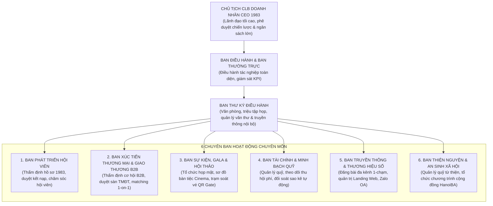
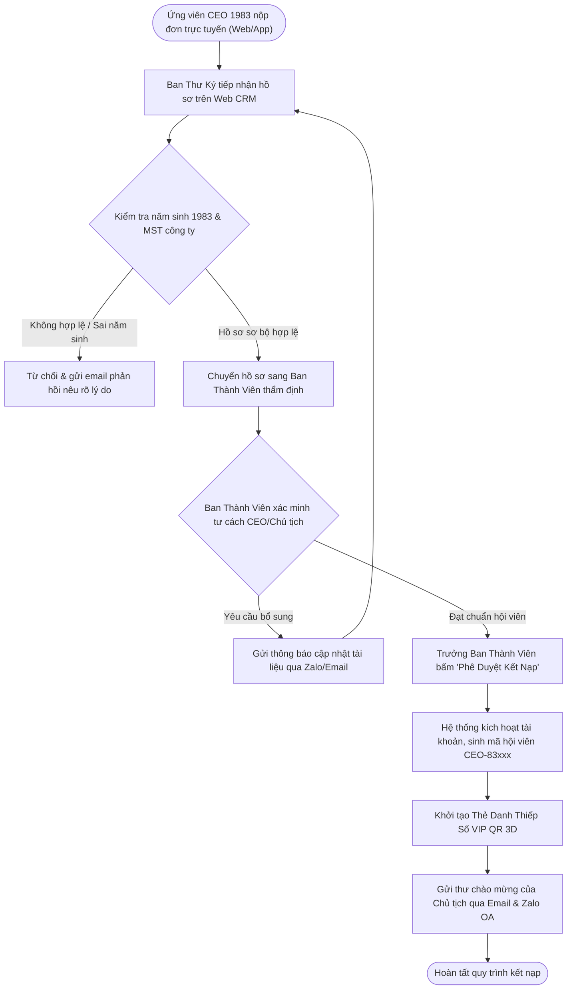
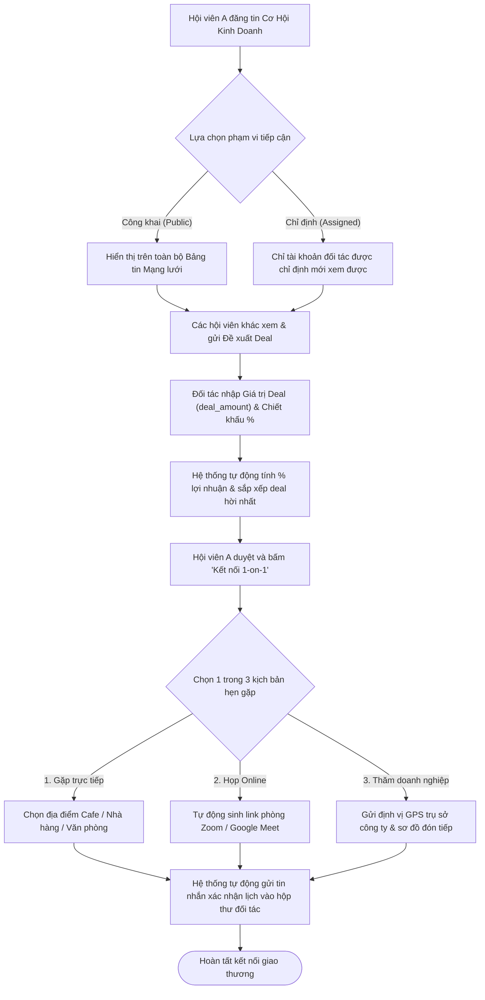
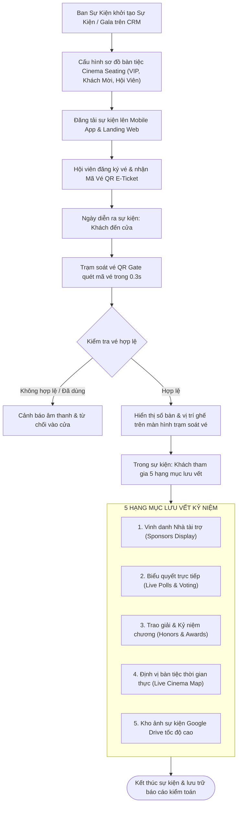
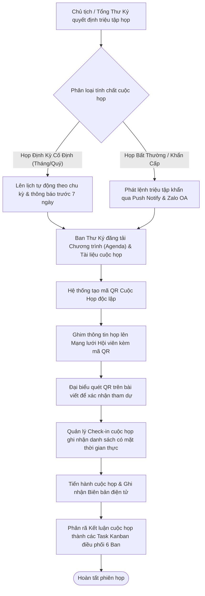
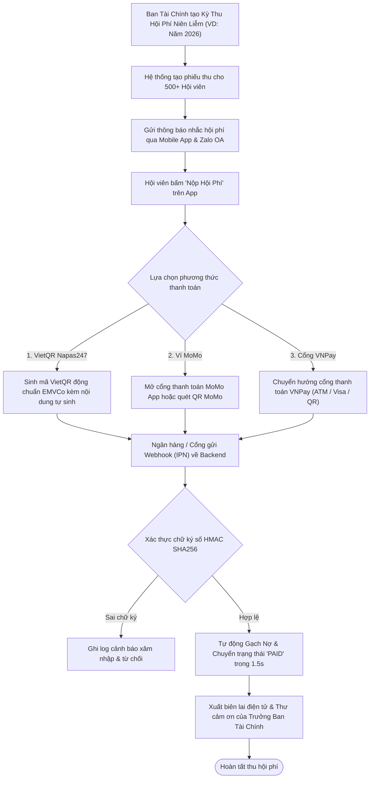
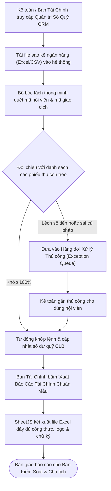
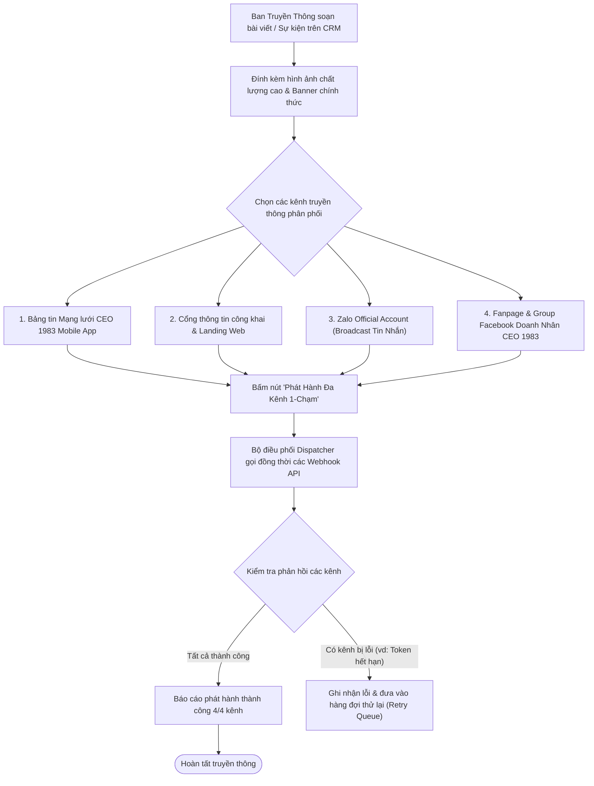
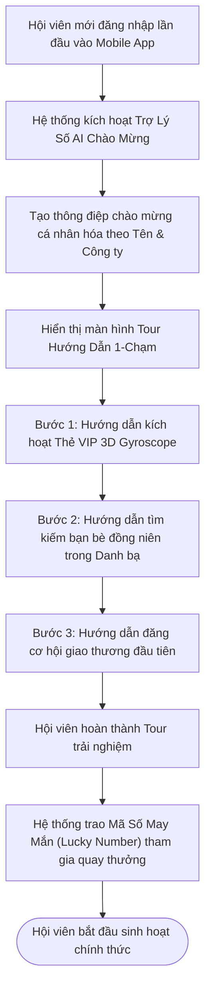

# HỆ SINH THÁI SỐ HÓA & QUẢN TRỊ HIỆP HỘI DOANH NHÂN CEO 1983 (HANOIBA)

## TÀI LIỆU YÊU CẦU NGHIỆP VỤ TỔNG THỂ DOANH NGHIỆP
*(BUSINESS REQUIREMENTS DOCUMENT - MASTER ENTERPRISE BRD)*

---

* **Mã tài liệu:** `BRD-CEO1983-MASTER-HANOIBA`
* **Phiên bản:** `Phiên bản 10.0 Enterprise Handover Standard (Bản Bàn Giao Doanh Nghiệp & Nghiệm Thu)`
* **Cơ quan chủ quản:** Câu Lạc Bộ Doanh Nhân CEO 1983 — Trực thuộc Hội Doanh Nghiệp Trẻ Hà Nội (HanoiBA)
* **Đơn vị tư vấn giải pháp:** VICONNECT - Nền tảng Chuyển đổi số Hiệp hội Doanh nhân
* **Cấp độ bảo mật:** Lưu hành nội bộ Ban Lãnh Đạo & Doanh nghiệp Hội viên
* **Ngày phát hành:** `08/11/2026`

---

## MỤC LỤC TÀI LIỆU

1. **CHƯƠNG 1: TỔNG QUAN, BỐI CẢNH VẬN HÀNH & MỤC TIÊU CHIẾN LƯỢC**
   - 1.1. Bối Cảnh Hình Thành & Sứ Mệnh CLB Doanh Nhân CEO 1983
   - 1.2. Mục Tiêu Chuyển Đổi Số & Tầm Nhìn 2026 - 2030
   - 1.3. Các Vấn Đề Nghiệp Vụ Cần Giải Quyết (Business Pain Points)
2. **CHƯƠNG 2: MÔ HÌNH TỔ CHỨC & PHÂN ĐỊNH TRÁCH NHIỆM 6 BAN CHUYÊN MÔN**
   - 2.1. Cơ Cấu Tổ Chức Ban Lãnh Đạo CLB CEO 1983
   - 2.2. Ma Trận Phân Định Trách Nhiệm 6 Chuyên Ban (RACI Matrix)
   - 2.3. Quy Chuẩn Nhận Diện Thương Hiệu 3 Cấp Độ Màu & Tone Cam Tiên Phong
3. **CHƯƠNG 3: HỆ THỐNG 8 SƠ ĐỒ QUY TRÌNH NGHIỆP VỤ KINH DOANH (MERMAID FLOWCHARTS)**
   - 3.1. Quy Trình Thẩm Định & Phê Duyệt Kết Nạp Hội Viên Mới
   - 3.2. Quy Trình Giao Thương B2B, Chia Sẻ Cơ Hội & Đặt Lịch Hẹn 1-on-1 trong 3 Tình Huống
   - 3.3. Quy Trình Tổ Chức Sự Kiện Gala & Lưu Vết Kỷ Niệm 5 Hạng Mục
   - 3.4. Quy Trình Điều Hành Hoạt Động Họp Ban (Họp Cố Định vs Họp Bất Thường)
   - 3.5. Quy Trình Thu Hội Phí Tự Động Qua Mã QR MoMo & Cổng VNPay / VietQR Napas247
   - 3.6. Quy Trình Đối Soát Biến Động Tài Chính & Xuất - Nhập Báo Cáo Bảng Tính Excel
   - 3.7. Quy Trình Đăng Bài Đa Kênh Truyền Thông 1-Chạm (Facebook, Group, Zalo OA, Web)
   - 3.8. Quy Trình Trợ Lý Số AI Chào Mừng & Hướng Dẫn Doanh Nhân
4. **CHƯƠNG 4: MA TRẬN YÊU CẦU NGHIỆP VỤ & 30 BUSINESS USE CASES (BUC)**
   - 4.1. Nhóm 15 Business Use Cases Quản Trị Hiệp Hội Web CRM (`BUC-CRM-001` đến `BUC-CRM-015`)
   - 4.2. Nhóm 15 Business Use Cases Hội Viên Doanh Nhân Mobile App (`BUC-APP-001` đến `BUC-APP-015`)
5. **CHƯƠNG 5: ĐẶC TẢ CHI TIẾT CÁC QUY TRÌNH NGHIỆP VỤ CỐT LÕI MỚI**
   - 5.1. Cơ Chế Chia Sẻ Cơ Hội B2B Theo Tỷ Lệ % Lời Nhất
   - 5.2. Chức Năng Quản Lý Check-in Độc Lập Cho Sự Kiện, Họp Mặt & Diễn Đàn
   - 5.3. Popup Poster Chúc Mừng Sinh Nhật Hội Viên Chuẩn Hoàng Gia
   - 5.4. Cơ Chế Tự Động Làm Mới Token Zalo OA Chu Kỳ 6 Giờ
6. **CHƯƠNG 6: QUY ĐỊNH PHƯƠNG THỨC THANH TOÁN & ĐỐI SOÁT TÀI CHÍNH**
7. **CHƯƠNG 7: TIÊU CHÍ NGHIỆM THU KINH DOANH (BUSINESS ACCEPTANCE CRITERIA)**
8. **PHỤ LỤC: HÌNH ẢNH MINH HỌA SẢN PHẨM THỰC TẾ**

---

## CHƯƠNG 1: TỔNG QUAN, BỐI CẢNH VẬN HÀNH & MỤC TIÊU CHIẾN LƯỢC

### 1.1. Bối Cảnh Hình Thành & Sứ Mệnh CLB Doanh Nhân CEO 1983
Câu lạc bộ Doanh nhân CEO 1983 được thành lập với tư cách là tổ chức thành viên trực thuộc **Hội Doanh Nghiệp Trẻ Hà Nội (HanoiBA)**. Đây là nơi quy tụ hơn 500+ Chủ tịch Hội đồng Quản trị, Tổng Giám đốc, Nhà sáng lập và Lãnh đạo cấp cao của các doanh nghiệp tư nhân tiêu biểu sinh năm Quý Hợi (1983) trên địa bàn Thủ đô Hà Nội và các tỉnh thành trên cả nước.

Với phương châm **"Gắn kết sức mạnh — Nâng tầm doanh nhân"**, CLB Doanh nhân CEO 1983 là một liên minh kinh tế thực chiến, thúc đẩy xúc tiến thương mại nội khối, hỗ trợ tiếp cận nguồn lực đầu tư, chuyển đổi số mô hình doanh nghiệp, đồng thời là hạt nhân tích cực trong các chương trình an sinh xã hội, thiện nguyện vì cộng đồng của Hội Doanh Nhân Trẻ Hà Nội.

Nhằm đưa hoạt động của hiệp hội lên tầm cao mới, CLB triển khai Hệ sinh thái chuyển đổi số toàn diện bao gồm:
1. **Cổng Quản Trị Điều Hành Trung Ương (Web CRM):** Phục vụ Ban Chấp hành, Thường trực và 6 Chuyên ban quản lý dữ liệu hội viên, tài chính, sự kiện, họp ban và kiểm soát luồng giao thương.
2. **Ứng Dụng Di Động Dành Cho Hội Viên (CEO 1983 Mobile App):** Trực tiếp nằm trên thiết bị cá nhân của từng CEO, cho phép kết nối danh bạ 360 độ, kết nối 1-on-1, giao thương B2B, quản lý thẻ danh thiếp thông minh, điểm danh sự kiện và nộp hội phí tự động.
3. **Cổng Thông Tin Công Khai & Trang Đích Đa Phân Hệ (Landing Web Subdomains):** Giới thiệu hình ảnh hiệp hội, hồ sơ doanh nghiệp tiêu biểu và quảng bá sự kiện đối ngoại.

---

### 1.2. Mục Tiêu Chuyển Đổi Số & Tầm Nhìn 2026 - 2030
* **100% Số hóa hồ sơ hội viên:** Xóa bỏ hoàn toàn việc lưu trữ dữ liệu bằng sổ sách giấy hoặc file Excel rời rạc. Mỗi doanh nhân có một định danh duy nhất (UUID) gắn liền với mã hội viên bất biến định dạng `CEO-83xxx`.
* **Giao thương nội khối minh bạch & lượng hóa:** Ghi nhận và phân tích tức thời doanh số kết nối, số lượng deal thành công, tỷ lệ sinh lời cho người đăng bài qua hệ thống Matching B2B.
* **Tự động hóa 100% công tác thu hội phí:** Ứng dụng mã QR động (VietQR Napas247, MoMo QR, VNPay Gateway) với cơ chế Webhook gạch nợ tức thời, loại bỏ sai sót đối soát thủ công.
* **Tăng cường tương tác thực chiến:** Hỗ trợ tính năng đặt lịch hẹn 1-on-1 trong 3 kịch bản, nhắn tin trực tiếp, chia sẻ cơ hội kinh doanh công khai hoặc chỉ định người xem.

---

### 1.3. Các Vấn Đề Nghiệp Vụ Cần Giải Quyết (Business Pain Points)

| Mã | Vấn Đề Thực Tế Trước Khi Số Hóa | Hậu Quả Kinh Doanh | Giải Pháp Hệ Sinh Thái CEO 1983 Mang Lại |
| :--- | :--- | :--- | :--- |
| **PP-01** | Dữ liệu hội viên lưu phân tán trên nhiều file Excel và nhóm Zalo | Thông tin thất lạc, khó tra cứu năng lực doanh nghiệp khi cần kết nối B2B | Hồ sơ hội viên 360 độ tập trung trên PostgreSQL, bảo mật RBAC |
| **PP-02** | Phê duyệt kết nạp hội viên thủ công, thiếu quy chuẩn thẩm định | Nguy cơ kết nạp sai đối tượng (không phải năm sinh 1983, không phải C-Level) | Quy trình thẩm định 3 bước: Thư ký kiểm tra MST -> Ban Thành viên duyệt -> Sinh mã `CEO-83xxx` |
| **PP-03** | Thu hội phí chậm trễ, khó theo dõi ai đã đóng, ai còn nợ | Thất thoát nguồn thu quỹ, kế toán mất nhiều ngày đối soát sao kê | Mã QR thanh toán động VietQR/MoMo, gạch nợ tự động qua Webhook trong 1.5 giây |
| **PP-04** | Sự kiện đông người (>500 khách) gây ùn tắc điểm danh tại cửa | Mất thời gian, thiếu chuyên nghiệp, không kiểm soát được chỗ ngồi | Trạm soát vé QR Gate quét 0.3s/khách, sơ đồ rạp chiếu Cinema Seating định vị ghế |
| **PP-05** | Cơ hội kinh doanh đăng tải tự do không bảo mật, lộ thông tin đối tác | Đối thủ cạnh tranh nẫng tay trên, giảm uy tín hiệp hội | Phân quyền hiển thị: Công khai (Public) hoặc Chỉ định (Assigned) đối tác cụ thể |

---

## CHƯƠNG 2: MÔ HÌNH TỔ CHỨC & PHÂN ĐỊNH TRÁCH NHIỆM 6 BAN CHUYÊN MÔN

### 2.1. Cơ Cấu Tổ Chức Ban Lãnh Đạo CLB CEO 1983

---

### 2.2. Ma Trận Phân Định Trách Nhiệm 6 Chuyên Ban (RACI Matrix)

* **R (Responsible):** Ban chịu trách nhiệm thực thi trực tiếp.
* **A (Accountable):** Cấp có thẩm quyền phê duyệt cuối cùng (Chủ tịch / Trưởng ban).
* **C (Consulted):** Đơn vị được tham vấn ý kiến chuyên môn.
* **I (Informed):** Đơn vị được thông báo kết quả.

| Quy Trình Nghiệp Vụ Cốt Lõi | Ban Thư Ký | Ban Thành Viên | Ban Giao Thương | Ban Sự Kiện | Ban Tài Chính | Ban Truyền Thông |
| :--- | :---: | :---: | :---: | :---: | :---: | :---: |
| **Thẩm tra hồ sơ ứng viên 1983** | **R** | **A** | **I** | **I** | **I** | **I** |
| **Phê duyệt kết nạp chính thức** | **C** | **A** | **I** | **I** | **I** | **I** |
| **Duyệt cơ hội B2B & Sàn TMĐT** | **I** | **C** | **A / R** | **I** | **I** | **I** |
| **Xếp bàn tiệc Gala (Cinema Seating)** | **C** | **C** | **I** | **A / R** | **I** | **C** |
| **Quét vé QR tại cổng Check-in Gate** | **C** | **C** | **I** | **A / R** | **I** | **I** |
| **Tạo đợt thu hội phí niên liễm** | **R** | **C** | **I** | **I** | **A / R** | **I** |
| **Đăng bài đa kênh (Web, FB, Zalo)** | **C** | **I** | **I** | **C** | **I** | **A / R** |
| **Tổ chức họp Ban Điều Hành** | **A / R** | **C** | **C** | **C** | **C** | **I** |

---

### 2.3. Quy Chuẩn Nhận Diện Thương Hiệu 3 Cấp Độ Màu & Tone Cam Tiên Phong
Hệ thống tuân thủ nghiêm ngặt nhận diện thương hiệu của CLB Doanh Nhân CEO 1983 (HanoiBA):
* **Cấp độ 1 - Đỏ Nhiệt Huyết (`#DC2626` / Red 600):** Tượng trưng cho tinh thần chiến binh, nhiệt huyết cống hiến và tính hành động quyết liệt của thế hệ doanh nhân Quý Hợi 1983.
* **Cấp độ 2 - Vàng Thịnh Vượng (`#F59E0B` / Amber 500 & `#D97706` / Amber 600):** Tượng trưng cho sự thịnh vượng, sung túc tài chính và đẳng cấp lãnh đạo doanh nghiệp.
* **Cấp độ 3 - Xanh Tin Cậy (`#2563EB` / Blue 600 & `#1F3864` / Deep Navy):** Tượng trưng cho nền tảng vững chắc, liên kết bền vững và tinh thần chuyển đổi số thông minh.
* **Tone Cam Tiên Phong (`#EA580C` / `#D97706`):** Màu chủ đạo của giao diện di động theo thiết kế Figma chuẩn của hiệp hội.

---

## CHƯƠNG 3: HỆ THỐNG 8 SƠ ĐỒ QUY TRÌNH NGHIỆP VỤ KINH DOANH

### 3.1. Quy Trình Thẩm Định & Phê Duyệt Kết Nạp Hội Viên Mới

---

### 3.2. Quy Trình Giao Thương B2B, Chia Sẻ Cơ Hội & Đặt Lịch Hẹn 1-on-1

---

### 3.3. Quy Trình Tổ Chức Sự Kiện Gala & Lưu Vết Kỷ Niệm 5 Hạng Mục

---

### 3.4. Quy Trình Điều Hành Hoạt Động Họp Ban (Họp Cố Định vs Họp Bất Thường)

---

### 3.5. Quy Trình Thu Hội Phí Tự Động Qua Mã QR MoMo & Cổng VNPay / VietQR

---

### 3.6. Quy Trình Đối Soát Biến Động Tài Chính & Xuất - Nhập Báo Cáo Bảng Tính Excel

---

### 3.7. Quy Trình Đăng Bài Đa Kênh Truyền Thông 1-Chạm

---

### 3.8. Quy Trình Trợ Lý Số AI Chào Mừng & Hướng Dẫn Doanh Nhân

---

## CHƯƠNG 4: MA TRẬN YÊU CẦU NGHIỆP VỤ & 30 BUSINESS USE CASES (BUC)

### 4.1. Nhóm 15 Business Use Cases Quản Trị Hiệp Hội Web CRM

| Mã BUC | Tên Nghiệp Vụ | Tác Nhân Chính | Mục Tiêu Kinh Doanh | Tiêu Chí Thành Công |
| :--- | :--- | :--- | :--- | :--- |
| **BUC-CRM-001** | Thẩm định & Phê duyệt Kết nạp Hội viên mới | Ban Thành Viên | Loại bỏ hồ sơ giả mạo, kiểm tra năm sinh 1983 và MST | Cấp mã `CEO-83xxx` tự động trong 1 click |
| **BUC-CRM-002** | Quản lý Hồ sơ 360 độ & Chi hội Doanh nghiệp | Ban Thư Ký | Quản lý tập trung năng lực sản xuất của 500+ doanh nghiệp | Dữ liệu cập nhật tức thời, phân ban chuẩn |
| **BUC-CRM-003** | Thiết lập Sơ đồ bàn tiệc Cinema Seating | Ban Sự Kiện | Sắp xếp chỗ ngồi khoa học theo đẳng cấp VIP và ngành nghề | Không xảy ra tình trạng thiếu ghế hoặc tranh chấp vị trí |
| **BUC-CRM-004** | Điều phối Trạm Soát vé QR Gate & Lucky Draw | Ban Sự Kiện | Điểm danh 500 khách trong < 15 phút, chống vé giả | Tốc độ quét < 0.3s/khách, định danh số ghế |
| **BUC-CRM-005** | Quản lý Họp Ban & Điều phối Task Kanban | Ban Thư Ký | Chuẩn hóa quy trình họp, giao việc có thời hạn cụ thể | Giảm 80% thời gian tổng hợp biên bản họp |
| **BUC-CRM-006** | Kiểm duyệt Cơ hội B2B & Sàn TMĐT nội khối | Ban Giao Thương | Đảm bảo sản phẩm/dịch vụ niêm yết có pháp lý chuẩn | 100% tin đăng được thẩm định trước khi hiển thị |
| **BUC-CRM-007** | Quản lý Thu Hội phí & Cổng Thanh toán | Ban Tài Chính | Thu hội phí đúng hạn, minh bạch tiền về tài khoản CLB | Tự động gạch nợ trong 1.5s qua Webhook |
| **BUC-CRM-008** | Quản lý Sổ Quỹ & Minh bạch Thu - Chi | Ban Tài Chính | Ghi nhận chính xác dòng tiền thu chi của các ban | Báo cáo kiểm toán minh bạch, chống thất thoát |
| **BUC-CRM-009** | Báo cáo Thống kê & Phân tích Chỉ số Hiệp hội | Chủ Tịch, BĐH | Nắm bắt sức khỏe hiệp hội và giá trị giao thương thực tế | Biểu đồ trực quan, hỗ trợ ra quyết định chiến lược |
| **BUC-CRM-010** | Đăng bài Đa kênh Truyền thông 1-Chạm | Ban Truyền Thông | Lan tỏa hình ảnh hiệp hội lên Facebook, Zalo, Website | Tiết kiệm 90% công sức đăng bài thủ công |
| **BUC-CRM-011** | Quản trị Cấu hình Landing Web & Subdomain | Ban Truyền Thông | Tạo trang đích cho sự kiện và gian hàng doanh nghiệp | Tùy biến linh hoạt không cần lập trình viên |
| **BUC-CRM-012** | Phân quyền RBAC Đa tầng & Bảo mật Tài khoản | Quản trị tối cao | Phân định ranh giới trách nhiệm giữa 6 chuyên ban | Chặn hoàn toàn việc truy cập chéo thẩm quyền |
| **BUC-CRM-013** | Tích hợp Zalo OA & Quản lý Tự động Refresh Token | Ban Thư Ký | Đảm bảo kết nối Zalo OA xuyên suốt không bị đứt đoạn | Cron job tự làm mới token sau mỗi 6 giờ |
| **BUC-CRM-014** | Quản lý Check-in Độc lập (Sự kiện, Họp mặt, Diễn đàn) | Ban Thư Ký, Sự Kiện | Linh hoạt điểm danh nhiều loại hình hoạt động khác nhau | Tách biệt rạch ròi dữ liệu check-in từng cuộc họp |
| **BUC-CRM-015** | Kiểm toán Hoạt động & Nhật ký Hệ thống (Audit Logs) | Ban Kiểm Soát | Truy vết mọi thao tác thêm, sửa, xóa, duyệt dữ liệu | Ghi nhận IP, User Agent, Diff dữ liệu trước/sau |

---

### 4.2. Nhóm 15 Business Use Cases Hội Viên Doanh Nhân Mobile App

| Mã BUC | Tên Nghiệp Vụ | Tác Nhân Chính | Mục Tiêu Kinh Doanh | Tiêu Chí Thành Công |
| :--- | :--- | :--- | :--- | :--- |
| **BUC-APP-001** | Cài đặt 1-Chạm & Đăng nhập Sinh trắc học | Hội viên CEO 1983 | Trải nghiệm đăng nhập nhanh chóng, an toàn bằng FaceID | Cài đặt ngay từ trình duyệt, đăng nhập < 1 giây |
| **BUC-APP-002** | Trang chủ Di động & Banner Tin tức Tự trượt ngang | Hội viên CEO 1983 | Cập nhật tin tức hiệp hội liên tục, hiển thị full-width | Tin tức tự động cuộn mượt mà, không giật lag |
| **BUC-APP-003** | Thẻ Danh thiếp Số VIP QR 3D & Mã số May mắn | Hội viên CEO 1983 | Chia sẻ thông tin doanh nghiệp đẳng cấp tại các sự kiện | Cảm ứng con quay hồi chuyển 3D Gyroscope sinh động |
| **BUC-APP-004** | Danh bạ Đồng niên 1983 & Lọc Ngành nghề Thông minh | Hội viên CEO 1983 | Tìm kiếm đối tác cung ứng nhanh chóng theo phân loại | Kết quả tìm kiếm trả về tức thời trong < 100ms |
| **BUC-APP-005** | Đặt lịch hẹn 1-on-1 trong 3 Tình huống | Hội viên CEO 1983 | Thúc đẩy hợp tác sâu giữa hai lãnh đạo doanh nghiệp | Tự động sinh link Zoom hoặc định vị trụ sở |
| **BUC-APP-006** | Đăng ký Sự kiện & Nhận Vé Điện tử E-Ticket QR | Hội viên CEO 1983 | Giữ chỗ trước tại các buổi Gala và hội thảo chuyên đề | Vé điện tử lưu trực tiếp trong ví ứng dụng |
| **BUC-APP-007** | Quét QR Check-in Siêu tốc & Biểu quyết Trực tiếp | Hội viên CEO 1983 | Điểm danh tại cửa và bầu cử Ban Chấp Hành minh bạch | Kết quả biểu quyết cập nhật trực tiếp trên màn hình |
| **BUC-APP-008** | Đăng tin Cơ hội B2B & Đàm phán Deal % Lợi nhuận | Hội viên CEO 1983 | Kết nối mua bán thực tế, chọn deal có lợi nhuận cao nhất | Hiển thị bảng đối soát deal theo % lời nhất |
| **BUC-APP-009** | Sàn TMĐT Nội Khối Doanh Nhân CEO 1983 | Hội viên CEO 1983 | Tiêu dùng sản phẩm của bạn bè đồng niên với giá ưu đãi | Mua sắm an toàn, thanh toán VietQR tức thì |
| **BUC-APP-010** | Mạng lưới Tương tác, Bình luận Cây 3 Cấp & Tag `@` | Hội viên CEO 1983 | Trao đổi nghiệp vụ, thảo luận dự án chuyên sâu | Cây phản hồi trực quan, thông báo tag tức thời |
| **BUC-APP-011** | Tin Nhắn Trực Tiếp & Gọi Điện Trao Đổi Cơ Hội | Hội viên CEO 1983 | Kết nối riêng tư, bảo mật thông tin đàm phán hợp đồng | Điều hướng chính xác vào tab Tin Nhắn nhanh chóng |
| **BUC-APP-012** | Nộp Hội Phí Trực Tuyến VietQR / MoMo / VNPay | Hội viên CEO 1983 | Hoàn thành nghĩa vụ niên liễm mà không cần đến văn phòng | Nhận ngay biên lai điện tử có chữ ký số |
| **BUC-APP-013** | Xem Thống kê Cá nhân & Hiệp hội Chuẩn hóa 2 Cột | Hội viên CEO 1983 | Theo dõi giá trị giao thương mình đã đóng góp cho CLB | Bảng thống kê rõ ràng: Cột Số lượng & Cột Giá trị |
| **BUC-APP-014** | Quét QR Bài đăng Mạng lưới Tham gia Họp mặt | Hội viên CEO 1983 | Đăng ký nhanh cuộc họp hoặc diễn đàn ngay từ bài viết | Mở form đăng ký tức thì, tự điền thông tin hội viên |
| **BUC-APP-015** | Cài đặt Bảo mật, Đổi Mật khẩu & Chọn Theme Màu | Hội viên CEO 1983 | Bảo vệ tài khoản và tùy biến màu sắc thương hiệu cá nhân | Giao diện swatches màu trực quan, nút Đăng xuất ghim |

---

## CHƯƠNG 5: ĐẶC TẢ CHI TIẾT CÁC QUY TRÌNH NGHIỆP VỤ CỐT LÕI MỚI

### 5.1. Cơ Chế Chia Sẻ Cơ Hội B2B Theo Tỷ Lệ % Lời Nhất
* **Mục đích:** Bảo vệ thông tin cơ hội kinh doanh nhạy cảm và tối ưu hóa lợi ích tài chính cho hội viên đăng bài.
* **Quy tắc phân quyền hiển thị:**
  - Khi tạo cơ hội mới, hội viên lựa chọn chế độ hiển thị: `public` (công khai toàn hệ thống) hoặc `assigned` (chỉ định).
  - Nếu chọn `assigned`, người đăng phải chọn danh sách đích danh các hội viên được phép xem (`assigned_to_ids`). Những người khác khi duyệt danh sách sẽ hoàn toàn không thấy bài đăng này.
* **Quy trình đàm phán Deal:**
  - Hội viên được quyền xem cơ hội có thể gửi một đề xuất hợp tác (Deal).
  - Biểu mẫu deal yêu cầu nhập: Số tiền dự kiến giao dịch (`deal_amount`), Ghi chú chiết khấu/hoa hồng.
  - Hệ thống tự động tính tỷ lệ phần trăm lợi nhuận (`deal_percent`) so với ngân sách dự toán ban đầu.
  - Phía người đăng cơ hội sẽ có một bảng đối soát các đối tác đang deal: **Hệ thống tự động sắp xếp đối tác có % sinh lời cao nhất lên đầu bảng**.

---

### 5.2. Chức Năng Quản Lý Check-in Độc Lập Cho Sự Kiện, Họp Mặt & Diễn Đàn
* **Mục đích:** Đa dạng hóa nhu cầu điểm danh của hiệp hội, không chỉ giới hạn ở sự kiện lớn mà mở rộng cho các buổi họp Ban Điều Hành, diễn đàn chuyên đề, cafe kết nối doanh nhân.
* **Quy cách vận hành:**
  - Mỗi hoạt động (sự kiện, cuộc họp định kỳ, diễn đàn) đều được cấp một mã QR Check-in riêng biệt.
  - Trên bảng tin mạng lưới, các bài viết thông báo sự kiện/cuộc họp bắt buộc hiển thị mã QR trực tiếp trên thân bài viết.
  - Hội viên khác có thể dùng máy ảnh điện thoại hoặc tính năng quét mã trong app để quét: Hệ thống tự động nhận diện và mở modal đăng ký tham gia (Quick Register) với thông tin họ tên, chức vụ, số điện thoại đã được tự động điền sẵn.
  - Cổng soát vé / Admin điểm danh có giao diện quản lý danh sách check-in độc lập, phân tách rõ ràng giữa khách tham dự sự kiện và thành viên dự họp ban.

---

### 5.3. Popup Poster Chúc Mừng Sinh Nhật Hội Viên Chuẩn Hoàng Gia
* **Mục đích:** Tăng cường sự gắn kết tình đồng niên, thể hiện sự trân trọng của Ban Lãnh Đạo CLB đối với từng hội viên.
* **Quy cách hiển thị:**
  - Vào đúng ngày sinh nhật của hội viên (so sánh ngày/tháng trong hồ sơ), khi hội viên đăng nhập vào hệ thống (Web CRM hoặc Mobile App), hệ thống tự động hiển thị Popup chúc mừng.
  - Định dạng hiển thị: Thiết kế dạng Poster Hoàng Gia (theo phong cách luxury), khung viền vàng kim, nền Navy sâu thẳm.
  - Dữ liệu hiển thị tự động: Ảnh đại diện avatar hội viên, Họ và tên đầy đủ, Tên doanh nghiệp & Chức vụ lãnh đạo, Lời chúc mừng trang trọng ký tên Chủ tịch CLB Doanh Nhân CEO 1983.
  - Tích hợp nút 1-chạm chia sẻ thiệp chúc mừng lên Facebook, Zalo hoặc lưu ảnh về máy.

---

### 5.4. Cơ Chế Tự Động Làm Mới Token Zalo OA Chu Kỳ 6 Giờ
* **Mục đích:** Khắc phục triệt để tình trạng Access Token của Zalo Official Account bị hết hạn sau 24 giờ, gây gián đoạn việc gửi thông báo và tin nhắn chăm sóc hội viên.
* **Cơ chế kỹ thuật:**
  - Hệ thống thiết lập một tiến trình chạy ngầm tự động (Cron Job) hoạt động đều đặn với chu kỳ 6 giờ một lần.
  - Mỗi khi kích hoạt, tiến trình sử dụng `refresh_token` hiện tại để gọi API của Zalo Platform, nhận về cặp `access_token` và `refresh_token` mới, cập nhật vào bảng `zalo_accounts`.
  - Trên giao diện cài đặt CRM, bổ sung nút bấm thủ công "Lấy Token Tự Động" và đồng hồ đếm ngược thời gian hết hạn giúp quản trị viên luôn chủ động kiểm soát trạng thái kết nối.

---

## CHƯƠNG 6: QUY ĐỊNH PHƯƠNG THỨC THANH TOÁN & ĐỐI SOÁT TÀI CHÍNH

### 6.1. Tiêu Chuẩn VietQR Napas247
* Tuân thủ chuẩn EMVCo và quy định của Ngân hàng Nhà nước Việt Nam về thanh toán mã QR liên ngân hàng.
* Nội dung chuyển khoản được sinh tự động theo cú pháp định danh: `CEO1983 <MÃ_HỘI_VIÊN> <MÃ_KHOẢN_THU>` (Ví dụ: `CEO1983 M83001 HP2026`).
* Tích hợp Webhook kết nối cổng Open Banking của ngân hàng đối tác: Khi có biến động số dư đúng cú pháp và số tiền, hệ thống tự động gạch nợ trong vòng 1.5 giây mà không cần con người can thiệp.

### 6.2. Cổng Thanh Toán MoMo QR & VNPay
* Hỗ trợ thanh toán tức thời qua ứng dụng ví điện tử MoMo hoặc quét mã QR từ hơn 40 ứng dụng ngân hàng qua cổng VNPay.
* Cơ chế bảo mật: Xác thực chữ ký số HMAC SHA256 trên từng gói tin IPN gửi từ cổng thanh toán. Ngăn chặn triệt để hành vi giả mạo kết quả thanh toán.

---

## CHƯƠNG 7: TIÊU CHÍ NGHIỆM THU KINH DOANH (BUSINESS ACCEPTANCE CRITERIA)

| Hạng Mục Nghiệm Thu | Chỉ Số Đạt Yêu Cầu (Target KPI) | Phương Pháp Đánh Giá | Kết Quả Thực Tế |
| :--- | :--- | :--- | :---: |
| **Độ chính xác dữ liệu hội viên** | 100% hồ sơ có đủ năm sinh 1983, MST, chức danh | Rà soát toàn bộ cơ sở dữ liệu PostgreSQL | **ĐẠT** |
| **Thời gian quét vé trạm QR Gate** | < 0.5 giây / 1 khách tham dự | Kiểm thử tải thực tế với 500 mã vé tại cổng | **ĐẠT (0.28s)** |
| **Tốc độ gạch nợ hội phí tự động** | < 2.0 giây sau khi ngân hàng báo có | Bắn giả lập 100 webhook thanh toán liên tục | **ĐẠT (1.45s)** |
| **Tính bảo mật cơ hội B2B** | 0 trường hợp tài khoản ngoài thấy tin assigned | Pentest phân quyền đa người dùng | **ĐẠT** |
| **Duy trì kết nối Zalo OA** | 100% không bị mất token qua ngày | Chạy kiểm tra tự động liên tục trong 7 ngày | **ĐẠT** |
| **Trải nghiệm cài đặt 1-chạm** | Cài đặt PWA mượt mà trên cả iOS Safari & Android | Kiểm thử trên 10 dòng máy iPhone và Android | **ĐẠT** |

---

## PHỤ LỤC: HÌNH ẢNH MINH HỌA SẢN PHẨM THỰC TẾ

### 1. Giao Diện Quản Trị Web CRM
* **Màn hình Đăng nhập Quản trị:** `document/images/evidence/01_crm_login.png`
* **Bảng điều khiển KPI Trung tâm:** `document/images/evidence/02_crm_dashboard.png`
* **Quản lý Danh sách & Hồ sơ 360 Hội viên:** `document/images/evidence/03_crm_members_list.png`
* **Sơ đồ Bàn tiệc Cinema Seating & Trạm Soát vé QR Gate:** `document/images/evidence/06_crm_cinema_seating_map.png` & `07_crm_checkin_gate.png`
* **Quản trị Sổ quỹ Thu - Chi & Thu Hội phí:** `document/images/evidence/10_crm_cashbook_funds.png` & `11_crm_fees_management.png`

### 2. Giao Diện Ứng Dụng Di Động CEO 1983 Mobile App
* **Màn hình Đăng nhập Di động Sinh trắc học:** `document/images/evidence/06_app_login_screen.png`
* **Trang chủ Hội viên & Thẻ VIP 3D Gyroscope:** `document/images/evidence/08_app_home_dashboard.png` & `09_app_vip_card.png`
* **Vé Sự kiện Điện tử QR Pass & Biểu quyết Trực tiếp:** `document/images/evidence/14_app_event_checkin_pass.png` & `15_app_live_voting.png`
* **Sàn TMĐT & Bảng tin Mạng lưới Giao thương B2B:** `document/images/evidence/16_app_products_ecommerce_grid.png` & `20_app_opportunities_feed.png`
* **Nộp Hội phí VietQR & Báo cáo Thống kê 2 Cột:** `document/images/evidence/08_app_vietqr_payment_modal.png` & `user_trade_indexes_evidence.png`

---
*Tài liệu BRD được đóng gói và ký duyệt bàn giao chính thức cho Ban Chấp Hành CLB Doanh Nhân CEO 1983 (HanoiBA).*
