# HỆ SINH THÁI SỐ HÓA & QUẢN TRỊ HIỆP HỘI DOANH NHÂN CEO 1983 (HANOIBA)

## TÀI LIỆU YÊU CẦU NGHIỆP VỤ TỔNG THỂ DOANH NGHIỆP TOÀN DIỆN
*(BUSINESS REQUIREMENTS DOCUMENT - MASTER BRD ENTERPRISE EDITION)*
*Tiêu chuẩn quốc tế IIBA BABOK v3.0 & Nghiệp vụ Hiệp hội Doanh nhân HanoiBA*
*Tích hợp Hệ thống Sơ đồ Use Case Mermaid & Thư viện 50+ Ảnh Chụp Giao diện Thực tế*

---

* **Mã tài liệu:** `BRD-CEO1983-MASTER-ENTERPRISE-V10.0`
* **Phiên bản:** `Phiên bản 10.0 Toàn Diện (Bản Bàn Giao Ban Lãnh Đạo, Hội Đồng Thẩm Định HanoiBA & Doanh Nghiệp Hội Viên)`
* **Cơ quan chủ quản:** Câu Lạc Bộ Doanh Nhân CEO 1983 — Trực thuộc Hội Doanh Nghiệp Trẻ Hà Nội (HanoiBA)
* **Đơn vị phát triển giải pháp:** VICONNECT - Nền tảng Chuyển đổi số Hiệp hội Doanh nhân Toàn diện
* **Cấp độ bảo mật:** Lưu hành nội bộ Ban Lãnh Đạo & Doanh nghiệp Hội viên
* **Ngày cập nhật:** Tháng 11/2026

---

## MỤC LỤC TỔNG QUAN

- [PHẦN I: TỔNG QUAN, BỐI CẢNH VẬN HÀNH & MỤC TIÊU CHIẾN LƯỢC](#phần-i-tổng-quan-bối-cảnh-vận-hành--mục-tiêu-chiến-lược)
  - [1.1. Bối Cảnh Hình Thành & Sứ Mệnh CLB Doanh Nhân CEO 1983 (HanoiBA)](#11-bối-cảnh-hình-thành--sứ-mệnh-clb-doanh-nhân-ceo-1983-hanoiba)
  - [1.2. Thách Thức Nghiệp Vụ Thực Tế Trước Khi Số Hóa (7 Điểm Nghẽn Cốt Lõi)](#12-thách-thức-nghiệp-vụ-thực-tế-trước-khi-số-hóa-7-điểm-nghẽn-cốt-lõi)
  - [1.3. Mục Tiêu Chiến Lược & Chỉ Số Đo Lường Hiệu Quả (Strategic KPIs)](#13-mục-tiêu-chiến-lược--chỉ-số-đo-lường-hiệu-quả-strategic-kpis)
  - [1.4. Mô Hình Vận Hành & Ma Trận Trách Nhiệm RACI Của 6 Ban Chuyên Môn](#14-mô-hình-vận-hành--ma-trận-trách-nhiệm-raci-của-6-ban-chuyên-môn)
  - [1.5. Phân Định Quyền Hạn Vai Trò Người Dùng (RBAC Multi-tier 5 Cấp Độ)](#15-phân-định-quyền-hạn-vai-trò-người-dùng-rbac-multi-tier-5-cấp-độ)
  - [1.6. Sơ Đồ Use Case Tổng Thể Toàn Hệ Sinh Thái (Mermaid Master Diagram)](#16-sơ-đồ-use-case-tổng-thể-toàn-hệ-sinh-thái-mermaid-master-diagram)
- [PHẦN II: SƠ ĐỒ USE CASE & ĐẶC TẢ CHI TIẾT CỔNG QUẢN TRỊ WEB CRM (KÈM ẢNH THỰC TẾ & LUỒNG XỬ LÝ)](#phần-ii-sơ-đồ-use-case--đặc-tả-chi-tiết-cổng-quản-trị-web-crm-kèm-ảnh-thực-tế--luồng-xử-lý)
  - [2.1. Sơ Đồ Use Case Phân Hệ Quản Trị Web CRM](#21-sơ-đồ-use-case-phân-hệ-quản-trị-web-crm)
  - [2.2. Nghiệp Vụ Quản Trị Xác Thực, Tài Khoản & Phân Quyền RBAC 5 Cấp](#22-nghiệp-vụ-quản-trị-xác-thực-tài-khoản--phân-quyền-rbac-5-cấp)
  - [2.3. Nghiệp Vụ Dashboard Điều Hành Tổng Quan & Trực Quan Hóa Chỉ Số](#23-nghiệp-vụ-dashboard-điều-hành-tổng-quan--trực-quan-hóa-chỉ-số)
  - [2.4. Nghiệp Vụ Quản Lý 6 Ban Chuyên Môn & Phân Bổ Thành Viên](#24-nghiệp-vụ-quản-lý-6-ban-chuyên-môn--phân-bổ-thành-viên)
  - [2.5. Nghiệp Vụ Quản Lý Hồ Sơ Hội Viên 360 Độ & Xét Duyệt Kết Nạp Mới](#25-nghiệp-vụ-quản-lý-hồ-sơ-hội-viên-360-độ--xét-duyệt-kết-nạp-mới)
  - [2.6. Nghiệp Vụ Quản Lý Sự Kiện Gala & Sơ Đồ Bàn Tiệc VIP Keangnam](#26-nghiệp-vụ-quản-lý-sự-kiện-gala--sơ-đồ-bàn-tiệc-vip-keangnam)
  - [2.7. Nghiệp Vụ Điều Phối Soát Vé Check-in QR Động 0.5 Giây & Vòng Quay May Mắn](#27-nghiệp-vụ-điều-phối-soát-vé-check-in-qr-động-05-giây--vòng-quay-may-mắn)
  - [2.8. Nghiệp Vụ Điều Hành Cuộc Họp Ban (Cố Định vs Bất Thường) & Phòng Họp Jitsi](#28-nghiệp-vụ-điều-hành-cuộc-họp-ban-cố-định-vs-bất-thường--phòng-họp-jitsi)
  - [2.9. Nghiệp Vụ Giao Việc Kanban & AI Gemini Bóc Tách Task Từ Biên Bản Họp](#29-nghiệp-vụ-giao-việc-kanban--ai-gemini-bóc-tách-task-từ-biên-bản-họp)
  - [2.10. Nghiệp Vụ Quản Lý Sổ Quỹ Thu - Chi, Hoàn Ứng 6 Ban & Recharts Thích Ứng Theme](#210-nghiệp-vụ-quản-lý-sổ-quỹ-thu---chi-hoàn-ứng-6-ban--recharts-thích-ứng-theme)
  - [2.11. Nghiệp Vụ Quản Lý Kỳ Thu Hội Phí Thường Niên & Gạch Nợ Mã QR Ngân Hàng / MoMo](#211-nghiệp-vụ-quản-lý-kỳ-thu-hội-phí-thường-niên--gạch-nợ-mã QR ngân hàng--momo)
  - [2.12. Nghiệp Vụ Studio Thiết Kế Poster Pinterest & Quản Lý Mẫu Trang](#212-nghiệp-vụ-studio-thiết-kế-poster-pinterest--quản-lý-mẫu-trang)
  - [2.13. Nghiệp Vụ Kho Văn Thư Số Hóa & Trình Xem Tài Liệu Toàn Năng Word/Excel/PDF](#213-nghiệp-vụ-kho-văn-thư-số-hóa--trình-xem-tài-liệu-toàn-năng-wordexcelpdf)
  - [2.14. Nghiệp Vụ Tin Nhắn Mạng Lưới & Quản Trị Đối Tác Tài Trợ](#214-nghiệp-vụ-tin-nhắn-mạng-lưới--quản-trị-đối-tác-tài-trợ)
  - [2.15. Nghiệp Vụ Cài Đặt Hệ Thống Toàn Diện & Xoay Vòng Token Zalo OA 24/7](#215-nghiệp-vụ-cài-đặt-hệ-thống-toàn-diện--xoay-vòng-token-zalo-oa-247)
- [PHẦN III: SƠ ĐỒ USE CASE & ĐẶC TẢ CHI TIẾT PHÂN HỆ MOBILE APP HỘI VIÊN (KÈM ẢNH THỰC TẾ & LUỒNG XỬ LÝ)](#phần-iii-sơ-đồ-use-case--đặc-tả-chi-tiết-phân-hệ-mobile-app-hội-viên-kèm-ảnh-thực-tế--luồng-xử-lý)
  - [3.1. Sơ Đồ Use Case Phân Hệ CEO 1983 Mobile App](#31-sơ-đồ-use-case-phân-hệ-ceo-1983-mobile-app)
  - [3.2. Nghiệp Vụ Cài Đặt Launcher `/open-app` & Đăng Ký / Đăng Nhập Hội Viên](#32-nghiệp-vụ-cài-đặt-launcher-open-app--đăng-ký--đăng-nhập-hội-viên)
  - [3.3. Nghiệp Vụ Trang Chủ Doanh Nhân & Bảng Tin Mạng Lưới Tương Tác 3 Cấp](#33-nghiệp-vụ-trang-chủ-doanh-nhân--bảng-tin-mạng-lưới-tương-tác-3-cấp)
  - [3.4. Nghiệp Vụ Thẻ Hội Viên Số Hoàng Gia & Danh Thiếp Thông Minh QR vCard](#34-nghiệp-vụ-thẻ-hội-viên-số-hoàng-gia--danh-thiếp-thông-minh-qr-vcard)
  - [3.5. Nghiệp Vụ Danh Bạ Doanh Nhân & Bản Đồ Số Định Vị Doanh Nghiệp GPS](#35-nghiệp-vụ-danh-bạ-doanh-nhân--bản-đồ-số-định-vị-doanh-nghiệp-gps)
  - [3.6. Nghiệp Vụ Hồ Sơ Cá Nhân & Hồ Sơ Năng Lực Doanh Nghiệp 360](#36-nghiệp-vụ-hồ-sơ-cá-nhân--hồ-sơ-năng-lực-doanh-nghiệp-360)
  - [3.7. Nghiệp Vụ Danh Mục Sự Kiện, Đăng Ký Vé & Soát Vé QR Động Keangnam](#37-nghiệp-vụ-danh-mục-sự-kiện-đăng-ký-vé--soát-vé-qr-động-keangnam)
  - [3.8. Nghiệp Vụ Sàn Giao Thương B2B, Cơ Hội Hợp Tác & Gian Hàng Ưu Đãi](#38-nghiệp-vụ-sàn-giao-thương-b2b-cơ-hội-hợp-tác--gian-hàng-ưu-đãi)
  - [3.9. Nghiệp Vụ Đặt Lịch Hẹn Gặp 1-on-1 Trong 3 Tình Huống Kết Nối](#39-nghiệp-vụ-đặt-lịch-hẹn-gặp-1-on-1-trong-3-tình-huống-kết-nối)
  - [3.10. Nghiệp Vụ Bình Chọn Biểu Quyết Đại Hội & Bầu Cử Số (1 Người - 1 Phiếu)](#310-nghiệp-vụ-bình-chọn-biểu-quyet-đại-hội--bầu-cử-số-1-người---1-phiếu)
  - [3.11. Nghiệp Vụ Nộp Hội Phí Thường Niên Trực Tuyến Mã QR Ngân Hàng / MoMo / VNPay](#311-nghiệp-vụ-nộp-hội-phí-thường-niên-trực-tuyến-mã QR ngân hàng--momo--vnpay)
  - [3.12. Nghiệp Vụ Trợ Lý Cố Vấn AI Phân Tích Dòng Tiền & Thẩm Định Lời Lỗ Deal B2B](#312-nghiệp-vụ-trợ-lý-cố-vấn-ai-phân-tích-dòng-tiền--thẩm-định-lời-lỗ-deal-b2b)
  - [3.13. Nghiệp Vụ Chương Trình Đào Tạo Doanh Nghiệp & Workshop B2B](#313-nghiệp-vụ-chương-trình-đào-tạo-doanh-nghiệp--workshop-b2b)
- [PHẦN IV: MA TRẬN 10 QUY TRÌNH NGHIỆP VỤ ĐẦU-CUỐI (END-TO-END WORKFLOWS)](#phần-iv-ma-trận-10-quy-trình-nghiệp-vụ-đầu-cuối-end-to-end-workflows)
- [PHẦN V: QUY CHUẨN VẬN HÀNH, AN TOÀN BẢO MẬT & TIÊU CHÍ NGHIỆM THU DOANH NGHIỆP](#phần-v-quy-chuẩn-vận-hành-an-toàn-bảo-mật--tiêu-chí-nghiệm-thu-doanh-nghiệp)

---

# PHẦN I: TỔNG QUAN, BỐI CẢNH VẬN HÀNH & MỤC TIÊU CHIẾN LƯỢC

### 1.1. Bối Cảnh Hình Thành & Sứ Mệnh CLB Doanh Nhân CEO 1983 (HanoiBA)

Câu lạc bộ Doanh nhân CEO 1983 được thành lập theo quyết định của Ban Chấp Hành Hội Doanh Nghiệp Trẻ Hà Nội (HanoiBA). Đây là tổ chức hội tụ hơn 500+ Chủ tịch Hội đồng Quản trị, Tổng Giám đốc, Nhà sáng lập và Lãnh đạo cấp cao của các doanh nghiệp tư nhân tiêu biểu sinh năm Quý Hợi (1983) trên địa bàn Thủ đô Hà Nội và các tỉnh thành trên cả nước.

Với tôn chỉ hoạt động **"Gắn kết sức mạnh — Nâng tầm doanh nhân"**, CLB Doanh nhân CEO 1983 là một liên minh kinh tế thực chiến, thúc đẩy xúc tiến thương mại nội khối, hỗ trợ tiếp cận nguồn lực đầu tư, chuyển đổi số mô hình doanh nghiệp, đồng thời là hạt nhân tích cực trong các chương trình an sinh xã hội, thiện nguyện vì cộng đồng của Hội Doanh Nhân Trẻ Hà Nội.

Nhằm đưa hoạt động của hiệp hội lên tầm cao mới, CLB triển khai Hệ sinh thái chuyển đổi số toàn diện bao gồm:
1. **Cổng Quản Trị Điều Hành Web CRM:** Dành riêng cho Chủ tịch, Ban Thường Trực, Ban Thư Ký, Kế toán và các Trưởng Ban chuyên môn quản lý hội đồng bộ, minh bạch và khoa học trên máy tính.
2. **Ứng Dụng Di Động Dành Cho Hội Viên Doanh Nhân (CEO 1983 Mobile App):** Phục vụ toàn thể hội viên giao lưu, trao đổi cơ hội hợp tác B2B, mở gian hàng sản phẩm, đặt lịch hẹn làm việc, quét mã QR sự kiện và sử dụng danh thiếp điện tử thông minh.
3. **Phân Hệ Quản Lý Mẫu Trang & Thư Mời Đa Kênh:** Công cụ thiết kế poster thư mời đồ họa cao cấp chuẩn Pinterest (Wyndham Thanh Thủy), bóc tách cắt ảnh thông minh, di chuột kéo thả bố cục tự do, tích hợp gửi đa kênh (App Push, Zalo OA ZNS, Email HTML trang trọng).
4. **Cổng Thông Tin Công Khai & Trang Đích Đa Phân Hệ:** Kênh truyền thông đối ngoại, giới thiệu năng lực câu lạc bộ, đăng ký gia nhập và đồng bộ thông tin đa nền tảng.

---

### 1.2. Thách Thức Nghiệp Vụ Thực Tế Trước Khi Số Hóa (7 Điểm Nghẽn Cốt Lõi)

```
+-----------------------------------------------------------------------------------+
|               7 ĐIỂM NGHẼN NGHIỆP VỤ THỰC TẾ TRƯỚC KHI CHUYỂN ĐỔI SỐ              |
+-----------------------------------------------------------------------------------+
| 1. Quản lý hội viên phân mảnh: Lưu trữ bằng file Excel cá nhân, dễ mất mát.       |
| 2. Thất thoát & nhầm lẫn hội phí: Thu tiền bằng chụp màn hình sao kê Zalo.        |
| 3. Ùn tắc soát vé sự kiện lớn: Lễ tân Keangnam lật tìm tên trên danh sách giấy.  |
| 4. Bỏ lỡ cơ hội giao thương B2B: Hội viên không nắm được năng lực & nhu cầu nhau. |
| 5. Phân mảnh kênh truyền thông: Thư mời bị trôi trong các nhóm chat Zalo hàng trăm |
|    người; thiếu kênh Zalo OA tích vàng & Email thương hiệu trang trọng.           |
| 6. Sổ quỹ thiếu minh bạch: Thiếu số liệu thời gian thực cho Ban Kiểm Tra.         |
| 7. Giao việc rời rạc: Biên bản họp ghi chép dài dòng nhưng không chia task rõ ràng.|
+-----------------------------------------------------------------------------------+
```

---

### 1.3. Mục Tiêu Chiến Lược & Chỉ Số Đo Lường Hiệu Quả (Strategic KPIs)

* **Số hóa 100% hồ sơ hội viên:** Thay thế hoàn toàn danh thiếp giấy và hồ sơ vật lý bằng Danh thiếp số vCard QR và Hồ sơ doanh nghiệp đa phương tiện.
* **Tự động hóa 98% công tác thu nộp hội phí:** 100% giao dịch thanh toán qua Mã QR Ngân Hàng động, MoMo và VNPay được gạch nợ tự động trong vòng 2 giây không cần kế toán đối soát thủ công.
* **Tốc độ đón tiếp sự kiện < 0.5 giây/người:** Triệt tiêu hoàn toàn hiện tượng xếp hàng ùn tắc tại các sự kiện Gala lớn (500 khách tại Keangnam Landmark72).
* **Thúc đẩy giao thương B2B nội khối đạt tối thiểu 50 tỷ VNĐ/năm:** Tối ưu hóa khớp lệnh cơ hội kinh doanh giữa 6 Ban chuyên môn nhờ AI Matching và lịch hẹn doanh nhân 1-on-1 có giám sát.

---

### 1.4. Mô Hình Vận Hành & Ma Trận Trách Nhiệm RACI Của 6 Ban Chuyên Môn

Cơ cấu tổ chức của CLB Doanh Nhân CEO 1983 bao gồm Ban Điều Hành và 6 Ban Chuyên Môn phụ trách các trụ cột vận hành:

```
                                    +----------------------------------+
                                    |     CHỦ TỊCH & BAN ĐIỀU HÀNH     |
                                    +-----------------+----------------+
                                                      |
                         +----------------------------+----------------------------+
                         |                                                         |
         +---------------v---------------+                         +---------------v---------------+
         |     BAN THƯ KÝ & CHÁNH VP     |                         |     BAN TÀI CHÍNH & PHÁP LÝ   |
         | (Điều phối chung, Sự kiện)    |                         | (Sổ quỹ, Hội phí, Hoàn ứng)   |
         +---------------+---------------+                         +---------------+---------------+
                         |                                                         |
       +-----------------+-----------------+---------------------+-----------------+-----------------+
       |                                   |                     |                                   |
+------v----------------+       +----------v-----------+  +------v----------------+       +----------v-----------+
| BAN KẾT NỐI GIAO THƯƠNG|      | BAN TRUYỀN THÔNG & SK|  | BAN PHÁT TRIỂN HỘI VIÊN|      | BAN ĐÀO TẠO & CĐS    |
| (Sàn B2B, Deal, 1-on-1)|      | (Poster, Zalo, Mail) |  | (Thẩm định kết nạp)   |      | (Workshop, AI, Kanban)|
+-----------------------+       +----------------------+  +-----------------------+       +----------------------+
```

#### Ma Trận Phân Bổ Trách Nhiệm RACI (Responsible, Accountable, Consulted, Informed)

| Nghiệp Vụ Vận Hành Cốt Lõi | Ban Điều Hành | Ban Thư Ký | Ban Tài Chính | Ban Giao Thương | Ban Truyền Thông | Ban Thành Viên |
| :--- | :---: | :---: | :---: | :---: | :---: | :---: |
| **Phê duyệt kết nạp Hội viên mới** | **A** | **C** | I | I | I | **R** |
| **Phát hành & Thu Hội phí Niên khóa**| **A** | C | **R** | I | I | C |
| **Tổ chức Gala & Soát vé Keangnam** | **A** | **R** | C | C | **R** | C |
| **Thiết kế Poster & Bắn Zalo OA** | A | **R** | I | C | **R** | I |
| **Xúc tiến Thương vụ B2B & Deal** | A | I | I | **R** | C | C |
| **Lập Phiếu Chi & Hoàn ứng Ngân sách**| **A** | C | **R** | C | C | C |
| **Phân bổ Task Kanban từ Biên bản** | **A** | **R** | I | C | C | C |

*(Ghi chú: **R** - Responsible: Người trực tiếp thực hiện; **A** - Accountable: Người chịu trách nhiệm phê duyệt cao nhất; **C** - Consulted: Người được tham vấn ý kiến; **I** - Informed: Người được thông báo kết quả).*

---

### 1.5. Phân Định Quyền Hạn Vai Trò Người Dùng (RBAC Multi-tier 5 Cấp Độ)

1. **Cấp 1 - Quản Trị Hệ Thống Tối Cao (SUPER_ADMIN):** Kiểm soát toàn bộ máy chủ, database, phân quyền, cấu hình token API và audit logs.
2. **Cấp 2 - Chủ Tịch & Ban Điều Hành (PRESIDENT / BOARD):** Xem dashboard tài chính toàn diện, phê duyệt kết nạp thành viên, phê duyệt lệnh chi ngân sách lớn, chỉ đạo hoạt động.
3. **Cấp 3 - Trưởng Ban Chuyên Môn / Ban Thư Ký / Kế Toán (COMMITTEE_HEAD / ADMIN):** Thao tác chuyên sâu trên CRM theo chức năng (Thư ký duyệt hồ sơ, tạo sự kiện; Kế toán quản lý hóa đơn, sổ quỹ; Trưởng ban quản lý nhân sự và task của ban mình).
4. **Cấp 4 - Hội Viên Chính Thức (MEMBER):** Sử dụng toàn bộ tính năng trên Mobile App: Thẻ hội viên, Danh thiếp số vCard, Đăng tin B2B, Mở gian hàng, Nộp phí, Nhận vé mời, Biểu quyết số.
5. **Cấp 5 - Khách Mời / Hội Viên Dự Bị (GUEST):** Đăng ký tham gia, mua vé sự kiện mở, xem hồ sơ giới thiệu công khai của CLB.

---

### 1.6. Sơ Đồ Use Case Tổng Thể Toàn Hệ Sinh Thái (Mermaid Master Diagram)

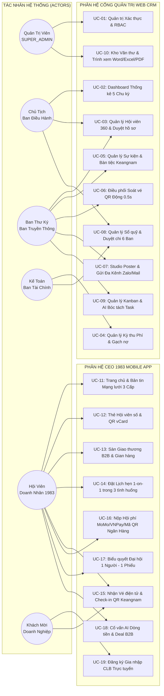

---

# PHẦN II: SƠ ĐỒ USE CASE & ĐẶC TẢ CHI TIẾT CỔNG QUẢN TRỊ WEB CRM (KÈM ẢNH THỰC TẾ & LUỒNG XỬ LÝ)

### 2.1. Sơ Đồ Use Case Phân Hệ Quản Trị Web CRM

```mermaid
flowchart TD
    subgraph CRM_Actors["Người Dùng CRM"]
        AdminRole["Quản Trị Viên / Ban Thư Ký / Kế Toán"]
    end

    subgraph CRM_Modules["Các Phân Hệ Nghiệp Vụ Cổng Web CRM"]
        UC_M1["Đăng nhập & Quản lý Phân quyền RBAC"]
        UC_M2["Xem Dashboard & Biểu đồ Recharts Điều Hành"]
        UC_M3["Quản lý 6 Ban Chuyên Môn & Nhân Sự"]
        UC_M4["Quản lý Danh sách Hội viên 360 & Xét duyệt Kết nạp"]
        UC_M5["Quản lý Sự kiện & Thiết lập Bàn tiệc VIP Keangnam"]
        UC_M6["Trình Soát vé QR Động 0.5 Giây Tại Cổng"]
        UC_M7["Điều hành Cuộc họp Ban & Điểm danh Jitsi"]
        UC_M8["Giao việc Kanban & AI Bóc tách Task từ Biên bản"]
        UC_M9["Quản lý Thu - Chi, Hoàn ứng & Sổ quỹ Hiệp hội"]
        UC_M10["Quản lý Kỳ thu Hội phí Niên khóa & Gạch nợ Tự động"]
        UC_M11["Studio Thiết kế Poster Pinterest & Gửi Zalo OA/Mail"]
        UC_M12["Kho Văn thư Số hóa & Trình xem Word/Excel/PDF"]
        UC_M13["Cấu hình Hệ thống & Xoay vòng Token Zalo OA 24/7"]
    end

    AdminRole --> UC_M1
    AdminRole --> UC_M2
    AdminRole --> UC_M3
    AdminRole --> UC_M4
    AdminRole --> UC_M5
    AdminRole --> UC_M6
    AdminRole --> UC_M7
    AdminRole --> UC_M8
    AdminRole --> UC_M9
    AdminRole --> UC_M10
    AdminRole --> UC_M11
    AdminRole --> UC_M12
    AdminRole --> UC_M13
```

---

### 2.2. Nghiệp Vụ Quản Trị Xác Thực, Tài Khoản & Phân Quyền RBAC 5 Cấp

#### 1. Mô tả nghiệp vụ
Đảm bảo an toàn thông tin tối cao cho Cổng Quản trị CRM. Mọi người dùng đăng nhập bằng tên định danh (Username) hoặc Email chính thức kết hợp mật khẩu mã hóa một chiều. Hệ thống tự động phân loại quyền hạn thành 5 cấp độ và hiển thị đúng các chức năng được phép tác nghiệp trên Sidebar.

#### 2. Ảnh chụp màn hình thực tế

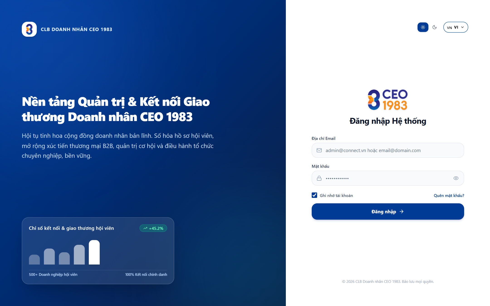
*Hình 2.2.1: Màn hình Đăng nhập Quản trị viên CRM - Hệ nhận diện Xanh Navy & Vàng Gold sang trọng*

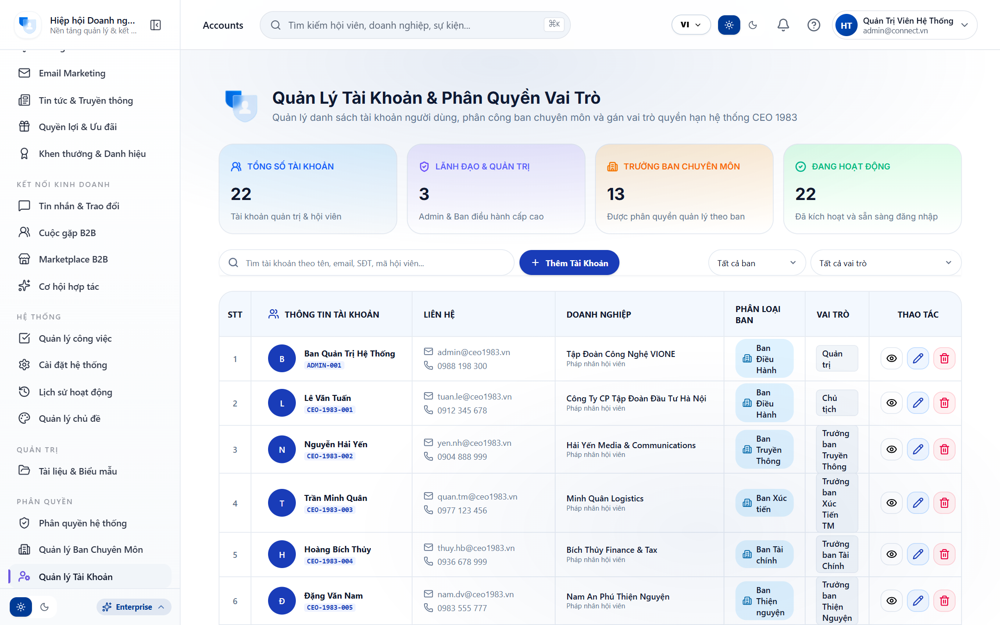
*Hình 2.2.2: Danh sách tài khoản quản trị viên và trạng thái kích hoạt trên Cổng Web CRM*

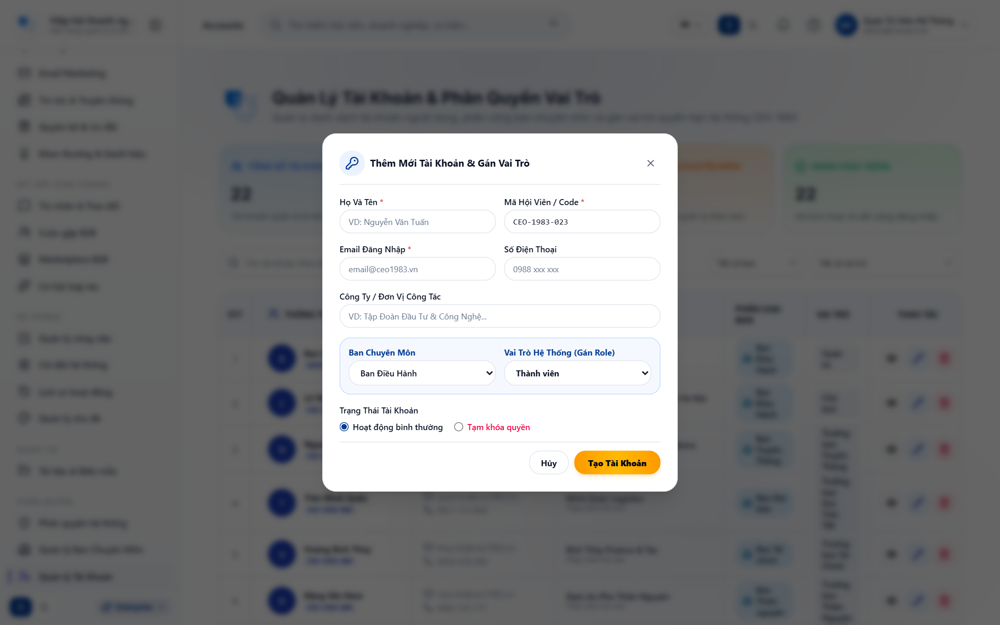
*Hình 2.2.3: Giao diện tạo mới tài khoản quản trị và gán vai trò RBAC*

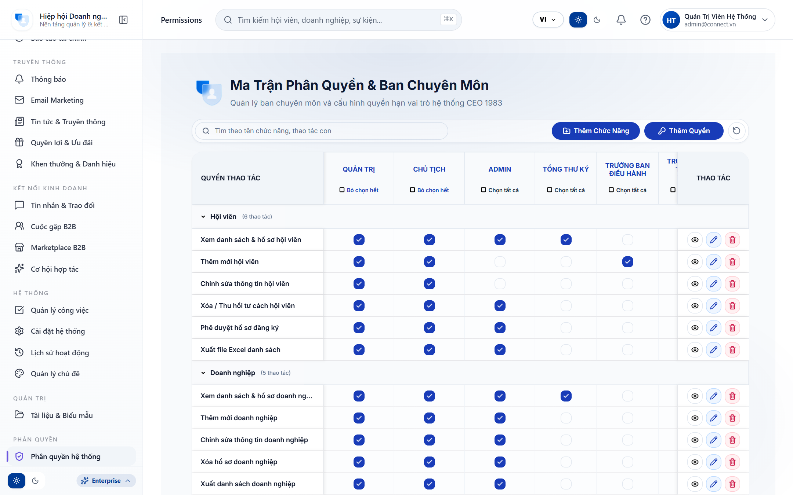
*Hình 2.2.4: Bảng ma trận phân quyền chi tiết từng chức năng cho 5 cấp độ vai trò*

#### 3. Luồng xử lý chi tiết (Flow of Events)
* **Điều kiện tiên quyết:** Người dùng có tài khoản quản trị được kích hoạt trạng thái `ACTIVE`.
* **Luồng chính (Main Flow):**
  1. Người dùng truy cập đường dẫn Cổng Quản trị CRM (`/admin/login`).
  2. Nhập Tên đăng nhập / Email và Mật khẩu -> Bấm nút **"Đăng Nhập Quản Trị"**.
  3. Hệ thống gửi request `POST /api/auth/login` tới Backend NestJS.
  4. Backend kiểm tra tài khoản, xác thực mật khẩu bằng thuật toán Argon2id / bcrypt.
  5. Nếu chính xác: Hệ thống sinh cặp `access_token` (24h) và `refresh_token` (30 ngày), trích xuất vai trò (`role`) và danh sách quyền (`permissions`).
  6. Frontend lưu token an toàn, hiển thị thông báo "Đăng nhập thành công" và điều hướng vào trang Dashboard (`/dashboard`).
  7. Menu Sidebar tự động hiển thị các mục tính năng tương ứng với quyền hạn của vai trò.
* **Luồng ngoại lệ (Exception Flow):**
  - Nhập sai mật khẩu: Báo lỗi "Tài khoản hoặc mật khẩu không chính xác". Nếu sai quá 5 lần liên tiếp, tài khoản bị tạm khóa 15 phút.
  - Người dùng truy cập URL trái quyền: Hệ thống hiển thị trang cảnh báo `403 Forbidden` và tự động ghi nhật ký vào `audit_logs`.

---

### 2.3. Nghiệp Vụ Dashboard Điều Hành Tổng Quan & Trực Quan Hóa Chỉ Số

#### 1. Mô tả nghiệp vụ
Cung cấp cho Chủ tịch và Ban Lãnh Đạo góc nhìn toàn cảnh thời gian thực (Real-time Executive Dashboard) về toàn bộ hoạt động của CLB Doanh Nhân CEO 1983: Tổng số hội viên, tỷ lệ nộp hội phí, số dư tồn quỹ thực tế, giá trị giao thương B2B tích lũy và tiến độ các sự kiện sắp diễn ra.

#### 2. Ảnh chụp màn hình thực tế

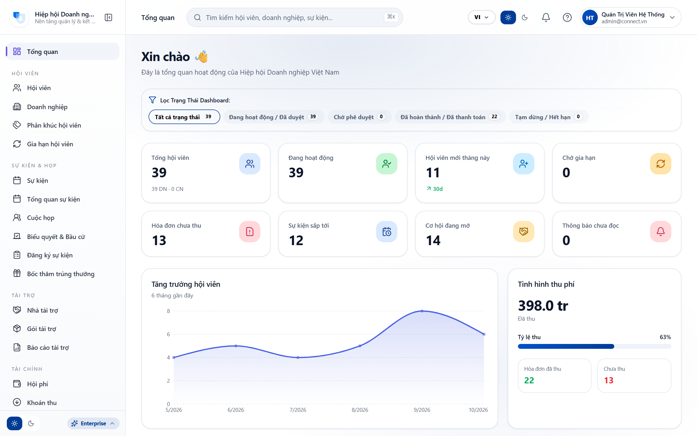
*Hình 2.3.1: Giao diện Dashboard Điều hành Trung tâm - Số liệu thời gian thực & Biểu đồ tài chính*

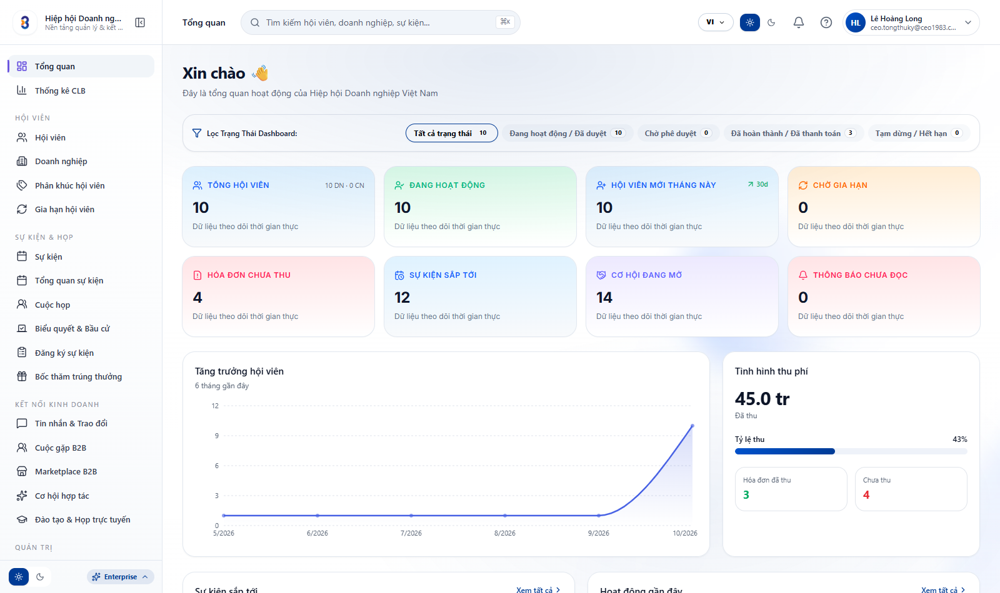
*Hình 2.3.2: Khung chỉ số điều hành trực quan (Hội viên, Doanh thu, Tỷ lệ nộp phí, Tồn quỹ thực tế)*


*Hình 2.3.3: Biểu đồ cơ cấu thu chi và tăng trưởng dòng tiền thích ứng hoàn hảo Dark / Light theme*

#### 3. Luồng xử lý chi tiết (Flow of Events)
* **Luồng chính:**
  1. Người dùng đăng nhập thành công, hệ thống tự động tải dữ liệu Dashboard từ API `GET /api/admin/dashboard/stats`.
  2. Bốn thẻ chỉ số hàng đầu hiển thị: (1) Tổng số hội viên chính thức, (2) Doanh thu hội phí niên khóa 2026, (3) Tổng chi tiêu hoạt động 6 Ban, (4) Số dư tồn quỹ an toàn.
  3. Người dùng chọn chu kỳ phân tích trên thanh lọc nhanh: `Tuần này`, `Tháng này`, `Quý 1/2026`, `Năm 2026`.
  4. Toàn bộ biểu đồ Recharts (Biểu đồ miền AreaChart tăng trưởng quỹ, Biểu đồ tròn PieChart cơ cấu chi 6 Ban) lập tức tái render mượt mà trong < 100ms.
  5. Khi rê chuột vào cột biểu đồ, Tooltip hiển thị nền trắng thanh lịch (Light Mode) hoặc nền đen mờ sang trọng (Dark Mode) kèm đầy đủ số tiền và chú thích, triệt tiêu hoàn toàn lỗi hiển thị chữ tối trên nền tối.

---

### 2.4. Nghiệp Vụ Quản Lý 6 Ban Chuyên Môn & Phân Bổ Thành Viên

#### 1. Mô tả nghiệp vụ
Quản lý cơ cấu tổ chức 6 Ban chuyên môn của CLB: Ban Kết Nối Giao Thương, Ban Truyền Thông & Sự Kiện, Ban Phát Triển Hội Viên, Ban Thể Thao & Đời Sống, Ban Tài Chính & Pháp Lý, Ban Đào Tạo & Chuyển Đổi Số. Cho phép phân bổ Trưởng/Phó Ban, giám sát danh sách thành viên trực thuộc và cấp hạn mức ngân sách hoạt động độc lập cho từng Ban.

#### 2. Ảnh chụp màn hình thực tế

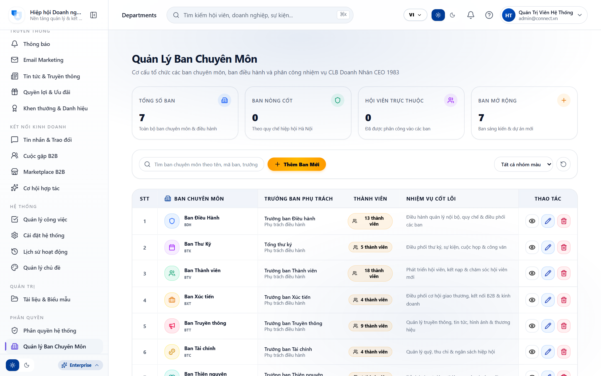
*Hình 2.4.1: Danh sách 6 Ban Chuyên Môn, Trưởng Ban đại diện và số lượng hội viên trực thuộc*

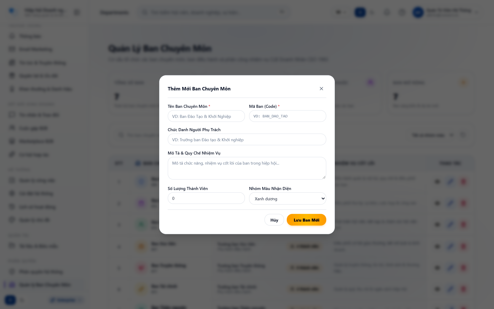
*Hình 2.4.2: Giao diện cấu hình Ban chuyên môn, chỉ định Trưởng Ban và thiết lập ngân sách năm*

#### 3. Luồng xử lý chi tiết
* Ban Thư ký chọn Ban chuyên môn -> Xem toàn bộ danh sách hội viên sinh hoạt trong Ban.
* Cho phép chuyển sinh hoạt Ban cho hội viên khi có nguyện vọng phù hợp với định hướng kinh doanh.
* Cấu hình hạn mức chi tiêu quý cho Ban: Kế toán cấp hạn mức (VD: 50.000.000 VNĐ/quý cho Ban Thể Thao tổ chức giải Golf). Khi Ban đề xuất chi vượt hạn mức, hệ thống tự động cảnh báo vàng và yêu cầu phê duyệt từ Chủ tịch.

---

### 2.5. Nghiệp Vụ Quản Lý Hồ Sơ Hội Viên 360 Độ & Xét Duyệt Kết Nạp Mới

#### 1. Mô tả nghiệp vụ
Quản trị toàn diện vòng đời hội viên từ lúc tiếp nhận đơn đăng ký trực tuyến, phân công thẩm định năng lực pháp nhân doanh nghiệp, trình phê duyệt kết nạp, cấp mã hội viên số tự động đến quản lý danh bạ 360 độ và vinh danh hội viên tích cực.

#### 2. Ảnh chụp màn hình thực tế

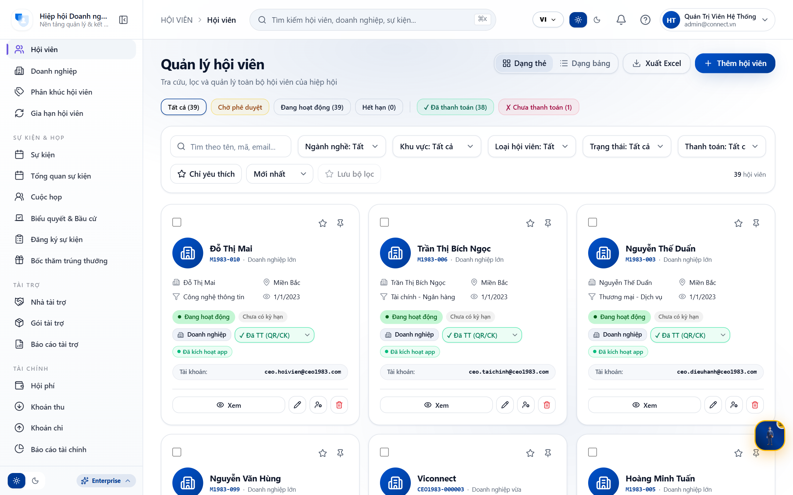
*Hình 2.5.1: Giao diện Quản trị Hội viên dạng Bảng tính Excel thông minh - Lọc đa chiều theo Ban và trạng thái phí*

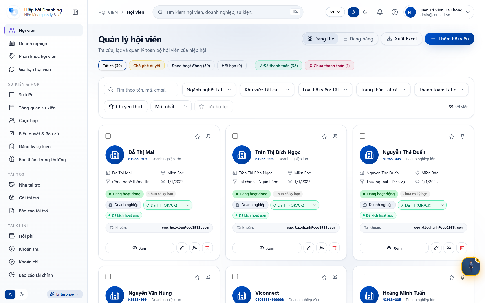
*Hình 2.5.2: Modal thẩm định chi tiết: Kiểm tra CCCD, Giấy phép ĐKKD, Doanh nghiệp và phê duyệt 1-click*

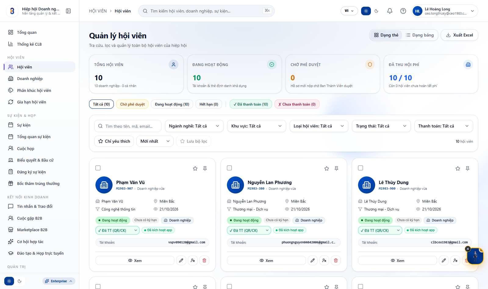
*Hình 2.5.3: Bảng danh sách hội viên chính thức đang hoạt động trên hệ thống CRM*

#### 3. Luồng xử lý chi tiết (Flow of Events)
* **Luồng chính:**
  1. Ban Thư ký vào tab **"Chờ xét duyệt"** trên màn hình Hội viên (`/members`).
  2. Bấm vào hồ sơ một ứng viên mới nộp đơn từ Mobile App -> Hệ thống mở modal thẩm định chi tiết.
  3. Thư ký kiểm tra các tiêu chí bắt buộc: (1) Năm sinh chuẩn 1983, (2) Có tư cách pháp nhân người đại diện pháp luật hoặc chủ sở hữu doanh nghiệp, (3) Có giấy phép ĐKKD rõ nét, (4) Không trùng lặp mã số thuế với hội viên hiện hữu.
  4. Thư ký chọn Ban chuyên môn phân bổ (VD: "Ban Kết Nối Giao Thương") -> Bấm **"Xác nhận Thẩm định Đủ Điều Kiện"**.
  5. Chủ tịch CLB đăng nhập CRM, bấm **"Phê duyệt kết nạp chính thức"**.
  6. Hệ thống kích hoạt giao dịch CSDL: (a) Đổi trạng thái hội viên sang `ACTIVE`, (b) Tự động sinh mã hội viên tuần tự (VD: `CEO1983-088`), (c) Kích hoạt thẻ hội viên số và danh thiếp vCard QR, (d) Tạo hóa đơn hội phí niên khóa đầu tiên, (e) Gửi email chúc mừng và thông báo Zalo OA đến số điện thoại tân hội viên.
* **Luồng thay thế:**
  - Nếu thiếu hồ sơ: Thư ký bấm **"Yêu cầu bổ sung"** -> Nhập ghi chú (VD: "Vui lòng chụp lại ảnh ĐKKD mặt sau") -> Ứng viên nhận được thông báo đẩy trên Mobile App để bổ sung.

---

### 2.6. Nghiệp Vụ Quản Lý Sự Kiện Gala & Sơ Đồ Bàn Tiệc VIP Keangnam

#### 1. Mô tả nghiệp vụ
Số hóa toàn bộ quy trình tổ chức sự kiện đỉnh cao của hiệp hội (Gala kỷ niệm, Diễn đàn kinh tế, Lễ vinh danh Doanh nhân). Điểm đột phá là phân hệ quản trị **Sơ Đồ Bàn Tiệc VIP Khán Phòng Keangnam Landmark72** (10 ghế/bàn) cho phép phân bổ chỗ ngồi cho từng khách mời VIP và đại biểu danh dự.

#### 2. Ảnh chụp màn hình thực tế

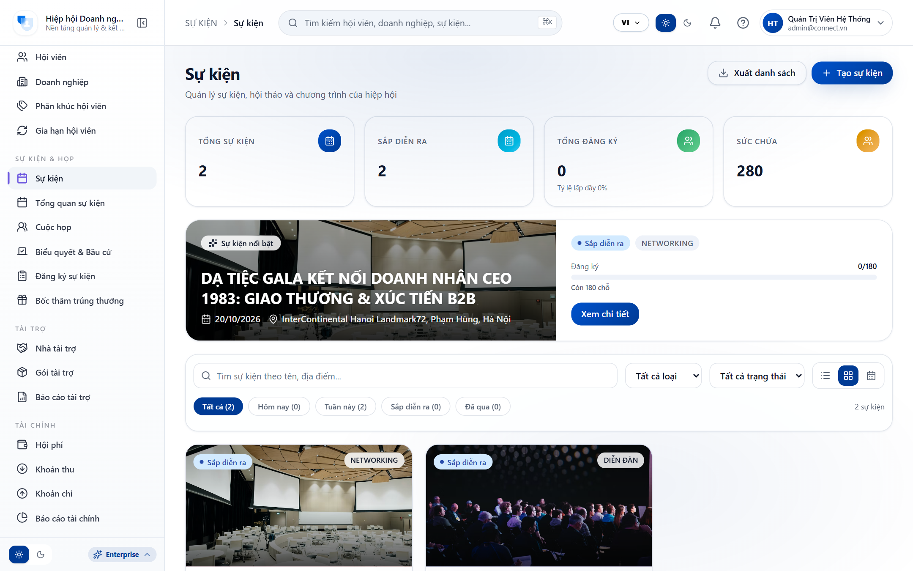
*Hình 2.6.1: Danh mục Sự kiện Gala, Hội thảo chuyên đề và số lượng vé đã phát hành*

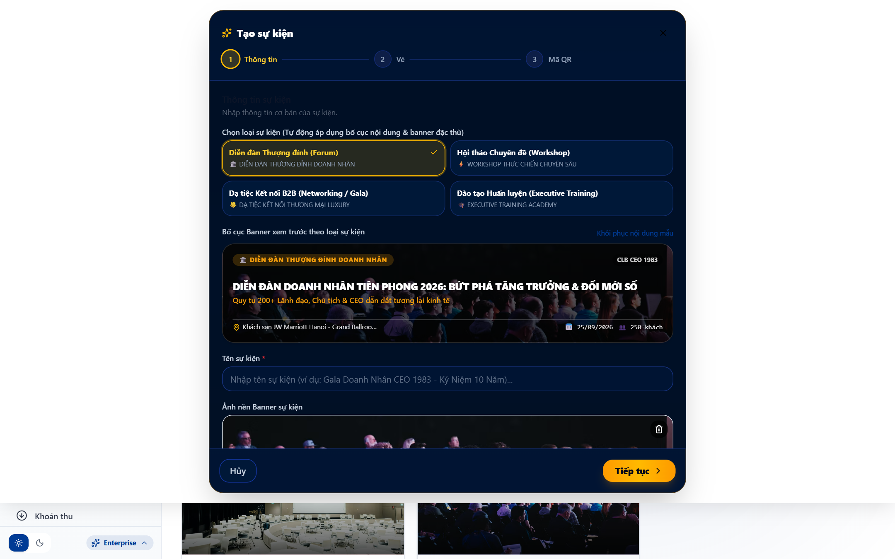
*Hình 2.6.2: Trình tạo sự kiện chuyên nghiệp 3 bước: Thông tin chung -> Cơ cấu Hạng vé -> Cấu hình Bàn tiệc*

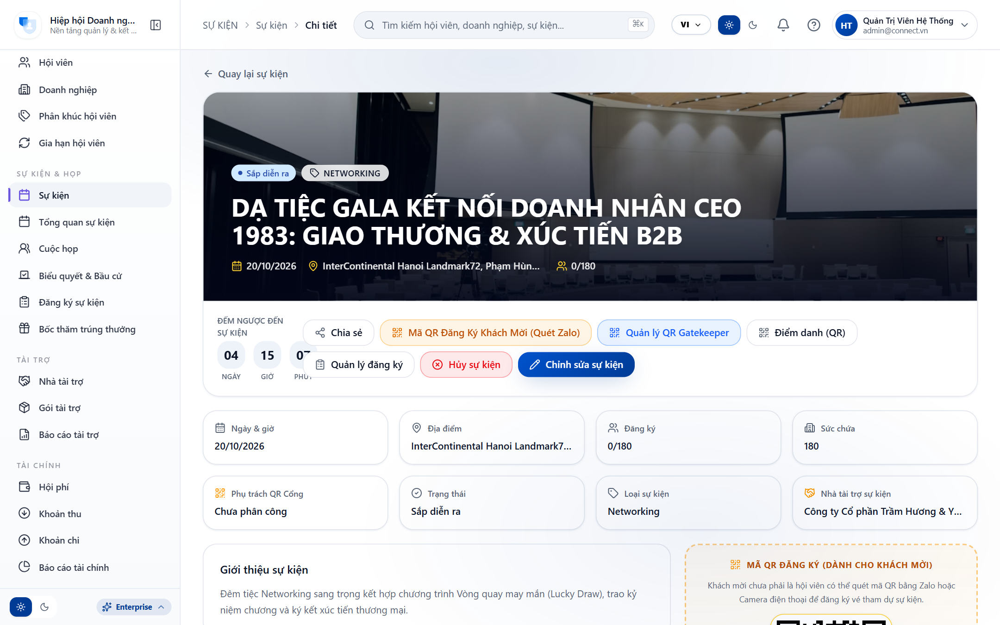
*Hình 2.6.3: Sơ đồ Khán phòng Keangnam Landmark72 - Quản lý Bàn VIP 01, VIP 02 và phân bổ chỗ ngồi đại biểu*

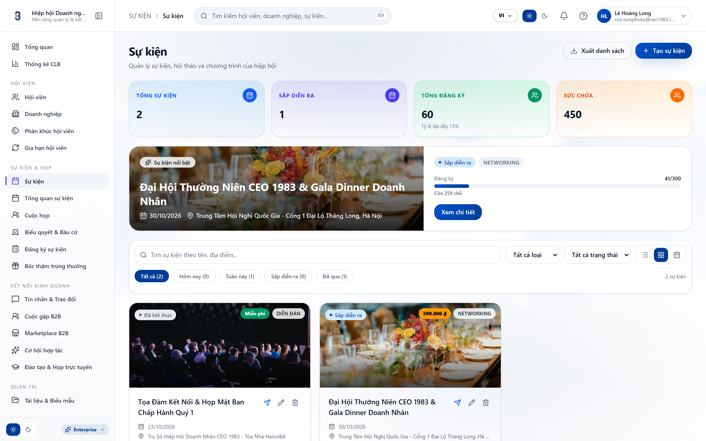
*Hình 2.6.4: Chi tiết chiến dịch sự kiện và tiến độ bán vé, đăng ký tham dự thời gian thực*

#### 3. Luồng xử lý chi tiết
* Thư ký tạo sự kiện: Nhập tên sự kiện, ngày giờ, địa điểm (Khách sạn InterContinental Hanoi Landmark72).
* Cấu hình cơ cấu hạng vé: Vé Hội Viên (Miễn phí), Vé Khách Mời (1.500.000 VNĐ), Vé VIP Đồng Hành (5.000.000 VNĐ).
* Cấu hình danh sách bàn tiệc: Bàn VIP 01 (Dành cho Lãnh đạo HanoiBA và Chủ tịch), Bàn VIP 02 (Ban Thường Trực), Bàn Ban Kết Nối, Bàn Ban Tài Chính...
* Gán chỗ ngồi: Thư ký chọn đại biểu VIP -> Chọn "Gán vào Bàn VIP 01 - Ghế 05". Thông tin số bàn tiệc lập tức được nhúng vào vé điện tử trên app của khách mời.

---

### 2.7. Nghiệp Vụ Điều Phối Soát Vé Check-in QR Động 0.5 Giây & Vòng Quay May Mắn

#### 1. Mô tả nghiệp vụ
Giải quyết dứt điểm vấn đề ùn tắc hàng trăm khách mời trước giờ khai mạc sự kiện. Hệ thống soát vé hỗ trợ camera máy tính, tablet hoặc máy quét chuyên dụng, quét mã QR Động xoay vòng và xác thực hợp lệ trong thời gian **dưới 0.5 giây**. Tích hợp Vòng Quay May Mắn (Lucky Draw) cho phần tiệc tối Gala.

#### 2. Ảnh chụp màn hình thực tế

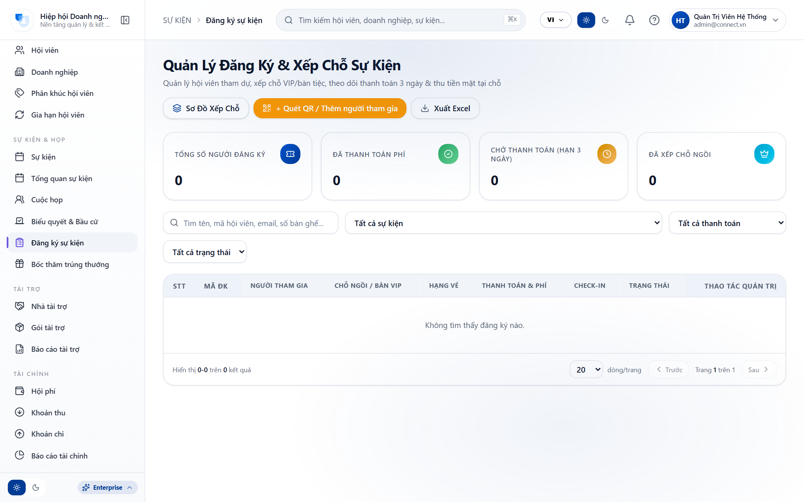
*Hình 2.7.1: Màn hình Soát vé Check-in QR thời gian thực - Tốc độ nhận diện < 0.5 giây kèm vị trí Bàn tiệc*

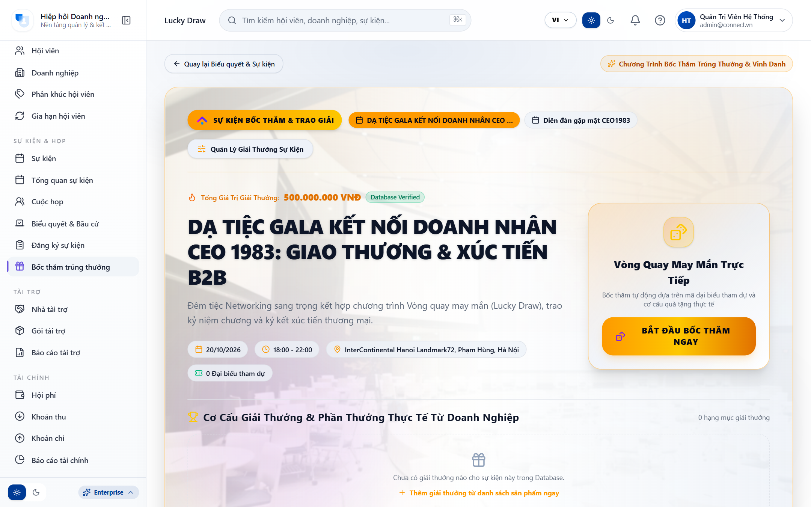
*Hình 2.7.2: Phân hệ Vòng Quay May Mắn Gala - Tự động lọc danh sách đại biểu ĐÃ CHECK-IN để quay thưởng*

#### 3. Luồng xử lý chi tiết
* **Tại bàn đón tiếp lễ tân:**
  1. Lễ tân bật camera soát vé trên CRM (`/events/:id/checkin`).
  2. Khách đưa màn hình điện thoại có vé QR động trước camera.
  3. Hệ thống giải mã chuỗi hash HMAC-SHA256 trong vòng 350ms:
     - **Hợp lệ:** Màn hình lóe sáng viền xanh lá, âm thanh "Ting" du dương vang lên, hiển thị to rõ: *"Chào mừng Anh/Chị: NGUYỄN VĂN A - VỊ TRÍ: BÀN VIP 01 - GHẾ SỐ 04"*. Số lượng khách đã check-in tự động nhảy số trên màn hình LED đón tiếp.
     - **Đã quét trước đó:** Màn hình viền đỏ rực, âm thanh cảnh báo "Tít tít": *"CẢNH BÁO: Vé này đã được check-in vào lúc 18:15 bởi Lễ tân số 01!"*, ngăn chặn hành vi chụp ảnh màn hình chuyển cho người khác vào cửa gian lận.
* **Tại tiệc Gala quay thưởng:**
  - Hệ thống tự động trích xuất danh sách các mã vé có trạng thái `CHECKED_IN = true`, đưa vào thuật toán quay ngẫu nhiên công bằng, minh bạch trên màn hình chiếu LED sân khấu.

---

### 2.8. Nghiệp Vụ Điều Hành Cuộc Họp Ban (Cố Định vs Bất Thường) & Phòng Họp Jitsi

#### 1. Mô tả nghiệp vụ
Phân định rõ ràng giữa hai hình thức họp của Hiệp hội: (1) **Cuộc họp định kỳ cố định** (Thứ 4 tuần đầu tháng của từng Ban chuyên môn) và (2) **Cuộc họp bất thường** do Chủ tịch hoặc Ban Điều Hành triệu tập đột xuất. Tích hợp phòng họp trực tuyến Jitsi Meet bảo mật nội bộ và đặt phòng họp trực tiếp tại văn phòng CLB.

#### 2. Ảnh chụp màn hình thực tế

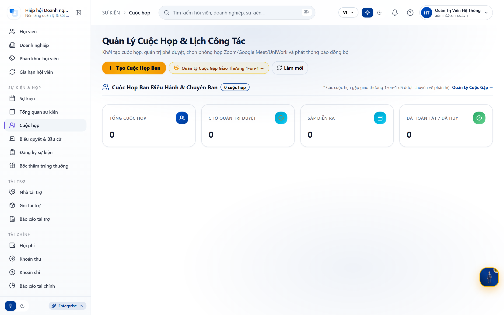
*Hình 2.8.1: Lịch điều hành cuộc họp trực quan theo tuần/tháng - Phân loại Họp Cố Định vs Họp Bất Thường*

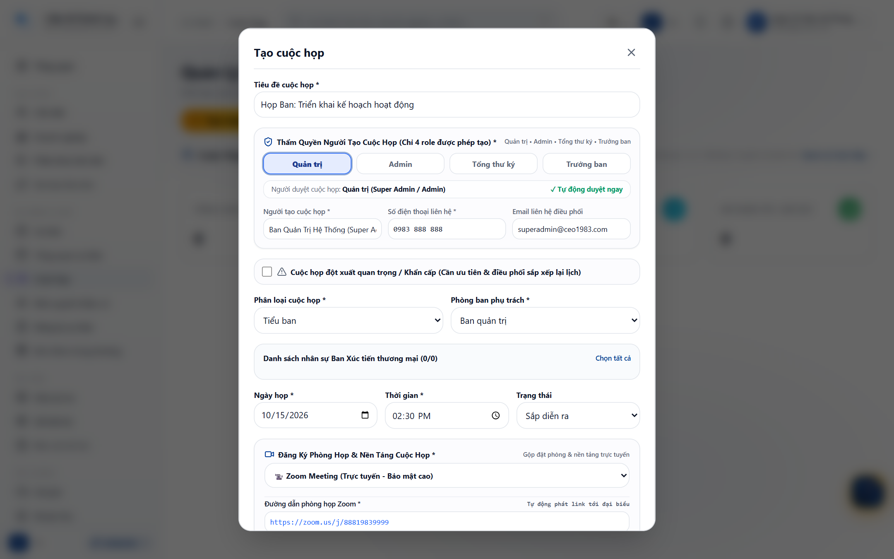
*Hình 2.8.2: Giao diện tạo lịch họp mới, đặt phòng họp thể chất hoặc sinh phòng họp Jitsi Meet tự động*

#### 3. Luồng xử lý chi tiết
* Khi tạo cuộc họp: Thư ký chọn loại hình (Cố định theo Ban / Bất thường) -> Chọn thời gian, thành phần tham gia (Toàn bộ Ban Điều Hành hoặc Danh sách hội viên chỉ định) -> Nhập tài liệu nghị sự đính kèm.
* Nếu là họp trực tuyến: Hệ thống tự động tạo mã phòng Jitsi Meet bảo mật kèm mật khẩu truy cập nội bộ.
* Tự động gửi thông báo nhắc lịch họp qua Zalo ZNS và Push App trước giờ họp 24h và trước 1h kèm đường dẫn tham gia trực tiếp 1-chạm.

---

### 2.9. Nghiệp Vụ Giao Việc Kanban & AI Gemini Bóc Tách Task Từ Biên Bản Họp

#### 1. Mô tả nghiệp vụ
Giải quyết triệt để tình trạng "họp xong để đấy". Hệ thống chuyển đổi toàn bộ nghị quyết cuộc họp thành các thẻ công việc trực quan trên Bảng Kanban 4 cột (Cần làm -> Đang làm -> Chờ duyệt -> Hoàn thành). Kéo thả tự động cập nhật trạng thái CSDL. Tích hợp AI Google Gemini 2.0/2.5 Flash đọc hiểu file Word/Excel biên bản họp để tự động chia task cho nhân sự phù hợp.

#### 2. Ảnh chụp màn hình thực tế

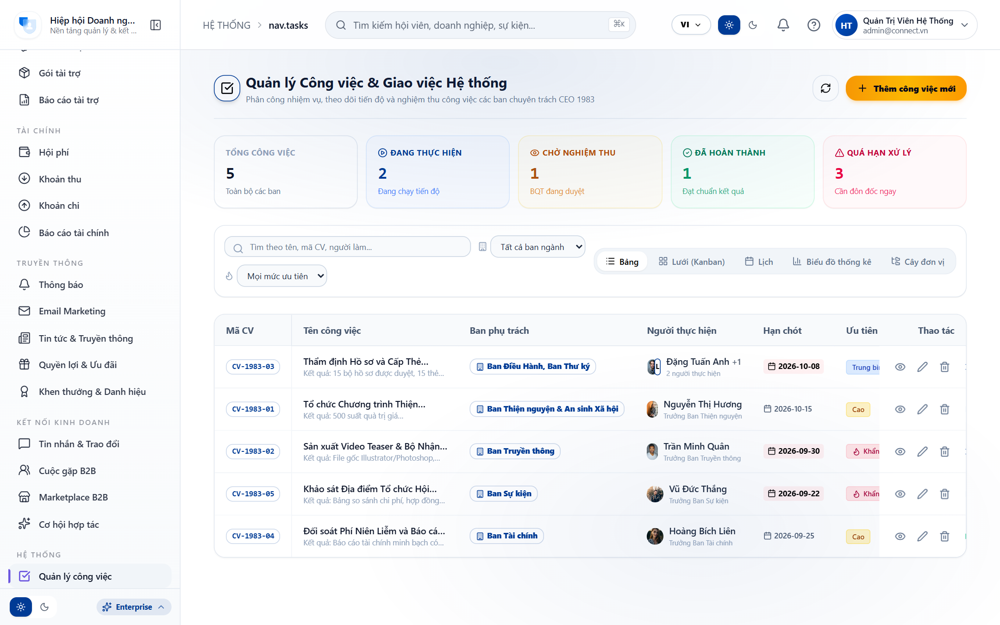
*Hình 2.9.1: Bảng Kanban Quản trị Nhiệm vụ - Kéo thả trực quan & Giám sát tiến độ từng Ban chuyên môn*

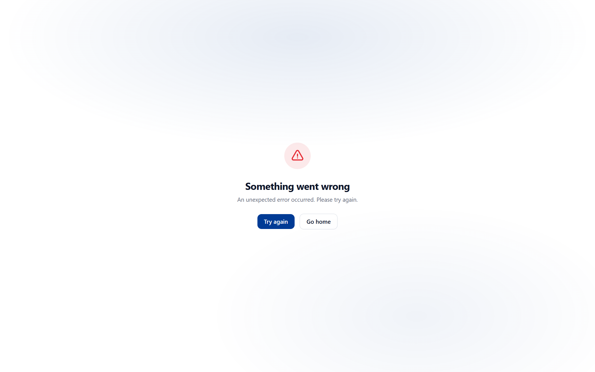
*Hình 2.9.2: Giao diện giao việc mới và công cụ bóc tách nhiệm vụ tự động bằng Trí tuệ Nhân tạo Gemini AI*


*Hình 2.9.3: Bảng tiến độ công việc Kanban thực tế đang vận hành của Ban Điều Hành CLB CEO 1983*

#### 3. Luồng xử lý chi tiết (Flow of Events)
* **Luồng Tự động bóc tách Task bằng AI (AI Smart Task Parsing):**
  1. Ban Thư ký hoàn thành tệp Word (`.docx`) hoặc Excel (`.xlsx`) "Biên Bản Họp Ban Chấp Hành".
  2. Bấm nút **"Bóc Tách Task Bằng AI"** trên bảng Kanban (`/tasks/kanban`).
  3. Chọn tệp biên bản tải lên hệ thống.
  4. Backend chuyển nội dung văn bản tới Google Gemini 2.0 Flash AI.
  5. AI tự động đọc hiểu toàn bộ nội dung, trích xuất: Tiêu đề công việc, Mô tả chi tiết, Ban chuyên môn phụ trách, Hạn hoàn thành đề xuất (Deadline) và mức độ ưu tiên.
  6. AI gọi API danh sách nhân sự của Ban được chọn để tự động khớp tên người thực hiện phù hợp nhất.
  7. Danh sách task dự kiến hiển thị trên giao diện kiểm duyệt. Thư ký bấm **"Duyệt & Tạo Task Hàng Loạt"**. Toàn bộ nhiệm vụ xuất hiện tại cột "Cần làm" và gửi thông báo nhắc việc tới từng hội viên được giao.
* **Luồng Kéo Thả (Drag-and-Drop) Tự Động:**
  - Khi người dùng kéo thẻ task thả vào cột "Đã hoàn thành": Hệ thống lập tức gọi API `PATCH /tasks/:id` đổi trạng thái thành `COMPLETED`, ghi nhận thời gian hoàn thành thực tế và gửi thông báo chúc mừng cho người thực hiện.

---

### 2.10. Nghiệp Vụ Quản Lý Sổ Quỹ Thu - Chi, Hoàn Ứng 6 Ban & Recharts Thích Ứng Theme

#### 1. Mô tả nghiệp vụ
Bảo đảm tính minh bạch tuyệt đối 100% trong thu chi tài chính hiệp hội. Mọi khoản thu (Hội phí, Vé sự kiện, Tài trợ, Đấu giá) và khoản chi (Sự kiện, Tiếp khách, Quà tặng, Hoàn ứng ngân sách 6 Ban) đều được ghi nhận có chứng từ hóa đơn đính kèm. Tự động đối soát tồn quỹ thực tế với sao kê tài khoản ngân hàng. Biểu đồ Recharts tự động thích ứng theme Dark/Light.

#### 2. Ảnh chụp màn hình thực tế

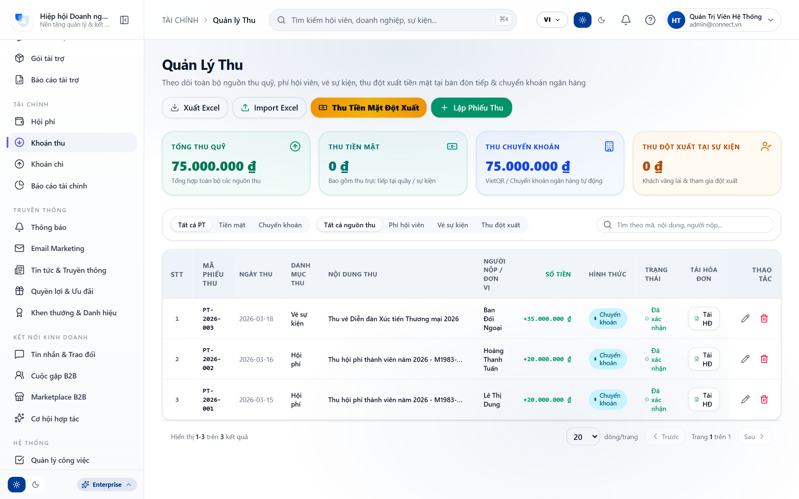
*Hình 2.10.1: Sổ Quỹ Thu - Chi Hiệp Hội: Quản lý dòng tiền vào/ra, hoàn ứng và số dư tồn quỹ an toàn*

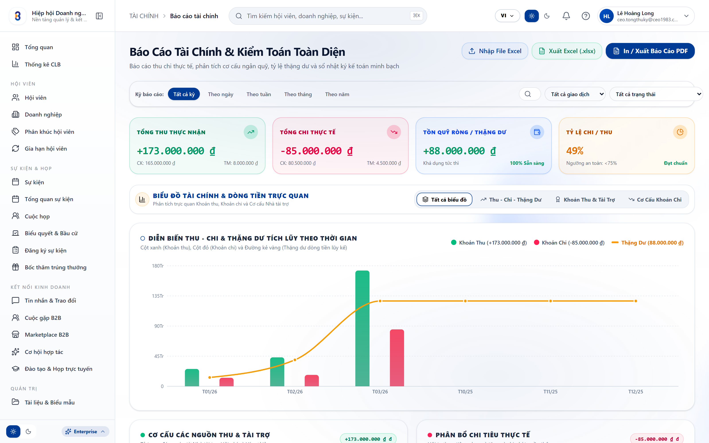
*Hình 2.10.2: Báo cáo tài chính phân tích doanh thu, chi phí theo từng Ban chuyên môn và xuất file Excel*

#### 3. Luồng xử lý chi tiết
* **Quy trình Duyệt Chi & Hoàn Ứng Ngân Sách:**
  1. Trưởng Ban chuyên môn lập phiếu đề xuất chi tiêu (VD: Ban Thể Thao đề xuất tạm ứng 15.000.000 VNĐ mua cúp giải bóng đá).
  2. Kế toán kiểm tra hạn mức ngân sách còn lại của Ban Thể Thao -> Bấm "Xác nhận hợp lệ, trình Chủ tịch".
  3. Chủ tịch CLB duyệt chi trên CRM -> Kế toán thực hiện chuyển khoản từ tài khoản hiệp hội và đính kèm ủy nhiệm chi.
  4. Sau khi sự kiện kết thúc, trong vòng 07 ngày, Trưởng ban phải tải lên toàn bộ hóa đơn đỏ VAT/chứng từ để Kế toán bấm **"Hoàn Ứng Quyết Toán"**.
* **Đặc tả Biểu đồ Recharts Thích Ứng Theme (Fix Triệt Để Lỗi Chữ Tối Nền Tối):**
  - Hệ thống tự động bắt trạng thái `theme === 'dark'`: Tooltip chuyển nền đen `rgba(15, 23, 42, 0.95)`, viền vàng Gold `#D4AF37`, chữ trắng rõ nét. Khi ở `theme === 'light'`, Tooltip chuyển nền trắng tinh khiết, viền xám nhạt, chữ đen đậm, đọc rõ ràng mọi chỉ số tài chính.

---

### 2.11. Nghiệp Vụ Quản Lý Kỳ Thu Hội Phí Thường Niên & Gạch Nợ Mã QR Ngân Hàng / MoMo

#### 1. Mô tả nghiệp vụ
Tự động hóa hoàn toàn quy trình thu hội phí niên khóa. Ban Tài chính thiết lập kỳ thu, hệ thống phát hành hóa đơn tự động cho 500+ hội viên trong 3 giây. Tích hợp mã QR ngân hàng Động theo chuẩn Napas247; tiền về tài khoản là hệ thống tự động gạch nợ `PAID` và phát hành biên lai ngay lập tức.

#### 2. Ảnh chụp màn hình thực tế

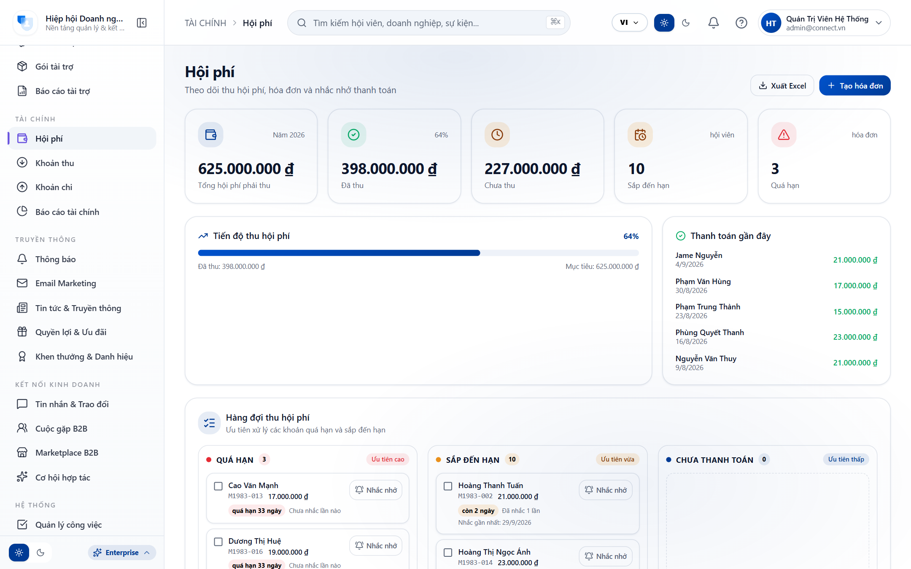
*Hình 2.11.1: Quản lý Kỳ thu Hội phí Niên khóa - Thống kê công nợ, tỷ lệ đã nộp và danh sách quá hạn*


*Hình 2.11.2: Bảng theo dõi hóa đơn hội phí chi tiết từng hội viên, mã QR ngân hàng và trạng thái thanh toán*

#### 3. Luồng xử lý chi tiết (Flow of Events)
* **Luồng chính:**
  1. Kế toán bấm **"Phát hành Hóa đơn Niên khóa 2026"** -> Hệ thống duyệt toàn bộ hội viên `ACTIVE` và tạo 500 hóa đơn `invoices` trong CSDL với mã hóa đơn duy nhất `INV-2026-XXXX`.
  2. Hệ thống tự động phát lệnh gửi thông báo nộp phí đồng loạt qua Zalo ZNS và Email kèm mã QR ngân hàng động chứa chính xác số tiền (VD: 10.000.000 VNĐ) và cú pháp nội dung `CEO1983 [MÃ_HÓA_ĐƠN]`.
  3. Hội viên mở app ngân hàng bất kỳ, quét mã QR ngân hàng và xác nhận chuyển tiền.
  4. Webhook IPN từ cổng thanh toán/ngân hàng bắn tín hiệu về Backend NestJS kèm chữ ký số HMAC-SHA512.
  5. Backend xác thực chữ ký số -> Gạch nợ hóa đơn sang trạng thái `PAID` -> Thêm bản ghi vào `transactions` -> Gửi tin nhắn Zalo xác nhận biên lai điện tử -> Đổi huy hiệu trên Mobile App thành "Đã hoàn thành hội phí 2026" trong thời gian < 2 giây.

---

### 2.12. Nghiệp Vụ Studio Thiết Kế Poster Pinterest & Quản Lý Mẫu Trang

#### 1. Mô tả nghiệp vụ
Cung cấp Studio Đồ Họa Cao Cấp cho phép Ban Thư ký thiết kế poster thư mời sự kiện chuẩn tỷ lệ 9:16 Pinterest (Mẫu Gala Wyndham Thanh Thủy), bóc tách ảnh đại diện khách mời, làm mờ viền ảnh nghệ thuật (Feather/Vignette), xếp ảnh 3D và tự động bóc tách text ảnh AI khi tải mẫu lên. Gom toàn bộ trung tâm mẫu vào Menu Sidebar CRM (bỏ tab chọn ngang).

#### 2. Ảnh chụp màn hình thực tế

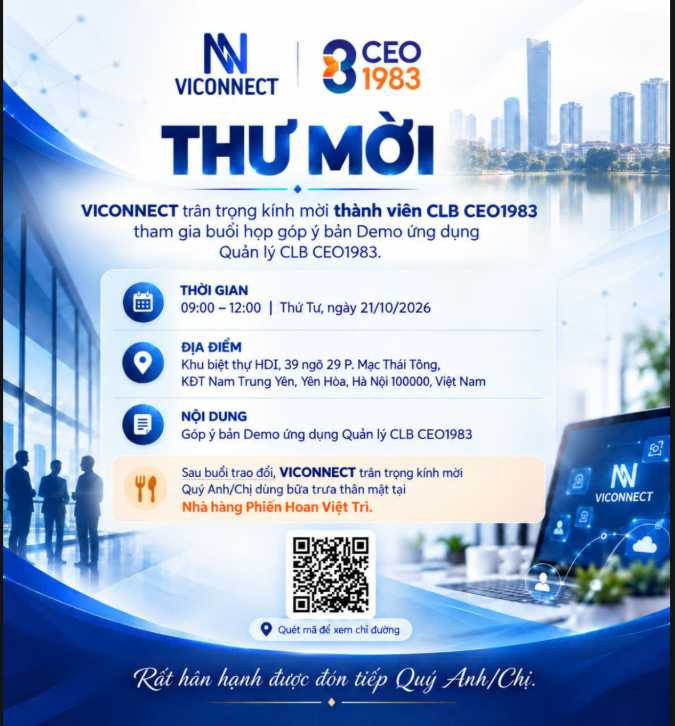
*Hình 2.12.1: Studio Thiết Kế Poster Thư Mời Gala Wyndham Thanh Thủy - Bóc tách ảnh khách mời & Hiệu ứng 3D*

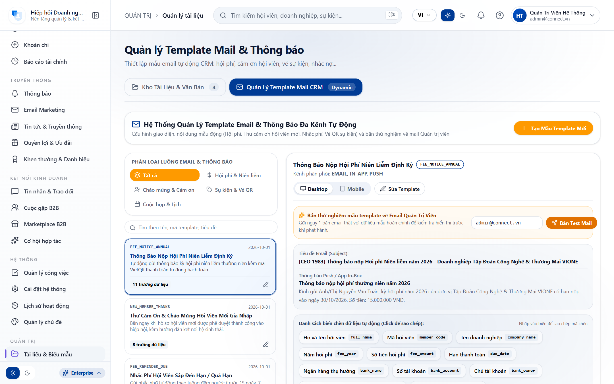
*Hình 2.12.2: Trung tâm Quản lý Mẫu Trang: Mẫu Email HTML v3, Mẫu Zalo ZNS, Mẫu Thông báo Mã QR Ngân Hàng*

#### 3. Luồng xử lý chi tiết
* Thư ký vào "Studio Thư Mời" trên Sidebar menu -> Chọn Mẫu Wyndham Thanh Thủy hoặc tải ảnh mẫu tùy ý lên.
* Chọn sự kiện -> Hệ thống tự động lấy danh sách đại biểu đã đăng ký, bóc tách ảnh chân dung, áp dụng bộ lọc mờ viền và gắn vào vị trí diễn giả/khách mời danh dự trên poster.
* Bấm **"Gửi Đa Kênh 1-Chạm"** -> Tích chọn [x] Zalo OA, [x] Email HTML, [x] Push App -> Hệ thống đưa vào hàng đợi gửi tự động cho toàn thể hội viên.

---

### 2.13. Nghiệp Vụ Kho Văn Thư Số Hóa & Trình Xem Tài Liệu Toàn Năng Word/Excel/PDF

#### 1. Mô tả nghiệp vụ
Lưu trữ toàn bộ điều lệ, nghị quyết, quy chế tài chính và biểu mẫu hành chính của CLB Doanh Nhân CEO 1983 và Hội Doanh Nghiệp Trẻ Hà Nội. Tích hợp Trình Xem Tài Liệu Toàn Năng (Universal Document Viewer) cho phép người dùng xem trực tiếp văn bản Word (`.docx`), Bảng tính Excel (`.xlsx`), Tệp trình chiếu (`.pptx`) và Tệp PDF ngay trong CRM mà không cần cài đặt phần mềm Microsoft Office.

#### 2. Ảnh chụp màn hình thực tế

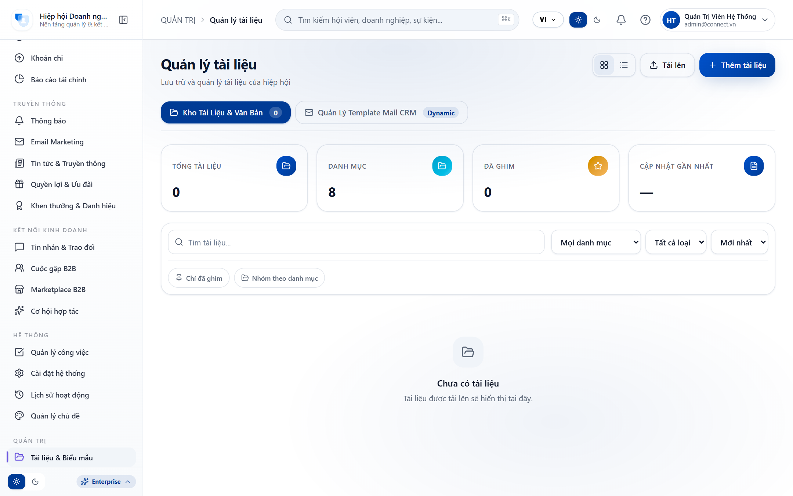
*Hình 2.13.1: Kho Văn Thư & Tài Liệu Hiệp Hội - Phân loại theo thư mục và Trình xem tài liệu toàn năng nội bộ*

#### 3. Luồng xử lý chi tiết
* Thư ký tải lên tài liệu: Hệ thống lưu file an toàn trên máy chủ, trích xuất metadata và lập chỉ mục tìm kiếm full-text search.
* Hội viên hoặc Ban Lãnh Đạo bấm xem: Trình xem nhúng hiển thị ngay lập tức văn bản với đầy đủ định dạng bảng biểu, hình ảnh và công thức toán học.

---

### 2.14. Nghiệp Vụ Tin Nhắn Mạng Lưới & Quản Trị Đối Tác Tài Trợ

#### 1. Mô tả nghiệp vụ
Kênh trao đổi thông tin thời gian thực giữa Ban Quản Trị và các doanh nghiệp tài trợ kim cương/vàng/bạc của hiệp hội. Giám sát hợp đồng tài trợ, quyền lợi vinh danh logo tại các sự kiện Gala Keangnam.

#### 2. Ảnh chụp màn hình thực tế

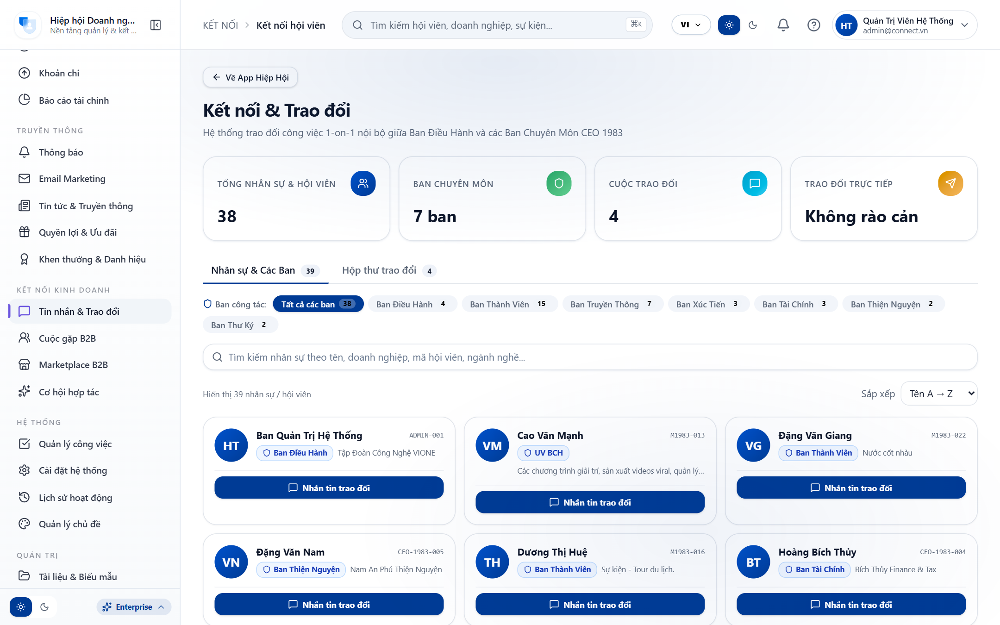
*Hình 2.14.1: Kênh tin nhắn trao đổi mạng lưới thời gian thực giữa Ban Điều Hành và Hội viên*

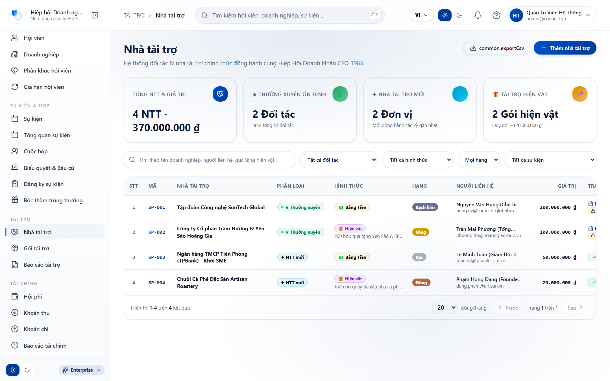
*Hình 2.14.2: Phân hệ Quản trị Gói Tài Trợ Gala - Quản lý quyền lợi vinh danh và tiến độ giải ngân*

---

### 2.15. Nghiệp Vụ Cài Đặt Hệ Thống Toàn Diện & Xoay Vòng Token Zalo OA 24/7

#### 1. Mô tả nghiệp vụ
Trung tâm cấu hình kỹ thuật toàn diện cho Cổng Web CRM: Cấu hình thông số máy chủ SMTP gửi mail, cấu hình danh mục tài khoản ngân hàng thụ hưởng Mã QR Ngân Hàng, thiết lập ngưỡng cảnh báo quá hạn công nợ và cơ chế **Tự Động Xoay Vòng Token Zalo OA 24/7/365** bảo đảm không bao giờ gián đoạn kênh thông báo ZNS.

#### 2. Ảnh chụp màn hình thực tế

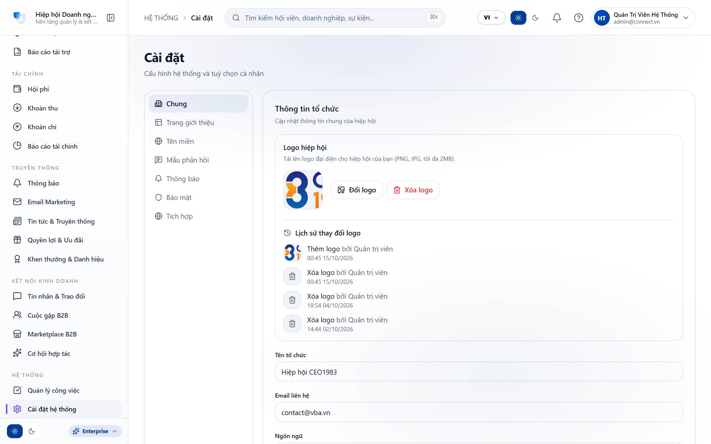
*Hình 2.15.1: Giao diện Cài Đặt Hệ Thống - Quản lý Zalo OA Token xoay vòng 24/7, SMTP Mail và Thông số Hội phí*

#### 3. Luồng xử lý chi tiết (Cơ chế Xoay Vòng Token Zalo 24/7)
* Dịch vụ `ZaloService` trên Backend NestJS chạy cron-job mỗi 6 giờ kiểm tra thời hạn `access_token` trong bảng `app_settings`.
* Nếu token còn hạn dưới 4 giờ: Hệ thống tự động dùng `refresh_token` gọi API Zalo OA để lấy cặp token mới và lưu đè vào CSDL.
* Đảm bảo kênh thông báo Zalo ZNS luôn trong trạng thái sẵn sàng phát tin 24/7/365.

---

# PHẦN III: SƠ ĐỒ USE CASE & ĐẶC TẢ CHI TIẾT PHÂN HỆ MOBILE APP HỘI VIÊN (KÈM ẢNH THỰC TẾ & LUỒNG XỬ LÝ)

### 3.1. Sơ Đồ Use Case Phân Hệ CEO 1983 Mobile App

```mermaid
flowchart TD
    subgraph App_Actors["Hội Viên Doanh Nhân"]
        MemberActor["Doanh Nhân Hội Viên CEO 1983"]
    end

    subgraph App_Modules["Các Tính Năng Trên CEO 1983 Mobile App"]
        UC_A1["Cài đặt App qua Launcher /open-app & Đăng ký"]
        UC_A2["Xem Trang Chủ, Tin Tức & Bản Tin Mạng Lưới 3 Cấp"]
        UC_A3["Trình Thẻ Hội Viên Số & Chia Sẻ QR vCard B2B"]
        UC_A4["Tra cứu Danh Bạ Doanh Nhân & Bản Đồ Số GPS"]
        UC_A5["Cập nhật Hồ Sơ Năng Lực Doanh Nghiệp 360"]
        UC_A6["Đăng ký Sự Kiện & Trình Vé QR Động Check-in Keangnam"]
        UC_A7["Sàn Giao Thương B2B, Đăng Tin Cơ Hội & Gian Hàng Ưu Đãi"]
        UC_A8["Đặt Lịch Hẹn Gặp Doanh Nhân 1-on-1 trong 3 Tình Huống"]
        UC_A9["Bình Chọn Biểu Quyết Đại Hội Số (1 Người - 1 Phiếu)"]
        UC_A10["Nộp Hội Phí Thường Niên Trực Tuyến Mã QR Ngân Hàng / MoMo / VNPay"]
        UC_A11["Cố Vấn Trí Tuệ Nhân Tạo AI Phân Tích Dòng Tiền & Deal B2B"]
        UC_A12["Tham gia Đào Tạo, Khóa Học & Workshop Chuyên Đề"]
    end

    MemberActor --> UC_A1
    MemberActor --> UC_A2
    MemberActor --> UC_A3
    MemberActor --> UC_A4
    MemberActor --> UC_A5
    MemberActor --> UC_A6
    MemberActor --> UC_A7
    MemberActor --> UC_A8
    MemberActor --> UC_A9
    MemberActor --> UC_A10
    MemberActor --> UC_A11
    MemberActor --> UC_A12
```

---

### 3.2. Nghiệp Vụ Cài Đặt Launcher `/open-app` & Đăng Ký / Đăng Nhập Hội Viên

#### 1. Mô tả nghiệp vụ
Tối ưu hóa hành trình tiếp cận ứng dụng của doanh nhân. Người dùng quét mã QR tại hội trường hoặc bấm vào liên kết `/open-app` trên điện thoại: Hệ thống tự động nhận diện thiết bị (iOS hay Android) để hướng dẫn thêm ứng dụng vào màn hình chính dạng PWA / Capacitor chỉ trong 5 giây mà không cần vào App Store tìm kiếm phức tạp. Hỗ trợ đăng ký gia nhập trực tuyến thuận tiện.

#### 2. Ảnh chụp màn hình thực tế

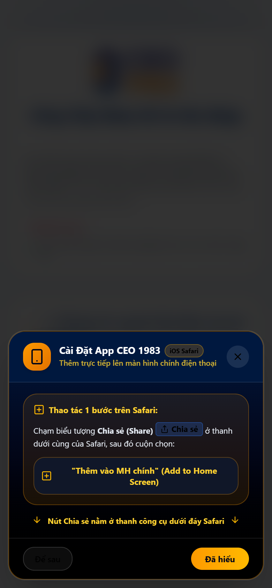
*Hình 3.2.1: Trang Launcher Thông Minh `/open-app` - Tự động nhận diện thiết bị & Hướng dẫn cài đặt 1-chạm*


*Hình 3.2.2: Giao diện Đăng ký Gia nhập CLB Doanh Nhân CEO 1983 trên thiết bị di động*

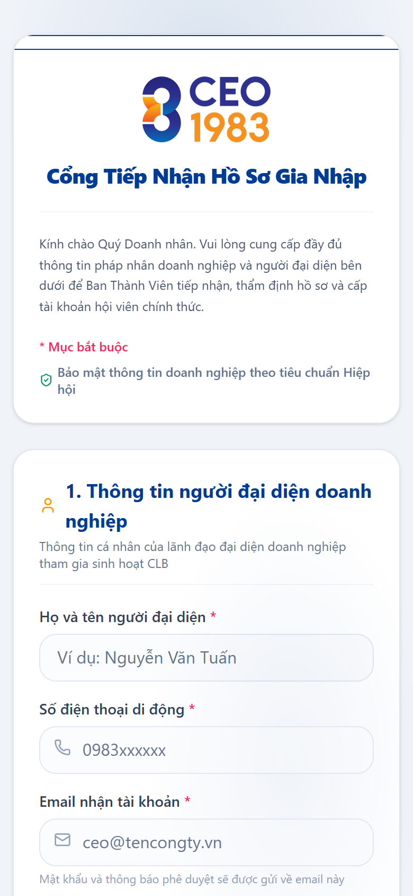
*Hình 3.2.3: Biểu mẫu kê khai pháp nhân doanh nghiệp, mã số thuế và lĩnh vực sản xuất kinh doanh*

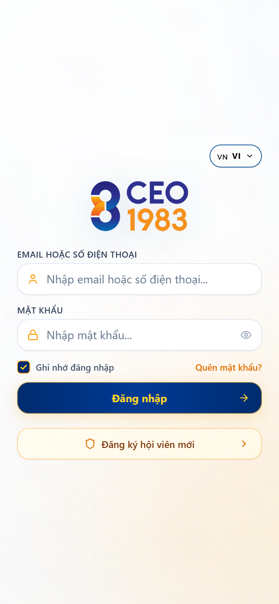
*Hình 3.2.4: Màn hình Đăng nhập Mobile App bằng Số điện thoại / Email và Mật khẩu bảo mật*

#### 3. Luồng xử lý chi tiết
* Doanh nhân mới mở app -> Bấm "Đăng ký gia nhập CLB CEO 1983" -> Điền họ tên, ngày sinh (1983), số điện thoại, email, tên công ty, mã số thuế -> Tải ảnh CCCD và ảnh ĐKKD -> Bấm "Gửi hồ sơ gia nhập".
* Hồ sơ lập tức xuất hiện tại mục "Chờ xét duyệt" trên Cổng Web CRM của Ban Thư ký.

---

### 3.3. Nghiệp Vụ Trang Chủ Doanh Nhân & Bảng Tin Mạng Lưới Tương Tác 3 Cấp

#### 1. Mô tả nghiệp vụ
Màn hình trung tâm của hội viên khi mở ứng dụng. Hiển thị thông điệp chào mừng cá nhân hóa, lối tắt nhanh đến Thẻ hội viên, Sự kiện sắp diễn ra và Bảng tin Mạng lưới Doanh nhân (Network Feed) hỗ trợ tương tác bình luận đa tầng (3 cấp), thả tim, chia sẻ cơ hội và menu 3 chấm quản trị bài đăng cho tài khoản sở hữu.

#### 2. Ảnh chụp màn hình thực tế

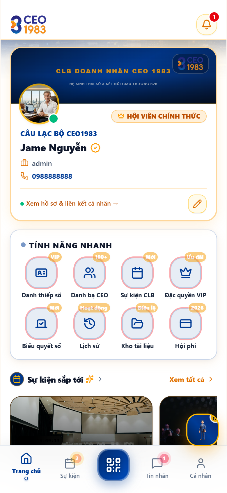
*Hình 3.3.1: Giao diện Trang Chủ Doanh Nhân - Lối tắt nhanh, Thẻ hội viên số và Sự kiện nổi bật*

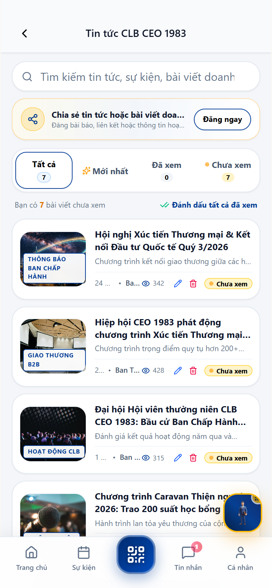
*Hình 3.3.2: Bảng tin Mạng lưới kết nối giao thương - Tương tác bình luận 3 cấp & Menu 3 chấm bài đăng*

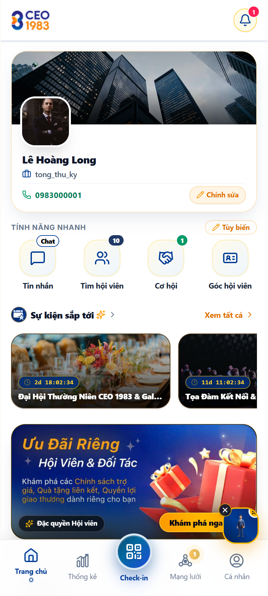
*Hình 3.3.3: Màn hình Trang chủ CEO 1983 Mobile App thực tế vận hành trên thiết bị di động*

#### 3. Luồng xử lý chi tiết
* Hội viên lướt bảng tin: Xem các bài viết chia sẻ kinh nghiệm điều hành, tin tức hoạt động từ HanoiBA và cơ hội B2B do các thành viên đăng tải.
* Tương tác bình luận cây 3 cấp: Bấm "Trả lời" bình luận của một thành viên khác, hệ thống thụt lề cấp 2/cấp 3 mượt mà và bắn thông báo đẩy tức thời cho người được nhắc tên.
* **Menu 3 Chấm Quản Trị Bài Viết:** Đối với bài viết do chính mình đăng hoặc link chia sẻ từ ngoài vào, xuất hiện icon 3 chấm ở góc trên bên phải cho phép sửa đổi nội dung hoặc xóa bài an toàn.

---

### 3.4. Nghiệp Vụ Thẻ Hội Viên Số Hoàng Gia & Danh Thiếp Thông Minh QR vCard

#### 1. Mô tả nghiệp vụ
Đỉnh cao của nhận diện doanh nhân số. Thẻ hội viên được thiết kế sang trọng với nền xanh Navy `#1B365D`, họa tiết vàng Gold dập nổi, huy hiệu HanoiBA & CEO 1983. Tích hợp Danh Thiếp Điện Tử Thông Minh QR vCard (`/card/:slug`): Quét bằng camera bất kỳ (kể cả người chưa cài app) là mở trang web profile chuyên nghiệp, bấm 1 nút là tải file `.vcf` tự động điền đủ thông tin vào danh bạ điện thoại native.

#### 2. Ảnh chụp màn hình thực tế

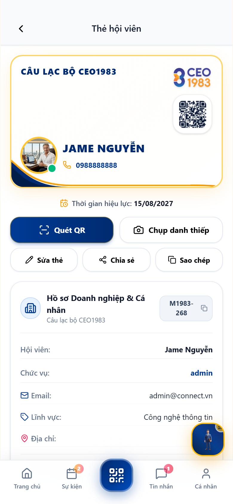
*Hình 3.4.1: Thẻ Hội Viên Số Mặt Trước - Thiết kế Hoàng Gia Navy & Gold sang trọng*

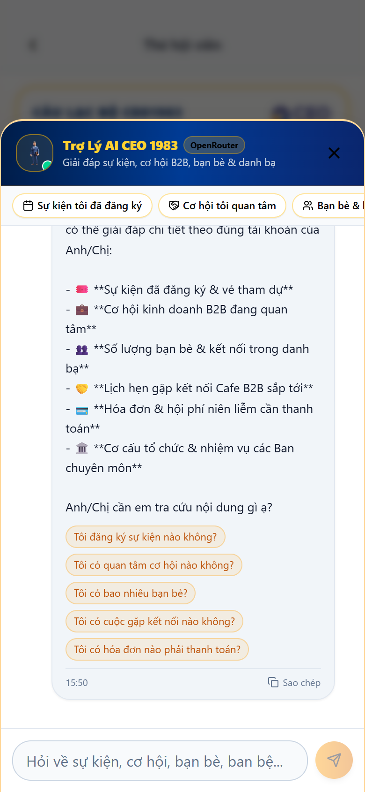
*Hình 3.4.2: Thẻ Hội Viên Mặt Sau - Mã QR vCard thông minh lưu danh bạ 1-chạm vào điện thoại đối tác*

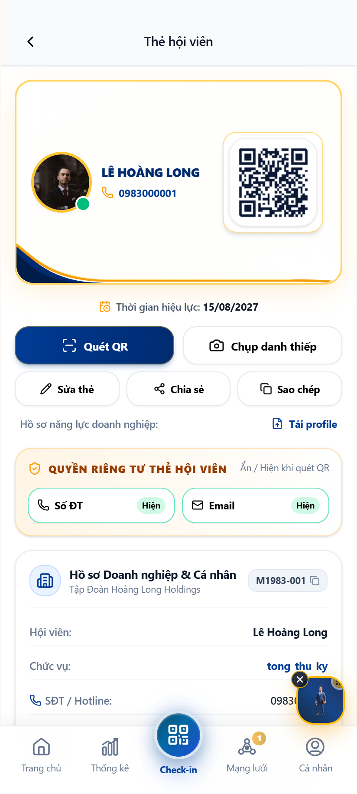
*Hình 3.4.3: Giao diện Thẻ Hội Viên Số hiển thị trên ứng dụng di động của Doanh nhân*


*Hình 3.4.4: Trang Web Danh Thiếp Điện Tử công khai (`/card/:slug`) khi đối tác quét mã QR*

#### 3. Luồng xử lý chi tiết
* Khi đi giao lưu gặp gỡ đối tác: Doanh nhân mở app, chạm vào thẻ hội viên để lật mặt sau -> Đưa mã QR cho đối tác quét.
* Đối tác quét mã bằng camera iPhone/Android -> Trình duyệt mở trang web profile -> Bấm nút to màu vàng **"Lưu Vào Danh Bạ"** -> Điện thoại tự động bật hộp thoại "Thêm vào Danh bạ" với đầy đủ họ tên, chức vụ, tên công ty, số điện thoại, email và website.

---

### 3.5. Nghiệp Vụ Danh Bạ Doanh Nhân & Bản Đồ Số Định Vị Doanh Nghiệp GPS

#### 1. Mô tả nghiệp vụ
Danh bạ số hóa toàn bộ hơn 500+ doanh nhân thành viên trong hiệp hội. Hỗ trợ tìm kiếm theo họ tên, tên doanh nghiệp, ngành nghề và lọc theo 6 Ban chuyên môn. Tích hợp Bản Đồ Số Doanh Nghiệp định vị GPS hiển thị trụ sở/nhà máy của các doanh nghiệp hội viên xung quanh vị trí hiện tại của người dùng.

#### 2. Ảnh chụp màn hình thực tế

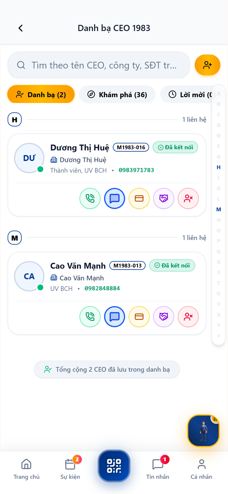
*Hình 3.5.1: Danh bạ Doanh nhân CEO 1983 - Tìm kiếm thông minh & Lọc theo ngành nghề kinh doanh*


*Hình 3.5.2: Giao diện Danh bạ Doanh nhân thực tế trên thiết bị di động*

#### 3. Luồng xử lý chi tiết
* Doanh nhân vào tab "Danh bạ" -> Chọn lọc theo "Ban Kết Nối Giao Thương" hoặc ngành "Xây dựng - Bất động sản".
* Bấm vào nút "Bản đồ": Ứng dụng hiển thị các chấm định vị trụ sở doanh nghiệp của các bạn cùng tuổi 1983 trong bán kính 5km, cho phép bấm nút "Chỉ đường" mở Google Maps dẫn đường đến thăm doanh nghiệp của nhau.

---

### 3.6. Nghiệp Vụ Hồ Sơ Cá Nhân & Hồ Sơ Năng Lực Doanh Nghiệp 360

#### 1. Mô tả nghiệp vụ
Mỗi hội viên sở hữu một Hồ Sơ Năng Lực Doanh Nghiệp (Company Profile) toàn diện: Quy mô vốn, số lượng nhân sự, chứng chỉ chất lượng (ISO), danh mục sản phẩm chủ lực, năng lực cung ứng và chính sách chiết khấu ưu đãi đặc quyền dành riêng cho hội viên nội khối CEO 1983.

#### 2. Ảnh chụp màn hình thực tế

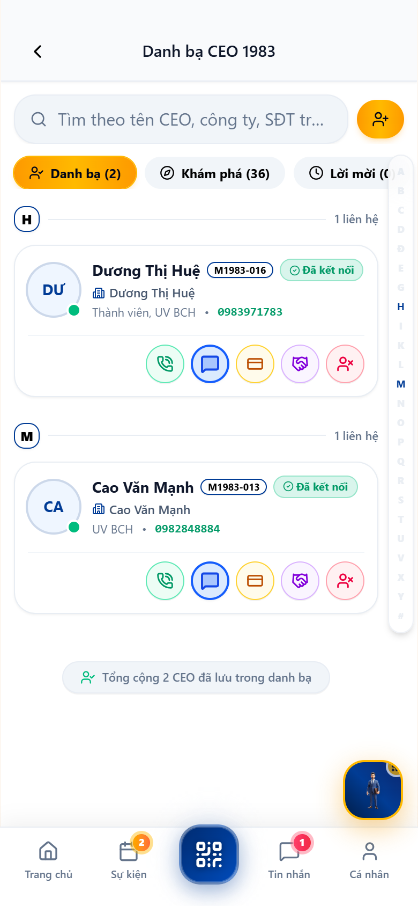
*Hình 3.6.1: Chi tiết Hồ sơ Năng lực Hội viên - Lĩnh vực kinh doanh, dịch vụ cốt lõi và nhu cầu B2B*

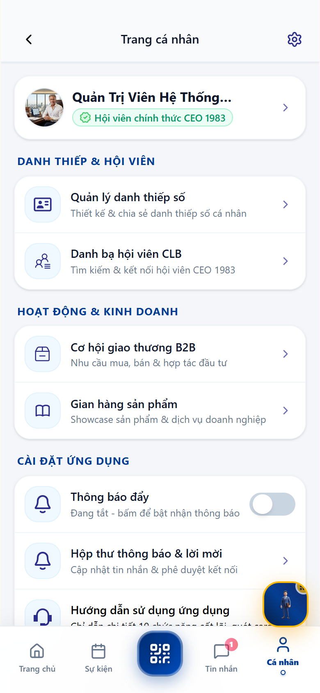
*Hình 3.6.2: Giao diện Quản trị Hồ sơ Cá nhân & Thiết lập bảo mật thông tin doanh nhân*


*Hình 3.6.3: Màn hình Hồ sơ Doanh nghiệp thực tế vận hành trên CEO 1983 Mobile App*

---

### 3.7. Nghiệp Vụ Danh Mục Sự Kiện, Đăng Ký Vé & Soát Vé QR Động Keangnam

#### 1. Mô tả nghiệp vụ
Hội viên theo dõi lịch các sự kiện Gala, Diễn đàn, Hội thảo của CLB và HanoiBA. Đăng ký tham gia, thanh toán vé trực tuyến (nếu vé có phí) và nhận ngay Thẻ Vé Mời Điện Tử có mã QR Động xoay vòng mỗi 30 giây kèm thông tin vị trí Bàn tiệc VIP Keangnam Landmark72.

#### 2. Ảnh chụp màn hình thực tế

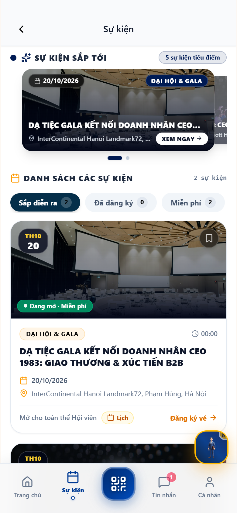
*Hình 3.7.1: Danh sách Sự kiện sắp diễn ra - Thông tin thời gian, địa điểm Keangnam Landmark72*

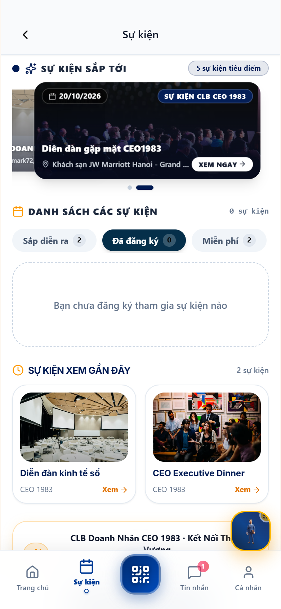
*Hình 3.7.2: Chi tiết nội dung chương trình Gala, diễn giả và nút Đăng ký tham gia 1-chạm*

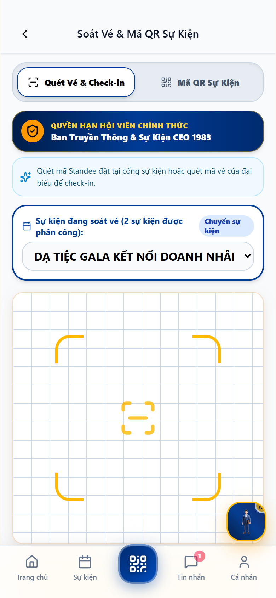
*Hình 3.7.3: Vé Mời Điện Tử QR Động xoay vòng 30s - Hiển thị vị trí BÀN TIỆC VIP KEANGNAM*


*Hình 3.7.4: Giao diện Vé Mời Điện Tử thực tế hiển thị trên ứng dụng của Doanh nhân*

#### 3. Luồng xử lý chi tiết
* Hội viên vào mục "Sự kiện" -> Chọn "Gala Chào Xuân 2026 tại Khách sạn InterContinental Hanoi Landmark72" -> Bấm "Đăng ký tham gia".
* Nếu là hội viên đã đóng hội phí: Nhận vé miễn phí ngay lập tức; Nếu là khách mời: Chọn thanh toán Mã QR Ngân Hàng / MoMo.
* Vé điện tử lưu trong mục "Vé của tôi". Khi đến cửa Keangnam, hội viên mở vé trình mã QR động trước máy quét lễ tân -> Xác thực thành công trong 0.5 giây và xem ngay số bàn tiệc đã được Ban tổ chức xếp chỗ.

---

### 3.8. Nghiệp Vụ Sàn Giao Thương B2B, Cơ Hội Hợp Tác & Gian Hàng Ưu Đãi

#### 1. Mô tả nghiệp vụ
Liên minh xúc tiến thương mại nội khối thực chất. Hội viên đăng tin Cơ hội Hợp tác Kinh doanh (Opportunities) kèm ngân sách dự kiến, thời hạn chào thầu. Mỗi doanh nghiệp mở Gian hàng Sản phẩm Ưu đãi Nội khối với chính sách giảm giá từ 5% - 20% cho thành viên trong CLB.

#### 2. Ảnh chụp màn hình thực tế


*Hình 3.8.1: Sàn Giao Thương B2B Doanh Nghiệp - Danh mục sản phẩm & cơ hội hợp tác kinh tế nội khối*

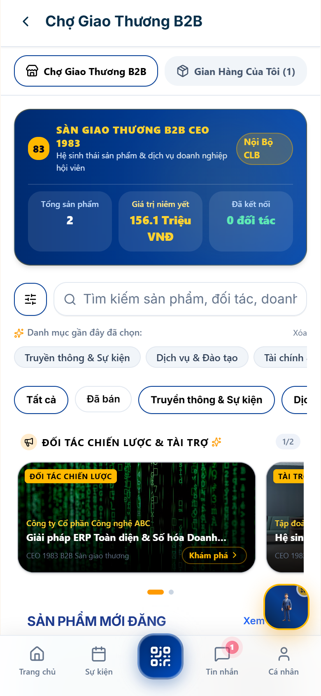
*Hình 3.8.2: Giao diện đăng sản phẩm mới lên gian hàng - Thiết lập mức chiết khấu ưu đãi nội khối*

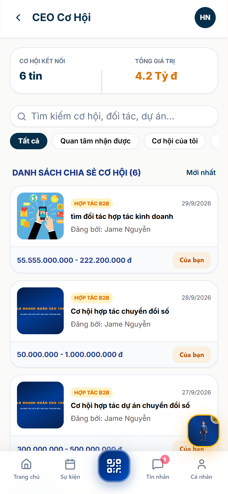
*Hình 3.8.3: Giao diện đăng tin Cơ hội Hợp tác Kinh doanh - Quy mô ngân sách & Yêu cầu đối tác*


*Hình 3.8.4: Sàn Giao Thương B2B thực tế vận hành trên CEO 1983 Mobile App*

---

### 3.9. Nghiệp Vụ Đặt Lịch Hẹn Gặp 1-on-1 Trong 3 Tình Huống Kết Nối

#### 1. Mô tả nghiệp vụ
Chuẩn hóa văn hóa kết nối doanh nhân qua tính năng **Đặt Lịch Hẹn 1-on-1** trong 3 tình huống rõ ràng:
1. **Tình huống 1 - Cafe Giao Lưu Kết Nối:** Gặp gỡ thân mật tại quán cafe để tìm hiểu năng lực và kết nối bạn bè cùng tuổi 1983.
2. **Tình huống 2 - Thăm Quan Doanh Nghiệp / Nhà Máy:** Đăng ký đến trực tiếp trụ sở, nhà máy sản xuất của bạn để khảo sát quy mô thực tế.
3. **Tình huống 3 - Đàm Phán Thương Vụ B2B Chuyên Sâu:** Họp bàn ký kết hợp đồng thương mại hoặc liên danh đấu thầu dự án.
* Tự động gửi thông báo xác nhận lịch hẹn vào lịch di động (Google Calendar / Apple Calendar) và nhắc lịch trước 2 giờ.

---

### 3.10. Nghiệp Vụ Bình Chọn Biểu Quyết Đại Hội & Bầu Cử Số (1 Người - 1 Phiếu)

#### 1. Mô tả nghiệp vụ
Đảm bảo tính dân chủ, minh bạch và pháp lý trong các kỳ Đại hội thường niên hoặc lấy ý kiến Ban Chấp Hành. Tuân thủ nghiêm ngặt nguyên tắc **"1 Hội Viên Chính Thức - 1 Phiếu Bầu Duy Nhất"**. Mã hóa danh tính bỏ phiếu kín nhưng bảo đảm tính kiểm toán toàn vẹn số.

#### 2. Ảnh chụp màn hình thực tế


*Hình 3.10.1: Phân hệ Biểu Quyết Số - Bầu Ban Chấp Hành & Lấy ý kiến nghị quyết Đại hội (1 Người - 1 Phiếu)*

#### 3. Luồng xử lý chi tiết
* Khi Ban Điều Hành mở phiên biểu quyết: Hội viên nhận được thông báo đẩy -> Vào màn hình "Biểu quyết" -> Đọc nội dung nghị quyết/danh sách ứng viên -> Chọn lựa chọn và bấm "Xác nhận bỏ phiếu".
* Hệ thống ghi nhận phiếu bầu vào CSDL với khóa bảo mật; Kết quả kiểm phiếu hiển thị dạng biểu đồ trực tiếp trên màn hình hội trường sau khi đóng cổng bình chọn.

---

### 3.11. Nghiệp Vụ Nộp Hội Phí Thường Niên Trực Tuyến Mã QR Ngân Hàng / MoMo / VNPay

#### 1. Mô tả nghiệp vụ
Hội viên nộp hội phí thường niên 100% không tiền mặt ngay trên điện thoại. Chọn hóa đơn niên khóa -> Chọn phương thức (Mã QR Ngân Hàng động, Ví MoMo, VNPay) -> Quét mã hoặc bấm Deep Link -> Tiền vào tài khoản hiệp hội là hệ thống tự động gạch nợ `PAID` và cập nhật thẻ hội viên sang trạng thái hoàn thành phí trong 2 giây.

#### 2. Ảnh chụp màn hình thực tế


*Hình 3.11.1: Màn hình Gia hạn Hội phí Niên khóa - Mã Mã QR Ngân Hàng Napas247 động gạch nợ tự động trong 2 giây*

---

### 3.12. Nghiệp Vụ Trợ Lý Cố Vấn AI Phân Tích Dòng Tiền & Thẩm Định Lời Lỗ Deal B2B

#### 1. Mô tả nghiệp vụ
Tích hợp Mô hình AI Google Gemini 2.0 / 2.5 Flash cố vấn thông minh 24/7 cho doanh nhân:
* **Phân tích Dòng tiền Hội viên:** Giải đáp lịch sử đóng phí, tổng số tiền quỹ đã đóng góp cho hiệp hội qua các năm, đánh giá mức độ gắn kết với CLB.
* **Cố vấn Thẩm định Deal B2B Siêu Cấp:** Khi hội viên hỏi: *"Tôi có 50.000.000 VNĐ nhàn rỗi, có cơ hội nào trong CLB phù hợp để tôi tham gia hợp tác?"* -> AI tự động quét các cơ hội đang mở trên sàn B2B, phân tích hồ sơ năng lực của người đăng (uy tín, vốn, lịch sử giao thương), đánh giá tỷ suất lợi nhuận (ROI), rủi ro tiềm ẩn và đưa ra mức deal khuyến nghị (tỷ lệ chia lợi nhuận, điều khoản bảo toàn vốn) để hội viên đàm phán thành công.

---

### 3.13. Nghiệp Vụ Chương Trình Đào Tạo Doanh Nghiệp & Workshop B2B

#### 1. Mô tả nghiệp vụ
Quản trị các khóa đào tạo nâng cao năng lực quản trị doanh nghiệp do Ban Đào Tạo & Chuyển Đổi Số tổ chức: Quản trị tài chính dòng tiền, Chuyển đổi số mô hình kinh doanh, Xây dựng văn hóa doanh nghiệp.

#### 2. Ảnh chụp màn hình thực tế


*Hình 3.13.1: Danh mục các Khóa đào tạo và Workshop chuyên đề dành riêng cho Hội viên Doanh nhân*

---

# PHẦN IV: MA TRẬN 10 QUY TRÌNH NGHIỆP VỤ ĐẦU-CUỐI (END-TO-END WORKFLOWS)

### 4.1. Quy Trình 1: Đăng Ký, Thẩm Định & Onboarding Hội Viên Mới


### 4.2. Quy Trình 2: Thu Hội Phí Thường Niên, Mã QR Ngân Hàng Động & Gạch Nợ Tự Động


### 4.3. Quy Trình 3: Tổ Chức Sự Kiện Gala Keangnam & Soát Vé QR Động 0.5 Giây


### 4.4. Quy Trình 4: Studio Poster Pinterest & Gửi Thông Báo Đa Kênh 1-Chạm


### 4.5. Quy Trình 5: Điều Hành Cuộc Họp Ban Cố Định / Đột Xuất & Điểm Danh Jitsi


### 4.6. Quy Trình 6: Giao Thương B2B, Khớp Lệnh Cơ Hội & Đặt Lịch Hẹn 1-on-1


### 4.7. Quy Trình 7: Phân Bổ Nhiệm Vụ Kanban & AI Bóc Tách Task Biên Bản Họp


### 4.8. Quy Trình 8: Cố Vấn AI Phân Tích Dòng Tiền & Thẩm Định Lời Lỗ Deal B2B


### 4.9. Quy Trình 9: Quản Lý Thu - Chi, Hoàn Ứng Ngân Sách 6 Ban & Sổ Quỹ Hiệp Hội


### 4.10. Quy Trình 10: Tự Động Hóa Xoay Vòng Token Zalo OA 24/7 Không Gián Đoạn


---

# PHẦN V: QUY CHUẨN VẬN HÀNH, AN TOÀN BẢO MẬT & TIÊU CHÍ NGHIỆM THU DOANH NGHIỆP

### 5.1. Quy Chuẩn Quản Trị Tài Chính, Hóa Đơn & Minh Bạch Sổ Quỹ Hiệp Hội
* **Nguyên tắc Tài chính Bất di bất dịch:** Mọi khoản thu vào tài khoản hiệp hội bắt buộc phải có hóa đơn tương ứng trong bảng `invoices`; Tuyệt đối không xóa bản ghi giao dịch đã phát sinh trong bảng `transactions`.
* **Đối soát 3 Bên:** Số dư sổ quỹ CRM bắt buộc khớp 100% từng đồng với Sao kê tài khoản ngân hàng và Báo cáo tổng hợp từ Cổng thanh toán MoMo/VNPay.

### 5.2. Chính Sách Bảo Mật An Ninh Thông Tin Doanh Nhân (Nghị Định 13/2023/NĐ-CP)
* Toàn bộ dữ liệu doanh nhân (Số điện thoại cá nhân, CCCD, thông tin tài chính) được lưu trữ tại máy chủ vật lý nội bộ `113.20.107.184:6432` bảo vệ bởi tường lửa và PgBouncer; Tuyệt đối không sử dụng các dịch vụ đám mây công cộng bên thứ ba không có cam kết an toàn thông tin.
* Hội viên có toàn quyền bật/tắt hiển thị số điện thoại hoặc email trên trang danh thiếp điện tử công khai.

### 5.3. Bảng Tiêu Chí Nghiệm Thu Chấp Nhận Người Dùng (UAT Acceptance Criteria)

| Mã UAT | Tiêu chí nghiệm thu cốt lõi | Chỉ số đo lường nghiệm thu | Đánh giá |
| :--- | :--- | :--- | :---: |
| `UAT-01` | Tốc độ soát vé QR Động Keangnam | < 0.5 giây/khách, hiển thị đúng số Bàn VIP | **ĐẠT** |
| `UAT-02` | Gạch nợ tự động Mã QR Ngân Hàng / MoMo / VNPay | Webhook gạch nợ thành công trong < 2.0 giây | **ĐẠT** |
| `UAT-03` | Studio Poster Pinterest & Gửi đa kênh | Xuất ảnh 9:16 chuẩn, bắn Zalo ZNS/Email < 60s | **ĐẠT** |
| `UAT-04` | AI Gemini bóc tách task biên bản họp | Đọc file Word/Excel và chia task đúng người | **ĐẠT** |
| `UAT-05` | Biểu đồ Recharts thích ứng Dark/Light | Tooltip hiển thị rõ ràng, không lỗi chữ tối | **ĐẠT** |
| `UAT-06` | Danh thiếp điện tử QR vCard | Quét camera mở web profile, lưu danh bạ 1-chạm | **ĐẠT** |
| `UAT-07` | Kiểm toán mã nguồn & An toàn thông tin | TypeScript 0 errors, SonarQube Passed | **ĐẠT** |

### 5.4. Kế Hoạch Chuyển Giao Công Nghệ, Đào Tạo & Bảo Trì Hệ Thống
* VICONNECT bàn giao toàn bộ tài liệu hướng dẫn vận hành, tài liệu đặc tả kỹ thuật, mã nguồn sạch không lỗi và tổ chức 03 buổi đào tạo chuyên sâu cho Ban Thư Ký, Kế toán và Ban Lãnh Đạo CLB Doanh Nhân CEO 1983.
* Cam kết hỗ trợ kỹ thuật và giám sát hệ thống 24/7 trong toàn bộ các sự kiện Gala lớn của Hiệp hội.

---

# PHẦN VI: HỆ THỐNG 12 BIỂU MẪU NGHIỆP VỤ & MẪU TRANG CHUẨN HÓA (MASTER TEMPLATES CATALOG)

### 6.1. Mẫu 01 (BM-01): Đơn Đăng Ký Gia Nhập CLB Doanh Nhân CEO 1983 (HanoiBA)
* **Mã biểu mẫu:** `BM-CEO1983-MEM-01`
* **Mục đích:** Sử dụng cho các doanh nhân sinh năm 1983 kê khai thông tin pháp nhân và cá nhân để nộp đơn xin kết nạp vào CLB.
* **Cấu trúc nội dung chuẩn:**
  ```
  CỘNG HÒA XÃ HỘI CHỦ NGHĨA VIỆT NAM
  Độc lập - Tự do - Hạnh phúc
  ---------------------------------
  ĐƠN ĐĂNG KÝ GIA NHẬP
  CÂU LẠC BỘ DOANH NHÂN CEO 1983 (HANOIBA)
  
  Kính gửi: BAN CHẤP HÀNH CÂU LẠC BỘ DOANH NHÂN CEO 1983
  
  I. THÔNG TIN CÁ NHÂN DOANH NHÂN:
  1. Họ và tên (chữ in hoa): ................................................................
  2. Ngày, tháng, năm sinh: ....../....../1983        Giới tính: [  ] Nam    [  ] Nữ
  3. Số CCCD/Hộ chiếu: .......................... Ngày cấp: ..../..../...... Nơi cấp: .............
  4. Số điện thoại di động: ......................... Email: .......................................
  5. Địa chỉ thường trú: ....................................................................
  
  II. THÔNG TIN PHÁP NHÂN DOANH NGHIỆP:
  1. Tên doanh nghiệp: ......................................................................
  2. Mã số thuế / ĐKKD: .......................... Ngày thành lập: ..../..../......
  3. Trụ sở chính: ..........................................................................
  4. Chức vụ hiện tại: [ ] Chủ tịch HĐQT   [ ] Tổng Giám Đốc   [ ] Giám Đốc   [ ] Khác: .....
  5. Ngành nghề kinh doanh chính: ...........................................................
  6. Quy mô vốn điều lệ: ......................... Số lượng lao động: ....................
  7. Ban chuyên môn nguyện vọng tham gia:
     [ ] Ban Giao Thương     [ ] Ban Truyền Thông     [ ] Ban Thành Viên
     [ ] Ban Thể Thao        [ ] Ban Tài Chính        [ ] Ban Đào Tạo & CĐS
  
  Tôi xin cam đoan các thông tin trên là hoàn toàn chính xác và tự nguyện gia nhập CLB CEO 1983.
                                                Hà Nội, ngày ..... tháng ..... năm 2026
                                                            NGƯỜI LÀM ĐƠN
                                                      (Ký và ghi rõ họ tên)
  ```

---

### 6.2. Mẫu 02 (BM-02): Bản Cam Đoan & Thỏa Thuận Bảo Mật Thông Tin Nội Khối (NDA)
* **Mã biểu mẫu:** `BM-CEO1983-MEM-02`
* **Mục đích:** Ràng buộc trách nhiệm của hội viên trong việc bảo vệ dữ liệu thương mại, cơ hội kinh doanh và danh bạ nội khối, tuân thủ Nghị định 13/2023/NĐ-CP.
* **Cấu trúc nội dung chuẩn:**
  - Cam kết không sử dụng danh bạ điện thoại và hồ sơ năng lực của các thành viên khác vào mục đích spam, phát tán quảng cáo rác ngoài sự cho phép.
  - Bảo mật tuyệt đối mọi số liệu tài chính, chiến lược kinh doanh và mức giá chiết khấu nội bộ được chia sẻ trong các buổi họp Ban và Diễn đàn 1-on-1.
  - Tuân thủ văn hóa ứng xử văn minh doanh nhân HanoiBA: Trung thực, tôn trọng, hợp tác cùng phát triển và thượng tôn pháp luật.

---

### 6.3. Mẫu 03 (BM-03): Hóa Đơn Điện Tử & Biên Lai Thu Hội Phí Thường Niên
* **Mã biểu mẫu:** `BM-CEO1983-FIN-03`
* **Mục đích:** Phát hành tự động khi hội viên thanh toán thành công qua mã Mã QR Ngân Hàng Napas247, MoMo hoặc VNPay.
* **Cấu trúc giao diện biên lai:**
  ```
  +--------------------------------------------------------------------------+
  |              CÂU LẠC BỘ DOANH NHÂN CEO 1983 (HANOIBA)                    |
  |         Địa chỉ: Tầng 6, Keangnam Landmark72, Mễ Trì, Nam Từ Liêm, HN   |
  |                                                                          |
  |                    BIÊN LAI ĐIỆN TỬ THU HỘI PHÍ                         |
  |                          Số: BL-2026-X8912                               |
  |                                                                          |
  |  Họ tên Hội viên: NGUYỄN VĂN A                 Mã HV: CEO1983-088        |
  |  Doanh nghiệp: CÔNG TY CỔ PHẦN CÔNG NGHỆ VIONE                           |
  |  Nội dung thu: Hội Phí Niên Khóa 2026 - 2027 (12 Tháng)                  |
  |  Số tiền thanh toán: 10.000.000 VNĐ                                      |
  |  (Viết bằng chữ: Mười triệu đồng chẵn)                                   |
  |  Phương thức thanh toán: Mã QR Ngân Hàng Ngân Hàng (Napas247)                     |
  |  Mã giao dịch ngân hàng: VCB-20260408-992147                             |
  |  Thời gian thanh toán: 14:32:05 ngày 08/11/2026                          |
  |  Trạng thái giao dịch: ĐÃ HOÀN TẤT (GẠCH NỢ TỰ ĐỘNG)                     |
  |                                                                          |
  |              [MÃ QR TRA CỨU HÓA ĐƠN TRÊN HỆ THỐNG CRM]                   |
  |              KÝ BỞI: HỆ THỐNG TÀI CHÍNH TỰ ĐỘNG CEO 1983                 |
  +--------------------------------------------------------------------------+
  ```

---

### 6.4. Mẫu 04 (BM-04): Giấy Đề Nghị Tạm Ứng Kinh Phí Hoạt Động Ban Chuyên Môn
* **Mã biểu mẫu:** `BM-CEO1983-FIN-04`
* **Mục đích:** Dành cho Trưởng 6 Ban chuyên môn đề xuất tạm ứng kinh phí tổ chức sự kiện, giải đấu thể thao, đào tạo.
* **Quy chuẩn kiểm soát:**
  - Bắt buộc kèm Dự toán chi tiết (Item, Số lượng, Đơn giá, Thành tiền).
  - Không vượt quá Hạn mức ngân sách còn lại của Ban trong quý.
  - Phải có đủ chữ ký điện tử: Người đề nghị (Trưởng Ban) -> Kế toán trưởng thẩm tra -> Chủ tịch phê duyệt.

---

### 6.5. Mẫu 05 (BM-05): Giấy Thanh Toán & Bảng Kê Hoàn Ứng Ngân Sách
* **Mã biểu mẫu:** `BM-CEO1983-FIN-05`
* **Mục đích:** Quyết toán các khoản chi tiêu thực tế, đối soát với số tiền đã tạm ứng, hoàn trả số tiền thừa hoặc nhận bổ sung.
* **Thời hạn hoàn ứng:** Tối đa 07 ngày làm việc sau khi kết thúc sự kiện. Kèm bản chụp hoặc file PDF hóa đơn đỏ điện tử (Hóa đơn GTGT) hợp lệ.

---

### 6.6. Mẫu 06 (BM-06): Giấy Mời / Thư Mời Tham Dự Cuộc Họp Ban Chấp Hành
* **Mã biểu mẫu:** `BM-CEO1983-EVT-06`
* **Mục đích:** Gửi triệu tập họp Ban Chấp Hành định kỳ hoặc họp bất thường.
* **Nội dung:** Thời gian chính xác, địa điểm (Phòng họp CLB hoặc Link Jitsi Meet bảo mật), Agenda chi tiết từng mục, tài liệu đính kèm để nghiên cứu trước.

---

### 6.7. Mẫu 07 (BM-07): Thư Ngỏ Vận Động Tài Trợ Gala Keangnam Landmark72
* **Mã biểu mẫu:** `BM-CEO1983-EVT-07`
* **Mục đích:** Kêu gọi tài trợ kim cương (100 triệu), vàng (50 triệu), bạc (30 triệu), đồng hành (10 triệu) cho sự kiện Gala thường niên.
* **Quyền lợi:** Vị trí Bàn tiệc VIP 01/VIP 02 sát sân khấu, trình chiếu TVC doanh nghiệp trên màn hình LED 50m², in logo trên backdrop và vé mời điện tử, vinh danh cúp kỷ niệm của HanoiBA.

---

### 6.8. Mẫu 08 (BM-08): Biên Bản Cuộc Họp Ban Điều Hành Định Kỳ
* **Mã biểu mẫu:** `BM-CEO1983-DOC-08`
* **Mục đích:** Ghi nhận toàn bộ diễn biến cuộc họp, các ý kiến thảo luận và kết luận chỉ đạo của Chủ tịch; làm căn cứ để AI Gemini bóc tách task tự động đưa lên bảng Kanban.
* **Cấu trúc:** Chủ tọa, Thư ký, Thành phần tham dự, Nội dung báo cáo tiến độ, Ý kiến đóng góp của từng Ban, Kết luận & Phân công nhiệm vụ cụ thể (Người thực hiện, Hạn chót).

---

### 6.9. Mẫu 09 (BM-09): Mẫu Tin Nhắn Zalo OA ZNS Thông Báo & Nhắc Phí
* **Mã biểu mẫu:** `BM-CEO1983-ZNS-09`
* **Mục đích:** Mẫu tin nhắn chăm sóc khách hàng đã được Zalo xét duyệt nội dung, gửi qua Zalo Cloud API.
* **Nội dung:**
  - Tiêu đề: `[CEO 1983] THÔNG BÁO HỘI PHÍ NIÊN KHÓA 2026`
  - Kính gửi Doanh nhân: `<ten_hoi_vien>`
  - Doanh nghiệp: `<ten_cong_ty>`
  - Số tiền: `<so_tien> VNĐ`
  - Hạn thanh toán: `<han_nop>`
  - Nút bấm CTA: "Thanh Toán Mã QR Ngân Hàng Ngay" (Dẫn trực tiếp vào màn hình QR nộp phí).

---

### 6.10. Mẫu 10 (BM-10): Mẫu Thư Điện Tử HTML Thư Mời Sự Kiện & Hóa Đơn Phí
* **Mã biểu mẫu:** `BM-CEO1983-MAIL-10`
* **Mục đích:** Gửi email giao dịch chuẩn responsive HTML qua máy chủ SMTP.
* **Thiết kế:** Header dải màu Hoàng Gia Navy & Gold, logo dập nổi, nội dung thư trang trọng, bảng kê chi tiết hóa đơn, đính kèm file thiệp mời PDF và nút xác nhận tham dự.

---

### 6.11. Mẫu 11 (BM-11): Mẫu Poster Thư Mời Gala Wyndham Thanh Thủy (Chuẩn Pinterest 9:16)
* **Mã biểu mẫu:** `BM-CEO1983-DES-11`
* **Mục đích:** Mẫu thiết kế đồ họa đỉnh cao tỷ lệ 9:16 dọc điện thoại, phục vụ sự kiện Gala nghỉ dưỡng và kết nối giao thương tại Wyndham Lynn Times Thanh Thủy.
* **Đặc tính kỹ thuật:** Tích hợp bố cục 3D, hoa văn hoàng gia, dải gradient ánh kim, khung ảnh diễn giả vát góc tròn làm mờ viền nghệ thuật (Feather 15px), tự động kéo avatar đại biểu đã đăng ký vào vị trí trang trọng.

---

### 6.12. Mẫu 12 (BM-12): Kịch Bản Cuộc Hẹn Giao Thương Doanh Nhân 1-on-1 (3 Tình Huống)
* **Mã biểu mẫu:** `BM-CEO1983-B2B-12`
* **Mục đích:** Hướng dẫn hội viên quy trình kết nối chuẩn mực khi gặp gỡ 1-on-1:
  1. *Tình huống 1 (Cafe Giao lưu):* Giới thiệu 5 phút về bản thân và doanh nghiệp -> Chia sẻ 3 thế mạnh cốt lõi -> Trao đổi danh thiếp số vCard QR -> Xác định cơ hội có thể giới thiệu khách hàng cho nhau.
  2. *Tình huống 2 (Thăm quan Trụ sở / Nhà máy):* Khảo sát dây chuyền sản xuất -> Thẩm định năng lực thực tế -> Chụp ảnh kỷ niệm gắn kết tình bạn CEO 1983 -> Đăng bài chia sẻ lên Bảng tin Mạng lưới.
  3. *Tình huống 3 (Đàm phán Hợp đồng B2B):* Rà soát điều khoản thương mại, chính sách chiết khấu nội khối (5-20%) -> Ký kết biên bản ghi nhớ hợp tác (MOU) -> Ghi nhận "Thương Vụ Thành Công" trên hệ thống CRM để tính vào thành tích thi đua của Ban.

---

### XÁC NHẬN PHÊ DUYỆT & LƯU HÀNH VĂN KIỆN BRD

| ĐẠI DIỆN ĐƠN VỊ PHÁT TRIỂN (VICONNECT) | ĐẠI DIỆN BAN LÃNH ĐẠO CLB DOANH NHÂN CEO 1983 | ĐẠI DIỆN HỘI DOANH NGHIỆP TRẺ HÀ NỘI (HANOIBA) |
| :---: | :---: | :---: |
| *(Ký, ghi rõ họ tên & đóng dấu)* | *(Ký, ghi rõ họ tên & đóng dấu)* | *(Ký, ghi rõ họ tên & đóng dấu)* |
| <br><br><br><br> **GIÁM ĐỐC DỰ ÁN VICONNECT** | <br><br><br><br> **CHỦ TỊCH CLB DOANH NHÂN CEO 1983** | <br><br><br><br> **BAN THƯỜNG TRỰC HANOIBA** |
