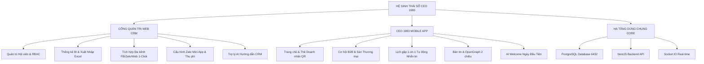

# TÀI LIỆU YÊU CẦU NGHIỆP VỤ TOÀN DIỆN (BUSINESS REQUIREMENTS DOCUMENT - BRD)
# HỆ THỐNG QUẢN TRỊ HIỆP HỘI CRM & MOBILE APP CLB DOANH NHÂN CEO 1983 (HANOIBA)
**Phiên bản:** 8.0 (Master Release)  
**Tổ chức:** CLB Doanh Nhân CEO 1983 — Trực thuộc Hội Doanh Nghiệp Trẻ Hà Nội (HanoiBA)  
**Đơn vị phát triển:** VICONNECT - VIONE PLATFORM  
**Ngày phát hành:** Tháng 11/2026  

---

## 1. TỔNG QUAN DỰ ÁN & BỐI CẢNH CHIẾN LƯỢC
### 1.1. Bối cảnh ra đời
CLB Doanh Nhân CEO 1983 tập hợp các nhà sáng lập, chủ tịch hội đồng quản trị và tổng giám đốc sinh năm Quý Hợi (1983) trên địa bàn thành phố Hà Nội và các tỉnh lân cận, hoạt động dưới sự bảo trợ của Hội Doanh nghiệp Trẻ Hà Nội (HanoiBA). Nhằm chuyển đổi số toàn diện hoạt động kết nối giao thương, quản trị hội viên và phát triển mạng lưới liên kết kinh tế, dự án phát triển hệ sinh thái kép độc lập nhưng liên thông mật thiết gồm:
1. **Cổng Quản Trị Web CRM (crm.ceo1983.com / apps/ceo1983_app_fe /crm)**: Dành riêng cho Chủ tịch CLB, Ban Thường Vụ, Ban Thư Ký, Kế toán và các Trưởng Ban chuyên môn.
2. **Ứng Dụng Di Động Hội Viên CEO 1983 (app.ceo1983.com / Mobile App)**: Dành cho toàn thể doanh nhân hội viên giao lưu, trao đổi cơ hội, đặt lịch hẹn và dùng thẻ danh thiếp điện tử.
3. **Hạ Tầng Lõi Backend & CSDL (NestJS + PostgreSQL)**: Cung cấp API bảo mật đa tầng, kết nối Socket.IO thời gian thực, lưu trữ bền vững và phân quyền RBAC chuẩn mực.

### 1.2. Mục tiêu chiến lược của Phiên bản 8.0
- **Triệt tiêu sai sót dữ liệu**: Đồng bộ toàn bộ các trường số tiền Việt Nam (`parseVnNumber`), phản hồi tức thì (`localOpps`, `localProducts`).
- **Nâng tầm Báo cáo CRM**: Tách biệt hoàn toàn thống kê CRM với Mobile App, trang bị 3 chế độ xuất Excel chuyên sâu và Nhập Excel thông minh tự bóc tách cột.
- **Truyền thông Đa nền tảng 1-Click**: Cấu hình link Hội nhóm Facebook, Nhóm Zalo, Web và bấm 1 nút đăng bài đồng loạt.
- **Trải nghiệm Onboarding Chuẩn Ngân Hàng**: Mô hình "Giáo viên đứng cạnh bảng" dẫn dắt người dùng qua từng Use Case cụ thể, kèm lời chào nồng nhiệt ngày đầu đăng nhập.
- **Vệ sinh dữ liệu an toàn**: Làm sạch toàn bộ dữ liệu thử nghiệm, bảo toàn duy nhất tài khoản Quản trị viên tối cao `admin@connect.vn`.

---

## 2. PHÂN ĐỊNH RÕ RÀNG HAI PHÂN HỆ MỤC TIÊU

---

## 3. DANH MỤC YÊU CẦU NGHIỆP VỤ THEO NHÓM CHỨC NĂNG

### PHẦN I: CỔNG QUẢN TRỊ WEB CRM
#### BRD-CRM-01: Quản trị Hồ sơ Hội viên & Duyệt Kết Nạp Tự Động
- Tiếp nhận hồ sơ đăng ký từ Zalo Mini App và Web Form công khai.
- Quy trình xét duyệt 1-click: Tự động sinh mật khẩu ngẫu nhiên an toàn, kích hoạt tài khoản đăng nhập và gửi email thông báo kèm hướng dẫn kích hoạt thẻ hội viên.
- Quản trị ban chuyên môn: Phân bổ vào 5 ban chức năng và gán vai trò theo ma trận RBAC.

#### BRD-CRM-02: Trung Tâm Thống Kê & 3 Chế Độ Xuất Báo Cáo Excel
- Khác biệt vượt trội so với mobile: Thống kê CRM cung cấp cái nhìn vĩ mô về toàn bộ chỉ số giao thương, đối soát mục tiêu kế hoạch so với thực tế.
- **Chế độ Xuất 1 (Theo Thời Gian)**: Xuất toàn bộ danh sách hội viên theo Tháng, Quý, Năm với Header CLB CEO 1983 - HanoiBA, đầy đủ 14 cột nghiệp vụ và dòng tổng cộng tự động.
- **Chế độ Xuất 2 (Theo Từng Hội Viên)**: Xuất hồ sơ doanh nhân chi tiết (Dossier) phân tách thành các Sheet riêng biệt về cơ hội đã chia sẻ, đối tác đã kết nối và giá trị đóng góp.
- **Chế độ Xuất 3 (Biến Động Hội Viên - Delta)**: So sánh % tăng giảm chỉ số giữa các kỳ, tự động phân loại thành 3 nhóm (Bứt phá, Duy trì ổn định, Cần hỗ trợ) kèm đề xuất hành động cho Ban Điều Hành.

#### BRD-CRM-03: Nhập Dữ Liệu Excel Thông Minh (Smart Import)
- Hỗ trợ tải lên file `.xlsx`, `.xls`, `.csv`.
- Tự động nhận diện và bóc tách các cột: Họ tên, Số điện thoại, Email, Doanh nghiệp, Chức vụ, Ngành nghề, Ban chuyên môn, Địa chỉ.
- Giao diện Live Preview hiển thị badge số dòng hợp lệ và cảnh báo, cho phép tích chọn dòng nhập.
- Nút "Tải file mẫu chuẩn (.xlsx)" tải về tệp Excel mẫu để điền dữ liệu.
- Lưu trữ bền vững vào CSDL PostgreSQL qua API `POST /members/bulk-import`.

#### BRD-CRM-04: Tích Hợp Nền Tảng Đa Kênh & Đăng Bài 1-Click (1-Click Auto Post)
- Cấu hình link Hội nhóm Facebook, link Fanpage, link Nhóm Zalo, Zalo OA ID và Website chính thức. Lưu bền vững trong bảng `public.app_settings`.
- Tính năng 1-Click: Chọn Sự kiện hoặc Cuộc họp, bấm 1 nút duy nhất là hệ thống tự động đăng bài lên các hội nhóm và trả về link xem trực tiếp bài viết.

#### BRD-CRM-05: Cấu Hình Zalo Mini App
- Kết nối CSDL PostgreSQL với API `GET /zalo/miniapp/config` và `POST /zalo/miniapp/config`.
- Kiểm tra sức khỏe kết nối (`check-health`) hiển thị trạng thái thực tế.

---

### PHẦN II: ỨNG DỤNG DI ĐỘNG HỘI VIÊN CEO 1983 MOBILE APP
#### BRD-APP-01: Chia Sẻ Cơ Hội B2B & Hiển Thị Tiền Tệ Chuẩn Xác
- Xử lý hoàn hảo định dạng tiền tệ Việt Nam (ví dụ `2.000.000.000 đ` hiển thị chính xác là `2 Tỷ VNĐ`).
- Phản ứng tức thì (Zero Latency) với `localOpps`: Cập nhật ngay khi sửa hoặc tạo cơ hội mà không cần load lại trang.
- Chạm vào các thẻ chỉ số giao thương để mở modal xem dẫn chứng minh chứng hợp đồng.

#### BRD-APP-02: Sàn Thương Mại & Cập Nhật Giá Sản Phẩm
- Quản lý sản phẩm với giá niêm yết, giá ưu đãi hội viên và danh mục ngành nghề.
- Đồng bộ mảng ảnh `image_urls` chuẩn PostgreSQL `text[]`.

#### BRD-APP-03: Tự Động Gửi Tin Nhắn Cuộc Hẹn B2B (3 Case Bắt Buộc)
- **Case 1 (Kết nối B2B)**: Thiết lập lịch gặp trực tiếp tại màn Kết nối B2B.
- **Case 2 (Từ Chia sẻ Cơ hội)**: Lên lịch hẹn từ chi tiết một cơ hội kinh doanh.
- **Case 3 (Từ Sàn thương mại)**: Đặt lịch hẹn đàm phán mua/bán sản phẩm thương mại.
- Khi người nhận bấm đồng ý, hệ thống tự động bắn tin nhắn xác nhận lịch gặp vào hộp thư của cả hai bên.

#### BRD-APP-04: Bản Tin Diễn Đàn, OpenGraph 2 Chiều & Tối Ưu Tìm Kiếm
- Khi share link ra ngoài (Facebook, Zalo): Thẻ OpenGraph động trả về chuẩn tiêu đề, ảnh banner và tóm tắt.
- Khi dán link ngoài vào App: Hiển thị khung xem trước Facebook Share Card đẹp mắt.
- Tìm kiếm áp dụng Debounce 350ms: Triệt tiêu tình trạng spam gọi API mỗi khi nhập ký tự hay phím Space.
- Đặt tiêu đề màn hình chuẩn xác: **"Mạng Lưới Hội Viên & Bản Tin Doanh Nhân CEO 1983"**.

---

### PHẦN III: TRỢ LÝ CỐ VẤN SỐ AI & HƯỚNG DẪN THAO TÁC
#### BRD-AI-01: Mô Hình Hướng Dẫn "Giáo Viên Đứng Bên Cạnh Bảng"
- Áp dụng triệt để trải nghiệm Onboarding của các ứng dụng ngân hàng số.
- Thiết kế: Avatar AI Cố Vấn Số bên trái, Khung bảng lớp học bên phải chứa chỉ dẫn thao tác, lời khuyên thực chiến và khung chat hỏi đáp trực tiếp với AI.
- Hỗ trợ đầy đủ các Use Cases (UC) của cả CRM và Mobile App.

#### BRD-AI-02: Chào Mừng Hội Viên Ngày Đầu Tiên Đăng Nhập App
- Tự động xuất hiện vào ngày đầu tiên đăng nhập (`vba_first_day_welcomed_date`).
- Icon AI bên trái, bảng lời nhắn bên phải chào hỏi thân mật, điểm qua lịch hẹn 14:30 và sự kiện sắp tới.

---

## 4. MA TRẬN PHÂN CHIA VAI TRÒ VÀ TRÁCH NHIỆM (RACI MATRIX)
| Nhóm Chức Năng | Chủ tịch CLB | Ban Thư Ký | Ủy viên BCH | Hội viên Doanh nhân | Ban Công Nghệ |
| :--- | :---: | :---: | :---: | :---: | :---: |
| Duyệt kết nạp & cấp tài khoản | A | R | C | I | S |
| Thống kê & Xuất/Nhập Excel | A | R | C | I | S |
| Tích hợp Đa kênh & 1-Click Post | A | R | C | I | S |
| Giao thương B2B & Sàn sản phẩm | I | C | C | R / A | S |
| Lịch hẹn 1-on-1 & Tự động nhắn tin | I | I | C | R / A | S |
| Quản trị Hạ tầng & Database Wipe | A | I | I | I | R |

*(R: Responsible, A: Accountable, C: Consulted, I: Informed, S: Supported)*
