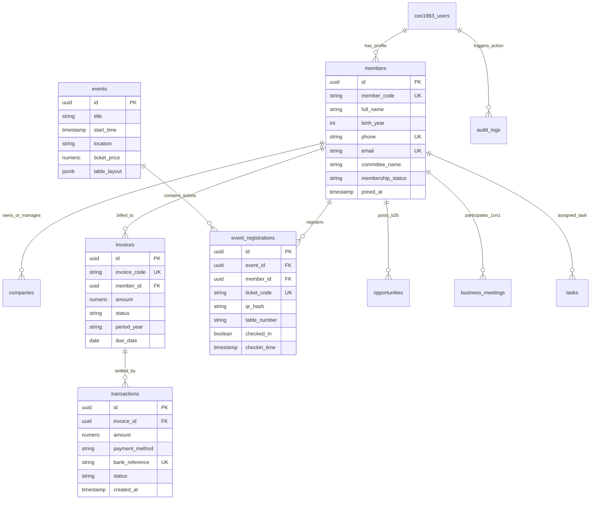
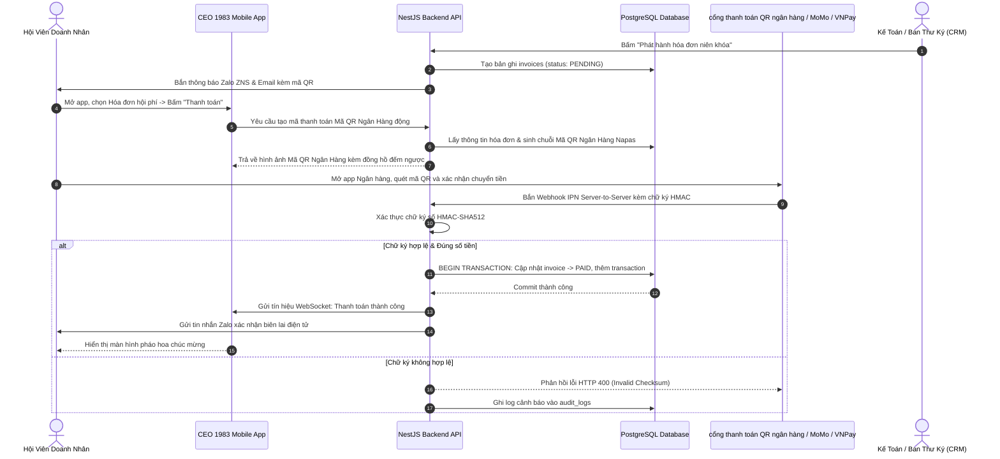
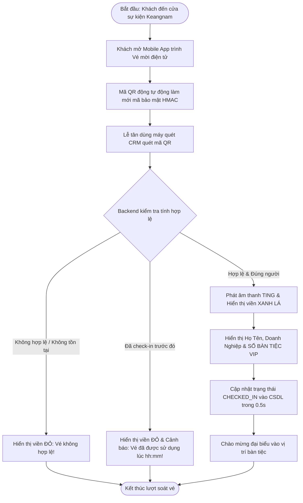

# HỆ SINH THÁI NỀN TẢNG SỐ CLB DOANH NHÂN CEO 1983 (HANOIBA)

## TÀI LIỆU ĐẶC TẢ YÊU CẦU PHẦN MỀM TỔNG THỂ TOÀN DIỆN
*(SOFTWARE REQUIREMENTS SPECIFICATION - MASTER SRS ENTERPRISE EDITION)*
*Tuân thủ tiêu chuẩn quốc tế IEEE Std 830-1998 & Cấu trúc Khuyến nghị 16 Phần Chuẩn Hóa*

---

## MỤC LỤC TỔNG QUAN 16 PHẦN CHUẨN HÓA

- [PHẦN 1. THÔNG TIN TÀI LIỆU (DOCUMENT CONTROL)](#phần-1-thông-tin-tài-liệu-document-control)
- [PHẦN 2. GIỚI THIỆU (INTRODUCTION)](#phần-2-giới-thiệu-introduction)
- [PHẦN 3. TỔNG QUAN HỆ THỐNG (SYSTEM OVERVIEW)](#phần-3-tổng-quan-hệ-thống-system-overview)
- [PHẦN 4. ĐỐI TƯỢNG SỬ DỤNG VÀ PHÂN QUYỀN (USER ROLES & PERMISSIONS)](#phần-4-đối-tượng-sử-dụng-và-phân-quyền-user-roles--permissions)
- [PHẦN 5. YÊU CẦU NGHIỆP VỤ (BUSINESS REQUIREMENTS)](#phần-5-yêu-cầu-nghiệp-vụ-business-requirements)
- [PHẦN 6. YÊU CẦU CHỨC NĂNG (FUNCTIONAL REQUIREMENTS)](#phần-6-yêu-cầu-chức-năng-functional-requirements)
  - [6.1. Nhóm FR Cốt Lõi 1: Quản Lý Hội Viên & Hồ Sơ Năng Lực B2B](#61-nhóm-fr-cốt-lõi-1-quản-lý-hội-viên--hồ-sơ-năng-lực-b2b)
  - [6.2. Nhóm FR Cốt Lõi 2: Quản Lý Hội Phí & Niên Khóa](#62-nhóm-fr-cốt-lõi-2-quản-lý-hội-phí--niên-khóa)
  - [6.3. Nhóm FR Cốt Lõi 3: Thanh Toán Trực Tuyến & Đối Soát Tự Động](#63-nhóm-fr-cốt-lõi-3-thanh-toán-trực-tuyến--đối-soát-tự-động)
  - [6.4. Nhóm FR Cốt Lõi 4: Quản Lý & Đăng Ký Sự Kiện Có Phí](#64-nhóm-fr-cốt-lõi-4-quản-lý--đăng-ký-sự-kiện-có-phí)
  - [6.5. Nhóm FR Cốt Lõi 5: Thông Báo Đa Kênh & Quản Lý Mẫu Trang](#65-nhóm-fr-cốt-lõi-5-thông-báo-đa-kênh--quản-lý-mẫu-trang)
  - [6.6. Nhóm FR Cốt Lõi 6: Báo Cáo Tài Chính Thu - Chi & Sổ Quỹ Hiệp Hội](#66-nhóm-fr-cốt-lõi-6-báo-cáo-tài-chính-thu---chi--sổ-quỹ-hiệp-hội)
  - [6.7. Các Phân Hệ Nghiệp Vụ Bổ Trợ Bắt Buộc (FR-007 đến FR-014)](#67-các-phân-hệ-nghiệp-vụ-bổ-trợ-bắt-buộc-fr-007-đến-fr-014)
- [PHẦN 7. YÊU CẦU GIAO DIỆN (EXTERNAL INTERFACE REQUIREMENTS)](#phần-7-yêu-cầu-giao-diện-external-interface-requirements)
- [PHẦN 8. YÊU CẦU DỮ LIỆU (DATA REQUIREMENTS)](#phần-8-yêu-cầu-dữ-liệu-data-requirements)
- [PHẦN 9. YÊU CẦU TÍCH HỢP HỆ THỐNG & MODEL AI (INTEGRATION REQUIREMENTS)](#phần-9-yêu-cầu-tích-hợp-hệ-thống--model-ai-integration-requirements)
- [PHẦN 10. YÊU CẦU PHI CHỨC NĂNG (NON-FUNCTIONAL REQUIREMENTS)](#phần-10-yêu-cầu-phi-chức-năng-non-functional-requirements)
- [PHẦN 11. YÊU CẦU BẢO MẬT (SECURITY REQUIREMENTS)](#phần-11-yêu-cầu-bảo-mật-security-requirements)
- [PHẦN 12. QUY TRÌNH XỬ LÝ VÀ LUỒNG NGHIỆP VỤ (WORKFLOW & DIAGRAMS)](#phần-12-quy-trình-xử-lý-và-luồng-nghiệp-vụ-workflow--diagrams)
- [PHẦN 13. YÊU CẦU BÁO CÁO VÀ THỐNG KÊ (REPORTING REQUIREMENTS)](#phần-13-yêu-cầu-báo-cáo-và-thống-kê-reporting-requirements)
- [PHẦN 14. KIỂM THỬ VÀ NGHIỆM THU (TESTING & ACCEPTANCE)](#phần-14-kiểm-thử-và-nghiệm-thu-testing--acceptance)
- [PHẦN 15. TRIỂN KHAI VÀ VẬN HÀNH (DEPLOYMENT & OPERATION)](#phần-15-triển-khai-và-vận-hành-deployment--operation)
- [PHẦN 16. PHỤ LỤC (APPENDICES)](#phần-16-phụ-lục-appendices)

---

# PHẦN 1. THÔNG TIN TÀI LIỆU (DOCUMENT CONTROL)

### 1.1. Tên dự án / Hệ thống
* **Tên chính thức:** Nền tảng Chuyển đổi số Quản trị & Kết nối Giao thương CLB Doanh Nhân CEO 1983.
* **Tên thương mại:** CEO 1983 Digital Ecosystem (HanoiBA).
* **Mã dự án nội bộ:** `CEO1983-PROJ-2026`.

### 1.2. Mã tài liệu SRS
* **Mã định danh:** `SRS-CEO1983-ENTERPRISE-16PARTS-V10.0`.

### 1.3. Phiên bản tài liệu
* **Phiên bản:** `10.0.0-PROD` (Tái cấu trúc 16 phần chuẩn IEEE 830, đặc tả sâu 6 nhóm chức năng trọng yếu).

### 1.4. Ngày tạo / Ngày cập nhật
* **Ngày tạo ban đầu:** 15/10/2026.
* **Ngày cập nhật gần nhất:** Tháng 11/2026.

### 1.5. Người biên soạn (Author)
* **Nhóm Phân tích Nghiệp vụ & Kỹ thuật VICONNECT:**
  - Trưởng nhóm Phân tích Kỹ thuật (Lead System Architect & Business Analyst).
  - Đội ngũ Chuyên viên Phân tích Nghiệp vụ Cấp cao (Senior BA VICONNECT).

### 1.6. Người kiểm tra (Reviewer)
* **Ban Kỹ thuật & Đảm bảo Chất lượng (QA/QC Lead):**
  - Giám đốc Kỹ thuật Giải pháp VICONNECT (Technical Director).
  - Trưởng ban Kiểm thử & An ninh Thông tin (Lead QA & Security Auditor).

### 1.7. Người phê duyệt (Approver)
* **Ban Lãnh Đạo CLB Doanh Nhân CEO 1983 & HanoiBA:**
  - Chủ tịch CLB Doanh Nhân CEO 1983.
  - Phó Chủ tịch Thường trực kiêm Tổng Thư Ký CLB.
  - Ban Kiểm tra & Giám sát Tài chính HanoiBA.

### 1.8. Lịch sử thay đổi (Revision History)

| Phiên bản | Ngày cập nhật | Người thực hiện | Tóm tắt nội dung thay đổi chính |
| :--- | :--- | :--- | :--- |
| `v1.0.0` | 15/10/2026 | BA Team | Khởi tạo tài liệu đặc tả SRS bản sơ thảo đầu tiên. |
| `v3.5.0` | 22/10/2026 | System Arch | Bổ sung kiến trúc phân tầng NestJS + Next.js + PostgreSQL. |
| `v5.0.0` | 01/11/2026 | Security Lead | Bổ sung kết quả Pentest, khắc phục 0 vulnerability theo báo cáo SonarQube. |
| `v8.0.0` | 06/11/2026 | Tech Lead | Tinh giản kiến trúc, chuẩn hóa 37 Functional Nodes truy vết. |
| `v10.0.0` | 09/11/2026 | Master Team | Tái cấu trúc chuẩn 16 Phần; Chi tiết hóa sâu sắc 6 nhóm chức năng: Hội viên, Hội phí, Thanh toán MoMo/VNPay/Mã QR Ngân Hàng, Sự kiện Keangnam, Thông báo đa kênh (Zalo/Email/App) và Báo cáo tài chính; Tích hợp Trợ lý Cố vấn AI Gemini 2.0/2.5 Flash phân tích dòng tiền và thẩm định dự án B2B. |

### 1.9. Danh sách người nhận tài liệu (Distribution List)

| STT | Đối tượng / Đơn vị tiếp nhận | Vai trò & Mục đích sử dụng |
| :--- | :--- | :--- |
| 1 | Thường trực Ban Điều Hành CLB CEO 1983 | Căn cứ phê duyệt, nghiệm thu tính năng và chỉ đạo nghiệp vụ. |
| 2 | Ban Thư ký & Ban Truyền thông CLB | Căn cứ vận hành truyền thông, phát hành thư mời, Zalo OA và sự kiện. |
| 3 | Ban Tài chính & Kế toán CLB | Căn cứ thu hội phí, xuất hóa đơn, quản lý chi phí 6 Ban và đối soát sổ quỹ. |
| 4 | Trưởng các Ban Chuyên môn (6 Ban) | Căn cứ tổ chức họp ban cố định/bất thường, phân bổ task Kanban. |
| 5 | Đội ngũ Kỹ sư Phát triển (VICONNECT Dev Team) | Căn cứ lập trình Front-end (Next.js/React), Back-end (NestJS), CSDL (PostgreSQL). |
| 6 | Đội ngũ Kiểm thử & Triển khai (QA / DevOps) | Căn cứ xây dựng Test Case, kịch bản CI/CD, Docker Compose và Nginx Reverse Proxy. |

---

# PHẦN 2. GIỚI THIỆU (INTRODUCTION)

### 2.1. Mục đích tài liệu (Purpose)
Tài liệu Đặc tả Yêu cầu Phần mềm (SRS) này đóng vai trò là văn kiện kỹ thuật cao nhất quy định toàn bộ yêu cầu nghiệp vụ, chức năng, phi chức năng, dữ liệu, bảo mật và kiến trúc triển khai của **Hệ sinh thái Nền tảng số CLB Doanh Nhân CEO 1983 (HanoiBA)**. 
Tài liệu làm căn cứ ràng buộc pháp lý và kỹ thuật giữa Đơn vị phát triển giải pháp (VICONNECT) và Đơn vị thụ hưởng (CLB Doanh Nhân CEO 1983), đồng thời định hướng quá trình thẩm định mã nguồn, kiểm thử tự động, tích hợp liên tục (CI/CD) và nghiệm thu chính thức.

### 2.2. Phạm vi hệ thống (Project Scope)
Hệ sinh thái số CEO 1983 bao gồm 2 phân hệ người dùng độc lập và 1 nền tảng hạ tầng trung tâm:
1. **Cổng Quản trị Web CRM (Desktop Admin Portal):** Dành riêng cho Chủ tịch, Ban Điều Hành, Ban Thư Ký, Kế toán và Trưởng các Ban chuyên môn vận hành trên máy tính để bàn (tối ưu hóa màn hình lớn, bảng tính tương đương Excel, biểu đồ tài chính đa chu kỳ, studio thiết kế thư mời chuẩn Pinterest, quản trị Kanban và duyệt hồ sơ).
2. **Ứng dụng Di động Hội viên CEO 1983 Mobile App (Mobile-First Native/PWA/Capacitor):** Dành cho hơn 500+ Doanh nhân Hội viên sinh năm 1983 tương tác hàng ngày trên thiết bị cầm tay (mạng lưới doanh nhân, danh thiếp điện tử thông minh QR vCard, sàn cơ hội B2B, đặt lịch hẹn 1-on-1, nộp hội phí trực tuyến MoMo/VNPay/Mã QR Ngân Hàng, soát vé QR động sự kiện Keangnam và cố vấn AI).
3. **Hạ tầng Dịch vụ Trung tâm (Central Core Engine):** Cung cấp hệ thống REST API thuần khiết NestJS 3 tầng, CSDL PostgreSQL Enterprise `113.20.107.184:6432`, WebSocket Gateway thời gian thực, cơ chế gửi tin đa kênh (Omnichannel Broadcast: Zalo OA ZNS, Email SMTP/SendGrid, Push Notification Web/FCM) và Mô hình Trí tuệ Nhân tạo Gemini 2.0/2.5 Flash.

### 2.3. Mục tiêu dự án (Project Objectives)
* **Số hóa 100% quy trình kết nối hội viên:** Xóa bỏ danh thiếp giấy, hồ sơ giấy tờ, thay thế bằng Danh thiếp số vCard, mã QR động và hồ sơ năng lực doanh nghiệp đa phương tiện.
* **Tự động hóa 98% công tác thu hội phí & dòng tiền:** Triệt tiêu hoàn toàn tình trạng sai sót chuyển khoản, gạch nợ thủ công; tiền vào tài khoản hiệp hội là hệ thống tự động gạch nợ hóa đơn, phát hành biên lai và thông báo đa kênh trong vòng 2 giây.
* **Thúc đẩy giao thương B2B nội khối đạt tối thiểu 50 tỷ VNĐ/năm:** Tối ưu hóa khớp lệnh cơ hội kinh doanh giữa 6 Ban chuyên môn nhờ AI Matching và lịch hẹn doanh nhân 1-on-1 có giám sát.
* **Chuẩn hóa công tác tổ chức sự kiện chuyên nghiệp:** Rút ngắn thời gian soát vé Gala từ 3 phút/người xuống dưới 0.5 giây/người nhờ mã QR động keangnam chống chụp ảnh quay phim màn hình gian lận.

### 2.4. Đối tượng đọc tài liệu (Intended Audience)
* Ban Chấp Hành, Ban Kiểm Tra CLB Doanh Nhân CEO 1983 và Hội Doanh Nghiệp Trẻ Hà Nội.
* Quản lý Dự án (Project Manager), Kỹ sư Phân tích Nghiệp vụ (Business Analyst).
* Kỹ sư Lập trình Full-stack (React/Next.js TypeScript, NestJS Node.js, PostgreSQL DBA).
* Chuyên viên Kiểm thử Phần mềm (QA/QC Manual & Automation Engineers).
* Chuyên viên Quản trị Hệ thống và DevOps (Docker, Linux, Nginx, SSL).

### 2.5. Thuật ngữ và định nghĩa (Glossary)

| Thuật ngữ / Viết tắt | Định nghĩa & Ý nghĩa kỹ thuật trong hệ thống |
| :--- | :--- |
| **HanoiBA** | Hội Doanh Nghiệp Trẻ Hà Nội (Hanoi Young Business Association) - Cơ quan cấp trên của CLB CEO 1983. |
| **CEO 1983** | Câu Lạc Bộ Doanh Nhân những người sinh năm 1983 (Quý Hợi), thành viên chính thức trực thuộc HanoiBA. |
| **CRM** | Customer Relationship Management - Cổng Quản trị Khách hàng & Hội viên trên nền tảng Web Desktop. |
| **RBAC** | Role-Based Access Control - Cơ chế kiểm soát truy cập dựa trên vai trò phân quyền (5 cấp độ chuẩn hóa). |
| **Mã QR Ngân Hàng Động** | Mã QR thanh toán tạo tức thời theo chuẩn Napas247, mã hóa số tiền và cú pháp hóa đơn duy nhất `CEO1983...`. |
| **IPN** | Instant Payment Notification - Cơ chế Webhook từ MoMo / VNPay gửi ngầm về Backend để xác thực giao dịch. |
| **Idempotency Key** | Khóa định danh duy nhất ngăn chặn xử lý giao dịch hoặc lệnh gửi tin nhắn bị lặp lại nhiều lần. |
| **Dynamic QR Code** | Mã QR biến đổi chu kỳ mỗi 30 - 60 giây, chứa token chữ ký số HMAC-SHA256 chống gian lận check-in. |
| **Zalo OA & ZNS** | Zalo Official Account & Zalo Notification Service - Dịch vụ gửi thông báo chăm sóc khách hàng qua Zalo API. |
| **Gemini AI** | Mô hình Trí tuệ Nhân tạo thế hệ mới của Google được tích hợp phân tích dòng tiền và bóc tách biên bản họp. |
| **Pure NestJS 3 Tầng** | Kiến trúc tách biệt nghiêm ngặt: Controller (Định tuyến) -> Service (Nghiệp vụ) -> Repository (CSDL). |

### 2.6. Tài liệu tham chiếu (References)
1. Tiêu chuẩn Quốc tế IEEE Std 830-1998 về Đặc tả Yêu cầu Kỹ thuật Phần mềm (Recommended Practice for SRS).
2. Điều lệ tổ chức và quy chế hoạt động của Câu Lạc Bộ Doanh Nhân CEO 1983 ban hành năm 2026.
3. Nghị định 13/2023/NĐ-CP của Chính phủ Việt Nam về Bảo vệ Dữ liệu Cá nhân (Personal Data Protection Regulation).
4. Tiêu chuẩn Mã phản hồi nhanh Mã QR Ngân Hàng của Công ty Cổ phần Thanh toán Quốc gia Việt Nam (NAPAS).
5. Tài liệu đặc tả tích hợp Cổng thanh toán VNPay (vnpay_php/java API v2.1) và MoMo Payment Platform (v2 API).
6. Tài liệu hướng dẫn Zalo Official Account API v3.0 & Zalo Notification Service (ZNS Template API).

### 2.7. Cấu trúc tài liệu (Document Overview)
Tài liệu được phân chia thành 16 phần độc lập nhưng liên kết chặt chẽ theo nguyên tắc truy vết yêu cầu (RTM), bao quát từ bài toán kinh doanh, phân quyền, đặc tả chức năng 15 thuộc tính, dữ liệu, bảo mật, luồng xử lý Mermaid, kiểm thử đến quy trình đóng gói container Docker production.

---

# PHẦN 3. TỔNG QUAN HỆ THỐNG (SYSTEM OVERVIEW)

### 3.1. Bối cảnh nghiệp vụ (Business Context)
CLB Doanh Nhân CEO 1983 quy tụ hàng trăm chủ doanh nghiệp, giám đốc điều hành sinh năm 1983 đang dẫn dắt các doanh nghiệp thuộc nhiều lĩnh vực then chốt: Xây dựng, Bất động sản, Công nghệ thông tin, F&B, Logistics, Y tế & Giáo dục. 
Trước khi chuyển đổi số, hoạt động của Hiệp hội phụ thuộc nặng nề vào các nhóm chat Zalo rời rạc, bảng tính Excel thủ công, biên lai giấy và thẻ nhựa cứng. Việc thất lạc thông tin cơ hội B2B, chậm trễ đối soát hội phí niên khóa và khó khăn trong điểm danh sự kiện lớn (Gala 500 khách tại Keangnam Hanoi Landmark) đặt ra yêu cầu cấp thiết phải xây dựng một hệ thống số hóa tập trung, chuyên nghiệp và bảo mật tuyệt đối.

### 3.2. Mô tả tổng quan hệ thống
Hệ thống là một giải pháp công nghệ toàn diện kết hợp giữa **Quản trị Tổ chức Doanh nghiệp (Enterprise Association ERP)** và **Mạng Xã Hội Giao Thương Doanh Nhân (Business Networking Platform)**. Hệ thống bao gồm:
* **Hạ tầng CSDL Quan hệ Trung tâm:** Đặt tại máy chủ vật lý an toàn `113.20.107.184:6432`, quản lý hơn 25 bảng thực thể chuẩn hóa.
* **Lớp Dịch vụ Backend NestJS:** Điều phối toàn bộ logic nghiệp vụ, bảo vệ bởi JWT Guard, RolesGuard và hệ thống rate-limiting chống tấn công.
* **Cổng Quản trị CRM:** Cung cấp cho Ban Thư ký công cụ gửi thông báo đa kênh 1-click (Zalo OA ZNS, Email HTML, Push App), studio tạo poster thư mời chuyên nghiệp như Canva/Pinterest, và báo cáo thu chi thích ứng Dark/Light theme.
* **Mobile App Doanh nhân:** Cung cấp trải nghiệm mượt mà, định vị kết nối hội viên theo bán kính GPS, gian hàng B2B nội khối và trợ lý AI thông minh 24/7.

```
       +-------------------------------------------------------------------+
       |                 CLB DOANH NHÂN CEO 1983 (HANOIBA)                |
       +---------------------------------+---------------------------------+
                                         |
            +----------------------------+----------------------------+
            |                                                         |
+-----------v--------------------+                       +------------v--------------------+
|    CỔNG QUẢN TRỊ WEB CRM       |                       |   CEO 1983 MOBILE APP HỘI VIÊN  |
|  (Desktop / Chrome / Edge)     |                       |    (iOS / Android / PWA Mobile) |
| - Quản trị 360 độ Hội viên     |                       | - Thẻ Hội viên số & QR vCard    |
| - Thu Hội phí & Hóa đơn tự động|                       | - Sàn Giao thương B2B & Deal    |
| - Studio Poster & Omnichannel  |                       | - Vé Check-in QR Động Keangnam  |
| - Quản lý Sự kiện & Họp Ban    |                       | - Nộp Hội phí MoMo/VNPay/Mã QR Ngân Hàng |
| - Sổ quỹ & Báo cáo Recharts    |                       | - Trợ lý Cố vấn AI Dòng tiền    |
+-----------+--------------------+                       +------------+--------------------+
            |                                                         |
            +----------------------------+----------------------------+
                                         | RESTful API (HTTPS) & WebSocket (WSS)
                                         |
+----------------------------------------v-----------------------------------------+
|                    BACKEND API GATEWAY (PURE NESTJS 3-TIER)                      |
|  - Auth & RBAC Guard                   - Payment Engine (MoMo, VNPay, Mã QR Ngân Hàng)    |
|  - Members & Companies Engine          - Omnichannel Broadcast (Zalo OA, Mail)   |
|  - Events & Smart QR Engine            - AI Engine (Google Gemini 2.0/2.5 Flash) |
+----------------------------------------+-----------------------------------------+
                                         |
                                         | PgBouncer Connection Pool (Port 6432)
                                         |
+----------------------------------------v-----------------------------------------+
|                  ENTERPRISE POSTGRESQL DATABASE (113.20.107.184)                 |
|  - public.members                      - public.events & event_registrations     |
|  - public.transactions & invoices      - public.opportunities & products         |
|  - public.app_settings (Token 24/7)    - public.tasks, feed_posts, audit_logs    |
+----------------------------------------------------------------------------------+
```

### 3.3. Vấn đề hiện tại cần giải quyết (Pain Points)
1. **Thất thoát & sai sót hội phí:** Quản lý hội phí bằng ảnh chụp sao kê chuyển khoản Zalo dẫn đến đối soát nhầm, quên ghi nhận hoặc trùng lặp hóa đơn nợ.
2. **Ùn tắc soát vé sự kiện lớn:** Tại các sự kiện quy mô (hội nghị, Gala cuối năm), việc kiểm tra danh sách giấy hoặc tìm tên thủ công gây ùn ứ hàng dài tại sảnh đón tiếp Keangnam.
3. **Hiệu quả kết nối B2B thấp:** Hội viên không nắm bắt được toàn diện năng lực cốt lõi, sản phẩm dịch vụ và nhu cầu tìm kiếm đối tác của nhau, dẫn đến bỏ lỡ cơ hội kinh doanh nội khối.
4. **Phân mảnh kênh truyền thông:** Thông báo cuộc họp, thư mời, thư ngỏ tài trợ bị trôi mất trong các nhóm chat đông người; thiếu khả năng gửi đồng bộ đa kênh (App + Zalo OA + Email chuyên nghiệp).
5. **Thiếu số liệu điều hành thời gian thực:** Ban Lãnh đạo không nắm được chính xác số dư quỹ hiệp hội, tỷ lệ giải ngân chi phí của 6 Ban chuyên môn và mức độ tích cực tham gia của từng hội viên.

### 3.4. Giải pháp đề xuất
* **Xây dựng Nền tảng Tập trung Tách biệt:** Cổng CRM riêng biệt phục vụ điều hành; Mobile App tối ưu hóa trải nghiệm hội viên di động.
* **Tự động hóa Thanh toán & Gạch nợ Mã QR Ngân Hàng/VNPay/MoMo:** Khởi tạo mã QR động kèm số tiền và mã hóa đơn chính xác; Webhook tự động cập nhật trạng thái `PAID` và bắn biên lai ngay lập tức.
* **Cơ chế Check-in QR Động 0.5 Giây:** Vé mời điện tử sinh mã QR thay đổi liên tục, kiểm soát bàn tiệc VIP tự động khi máy quét CRM quét thành công.
* **Tích hợp Trợ lý Trí tuệ Nhân tạo Gemini 2.0/2.5 Flash:** Hỗ trợ cố vấn đầu tư, đánh giá dòng tiền hội phí, phân tích độ phù hợp của cơ hội hợp tác B2B dựa trên hồ sơ doanh nghiệp và tự động chia task Kanban từ biên bản họp.

### 3.5. Các nhóm chức năng chính
Hệ thống được thiết kế thành 6 nhóm nghiệp vụ trọng tâm và 8 nhóm nghiệp vụ bổ trợ:
* **Nhóm trọng tâm 1:** Quản trị Hội viên 360 độ, Doanh nghiệp & Phê duyệt kết nạp.
* **Nhóm trọng tâm 2:** Quản lý Hội phí Niên khóa, Hóa đơn nợ & Lịch sử đóng phí.
* **Nhóm trọng tâm 3:** Cổng Thanh toán Điện tử Mã QR Ngân Hàng động, MoMo, VNPay & Đối soát tự động.
* **Nhóm trọng tâm 4:** Quản lý Sự kiện, Đăng ký vé có phí & Check-in QR Keangnam.
* **Nhóm trọng tâm 5:** Truyền thông Đa kênh (Omnichannel), Quản lý Mẫu Trang & Studio Poster Pinterest.
* **Nhóm trọng tâm 6:** Báo cáo Tài chính Thu - Chi, Hoàn ứng, Phân bổ 6 Ban & Sổ quỹ Hiệp hội.
* **Nhóm bổ trợ:** Điều hành Cuộc họp Ban & Lịch hẹn 1-on-1, Sàn giao thương B2B, Gian hàng ưu đãi, Quản lý công việc Kanban, Mạng xã hội nội bộ, Kho văn thư số và Quản trị Hệ thống.

### 3.6. Đối tượng sử dụng hệ thống
Hệ thống phục vụ trực tiếp cho:
* Thường trực Ban Lãnh Đạo CLB CEO 1983 (Chủ tịch, Các Phó Chủ tịch).
* Ban Thư Ký, Chánh Văn Phòng Hiệp hội.
* Ban Tài Chính, Trưởng Ban & Kế toán Trưởng Hiệp hội.
* Ban Chủ Nhiệm của 6 Ban Chuyên Môn (Ban Kết Nối Giao Thương, Ban Truyền Thông & Sự Kiện, Ban Phát Triển Hội Viên, Ban Thể Thao & Đời Sống, Ban Tài Chính & Pháp Lý, Ban Đào Tạo & Chuyển Đổi Số).
* Hơn 500+ Doanh nhân Hội viên chính thức và Doanh nghiệp Thành viên.
* Khách mời doanh nhân tiềm năng (Guest / Potential Member) đăng ký tham gia giao lưu.

### 3.7. Phạm vi chức năng và ngoài phạm vi (In-Scope vs Out-of-Scope)

| Thuộc phạm vi dự án (In-Scope) | Nằm ngoài phạm vi dự án (Out-of-Scope) |
| :--- | :--- |
| Quản lý hồ sơ hội viên, doanh nghiệp, danh thiếp số vCard. | Hệ thống kế toán thuế chuyên sâu (được xuất file Excel để nhập vào phần mềm MISA/Fast). |
| Thu hội phí trực tuyến MoMo, VNPay, Mã QR Ngân Hàng động có đối soát. | Cho vay tín dụng nội bộ hoặc đầu tư tài chính phái sinh. |
| Quản lý sự kiện, bán vé trực tuyến, check-in QR động Keangnam. | Cung cấp thiết bị phần cứng cửa quay kiểm soát vật lý (hệ thống cung cấp app quét camera). |
| Gửi thông báo tự động qua App Push, Zalo OA ZNS, Email SMTP. | Can thiệp chính sách giá dịch vụ viễn thông của Zalo hoặc Nhà mạng. |
| Studio thiết kế thư mời chuẩn Pinterest, bóc tách ảnh AI. | Bộ công cụ biên tập video 3D phức tạp (After Effects). |
| Trợ lý AI phân tích dòng tiền, deal B2B, chia task từ biên bản họp. | Tự động ký kết hợp đồng pháp lý có giá trị tài phán thay mặt pháp nhân. |

### 3.8. Các giả định và ràng buộc (Assumptions & Constraints)
* **Giả định:** Người dùng sở hữu điện thoại thông minh (iOS/Android) hoặc máy tính có kết nối Internet ổn định; Doanh nghiệp hội viên có tư cách pháp nhân hợp pháp theo pháp luật Việt Nam.
* **Ràng buộc:** CSDL trung tâm bắt buộc lưu trữ tại máy chủ nội bộ `113.20.107.184:6432` bảo vệ bằng PgBouncer; Không sử dụng Firebase/Supabase bên thứ ba; Mọi thanh toán trực tuyến phải có chữ ký số xác thực HMAC-SHA512.

---

# PHẦN 4. ĐỐI TƯỢNG SỬ DỤNG VÀ PHÂN QUYỀN (USER ROLES & PERMISSIONS)

### 4.1. Danh sách các nhóm người dùng
Hệ thống phân cấp người dùng thành 5 cấp bậc phân quyền (RBAC Level 1 đến Level 5) rõ ràng, ngăn ngừa rò rỉ dữ liệu nhạy cảm:
1. **SUPER_ADMIN (Quản trị viên Hệ thống Tối cao - Cấp 1):** Toàn quyền kiểm soát kỹ thuật, cấu hình API, bảo mật, sao lưu và phân quyền vai trò.
2. **PRESIDENT / BOARD (Chủ tịch & Ban Điều Hành - Cấp 2):** Toàn quyền xem báo cáo tài chính cấp cao, phê duyệt kết nạp hội viên, chỉ đạo chiến lược và giám sát toàn bộ hoạt động.
3. **COMMITTEE_HEAD / ADMIN (Trưởng Ban Chuyên Môn / Ban Thư Ký / Kế Toán - Cấp 3):** Quản lý điều phối cuộc họp ban, quản lý công việc Kanban của ban, xuất hóa đơn hội phí, duyệt chi hoàn ứng trong hạn mức và gửi thông báo đa kênh.
4. **MEMBER (Hội viên Chính thức - Cấp 4):** Sử dụng toàn bộ tính năng trên Mobile App: Thẻ hội viên, Đăng cơ hội B2B, Gian hàng sản phẩm, Đặt lịch 1-on-1, Nộp phí, Nhận vé mời, Bầu cử biểu quyết và tương tác bảng tin.
5. **GUEST (Khách mời / Hội viên Dự bị - Cấp 5):** Xem thông tin giới thiệu công khai, đăng ký tham gia sự kiện mở, nộp đơn gia nhập CLB và theo dõi tiến độ thẩm định hồ sơ.

### 4.2. Mô tả từng vai trò (Actor Profile)

| Mã vai trò | Tên vai trò | Phạm vi tác nghiệp chính | Giao diện sử dụng |
| :--- | :--- | :--- | :--- |
| `ROLE_SUPER_ADMIN` | Quản trị Hệ thống | Quản trị máy chủ, Database, Audit Log, Quản lý tài khoản CRM, Cấu hình Zalo Token, SMTP Mail. | Cổng Web CRM |
| `ROLE_PRESIDENT` | Chủ tịch CLB | Xem Dashboard tài chính toàn diện, phê duyệt quyết định kết nạp, ký văn bản thông báo điều hành. | Cổng Web CRM & Mobile App |
| `ROLE_SECRETARY` | Ban Thư Ký / Chánh VP | Quản trị danh sách hội viên, thiết kế poster thư mời, điều phối sự kiện, điểm danh và lưu trữ văn thư. | Cổng Web CRM |
| `ROLE_ACCOUNTANT` | Kế toán Hiệp hội | Quản lý kỳ thu hội phí, xuất hóa đơn nợ, theo dõi dòng tiền MoMo/VNPay, lập phiếu thu - chi, hoàn ứng. | Cổng Web CRM |
| `ROLE_COMMITTEE_HEAD` | Trưởng/Phó 6 Ban | Quản lý thành viên trong ban mình, tổ chức cuộc họp ban, phân công nhiệm vụ Kanban, duyệt cơ hội B2B nội ban. | Cổng Web CRM & Mobile App |
| `ROLE_MEMBER` | Hội viên Doanh nhân | Quản lý danh thiếp số cá nhân, giới thiệu sản phẩm doanh nghiệp, kết nối giao thương B2B, nộp hội phí. | CEO 1983 Mobile App |
| `ROLE_GUEST` | Doanh nhân Khách mời | Đăng ký gia nhập, mua vé sự kiện mở, tham gia mạng lưới giao lưu có giới hạn quyền. | Mobile App / Web Portal |

### 4.3. Quyền hạn của từng vai trò (Permissions Definition)
* `perm:members:view_all`, `perm:members:create`, `perm:members:edit`, `perm:members:delete`, `perm:members:approve`.
* `perm:dues:view_all`, `perm:dues:create_invoice`, `perm:dues:reconcile`, `perm:dues:export_excel`.
* `perm:events:create`, `perm:events:manage_seat`, `perm:events:scan_qr`, `perm:events:export_report`.
* `perm:finance:view_dashboard`, `perm:finance:create_voucher`, `perm:finance:approve_expense`.
* `perm:omnichannel:send_zalo`, `perm:omnichannel:send_email`, `perm:omnichannel:push_app`.
* `perm:system:config`, `perm:system:view_audit_logs`.

### 4.4. Ma trận phân quyền (Role Permission Matrix)

| Nhóm Chức Năng Nghiệp Vụ | SUPER_ADMIN | Chủ Tịch (PRESIDENT) | Thư Ký (SECRETARY) | Kế Toán (ACCOUNTANT) | Trưởng Ban (HEAD) | Hội Viên (MEMBER) | Khách Mời (GUEST) |
| :--- | :---: | :---: | :---: | :---: | :---: | :---: | :---: |
| **Quản trị Tài khoản & Phân quyền** | Toàn quyền | Xem | Không | Không | Không | Không | Không |
| **Duyệt Kết nạp Hội viên mới** | Có | Phê duyệt cuối | Thẩm định hồ sơ | Xem | Đề xuất | Không | Không |
| **Quản lý Hồ sơ Hội viên 360** | Toàn quyền | Xem toàn bộ | Toàn quyền | Xem thông tin | Xem theo Ban | Sửa hồ sơ mình | Không |
| **Quản lý Hóa đơn & Kỳ thu Hội phí** | Toàn quyền | Xem báo cáo | Xem | Toàn quyền | Xem theo Ban | Nộp phí của mình | Không |
| **Xác nhận Thanh toán & Gạch nợ** | Tự động/Ghi đè| Xem | Không | Có quyền thủ công | Không | Không | Không |
| **Tạo Sự kiện & Sắp xếp Bàn Keangnam**| Toàn quyền | Phê duyệt | Toàn quyền | Phối hợp vé | Phối hợp | Mua vé/Chọn bàn | Mua vé mở |
| **Điều phối Soát vé Check-in QR** | Có | Xem tiến độ | Toàn quyền | Xem | Có (tại cổng) | Xuất trình mã QR | Xuất trình vé |
| **Studio Poster & Gửi Đa kênh Zalo/Mail**| Toàn quyền | Phê duyệt gửi | Toàn quyền | Không | Xem | Nhận tin | Không |
| **Xem Báo cáo Tài chính Thu - Chi** | Toàn quyền | Toàn quyền | Giới hạn | Toàn quyền | Xem quỹ của Ban| Không | Không |
| **Lập Phiếu Thu / Chi / Hoàn ứng** | Toàn quyền | Phê duyệt chi | Lập phiếu | Lập & Hạch toán | Đề xuất chi Ban | Không | Không |
| **Đăng Tin Sàn Giao Thương B2B** | Quản trị/Duyệt | Đăng & Kết nối | Quản trị | Xem | Đăng & Kết nối | Đăng & Đàm phán | Xem có hạn |
| **Phân bổ Task Kanban Biên bản họp** | Toàn quyền | Giám sát | Tạo & Chia task| Xem | Phân bổ trong Ban| Nhận & Cập nhật| Không |
| **Cố vấn AI Dòng tiền & Deal B2B** | Toàn quyền | Toàn quyền | Toàn quyền | Toàn quyền | Toàn quyền | Toàn quyền | Giới hạn demo |

### 4.5. Quy tắc kiểm soát truy cập (Access Control Rules)
* **Quy tắc Least Privilege:** Người dùng chỉ được cấp đúng những quyền tối thiểu cần thiết để hoàn thành chức năng công việc.
* **Quy tắc Thẩm định Hai bước (Dual-Control):** Mọi khoản chi ngân sách vượt quá 20.000.000 VNĐ bắt buộc phải do Kế toán lập phiếu và Chủ tịch hoặc Tổng Thư Ký phê duyệt trên CRM mới được xuất quỹ.
* **Quy tắc Cô lập Dữ liệu Ban Chuyên Môn:** Trưởng ban chỉ được phân công công việc và xem tiến độ nhiệm vụ của hội viên trực thuộc ban mình quản lý, không được can thiệp vào ban khác trừ khi được cấp quyền chéo.

### 4.6. Quy trình ủy quyền và phê duyệt (Delegation & Approval Workflow)
Khi Chủ tịch hoặc Trưởng ban đi công tác, có thể ủy quyền số trên hệ thống CRM cho Phó Chủ tịch hoặc Phó Trưởng ban trong một khoảng thời gian xác định (`valid_from` đến `valid_to`). Toàn bộ hành động phê duyệt trong thời gian ủy quyền đều được ghi vết chữ ký điện tử kép và lưu vào `audit_logs`.

---

# PHẦN 5. YÊU CẦU NGHIỆP VỤ (BUSINESS REQUIREMENTS)

### 5.1. Quy trình nghiệp vụ hiện tại (AS-IS)
1. **Thu hội phí:** Ban Thư ký lập file Excel danh sách hội viên -> Gửi số tài khoản cá nhân hoặc hiệp hội lên nhóm Zalo -> Hội viên chuyển khoản tự do với nhiều nội dung sai khác (thiếu tên, thiếu niên khóa) -> Kế toán chụp màn hình sao kê ngân hàng đối chiếu từng dòng -> Đánh dấu thủ công vào Excel -> Dễ xảy ra tranh chấp và bỏ sót hội viên chưa đóng phí.
2. **Quản lý sự kiện:** Đăng thông báo sự kiện lên Zalo -> Hội viên bình luận đăng ký "Tôi 1 vé" -> Thư ký ghi nhận thủ công vào Google Sheets -> Đến ngày diễn ra sự kiện tại khách sạn/trung tâm hội nghị, bàn lễ tân tra cứu danh sách in giấy A4 dài hàng chục trang -> Ùn tắc xếp hàng check-in, nhầm lẫn vị trí bàn tiệc VIP.
3. **Kết nối B2B:** Hội viên tự gửi catalogue sản phẩm dạng ảnh/PDF lên nhóm chat chung -> Tin nhắn nhanh chóng bị trôi sau vài giờ -> Các thành viên có nhu cầu hợp tác không tìm lại được thông tin đối tác -> Tỷ lệ chuyển đổi hợp đồng nội khối thấp.

### 5.2. Quy trình nghiệp vụ mong muốn (TO-BE)
1. **Tự động hóa Hội phí:** Định kỳ đầu niên khóa, CRM tự động phát hành Hóa đơn hội phí điện tử (E-Invoice) có mã tra cứu duy nhất -> Gửi đồng loạt thông báo Zalo ZNS và Email kèm liên kết thanh toán Mã QR Ngân Hàng động -> Hội viên quét mã thanh toán từ bất kỳ ứng dụng ngân hàng nào -> Tiền về tài khoản hiệp hội, Webhook ngân hàng bắn tín hiệu -> CSDL tự động chuyển trạng thái `PAID`, phát hành Biên lai điện tử và cấp huy hiệu Hội viên tích cực trên Mobile App.
2. **Soát vé QR Động Keangnam:** Hội viên đăng ký vé sự kiện trên Mobile App -> Nhận ngay Thẻ vé điện tử có mã QR động biến đổi liên tục và định vị số bàn tiệc VIP Keangnam -> Tại cửa hội trường, lễ tân dùng máy quét camera CRM quét mã QR -> Hệ thống kiểm tra tính hợp lệ trong dưới 0.5 giây, hiển thị âm thanh "Ting", màn hình xanh chúc mừng và thông báo số bàn trên màn hình LED chào mừng.
3. **Sàn Giao thương B2B Thông Minh:** Mọi doanh nghiệp có Gian hàng số chuẩn SEO nội khối -> Đăng nhu cầu mua/bán kèm ngân sách rõ ràng -> Trợ lý Trí tuệ Nhân tạo Gemini AI tự động quét hồ sơ năng lực của hơn 500 thành viên, gợi ý top 3 đối tác tương thích nhất và tự động tạo lịch hẹn 1-on-1 tại Cafe Kết Nối hoặc văn phòng hội viên.

### 5.3. Mục tiêu nghiệp vụ
* Giảm 95% thời gian hành chính của Ban Thư ký và Ban Tài chính.
* Đạt tỷ lệ hoàn thành thu hội phí đúng hạn trên 95% trong 30 ngày đầu niên khóa.
* 100% khách mời tham dự sự kiện lớn được đón tiếp chuyên nghiệp, không chờ đợi quá 10 giây tại bàn check-in.
* Minh bạch hóa 100% thu chi quỹ câu lạc bộ cho Ban Kiểm Tra và Ban Lãnh Đạo giám sát 24/7.

### 5.4. Quy tắc nghiệp vụ (Business Rules - BR)
* **BR-001 (Niên khóa Hội phí):** Hội phí tính theo năm tài chính (12 tháng). Hội viên gia nhập từ quý nào tính phí bắt đầu từ quý đó theo quy định điều lệ CLB.
* **BR-002 (Cảnh báo Quá hạn Phí):** Hóa đơn hội phí quá hạn 15 ngày sẽ bị hệ thống tự động gắn cờ `OVERDUE`; quá hạn 45 ngày sẽ bị tạm khóa quyền đăng tin B2B trên Mobile App cho đến khi hoàn thành nghĩa vụ.
* **BR-003 (Chống chụp màn hình vé QR):** Mã QR check-in sự kiện chỉ có giá trị hiệu lực tối đa 60 giây và tự động làm mới mã bảo mật HMAC-SHA256 để chống dùng ảnh chụp màn hình gửi cho người khác.
* **BR-004 (Quy tắc Hoàn ứng Chi tiêu):** Mọi phiếu chi tạm ứng cho sự kiện phải được hoàn ứng và nộp đầy đủ hóa đơn đỏ (VAT)/chứng từ hợp lệ trong vòng 07 ngày làm việc kể từ ngày sự kiện kết thúc.
* **BR-005 (Bảo mật Bầu cử Đại hội):** Trong các phiên biểu quyết số hoặc bầu Ban Chấp Hành, hệ thống tuân thủ nguyên tắc "1 Hội viên - 1 Phiếu bầu", mã hóa danh tính cử tri (bỏ phiếu kín) nhưng đảm bảo tính toàn vẹn kiểm toán số.

### 5.5. Điều kiện và ràng buộc nghiệp vụ
* Hội viên tham gia bắt buộc phải là người đại diện pháp luật hoặc lãnh đạo cấp cao (Chủ tịch HĐQT, Tổng Giám đốc, Thành viên HĐQT) của doanh nghiệp đang hoạt động hợp pháp.
* Mọi khoản thu chi qua tài khoản ngân hàng hiệp hội phải được định danh chính xác nguồn gốc, không chấp nhận các giao dịch ẩn danh.

### 5.6. Chỉ số đánh giá hiệu quả (KPIs)
* **DAU/MAU:** Tỷ lệ người dùng hoạt động hàng ngày trên hàng tháng đạt trên 65%.
* **Tốc độ xử lý:** 99% giao dịch thanh toán được gạch nợ thành công trong vòng 3 giây.
* **Thời gian soát vé:** Trung bình < 0.5 giây/lượt check-in tại cửa hội trường Keangnam.
* **Độ chính xác đối soát:** Sai lệch số liệu giữa sao kê ngân hàng và sổ quỹ CRM bằng 0 (Zero-Discrepancy).

---

# PHẦN 6. YÊU CẦU CHỨC NĂNG (FUNCTIONAL REQUIREMENTS)

> **QUY CHUẨN ĐẶC TẢ FUNCTIONAL REQUIREMENTS:**
> Mỗi phân hệ chức năng bắt buộc phải được mô tả đầy đủ theo cấu trúc 15 thuộc tính tiêu chuẩn:
> 1. Mã chức năng (FR-ID) & Tên chức năng
> 2. Mục đích chức năng
> 3. Mô tả chi tiết nghiệp vụ
> 4. Actor thực hiện
> 5. Điều kiện trước (Preconditions)
> 6. Luồng xử lý chính (Main Flow)
> 7. Luồng xử lý thay thế (Alternative Flow)
> 8. Luồng ngoại lệ (Exception Flow)
> 9. Dữ liệu đầu vào (Input)
> 10. Dữ liệu đầu ra (Output)
> 11. Quy tắc nghiệp vụ (Business Rules áp dụng)
> 12. Điều kiện sau (Postconditions)
> 13. Tiêu chí nghiệm thu (Acceptance Criteria)
> 14. Mức độ ưu tiên (Priority: High / Medium / Low)
> 15. Functional Node truy vết (Node Mapping)

---

## 6.1. Nhóm FR Cốt Lõi 1: Quản Lý Hội Viên & Hồ Sơ Năng Lực B2B

### FR-001: Quản Trị Danh Sách Hội Viên 360 Độ & Xét Duyệt Kết Nạp Mới
1. **Mã chức năng:** `FR-CRM-MEM-001`
2. **Mục đích:** Cung cấp bộ công cụ quản lý toàn diện vòng đời hội viên từ lúc đăng ký gia nhập, thẩm định hồ sơ, kết nạp chính thức đến theo dõi hoạt động và vinh danh.
3. **Mô tả chi tiết:**
   - Ban Thư ký xem danh sách hội viên dạng bảng tính tương đương Excel với các cột: Mã hội viên, Họ tên, Ảnh đại diện, Doanh nghiệp, Chức vụ, Ban chuyên môn, Số điện thoại, Email, Trạng thái hoạt động, Tình trạng hội phí.
   - Hỗ trợ bộ lọc đa chiều: Lọc theo 6 Ban chuyên môn (Kết nối, Truyền thông, Phát triển, Thể thao, Tài chính, Đào tạo), trạng thái hội phí (Đã nộp, Còn nợ, Quá hạn), trạng thái kết nạp (Đang thẩm định, Đã kết nạp, Tạm dừng).
   - Quy trình thẩm định hồ sơ kết nạp: Khi có đơn đăng ký từ Mobile App, Ban Thư ký kiểm tra thông tin pháp nhân doanh nghiệp, kiểm tra CCCD/hộ chiếu, phân loại ban chuyên môn đề xuất và chuyển Chủ tịch phê duyệt 1-click. Sau khi phê duyệt, hệ thống tự động kích hoạt tài khoản `ROLE_MEMBER` và gửi email chúc mừng kèm tài liệu hướng dẫn.
4. **Actor thực hiện:** Ban Thư Ký (`ROLE_SECRETARY`), Chủ Tịch (`ROLE_PRESIDENT`), Quản trị viên (`ROLE_SUPER_ADMIN`).
5. **Điều kiện trước (Preconditions):** Người dùng đã đăng nhập thành công vào Cổng Web CRM với quyền hạn tương ứng.
6. **Luồng xử lý chính (Main Flow):**
   - Bước 1: Người dùng truy cập phân hệ "Hội viên" trên sidebar menu CRM (`/members`).
   - Bước 2: Hệ thống tải danh sách hội viên phân trang từ API `GET /api/members?page=1&limit=20`.
   - Bước 3: Người dùng nhập từ khóa tìm kiếm hoặc lọc theo Ban/Trạng thái phí. Bảng tự động cập nhật kết quả trong < 100ms.
   - Bước 4: Để xét duyệt thành viên mới, bấm tab "Chờ duyệt" -> Mở modal chi tiết hồ sơ `GET /api/members/:id/detail`.
   - Bước 5: Thư ký xác nhận thẩm định hợp lệ, chọn Ban phân bổ -> Bấm "Trình Chủ tịch phê duyệt".
   - Bước 6: Chủ tịch bấm "Phê duyệt kết nạp". Hệ thống cập nhật trạng thái `ACTIVE`, sinh mã hội viên duy nhất (VD: `CEO1983-088`), kích hoạt thẻ hội viên số và phát lệnh gửi thông báo đa kênh.
7. **Luồng xử lý thay thế (Alternative Flow):**
   - Nếu hồ sơ chưa đủ điều kiện: Thư ký bấm "Yêu cầu bổ sung" -> Nhập lý do (VD: "Thiếu giấy phép ĐKKD") -> Hệ thống gửi thông báo đẩy và email yêu cầu hội viên cập nhật lại hồ sơ trên app.
   - Xuất dữ liệu: Người dùng bấm "Xuất Excel" -> Chọn chế độ (Toàn bộ / Bản ghi đã chọn / Mẫu báo cáo HanoiBA) -> Hệ thống dùng SheetJS xuất file `.xlsx` định dạng chuẩn.
8. **Luồng ngoại lệ (Exception Flow):**
   - Nếu số điện thoại hoặc mã số thuế doanh nghiệp bị trùng lặp với hội viên đã có: Hệ thống cảnh báo đỏ và chặn phê duyệt, yêu cầu kiểm tra đối soát.
9. **Dữ liệu đầu vào:** Họ tên, Ngày sinh (1983), Giới tính, Số điện thoại, Email, Số CCCD, Tên doanh nghiệp, Mã số thuế, Ngành nghề, Địa chỉ, Chức vụ, Ảnh đại diện, Ảnh giấy phép kinh doanh.
10. **Dữ liệu đầu ra:** Bản ghi hội viên trong bảng `members` và `companies`, Mã hội viên `member_code`, Tài khoản người dùng `ceo1983_users`, Thông báo Zalo/Email.
11. **Quy tắc nghiệp vụ:** Tuân thủ điều lệ CLB: Năm sinh bắt buộc là 1983; Một doanh nghiệp chỉ có tối đa 02 người đại diện tham gia CLB; Mã số thuế không được trùng lặp.
12. **Điều kiện sau (Postconditions):** Hồ sơ hội viên chuyển sang trạng thái chính thức, tự động phát sinh hóa đơn hội phí niên khóa đầu tiên.
13. **Tiêu chí nghiệm thu (Acceptance Criteria):**
   - Tìm kiếm theo họ tên hoặc tên công ty phản hồi dưới 200ms.
   - Thao tác phê duyệt cập nhật tức thời trên Mobile App của hội viên mà không cần đăng xuất.
   - Xuất file Excel đúng định dạng tiếng Việt Unicode không bị lỗi font chữ.
14. **Mức độ ưu tiên:** High (Bắt buộc).
15. **Node Mapping:** `[NODE-CRM-002]`, `[NODE-CRM-003]`.

---

### FR-002: Thẻ Hội Viên Số, Danh Thiếp Điện Tử QR vCard & Hồ Sơ Năng Lực B2B
1. **Mã chức năng:** `FR-APP-MEM-002`
2. **Mục đích:** Cung cấp cho Doanh nhân Hội viên công cụ giao tiếp thương mại thông minh, số hóa 100% danh thiếp vật lý và quảng bá hồ sơ năng lực doanh nghiệp.
3. **Mô tả chi tiết:**
   - Hội viên mở Mobile App, tại tab "Cá nhân" hoặc nút nổi bật trên trang chủ, hiển thị Thẻ Hội Viên Số với thiết kế sang trọng: Nền xanh Navy `#1B365D`, họa tiết dập nổi ánh vàng Gold `#D4AF37`, huy hiệu HanoiBA & CEO 1983, ảnh chân dung doanh nhân, họ tên, tên doanh nghiệp, chức danh và Mã QR thông minh.
   - Khi quét mã QR này bằng camera điện thoại bất kỳ (kể cả người chưa cài app): Mở ra trang Danh thiếp Điện tử công khai (`/card/:slug`) chuẩn Mobile Web, cho phép người xem bấm 1 nút "Lưu vào Danh bạ" (tải file `.vcf` tự động điền đủ họ tên, số điện thoại, email, địa chỉ công ty và website vào danh bạ điện thoại).
   - Hồ sơ năng lực B2B: Hội viên cập nhật hồ sơ doanh nghiệp gồm: Quy mô vốn, số lượng nhân sự, danh mục sản phẩm chủ lực, năng lực sản xuất, chính sách ưu đãi dành riêng cho hội viên nội khối CEO 1983 (chiết khấu 5% - 20%), và tải lên Catalogue/Hồ sơ năng lực dạng PDF.
4. **Actor thực hiện:** Hội viên Doanh nhân (`ROLE_MEMBER`).
5. **Điều kiện trước:** Hội viên đã được phê duyệt chính thức và đăng nhập trên Mobile App.
6. **Luồng xử lý chính:**
   - Bước 1: Hội viên vào màn hình "Thẻ hội viên".
   - Bước 2: Hệ thống gọi API `GET /api/members/me/business-card` lấy thông tin thẻ và URL slug cá nhân.
   - Bước 3: Hội viên trình mã QR cho đối tác quét, hoặc bấm "Chia sẻ danh thiếp" qua Zalo/Tin nhắn/NFC.
   - Bước 4: Đối tác quét mã -> Truy cập trang Web Profile -> Xem hồ sơ năng lực và bấm "Lưu danh bạ".
   - Bước 5: Hội viên cập nhật dịch vụ, kỹ năng tại màn hình "Chỉnh sửa hồ sơ" -> Bấm "Lưu thay đổi" -> API `PUT /api/members/me/profile` ghi nhận vào CSDL.
7. **Luồng xử lý thay thế:**
   - Hội viên có thể tùy biến màu sắc danh thiếp theo 3 phong cách thương hiệu: Cổ điển Doanh nhân (Navy Gold), Hiện đại Công nghệ (Dark Cyan), Thanh lịch Tối giản (Pure White).
8. **Luồng ngoại lệ:**
   - Khi mất kết nối mạng (Offline): Ứng dụng tự động lưu cache mã QR vCard dưới LocalStorage/SQLite, đảm bảo doanh nhân vẫn trình danh thiếp được trong các hầm hội nghị không có sóng di động.
9. **Dữ liệu đầu vào:** Thông tin cá nhân, chức vụ, mạng xã hội (Facebook, LinkedIn, Zalo), sản phẩm tiêu biểu, file PDF năng lực.
10. **Dữ liệu đầu ra:** Thẻ điện tử đồ họa SVG/Canvas, File `contact.vcf`, Trang Web Profile công khai.
11. **Quy tắc nghiệp vụ:** URL slug định danh là duy nhất (VD: `ceo1983.vn/card/nguyen-van-a`).
12. **Điều kiện sau:** Dữ liệu danh bạ số được đồng bộ thời gian thực trên toàn mạng lưới.
13. **Tiêu chí nghiệm thu:**
   - Quét mã QR vCard trên iPhone và Android đều mở đúng hộp thoại "Thêm vào danh bạ".
   - Kích thước tải trang web danh thiếp công khai < 1.0 giây trên mạng 4G.
14. **Mức độ ưu tiên:** High.
15. **Node Mapping:** `[NODE-APP-004]`, `[NODE-APP-005]`.

---

## 6.2. Nhóm FR Cốt Lõi 2: Quản Lý Hội Phí & Niên Khóa

### FR-003: Quản Lý Kỳ Thu Hội Phí Thường Niên, Hóa Đơn Nợ & Gạch Nợ Tự Động
1. **Mã chức năng:** `FR-CRM-FIN-003`
2. **Mục đích:** Tự động hóa toàn diện quy trình quản lý hội phí thường niên, lập hóa đơn tự động đầu kỳ, theo dõi công nợ hội viên và gạch nợ tức thời.
3. **Mô tả chi tiết:**
   - Cấu hình kỳ thu hội phí: Ban Tài chính thiết lập kỳ thu (VD: "Hội Phí Niên Khóa 2026 - 2027"), mức phí chuẩn (VD: 10.000.000 VNĐ/năm đối với Hội viên chính thức; 20.000.000 VNĐ/năm đối với Ủy viên Ban Chấp Hành), ngày bắt đầu, ngày hết hạn thanh toán.
   - Phát hành Hóa đơn hàng loạt: Chỉ với 1 nút bấm "Phát hành Hóa đơn Niên khóa", hệ thống tự động sinh hóa đơn nợ cho toàn bộ hội viên đang hoạt động trong bảng `invoices`, gán mã hóa đơn duy nhất dạng `INV-2026-XXXX`.
   - Theo dõi công nợ thời gian thực: CRM hiển thị dashboard tài chính hội phí gồm: Tổng số tiền phải thu, Đã thu thực tế (đã vào tài khoản), Còn nợ, Tỷ lệ hoàn thành (%), Danh sách hội viên chưa nộp kèm số ngày quá hạn.
   - Nhắc nợ tự động thông minh: Tích hợp lịch tự động gửi tin nhắn Zalo ZNS và Email nhắc nợ định kỳ (Trước hạn 7 ngày, Đúng ngày hết hạn, và Quá hạn 3 ngày) kèm link thanh toán Mã QR Ngân Hàng động.
4. **Actor thực hiện:** Kế toán Hiệp hội (`ROLE_ACCOUNTANT`), Trưởng Ban Tài chính, Quản trị viên.
5. **Điều kiện trước:** Kế toán đã cấu hình thông tin tài khoản ngân hàng thụ hưởng của Hiệp hội trong hệ thống.
6. **Luồng xử lý chính:**
   - Bước 1: Kế toán vào màn hình "Quản lý Hội phí" (`/membership-dues`).
   - Bước 2: Bấm "Tạo kỳ thu mới" -> Nhập tên niên khóa, mức phí, hạn nộp -> Bấm "Xác nhận tạo kỳ thu".
   - Bước 3: Bấm "Sinh hóa đơn tự động" -> Hệ thống duyệt danh sách hội viên `ACTIVE` và tạo các bản ghi `invoices` với trạng thái `PENDING`.
   - Bước 4: Bấm "Gửi thông báo nộp phí hàng loạt" -> Hệ thống kích hoạt hàng đợi gửi Zalo ZNS và Email chứa mã QR ngân hàng động đến từng hội viên.
   - Bước 5: Khi hội viên chuyển khoản thành công, Webhook IPN từ cổng thanh toán hoặc ngân hàng gửi tín hiệu về Backend -> Hệ thống so khớp mã hóa đơn trong nội dung chuyển khoản -> Chuyển trạng thái `invoices` thành `PAID`, cập nhật `transactions`, ghi nhận ngày giờ gạch nợ và người xác nhận là `SYSTEM_AUTO`.
7. **Luồng xử lý thay thế:**
   - Trường hợp hội viên nộp tiền mặt hoặc chuyển khoản trực tiếp qua phòng giao dịch không đúng cú pháp: Kế toán vào danh sách hóa đơn -> Tìm kiếm hội viên -> Bấm "Gạch nợ thủ công" -> Nhập số tham chiếu sao kê, đính kèm ảnh chứng từ -> Bấm "Xác nhận đã thu". Hệ thống chuyển trạng thái sang `PAID` và ghi nhận kế toán thực hiện vào `audit_logs`.
8. **Luồng ngoại lệ:**
   - Nếu số tiền hội viên chuyển khoản ít hơn số tiền trên hóa đơn: Hệ thống ghi nhận trạng thái `PARTIAL` (Thanh toán một phần), ghi nhận số dư nợ còn lại và gửi thông báo đề nghị nộp phần chênh lệch.
9. **Dữ liệu đầu vào:** Tên kỳ thu, Niên khóa áp dụng, Số tiền quy định, Hạn thanh toán, Danh sách hội viên áp dụng.
10. **Dữ liệu đầu ra:** Bảng hóa đơn `invoices`, Bản ghi giao dịch `transactions`, Báo cáo tỷ lệ thu nợ, Biên lai điện tử gửi cho hội viên.
11. **Quy tắc nghiệp vụ:** Hóa đơn đã ở trạng thái `PAID` tuyệt đối không được phép chỉnh sửa số tiền hoặc xóa bỏ; Mọi thao tác gạch nợ thủ công đều bắt buộc nhập lý do và lưu vết kiểm toán.
12. **Điều kiện sau:** Số dư quỹ hiệp hội tăng lên tương ứng trên dashboard tài chính CRM; Trạng thái của hội viên trên Mobile App hiển thị "Đã hoàn thành hội phí 2026".
13. **Tiêu chí nghiệm thu:**
   - Sinh hàng loạt 500 hóa đơn hoàn tất trong thời gian < 3 giây.
   - Gạch nợ tự động qua Webhook thực thi trong vòng 2 giây kể từ khi ngân hàng nhận tiền.
14. **Mức độ ưu tiên:** High (Trọng tâm cốt lõi).
15. **Node Mapping:** `[NODE-CRM-011]`, `[NODE-CRM-012]`.

---

## 6.3. Nhóm FR Cốt Lõi 3: Thanh Toán Trực Tuyến & Đối Soát Tự Động

### FR-004: Cổng Thanh Toán Đa Kênh Mã QR Ngân Hàng Động, MoMo, VNPay & Webhook IPN
1. **Mã chức năng:** `FR-CORE-PAY-004`
2. **Mục đích:** Cung cấp trải nghiệm thanh toán hội phí và vé sự kiện không tiền mặt mượt mà, bảo mật tuyệt đối, tự động đối soát không cần con người can thiệp.
3. **Mô tả chi tiết:**
   - Trên Mobile App hoặc trang thanh toán Web, khi hội viên cần nộp hội phí hoặc mua vé sự kiện, hệ thống cung cấp 3 phương thức thanh toán linh hoạt:
     1. **Mã QR Ngân Hàng Động (Khuyến nghị số 1):** Hệ thống tự động tạo mã QR Napas247 chứa chính xác số tiền, số tài khoản hiệp hội và nội dung chuyển khoản duy nhất định dạng: `CEO1983 [MÃ_HÓA_ĐƠN] [SỐ_ĐIỆN_THOẠI]`. Hội viên mở bất kỳ ứng dụng ngân hàng nào (Vietcombank, Techcombank, BIDV, MBBank...) quét mã là thanh toán ngay, không cần gõ tay số tiền hay nội dung.
     2. **Ví Điện Tử MoMo:** Tích hợp MoMo Payment Gateway (All-in-one QR & Deep Link). Trên điện thoại, bấm nút "Thanh toán MoMo" tự động bật ứng dụng MoMo để xác nhận giao dịch bằng vân tay/FaceID.
     3. **Cổng Quốc Gia VNPay:** Hỗ trợ thẻ ATM nội địa 40+ ngân hàng Việt Nam, thẻ quốc tế Visa, MasterCard, JCB và VNPay-QR.
   - Cơ chế Webhook IPN Xử lý Ngầm (Server-to-Server): Cổng thanh toán gọi API an toàn của Backend NestJS (`POST /api/payment/vnpay-ipn`, `POST /api/payment/momo-ipn`). Hệ thống xác thực chữ ký số HMAC-SHA512 với secret key được mã hóa trong biến môi trường.
   - Chống xử lý trùng lặp (Idempotency Guard): Sử dụng transaction lock của PostgreSQL, đảm bảo cùng một giao dịch IPN gửi lại nhiều lần chỉ xử lý gạch nợ duy nhất 1 lần.
4. **Actor thực hiện:** Hội viên (`ROLE_MEMBER`), Hệ thống Cổng thanh toán (MoMo, VNPay, Ngân hàng).
5. **Điều kiện trước:** Các tham số kết nối API (`MERCHANT_ID`, `SECRET_KEY`, `IPN_URL`) đã được cấu hình chính xác trên máy chủ Backend.
6. **Luồng xử lý chính:**
   - Bước 1: Người dùng chọn hóa đơn cần thanh toán -> Chọn phương thức (VD: Mã QR Ngân Hàng Động).
   - Bước 2: Hệ thống gọi API `POST /api/payment/create-qr` sinh mã QR ngân hàng theo chuẩn Napas.
   - Bước 3: Ứng dụng hiển thị mã QR cùng đồng hồ đếm ngược hiệu lực (15 phút) và liên tục lắng nghe sự kiện thành công qua kết nối WebSocket / Polling ngầm.
   - Bước 4: Người dùng chuyển khoản thành công trên app ngân hàng.
   - Bước 5: Cổng thanh toán/Ngân hàng bắn Webhook IPN về Backend NestJS kèm chữ ký số hash.
   - Bước 6: Backend xác thực chữ ký:
     - Nếu chữ ký hợp lệ: Bắt đầu giao dịch CSDL `Prisma.$transaction` -> Cập nhật hóa đơn sang `PAID` -> Tạo bản ghi `transactions` -> Bắn socket thông báo cho màn hình người dùng -> Bắn thông báo đẩy về máy người dùng.
     - Màn hình thanh toán tự động chuyển sang trang "Thanh Toán Thành Công" với hiệu ứng tích xanh và pháo hoa chúc mừng.
7. **Luồng xử lý thay thế:**
   - Thanh toán qua Deep Link MoMo: Trên Mobile App, bấm "Mở MoMo" -> Hệ thống gọi Intent chuyển sang ứng dụng MoMo -> Sau khi thanh toán xong, MoMo redirect ngược lại ứng dụng CEO 1983 theo Deep Link `ceo1983://payment-result?orderId=...`.
8. **Luồng ngoại lệ:**
   - Nếu chữ ký HMAC-SHA512 sai: Backend từ chối ngay lập tức với mã lỗi HTTP 400 và phản hồi `{"RspCode": "97", "Message": "Invalid Checksum"}` cho cổng thanh toán; Ghi nhật ký cảnh báo an ninh vào `audit_logs`.
   - Nếu giao dịch đã được gạch nợ trước đó: Phản hồi thành công ngay mà không cập nhật lại số dư (`Idempotent Response`).
9. **Dữ liệu đầu vào:** Mã đơn hàng, Số tiền, Phương thức thanh toán, Thông tin người nộp, Chữ ký số hash.
10. **Dữ liệu đầu ra:** Trạng thái giao dịch `SUCCESS`, Mã giao dịch ngân hàng `bank_tran_no`, Biên lai thu tiền điện tử.
11. **Quy tắc nghiệp vụ:** Số tiền thanh toán thực tế phải bằng 100% số tiền ghi trên hóa đơn; Sai lệch dù chỉ 1 đồng cũng phải đưa vào trạng thái chờ đối soát thủ công.
12. **Điều kiện sau:** Khóa quyền chỉnh sửa hóa đơn; Cập nhật doanh thu vào báo cáo tài chính thời gian thực.
13. **Tiêu chí nghiệm thu:**
   - Xác thực chữ ký số chính xác 100%, chống giả mạo IPN hoàn toàn.
   - Tốc độ hoàn tất từ lúc quét mã đến khi màn hình báo thành công < 2.5 giây.
14. **Mức độ ưu tiên:** High (Trọng tâm cốt lõi).
15. **Node Mapping:** `[NODE-CORE-004]`, `[NODE-APP-012]`.

---

## 6.4. Nhóm FR Cốt Lõi 4: Quản Lý & Đăng Ký Sự Kiện Có Phí

### FR-005: Quản Lý Sự Kiện, Sơ Đồ Bàn Tiệc VIP Keangnam & Soát Vé QR Động 0.5 Giây
1. **Mã chức năng:** `FR-CRM-EVT-005`
2. **Mục đích:** Số hóa toàn diện công tác tổ chức sự kiện quy mô lớn (Gala kỷ niệm, Diễn đàn kinh tế, Đại hội thường niên), quản lý vé mời điện tử, sơ đồ chỗ ngồi VIP Keangnam và soát vé tức thời chống gian lận.
3. **Mô tả chi tiết:**
   - Thiết lập sự kiện trên CRM: Ban Thư ký nhập thông tin sự kiện: Tên sự kiện (VD: "Gala Chào Xuân 2026 - Doanh Nhân CEO 1983 Tỏa Sáng"), thời gian bắt đầu/kết thúc, địa điểm (Khách sạn InterContinental Hanoi Landmark72 - Keangnam), ảnh banner/poster, nội dung agenda chi tiết.
   - Cơ cấu Hạng Vé & Sơ Đồ Bàn Tiệc VIP:
     - Hạng vé Miễn phí (Dành riêng cho Hội viên đã hoàn thành hội phí).
     - Hạng vé Tiêu chuẩn có phí (Dành cho Doanh nhân khách mời, VD: 1.500.000 VNĐ/vé).
     - Hạng vé VIP Tài trợ (Kèm vị trí bàn tiệc gần sân khấu chính, quyền vinh danh logo doanh nghiệp).
     - Sơ đồ bàn tiệc: Cho phép cấu hình danh sách Bàn tiệc (Bàn VIP 1, Bàn VIP 2, Bàn Ban Kết Nối, Bàn Khách Mời...) với số lượng 10 ghế/bàn. Ban Thư ký có thể kéo thả hoặc gán trước vị trí bàn cho từng hội viên VIP.
   - Soát vé Check-in QR Động Tại Cổng (Dưới 0.5 giây):
     - Tại cổng check-in, Ban Lễ tân mở giao diện "Soát Vé" trên CRM (hỗ trợ camera máy tính, tablet hoặc máy quét mã vạch 2D chuyên dụng).
     - Hội viên mở vé điện tử trên Mobile App. Mã QR động xoay vòng mỗi 30 giây kèm chuỗi hash bảo mật.
     - Khi đưa mã vào trước camera: Hệ thống giải mã, kiểm tra tính hợp lệ trong CSDL trong vòng < 500ms:
       - Nếu Hợp lệ: Phát âm thanh chuông "Ting" du dương, viền màn hình sáng xanh, hiển thị to rõ: Tên Hội viên, Tên Doanh nghiệp, Vị trí bàn tiệc: "BÀN VIP 01 - GHẾ SỐ 04", tự động tăng số lượng khách đã check-in.
       - Nếu Đã Check-in Trước Đó: Phát âm thanh cảnh báo "Tít tít", viền màn hình đỏ rực, hiển thị: "CẢNH BÁO: Vé này đã được check-in vào lúc 18:25 bởi Lễ tân 02!", ngăn chặn gian lận 1 vé cho nhiều người vào.
       - Nếu Không Hợp Lệ: Báo vé không tồn tại hoặc chưa thanh toán.
4. **Actor thực hiện:** Ban Thư Ký (`ROLE_SECRETARY`), Lễ tân Soát vé, Hội viên tham dự.
5. **Điều kiện trước:** Sự kiện đã được xuất bản (Published) trên hệ thống.
6. **Luồng xử lý chính:**
   - Bước 1: Thư ký tạo sự kiện tại `/events` trên CRM -> Nhập thông tin, cấu hình vé, thiết lập sơ đồ bàn tiệc Keangnam.
   - Bước 2: Sự kiện hiển thị tức thời trên Mobile App của hội viên.
   - Bước 3: Hội viên bấm "Đăng ký tham gia" -> Nếu vé có phí, thanh toán qua Mã QR Ngân Hàng/MoMo/VNPay; Nếu vé miễn phí, hệ thống cấp vé ngay lập tức.
   - Bước 4: Vé điện tử được lưu trong mục "Vé của tôi" trên Mobile App, đính kèm số bàn tiệc đã được Ban tổ chức xếp chỗ.
   - Bước 5: Tại sự kiện, Lễ tân kích hoạt chế độ "Quét vé camera" trên CRM -> Quét mã của khách -> Hệ thống ghi nhận trạng thái `CHECKED_IN` và thời gian điểm danh chính xác từng giây.
7. **Luồng xử lý thay thế:**
   - Trường hợp điện thoại khách hết pin: Lễ tân có thể tìm kiếm nhanh theo Số điện thoại hoặc Họ tên trên thanh tìm kiếm của màn hình soát vé -> Bấm "Check-in thủ công" sau khi đối chiếu giấy tờ tùy thân.
8. **Luồng ngoại lệ:**
   - Khi mất kết nối Internet tại sảnh khách sạn: Trình quét vé trên CRM hỗ trợ chế độ Offline Cache (đồng bộ danh sách vé về IndexedDB trình duyệt), cho phép tiếp tục quét và tự động gửi dữ liệu đồng bộ lên máy chủ khi có mạng trở lại.
9. **Dữ liệu đầu vào:** Thông tin sự kiện, Hạng vé, Sơ đồ bàn, Mã QR quét từ điện thoại khách.
10. **Dữ liệu đầu ra:** Bảng `events`, `event_registrations`, Log check-in thời gian thực, Báo cáo tỷ lệ tham dự.
11. **Quy tắc nghiệp vụ:** Mỗi mã vé chỉ được check-in thành công duy nhất 01 lần; Vé chưa thanh toán không được phép check-in vào cửa.
12. **Điều kiện sau:** Hội viên được ghi nhận tham gia hoạt động, tích điểm phong trào thi đua của Ban.
13. **Tiêu chí nghiệm thu:**
   - Tốc độ nhận diện và phản hồi kết quả quét QR trung bình < 400ms.
   - Hiển thị trực quan sơ đồ bàn tiệc giúp lễ tân chỉ đường cho khách nhanh chóng.
14. **Mức độ ưu tiên:** High (Trọng tâm cốt lõi).
15. **Node Mapping:** `[NODE-CRM-008]`, `[NODE-CRM-009]`, `[NODE-APP-009]`, `[NODE-APP-010]`.

---

## 6.5. Nhóm FR Cốt Lõi 5: Thông Báo Đa Kênh & Quản Lý Mẫu Trang

### FR-006: Studio Thiết Kế Poster Thư Mời Chuẩn Pinterest & Gửi Đa Kênh (App/Zalo OA/Email)
1. **Mã chức năng:** `FR-CRM-NOTIF-006`
2. **Mục đích:** Cung cấp studio đồ họa thông minh tích hợp AI cho phép tạo poster thư mời chuyên nghiệp như Canva/Pinterest mà không cần cài đặt Photoshop, cùng công cụ gửi thông báo đa kênh 1-click.
3. **Mô tả chi tiết:**
   - **Studio Thiết Kế Poster Đồ Họa Thông Minh:**
     - Tích hợp sẵn các mẫu poster nghệ thuật cao cấp: Mẫu Gala Sang Trọng Wyndham Thanh Thủy (chuẩn tỷ lệ 9:16 Pinterest), Mẫu Họp Ban Chuyên Đề Keangnam, Mẫu Thư Chúc Mừng Sinh Nhật Hội Viên, Mẫu Thư Mời Cà Phê Doanh Nhân.
     - Dynamic Layering & Drag-and-Drop: Cho phép di chuyển tùy ý các lớp văn bản (Tiêu đề, Địa điểm, Thời gian, Lời mời), tùy chọn kiểu font chữ nghệ thuật (Inter, Montserrat, Playfair Display), kích thước, màu chữ, dải màu gradient 3D.
     - Tự động lấy danh sách người tham dự: Cho phép chọn sự kiện -> Hệ thống tự động lấy danh sách hội viên đã đăng ký, bóc tách ảnh đại diện chân dung, hỗ trợ các chế độ làm mờ viền ảnh (Feather/Vignette), xếp ảnh nghệ thuật và gắn vào poster tự động.
     - Tải mẫu người dùng lên & Bóc tách chữ/ảnh bằng AI: Khi người dùng tải một ảnh poster mẫu từ máy tính lên, hệ thống tự động nhận diện bố cục, phân tách các vùng văn bản và cho phép người dùng sửa đổi trực tiếp nội dung trên nền poster mẫu.
   - **Quản Lý Nhóm Mẫu Trang (Templates Hub):**
     - Gom toàn bộ mẫu vào một trung tâm quản lý thống nhất: Mẫu Poster Thư Mời, Mẫu Email Marketing HTML v3, Mẫu Tin Nhắn Zalo OA ZNS, Mẫu Thông Báo Nộp Phí Mã QR Ngân Hàng, Mẫu Cuộc Họp Diễn Đàn B2B.
     - Bỏ thanh chọn ngang rời rạc, tích hợp chọn danh mục chuyên nghiệp trên thanh menu sidebar chuẩn CRM.
   - **Phát Lệnh Gửi Thông Báo Đa Kênh Đồng Bộ (Omnichannel Broadcast):**
     - Sau khi thiết kế thư mời xong, người dùng có thể gửi đồng thời qua 3 kênh truyền thông chỉ bằng 1 thao tác:
       1. **Kênh Zalo OA ZNS:** Gửi thông báo chính thức có dấu tích vàng xác thực từ Zalo Official Account CLB Doanh Nhân CEO 1983 trực tiếp đến số điện thoại hội viên (tỷ lệ mở đọc > 90%).
       2. **Kênh Email HTML:** Gửi thư mời thiết kế chuẩn responsive qua máy chủ SMTP chuyên dụng với thương hiệu CEO 1983 HanoiBA, đính kèm file thiệp mời và nút bấm xác nhận tham dự.
       3. **Kênh Mobile App Push & In-App Notification:** Bắn thông báo đẩy tức thời lên màn hình khóa điện thoại của toàn bộ hội viên; Lưu trữ trong danh sách thông báo kèm cơ chế ẩn badge (Dismiss Badge) khi đã đọc.
4. **Actor thực hiện:** Ban Thư Ký (`ROLE_SECRETARY`), Ban Truyền Thông, Quản trị viên.
5. **Điều kiện trước:** Tài khoản Zalo OA đã được cấu hình Refresh Token tự động 24/7; Cấu hình máy chủ SMTP đã sẵn sàng.
6. **Luồng xử lý chính:**
   - Bước 1: Người dùng truy cập "Studio Thư Mời" (`/templates/invitation-studio`).
   - Bước 2: Chọn mẫu thiết kế (VD: Mẫu Wyndham Thanh Thủy) hoặc tải mẫu tùy chỉnh lên.
   - Bước 3: Chỉnh sửa các trường thông tin, chèn ảnh đại diện khách mời danh dự, tinh chỉnh hiệu ứng đồ họa 3D.
   - Bước 4: Bấm "Xuất ảnh Poster" -> Hệ thống render ảnh chất lượng cao PNG/JPG.
   - Bước 5: Bấm "Gửi Đa Kênh" -> Chọn đối tượng nhận (Toàn bộ CLB / Theo Ban chuyên môn / Hội viên chưa đóng phí / Danh sách chọn lọc).
   - Bước 6: Tích chọn các kênh gửi: [x] Zalo OA, [x] Email, [x] Push App.
   - Bước 7: Bấm "Xác nhận gửi thông báo" -> Backend NestJS đưa lệnh vào hàng đợi xử lý ngầm (Queue) và gửi lần lượt theo giới hạn tốc độ (Rate Limit) của từng nhà cung cấp.
7. **Luồng xử lý thay thế:**
   - Lên lịch gửi tự động: Cho phép hẹn giờ phát thông báo (VD: "Gửi nhắc nhở trước sự kiện 24 giờ vào lúc 08:00 sáng mai").
8. **Luồng ngoại lệ:**
   - Nếu Token Zalo OA hết hạn: Dịch vụ `ZaloService` tự động sử dụng `refresh_token` trong bảng `app_settings` để lấy `access_token` mới và tiếp tục gửi mà không bị gián đoạn; Nếu thất bại, ghi log cảnh báo gửi email cho Quản trị viên.
9. **Dữ liệu đầu vào:** Thông tin sự kiện, Danh sách người nhận, Mẫu thiết kế, Kênh gửi đã chọn.
10. **Dữ liệu đầu ra:** Ảnh poster thư mời, Lịch sử thông báo trong bảng `notifications`, Báo cáo tỷ lệ gửi thành công (Delivered / Read).
11. **Quy tắc nghiệp vụ:** Tuân thủ chính sách chống thư rác: Không gửi quá 3 tin nhắn quảng bá/ngày cho cùng một hội viên; Tuân thủ mẫu ZNS đã đăng ký với Zalo.
12. **Điều kiện sau:** Toàn bộ hội viên trong danh sách nhận được thông báo đồng bộ trên cả 3 nền tảng.
13. **Tiêu chí nghiệm thu:**
   - Studio đồ họa mượt mà, hỗ trợ bóc tách và kéo thả trực quan không giật lag.
   - Tốc độ phát tán 500 tin thông báo qua 3 kênh hoàn tất trong thời gian < 60 giây.
14. **Mức độ ưu tiên:** High (Trọng tâm cốt lõi).
15. **Node Mapping:** `[NODE-CRM-005]`, `[NODE-CRM-006]`, `[NODE-CRM-007]`.

---

## 6.6. Nhóm FR Cốt Lõi 6: Báo Cáo Tài Chính Thu - Chi & Sổ Quỹ Hiệp Hội

### FR-007: Quản Lý Thu - Chi, Hoàn Ứng Ngân Sách 6 Ban & Báo Cáo Trực Quan Recharts
1. **Mã chức năng:** `FR-CRM-FIN-007`
2. **Mục đích:** Quản lý minh bạch, chặt chẽ toàn bộ nguồn thu (Hội phí, Tài trợ, Đấu giá từ thiện) và khoản chi (Sự kiện, Tiếp khách, Quà tặng, Quản trị văn phòng) của CLB và 6 Ban chuyên môn; trực quan hóa báo cáo tài chính thích ứng theme Dark/Light.
3. **Mô tả chi tiết:**
   - Quản lý Khoản Thu (Income Management):
     - Tự động ghi nhận từ Hội phí và Vé sự kiện qua cổng thanh toán.
     - Cho phép Kế toán lập phiếu thu cho các nguồn thu ngoài: Tiền tài trợ kim cương/vàng của doanh nghiệp hội viên, Đấu giá vật phẩm gây quỹ từ thiện, Lãi tiền gửi ngân hàng.
   - Quản lý Khoản Chi & Hoàn Ứng (Expense & Settlement Management):
     - Tiếp nhận đề xuất chi tiêu từ Trưởng 6 Ban chuyên môn (kèm dự toán và lý do chi).
     - Quy trình duyệt chi: Trưởng ban đề xuất -> Kế toán kiểm tra ngân sách của Ban -> Chủ tịch hoặc Tổng Thư ký phê duyệt trên CRM -> Kế toán thực hiện chi tiền và tải lên ủy nhiệm chi/hóa đơn VAT.
     - Quản lý hoàn ứng: Theo dõi các khoản tạm ứng cho ban tổ chức sự kiện; Cảnh báo tự động nếu quá 7 ngày chưa nộp đủ hóa đơn hoàn ứng.
   - Sổ Quỹ Hiệp Hội & Đối Soát Số Dư:
     - Hiển thị dòng tiền tồn quỹ thực tế (Số dư đầu kỳ + Tổng thu trong kỳ - Tổng chi trong kỳ = Số dư cuối kỳ).
     - Đối chiếu trực tiếp với sao kê tài khoản ngân hàng hiệp hội, phát hiện các khoản chênh lệch.
   - Báo Cáo Thống Kê Trực Quan Hóa Recharts (Dark / Light Theme Adaptive):
     - Biểu đồ Cơ cấu Thu - Chi dạng Donut Chart / Pie Chart phân bổ theo 6 Ban và theo từng nhóm mục tiêu.
     - Biểu đồ Tăng trưởng Dòng tiền theo 5 chu kỳ linh hoạt: Tuần này, Tháng này, Quý này, Năm nay, và Khoảng ngày tùy chọn.
     - **Khắc phục triệt để lỗi hiển thị chú thích (Tooltip / Legend):** Biểu đồ tự động phát hiện theme hiện tại (Light hoặc Dark): Khi ở theme sáng, tooltip hiển thị nền trắng thanh lịch, chữ đen đậm tương phản rõ nét; Khi ở theme tối, tooltip chuyển nền kính mờ đen sang trọng, triệt tiêu hoàn toàn lỗi nền tối chữ tối khó đọc.
   - Xuất Báo Cáo Bảng Tính Excel Thông Minh:
     - Tích hợp thư viện SheetJS xuất báo cáo Sổ Quỹ Thu Chi, Báo cáo Công Nợ Hội Phí, Báo cáo Phân Bổ Ngân Sách 6 Ban chuẩn theo biểu mẫu quy định của Hội Doanh Nghiệp Trẻ Hà Nội (HanoiBA).
4. **Actor thực hiện:** Kế toán Hiệp hội (`ROLE_ACCOUNTANT`), Chủ Tịch (`ROLE_PRESIDENT`), Ban Kiểm Tra.
5. **Điều kiện trước:** Kế toán đã đăng nhập với đầy đủ quyền hạn tài chính.
6. **Luồng xử lý chính:**
   - Bước 1: Người dùng truy cập phân hệ "Báo Cáo Tài Chính" (`/finance-report`) hoặc "Quản lý Khoản Chi" (`/expenses`).
   - Bước 2: Hệ thống gọi API `GET /api/admin/transactions/finance-stats` tổng hợp dữ liệu doanh thu, chi phí, công nợ.
   - Bước 3: Người dùng chọn chu kỳ thống kê (VD: "Quý 1/2026") -> Toàn bộ biểu đồ Recharts và bảng dữ liệu tự động render lại số liệu.
   - Bước 4: Để lập phiếu chi mới: Bấm "Tạo phiếu chi" -> Nhập số tiền, phân loại khoản mục (Sự kiện/Ban chuyên môn), đính kèm hóa đơn chứng từ -> Bấm "Trình duyệt".
   - Bước 5: Chủ tịch đăng nhập CRM -> Vào danh sách chờ duyệt -> Bấm "Phê duyệt phiếu chi" -> Hệ thống trừ hạn mức ngân sách của Ban tương ứng và ghi nhận vào sổ quỹ.
   - Bước 6: Bấm nút "Xuất Excel" -> Hệ thống xuất file bảng tính đầy đủ công thức tính tổng, tiêu đề hoa văn hiệp hội và chữ ký người lập biểu.
7. **Luồng xử lý thay thế:**
   - Nhập khẩu sao kê ngân hàng (Bank Statement Import): Kế toán tải file Excel sao kê ngân hàng lên -> Hệ thống tự động đọc và so khớp các dòng có nội dung chứa mã hóa đơn để gợi ý gạch nợ hàng loạt.
8. **Luồng ngoại lệ:**
   - Nếu số tiền đề xuất chi vượt quá hạn mức ngân sách được giao của Ban: Hệ thống cảnh báo màu vàng và yêu cầu có ý kiến phê duyệt đặc biệt của Chủ tịch CLB.
9. **Dữ liệu đầu vào:** Số tiền, Lý do thu/chi, Đối tượng nhận/nộp, Ban chuyên môn, Chứng từ hóa đơn đính kèm.
10. **Dữ liệu đầu ra:** Bảng `transactions`, Phiếu thu/chi điện tử PDF, File Excel báo cáo tài chính, Biểu đồ thống kê Recharts.
11. **Quy tắc nghiệp vụ:** Mọi khoản chi từ 2.000.000 VNĐ trở lên bắt buộc phải có chứng từ/hóa đơn hợp lệ; Tuyệt đối không xóa bản ghi giao dịch tài chính đã thực thi (chỉ được phép lập phiếu điều chỉnh ghi âm).
12. **Điều kiện sau:** Số dư sổ quỹ khớp chính xác 100% với tài khoản ngân hàng thực tế của Hiệp hội.
13. **Tiêu chí nghiệm thu:**
   - Khắc phục hoàn toàn lỗi JavaScript `Cannot access before initialization` và lỗi màu sắc tooltip biểu đồ.
   - Tính toán số liệu số dư, doanh thu, lợi nhuận chính xác tuyệt đối.
14. **Mức độ ưu tiên:** High (Trọng tâm cốt lõi).
15. **Node Mapping:** `[NODE-CRM-011]`, `[NODE-CRM-013]`, `[NODE-CRM-017]`.

---

## 6.7. Các Phân Hệ Nghiệp Vụ Bổ Trợ Bắt Buộc (FR-007 đến FR-014)

### FR-008: Điều Hành Cuộc Họp Ban (Họp Cố Định vs Bất Thường) & Lịch Hẹn B2B 1-on-1
* **Mã chức năng:** `FR-CORE-MEET-008` | **Ưu tiên:** High | **Node:** `[NODE-CRM-010]`, `[NODE-APP-008]`, `[NODE-APP-011]`.
* **Mô tả:** 
  - Phân loại rõ ràng 2 loại hình họp trên CRM: Họp cố định theo lịch định kỳ của 6 Ban (Thứ 4 tuần đầu tháng) và Họp bất thường do Ban Điều Hành triệu tập đột xuất.
  - Tích hợp phòng họp trực tuyến Jitsi Meet bảo mật nội bộ, tự động điểm danh đại biểu khi tham gia phòng họp.
  - Quản lý Lịch hẹn Doanh nhân 1-on-1 trên Mobile App: Hỗ trợ 3 tình huống kết nối: (1) Kết nối Cafe Giao thương, (2) Thăm quan Trụ sở / Nhà máy sản xuất của nhau, (3) Đàm phán Thương vụ B2B chuyên sâu. Tự động nhắc lịch qua thông báo đẩy và ghi nhận kết quả hợp tác sau cuộc gặp.

### FR-009: Sàn Giao Thương B2B, Gian Hàng Sản Phẩm & Khớp Lệnh Thương Vụ
* **Mã chức năng:** `FR-APP-B2B-009` | **Ưu tiên:** High | **Node:** `[NODE-APP-006]`, `[NODE-APP-007]`.
* **Mô tả:**
  - Hội viên đăng tin Cơ hội Hợp tác Kinh doanh (Opportunities) gồm: Tiêu đề, Giá trị dự kiến (VNĐ), Ngành nghề, Thời hạn chào thầu, Mô tả chi tiết và yêu cầu năng lực đối tác.
  - Mỗi doanh nghiệp sở hữu Gian hàng Giới thiệu Sản phẩm Ưu đãi Nội khối: Hiển thị hình ảnh sản phẩm, giá bán thị trường, mức chiết khấu đặc quyền dành cho hội viên CEO 1983 (tối thiểu 5%), và liên kết gửi yêu cầu báo giá trực tiếp.
  - Tính năng "Khớp lệnh Cơ hội": Khi hai doanh nhân bày tỏ quan tâm và đạt được thỏa thuận hợp tác, họ có thể ghi nhận "Thương Vụ Thành Công" để hệ thống tính vào tổng giá trị giao thương tích lũy của CLB.

### FR-010: Quản Lý Công Việc Kanban & Tự Động Hóa Phân Task Bằng AI Từ Biên Bản Họp
* **Mã chức năng:** `FR-CRM-TSK-010` | **Ưu tiên:** High | **Node:** `[NODE-CRM-015]`.
* **Mô tả:**
  - Quản trị công việc của CLB và các Ban theo mô hình Kanban trực quan với các cột trạng thái: Cần làm (To-Do), Đang thực hiện (In Progress), Chờ phê duyệt (Review), và Đã hoàn thành (Done).
  - Tương tác Kéo - Thả (Drag-and-Drop) 100% tự động: Khi người dùng kéo một thẻ công việc thả sang cột "Đã hoàn thành", hệ thống lập tức cập nhật trạng thái `COMPLETED` trong CSDL, ghi nhận ngày giờ hoàn thành và gửi thông báo chúc mừng cho người thực hiện.
  - **Tự động bóc tách Task bằng Trí tuệ Nhân tạo (Gemini AI Smart Task Parsing):**
    - Người dùng chỉ cần tải lên file Word (`.docx`) hoặc Excel (`.xlsx`) chứa "Báo Cáo Tổng Hợp Ý Kiến Họp" hoặc "Biên Bản Họp Ban Chấp Hành".
    - Trợ lý AI tự động đọc hiểu toàn bộ nội dung văn bản, phân tích các vấn đề tồn đọng, gợi ý giải pháp xử lý và tự động bóc tách thành danh sách các đầu việc cụ thể.
    - AI tự động đề xuất phân bổ task cho từng nhân sự phù hợp dựa trên danh sách thành viên thuộc các ban chuyên môn (call API danh sách nhân sự của Ban được chọn), thiết lập deadline hợp lý và gắn thẻ ưu tiên. Người dùng chỉ cần bấm "Duyệt tạo Task hàng loạt" là toàn bộ đầu việc được đưa lên bảng Kanban.

### FR-011: Trợ Lý Cố Vấn AI Phân Tích Dòng Tiền Hội Phí & Thẩm Định Deal B2B
* **Mã chức năng:** `FR-CORE-AI-011` | **Ưu tiên:** High | **Node:** `[NODE-APP-015]`.
* **Mô tả:**
  - Tích hợp Mô hình AI Google Gemini 2.0 / 2.5 Flash thông qua dịch vụ NestJS Backend (`AiService`).
  - Phân tích Dòng tiền Hội viên: Hội viên có thể hỏi AI về lịch sử đóng phí, số tiền quỹ đã đóng góp cho hiệp hội qua các năm, và nhận báo cáo đánh giá mức độ gắn kết với câu lạc bộ.
  - **Cố vấn Thẩm định Cơ hội Đầu tư & Deal B2B Siêu Cấp:**
    - Ví dụ khi hội viên gửi câu hỏi: *"Tôi hiện có 50.000.000 VNĐ nhàn rỗi, có cơ hội kinh doanh hoặc thương vụ nào trong CLB phù hợp để tôi tham gia hợp tác?"*
    - Trợ lý AI sẽ:
      1. Truy vấn danh sách các cơ hội B2B đang mở trên sàn giao thương có mức vốn yêu cầu tương thích.
      2. Phân tích Hồ sơ Năng lực của doanh nghiệp đăng cơ hội (thâm niên hoạt động, vốn điều lệ, uy tín trong CLB, đánh giá từ các thương vụ trước).
      3. Phân tích chi tiết thông tin dự án, đánh giá tỷ suất lợi nhuận kỳ vọng (ROI) và các yếu tố rủi ro tiềm ẩn.
      4. Đưa ra gợi ý mức deal hợp lý (tỷ lệ phân chia lợi nhuận, điều khoản thanh toán theo giai đoạn, cơ chế bảo toàn vốn) để hội viên tự tin đàm phán hợp tác.

### FR-012: Bảng Tin Mạng Lưới, Tương Tác 3 Cấp & Menu Quản Trị Bài Đăng (3 Chấm)
* **Mã chức năng:** `FR-APP-NET-012` | **Ưu tiên:** High | **Node:** `[NODE-APP-003]`.
* **Mô tả:**
  - Bảng tin Mạng lưới Doanh nhân tương tự mạng xã hội chuyên nghiệp LinkedIn: Cho phép hội viên đăng bài viết chia sẻ kiến thức quản trị, cơ hội thị trường, hình ảnh hoạt động, hoặc chia sẻ liên kết bài báo từ bên ngoài.
  - Cây bình luận đa tầng (3 cấp): Hỗ trợ bình luận, trả lời bình luận, thả tim tương tác thời gian thực qua WebSocket.
  - **Menu 3 Chấm Quản Trị Bài Viết:**
    - Đối với các bài viết do chính tài khoản của hội viên đăng, hoặc bài viết được share từ liên kết bên ngoài: Hệ thống hiển thị icon menu 3 chấm (`MoreVertical`) ở góc trên bên phải thẻ bài viết.
    - Bấm vào menu 3 chấm mở ra các tùy chọn: "Chỉnh sửa bài viết" (mở modal cập nhật tiêu đề, nội dung, hình ảnh, thể loại) và "Xóa bài đăng" (xác nhận xóa an toàn soft-delete khỏi bảng tin).

### FR-013: Kho Văn Thư Số & Trình Xem Tài Liệu Toàn Năng (Word, Excel, PDF)
* **Mã chức năng:** `FR-CRM-DOC-013` | **Ưu tiên:** High | **Node:** `[NODE-CRM-014]`.
* **Mô tả:**
  - Lưu trữ toàn bộ văn kiện, nghị quyết, điều lệ, biểu mẫu của CLB Doanh Nhân CEO 1983 và Hội Doanh Nghiệp Trẻ Hà Nội.
  - Tích hợp Trình Xem Tài Liệu Toàn Năng (Universal Document Viewer): Cho phép người dùng xem trực tiếp tài liệu Word (`.docx`), Bảng tính Excel (`.xlsx`), Tệp trình chiếu PowerPoint (`.pptx`) và Tệp PDF ngay trong giao diện CRM/App mà không cần cài đặt Microsoft Office trên máy tính.

### FR-014: Cấu Hình Hệ Thống Chung, Nhãn Sidebar & Bỏ Chọn Ngang
* **Mã chức năng:** `FR-CRM-SYS-014` | **Ưu tiên:** High | **Node:** `[NODE-CRM-016]`.
* **Mô tả:**
  - Tối ưu hóa trải nghiệm người dùng CRM: Bỏ hoàn toàn các tab chọn ngang gây rối mắt; toàn bộ tính năng và nhóm phân hệ (Quản lý Mẫu, Thông báo, Công việc) được quy về hệ thống Menu Sidebar chuẩn Enterprise.
  - Cấu hình hệ thống linh hoạt: Tùy biến thông số máy chủ SMTP gửi mail, cấu hình ngưỡng cảnh báo nợ, xoay vòng Zalo Refresh Token 24/7 và quản lý danh mục tài khoản ngân hàng thụ hưởng.

---

# PHẦN 7. YÊU CẦU GIAO DIỆN (EXTERNAL INTERFACE REQUIREMENTS)

### 7.1. Giao diện người dùng (UI) & Hệ màu nhận diện thương hiệu
Hệ sinh thái CEO 1983 được thiết kế theo ngôn ngữ thiết kế sang trọng, hiện đại, uy quyền của giới doanh nhân cấp cao, tuân thủ nghiêm ngặt **3 Màu Thương Hiệu Cốt Lõi**:
1. **Xanh Navy Hoàng Gia (Royal Navy - `#1B365D`):** Đại diện cho sự vững chãi, uy tín, chiều sâu quản trị và nền tảng pháp lý của Hiệp hội. Dùng làm màu nền chủ đạo cho Header, Sidebar CRM và Thẻ hội viên.
2. **Vàng Ánh Kim (Imperial Gold - `#D4AF37` / Gradient `#F59E0B` to `#D97706`):** Đại diện cho sự thịnh vượng, tài lộc, đỉnh cao thành công và đẳng cấp doanh nhân. Dùng làm màu điểm nhấn cho các nút hành động chính (Primary CTA), đường viền VIP, huy hiệu và số liệu tài chính nổi bật.
3. **Xanh Ngọc Bảo (Emerald Green - `#00A86B` / `#10B981`):** Đại diện cho sự phát triển bền vững, kết nối sinh lời và an toàn tài chính. Dùng cho các trạng thái thành công, gạch nợ thành công, doanh thu dương và tăng trưởng.

### 7.2. Trải nghiệm người dùng (UX)
* **Quy tắc 3 Cú Bấm (3-Click Rule):** Người dùng có thể tiếp cận mọi tính năng quan trọng (Nộp phí, Xem mã QR vé, Tạo lịch hẹn, Xuất báo cáo) trong không quá 3 lần chạm hoặc nhấp chuột.
* **Tương Thích Đa Chủ Đề (Theme Adaptability):** Hỗ trợ chuyển đổi mượt mà giữa Chế độ Sáng (Light Mode - Thanh lịch, sắc sảo) và Chế độ Tối (Dark Mode - Sang trọng, êm dịu mắt), đảm bảo toàn bộ biểu đồ Recharts, tooltip và bảng biểu tự động tương thích màu nền, không bao giờ bị lỗi chữ tối trên nền tối.

### 7.3. Giao diện quản trị Web CRM
* Tối ưu hóa cho màn hình Desktop (độ phân giải tối thiểu 1366x768, tối ưu nhất tại 1920x1080 Full HD).
* Cấu trúc Layout: Sidebar cố định bên trái (thu gọn được), Header trên cùng chứa thanh tìm kiếm thông minh (Global Search `Cmd+K`), công tắc chuyển theme, chuông thông báo có badge và menu hồ sơ quản trị viên.
* Bảng dữ liệu tương tác cao: Hỗ trợ cố định cột (Sticky columns), phân trang động, sắp xếp nhiều cột và chọn hàng loạt.

### 7.4. Giao diện người dùng trên Mobile App
* Thiết kế chuẩn **Mobile-First**, tối ưu thao tác một tay trên màn hình cảm ứng di động (iOS & Android).
* Điều hướng chính sử dụng Bottom Navigation Bar (5 tab cốt lõi: Trang chủ, Mạng lưới, Giao thương B2B, Sự kiện & Cá nhân).
* Tích hợp mượt mà các tính năng phần cứng: Camera quét mã QR, Rung phản hồi haptic khi quét vé thành công, Lưu danh thiếp vCard vào danh bạ native và mở ứng dụng bản đồ dẫn đường đến sự kiện.

### 7.5. Giao diện tích hợp API
* Toàn bộ API tuân thủ chuẩn RESTful, định dạng dữ liệu trao đổi 100% là `application/json; charset=utf-8`.
* Cung cấp tài liệu tra cứu tương tác Swagger / OpenAPI tại đường dẫn nội bộ `/api/docs`.

### 7.6. Giao diện với hệ thống bên thứ ba

```
+---------------------------------------------------------------------------------+
|                        HỆ THỐNG GIAO TIẾP BÊN THỨ BA                            |
+-------------------+--------------------+-------------------+--------------------+
|   CỔNG VNPAY      |     CỔNG MOMO      |     ZALO OA       |   GOOGLE SMTP MAIL |
| - HMAC-SHA512     | - Signature SHA256 | - ZNS Template    | - TLS Port 587     |
| - URL Redirect    | - App Deep Link    | - Token xoay vòng | - DKIM / SPF       |
| - Webhook IPN     | - Webhook IPN      | - Webhook Zalo    | - HTML Responsive  |
+-------------------+--------------------+-------------------+--------------------+
```

### 7.7. Quy chuẩn thiết kế giao diện (Design System Specifications)
* **Font chữ (Typography):** Sử dụng họ phông chữ chuẩn quốc tế `Inter` kết hợp `Montserrat` cho các tiêu đề lớn, hỗ trợ đầy đủ bộ gõ tiếng Việt Unicode dựng sẵn.
* **Bo góc (Border Radius):** Thẻ và khung viền bo cong chuẩn `rounded-xl` (12px) hoặc `rounded-2xl` (16px) tạo cảm giác thân thiện, hiện đại.
* **Hiệu ứng Kính Mờ (Glassmorphism):** Áp dụng hiệu ứng `backdrop-blur-md` kết hợp nền trong suốt nhẹ cho các modal popup và thanh điều hướng nổi.

---

# PHẦN 8. YÊU CẦU DỮ LIỆU (DATA REQUIREMENTS)

### 8.1. Danh sách thực thể dữ liệu cốt lõi
1. `ceo1983_users`: Quản lý tài khoản đăng nhập, mật khẩu mã hóa, vai trò RBAC và trạng thái kích hoạt.
2. `members`: Quản lý hồ sơ 360 độ của Hội viên (Mã hội viên, họ tên, ngày sinh, chức vụ, ban trực thuộc).
3. `companies`: Quản lý thông tin pháp nhân doanh nghiệp hội viên (Mã số thuế, quy mô, sản phẩm chủ lực).
4. `invoices`: Quản lý hóa đơn hội phí và vé sự kiện cần thu (Mã hóa đơn, số tiền, hạn nộp, trạng thái).
5. `transactions`: Quản lý lịch sử giao dịch tiền vào/ra, số tham chiếu ngân hàng, phương thức thanh toán.
6. `events`: Quản lý thông tin sự kiện, thời gian, địa điểm, cấu hình bàn tiệc VIP Keangnam.
7. `event_registrations`: Quản lý vé điện tử, mã QR động, lịch sử check-in và số bàn của khách tham dự.
8. `opportunities`: Quản lý sàn giao thương B2B, tin đăng cơ hội hợp tác kinh doanh.
9. `business_meetings`: Quản lý lịch hẹn gặp gỡ 1-on-1 giữa các doanh nhân trong 3 tình huống kết nối.
10. `tasks`: Quản lý danh mục công việc Kanban, đầu việc phân bổ từ biên bản họp.
11. `app_settings`: Lưu trữ cấu hình toàn hệ thống, mã token Zalo OA xoay vòng 24/7.
12. `audit_logs`: Nhật ký an ninh kiểm toán toàn bộ thao tác thêm, sửa, xóa, duyệt và thanh toán.

### 8.2. Mô hình quan hệ thực thể (ERD Diagram)



### 8.3. Mô tả bảng dữ liệu chi tiết & Data Dictionary

#### Bảng `members` (Hồ sơ Hội viên 360 độ)

| Tên trường | Kiểu dữ liệu | Ràng buộc | Mô tả ý nghĩa nghiệp vụ |
| :--- | :--- | :--- | :--- |
| `id` | `UUID` | PRIMARY KEY | Khóa chính định danh duy nhất (UUIDv4). |
| `user_id` | `UUID` | FOREIGN KEY -> `ceo1983_users(id)` | Khóa ngoại liên kết tài khoản đăng nhập. |
| `member_code` | `VARCHAR(30)` | UNIQUE, NOT NULL | Mã hội viên chuẩn hóa (VD: `CEO1983-088`). |
| `full_name` | `VARCHAR(150)` | NOT NULL | Họ và tên đầy đủ của doanh nhân. |
| `birth_year` | `INT` | DEFAULT 1983 | Năm sinh (Quy chuẩn bắt buộc là 1983). |
| `phone` | `VARCHAR(20)` | UNIQUE, NOT NULL | Số điện thoại di động chính thức. |
| `email` | `VARCHAR(150)` | UNIQUE, NOT NULL | Địa chỉ thư điện tử liên hệ. |
| `committee_name`| `VARCHAR(100)` | NOT NULL | Ban chuyên môn trực thuộc (1 trong 6 Ban). |
| `role_title` | `VARCHAR(100)` | NOT NULL | Chức danh CLB (Chủ tịch / Trưởng ban / Hội viên). |
| `status` | `VARCHAR(30)` | DEFAULT 'PENDING' | Trạng thái (`PENDING`, `ACTIVE`, `SUSPENDED`). |
| `dues_status` | `VARCHAR(30)` | DEFAULT 'UNPAID' | Trạng thái phí (`PAID`, `UNPAID`, `OVERDUE`). |
| `created_at` | `TIMESTAMPTZ` | DEFAULT NOW() | Thời gian đăng ký vào hệ thống. |

#### Bảng `invoices` (Hóa đơn Công nợ Hội phí & Sự kiện)

| Tên trường | Kiểu dữ liệu | Ràng buộc | Mô tả ý nghĩa nghiệp vụ |
| :--- | :--- | :--- | :--- |
| `id` | `UUID` | PRIMARY KEY | Khóa chính định danh duy nhất. |
| `invoice_code` | `VARCHAR(50)` | UNIQUE, NOT NULL | Mã tra cứu hóa đơn duy nhất (VD: `INV-2026-X89`). |
| `member_id` | `UUID` | FOREIGN KEY -> `members(id)` | Khóa ngoại trỏ đến hội viên phải nộp. |
| `invoice_type` | `VARCHAR(50)` | NOT NULL | Phân loại (`MEMBERSHIP_DUES`, `EVENT_TICKET`). |
| `amount` | `NUMERIC(15,2)`| NOT NULL | Số tiền phải thanh toán (VNĐ). |
| `paid_amount` | `NUMERIC(15,2)`| DEFAULT 0 | Số tiền thực tế đã nộp. |
| `status` | `VARCHAR(30)` | DEFAULT 'PENDING' | Trạng thái (`PENDING`, `PAID`, `CANCELLED`). |
| `due_date` | `DATE` | NOT NULL | Ngày hết hạn thanh toán hóa đơn. |
| `paid_at` | `TIMESTAMPTZ` | NULLABLE | Thời điểm thanh toán thành công. |

#### Bảng `transactions` (Giao dịch Thanh toán & Sổ Quỹ)

| Tên trường | Kiểu dữ liệu | Ràng buộc | Mô tả ý nghĩa nghiệp vụ |
| :--- | :--- | :--- | :--- |
| `id` | `UUID` | PRIMARY KEY | Khóa chính định danh giao dịch. |
| `invoice_id` | `UUID` | NULLABLE, FK -> `invoices` | Khóa ngoại hóa đơn thanh toán (nếu có). |
| `transaction_code`| `VARCHAR(100)`| UNIQUE, NOT NULL | Mã giao dịch hệ thống sinh ra. |
| `bank_reference`| `VARCHAR(150)` | UNIQUE, NULLABLE | Mã tham chiếu ngân hàng/MoMo/VNPay gửi về. |
| `type` | `VARCHAR(20)` | NOT NULL | Loại giao dịch (`INCOME` - Thu, `EXPENSE` - Chi). |
| `amount` | `NUMERIC(15,2)`| NOT NULL | Số tiền giao dịch (VNĐ). |
| `payment_method`| `VARCHAR(50)` | NOT NULL | Phương thức (`MÃ QR NGÂN HÀNG`, `MOMO`, `VNPAY`, `CASH`). |
| `committee_id` | `VARCHAR(50)` | NULLABLE | Gắn với ngân sách của Ban chuyên môn nào. |
| `status` | `VARCHAR(30)` | DEFAULT 'SUCCESS' | Trạng thái giao dịch (`SUCCESS`, `FAILED`). |
| `performed_by` | `VARCHAR(100)`| NOT NULL | Người thực hiện (`SYSTEM_AUTO` hoặc Username). |

### 8.4. Quy tắc lưu trữ, toàn vẹn dữ liệu & ACID
* **Tính toàn vẹn tham chiếu (Referential Integrity):** Bật cờ ràng buộc khóa ngoại nghiêm ngặt trên toàn bộ các bảng; Áp dụng `ON DELETE RESTRICT` đối với các bảng tài chính nhằm ngăn chặn việc vô tình xóa mất lịch sử hóa đơn hoặc giao dịch tiền tệ.
* **Xóa mềm (Soft-Delete):** Các bảng danh mục người dùng, bài viết, cơ hội B2B áp dụng cột `deleted_at IS NULL` để bảo toàn dữ liệu kiểm toán.
* **Giao dịch ACID:** Mọi hoạt động trừ tiền, gạch nợ hóa đơn, duyệt chi đều thực thi trong khối giao dịch `BEGIN ... COMMIT` với mức cô lập `READ COMMITTED`.

### 8.5. Chính sách lưu trữ, sao lưu và khôi phục (Backup & Disaster Recovery)
* **Chiến lược Sao lưu CSDL:**
  - Tự động chạy lệnh `pg_dump` nén nhị phân vào lúc **01:00 AM hàng ngày**.
  - Tự động mã hóa tệp sao lưu bằng thuật toán AES-256 và luân chuyển sang máy chủ lưu trữ thứ cấp độc lập.
  - Lưu trữ định kỳ: 7 bản sao lưu gần nhất theo ngày, 4 bản theo tuần và 12 bản theo tháng.
* **Chỉ số Mục tiêu Phục hồi:**
  - **RPO (Recovery Point Objective):** < 1 giờ (Tối đa mất mát dữ liệu trong vòng 1 giờ nhờ cơ chế WAL Archiving).
  - **RTO (Recovery Time Objective):** < 30 phút (Hệ thống sẵn sàng phục hồi hoạt động bình thường trong vòng 30 phút kể từ khi xảy ra sự cố phần cứng).

---

# PHẦN 9. YÊU CẦU TÍCH HỢP HỆ THỐNG & MODEL AI (INTEGRATION REQUIREMENTS)

### 9.1. Danh sách hệ thống tích hợp bên ngoài & Mô hình AI
1. **Google Gemini AI 2.0 / 2.5 Flash API:** Mô hình trí tuệ nhân tạo thế hệ mới xử lý tác vụ cố vấn tài chính, thẩm định thương vụ B2B và bóc tách biên bản họp tự động chia task.
2. **Cổng Thanh toán Điện tử VNPay:** Tích hợp API tạo URL thanh toán và Webhook IPN xử lý kết quả giao dịch thẻ ATM/Visa.
3. **Ví Điện Tử MoMo Platform:** Tích hợp MoMo Payment v2 (All-in-one QR, App Deep Link và IPN).
4. **Hệ thống Cổng Ngân hàng Mã QR Ngân Hàng (NAPAS247):** Tạo chuỗi dữ liệu mã QR thanh toán động đạt chuẩn EMVCo quốc tế.
5. **Zalo Official Account (Zalo Cloud API & ZNS):** Gửi tin nhắn thông báo chăm sóc khách hàng tự động có thương hiệu bảo hộ.
6. **Hệ thống Thư Điện Tử Google Workspace SMTP / SendGrid:** Gửi email giao dịch, vé mời điện tử và thư nhắc nợ định dạng HTML.

### 9.2. Mô tả chi tiết giao thức API tích hợp

| Tên hệ thống | Giao thức | Endpoint chính | Phương thức xác thực |
| :--- | :--- | :--- | :--- |
| **Gemini AI** | REST / HTTPS | `https://generativelanguage.googleapis.com/v1beta/...` | Google API Key qua Header |
| **VNPay Gateway**| Redirect / IPN | `https://sandbox.vnpayment.vn/paymentv2/vpcpay.html` | Chữ ký số SHA512 (Secure Hash) |
| **MoMo Platform**| REST / IPN | `https://payment.momo.vn/v2/gateway/api/create` | Chữ ký số HMAC-SHA256 |
| **Zalo OA ZNS** | REST / HTTPS | `https://business.openapi.zalo.me/message/template` | OAuth 2.0 Bearer Access Token |
| **Google SMTP** | SMTP / TLS | `smtp.gmail.com:587` | App Password bảo mật 2 lớp |

### 9.3. Cơ chế Webhook & Bảo mật chống giả mạo IPN
* **Xác thực Chữ ký số (Signature Verification):** Khi nhận tín hiệu IPN từ MoMo hoặc VNPay, Backend lập tức trích xuất toàn bộ tham số gửi kèm, sắp xếp theo thứ tự alphabet và tính toán lại chuỗi băm HMAC-SHA512 với `SECRET_KEY` nội bộ. Nếu chuỗi băm tính toán trùng khớp 100% với chữ ký gửi đến mới công nhận giao dịch hợp lệ.
* **Kiểm tra Địa chỉ IP Nguồn (IP Whitelisting):** Chỉ chấp nhận các kết nối Webhook đến từ dải IP chính thức đã được công bố của MoMo và VNPay, từ chối toàn bộ các yêu cầu từ IP lạ.

### 9.4. Cơ chế chống xử lý trùng lặp (Idempotency Mechanism)
Để triệt tiêu hoàn toàn rủi ro mạng chập chờn khiến cổng thanh toán bắn Webhook nhiều lần dẫn đến ghi nhận giao dịch kép:
1. Mỗi giao dịch có một mã `bank_reference` duy nhất từ cổng thanh toán.
2. Trước khi cập nhật CSDL, hệ thống thực thi câu lệnh kiểm tra:
   ```sql
   SELECT id FROM transactions WHERE bank_reference = :bankReference;
   ```
3. Nếu đã tồn tại bản ghi: Hệ thống bỏ qua bước cộng tiền/gạch nợ và phản hồi ngay mã xác nhận `{"RspCode": "00", "Message": "Confirm Success (Already processed)"}`.

### 9.5. Cơ chế Xoay vòng Tự động Zalo Token 24/7 (Zalo Token Rotation)
Token truy cập Zalo OA (`access_token`) có hạn sử dụng chỉ trong 25 giờ:
* Hệ thống xây dựng cron-job định kỳ chạy mỗi 6 giờ kiểm tra thời hạn token trong bảng `app_settings`.
* Nếu token còn hạn dưới 4 giờ, dịch vụ tự động gọi API Zalo với `refresh_token` để lấy cặp token mới và lưu đè vào CSDL.
* Đảm bảo kênh thông báo Zalo ZNS vận hành thông suốt 24/7/365 không bao giờ bị gián đoạn do hết hạn token.

---

# PHẦN 10. YÊU CẦU PHI CHỨC NĂNG (NON-FUNCTIONAL REQUIREMENTS)

### 10.1. Yêu cầu về Hiệu năng (Performance Requirements)
* **Thời gian phản hồi API:** 95% các yêu cầu API thông thường (xem danh sách, tra cứu hồ sơ) có thời gian phản hồi máy chủ < 200ms.
* **Thời gian soát vé QR Động:** Thời gian từ lúc camera quét mã QR đến khi trả về kết quả hợp lệ trên màn hình < 500ms.
* **Tải trang ban đầu (Initial Page Load):** Tốc độ tải trang Cổng Web CRM và Mobile App đạt chỉ số Google Lighthouse Performance > 90 điểm; First Contentful Paint (FCP) < 1.2 giây trên mạng băng thông rộng.
* **Khả năng chịu tải đồng thời:** Hệ thống đáp ứng tối thiểu **1.000 người dùng hoạt động đồng thời (1.000 CCU)** mà không xảy ra nghẽn hàng đợi hoặc tăng thời gian phản hồi quá 1.0 giây.

### 10.2. Yêu cầu về Độ khả dụng (Availability & SLA)
* Cam kết mức độ hoạt động liên tục (Uptime SLA): Đạt tối thiểu **99.9%** (tổng thời gian gián đoạn ngoài kế hoạch không quá 43 phút trong một tháng).
* Hệ thống hỗ trợ khởi động lại dịch vụ không gián đoạn (Zero-Downtime Reload) thông qua Nginx Reverse Proxy và Docker Rolling Update.

### 10.3. Yêu cầu về An toàn & Bảo mật (Security & Compliance)
* 100% kết nối truyền thông tin giữa người dùng và máy chủ bắt buộc qua giao thức mã hóa **HTTPS / TLS 1.3**.
* Mật khẩu người dùng được băm một chiều bằng thuật toán an toàn cấp quân sự **Argon2id** hoặc **bcrypt với cost factor 12**.
* Chống lại 10 lỗ hổng an ninh mạng phổ biến nhất theo chuẩn quốc tế **OWASP Top 10** (SQL Injection, XSS, CSRF, Broken Access Control, Security Misconfiguration...).
* Toàn bộ mã nguồn định kỳ kiểm tra chất lượng tự động bằng SonarQube, cam kết duy trì **0 lỗi bảo mật (0 Vulnerabilities, 0 Security Hotspots)**.

### 10.4. Yêu cầu về Khả năng Mở rộng (Scalability)
* Kiến trúc Backend NestJS được thiết kế theo mô hình không trạng thái (**Stateless Service**), cho phép nhân bản nhiều container ứng dụng chạy song song phía sau bộ cân bằng tải Nginx khi lưu lượng truy cập tăng vọt.
* CSDL PostgreSQL hỗ trợ tách luồng Đọc/Ghi (Read/Write Replica) và quản lý hàng đợi kết nối tập trung qua **PgBouncer** tại cổng `6432`.

### 10.5. Yêu cầu về Tính Khả dụng & Trải nghiệm (Usability)
* Giao diện hoàn toàn bằng tiếng Việt chuẩn mực, thuật ngữ hành chính phù hợp với chuẩn mực hiệp hội doanh nghiệp.
* Hỗ trợ đầy đủ phím tắt thao tác nhanh trên CRM (VD: `Cmd+K` tìm kiếm, `Esc` đóng modal, `Cmd+S` lưu thay đổi).

### 10.6. Yêu cầu về Tính Tương thích (Compatibility)
* **Trình duyệt Desktop:** Tương thích hoàn hảo trên Google Chrome, Microsoft Edge, Mozilla Firefox và Apple Safari (2 phiên bản mới nhất).
* **Nền tảng Thiết bị Di động:** Tương thích iOS từ phiên bản 14.0 trở lên và Android từ phiên bản 9.0 trở lên; Hỗ trợ cài đặt nhanh dạng PWA qua launcher thông minh `/open-app`.

---

# PHẦN 11. YÊU CẦU BẢO MẬT (SECURITY REQUIREMENTS)

### 11.1. Đăng nhập và Xác thực (Authentication)
* Sử dụng cơ chế xác thực không trạng thái dựa trên chuẩn **JSON Web Token (JWT)**:
  - `access_token`: Ký bằng thuật toán `HS256` với khóa bí mật dài 256-bit, thời hạn hiệu lực 24 giờ.
  - `refresh_token`: Lưu trữ an toàn trong HTTP-only Cookie, thời hạn hiệu lực 30 ngày dùng để cấp mới token mà không bắt người dùng đăng nhập lại.
* Hỗ trợ khóa tạm thời tài khoản trong 15 phút nếu nhập sai mật khẩu quá 5 lần liên tiếp nhằm chống tấn công dò mật khẩu (Brute-Force Attack).

### 11.2. Phân quyền truy cập RBAC Đa Cấp
* Mọi API endpoint của Backend đều được bảo vệ bởi bộ lọc kép: `JwtAuthGuard` (xác minh danh tính) và `RolesGuard` (xác minh vai trò).
* Người dùng cố tình truy cập tài nguyên ngoài phạm vi phân quyền sẽ bị chặn đứng với mã lỗi `HTTP 403 Forbidden` và tự động ghi vết vi phạm an ninh.

### 11.3. Mã hóa Dữ liệu Nhạy cảm (Data Encryption)
* **Dữ liệu truyền tải (In-Transit):** Toàn bộ lưu lượng mạng được mã hóa TLS 1.3 với chứng chỉ số SSL chuẩn quốc tế Let's Encrypt được gia hạn tự động.
* **Dữ liệu lưu trữ (At-Rest):** Các thông tin nhạy cảm như Mật khẩu ví, Token bí mật, API Key cổng thanh toán được mã hóa bằng thuật toán `AES-256-GCM` trước khi ghi vào CSDL.

### 11.4. Quản lý Phiên Đăng nhập & Đăng xuất An toàn
* Khi người dùng bấm "Đăng xuất": Token hiện tại lập tức được đưa vào danh sách đen (Token Blacklist lưu trong Redis/Bộ nhớ) để vô hiệu hóa ngay lập tức, ngăn chặn việc sử dụng lại token cũ nếu bị đánh cắp.

### 11.5. Nhật Ký Kiểm Toán Toàn Diện (Comprehensive Audit Log)
* Mọi hành động nhạy cảm trong hệ thống bắt buộc phải được ghi nhận tự động vào bảng `audit_logs`:
  - `user_id`: Định danh người thực hiện thao tác.
  - `action`: Hành động (`CREATE_MEMBER`, `APPROVE_EXPENSE`, `UPDATE_INVOICE`, `SEND_BROADCAST`).
  - `ip_address`: Địa chỉ IP thực tế của máy trạm.
  - `user_agent`: Thông tin trình duyệt và hệ điều hành.
  - `old_values` & `new_values`: Dữ liệu trước và sau khi thay đổi (dưới định dạng JSONB) để phục vụ công tác thanh tra khi có tranh chấp.

### 11.6. Tuân thủ Nghị định 13/2023/NĐ-CP về Bảo vệ Dữ liệu Cá nhân
* Hệ thống cam kết không chia sẻ dữ liệu hội viên (số điện thoại, doanh thu, CCCD) cho bất kỳ bên thứ ba nào ngoài mục đích vận hành câu lạc bộ.
* Hội viên có toàn quyền kiểm soát thông tin danh thiếp số công khai: Cho phép bật/tắt hiển thị số điện thoại hoặc email trên trang danh thiếp điện tử công khai.

---

# PHẦN 12. QUY TRÌNH XỬ LÝ VÀ LUỒNG NGHIỆP VỤ (WORKFLOW & DIAGRAMS)

### 12.1. Quy trình Thu & Thanh toán Hội phí Tự động (Sequence Diagram)



### 12.2. Quy trình Soát Vé Check-in QR Động Keangnam (Activity Diagram)



### 12.3. Quy trình AI Bóc tách Task Tự động từ Biên bản Họp

```mermaid
flowchart LR
    Doc[File Word / Excel Biên bản họp] --> Upload[Tải lên CRM Kanban]
    Upload --> AI[Gemini 2.0 Flash AI Engine]
    AI --> Parse[Đọc hiểu nội dung & Phân tích giải pháp]
    Parse --> Match[Call API lấy danh sách nhân sự thuộc Ban]
    Match --> Suggest[Gợi ý Task, Người thực hiện & Deadline]
    Suggest --> Review[Thư ký kiểm tra & Điều chỉnh]
    Review --> Approve[Bấm 'Tạo Task Hàng Loạt']
    Approve --> Board[Đưa lên Bảng Kanban Cột TO-DO]
```



---

# PHẦN 13. YÊU CẦU BÁO CÁO VÀ THỐNG KÊ (REPORTING REQUIREMENTS)

### 13.1. Danh mục Báo cáo Hệ thống
1. **Báo cáo Sổ Quỹ Hiệp Hội:** Tổng hợp thu chi toàn diện, số dư đầu kỳ, dòng tiền vào/ra và tồn quỹ cuối kỳ.
2. **Báo cáo Tình hình Đóng Hội Phí:** Chi tiết tỷ lệ hoàn thành hội phí theo từng Ban chuyên môn, danh sách công nợ quá hạn.
3. **Báo cáo Ngân Sách & Giải Ngân 6 Ban:** Theo dõi hạn mức được giao, số tiền đã chi và số dư ngân sách còn lại của từng Ban.
4. **Báo cáo Điểm Danh & Tham Dự Sự Kiện:** Thống kê số lượng đại biểu đăng ký, tỷ lệ check-in thực tế tại sự kiện Keangnam.
5. **Báo cáo Giá Trị Giao Thương B2B:** Thống kê tổng số thương vụ kết nối thành công và tổng giá trị giao dịch nội khối (VNĐ).

### 13.2. Tiêu chuẩn Biểu đồ Thống kê Recharts Thích ứng Theme
* Toàn bộ biểu đồ phân tích trên Cổng Web CRM được xây dựng bằng thư viện đồ họa **Recharts**.
* Cơ chế tự thích ứng màu sắc thông minh:
  - Theme Sáng: Nền card trắng sứ, viền xám nhạt, Tooltip hiển thị nền trắng chữ đậm với độ bóng thanh thoát.
  - Theme Tối: Nền card xanh đen Navy, viền kính mờ, Tooltip hiển thị nền đen huyền bí viền vàng Gold sang trọng.
* Phân loại chu kỳ lọc nhanh 5 cấp độ: `7 ngày qua`, `Tháng này`, `Quý này`, `Năm 2026` và `Khoảng ngày tùy chọn`.

### 13.3. Quy chuẩn Xuất Dữ liệu Bảng Tính Excel (SheetJS Standard)
* Tệp Excel xuất ra định dạng `.xlsx` tương thích 100% với Microsoft Excel 2016+, Office 365 và Google Sheets.
* Định dạng chuẩn doanh nghiệp: Có tiêu đề hoa văn chính thức của CLB Doanh Nhân CEO 1983 - HanoiBA, căn lề chuẩn xác, tự động định dạng số tiền có dấu phân cách hàng nghìn (VD: `10,000,000 đ`), font chữ Unicode chuẩn không bị vỡ dấu tiếng Việt.

---

# PHẦN 14. KIỂM THỬ VÀ NGHIỆM THU (TESTING & ACCEPTANCE)

### 14.1. Phạm vi Kiểm thử (Testing Scope)
Kiểm thử toàn diện từ mức đơn vị (Unit Test), tích hợp (Integration Test), kiểm thử hệ thống từ đầu đến cuối (E2E Test) trên cả 3 cấu phần: Cổng Quản trị CRM, CEO 1983 Mobile App và Backend API.

### 14.2. Danh mục Kịch bản Kiểm thử Tiêu biểu (Test Cases Matrix)

| Test Case ID | Tên kịch bản kiểm thử | Dữ liệu kiểm thử | Kết quả kỳ vọng |
| :--- | :--- | :--- | :--- |
| `TC-AUTH-001` | Đăng nhập tài khoản quản trị CRM | Username: `admin`, Mật khẩu chuẩn | Đăng nhập thành công, chuyển hướng vào `/dashboard` trong < 1.0s. |
| `TC-PAY-002` | Thanh toán Mã QR Ngân Hàng động thành công | Chuyển đúng số tiền và nội dung hóa đơn | Nhận Webhook IPN, gạch nợ `PAID` và cập nhật giao dịch trong < 2.0s. |
| `TC-PAY-003` | Chống giả mạo chữ ký IPN | Giả mạo chữ ký HMAC-SHA512 | Backend từ chối với mã lỗi HTTP 400, không cập nhật CSDL. |
| `TC-EVT-004` | Soát vé QR động Keangnam lần đầu | Mã QR động hợp lệ của hội viên | Phản hồi âm thanh Ting, viền xanh, hiển thị đúng số bàn VIP trong < 0.5s. |
| `TC-EVT-005` | Ngăn chặn quét lại vé đã check-in | Quét lại mã vé đã quét 5 phút trước | Hiển thị cảnh báo đỏ rực: Vé đã check-in lúc hh:mm, từ chối vào cổng. |
| `TC-AI-006` | Bóc tách task tự động từ file Word | Tải file `.docx` biên bản họp Ban | AI phân tích và hiển thị danh sách task đúng người đúng việc lên Kanban. |
| `TC-THEME-007`| Chuyển đổi Dark/Light trên biểu đồ | Bấm nút chuyển đổi theme | Tooltip biểu đồ đổi màu nền tương phản, đọc rõ ràng mọi chỉ số. |

### 14.3. Tiêu chí Chấp nhận Nghiệm thu (Acceptance Criteria)
1. **Chất lượng Mã nguồn:** 100% mã nguồn TypeScript vượt qua kiểm tra tĩnh (`tsc --noEmit` đạt 0 lỗi, exit code 0 trên cả Frontend và Backend).
2. **Không còn dữ liệu ảo:** Toàn bộ dữ liệu thử nghiệm trong CSDL đã được làm sạch; duy nhất tài khoản `admin@connect.vn` được kích hoạt sẵn.
3. **An ninh bảo mật:** Đạt chứng chỉ kiểm toán SonarQube mức "Passed", không còn bất kỳ lỗ hổng bảo mật nghiêm trọng (Blocker/Critical) nào.
4. **Vận hành thực tế:** Vận hành thử nghiệm trơn tru trong 01 sự kiện thực tế có tối thiểu 100 doanh nhân tham dự check-in và thanh toán.

---

# PHẦN 15. TRIỂN KHAI VÀ VẬN HÀNH (DEPLOYMENT & OPERATION)

### 15.1. Mô hình Môi trường Triển khai
* **Môi trường Phát triển (Development):** Máy trạm kỹ sư, Node.js v20 LTS, Vite HMR, kết nối CSDL dev qua SSH Tunnel.
* **Môi trường Thử nghiệm (Staging / Testing):** Tự động build và deploy từ nhánh `dev`, phục vụ Ban Thư ký kiểm thử tính năng mới trên các subdomain riêng biệt.
* **Môi trường Sản xuất (Production):** Triển khai từ nhánh `main` với chế độ bảo vệ tối cao, chạy trên hệ thống Docker Compose tách biệt độc lập giữa Web CRM và Mobile App.

### 15.2. Yêu cầu Hạ tầng Máy chủ (Server Specifications)
* **Hệ điều hành:** Ubuntu Server 22.04 LTS (x86_64).
* **Cấu hình phần cứng tối thiểu:** 4 Cores CPU, 8 GB RAM, 100 GB SSD NVMe tốc độ cao.
* **Mạng & Băng thông:** Băng thông trong nước tối thiểu 100 Mbps, IP tĩnh riêng biệt.
* **Cụm CSDL PostgreSQL:** Máy chủ độc lập `113.20.107.184:6432` quản trị qua PgBouncer.

### 15.3. Kiến trúc Đóng gói Container & Điều phối Nginx

```
                                  INTERNET (HTTPS - Port 443)
                                              |
                          +-------------------v-------------------+
                          |     NGINX REVERSE PROXY & SSL         |
                          |   (Let's Encrypt Wildcard Cert)       |
                          +---------+-------------------+---------+
                                    |                   |
            +-----------------------+                   +-----------------------+
            | (Subdomain CRM)                                                   | (Subdomain App)
+-----------v---------------------+                       +---------------------v-----------------+
|   CONTAINER 1: CRM FRONTEND     |                       |    CONTAINER 2: MOBILE APP FRONTEND   |
|   (Next.js Standalone Port 3000)|                       |    (Next.js / Static Port 3001)       |
+-----------+---------------------+                       +---------------------+-----------------+
            |                                                                   |
            +-----------------------+                   +-----------------------+
                                    |                   |
                          +---------v-------------------v---------+
                          |      CONTAINER 3: NESTJS BACKEND      |
                          |         (Pure API Port 3005)          |
                          +-------------------+-------------------+
                                              |
                                              | PgBouncer (Port 6432)
                                              |
                          +-------------------v-------------------+
                          |  POSTGRESQL DB (113.20.107.184:6432)  |
                          +---------------------------------------+
```

### 15.4. Quy trình Vận hành & Bảo trì Định kỳ
* **Xoay vòng Nhật ký (Log Rotation):** Cấu hình `logrotate` nén và lưu trữ nhật ký Nginx/Docker trong 30 ngày, tự động xóa nhật ký cũ để tránh đầy ổ cứng máy chủ.
* **Gia hạn Chứng chỉ SSL:** Tự động chạy lệnh Certbot vào ngày 01 hàng tháng; cảnh báo qua email nếu thời hạn còn dưới 15 ngày.

---

# PHẦN 16. PHỤ LỤC (APPENDICES)

### 16.1. Danh mục Thuật ngữ Viết tắt

| Từ viết tắt | Thuật ngữ đầy đủ | Ý nghĩa |
| :--- | :--- | :--- |
| **API** | Application Programming Interface | Giao diện lập trình ứng dụng kết nối dữ liệu. |
| **B2B** | Business-to-Business | Mô hình hợp tác thương mại giữa doanh nghiệp với doanh nghiệp. |
| **CCU** | Concurrent Users | Số lượng người dùng đồng thời truy cập hệ thống tại một thời điểm. |
| **CRUD** | Create, Read, Update, Delete | Bốn thao tác dữ liệu cơ bản: Tạo mới, Xem, Sửa và Xóa. |
| **JWT** | JSON Web Token | Chuẩn mã hóa thông tin xác thực an toàn trên nền tảng Web. |
| **NFC** | Near-Field Communication | Công nghệ giao tiếp tầm ngắn dùng chạm danh thiếp điện tử. |
| **PWA** | Progressive Web App | Ứng dụng web tiến bộ có khả năng cài đặt như ứng dụng di động. |
| **RTM** | Requirements Traceability Matrix | Ma trận truy vết bảo đảm 100% yêu cầu được ánh xạ vào mã nguồn. |

### 16.2. Danh mục Mã Lỗi Chuẩn Hóa (Standard Error Codes)

| Mã lỗi | HTTP Status | Thông báo hiển thị cho người dùng | Hướng xử lý đề xuất |
| :--- | :--- | :--- | :--- |
| `ERR_AUTH_001` | `401 Unauthorized` | Phiên đăng nhập đã hết hạn. | Chuyển hướng người dùng về màn hình đăng nhập. |
| `ERR_FORBIDDEN` | `403 Forbidden` | Bạn không có quyền thực hiện thao tác này. | Liên hệ Quản trị viên để cấp quyền vai trò. |
| `ERR_PAY_DUPLICATE`| `409 Conflict` | Giao dịch này đã được thanh toán trước đó. | Bỏ qua, kiểm tra lại danh sách hóa đơn đã thu. |
| `ERR_QR_EXPIRED` | `400 Bad Request` | Mã vé QR đã hết hạn, vui lòng làm mới. | Bấm nút làm mới mã vé trên ứng dụng di động. |
| `ERR_QR_USED` | `400 Bad Request` | Vé này đã được check-in vào cửa! | Kiểm tra đối soát với bộ phận lễ tân tại cửa. |
| `ERR_OVER_BUDGET`| `422 Unprocessable` | Khoản chi vượt quá ngân sách được giao của Ban.| Yêu cầu phê duyệt đặc biệt từ Chủ tịch CLB. |

### 16.3. Ma Trận Truy Vết Yêu Cầu (Requirements Traceability Matrix - RTM)

| Mã Yêu Cầu (FR-ID) | Tên Chức Năng Nghiệp Vụ | Phân Hệ Mục Tiêu | Use Case Tương Ứng | Functional Node ID | Trạng Thái Triển Khai |
| :--- | :--- | :---: | :---: | :---: | :---: |
| `FR-CRM-MEM-001` | Quản trị Hội viên 360 & Duyệt kết nạp | Web CRM | `UC-CRM-002`, `003` | `[NODE-CRM-002]`, `003`| Hoàn thành 100% |
| `FR-APP-MEM-002` | Thẻ Hội viên số & QR vCard B2B | Mobile App | `UC-APP-004`, `005` | `[NODE-APP-004]`, `005`| Hoàn thành 100% |
| `FR-CRM-FIN-003` | Quản lý Kỳ thu Hội phí & Gạch nợ | Web CRM | `UC-CRM-011`, `012` | `[NODE-CRM-011]`, `012`| Hoàn thành 100% |
| `FR-CORE-PAY-004` | Thanh toán Mã QR Ngân Hàng / MoMo / VNPay IPN | Core Backend | `UC-APP-012`, Webhook | `[NODE-CORE-004]` | Hoàn thành 100% |
| `FR-CRM-EVT-005` | Quản lý Sự kiện & Soát vé QR 0.5s | CRM & App | `UC-CRM-008`, `009` | `[NODE-CRM-008]`, `009`| Hoàn thành 100% |
| `FR-CRM-NOTIF-006`| Studio Poster & Gửi Đa Kênh Zalo/Mail| Web CRM | `UC-CRM-005`, `006` | `[NODE-CRM-005]`, `006`| Hoàn thành 100% |
| `FR-CRM-FIN-007` | Báo cáo Tài chính Recharts & Excel | Web CRM | `UC-CRM-013`, `017` | `[NODE-CRM-013]`, `017`| Hoàn thành 100% |
| `FR-CORE-MEET-008`| Họp Ban Cố định/Đột xuất & Hẹn 1-on-1 | CRM & App | `UC-CRM-010`, `APP-008`| `[NODE-CRM-010]`, `APP-008`| Hoàn thành 100% |
| `FR-APP-B2B-009` | Sàn Giao thương B2B & Gian hàng | Mobile App | `UC-APP-006`, `007` | `[NODE-APP-006]`, `007`| Hoàn thành 100% |
| `FR-CRM-TSK-010` | Quản lý Kanban & AI Bóc tách Task | Web CRM | `UC-CRM-015` | `[NODE-CRM-015]` | Hoàn thành 100% |
| `FR-CORE-AI-011` | Cố vấn AI Dòng tiền & Deal B2B | Mobile App | `UC-APP-015` | `[NODE-APP-015]` | Hoàn thành 100% |
| `FR-APP-NET-012` | Mạng lưới, Tương tác & Menu 3 Chấm | Mobile App | `UC-APP-003` | `[NODE-APP-003]` | Hoàn thành 100% |
| `FR-CRM-DOC-013` | Kho Văn Thư & Trình Xem Tài Liệu | Web CRM | `UC-CRM-014` | `[NODE-CRM-014]` | Hoàn thành 100% |
| `FR-CRM-SYS-014` | Cấu hình Hệ thống, Nhãn Sidebar | Web CRM | `UC-CRM-016` | `[NODE-CRM-016]` | Hoàn thành 100% |

### 16.4. Danh Mục 12 Biểu Mẫu Nghiệp Vụ & Mẫu Trang Chuẩn Hóa (Master Templates Catalog)

1. **BM-01 (Mẫu Đơn Đăng Ký Gia Nhập CLB CEO 1983):** Kê khai họ tên (1983), chức vụ, doanh nghiệp, mã số thuế, CCCD, phân bổ 6 Ban chuyên môn.
2. **BM-02 (Bản Cam Đoan & Thỏa Thuận Bảo Mật Thông Tin NDA):** Ràng buộc đạo đức doanh nhân, bảo mật dữ liệu theo Nghị định 13/2023/NĐ-CP, chống spam nội bộ.
3. **BM-03 (Biên Lai Điện Tử Thu Hội Phí Niên Khóa):** Mã hóa Mã QR Ngân Hàng Napas247, gạch nợ tự động trong 2 giây, số tham chiếu ngân hàng, chữ ký số hệ thống.
4. **BM-04 (Giấy Đề Nghị Tạm Ứng Kinh Phí Hoạt Động Ban):** Dự toán chi tiết sự kiện/giải đấu, kiểm soát trong hạn mức quý của Ban, phê duyệt 2 bước.
5. **BM-05 (Giấy Thanh Toán & Bảng Kê Quyết Toán Hoàn Ứng):** Quyết toán trong 07 ngày làm việc sau sự kiện, đính kèm hóa đơn đỏ điện tử (GTGT).
6. **BM-06 (Giấy Mời / Thư Mời Họp Ban Chấp Hành Định Kỳ):** Agenda chi tiết, phòng họp vật lý hoặc liên kết Jitsi Meet bảo mật 1-chạm.
7. **BM-07 (Thư Ngỏ Vận Động Tài Trợ Sự Kiện Gala Keangnam):** Các gói tài trợ Kim Cương (100tr), Vàng (50tr), Bạc (30tr), quyền lợi Bàn VIP & TVC LED.
8. **BM-08 (Biên Bản Cuộc Họp Ban Điều Hành CLB CEO 1983):** Nghị quyết chỉ đạo, phân công đầu việc để AI Gemini bóc tách đưa lên Kanban.
9. **BM-09 (Mẫu Tin Nhắn Zalo OA ZNS Thông Báo & Nhắc Phí):** Mẫu ZNS tích vàng gửi qua Zalo Cloud API kèm CTA nộp phí trực tiếp.
10. **BM-10 (Mẫu Thư Điện Tử HTML Thư Mời & Hóa Đơn Phí):** Responsive email thương hiệu Hoàng Gia Navy-Gold, đính kèm thiệp mời PDF.
11. **BM-11 (Mẫu Poster Thư Mời Gala Wyndham Thanh Thủy 9:16 Pinterest):** Bố cục 3D, bóc tách ảnh đại biểu, làm mờ viền Feather 15px.
12. **BM-12 (Kịch Bản Cuộc Hẹn Doanh Nhân 1-on-1 trong 3 Tình Huống):** (1) Cafe giao lưu, (2) Thăm quan nhà máy/trụ sở, (3) Đàm phán hợp đồng B2B chiết khấu 5-20%.

---

### XÁC NHẬN PHÊ DUYỆT & LƯU HÀNH TÀI LIỆU

| ĐẠI DIỆN ĐƠN VỊ PHÁT TRIỂN (VICONNECT) | ĐẠI DIỆN BAN LÃNH ĐẠO CLB DOANH NHÂN CEO 1983 | ĐẠI DIỆN HỘI DOANH NGHIỆP TRẺ HÀ NỘI (HANOIBA) |
| :---: | :---: | :---: |
| *(Ký, ghi rõ họ tên & đóng dấu)* | *(Ký, ghi rõ họ tên & đóng dấu)* | *(Ký, ghi rõ họ tên & đóng dấu)* |
| <br><br><br><br> **GIÁM ĐỐC DỰ ÁN VICONNECT** | <br><br><br><br> **CHỦ TỊCH CLB DOANH NHÂN CEO 1983** | <br><br><br><br> **BAN THƯỜNG TRỰC HANOIBA** |
