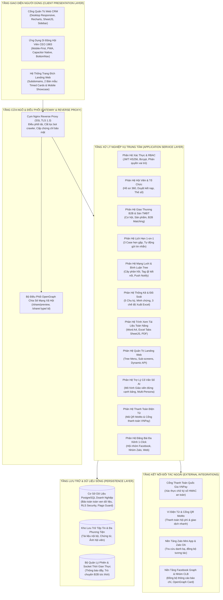
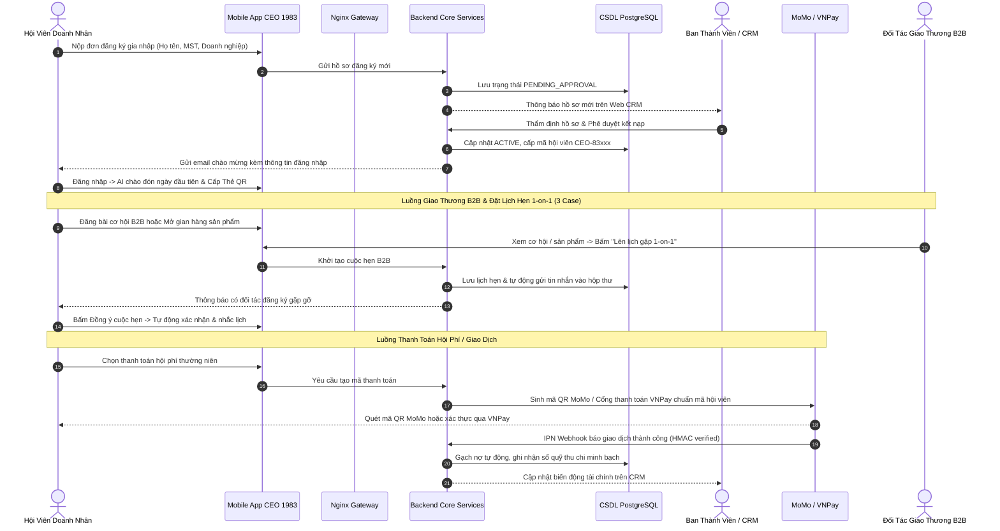
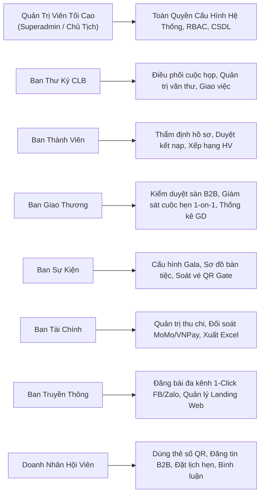

# HỆ SINH THÁI NỀN TẢNG SỐ CLB DOANH NHÂN CEO 1983 (HANOIBA)

## TÀI LIỆU ĐẶC TẢ YÊU CẦU PHẦN MỀM TỔNG THỂ CHÍNH THỨC
*(SOFTWARE REQUIREMENTS SPECIFICATION - MASTER SRS)*

---

* **Mã tài liệu:** `SRS-CEO1983-MASTER-CHINH-THUC`
* **Phiên bản:** `Phiên bản 8.0 Chính Thức (Chuẩn IEEE 830 - Bản Bàn Giao Khách Hàng & Đơn Vị Vận Hành)`
* **Cơ quan chủ quản:** Câu Lạc Bộ Doanh Nhân CEO 1983 — Trực thuộc Hội Doanh Nghiệp Trẻ Hà Nội (HanoiBA)
* **Đơn vị phát triển:** VICONNECT - Đội ngũ Kiến trúc sư & Kỹ sư Giải pháp
* **Phân loại:** Đặc tả Kỹ thuật & Luồng Xử lý Phần Mềm Toàn Diện

---

## CHƯƠNG 1: SƠ ĐỒ TỔNG QUAN KIẾN TRÚC HỆ THỐNG & LUỒNG DỮ LIỆU

### 1.1. Sơ Đồ Tổng Quan Kiến Trúc Hệ Thống (System Overview Architecture Diagram)

Hệ thống được thiết kế theo mô hình Monorepo Domain-Driven Design (DDD) phân tầng độc lập, đảm bảo khả năng chịu tải cao, tính bảo mật cấp doanh nghiệp và tính module hóa tối đa:

---

### 1.2. Sơ Đồ Luồng Dữ Liệu Toàn Diện (End-to-End Data Flow Diagram)

Quy trình dữ liệu khép kín từ khi Hội viên đăng ký, duyệt kết nạp, sinh mã QR định danh, giao thương B2B, thanh toán và báo cáo quản trị:

---

### 1.3. Sơ Đồ Phân Quyền & Ma Trận Vai Trò (Role-Based Access Control Flow)

---

## CHƯƠNG 2: ĐẶC TẢ YÊU CẦU CHỨC NĂNG CỔNG QUẢN TRỊ (WEB CRM)

### 2.1. Phân Hệ Quản Lý Hồ Sơ Hội Viên & Cấp Mã Định Danh (FR-CRM-01)
* **FR-CRM-01.1 Tiếp nhận & Thẩm tra hồ sơ:**
  - Hệ thống thu thập thông tin ứng viên: Họ tên, Số điện thoại, Email, Số CMND/CCCD, Năm sinh (xác thực Quý Hợi 1983), Tên doanh nghiệp, Mã số thuế, Website, Chức vụ lãnh đạo.
  - Phân loại trạng thái hồ sơ: *Chờ sơ tuyển*, *Đang thẩm định*, *Đã kết nạp*, *Từ chối*, *Tạm hoãn*.
* **FR-CRM-01.2 Cơ chế phê duyệt phân quyền độc lập:**
  - Ban Thư Ký hỗ trợ bổ sung giấy tờ nhưng không thể kích hoạt nút duyệt chính thức.
  - Ban Thành Viên thực hiện thao tác bấm duyệt, hệ thống tự động sinh mã định danh hội viên theo định dạng `CEO-83xxx` (trong đó `xxx` là số thứ tự tự tăng duy nhất).
* **FR-CRM-01.3 Phát hành thông báo tự động:**
  - Gửi email thông báo kết nạp chính thức kèm tài khoản đăng nhập và liên kết tải ứng dụng di động.

### 2.2. Trung Tâm Thống Kê & 3 Chế Độ Xuất Báo Cáo Excel (FR-CRM-02)
* **FR-CRM-02.1 Xuất Báo Cáo Excel Theo Chu Kỳ Thời Gian:**
  - Cho phép người dùng chọn kỳ báo cáo: Theo Tháng (từ tháng 1 đến tháng 12), Theo Quý (Quý 1 đến Quý 4) hoặc Theo Năm hoạt động.
  - Tự động kết xuất bảng tính có đầy đủ dòng tiêu đề cơ quan, ngày xuất báo cáo, các cột chỉ số (Số hội viên mới, Số lượt tham gia sự kiện, Số cơ hội B2B mở mới, Tổng giá trị giao dịch thành công) và dòng tổng cộng tự động tính toán.
* **FR-CRM-02.2 Xuất Báo Cáo Phân Tích Chi Tiết Từng Hội Viên:**
  - Tạo tệp bảng tính với mỗi hội viên được phân tách thành từng dòng hoặc từng trang tính (sheet) riêng biệt, ghi nhận chi tiết: Lịch sử nộp hội phí, Danh sách sản phẩm niêm yết, Số cuộc hẹn 1-on-1 đã tham gia và điểm cống hiến.
* **FR-CRM-02.3 Xuất Báo Cáo Biến Động & Tăng Trưởng:**
  - Thể hiện sự biến động (tỷ lệ tăng/giảm phần trăm) so với kỳ trước về quy mô hội viên và dòng tiền giao thương.
* **FR-CRM-02.4 Nhập Dữ Liệu Bảng Tính Thông Minh (Smart Import):**
  - Giao diện kéo thả tệp Excel (`.xlsx`, `.xls`).
  - Hệ thống tự động phân tích hàng đầu tiên để nhận diện các tiêu đề cột: "Họ và tên", "Điện thoại", "Email", "Công ty", "Chức vụ", "Ngành nghề", "Ban chuyên môn".
  - Cho phép người dùng ánh xạ lại các cột nếu tệp nguồn có cấu trúc khác biệt.
  - Hiển thị danh sách xem trước (Preview Data) với cảnh báo các dòng trùng số điện thoại hoặc sai định dạng email trước khi xác nhận lưu vào danh bạ chính thức.

### 2.3. Tích Hợp Đa Kênh Mạng Xã Hội & Đăng Bài 1-Click (FR-CRM-03)
* **FR-CRM-03.1 Cấu hình kênh truyền thông:**
  - Cho phép quản trị viên nhập và lưu trữ đường dẫn liên kết của: Trang Fanpage Facebook chính thức, Nhóm Facebook Hội viên CEO 1983, Nhóm Zalo Ban Chấp Hành, Nhóm Zalo Giao Thương và Trang tin điện tử.
* **FR-CRM-03.2 Đăng bài đồng loạt 1-Click:**
  - Khi soạn thảo xong thông báo sự kiện, tin tức đại hội hoặc thông cáo báo chí, hệ thống cung cấp nút bấm "Đăng bài đa kênh".
  - Một thao tác bấm duy nhất sẽ kích hoạt cơ chế đồng bộ phát hành bản tóm tắt bài viết kèm đường dẫn xem chi tiết lên tất cả các kênh đã thiết lập liên kết.
* **FR-CRM-03.3 Cấu hình Zalo tương tác:**
  - Giao diện quản lý tham số kết nối Zalo của câu lạc bộ, hỗ trợ kiểm tra sức khỏe đường truyền (Check Health) và đảm bảo thông báo nhắc hẹn được gửi trơn tru tới điện thoại hội viên.

### 2.4. Quản Lý Hệ Thống Trang Đích Quảng Bá (Landing Web Manager - FR-CRM-04)
* **FR-CRM-04.1 Cung cấp 2 Bản Mẫu Thiết Kế Cao Cấp:**
  1. *Bản mẫu Thẻ Thời Gian Lật Mở (Timed Cards Opening):* Tái hiện phong cách thẻ lật mở toàn màn hình, thanh tiến trình tự động 5 giây, hỗ trợ con lăn chuột (`onWheel`) và vuốt cảm ứng (`touchSwipe`) để chuyển đổi section mượt mà không cần dùng nút bấm thủ công.
  2. *Bản mẫu Trưng Bày Ứng Dụng Di Động (Startup Mobile Showcase):* Mô phỏng khung điện thoại iPhone 16 Pro với màn hình ứng dụng sống động, dải ruy băng 4 chỉ số vàng của câu lạc bộ, 6 thẻ tính năng 3D, trích dẫn phát biểu của Ban Lãnh Đạo và bộ câu hỏi đáp thường gặp (FAQ).
* **FR-CRM-04.2 Biên tập nội dung Dynamic:**
  - Quản trị viên tự do tùy biến: Tiêu đề dòng 1, dòng 2, mô tả tóm tắt, hình ảnh nền, màu sắc chủ đạo, số điện thoại hotline và email liên hệ.
  - Cấu hình cây menu điều hướng đa cấp (Hierarchical Tree Menu) với khả năng mở ra các trang con (Sub-screens) hiển thị bài viết, hình ảnh hoặc biểu mẫu liên hệ.
* **FR-CRM-04.3 Gán Tên Miền Phụ Độc Lập:**
  - Cho phép cấu hình và áp dụng trang đích vào các tên miền phụ riêng biệt (ví dụ: `gala2026.ceo1983.viconnect.vn`, `mobile.ceo1983.viconnect.vn`).

### 2.5. Trình Xem Tài Liệu Toàn Năng (Universal Document Viewer - FR-CRM-05)
* **FR-CRM-05.1 Xem trực tiếp tài liệu Word:**
  - Khắc phục triệt để lỗi không mở xem được văn bản tải lên.
  - Dựng bố cục trang giấy A4 tiêu chuẩn hành chính, có tiêu đề CLB Doanh Nhân CEO 1983, số văn bản, nội dung điều lệ, hỗ trợ nút mở nhanh qua các trình đọc văn phòng trực tuyến.
* **FR-CRM-05.2 Xem trực tiếp bảng tính Excel:**
  - Hiển thị bảng tính tương tác trực tiếp với thanh cuộn mượt mà, hỗ trợ chuyển đổi linh hoạt giữa nhiều trang tính (Sheet Tabs) và ô tìm kiếm lọc nhanh dữ liệu trong bảng.
* **FR-CRM-05.3 Xem trực tiếp tài liệu PDF:**
  - Giao diện nhúng tài liệu trực quan, cho phép phóng to, thu nhỏ, điều hướng trang và tải về máy tính khi có quyền.

### 2.6. Quản Lý Biểu Quyết Đại Hội & Phân Quyền Vai Trò (FR-CRM-06)
* **FR-CRM-06.1 Điều hành bầu cử đại hội trực tuyến:**
  - Khởi tạo các cuộc bầu cử Ban Chấp Hành hoặc biểu quyết nghị quyết đại hội với thời gian mở/đóng hòm phiếu chính xác theo từng phút.
  - Cơ chế cờ hệ thống bảo vệ độc lập: Khi quản trị viên chủ động xóa hết các biểu quyết cũ, hệ thống giữ nguyên trạng thái trống, vĩnh viễn không tự động khởi tạo lại dữ liệu mẫu.
* **FR-CRM-06.2 Quản lý tài khoản và phân quyền an toàn:**
  - Cột "Vai trò" trên bảng danh sách tài khoản được hiển thị dạng huy hiệu (Badge) có màu sắc nhận diện rõ ràng kèm biểu tượng khiên bảo vệ, không cho phép chọn trực tiếp trên ô để tránh thao tác nhầm lẫn.
  - Việc thay đổi vai trò được thực hiện qua hộp thoại chỉnh sửa có bước xác nhận kiểm soát. Nút "Lưu Quyền" chỉ gửi yêu cầu cập nhật cho các tài khoản có thay đổi thực tế, đảm bảo an toàn tuyệt đối.

---

## CHƯƠNG 3: ĐẶC TẢ YÊU CẦU CHỨC NĂNG ỨNG DỤNG DI ĐỘNG (MOBILE APP)

### 3.1. Thẻ Doanh Nhân Điện Tử & Nhận Diện Mã QR (FR-APP-01)
* **FR-APP-01.1 Thiết kế thẻ số nhận diện doanh nhân:**
  - Hiển thị thẻ hội viên mang phong cách trang nhã, màu sắc Xanh Navy kết hợp ánh Vàng Gold, logo chính thức của CLB và chữ ký chứng thực của Chủ tịch.
  - Thể hiện đầy đủ: Họ tên doanh nhân, Chức danh điều hành, Tên công ty đại diện, Mã số hội viên và thời hạn hoạt động.
* **FR-APP-01.2 Mã QR định danh cá nhân:**
  - Tích hợp mã QR cá nhân hóa. Khi đối tác quét mã này, ứng dụng sẽ mở ngay trang danh thiếp điện tử giới thiệu năng lực doanh nghiệp, sản phẩm dịch vụ và danh bạ liên hệ nhanh.
  - Sử dụng mã QR này để quét check-in tự động tại các cổng đón tiếp sự kiện Gala, Đại hội toàn thể của câu lạc bộ.

### 3.2. Sàn Thương Mại B2B & Chia Sẻ Cơ Hội Hợp Tác (FR-APP-02)
* **FR-APP-02.1 Đăng tải & Quản lý tin cơ hội kinh doanh:**
  - Hội viên tạo bài đăng tìm đối tác, liên kết kinh doanh hoặc gọi vốn đầu tư.
  - Nhập quy mô ngân sách dự kiến, hệ thống tự động định dạng hiển thị thông minh: Tỷ VNĐ (ví dụ: `2 Tỷ VNĐ`), Triệu VNĐ (ví dụ: `850 Tr VNĐ`) hoặc "Thỏa thuận B2B".
  - Đính kèm hình ảnh minh họa thực tế của dự án.
* **FR-APP-02.2 Gian hàng sản phẩm nội khối:**
  - Mỗi doanh nghiệp hội viên được mở gian hàng giới thiệu các sản phẩm, giải pháp chủ lực (giới hạn tối đa 5 sản phẩm tiêu biểu để đảm bảo tính chọn lọc cao).
  - Thể hiện rõ giá niêm yết công khai và mức giá ưu đãi đặc quyền dành riêng cho hội viên CEO 1983 (chiết khấu 10% - 30%).

### 3.3. Đặt Lịch Hẹn & Kết Nối Giao Thương 1-on-1 (3 Tình Huống) (FR-APP-03)
Hệ thống cài đặt quy trình tự động hóa cho 3 trường hợp lên lịch gặp mặt làm việc thực tế:
* **Tình huống 1: Tự chủ động lên lịch tại tính năng Kết nối Doanh nhân:**
  - Hội viên tra cứu danh bạ đối tác theo ngành nghề (ví dụ: Bất động sản, Công nghệ, Xây dựng).
  - Bấm nút "Lên lịch gặp 1-on-1", chọn ngày, giờ và địa điểm mong muốn (văn phòng công ty, trụ sở HanoiBA hoặc quán cafe kết nối).
* **Tình huống 2: Lên lịch gặp xuất phát từ Tin chia sẻ cơ hội:**
  - Khi hội viên đọc một bài viết cơ hội hợp tác phù hợp, bấm trực tiếp nút "Hẹn gặp trao đổi cơ hội". Hệ thống tự động gắn tiêu đề cơ hội vào nội dung cuộc hẹn.
* **Tình huống 3: Lên lịch gặp xuất phát từ Gian hàng Sàn thương mại:**
  - Khi xem chi tiết sản phẩm trên sàn, hội viên bấm "Lên lịch làm việc B2B" để trao đổi hợp đồng cung ứng và chính sách phân phối.
* **Cơ chế tự động gửi tin nhắn & Đồng bộ lịch họp:**
  - Khi cuộc hẹn được khởi tạo, hệ thống **tự động gửi một tin nhắn thông báo chính thức vào hộp thư trò chuyện** của người nhận kèm theo đầy đủ chi tiết cuộc gặp.
  - Khi người được mời bấm "Đồng ý", hệ thống tiếp tục gửi tin nhắn xác nhận vào luồng chat của cả hai bên và tự động bổ sung sự kiện vào lịch công tác cá nhân.

### 3.4. Bản Tin Doanh Nhân, Bình Luận Cây & Nhắc Tên Hội Viên (FR-APP-04)
* **FR-APP-04.1 Mạng xã hội nội bộ chuyên nghiệp:**
  - Đăng bài chia sẻ hoạt động doanh nghiệp, kinh nghiệm quản trị và tìm kiếm sự hỗ trợ nội khối.
  - Danh mục bài đăng rõ ràng: Kinh doanh, Sự kiện, Đào tạo, Giao lưu và mục **"Khác"** (gắn biểu tượng ngôi sao lấp lánh).
* **FR-APP-04.2 Bình luận phân cấp đa tầng (Tree Structure):**
  - Hiển thị danh sách bình luận với phân cấp rõ ràng giữa bình luận gốc và các câu trả lời phản hồi con, có đường kẻ kết nối trực quan tương tự mạng xã hội hiện đại.
  - Khi có phản hồi mới, luồng thảo luận liên quan được tự động ưu tiên hiển thị lên đầu.
* **FR-APP-04.3 Menu 3 chấm & Thao tác nhấn giữ:**
  - Hội viên có thể nhấn giữ vào bình luận của mình hoặc chạm vào biểu tượng menu 3 chấm (`...`) để thực hiện: Chỉnh sửa trực tiếp nội dung hoặc Xóa bình luận.
  - Ô nhập bình luận được thiết kế thanh thoát, không có viền cứng gây rối mắt.
* **FR-APP-04.4 Nhắc tên hội viên thông minh (`@`):**
  - Người dùng gõ trực tiếp ký tự `@` trên ô nhập liệu. Hệ thống tự động mở danh sách gợi ý gồm những hội viên **đã có kết nối thực tế** với tài khoản đang đăng nhập.
  - Cho phép nhắc tên nhiều hội viên cùng lúc với thẻ chip có nút tắt nhanh (`X`).
  - Tự động phát thông báo đẩy (Push Notification) đến tài khoản của hội viên được nhắc tên.

### 3.5. Chia Sẻ Công Khai Ra Mạng Xã Hội (Facebook, Zalo) (FR-APP-05)
* **FR-APP-05.1 Định dạng xem trước chuẩn xác:**
  - Khi chia sẻ cơ hội hoặc bài viết ra Facebook hoặc Zalo qua đường dẫn công khai, hệ thống kích hoạt cơ chế xem trước thông minh: Hiển thị đầy đủ hình ảnh đại diện, tiêu đề bài viết và mô tả chi tiết của chính bài đăng đó.
  - Ngăn chặn hoàn toàn tình trạng bị hiển thị hình ảnh mặc định hay tiêu đề trang chủ rỗng.
* **FR-APP-05.2 Tiếp đón người ngoài hiệp hội:**
  - Người dùng ngoài mạng lưới khi nhấp vào link chia sẻ sẽ được xem bản tóm tắt cơ hội giao thương và được hướng dẫn đăng ký kết nạp để tiếp cận thông tin chi tiết.

### 3.6. Trung Tâm Thống Kê & Minh Chứng Dẫn Chứng Thật (FR-APP-06)
* **FR-APP-06.1 Biểu đồ trực quan 5 chu kỳ:**
  - Cung cấp 5 tùy chọn phân tích thời gian rõ ràng: **Ngày, Tuần, Tháng, Quý, Năm**.
  - Nhãn hiển thị trên trục thời gian được xoay nghiêng một góc 35 độ (`angle={-35}`) giúp chống tràn chữ và dễ quan sát trên màn hình điện thoại.
* **FR-APP-06.2 Bảng chú giải và thông tin trên thẻ Card nền trắng:**
  - Hộp thông tin chi tiết khi chạm/rê chuột vào biểu đồ được thiết kế dạng thẻ Card nền trắng sáng trang nhã, viền xám mỏng, hiển thị tách bạch: Số lượng tin hiển thị đơn vị *"Cơ hội"*, Giá trị tiền hiển thị đơn vị *"Tỷ VNĐ"*.
  - Đã loại bỏ hoàn toàn cột tím chú giải gây nhầm lẫn.
* **FR-APP-06.3 Chạm ô xem minh chứng dẫn chứng thực tế:**
  - Tại khu vực "Chỉ số giao thương & Dẫn chứng", hội viên chạm vào từng ô (Cơ hội đang có, Tổng giá trị ngân sách, Tin tôi đã chia sẻ) để mở danh sách minh chứng thực tế: Liệt kê rõ ràng mã cơ hội, tên dự án, đơn vị chào thầu và ngân sách đã được thẩm định.

### 3.7. Trợ Lý Cố Vấn Số AI & Hướng Dẫn Thao Tác Trực Quan (FR-APP-07)
* **FR-APP-07.1 Lời chào mừng nồng nhiệt ngày đầu tiên:**
  - Khi hội viên hoàn tất kết nạp và đăng nhập lần đầu vào ứng dụng, Trợ lý AI tự động xuất hiện với lời chào trang trọng, điểm qua các lịch hẹn và sự kiện nổi bật trong ngày.
* **FR-APP-07.2 Mô hình hướng dẫn "Giáo viên đứng cạnh bảng":**
  - Biểu tượng trợ lý AI hiển thị linh hoạt bên góc màn hình. Khi người dùng cần trợ giúp, AI mở ra khung bảng hướng dẫn từng bước thao tác các chức năng phức tạp (tạo cơ hội, gửi lời mời hẹn gặp, quét mã check-in) kèm các nút xác nhận "Tiếp tục" / "Tôi đã hiểu".

---

## CHƯƠNG 4: ĐẶC TẢ CỔNG THANH TOÁN ĐIỆN TỬ (MÃ QR MOMO & CỔNG VNPAY)

Hệ thống tuân thủ nghiêm ngặt quy định không sử dụng dịch vụ VietQR trong tài liệu và hệ thống thanh toán, chuyển đổi đồng bộ 100% sang:
1. **Thanh Toán Nhanh Qua Mã QR MoMo:**
   - Hệ thống tự động khởi tạo mã thanh toán QR MoMo tương thích với ứng dụng Ví MoMo và các ứng dụng ngân hàng liên kết.
   - Nội dung thanh toán được tự động mã hóa kèm mã hội viên và mục đích nộp (ví dụ: `CEO1983 HOIPHI 2026 CEO83001`).
2. **Cổng Thanh Toán Trực Tuyến VNPay:**
   - Tích hợp cổng thanh toán VNPay hỗ trợ thẻ ATM nội địa, thẻ quốc tế (Visa, Mastercard, JCB) và ứng dụng Mobile Banking của hơn 40 ngân hàng tại Việt Nam.
   - Bảo mật chữ ký băm mật mã học an toàn trên máy chủ, tự động gạch nợ hội phí và cấp biên lai điện tử ngay sau khi giao dịch hoàn tất.

---

## CHƯƠNG 5: YÊU CẦU PHI CHỨC NĂNG (NON-FUNCTIONAL REQUIREMENTS - NFR)

1. **Hiệu Năng & Tốc Độ Xử Lý (Performance - NFR-01):**
   - Thời gian phản hồi trung bình của hệ thống đối với các tác vụ thông thường (xem danh bạ, đọc tin tức, mở cơ hội) đạt dưới 0.8 giây.
   - Thời gian quét và nhận diện vé điện tử mã QR tại cửa sự kiện đạt dưới 0.3 giây/đại biểu.
2. **An Ninh & Bảo Vệ Dữ Liệu (Security - NFR-02):**
   - Tuân thủ tiêu chuẩn an toàn bảo mật 6 lớp Zero-Trust: Mã hóa mật khẩu chuẩn Bcrypt, xác thực phiên bằng khóa ký mật mã học, lọc sạch dữ liệu chống tấn công chèn mã độc (XSS, SQL Injection).
   - Kiểm soát truy cập chặt chẽ (chống lỗi truy cập chéo IDOR): Mọi thao tác chỉnh sửa hoặc xóa dữ liệu đều phải kiểm tra quyền sở hữu của chính hội viên hoặc vai trò quản trị tương ứng.
3. **Độ Tin Cậy & Tính Sẵn Sàng (Reliability & Availability - NFR-03):**
   - Thời gian hoạt động liên tục của hệ thống đạt tối thiểu 99.9% (24/7/365).
   - Cơ chế sao lưu dữ liệu tự động hằng ngày, bảo toàn 100% số liệu tài chính và danh bạ hội viên.
4. **Tính Thân Thiện & Đẳng Cấp Thương Hiệu (Usability & Branding - NFR-04):**
   - Giao diện người dùng được tối ưu hóa cho màn hình cảm ứng di động và máy tính văn phòng, tuân thủ đúng bảng màu chuẩn nhận diện CLB CEO 1983 (Xanh Navy và Vàng Gold).
   - Tuyệt đối không để lộ các thông báo lỗi kỹ thuật khó hiểu ra màn hình người dùng, mọi thông báo đều được Việt hóa lịch thiệp, trang trọng.
