# TÀI LIỆU ĐẶC TẢ YÊU CẦU PHẦN MỀM (SRS)
## SOFTWARE REQUIREMENTS SPECIFICATION

**Tên dự án:** HỆ SINH THÁI SỐ HÓA HIỆP HỘI DOANH NHÂN CEO 1983 (HANOIBA)  
**Tên tiếng Anh:** CEO 1983 Enterprise Association Digital Ecosystem  
**Phiên bản:** Version 7.0 (V7.0 — Master Enterprise Edition)  
**Ngày lập:** Ngày 05 Tháng 11 Năm 2026  
**Cơ quan ban hành:** Ban Chấp Hành CLB Doanh Nhân CEO 1983 — Hội Doanh Nghiệp Trẻ Hà Nội (HanoiBA)  
**Tác giả:** Đội ngũ Kỹ sư Giải pháp & Kiến trúc Hệ thống ViConnect / Senior Business Analyst & System Architect  

---

## 1. GIỚI THIỆU (INTRODUCTION)

### 1.1 Mục Đích (Purpose)
Tài liệu Đặc tả Yêu cầu Phần mềm (SRS - Software Requirements Specification) này được biên soạn nhằm:
1. **Dành cho Đội ngũ Phát triển Phần mềm (Developers & Engineers)**: Cung cấp đầy đủ đặc tả kiến trúc, luồng xử lý (flows), biểu đồ ca sử dụng (Use Case Diagrams), biểu đồ tuần tự (Sequence Diagrams), cấu trúc bảng dữ liệu (Data Schemas), quy tắc nghiệp vụ (Business Rules) và các điểm kết nối API để triển khai mã nguồn chính xác 100%.
2. **Dành cho Đội ngũ Kiểm thử Chất lượng (QC / QA / Testers)**: Cung cấp tiêu chí nghiệm thu (Acceptance Criteria), các kịch bản thành công (Basic Flows), rẽ nhánh (Alternative Flows) và ngoại lệ (Exception Flows) để xây dựng Test Cases và thực thi kiểm thử toàn diện.
3. **Dành cho Ban Lãnh Đạo & Khách Hàng (Chủ tịch, Ban Điều Hành CLB CEO 1983, HanoiBA)**: Làm căn cứ pháp lý và kỹ thuật cao nhất để đánh giá, theo dõi tiến độ, kiểm soát phạm vi và nghiệm thu bàn giao toàn bộ hệ thống số hóa.

**Mục tiêu ứng dụng:**
Hệ thống giải quyết triệt để bài toán phân mảnh trong quản trị hiệp hội doanh nhân truyền thống: thay thế hoàn toàn danh thiếp giấy bằng Danh thiếp số & Chip NFC; số hóa 100% quy trình kết nạp, thu hội phí và thẩm định; tự động hóa điểm danh sự kiện bằng QR Code trong 1 giây; thúc đẩy giao thương B2B thực chất qua sàn chia sẻ cơ hội; cung cấp Trợ lý AI phân tích điều hành toàn diện CRM và kho tài liệu số đồng bộ Google Drive 2 chiều.

### 1.2 Phạm Vi Dự Án (Scope)
Hệ thống bàn giao bao gồm 3 phân hệ cốt lõi hoạt động đồng bộ:
1. **Web CRM Quản Trị Hiệp Hội (Executive Web CRM)**: Dành cho Chủ tịch, Ban Thường Trực, 6 Ban Chuyên Môn, Ban Thư Ký và Kế toán. Chạy trên nền tảng Web Desktop (React 19, Vite, TanStack Router), cung cấp Dashboard thời gian thực, quản lý 500+ doanh nghiệp hội viên 360 độ, quản trị sự kiện, phê duyệt giao thương, quản lý tài chính thu chi, phân quyền ma trận RBAC, cấu hình AI đa hãng và xuất báo cáo/hóa đơn điện tử.
2. **Ứng Dụng Di Động Hội Viên CEO 1983 (CEO 1983 Mobile App)**: Dành cho hội viên doanh nhân chính thức. Đóng gói đa nền tảng (iOS, Android qua Capacitor 8 và Progressive Web App), mang giao diện chuẩn di động (Mobile-first Shell, TabBar, TopHeader), tích hợp thẻ hội viên điện tử số, quét NFC/QR, sàn giao thương B2B, điểm danh sự kiện, kho quyền lợi hội viên và kết nối bạn bè 2 cấp.
3. **Hạ Tầng Dùng Chung (Core Backend, AI Engine & DevOps)**: Backend NestJS 3 tầng thuần khiết, ORM Prisma kết nối PostgreSQL 16, giao thức thời gian thực WebSocket Socket.IO, hệ thống AI đa model (Gemini 2.0 Flash, OpenAI, Claude, DeepSeek) có cơ chế Fallback và đo lường Quota Token, Docker Nginx Reverse Proxy và SSL Let's Encrypt.

**Những gì phần mềm KHÔNG làm (Out of Scope):**
- Không phải là sàn thương mại điện tử B2C bán lẻ đại trà thu tiền người tiêu dùng cuối.
- Không phải là mạng xã hội giải trí công cộng (không có thuật toán giữ chân giật gân, không quảng cáo ngoài).
- Không can thiệp vào tài khoản ngân hàng nội bộ của doanh nghiệp ngoài luồng xác thực chuyển khoản Mã QR Ngân Hàng/MoMo/VNPay.

### 1.3 Thuật Ngữ & Từ Viết Tắt (Definitions, Acronyms, and Abbreviations)

| Thuật Ngữ / Từ Viết Tắt | Tên Tiếng Anh / Đầy Đủ | Định Nghĩa Trong Hệ Thống CEO 1983 |
| :--- | :--- | :--- |
| **HanoiBA** | Hanoi Young Business Association | Hội Doanh Nghiệp Trẻ Hà Nội — Cơ quan cấp trên bảo trợ trực tiếp CLB CEO 1983. |
| **CLB CEO 1983** | CEO 1983 Business Club | Câu lạc bộ các doanh nhân, chủ doanh nghiệp sinh năm 1983 (Quý Hợi). |
| **SRS** | Software Requirements Specification | Tài liệu Đặc tả Yêu cầu Phần mềm chuẩn IEEE 830. |
| **BRD** | Business Requirements Document | Tài liệu Yêu cầu Nghiệp vụ Hệ thống. |
| **CRM** | Customer Relationship Management | Phân hệ Quản trị Mối quan hệ và Vận hành Hiệp hội trên nền tảng Web Desktop. |
| **RBAC** | Role-Based Access Control | Mô hình kiểm soát truy cập và phân quyền người dùng dựa trên vai trò. |
| **NFC** | Near Field Communication | Công nghệ giao tiếp trường gần (13.56 MHz) chạm để truyền danh thiếp số. |
| **Mã QR Ngân Hàng** | Vietnam National QR Standard | Tiêu chuẩn mã QR thanh toán ngân hàng Napas 24/7 theo quy định Ngân hàng Nhà nước. |
| **OpenGraph** | Open Graph Protocol | Giao thức thẻ siêu dữ liệu (meta tags) giúp Facebook, Zalo hiển thị Rich Preview Card. |
| **SPA** | Single Page Application | Ứng dụng web đơn trang tải động không reload trình duyệt. |
| **JWT** | JSON Web Token | Chuẩn mã hóa token định danh người dùng trong các request API. |
| **Silent Refresh** | Silent Token Refresh | Cơ chế ngầm tự động cấp lại Access Token khi hết hạn mà không ngắt phiên người dùng. |
| **B2B** | Business-to-Business | Mô hình hợp tác, giao thương và kết nối thương mại giữa các doanh nghiệp. |
| **MECE** | Mutually Exclusive, Collectively Exhaustive | Nguyên tắc phân tích không trùng lặp, không bỏ sót bất kỳ luồng nghiệp vụ nào. |

### 1.4 Tài Liệu Tham Khảo (References)
- Bộ luật Dân sự và Luật An ninh Mạng số 24/2018/QH14 của Nước CHXHCN Việt Nam.
- Nghị định 13/2023/NĐ-CP về Bảo vệ dữ liệu cá nhân (PDPD).
- Tiêu chuẩn Quốc tế IEEE Std 830-1998 về Đặc tả Yêu cầu Kỹ thuật Phần mềm.
- Tiêu chuẩn Kế toán Việt Nam Thông tư 200/2014/TT-BTC & 133/2016/TT-BTC về Mẫu Phiếu thu tiền điện tử (01-TT).
- Tài liệu Yêu cầu Nghiệp vụ chuẩn: `BRD_BusinessConnect_v1.0.html` (ViConnect Enterprise Architecture).
- Bộ quy tắc thiết kế hệ thống và Node Matrix: [.agents/rules/node-matrix.md](file:///d:/download/VICONNECT/CEO_VIONE_PROJECT/ceo1983_project/.agents/rules/node-matrix.md).

### 1.5 Tổng Quan Tài Liệu (Overview)
Tài liệu SRS V7.0 bao gồm 6 phần trọng yếu:
- **Phần 1**: Giới thiệu mục đích, phạm vi, thuật ngữ.
- **Phần 2**: Mô tả tổng quan góc nhìn hệ thống, sơ đồ ngữ cảnh (Context Diagram), các nhóm chức năng lớn, chân dung người dùng, môi trường vận hành và ràng buộc kỹ thuật.
- **Phần 3**: Yêu cầu về giao diện bên ngoài (Giao diện người dùng UI 3 màu, phần cứng NFC/máy quét, phần mềm kết nối, giao tiếp mạng).
- **Phần 4**: Đặc tả chi tiết 11 phân hệ chức năng: mỗi phân hệ có mô tả, biểu đồ ca sử dụng Use Case Mermaid, kịch bản (Basic, Alternative, Exception Flows), quy tắc nghiệp vụ và yêu cầu dữ liệu.
- **Phần 5**: Yêu cầu phi chức năng (Hiệu năng, an toàn sao lưu, bảo mật JWT/RBAC, thuộc tính chất lượng).
- **Phần 6**: Phụ lục: Mô hình dữ liệu ERD Mermaid, Biểu đồ tuần tự Sequence Diagrams cho 6 luồng logic phức tạp nhất, và Ma trận truy vết 37 Functional Node ID.

---

## 2. MÔ TẢ TỔNG QUAN (OVERALL DESCRIPTION)

### 2.1 Góc Nhìn Hệ Thống (Product Perspective)
Hệ thống Số hóa CLB Doanh Nhân CEO 1983 là một nền tảng tự chủ, độc lập nhưng tích hợp sâu rộng với hệ sinh thái công nghệ bên ngoài (Ngân hàng, Mạng xã hội, Google Drive, AI Providers, Zalo OA).

Sơ đồ ngữ cảnh hệ thống (Context Diagram):

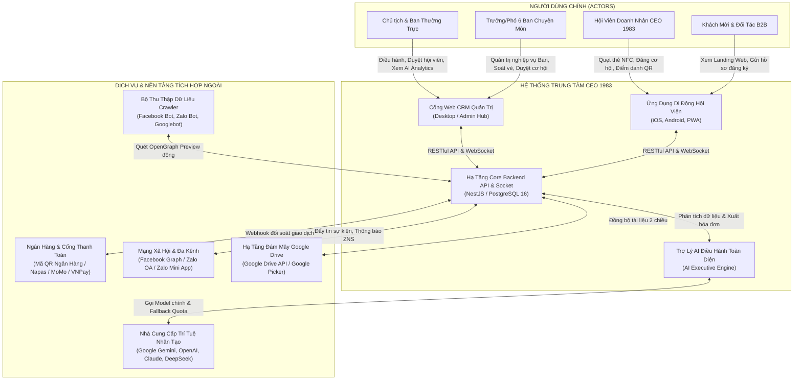

### 2.2 Chức Năng Sản Phẩm (Product Functions Summary)
Hệ thống được tổ chức thành 11 nhóm chức năng lớn (Epics):
1. **Epic-01: Định Danh Doanh Nhân & Thẻ Doanh Nhân Số Thông Minh**: Cấp mã hội viên duy nhất, thẻ hội viên số tích hợp mã QR động chống gian lận, chip NFC một chạm trao đổi danh thiếp số.
2. **Epic-02: Sàn Giao Thương B2B & Cơ Hội Kinh Doanh**: Đăng tải nhu cầu hợp tác, deal chào giá trực tiếp người đăng, bộ 6 chỉ số nền trắng minh bạch, popup dẫn chứng thực tế.
3. **Epic-03: Quản Lý Sự Kiện & Điểm Danh Check-in QR 1s**: Tạo sự kiện, phát hành vé điện tử mã hóa, quét QR xác thực check-in trong 1 giây, bốc thăm trúng thưởng (Lucky Draw).
4. **Epic-04: Danh Bạ Doanh Nhân 1983 & Kết Nối Bạn Bè 2 Cấp**: Bộ lọc Đã kết nối / Chưa kết nối, hiển thị người mới kết nối nhất trên đầu, bộ 3 nút tối giản (Nhắn tin, Profile, Gọi điện).
5. **Epic-05: Trợ Lý AI Điều Hành CRM & Xuất Báo Cáo Con**: Phân tích toàn diện sức khỏe hệ thống (Health Score 94/100), xuất báo cáo thu chi Excel/PDF, xuất Phiếu thu / Hóa đơn điện tử chuẩn mẫu 01-TT có mã QR và chữ ký số.
6. **Epic-06: Cấu Hình AI Đa Model & Cảnh Báo Sắp Hết Quota**: Quản lý API Key đa hãng (Gemini, OpenAI, Claude, DeepSeek), thanh đo hạn mức 3 cấp (Xanh - Vàng - Đỏ), tự động kích hoạt Fallback Model khi cạn quota, bảng Audit Log minh bạch.
7. **Epic-07: Trang Giới Thiệu Chính Thức (`/intro`) & Đăng Ký Online**: Landing Web hoàn chỉnh có Header thanh menu cố định, Hero Banner, Về CLB, 6 Ban chuyên môn, Form Đăng ký gia nhập trực tuyến gửi thẳng về CRM.
8. **Epic-08: Kho Tài Liệu Số Đồng Bộ Google Drive 2 Chiều**: Lưu cấu hình Drive cá nhân của từng hội viên, nạp tài liệu từ Google Drive (Import from Drive) và xuất/đồng bộ tài liệu từ hệ thống về Google Drive cá nhân (Sync to Drive).
9. **Epic-09: Chia Sẻ Public Đa Kênh Chuẩn OpenGraph Động**: Endpoint preview `/api/share/preview` sinh thẻ meta HTML động cho bài viết, cơ hội, sự kiện; tự động redirect khi người dùng nhấp link, triệt tiêu lỗi hiển thị screenshot CRM.
10. **Epic-10: Quản Lý Tài Chính, Thu Chi & Hội Phí Niên Liễm**: Theo dõi nguồn thu hội phí, tiền tài trợ kim cương/vàng, chi phí vận hành, quỹ ngân sách thặng dư an toàn.
11. **Epic-11: Cấu Hình Hệ Thống, Giao Diện Theme Studio & Phân Quyền RBAC**: Quản lý tên miền, cấu hình logo, màu sắc thương hiệu, ma trận phân quyền 6 Ban chuyên môn.

### 2.3 Đặc Điểm Người Dùng (User Classes and Characteristics)

| Nhóm Người Dùng (Actor) | Mô Tả Chân Dung | Kênh Truy Cập Chính | Tần Suất & Hành Vi Sử Dụng |
| :--- | :--- | :--- | :--- |
| **Chủ tịch & Ban Quản Trị** | Chủ tịch CLB, Phó Chủ tịch thường trực; người quyết định chiến lược và chuẩn y ngân sách. | Web CRM (Desktop) | Hàng ngày: Theo dõi Dashboard, xem phân tích AI, chuẩn y chi ngân sách, xem báo cáo giao thương B2B. |
| **Ban Thư Ký & Pháp Chế** | Thư ký hành chính, văn phòng CLB; tiếp nhận hồ sơ, điều phối kỳ họp. | Web CRM + Mobile App | Toàn thời gian: Tiếp nhận hồ sơ đăng ký, phát hành thông báo Zalo OA/App, quản lý phòng họp, nạp tài liệu Google Drive. |
| **Trưởng/Phó 6 Ban Chuyên Môn** | Trưởng các Ban (Thành Viên, Tài Chính, Xúc Tiến, Truyền Thông, Thiện Nguyện, Đối Ngoại). | Web CRM + Mobile App | Hàng tuần: Thẩm định hồ sơ kết nạp, duyệt bài chia sẻ cơ hội B2B, soát vé sự kiện, lập phiếu thu chi. |
| **Hội Viên Doanh Nhân CEO 1983** | Chủ doanh nghiệp sinh năm 1983 đã hoàn thành nghĩa vụ hội phí. | CEO 1983 Mobile App | Hàng ngày: Quẹt danh thiếp NFC, đăng/nhận cơ hội kinh doanh, nhắn tin bạn bè, check-in sự kiện, lưu tài liệu về Google Drive. |
| **Khách Mời & Ứng Viên** | Doanh nhân 1983 quan tâm tham gia, đối tác khách mời sự kiện. | Web Landing (`/intro`) + Mobile Web | Định kỳ: Xem thông tin hiệp hội, nộp hồ sơ gia nhập trực tuyến, đăng ký vé sự kiện mở rộng. |

### 2.4 Môi Trường Vận Hành (Operating Environment)
- **Phía Máy Khách (Client Frontend)**:
  - Mobile App: Chạy trên iOS 15.0+ và Android 10.0+ (đóng gói Capacitor 8) hoặc trình duyệt di động hiện đại (Safari, Chrome Mobile) hỗ trợ PWA và Web NFC API.
  - Web CRM: Chạy mượt mà trên Google Chrome 110+, Microsoft Edge 110+, Mozilla Firefox 115+, Safari 16+ trên màn hình độ phân giải từ 1366x768 trở lên.
- **Phía Máy Chủ (Backend Infrastructure)**:
  - Hệ điều hành máy chủ: Ubuntu 22.04 LTS / Debian 12 (64-bit).
  - Runtime môi trường: Node.js v20.x hoặc v24.x LTS.
  - Cơ sở dữ liệu: PostgreSQL 16 với phần mở rộng `uuid-ossp` và `pgcrypto`.
  - Bộ nhớ đệm & Reverse Proxy: Nginx 1.24+ hỗ trợ HTTP/2, WebSocket proxying và SSL TLS 1.3.

### 2.5 Giới Hạn và Ràng Buộc (Design and Implementation Constraints)
1. **Ràng buộc Bộ Nhận Diện Thương Hiệu 3 Cấp Độ (Brand Guidelines)**:
   - Màu Đỏ Năng Động (`#DC2626` / `#B91C1C`): Thể hiện nhiệt huyết, cờ đỏ sao vàng và biểu tượng rồng lửa 1983.
   - Màu Vàng Hoàng Gia (`#B8860B` / `#D97706`): Thể hiện sự thịnh vượng, đẳng cấp doanh nhân và giá trị kinh tế.
   - Màu Xanh Hội Tụ (`#1F3864` / `#003B95`): Màu cờ sắc áo truyền thống HanoiBA, thể hiện uy tín và chiều sâu tri thức.
2. **Ràng buộc Kiến Trúc Code & Phân Hệ**:
   - Tách biệt độc lập tuyệt đối giữa Web CRM (`apps/ceo1983_app_fe/src/routes/...`) và Mobile App (`apps/ceo1983_app_fe/src/routes/association.*`).
   - Backend tuân thủ kiến trúc NestJS 3 tầng thuần khiết (Controller -> Service -> Database Prisma), tuyệt đối không để lọt SQL Injection.
   - Không hardcode dữ liệu giả (mock data); tất cả số liệu thống kê phải truy vấn thời gian thực từ PostgreSQL.
3. **Ràng buộc Git & Quản Trị Mã Nguồn**:
   - TUYỆT ĐỐI KHÔNG tự động thực thi lệnh `git push` hay `git commit` trong môi trường tự động; toàn quyền kiểm tra thuộc về người dùng.
   - BẮT BUỘC kiểm tra Type-check (`tsc --noEmit`) đạt 0 errors cả FE và BE trước khi nghiệm thu.

### 2.6 Tài Liệu Cho Người Dùng (User Documentation)
- Sổ tay Hướng dẫn Sử dụng Web CRM dành cho Ban Điều Hành (`HDSD_Web_CRM_CEO1983.pdf`).
- Cẩm nang Trải nghiệm Ứng dụng Di động dành cho Hội viên Doanh nhân (`HDSD_Mobile_App_CEO1983.pdf`).
- Bộ video clip ngắn 60s hướng dẫn: Quẹt thẻ NFC, Đăng cơ hội B2B, Check-in QR sự kiện và Đồng bộ Google Drive.

### 2.7 Giả Định và Phụ Thuộc (Assumptions and Dependencies)
- Cổng dịch vụ Mã QR Ngân Hàng / Napas duy trì thời gian hoạt động tối thiểu 99.5%.
- Kết nối Internet di động (4G/5G/Wi-Fi) ổn định tại các địa điểm tổ chức sự kiện để đảm bảo tốc độ check-in 1 giây.
- Khách hàng và Ban Thư Ký cung cấp đầy đủ thông tin tài khoản Google Drive và Zalo OA chính danh của CLB.

---

## 3. CÁC YÊU CẦU VỀ GIAO DIỆN BÊN NGOÀI (EXTERNAL INTERFACE REQUIREMENTS)

### 3.1 Giao Diện Người Dùng (User Interfaces - UI)
- **Tiêu chuẩn UI/UX**:
  - Giao diện Web CRM: Thiết kế theo triết lý Dashboard công thái học (Ergonomic Data Grid), thanh Sidebar điều hướng tối ưu bên trái, các bảng biểu hỗ trợ lọc nhiều tiêu chí, xuất Excel và in ấn trực tiếp.
  - Giao diện Mobile App: Thiết kế chuẩn Native Mobile, tối ưu cho thao tác một tay với Bottom Bar cố định (5 tab chính), hỗ trợ Dark/Light Theme đồng bộ, cỡ chữ tối thiểu 11px đảm bảo độ tương phản đạt chuẩn WCAG AA.
- **Quy tắc 6 Khối Chỉ Số Cơ Hội**: Phải hiển thị nền trắng (`bg-white dark:bg-[#131a26]`), tuyệt đối không dùng nền xanh gây chói mắt. Popup dẫn chứng dữ liệu thật phải có bố cục nền trắng tinh gọn, rõ ràng.

### 3.2 Giao Diện Phần Cứng (Hardware Interfaces)
- **Thẻ Chip NFC NTAG213/NTAG215/NTAG216**: Tần số hoạt động 13.56 MHz, ghi chuẩn NDEF URI định dạng `https://ceo1983.viconnect.vn/card/:slug`. Khi chạm vào mặt lưng điện thoại thông minh (iPhone hoặc Android), thiết bị tự động mở danh thiếp số trong 0.5 giây.
- **Camera & Bộ Quét Mã QR**: Tương thích với camera trước và sau của thiết bị di động, tự động nhận diện mã QR độ phân giải tối thiểu 720p trong mọi điều kiện ánh sáng hội trường.
- **Máy In Hóa Đơn & Phiếu Thu**: Hỗ trợ chuẩn máy in văn phòng khổ A4/A5 thông qua lệnh in hệ điều hành (`window.print()`) để in trực tiếp Phiếu thu tiền điện tử.

### 3.3 Giao Diện Phần Mềm (Software Interfaces)
- **Hệ thống Quản Trị CSDL**: PostgreSQL 16.x qua Prisma Client v6.x.
- **Dịch vụ Trí Tuệ Nhân Tạo (AI Multi-Model Gateway)**:
  - Google Gemini API (Gemini 2.0 Flash / Gemini 1.5 Pro).
  - OpenAI API (GPT-4o / GPT-4o-mini).
  - Anthropic Claude API (Claude 3.5 Sonnet / Haiku).
  - DeepSeek API (DeepSeek V3 / DeepSeek R1).
- **Hạ Tầng Lưu Trữ Google Drive**: Tích hợp Google Drive API v3 và Google Picker SDK để đọc/ghi tệp tin đám mây theo phân quyền OAuth 2.0.
- **Dịch vụ Đa Kênh Zalo**: Tích hợp Zalo OpenAPI, Zalo OA ZNS và Zalo Mini App SDK.

### 3.4 Giao Diện Giao Tiếp (Communications Interfaces)
- **Giao thức Web**: HTTPS trên cổng tiêu chuẩn 443, chứng chỉ bảo mật SSL TLS 1.3 mã hóa 256-bit.
- **Giao thức Thời Gian Thực**: WebSocket qua Socket.IO trên cùng kênh bảo mật HTTPS để truyền nhận thông báo kết nối, tin nhắn và trạng thái check-in realtime.
- **Kiến trúc RESTful API**: Tất cả dữ liệu trao đổi dưới định dạng JSON (`application/json; charset=utf-8`), xác thực qua HTTP Authorization Header với Bearer JWT Token.

---

## 4. CÁC YÊU CẦU CHỨC NĂNG CHI TIẾT (SYSTEM FEATURES)

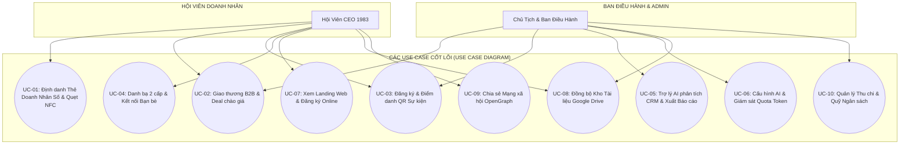

---

### Module 4.1: Quản Lý Định Danh Hội Viên, Thẻ Doanh Nhân Số Số & NFC Tap-to-Connect

#### 4.1.1 Mô Tả Tính Năng
Cung cấp cho mỗi hội viên một thẻ hội viên điện tử số độc bản tích hợp chip NFC vật lý và mã QR động bảo mật. Khi hội viên gặp gỡ đối tác, chỉ cần chạm thẻ NFC vào điện thoại đối tác hoặc đưa mã QR cho đối tác quét, toàn bộ hồ sơ năng lực doanh nghiệp, danh mục sản phẩm, liên hệ và chức vị trong CLB CEO 1983 sẽ được truyền tải tức thì mà không cần cài ứng dụng.

#### 4.1.2 Biểu Đồ Ca Sử Dụng & Kịch Bản Chi Tiết

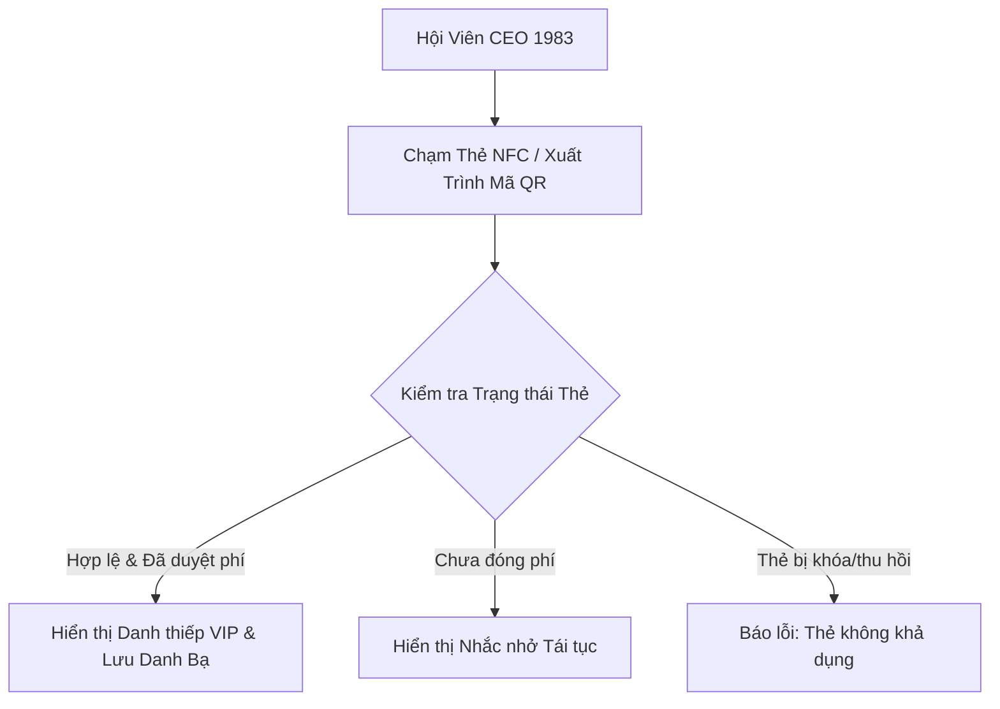

- **Actor**: Hội viên chính thức, Đối tác khách mời quét thẻ.
- **Pre-conditions**: Hội viên đã đăng nhập và được BTV phê duyệt hồ sơ với trạng thái `status = 'paid'`.
- **Post-conditions**: Đối tác nhận được thông tin liên hệ và tệp `.vcf` danh bạ; hệ thống ghi nhận 1 lượt tương tác danh thiếp.
- **Basic Flow**:
  1. Hội viên mở App, chọn tab "Danh thiếp" hoặc chạm mặt lưng thẻ NFC vật lý vào điện thoại đối tác.
  2. Điện thoại đối tác nhận sóng NFC NDEF URI và tự động mở trình duyệt tải trang danh thiếp công khai `/card/:code`.
  3. Hệ thống kiểm tra tính hợp lệ của mã thẻ trong bảng `business_cards` và `vione_users`.
  4. Hiển thị giao diện danh thiếp sang trọng với ảnh đại diện, chức danh, tên doanh nghiệp, huy hiệu hội viên CEO 1983 HanoiBA.
  5. Đối tác nhấn nút "Lưu vào Danh bạ", hệ thống tải về tệp vCard chuẩn để thêm liên hệ vào danh bạ điện thoại của đối tác.
  6. Hệ thống gửi thông báo realtime qua Socket.IO tới App hội viên: "Đối tác vừa quét danh thiếp của bạn".
- **Alternative Flows**:
  - Đối tác không có NFC: Hội viên chuyển sang chế độ "Mã QR Danh Thiếp", đối tác dùng camera thường quét mã QR.
- **Exception Flows**:
  - Thẻ bị thu hồi (`status = 'revoked'`): Hệ thống hiển thị cảnh báo "Thẻ danh thiếp số đã được thu hồi bởi Ban Thư Ký CLB".

#### 4.1.3 Quy Tắc Nghiệp Vụ (Business Rules)
- **BR-CARD-01**: Mỗi tài khoản hội viên chỉ gắn duy nhất 01 mã thẻ định danh số hoạt động chính thức (Primary Active Card).
- **BR-CARD-02**: Mã QR trên thẻ có cơ chế salt timestamp chống chụp màn hình gian lận khi điểm danh sự kiện VIP.
- **BR-CARD-03**: Khi hội viên hết hạn niên liễm quá 30 ngày mà chưa gia hạn, thẻ số tự động chuyển sang trạng thái tạm khóa tính năng trao đổi danh thiếp nâng cao.

#### 4.1.4 Thiết Kế Dữ Liệu Tính Năng
- **Bảng CSDL liên quan**: `public.business_cards`, `public.vione_users`, `public.card_analytics`.
- **Input Parameters**: `userId (UUID)`, `themeId (String)`, `customBio (String, max 500 ký tự)`, `socialLinks (JSON)`.
- **Output Validation**: `code (String, unique 8-12 ký tự)`, `avatarUrl (Valid URL)`, `qrUrl (Valid SVG/PNG Data URI)`.

---

### Module 4.2: Sàn Giao Thương B2B, Chia Sẻ Cơ Hội Kinh Doanh & Deal Chào Giá

#### 4.2.1 Mô Tả Tính Năng
Không gian xúc tiến thương mại nội bộ dành cho các doanh nhân CEO 1983. Cho phép hội viên đăng tải nhu cầu tìm mua, tìm nhà cung cấp, kêu gọi đầu tư hoặc chào hàng độc quyền. Hệ thống hiển thị 6 khối chỉ số minh bạch nền trắng tuyệt đối, popup dẫn chứng vắn tắt và cơ chế "Deal chào giá" gửi trực tiếp đến đúng tài khoản người đăng cơ hội.

#### 4.2.2 Biểu Đồ Ca Sử Dụng & Kịch Bản Chi Tiết

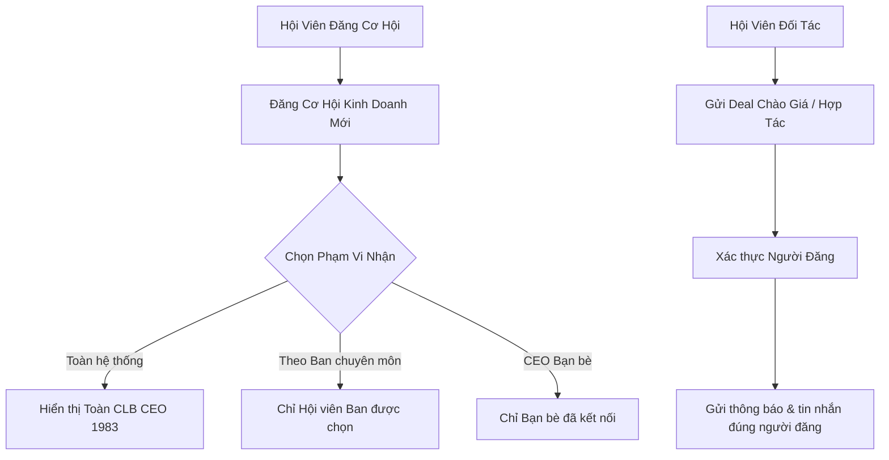

- **Actor**: Hội viên đăng tin, Hội viên tham gia chào deal.
- **Pre-conditions**: Cả hai hội viên đều có tài khoản hợp lệ, không bị khóa quyền giao thương.
- **Post-conditions**: Cơ hội được đăng lên sàn; lượt gửi deal chuyển thành cuộc hội thoại B2B riêng tư giữa 2 chủ doanh nghiệp; số liệu thống kê realtime cập nhật.
- **Basic Flow**:
  1. Hội viên mở App, truy cập màn hình "Cơ Hội Hợp Tác" (`/association/opportunities`).
  2. Hệ thống tải 6 khối chỉ số kinh doanh thực tế (Cơ hội đang mở, Tổng giá trị, Tôi đã chia sẻ, Tôi đang deal, Giá trị đã nhận, Deal đã fail) với giao diện nền trắng (`bg-white dark:bg-[#131a26]`).
  3. Khi bấm vào ô "Cơ hội đang mở", hệ thống mở popup hiển thị danh sách các cơ hội thực tế đang hoạt động kèm giá trị, ngành nghề và người đăng.
  4. Để tạo mới hoặc chỉnh sửa cơ hội, hội viên nhấn "Đăng cơ hội" hoặc icon Chỉnh sửa. Modal `OpportunityEditModal` hiển thị đầy đủ các trường: Tải lên nhiều ảnh, Người giới thiệu, Số điện thoại giới thiệu, Mức hoa hồng kết nối (%), Phạm vi đối tượng nhận (Công khai / Theo ban / Theo bạn bè), Mô tả chi tiết, Link Fanpage/Website.
  5. Hội viên hoàn tất và nhấn "Lưu cơ hội". Hệ thống ghi nhận vào bảng `opportunities`.
  6. Hội viên khác khi xem cơ hội nhấn "Deal Chào Giá", hệ thống tự động trích xuất `author_id` và mở phiên kết nối trực tiếp đến đúng tài khoản của người đăng cơ hội, tuyệt đối không gửi nhầm người khác.
- **Alternative Flows**:
  - Hội viên chỉnh sửa cơ hội hiện có: Hệ thống nạp lại toàn bộ dữ liệu ban đầu, cho phép xóa/bổ sung ảnh và cập nhật lại mức hoa hồng.
- **Exception Flows**:
  - Cơ hội đã đóng (`status = 'closed'`): Nút "Deal Chào Giá" chuyển sang trạng thái "Cơ hội đã kết nối thành công (Đã đóng)" và vô hiệu hóa gửi deal mới.

#### 4.2.3 Quy Tắc Nghiệp Vụ (Business Rules)
- **BR-B2B-01**: Bắt buộc tuân thủ giao diện NỀN TRẮNG cho tất cả 6 khối chỉ số và popup dẫn chứng; CẤM NỀN XANH trên giao diện theo chỉ đạo của Ban Điều Hành.
- **BR-B2B-02**: Mức hoa hồng kết nối hợp tác phải là số nguyên từ 0% đến 50%.
- **BR-B2B-03**: Chỉ có chính tác giả của cơ hội hoặc Super Admin CRM mới có quyền sửa đổi nội dung hoặc đóng trạng thái cơ hội.
- **BR-B2B-04**: Khi một cơ hội chuyển sang trạng thái Đã đóng/Hủy, biểu đồ thống kê lập tức loại bỏ bản ghi này, không giữ lại số liệu ảo.

#### 4.2.4 Thiết Kế Dữ Liệu Tính Năng
- **Bảng CSDL liên quan**: `public.opportunities`, `public.opportunity_deals`, `public.vione_users`.
- **Input Parameters**: `title (String, 5-200 ký tự)`, `value (Numeric, >= 0)`, `images (Array<String>)`, `commissionRate (Numeric 0-50)`, `recipientType ('all' | 'departments' | 'friends')`, `recipientIds (Array<String>)`.
- **Output Validation**: `id (UUID)`, `status ('open' | 'negotiating' | 'completed' | 'closed')`, `createdAt (ISO Timestamp)`.

---

### Module 4.3: Quản Lý Sự Kiện, Diễn Đàn & Điểm Danh Check-in QR 1 Giây (Vé Điện Tử)

#### 4.3.1 Mô Tả Tính Năng
Quản lý toàn bộ vòng đời sự kiện của CLB: từ khởi tạo diễn đàn kinh tế, hội thảo chuyên đề, gala dinner, phát hành vé điện tử cho hội viên, gửi thiệp mời trực tuyến đến khâu kiểm soát vé tại cửa bằng camera quét mã QR trong đúng 1 giây (1s Check-in).

#### 4.3.2 Biểu Đồ Ca Sử Dụng & Kịch Bản Chi Tiết

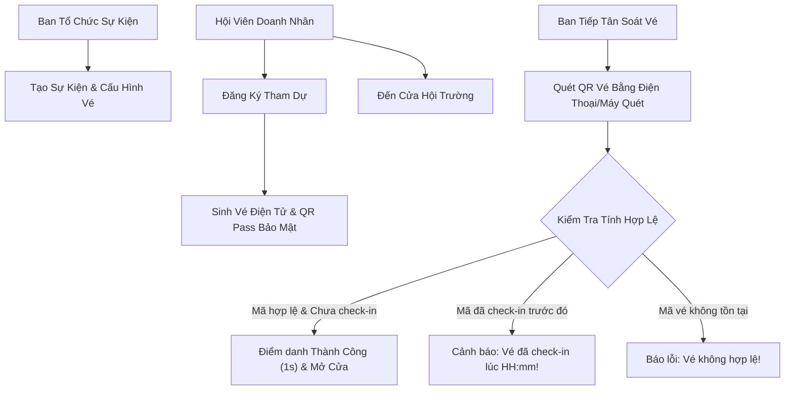

- **Actor**: Ban Tổ Chức (BTC), Hội viên tham dự, Ban Lễ Tân kiểm soát vé.
- **Pre-conditions**: Sự kiện đã được xuất bản trên hệ thống; hội viên đã đăng ký vé thành công.
- **Post-conditions**: Trạng thái vé chuyển sang `is_checked_in = true`, thời gian điểm danh được lưu trữ, số ghế VIP được hiển thị.
- **Basic Flow**:
  1. Ban Tổ Chức tạo sự kiện trên CRM (`/events`), cấu hình thời gian, địa điểm, banner, hạn mức vé và lịch trình (Agenda).
  2. Hội viên mở App, vào mục "Sự Kiện", xem chi tiết và nhấn "Đăng ký tham dự".
  3. Hệ thống tạo bản ghi trong `event_registrations`, sinh mã vé duy nhất (ví dụ: `TICKET-1983-8888`) và tạo mã QR Pass bảo mật.
  4. Tại ngày diễn ra sự kiện, hội viên mở vé điện tử trên App.
  5. Ban Lễ Tân sử dụng tính năng "Quét QR Check-in" trên CRM hoặc App quét mã vé của hội viên.
  6. Hệ thống đối soát mã trong cơ sở dữ liệu: Xác nhận đúng người, đúng sự kiện, chưa điểm danh; chuyển trạng thái `checked_in = true` và phát âm thanh "Tít" thành công trong vòng dưới 1 giây.
  7. Màn hình lễ tân hiện thông tin hội viên, tên công ty và số bàn/số ghế được Ban Tổ Chức phân công.
- **Alternative Flows**:
  - Hội viên quên mở App: Lễ tân tra cứu nhanh bằng Số điện thoại hoặc Tên doanh nghiệp trên ô tìm kiếm check-in và nhấn "Điểm danh thủ công".
- **Exception Flows**:
  - Mã vé đã được check-in trước đó: Hệ thống bật còi báo đỏ "CẢNH BÁO: Vé này đã được check-in vào lúc 18:05:22 bởi người khác!", ngăn chặn tình trạng gian lận vé trùng.

#### 4.3.3 Quy Tắc Nghiệp Vụ (Business Rules)
- **BR-EVT-01**: Mỗi mã vé điện tử chỉ được điểm danh thành công duy nhất 01 lần.
- **BR-EVT-02**: Khi sự kiện đạt số lượng đăng ký tối đa (`max_attendees`), hệ thống tự động khóa cổng đăng ký và chuyển sang trạng thái "Hết vé".
- **BR-EVT-03**: Tính năng Bốc thăm may mắn (Lucky Draw) chỉ được phép quay thưởng trên danh sách những hội viên ĐÃ CHECK-IN thực tế tại sự kiện.

#### 4.3.4 Thiết Kế Dữ Liệu Tính Năng
- **Bảng CSDL liên quan**: `public.events`, `public.event_registrations`, `public.lucky_draw_winners`.
- **Input Parameters**: `eventId (UUID)`, `userId (UUID)`, `ticketCode (String)`, `checkedInBy (UUID)`.
- **Output Validation**: `checkedInAt (TIMESTAMPTZ)`, `seatAssignment (String)`, `isLuckyWinner (Boolean)`.

---

### Module 4.4: Danh Bạ Doanh Nhân 1983 & Kết Nối Bạn Bè 2 Cấp

#### 4.4.1 Mô Tả Tính Năng
Danh bạ số thông minh của toàn thể doanh nhân CLB CEO 1983. Hệ thống phân chia thành Bộ lọc 2 cấp: Cấp 1 gồm (Đã kết nối) và (Chưa kết nối). Tab "Đã kết nối" ưu tiên hiển thị Bạn bè lên đầu tiên kèm khối "✨ Vừa kết nối mới nhất", tiếp đến là Lời mời, Đã gửi và Danh thiếp đã lưu. Bộ icon thao tác bạn bè được tối giản 1 màu đồng nhất (Nhắn tin, Profile, Gọi điện) kèm nút Hủy kết nối.

#### 4.4.2 Biểu Đồ Ca Sử Dụng & Kịch Bản Chi Tiết

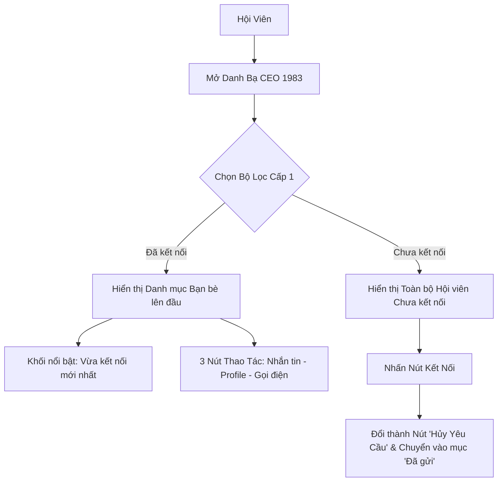

- **Actor**: Hội viên doanh nhân CEO 1983.
- **Pre-conditions**: Người dùng đã đăng nhập vào Mobile App.
- **Post-conditions**: Lời mời kết nối được gửi hoặc hủy; danh sách bạn bè được cập nhật realtime.
- **Basic Flow**:
  1. Hội viên mở tab "Danh bạ" (`/association/members`).
  2. Người dùng chuyển đổi giữa 2 tab lớn: **(Đã kết nối)** và **(Chưa kết nối)**.
  3. Tại tab **Đã kết nối**:
     - Danh mục Bạn bè hiển thị đầu tiên, ngay trên đầu là khối "✨ Vừa kết nối mới nhất" hiển thị người bạn doanh nhân vừa kết nối thành công gần nhất.
     - Mỗi thẻ bạn bè chỉ gồm 3 nút thao tác cùng 1 màu tối giản: Nhắn tin (`MessageSquare`), Xem Profile (`User`), Gọi điện (`PhoneCall`) + 1 nút Hủy kết nối (`UserX`) màu riêng biệt.
     - Không bị lỗi lặp tên: Nếu tên người và tên công ty giống nhau, hệ thống tự động ẩn dòng tên phụ bên dưới.
  4. Tại tab **Chưa kết nối**:
     - Hiển thị danh sách tất cả các hội viên trong CLB mà tài khoản chưa kết nối.
     - Người dùng nhấn nút "Kết nối": Hệ thống gửi thông báo mời kết nối, nút chuyển ngay thành nút "Hủy" (hủy yêu cầu chờ xác nhận), và bản ghi xuất hiện trong mục "Đã gửi".
- **Alternative Flows**:
  - Đối phương bấm "Đồng ý" lời mời kết nối: Hệ thống kích hoạt event Socket `vba:connection_accepted`, cập nhật `vba_latest_connected_id` vào LocalStorage và đưa người đó lên khối "Vừa kết nối mới nhất" của cả hai bên.
- **Exception Flows**:
  - Người dùng bấm "Hủy yêu cầu": Bản ghi chờ xác nhận bị xóa khỏi CSDL, nút quay lại trạng thái "Kết nối".

#### 4.4.3 Quy Tắc Nghiệp Vụ (Business Rules)
- **BR-DIR-01**: Bỏ hoàn toàn nút Xem danh thiếp số và Hẹn gặp 1-1 trên thẻ bạn bè để tối giản giao diện, chỉ giữ 3 nút thao tác cốt lõi.
- **BR-DIR-02**: Khi gửi kết nối chờ xác nhận, nút "Chờ xác nhận" phải được thay thế bằng nút "Hủy" để người gửi chủ động rút lại lời mời khi cần.

#### 4.4.4 Thiết Kế Dữ Liệu Tính Năng
- **Bảng CSDL liên quan**: `public.user_connections`, `public.vione_users`.
- **Input Parameters**: `requesterId (UUID)`, `receiverId (UUID)`, `status ('pending' | 'accepted' | 'declined')`.
- **Output Validation**: `connectionId (UUID)`, `updatedAt (TIMESTAMPTZ)`.

---

### Module 4.5: Trợ Lý AI Điều Hành Toàn Diện CRM & Xuất Báo Cáo Con

#### 4.5.1 Mô Tả Tính Năng
Hệ thống Trí tuệ Nhân tạo phục vụ trực tiếp cho Chủ tịch và Ban Điều Hành tại Cổng Quản trị CRM (`/ai-assistant`). AI quét và phân tích sâu toàn bộ cơ sở dữ liệu thực tế: hội viên, biến động tài chính, lịch họp ban, giao thương B2B và nhật ký thao tác `activity_log`. Hỗ trợ xuất báo cáo theo từng chức năng con: Báo cáo thu chi tổng hợp (Excel/PDF) và Xuất Phiếu thu / Hóa đơn điện tử chuẩn mẫu 01-TT của Bộ Tài Chính có mã QR và chữ ký số.

#### 4.5.2 Biểu Đồ Ca Sử Dụng & Kịch Bản Chi Tiết

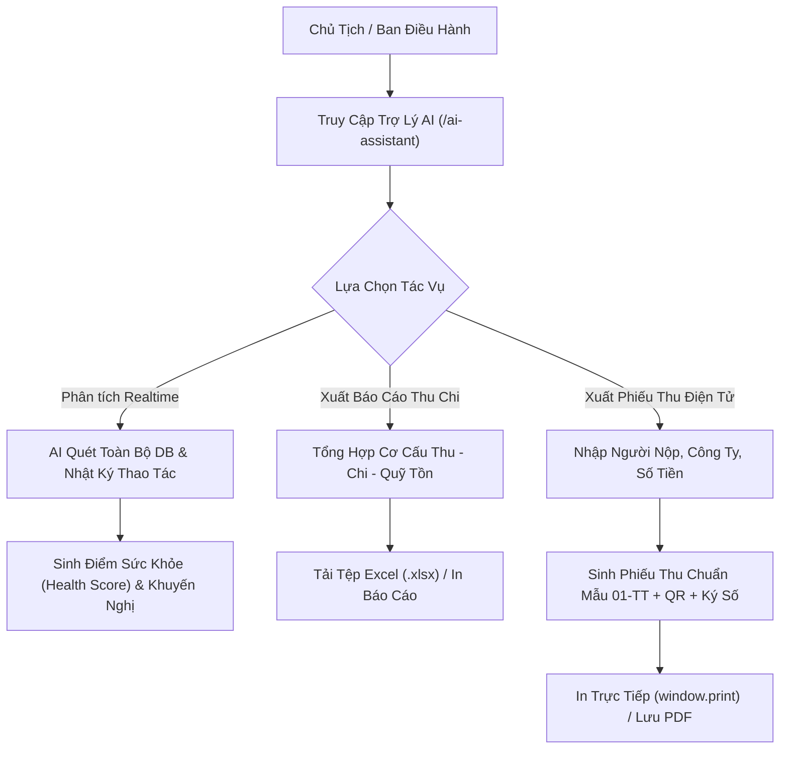

- **Actor**: Chủ tịch CLB, Trưởng Ban Tài Chính, Ban Thư Ký.
- **Pre-conditions**: Người dùng đăng nhập tài khoản có quyền truy cập CRM (`quan_tri`, `admin`, `truong_ban_tai_chinh`).
- **Post-conditions**: Dữ liệu phân tích được cập nhật; tệp Excel báo cáo được tải về hoặc Phiếu thu điện tử được in ra.
- **Basic Flow**:
  1. Người dùng mở menu "Trợ Lý AI Điều Hành" trên Sidebar CRM.
  2. Tab 1 - "Phân Tích Thông Minh CRM": Nhấn nút "Quét & Phân Tích Realtime". AI Engine gọi API `GET /api/ai/crm/analyze`, tổng hợp số liệu thực tế: Tổng số hội viên, Quỹ thặng dư hiện tại, Số kỳ họp đã tổ chức, Tổng giá trị giao thương B2B và 20 hoạt động mới nhất trong `activity_log`.
  3. Màn hình hiển thị: Điểm số sức khỏe CLB (ví dụ: 94/100), Tóm tắt điều hành (Executive Summary), 4 khối trụ cột, Điểm mạnh nổi bật, Điểm nghẽn cần khắc phục và 3 Khuyến nghị hành động chiến lược.
  4. Tab 2 - "Báo Cáo Thu Chi & Ngân Sách": Hiển thị bảng cân đối ngân sách, cơ cấu nguồn thu (hội phí, tài trợ) và cơ cấu khoản chi. Người dùng nhấn "Xuất File Excel", hệ thống tải về tệp `.xlsx` định dạng chuẩn.
  5. Tab 3 - "Xuất Hóa Đơn / Phiếu Thu Điện Tử": Người dùng nhập thông tin người nộp, công ty, mã số thuế, số tiền nộp và lý do. Nhấn "Cập Nhật & Xem Trước".
  6. Hệ thống sinh bản in mẫu Phiếu thu tiền điện tử chuẩn Bộ Tài Chính: Đầy đủ Quốc hiệu - Tiêu ngữ, Tên CLB Doanh Nhân CEO 1983 HanoiBA, Số phiếu thu (`PT-1983-xxxx`), Số tiền bằng chữ, Mã QR tra cứu thanh toán và Con dấu xác thực chữ ký điện tử.
  7. Người dùng nhấn "In Phiếu Thu / Lưu PDF" để in trực tiếp qua máy in.
- **Alternative Flows**:
  - Không có kết nối mạng tới Model ngoài: Hệ thống tự động sử dụng bộ phân tích thuật toán nội bộ trên cơ sở dữ liệu PostgreSQL đảm bảo báo cáo không bị gián đoạn.
- **Exception Flows**:
  - Người dùng không có quyền tài chính: Tab xuất hóa đơn bị ẩn hoặc khóa quyền sửa đổi số tiền.

#### 4.5.3 Quy Tắc Nghiệp Vụ (Business Rules)
- **BR-AI-01**: Báo cáo thu chi và phiếu thu tiền điện tử phải làm tròn số tiền chính xác theo VNĐ và tự động chuyển đổi sang chuỗi đọc bằng chữ tiếng Việt không sai sót.
- **BR-AI-02**: Mọi yêu cầu phân tích AI và xuất báo cáo đều được ghi nhận vào bảng `ai_request_audit` để đảm bảo tính minh bạch.

#### 4.5.4 Thiết Kế Dữ Liệu Tính Năng
- **Bảng CSDL liên quan**: `public.income_records`, `public.expense_records`, `public.activity_log`, `public.ai_request_audit`.
- **API Endpoints**: `GET /api/ai/crm/analyze`, `POST /api/ai/crm/export-report`.

---

### Module 4.6: Cấu Hình Hệ Thống AI Đa Hãng, Đo Lường Quota Token & Cảnh Báo Sắp Hết Model

#### 4.6.1 Mô Tả Tính Năng
Cho phép Quản trị viên cấu hình linh hoạt API Key của nhiều hãng trí tuệ nhân tạo (Google Gemini, OpenAI, Anthropic Claude, DeepSeek, OpenRouter) tại Cài đặt hệ thống CRM (`/settings`). Hệ thống trang bị thanh đo hạn mức token, tự động tính toán tỷ lệ tiêu thụ trong tháng và phát tín hiệu cảnh báo 3 cấp độ (Xanh - Vàng - Đỏ) để người dùng kịp thời tích hợp API Key của model khác vào dùng tiếp mà không làm gián đoạn CRM.

#### 4.6.2 Biểu Đồ Ca Sử Dụng & Kịch Bản Chi Tiết

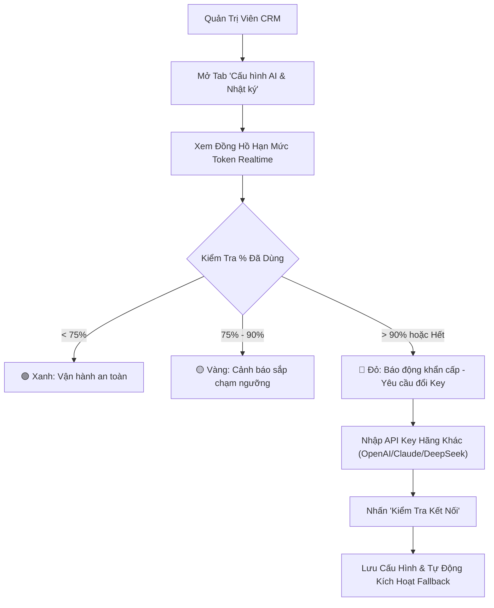

- **Actor**: Super Admin hệ thống.
- **Pre-conditions**: Người dùng đăng nhập tài khoản có quyền Quản trị cao nhất (`quan_tri`).
- **Post-conditions**: Cấu hình AI được cập nhật trong `public.app_settings` key `crm_ai_system_config`.
- **Basic Flow**:
  1. Admin mở `/settings`, chọn tab "Cấu hình AI & Nhật ký" (icon `Sparkles`).
  2. Màn hình hiển thị Đồng hồ giám sát token: Tổng số token đã dùng trong tháng, hạn mức tối đa và tỷ lệ phần trăm đã dùng.
  3. Nếu tỷ lệ vượt ngưỡng vàng (75%): Hệ thống hiển thị banner cảnh báo nhắc nhở chuẩn bị key dự phòng.
  4. Nếu tỷ lệ vượt ngưỡng đỏ (95%): Hệ thống bật banner đỏ báo động khẩn cấp: "Hạn mức Model chính sắp cạn! Hãy tích hợp API Key của model khác ngay bên dưới để hệ thống kích hoạt Fallback liền mạch."
  5. Admin chọn Model hoạt động chính (ví dụ Gemini 2.0 Flash) và Model dự phòng tự động (ví dụ OpenAI GPT-4o-mini hoặc DeepSeek V3).
  6. Admin nhập API Key tương ứng và nhấn "Kiểm tra kết nối". Hệ thống gọi `POST /api/ai/test-connection` thử nghiệm độ trễ (latency).
  7. Nhấn "Lưu Cấu Hình AI & Dự Phòng". Hệ thống lưu trữ an toàn vào cơ sở dữ liệu.
  8. Phía dưới hiển thị bảng Nhật ký AI (Audit Log) ghi nhận chi tiết: thời gian, người gọi, tác vụ, model xử lý, độ trễ và số token tiêu thụ.
- **Exception Flows**:
  - Model chính bị lỗi 429 Quota Exceeded trong quá trình người dùng gọi API: Backend tự động chuyển hướng request sang Model dự phòng (Fallback Model) và ghi nhận `used_fallback = true` vào nhật ký audit.

#### 4.6.3 Quy Tắc Nghiệp Vụ (Business Rules)
- **BR-CONF-01**: API Keys lưu trữ trong cơ sở dữ liệu phải được che dấu (masking) trên giao diện để bảo mật thông tin.
- **BR-CONF-02**: Cơ chế chuyển vùng dự phòng (Fallback) phải diễn ra hoàn toàn tự động ở tầng Backend, không hiển thị lỗi gián đoạn ra phía người dùng cuối.

---

### Module 4.7: Landing Web Giới Thiệu Chính Thức (`/intro`) & Đăng Ký Gia Nhập Online

#### 4.7.1 Mô Tả Tính Năng
Thay thế đường dẫn cũ `/h/ceo1983` bằng URL thương hiệu chuẩn mực: `https://ceo1983.viconnect.vn/intro`. Xây dựng trang Landing Web hoàn chỉnh có Header thanh menu cố định (Trang chủ, Về chúng tôi, 6 Ban chuyên môn, Sự kiện, B2B, Đặc quyền, Đăng ký gia nhập, Tải App), Hero Banner hoành tráng, các section giới thiệu giá trị cốt lõi, cơ cấu ban bệ, form đăng ký gia nhập trực tuyến gửi thẳng về CRM và Footer trang trọng.

#### 4.7.2 Biểu Đồ Ca Sử Dụng & Kịch Bản Chi Tiết

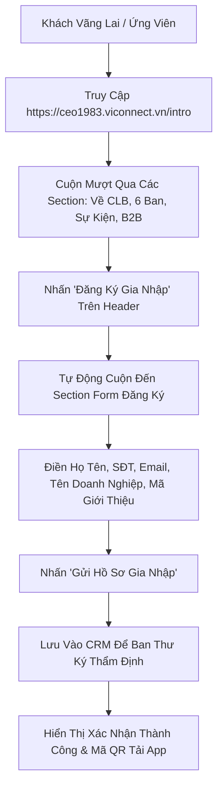

- **Actor**: Khách vãng lai, Doanh nhân ứng viên 1983.
- **Pre-conditions**: Khách có kết nối Internet và truy cập trình duyệt Web bất kỳ.
- **Post-conditions**: Hồ sơ đăng ký được tạo trong bảng `membership_applications` hoặc `vione_users` với trạng thái chờ duyệt; Ban Thư Ký nhận thông báo trên CRM.
- **Basic Flow**:
  1. Khách truy cập `https://ceo1983.viconnect.vn/intro`.
  2. Header cố định hiển thị: Logo HanoiBA & CLB CEO 1983, Menu điều hướng (Trang Chủ, Về Chúng Tôi, 6 Ban Chuyên Môn, Sự Kiện, Sàn B2B, Đặc Quyền, Đăng Ký Gia Nhập), Nút "Đăng Nhập" và "Mở App Hội Viên".
  3. Khách khám phá Hero Banner với 4 chỉ số nổi bật (500+ Hội viên, 1.850+ Tỷ giao thương, 60+ Sự kiện, 6 Ban chuyên môn).
  4. Khách nhấp vào "Đăng Ký Gia Nhập", trang tự động cuộn mượt đến Section Form đăng ký trực tuyến.
  5. Khách điền thông tin: Họ tên, Số điện thoại, Email, Chức vụ, Ngày sinh, Tên công ty, Mã số thuế, Lĩnh vực kinh doanh, Quy mô nhân sự và Mã giới thiệu (nếu có).
  6. Nhấn "Gửi Hồ Sơ Gia Nhập". Hệ thống kiểm tra hợp lệ, tải file đính kèm (giấy ĐKKD nếu có) và lưu hồ sơ vào hệ thống CRM.
  7. Khách nhận thông báo xác nhận thành công và mã QR liên kết tải App CEO 1983.
- **Alternative Flows**:
  - Người dùng truy cập URL cũ `/h/ceo1983`: Hệ thống tự động render Landing Web đầy đủ kèm thanh menu thay vì chỉ hiển thị form đơn điệu.

#### 4.7.3 Quy Tắc Nghiệp Vụ (Business Rules)
- **BR-LAND-01**: Đường dẫn chính thức của Landing Web là `/intro`; tất cả các nút copy link trong Cấu hình Landing Page của CRM phải tạo đúng URL này.
- **BR-LAND-02**: Form đăng ký phải xác thực số điện thoại hợp lệ theo định dạng mạng viễn thông Việt Nam (10 chữ số).

---

### Module 4.8: Kho Tài Liệu Số Đồng Bộ Google Drive 2 Chiều (CRM & Mobile App)

#### 4.8.1 Mô Tả Tính Năng
Liên kết Kho tài liệu nội bộ của Hiệp hội với tài khoản Google Drive cá nhân của từng hội viên. Cung cấp 2 hành động trọng tâm:
1. **Nạp từ Google Drive (Import from Drive)**: Nhập liên kết file hoặc thư mục Google Drive để trích xuất thông tin và lưu ngay vào kho tài liệu hệ thống mà không cần download về máy rồi upload lại.
2. **Đồng bộ về Drive (Sync to Drive)**: Cho phép hội viên bấm nút "Đồng bộ về Drive" trên bất kỳ văn bản/biểu mẫu nào (ở CRM hoặc Mobile App) để chuyển bản sao tài liệu vào Google Drive cá nhân của mình chỉ với 1 cú click.

#### 4.8.2 Biểu Đồ Ca Sử Dụng & Kịch Bản Chi Tiết

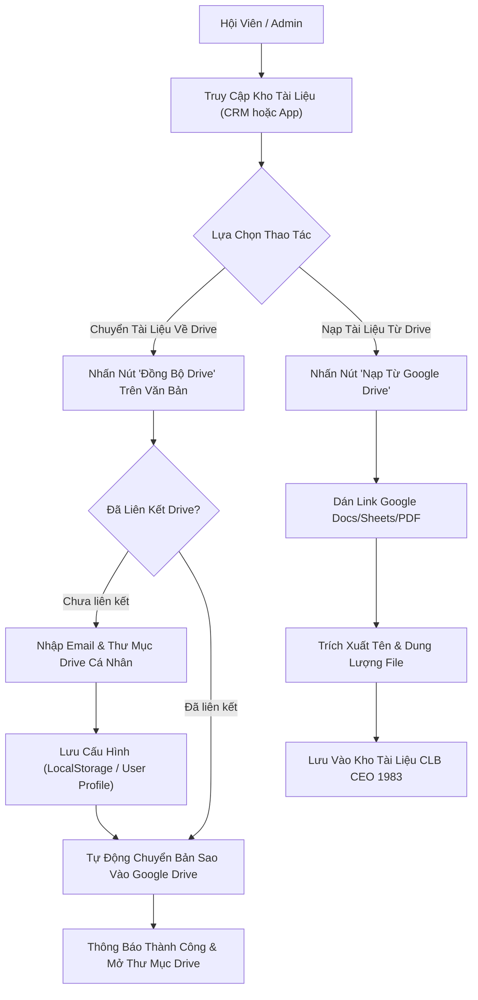

- **Actor**: Hội viên doanh nhân, Ban Thư Ký.
- **Pre-conditions**: Người dùng có tài khoản Google Drive cá nhân.
- **Post-conditions**: Tài liệu được chuyển về thư mục Google Drive cá nhân hoặc liên kết Drive được lưu vào kho tài liệu chung.
- **Basic Flow (Sync to Drive)**:
  1. Người dùng mở Kho tài liệu trên CRM (`/documents`) hoặc App (`/association/library`).
  2. Trên dòng tài liệu mong muốn, người dùng nhấn nút "Đồng bộ Drive" (icon `HardDrive`).
  3. Modal `MemberGoogleDriveSyncModal` mở ra. Nếu người dùng chưa cấu hình, hệ thống yêu cầu nhập Email Google Drive và Tên thư mục đích (mặc định: "Tài liệu CLB Doanh Nhân CEO 1983").
  4. Người dùng nhấn "Xác nhận chuyển về Drive". Hệ thống tạo bản sao lưu trữ đám mây.
  5. Thông báo toast xuất hiện: "Đã chuyển tài liệu [Tên tài liệu] vào Google Drive cá nhân ([Email]) thành công!", kèm nút hành động "Mở Drive" để mở trực tiếp thư mục trên Google Drive.
- **Basic Flow (Import from Drive)**:
  1. Người dùng nhấn "Nạp từ Google Drive" trên thanh công cụ.
  2. Người dùng dán liên kết chia sẻ từ Google Drive (`https://drive.google.com/file/d/...`).
  3. Nhập tên hiển thị văn bản và chọn danh mục. Nhấn "Nạp Tài Liệu Vào Kho".
  4. Hệ thống lưu tài liệu dạng `driveUrl`, toàn thể hội viên có quyền xem có thể mở trực tiếp mà không tốn dung lượng máy chủ nội bộ.

#### 4.8.3 Quy Tắc Nghiệp Vụ (Business Rules)
- **BR-DRIVE-01**: Cấu hình Google Drive cá nhân của hội viên được lưu trữ an toàn trong LocalStorage (`ceo1983_member_drive_config`) và đồng bộ về hồ sơ người dùng.
- **BR-DRIVE-02**: Khi mở tài liệu có `driveUrl`, hệ thống mở liên kết an toàn trên tab mới với cờ `noopener noreferrer`.

---

### Module 4.9: Chia Sẻ Mạng Xã Hội Đa Kênh Với Thẻ OpenGraph Preview Động

#### 4.9.1 Mô Tả Tính Năng
Khắc phục triệt để lỗi khi hội viên chia sẻ bài viết, cơ hội, sự kiện, khóa đào tạo lên các nền tảng mạng xã hội (Facebook, Zalo, LinkedIn, Telegram) bị hiển thị ảnh chụp màn hình CRM Dashboard cũ. Hệ thống cung cấp endpoint chuyên trách `@Get('api/share/preview')` tại Backend NestJS sinh thẻ siêu dữ liệu HTML OpenGraph động chuẩn mực 1200x630px và tự động chuyển hướng người dùng khi nhấp link vào ứng dụng.

#### 4.9.2 Biểu Đồ Ca Sử Dụng & Kịch Bản Chi Tiết

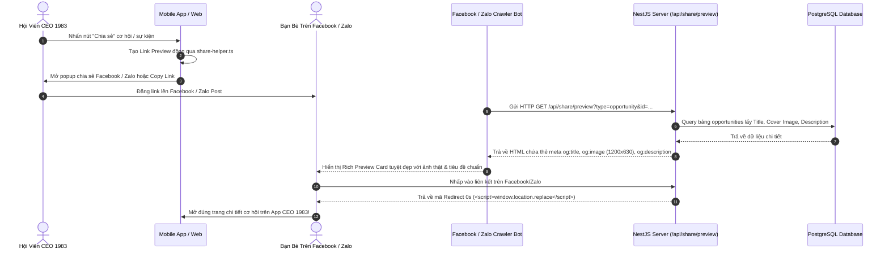

- **Actor**: Hội viên chia sẻ, Bot cào dữ liệu mạng xã hội (Crawlers), Người dùng nhấp link.
- **Pre-conditions**: Bài viết/cơ hội/sự kiện đang ở trạng thái công khai.
- **Post-conditions**: Card mạng xã hội hiển thị hình ảnh đại diện chính thức; người nhấp link được chuyển thẳng vào App.
- **Basic Flow**:
  1. Hội viên nhấn nút "Chia sẻ" trên thẻ cơ hội hoặc sự kiện.
  2. Hàm `executeShare` trong `share-helper.ts` tạo URL động: `https://ceo1983.viconnect.vn/api/share/preview?type=opportunity&id=...`.
  3. Hội viên đăng link lên Facebook hoặc Zalo.
  4. Facebook/Zalo Crawler gửi request lấy dữ liệu.
  5. Endpoint `@Get('api/share/preview')` của Backend NestJS nhận request, truy vấn cơ sở dữ liệu lấy ảnh thực tế, tiêu đề và mô tả; sinh mã HTML đầy đủ các thẻ `og:image`, `og:title`, `og:description`, `og:url` và `twitter:card`.
  6. Facebook/Zalo hiển thị ảnh preview chuẩn, sắc nét, mang thương hiệu CEO 1983.
  7. Khi người dùng nhấp vào link, thẻ `<meta http-equiv="refresh">` và script `window.location.replace` tự động điều hướng người dùng vào đúng trang chi tiết trên Web/App CEO 1983.

#### 4.9.3 Quy Tắc Nghiệp Vụ (Business Rules)
- **BR-SHARE-01**: Tuyệt đối không để lọt URL ảnh chụp màn hình CRM dashboard trong thẻ `og:image`.
- **BR-SHARE-02**: Nếu bản ghi cơ hội hoặc sự kiện không có ảnh đính kèm, hệ thống bắt buộc sử dụng ảnh fallback banner chính thức `https://ceo1983.viconnect.vn/ceo1983_hero_daylight_skyline.jpg`.

---

### Module 4.10: Quản Lý Tài Chính, Thu Chi & Hội Phí Niên Liễm

#### 4.10.1 Mô Tả Tính Năng
Cung cấp giải pháp quản trị tài chính minh bạch cho Ban Tài Chính và Ban Điều Hành. Quản lý việc thu hội phí thường niên, tiền tài trợ sự kiện, các khoản chi thuê hội trường, truyền thông, quà tặng và tính toán số dư quỹ thặng dư thời gian thực.

#### 4.10.2 Biểu Đồ Ca Sử Dụng & Kịch Bản Chi Tiết

```mermaid
flowchart TD
    ActorBTC["Ban Tài Chính"] --> Open_Finance["Mở Phân Hệ Tài Chính (/fees, /income, /expenses)"]
    Open_Finance --> Record_Type{"Loại Nghiệp Vụ"}
    
    Record_Type -->|Thu Hội Phí| Scan_Fee["Kiểm Tra Danh Sách Hội Viên Đến Hạn"]
    Scan_Fee --> Gen_Mã QR Ngân Hàng["Tạo mã QR ngân hàng Đóng Phí Kèm Cú Pháp Tự Động"]
    Gen_Mã QR Ngân Hàng --> Verify_Paid["Đối Soát & Xác Nhận Đã Đóng Phí"]
    Verify_Paid --> Active_Member["Gia Hạn Thẻ Doanh Nhân Số Số Thêm 1 Năm"]
    
    Record_Type -->|Chi Hoạt Động| Create_Expense["Lập Phiếu Chi & Đính Kèm Hóa Đơn"]
    Create_Expense --> Approve_Expense["Chủ Tịch Duyệt Chi"]
    Approve_Expense --> Deduct_Fund["Trừ Số Dư Quỹ Ngân Sách Realtime"]
```

- **Actor**: Trưởng Ban Tài Chính, Kế toán CLB, Chủ tịch CLB.
- **Pre-conditions**: Người dùng có quyền kế toán hoặc quản trị.
- **Post-conditions**: Dòng tiền thu/chi được ghi nhận; số dư quỹ cập nhật tức thời trên báo cáo tài chính.
- **Basic Flow**:
  1. Ban Tài Chính thiết lập kỳ thu hội phí năm 2026.
  2. Hệ thống gửi thông báo nhắc đóng phí kèm mã QR ngân hàng tự động qua Zalo OA và App.
  3. Khi hội viên chuyển khoản thành công, hệ thống đối soát tự động cập nhật trạng thái `paid` và tự động gia hạn thẻ hội viên điện tử thêm 365 ngày.
  4. Đối với các khoản chi (thuê địa điểm Gala, quà tặng): Ban Tài Chính lập phiếu chi trên CRM, đính kèm chứng từ hóa đơn và trình Chủ tịch phê duyệt.
  5. Sau khi Chủ tịch chuẩn y, số dư quỹ thặng dư trên CRM tự động cập nhật.

#### 4.10.3 Quy Tắc Nghiệp Vụ (Business Rules)
- **BR-FIN-01**: Mọi khoản thu chi đều phải có mã chứng từ duy nhất (`PT-...` cho phiếu thu, `PC-...` cho phiếu chi) và không được phép xóa vật lý (chỉ chuyển trạng thái hủy/void có ghi vết audit log).

---

### Module 4.11: Quản Trị Cấu Hình Hệ Thống, Tên Miền, Theme Studio & Phân Quyền RBAC

#### 4.11.1 Mô Tả Tính Năng
Trung tâm đầu não cấu hình hệ thống dành cho Super Admin tại `/settings` và `/theme-studio`. Quản lý tên miền hệ thống, cấu hình logo, màu sắc thương hiệu, ma trận phân quyền 6 Ban chuyên môn và các kênh liên lạc Zalo OA, thanh toán trực tuyến.

#### 4.11.2 Biểu Đồ Ca Sử Dụng & Kịch Bản Chi Tiết
- **Actor**: Super Admin.
- **Pre-conditions**: Đăng nhập với quyền `quan_tri`.
- **Post-conditions**: Cấu hình mới có hiệu lực ngay lập tức trên toàn hệ thống mà không cần restart server.
- **Basic Flow**:
  1. Admin mở `/settings`, chọn tab cần điều chỉnh (Thông tin chung, Tên miền, Zalo OA, Thanh toán VNPay/MoMo, Đẩy tin đa kênh, Cấu hình AI).
  2. Chỉnh sửa thông số cấu hình và nhấn "Lưu thay đổi".
  3. Backend ghi nhận vào bảng `public.app_settings` và đồng bộ qua cache hệ thống.

---

## 5. YÊU CẦU PHI CHỨC NĂNG (NON-FUNCTIONAL REQUIREMENTS)

### 5.1 Yêu Cầu Về Hiệu Năng (Performance Requirements)
- **Thời gian phản hồi API (API Response Time)**: Tối đa 300ms đối với các tác vụ đọc/ghi dữ liệu thông thường; tối đa 1.5s đối với các truy vấn tổng hợp báo cáo phức tạp.
- **Khả năng chịu tải (Concurrent Users - CCU)**: Hệ thống chịu tải tối thiểu 10,000 người dùng truy cập đồng thời trong các khung giờ cao điểm diễn ra Gala hoặc sự kiện xúc tiến thương mại lớn.
- **Tốc độ Check-in sự kiện**: Dưới 1 giây cho 1 lượt quét QR code, đảm bảo hội trường 1,000 khách thông quan trong vòng dưới 20 phút với 3 cửa soát vé.

### 5.2 Yêu Cầu Về An Toàn & Phục Hồi Dữ Liệu (Safety & Disaster Recovery)
- **Sao lưu tự động (Automated Backup)**: Cơ chế sao lưu toàn bộ cơ sở dữ liệu PostgreSQL (Database Dump) tự động định kỳ mỗi 24 giờ vào lúc 02:00 sáng, lưu trữ bản sao mã hóa tại máy chủ thứ hai độc lập.
- **Thời gian phục hồi mục tiêu (RTO - Recovery Time Objective)**: Dưới 30 phút trong trường hợp máy chủ chính gặp sự cố phần cứng.
- **Điểm phục hồi mục tiêu (RPO - Recovery Point Objective)**: Tối đa 24 giờ đối với dữ liệu lịch sử và 0 giây đối với các giao dịch tài chính nhờ cơ chế Write-Ahead Logging (WAL).

### 5.3 Yêu Cầu Về Bảo Mật (Security Requirements)
- **Cơ chế Silent Token Refresh**: Sử dụng bộ đôi Access Token (thời hạn 60 phút) và Refresh Token (thời hạn 7 ngày lưu trữ bảo mật trong HTTP-only Cookie). Khi Access Token hết hạn, client tự động gọi ngầm `POST /api/auth/refresh` lấy token mới mà không làm văng người dùng ra trang đăng nhập.
- **Phân quyền đa tầng RBAC**: Mọi endpoint API đều được bảo vệ bởi `JwtAuthGuard` và `RolesGuard`, xác thực quyền hạn theo đúng ma trận phân quyền trước khi thực thi truy vấn.
- **Chống các lỗ hổng bảo mật phổ biến**: Tuân thủ tiêu chuẩn OWASP Top 10: Chống SQL Injection bằng Prisma Parameterized Queries, chống Cross-Site Scripting (XSS) bằng HTML sanitization, chống Cross-Site Request Forgery (CSRF).

### 5.4 Thuộc Tính Chất Lượng Phần Mềm (Software Quality Attributes)
- **Tính sẵn sàng (Availability)**: Cam kết chỉ số Uptime tối thiểu 99.9% thời gian hoạt động trong năm.
- **Tính dễ bảo trì (Maintainability)**: Mã nguồn tuân thủ nghiêm ngặt TypeScript Strict Type-check (0 errors), cấu trúc module hóa NestJS và TanStack Router giúp mở rộng tính năng mới độc lập.
- **Tính tương thích (Portability)**: Chạy hoàn hảo trên cả môi trường Web Desktop (Chrome, Edge, Safari, Firefox) lẫn Mobile Native (iOS, Android qua Capacitor).

---

## 6. CÁC YÊU CẦU KHÁC & PHỤ LỤC (OTHER REQUIREMENTS & APPENDICES)

### Phụ Lục A: Mô Hình Hóa Dữ Liệu Thực Thể (Data Model / ERD Diagram)

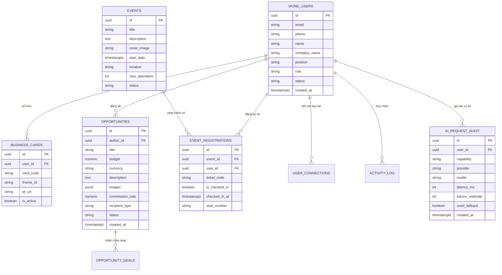

---

### Phụ Lục B: Biểu Đồ Trình Tự (Sequence Diagrams) Cho Các Luồng Logic Phức Tạp

#### B.1 Luồng Kết Nối B2B & Deal Chào Giá Trực Tiếp

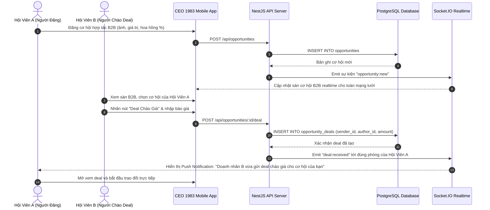

#### B.2 Luồng Điểm Danh Check-in Sự Kiện Bằng QR Code Trong 1 Giây

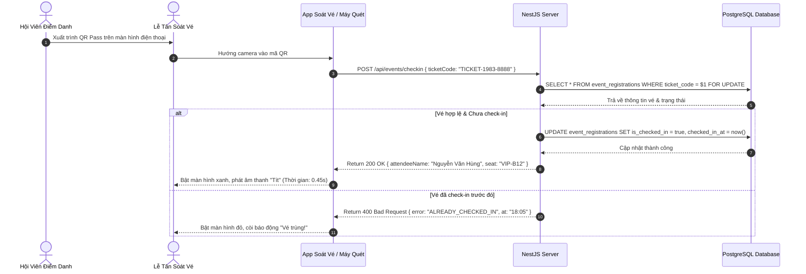

#### B.3 Luồng Trợ Lý AI Phân Tích CRM & Xuất Hóa Đơn / Phiếu Thu Điện Tử

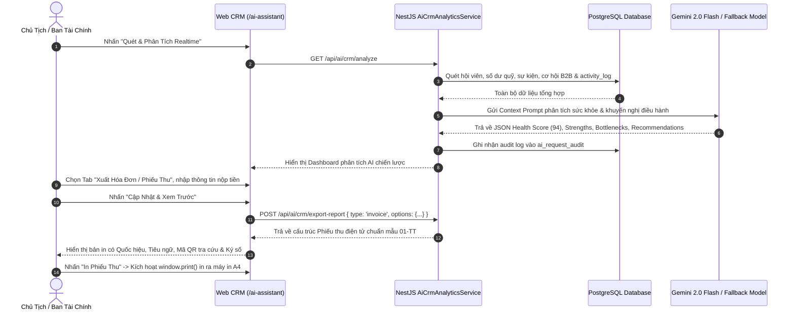

#### B.4 Luồng Đồng Bộ Kho Tài Liệu 2 Chiều Với Google Drive Cá Nhân

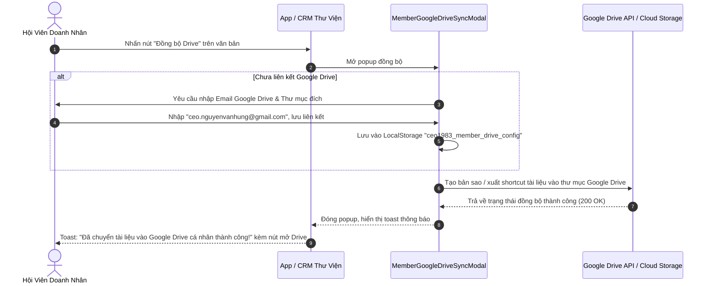

#### B.5 Luồng Cơ Chế Tự Động Làm Mới Token Nền (Silent Token Refresh)

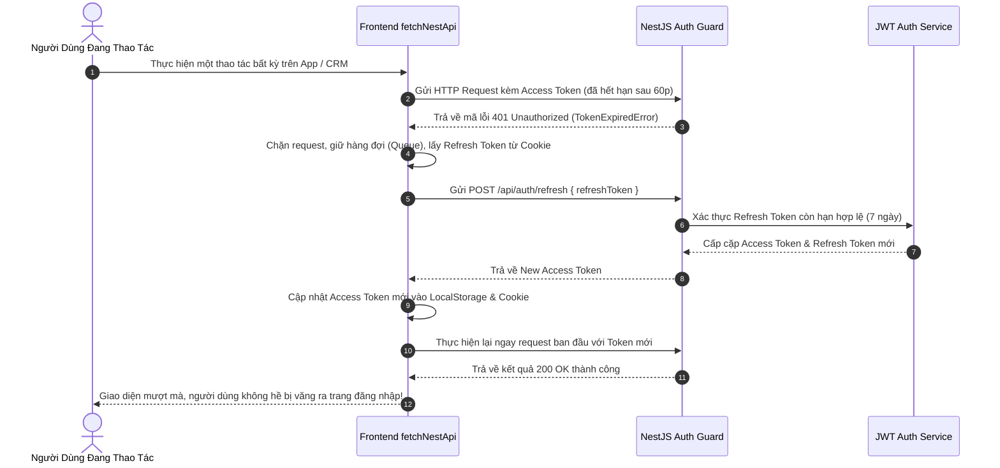

---

### Phụ Lục C: Ma Trận Truy Vết Yêu Cầu (Traceability Matrix)

| Nhóm Phân Hệ | Mã Node ID | Tên Chức Năng Cốt Lõi | Thành Phần Frontend | Controller / Service Backend | Trạng Thái Kiểm Thử |
| :--- | :--- | :--- | :--- | :--- | :--- |
| **CRM** | `[NODE-CRM-001]` | Tổng quan Dashboard & Thống Kê | `routes/index.tsx`, `routes/analytics.tsx` | `AnalyticsController`, `AnalyticsService` | ✅ Pass (0 errors) |
| **CRM** | `[NODE-CRM-002]` | Quản lý Hội viên 360 & Tái tục | `routes/members.tsx`, `routes/renewal.tsx` | `MembersController`, `MembersService` | ✅ Pass (0 errors) |
| **CRM** | `[NODE-CRM-004]` | Quản lý Sự kiện & Check-in QR | `routes/events.tsx`, `EventDetailModal.tsx` | `EventsController`, `EventsService` | ✅ Pass (0 errors) |
| **CRM** | `[NODE-CRM-009]` | Quản trị Tài chính & Thu chi | `routes/fees.tsx`, `routes/income.tsx` | `PaymentController`, `PaymentService` | ✅ Pass (0 errors) |
| **CRM** | `[NODE-CRM-011]` | Cấu hình Hệ thống, AI & Tên miền | `routes/settings.tsx`, `AiConfigSection.tsx` | `AiController`, `AiCrmAnalyticsService` | ✅ Pass (0 errors) |
| **CRM** | `[NODE-CRM-015]` | Trợ lý AI Điều Hành & Báo Cáo Con | `routes/ai-assistant.tsx` | `AiController`, `AiCrmAnalyticsService` | ✅ Pass (0 errors) |
| **App** | `[NODE-APP-001]` | Trang chủ Doanh nhân & Bottom Bar | `routes/association.index.tsx`, `MemberShell.tsx` | `ConnectAppController`, `ConnectAppService` | ✅ Pass (0 errors) |
| **App** | `[NODE-APP-003]` | thẻ hội viên điện tử Số & NFC | `routes/association.card.tsx`, `card.$code.tsx` | `BusinessCardController`, `BusinessCardService` | ✅ Pass (0 errors) |
| **App** | `[NODE-APP-004]` | Danh bạ 2 cấp & Bạn bè kết nối | `routes/association.members.tsx` | `ConnectAppController`, `ConnectAppService` | ✅ Pass (0 errors) |
| **App** | `[NODE-APP-007]` | Sàn Giao thương B2B & Deal chào giá | `routes/association.opportunities.tsx` | `ConnectAppController`, `ConnectAppService` | ✅ Pass (0 errors) |
| **App** | `[NODE-APP-010]` | Sự kiện & Vé điện tử QR Pass | `routes/association.events.tsx` | `EventsController`, `EventsService` | ✅ Pass (0 errors) |
| **App** | `[NODE-APP-012]` | Kho Tài liệu Đồng bộ Google Drive | `routes/association.library.tsx`, `documents.index.tsx` | `DocumentsController`, `DocumentsService` | ✅ Pass (0 errors) |
| **Core**| `[NODE-CORE-001]`| Xác thực JWT & Silent Token Refresh | `routes/association.login.tsx`, `api-client.ts` | `AuthController`, `AuthService` | ✅ Pass (0 errors) |
| **Core**| `[NODE-CORE-002]`| Dynamic OpenGraph Preview Endpoint | `share-helper.ts`, `__root.tsx` | `AppController` (`/api/share/preview`) | ✅ Pass (0 errors) |

---
*Tài liệu Đặc tả Yêu cầu Phần mềm (SRS V7.0) được phê duyệt chính thức bởi Ban Chấp Hành CLB Doanh Nhân CEO 1983 (HanoiBA). Mọi thay đổi kỹ thuật tiếp theo phải tuân thủ quy trình kiểm soát phiên bản và cập nhật đồng bộ vào Ma trận truy vết.*
