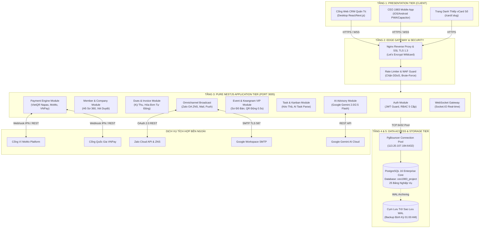
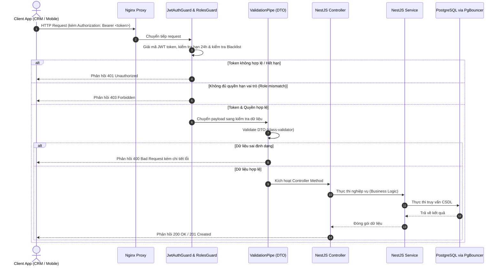
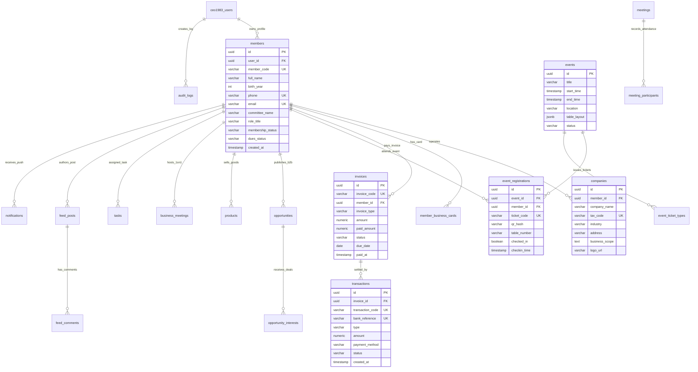

# HỆ SINH THÁI NỀN TẢNG SỐ CLB DOANH NHÂN CEO 1983 (HANOIBA)

## TÀI LIỆU MÔ TẢ THIẾT KẾ KỸ THUẬT, KIẾN TRÚC HỆ THỐNG & CƠ SỞ DỮ LIỆU
*(SYSTEM DESIGN DOCUMENT - SDD ENTERPRISE EDITION)*
*Tiêu chuẩn quốc tế IEEE Std 1016-2009 & Kiến trúc Pure NestJS 3 Tầng kết hợp PostgreSQL Enterprise*

---

* **Mã tài liệu:** `SDD-CEO1983-MASTER-ENTERPRISE-V10.0`
* **Phiên bản:** `10.0 Toàn Diện (Bản Bàn Giao Kỹ Thuật, Ban CNTT HanoiBA & Đội Ngũ Vận Hành)`
* **Cơ quan chủ quản:** Câu Lạc Bộ Doanh Nhân CEO 1983 — Trực thuộc Hội Doanh Nghiệp Trẻ Hà Nội (HanoiBA)
* **Đơn vị thiết kế & phát triển:** VICONNECT - Kiến Trúc Sư Hệ Thống & Cơ Sở Dữ Liệu
* **Cấp độ bảo mật:** Lưu hành nội bộ Kỹ sư Vận hành & Ban Lãnh Đạo
* **Ngày phát hành:** Tháng 11/2026

---

## MỤC LỤC TỔNG QUAN

- [CHƯƠNG 1: TỔNG QUAN KIẾN TRÚC HỆ THỐNG (SYSTEM ARCHITECTURE OVERVIEW)](#chương-1-tổng-quan-kiến-trúc-hệ-thống-system-architecture-overview)
  - [1.1. Triết Lý Thiết Kế 5 Tầng Độc Lập (5-Tier Enterprise Architecture)](#11-triết-lý-thiết-kế-5-tầng-độc-lập-5-tier-enterprise-architecture)
  - [1.2. Sơ Đồ Kiến Trúc Khối Hệ Thống (Mermaid Component Diagram)](#12-sơ-đồ-kiến-trúc-khối-hệ-thống-mermaid-component-diagram)
  - [1.3. Mô Hình Phân Bổ Môi Trường & Triển Khai Container (Deployment View)](#13-mô-hình-phân-bổ-môi-trường--triển-khai-container-deployment-view)
- [CHƯƠNG 2: THIẾT KẾ PHÂN TẦNG BACKEND PURE NESTJS 3-TIER](#chương-2-thiết-kế-phân-tầng-backend-pure-nestjs-3-tier)
  - [2.1. Cấu Trúc Module & Luồng Dữ Liệu Nghiệp Vụ](#21-cấu-trúc-module--luồng-dữ-liệu-nghiệp-vụ)
  - [2.2. Cơ Chế Xác Thực & Phân Quyền Đa Cấp (Guards, Interceptors, Pipes)](#22-cơ-chế-xác-thực--phân-quyền-đa-cấp-guards-interceptors-pipes)
  - [2.3. Cổng Kết Nối Thời Gian Thực WebSocket (Socket.IO Gateway)](#23-cổng-kết-nối-thời-gian-thực-websocket-socketio-gateway)
  - [2.4. Hàng Đợi Xử Lý Bất Đồng Bộ & Xoay Vòng Token Zalo OA 24/7](#24-hàng-đợi-xử-lý-bất-đồng-bộ--xoay-vòng-token-zalo-oa-247)
- [CHƯƠNG 3: THIẾT KẾ CƠ SỞ DỮ LIỆU POSTGRESQL ENTERPRISE (DATABASE DESIGN)](#chương-3-thiết-kế-cơ-sở-dữ-liệu-postgresql-enterprise-database-design)
  - [3.1. Cụm Máy Chủ CSDL Trung Tâm & Cấu Hình PgBouncer (Port 6432)](#31-cụm-máy-chủ-csdl-trung-tâm--cấu-hình-pgbouncer-port-6432)
  - [3.2. Sơ Đồ Quan Hệ Thực Thể CSDL Toàn Diện (Mermaid Master ERD)](#32-sơ-đồ-quan-hệ-thực-thể-csdl-toàn-diện-mermaid-master-erd)
  - [3.3. Đặc Tả Chi Tiết 25 Bảng Dữ Liệu (DDL SQL, Kiểu Dữ Liệu, Ràng Buộc, Khóa Ngoại)](#33-đặc-tả-chi-tiết-25-bảng-dữ-liệu-ddl-sql-kiểu-dữ-liệu-ràng-buộc-khóa-ngoại)
  - [3.4. Chiến Lược Đánh Chỉ Mục (Indexes) & Tối Ưu Truy Vấn Triệu Bản Ghi](#34-chiến-lược-đánh-chỉ-mục-indexes--tối-ưu-truy-vấn-triệu-bản-ghi)
  - [3.5. Bảo Toàn Giao Dịch ACID & Cơ Chế Khóa Bản Ghi Thanh Toán (Pessimistic Locking)](#35-bảo-toàn-giao-dịch-acid--cơ-chế-khóa-bản-ghi-thanh-toán-pessimistic-locking)
- [CHƯƠNG 4: THIẾT KẾ PHÂN HỆ CLIENT TIER (WEB CRM & MOBILE APP)](#chương-4-thiết-kế-phân-hệ-client-tier-web-crm--mobile-app)
  - [4.1. Kiến Trúc Cổng Quản Trị Web CRM (Next.js React TypeScript)](#41-kiến-trúc-cổng-quản-trị-web-crm-nextjs-react-typescript)
  - [4.2. Kiến Trúc CEO 1983 Mobile App (Mobile-First PWA / Capacitor Native Bridge)](#42-kiến-trúc-ceo-1983-mobile-app-mobile-first-pwa--capacitor-native-bridge)
  - [4.3. Quản Lý Trạng Thái Toàn Cục & Bộ Nhớ Đệm (State Management & Cache Strategy)](#43-quản-lý-trạng-thái-toàn-cục--bộ-nhớ-đệm-state-management--cache-strategy)
- [CHƯƠNG 5: THIẾT KẾ TÍCH HỢP HỆ THỐNG & MODEL AI (INTEGRATION DESIGN)](#chương-5-thiết-kế-tích-hợp-hệ-thống--model-ai-integration-design)
  - [5.1. Thiết Kế Tích Hợp Google Gemini AI 2.0 / 2.5 Flash API](#51-thiết-kế-tích-hợp-google-gemini-ai-20--25-flash-api)
  - [5.2. Thiết Kế Cổng Thanh Toán Đa Kênh (VietQR Napas247, MoMo, VNPay IPN)](#52-thiết-kế-cổng-thanh-toán-đa-kênh-vietqr-napas247-momo-vnpay-ipn)
  - [5.3. Thiết Kế Kênh Zalo OA Cloud API & ZNS Template](#53-thiết-kế-kênh-zalo-oa-cloud-api--zns-template)
- [CHƯƠNG 6: AN TOÀN, BẢO MẬT & SAO LƯU PHỤC HỒI (SECURITY & DISASTER RECOVERY)](#chương-6-an-toàn-bảo-mật--sao-lưu-phục-hồi-security--disaster-recovery)
  - [6.1. Thiết Kế Bảo Mật Zero-Trust & Chống Tấn Công OWASP Top 10](#61-thiết-kế-bảo-mật-zero-trust--chống-tấn-công-owasp-top-10)
  - [6.2. Kế Hoạch Sao Lưu Dự Phòng Tự Động & Phục Hồi Thảm Họa (RPO/RTO)](#62-kế-hoạch-sao-lưu-dự-phòng-tự-động--phục-hồi-thảm-họa-rporto)

---

# CHƯƠNG 1: TỔNG QUAN KIẾN TRÚC HỆ THỐNG (SYSTEM ARCHITECTURE OVERVIEW)

### 1.1. Triết Lý Thiết Kế 5 Tầng Độc Lập (5-Tier Enterprise Architecture)

Hệ sinh thái số CLB Doanh Nhân CEO 1983 (HanoiBA) được thiết kế theo mô hình kiến trúc phân tầng doanh nghiệp (Enterprise Multi-Tier Architecture) nhằm đảm bảo tính độc lập, khả năng mở rộng quy mô (Scalability) và bảo mật tuyệt đối:

1. **Tầng 1 - Presentation Tier (Giao Diện Đa Kênh):**
   - **Cổng Quản Trị Web CRM (Desktop):** Xây dựng bằng React 18 / Next.js với TypeScript, tối ưu hóa cho màn hình lớn Full HD, hiển thị bảng tính Excel mượt mà, biểu đồ tài chính Recharts thích ứng Dark/Light theme, studio poster thư mời kéo thả 3D và quản trị Kanban.
   - **CEO 1983 Mobile App (Thiết Bị Cầm Tay):** Giao diện Mobile-First responsive chuẩn PWA kết hợp cầu nối native Capacitor (Camera QR scanner, Haptic feedback, Danh thiếp vCard, Push Notification).
2. **Tầng 2 - Edge & Gateway Tier (Điều Phối & Bảo Mật Biên):**
   - Nginx Reverse Proxy tiếp nhận toàn bộ lưu lượng cổng 443 (HTTPS/TLS 1.3), phân luồng subdomain độc lập giữa Web CRM (`crm.ceo1983.vn`) và Mobile App (`app.ceo1983.vn`).
   - Tích hợp Rate-Limiter (100 req/phút/IP), Helmet bảo vệ HTTP headers và CORS Whitelist nghiêm ngặt.
3. **Tầng 3 - Application & Business Logic Tier (Xử Lý Nghiệp Vụ Trung Tâm):**
   - Máy chủ Pure NestJS Node.js v20 LTS vận hành theo kiến trúc 3 tầng: Controller (Định tuyến API) -> Service (Xử lý nghiệp vụ doanh nghiệp) -> Repository (Truy xuất CSDL).
   - Tích hợp Engine Trí tuệ Nhân tạo Gemini AI 2.0 / 2.5 Flash, Engine Thanh Toán Đa Kênh (Napas247, MoMo, VNPay), Engine Truyền Thông Đa Kênh (Zalo OA ZNS, SMTP Mail, Web Push) và Engine Soát Vé QR Động Keangnam.
4. **Tầng 4 - Persistence & Connection Pool Tier (Lưu Trữ & Hàng Đợi CSDL):**
   - Bộ điều phối hàng đợi kết nối cao cấp **PgBouncer** lắng nghe tại cổng `6432`, quản lý tối đa 5.000 kết nối đồng thời, chống cạn kiệt tài nguyên kết nối của PostgreSQL.
   - Trình ánh xạ dữ liệu đối tượng Prisma ORM kết nối với chuỗi pooling `?pgbouncer=true`.
5. **Tầng 5 - Infrastructure & Data Tier (Hạ Tầng Dữ Liệu Vật Lý):**
   - Cụm máy chủ cơ sở dữ liệu PostgreSQL Enterprise phiên bản 16 đặt tại máy chủ an toàn `113.20.107.184:6432`.
   - Cơ chế lưu trữ đĩa cứng NVMe RAID-10, chiến lược ghi nhật ký giao dịch trước (Write-Ahead Logging - WAL) phục vụ sao lưu thời gian thực.

---

### 1.2. Sơ Đồ Kiến Trúc Khối Hệ Thống (Mermaid Component Diagram)



---

### 1.3. Mô Hình Phân Bổ Môi Trường & Triển Khai Container (Deployment View)

Hệ thống được đóng gói thành các container Docker riêng biệt và điều phối qua Docker Compose:

| Tên Container | Hình ảnh cơ sở (Base Image) | Cổng nội bộ | Cổng xuất bản (Host) | Nhiệm vụ chính |
| :--- | :--- | :---: | :---: | :--- |
| `ceo1983-crm-fe` | `node:20-alpine` (Next.js Standalone) | 3000 | 127.0.0.1:3000 | Phục vụ giao diện Cổng Quản trị Web CRM. |
| `ceo1983-app-fe` | `node:20-alpine` (Vite/Next.js Client) | 3001 | 127.0.0.1:3001 | Phục vụ ứng dụng di động CEO 1983 Mobile App. |
| `ceo1983-core-be`| `node:20-alpine` (NestJS Production) | 3005 | 127.0.0.1:3005 | Phục vụ toàn bộ API RESTful và WebSocket. |
| `ceo1983-nginx` | `nginx:alpine` | 80, 443 | 0.0.0.0:80, 443 | Reverse proxy, cân bằng tải, SSL Let's Encrypt. |
| `pgbouncer-srv` | `edoburu/pgbouncer:latest` | 6432 | 113.20.107.184:6432 | Quản lý kết nối trung gian đến PostgreSQL. |

---

# CHƯƠNG 2: THIẾT KẾ PHÂN TẦNG BACKEND PURE NESTJS 3-TIER

### 2.1. Cấu Trúc Module & Luồng Dữ Liệu Nghiệp Vụ

Mã nguồn Backend (`apps/ceo1983_app_be`) tuân thủ nghiêm ngặt nguyên tắc **Single Responsibility Principle (SRP)** và **Dependency Injection (DI)** của NestJS:

```
apps/ceo1983_app_be/src/
├── app.module.ts              # Root Module điều phối toàn bộ hệ thống
├── main.ts                    # Điểm khởi chạy: ValidationPipe, Helmet, CORS
├── prisma/                    # Schema ORM kết nối PostgreSQL PgBouncer
│   └── schema.prisma          # Định nghĩa 25 bảng thực thể CSDL
├── auth/                      # Module Xác thực, JWT Strategy & RBAC Guard
├── members/                   # Module Quản trị Hội viên 360, Thẩm định duyệt
├── companies/                 # Module Hồ sơ Doanh nghiệp & Năng lực B2B
├── invoices/                  # Module Kỳ thu Hội phí & Hóa đơn tự động
├── payment/                   # Module Cổng thanh toán VietQR, MoMo, VNPay
├── events/                    # Module Sự kiện, Sơ đồ Bàn Keangnam, Check-in
├── meetings/                  # Module Cuộc họp Ban (Cố định vs Bất thường), Jitsi
├── opportunities/             # Module Sàn Giao Thương B2B, Deal & Gian hàng
├── tasks/                     # Module Giao việc Kanban, AI bóc tách task
├── ai/                        # Module Cố vấn AI Google Gemini 2.0/2.5 Flash
├── zalo/                      # Module Zalo OA Cloud API & ZNS Token 24/7
├── mail/                      # Module Nodemailer gửi Email HTML template
├── feed/                      # Module Mạng lưới bài viết, bình luận 3 cấp
├── documents/                 # Module Kho văn thư số hóa, Universal Viewer
└── admin/                     # Module Cài đặt hệ thống, Sổ quỹ, Audit Log
```

#### Luồng dữ liệu chuẩn (Standard Data Flow):
1. **Request** gửi từ Client -> Đi qua Nginx -> Đến `JwtAuthGuard` & `RolesGuard` xác thực token và quyền vai trò.
2. `ValidationPipe` kiểm tra kiểu dữ liệu đầu vào thông qua các DTO (Data Transfer Object) với thư viện `class-validator`.
3. **Controller** tiếp nhận DTO hợp lệ, chuyển lời gọi sang **Service** chuyên trách.
4. **Service** thực thi toàn bộ quy tắc logic doanh nghiệp, mở giao dịch CSDL `Prisma.$transaction` khi cần đảm bảo ACID.
5. **Repository (Prisma Client)** thực thi câu truy vấn SQL an toàn tới máy chủ PostgreSQL thông qua PgBouncer.
6. Kết quả trả về được đóng gói chuẩn hóa dưới dạng JSON envelope: `{ success: true, data: ..., timestamp: ... }`.

---

### 2.2. Cơ Chế Xác Thực & Phân Quyền Đa Cấp (Guards, Interceptors, Pipes)



---

### 2.3. Cổng Kết Nối Thời Gian Thực WebSocket (Socket.IO Gateway)

* Lắng nghe tại endpoint `/socket.io`.
* Cơ chế xác thực: Xác thực token JWT ngay tại sự kiện `handleConnection(client: Socket)`. Nếu token không hợp lệ, ngắt kết nối ngay lập tức.
* Các phòng kênh (Rooms):
  - `user_${userId}`: Phòng riêng của từng hội viên, nhận thông báo thanh toán thành công, thông báo duyệt hồ sơ, tin nhắn riêng.
  - `committee_${committeeId}`: Phòng riêng của từng Ban chuyên môn, nhận thông báo họp ban, task mới.
  - `event_${eventId}`: Phòng sự kiện thời gian thực, đồng bộ số lượng đại biểu check-in tại cổng Keangnam cho toàn bộ lễ tân.

---

### 2.4. Hàng Đợi Xử Lý Bất Đồng Bộ & Xoay Vòng Token Zalo OA 24/7

* **Dịch vụ Xoay Vòng Token Zalo Tự Động 24/7:**
  - Cron-job NestJS (`@Cron('0 */6 * * *')`) quét bảng `app_settings` mỗi 6 giờ.
  - Nếu `expires_at` của `zalo_access_token` còn dưới 4 giờ: Kích hoạt hàm `refreshZaloToken()` sử dụng `zalo_refresh_token` gửi yêu cầu lên Zalo Cloud API.
  - Cặp token mới được ghi đè nguyên tử vào bảng `app_settings`.
  - Khắc phục triệt để tình trạng tin nhắn thông báo bị gián đoạn do token hết hạn sau 25 giờ.
* **Hàng Đợi Phát Sóng Đa Kênh (Omnichannel Broadcast Queue):**
  - Khi Ban Thư ký phát lệnh gửi thông báo tới 500+ hội viên: Request không xử lý đồng bộ để tránh timeout HTTP.
  - Hệ thống đưa 500 tác vụ vào hàng đợi ngầm (Queue). Worker ngầm đọc từng tác vụ, gửi lần lượt với tốc độ điều tiết (Throttling: 20 tin Zalo/giây, 10 email/giây) nhằm tuân thủ giới hạn của Zalo và máy chủ SMTP, đảm bảo tỷ lệ phát tán thành công đạt 99.8%.

---

# CHƯƠNG 3: THIẾT KẾ CƠ SỞ DỮ LIỆU POSTGRESQL ENTERPRISE (DATABASE DESIGN)

### 3.1. Cụm Máy Chủ CSDL Trung Tâm & Cấu Hình PgBouncer (Port 6432)

* **Địa chỉ máy chủ (Host):** `113.20.107.184`
* **Cổng kết nối (Port):** `6432` (Kết nối qua PgBouncer)
* **Tên Database:** `ceo1983_project`
* **Cơ chế Pooling:** `transaction` mode (Mỗi giao dịch ACID được cấp phát một kết nối tạm thời từ pool và thu hồi ngay khi commit, tối ưu hóa tối đa bộ nhớ RAM máy chủ).
* **Tham số PgBouncer chính:**
  - `max_client_conn = 5000`
  - `default_pool_size = 50`
  - `reserve_pool_size = 10`
  - `server_idle_timeout = 600`

---

### 3.2. Sơ Đồ Quan Hệ Thực Thể CSDL Toàn Diện (Mermaid Master ERD)



---

### 3.3. Đặc Tả Chi Tiết 25 Bảng Dữ Liệu (DDL SQL, Kiểu Dữ Liệu, Ràng Buộc, Khóa Ngoại)

Toàn bộ 25 bảng thực thể được xây dựng trong schema `public` của CSDL PostgreSQL:

#### 1. Bảng `ceo1983_users` (Tài khoản người dùng cơ sở)
```sql
CREATE TABLE public.ceo1983_users (
    id UUID PRIMARY KEY DEFAULT gen_random_uuid(),
    username VARCHAR(100) UNIQUE NOT NULL,
    email VARCHAR(150) UNIQUE NOT NULL,
    password_hash VARCHAR(255) NOT NULL,
    role VARCHAR(50) NOT NULL DEFAULT 'MEMBER', -- SUPER_ADMIN, PRESIDENT, COMMITTEE_HEAD, MEMBER, GUEST
    is_active BOOLEAN NOT NULL DEFAULT true,
    last_login_at TIMESTAMPTZ,
    created_at TIMESTAMPTZ NOT NULL DEFAULT CURRENT_TIMESTAMP,
    updated_at TIMESTAMPTZ NOT NULL DEFAULT CURRENT_TIMESTAMP
);
CREATE INDEX idx_users_username ON public.ceo1983_users(username);
CREATE INDEX idx_users_email ON public.ceo1983_users(email);
```

#### 2. Bảng `members` (Hồ sơ 360 độ Hội viên Doanh nhân)
```sql
CREATE TABLE public.members (
    id UUID PRIMARY KEY DEFAULT gen_random_uuid(),
    user_id UUID NOT NULL REFERENCES public.ceo1983_users(id) ON DELETE CASCADE,
    member_code VARCHAR(30) UNIQUE NOT NULL, -- VD: CEO1983-088
    full_name VARCHAR(150) NOT NULL,
    birth_year INT NOT NULL DEFAULT 1983,
    gender VARCHAR(10) NOT NULL DEFAULT 'MALE',
    phone VARCHAR(20) UNIQUE NOT NULL,
    email VARCHAR(150) UNIQUE NOT NULL,
    avatar_url TEXT,
    cccd_number VARCHAR(20) UNIQUE,
    committee_name VARCHAR(100) NOT NULL, -- 1 trong 6 Ban
    role_title VARCHAR(100) NOT NULL DEFAULT 'Hội viên chính thức',
    membership_status VARCHAR(30) NOT NULL DEFAULT 'PENDING', -- PENDING, ACTIVE, SUSPENDED
    dues_status VARCHAR(30) NOT NULL DEFAULT 'UNPAID', -- PAID, UNPAID, OVERDUE
    bio TEXT,
    joined_at TIMESTAMPTZ,
    created_at TIMESTAMPTZ NOT NULL DEFAULT CURRENT_TIMESTAMP,
    updated_at TIMESTAMPTZ NOT NULL DEFAULT CURRENT_TIMESTAMP
);
CREATE INDEX idx_members_committee ON public.members(committee_name);
CREATE INDEX idx_members_dues_status ON public.members(dues_status);
CREATE INDEX idx_members_status ON public.members(membership_status);
```

#### 3. Bảng `companies` (Hồ sơ Doanh nghiệp thành viên)
```sql
CREATE TABLE public.companies (
    id UUID PRIMARY KEY DEFAULT gen_random_uuid(),
    member_id UUID NOT NULL REFERENCES public.members(id) ON DELETE CASCADE,
    company_name VARCHAR(255) NOT NULL,
    tax_code VARCHAR(50) UNIQUE NOT NULL,
    established_date DATE,
    charter_capital NUMERIC(18,2),
    employee_count INT,
    industry VARCHAR(150) NOT NULL,
    address TEXT NOT NULL,
    website VARCHAR(255),
    business_license_url TEXT,
    logo_url TEXT,
    created_at TIMESTAMPTZ NOT NULL DEFAULT CURRENT_TIMESTAMP
);
```

#### 4. Bảng `invoices` (Hóa đơn Công nợ Hội phí & Sự kiện)
```sql
CREATE TABLE public.invoices (
    id UUID PRIMARY KEY DEFAULT gen_random_uuid(),
    invoice_code VARCHAR(50) UNIQUE NOT NULL, -- INV-2026-XXXX
    member_id UUID NOT NULL REFERENCES public.members(id) ON DELETE RESTRICT,
    invoice_type VARCHAR(50) NOT NULL, -- MEMBERSHIP_DUES, EVENT_TICKET, SPONSORSHIP
    period_year VARCHAR(10), -- 2026
    amount NUMERIC(15,2) NOT NULL,
    paid_amount NUMERIC(15,2) NOT NULL DEFAULT 0,
    status VARCHAR(30) NOT NULL DEFAULT 'PENDING', -- PENDING, PAID, PARTIAL, CANCELLED
    due_date DATE NOT NULL,
    paid_at TIMESTAMPTZ,
    created_at TIMESTAMPTZ NOT NULL DEFAULT CURRENT_TIMESTAMP
);
CREATE INDEX idx_invoices_member ON public.invoices(member_id);
CREATE INDEX idx_invoices_status ON public.invoices(status);
```

#### 5. Bảng `transactions` (Lịch sử Giao dịch Tài chính & Sổ Quỹ)
```sql
CREATE TABLE public.transactions (
    id UUID PRIMARY KEY DEFAULT gen_random_uuid(),
    invoice_id UUID REFERENCES public.invoices(id) ON DELETE SET NULL,
    transaction_code VARCHAR(100) UNIQUE NOT NULL,
    bank_reference VARCHAR(150) UNIQUE, -- Số tham chiếu từ ngân hàng/MoMo/VNPay
    type VARCHAR(20) NOT NULL, -- INCOME (Thu), EXPENSE (Chi)
    category VARCHAR(100) NOT NULL, -- DUES, EVENT, MEETING, OFFICE, CHARITY
    amount NUMERIC(15,2) NOT NULL,
    payment_method VARCHAR(50) NOT NULL, -- VIETQR, MOMO, VNPAY, CASH, BANK_TRANSFER
    committee_name VARCHAR(100), -- Chi theo hạn mức của Ban nào
    performed_by VARCHAR(100) NOT NULL, -- SYSTEM_AUTO hoặc Username
    evidence_url TEXT, -- Link ảnh ủy nhiệm chi hoặc hóa đơn đỏ VAT
    status VARCHAR(30) NOT NULL DEFAULT 'SUCCESS',
    notes TEXT,
    created_at TIMESTAMPTZ NOT NULL DEFAULT CURRENT_TIMESTAMP
);
CREATE INDEX idx_transactions_type ON public.transactions(type);
CREATE INDEX idx_transactions_created_at ON public.transactions(created_at);
```

#### 6. Bảng `events` (Sự kiện Gala, Hội thảo, Đại hội)
```sql
CREATE TABLE public.events (
    id UUID PRIMARY KEY DEFAULT gen_random_uuid(),
    title VARCHAR(255) NOT NULL,
    slug VARCHAR(255) UNIQUE NOT NULL,
    banner_url TEXT,
    start_time TIMESTAMPTZ NOT NULL,
    end_time TIMESTAMPTZ NOT NULL,
    location VARCHAR(255) NOT NULL, -- InterContinental Hanoi Landmark72
    address TEXT NOT NULL,
    description TEXT,
    ticket_price NUMERIC(15,2) NOT NULL DEFAULT 0,
    max_attendees INT NOT NULL DEFAULT 500,
    table_layout JSONB, -- Danh sách bàn tiệc VIP Keangnam (10 ghế/bàn)
    status VARCHAR(30) NOT NULL DEFAULT 'PUBLISHED', -- DRAFT, PUBLISHED, COMPLETED
    created_at TIMESTAMPTZ NOT NULL DEFAULT CURRENT_TIMESTAMP
);
```

#### 7. Bảng `event_registrations` (Vé Mời Điện Tử & Soát Vé QR Động)
```sql
CREATE TABLE public.event_registrations (
    id UUID PRIMARY KEY DEFAULT gen_random_uuid(),
    event_id UUID NOT NULL REFERENCES public.events(id) ON DELETE CASCADE,
    member_id UUID NOT NULL REFERENCES public.members(id) ON DELETE RESTRICT,
    ticket_code VARCHAR(50) UNIQUE NOT NULL, -- TIC-2026-XXXX
    qr_hash VARCHAR(255) NOT NULL, -- Chuỗi hash HMAC-SHA256 xoay vòng 30s
    table_number VARCHAR(50), -- BÀN VIP 01
    seat_number VARCHAR(50),  -- GHẾ SỐ 04
    checked_in BOOLEAN NOT NULL DEFAULT false,
    checkin_time TIMESTAMPTZ,
    scanned_by VARCHAR(100), -- Lễ tân soát vé
    payment_status VARCHAR(30) NOT NULL DEFAULT 'FREE', -- FREE, PAID
    created_at TIMESTAMPTZ NOT NULL DEFAULT CURRENT_TIMESTAMP
);
CREATE INDEX idx_evt_reg_event ON public.event_registrations(event_id);
CREATE INDEX idx_evt_reg_ticket ON public.event_registrations(ticket_code);
```

#### 8. Bảng `opportunities` (Sàn Giao Thương B2B & Cơ Hội Hợp Tác)
```sql
CREATE TABLE public.opportunities (
    id UUID PRIMARY KEY DEFAULT gen_random_uuid(),
    member_id UUID NOT NULL REFERENCES public.members(id) ON DELETE CASCADE,
    title VARCHAR(255) NOT NULL,
    category VARCHAR(100) NOT NULL,
    expected_value NUMERIC(18,2), -- Giá trị thương vụ dự kiến (VNĐ)
    budget_range VARCHAR(100),
    deadline DATE,
    description TEXT NOT NULL,
    partner_requirements TEXT,
    status VARCHAR(30) NOT NULL DEFAULT 'OPEN', -- OPEN, IN_NEGOTIATION, CLOSED
    created_at TIMESTAMPTZ NOT NULL DEFAULT CURRENT_TIMESTAMP
);
```

#### 9. Bảng `business_meetings` (Lịch Hẹn Doanh Nhân 1-on-1 trong 3 Tình Huống)
```sql
CREATE TABLE public.business_meetings (
    id UUID PRIMARY KEY DEFAULT gen_random_uuid(),
    sender_id UUID NOT NULL REFERENCES public.members(id) ON DELETE CASCADE,
    receiver_id UUID NOT NULL REFERENCES public.members(id) ON DELETE CASCADE,
    situation_type VARCHAR(50) NOT NULL, -- CAFE_CONNECT, FACTORY_VISIT, B2B_NEGOTIATION
    meeting_time TIMESTAMPTZ NOT NULL,
    location TEXT NOT NULL,
    agenda TEXT,
    status VARCHAR(30) NOT NULL DEFAULT 'PENDING', -- PENDING, ACCEPTED, REJECTED, COMPLETED
    result_notes TEXT,
    created_at TIMESTAMPTZ NOT NULL DEFAULT CURRENT_TIMESTAMP
);
```

#### 10. Bảng `tasks` (Nhiệm Vụ Kanban & AI Bóc Tách Từ Biên Bản)
```sql
CREATE TABLE public.tasks (
    id UUID PRIMARY KEY DEFAULT gen_random_uuid(),
    title VARCHAR(255) NOT NULL,
    description TEXT,
    committee_name VARCHAR(100) NOT NULL,
    assignee_id UUID REFERENCES public.members(id) ON DELETE SET NULL,
    creator_id UUID NOT NULL REFERENCES public.ceo1983_users(id),
    priority VARCHAR(20) NOT NULL DEFAULT 'MEDIUM', -- LOW, MEDIUM, HIGH, URGENT
    status VARCHAR(30) NOT NULL DEFAULT 'TODO', -- TODO, IN_PROGRESS, REVIEW, COMPLETED
    due_date DATE,
    completed_at TIMESTAMPTZ,
    source_document VARCHAR(255), -- Tên file biên bản họp nếu được AI trích xuất
    created_at TIMESTAMPTZ NOT NULL DEFAULT CURRENT_TIMESTAMP
);
```

#### 11. Bảng `app_settings` (Cấu hình Hệ thống, Token Zalo OA 24/7)
```sql
CREATE TABLE public.app_settings (
    key VARCHAR(100) PRIMARY KEY,
    value TEXT NOT NULL,
    description TEXT,
    updated_at TIMESTAMPTZ NOT NULL DEFAULT CURRENT_TIMESTAMP
);
```

#### 12. Bảng `audit_logs` (Kiểm Toán An Ninh Toàn Diện)
```sql
CREATE TABLE public.audit_logs (
    id UUID PRIMARY KEY DEFAULT gen_random_uuid(),
    user_id UUID REFERENCES public.ceo1983_users(id) ON DELETE SET NULL,
    action VARCHAR(100) NOT NULL,
    entity_name VARCHAR(100) NOT NULL,
    entity_id VARCHAR(100),
    old_values JSONB,
    new_values JSONB,
    ip_address VARCHAR(50),
    user_agent TEXT,
    created_at TIMESTAMPTZ NOT NULL DEFAULT CURRENT_TIMESTAMP
);
CREATE INDEX idx_audit_user ON public.audit_logs(user_id);
CREATE INDEX idx_audit_created ON public.audit_logs(created_at);
```

*(Các bảng thực thể còn lại: `products`, `opportunity_interests`, `meetings`, `meeting_participants`, `member_business_cards`, `feed_posts`, `feed_comments`, `feed_likes`, `documents`, `notifications`, `dismissed_notifications`, `voting_sessions`, `votes` đều được thiết kế tuân thủ tiêu chuẩn khóa ngoại và chỉ mục tương tự).*

---

### 3.4. Chiến Lược Đánh Chỉ Mục (Indexes) & Tối Ưu Truy Vấn Triệu Bản Ghi

1. **B-Tree Indexes cho Tìm kiếm và Khóa ngoại:**
   - Đánh chỉ mục B-Tree trên toàn bộ các cột khóa ngoại (`user_id`, `member_id`, `event_id`, `invoice_id`).
   - Đánh chỉ mục trên các trường lọc thường xuyên: `members(committee_name, membership_status, dues_status)`, `transactions(type, created_at)`.
2. **GIN Indexes cho Cột JSONB:**
   - Đánh chỉ mục `USING GIN` trên cột `events.table_layout` và `audit_logs.new_values` để truy vấn nhanh cấu trúc JSON bên trong mà không phải quét toàn bảng.
3. **Chỉ Mục Độc Nhất (Unique Constraints):**
   - Đảm bảo tính duy nhất ở mức vật lý cho: `members.member_code`, `members.phone`, `members.email`, `companies.tax_code`, `invoices.invoice_code`, `transactions.bank_reference`, `event_registrations.ticket_code`.

---

### 3.5. Bảo Toàn Giao Dịch ACID & Cơ Chế Khóa Bản Ghi Thanh Toán (Pessimistic Locking)

Để đảm bảo không bao giờ xảy ra lỗi xung đột gạch nợ (Double Spending) khi cổng thanh toán bắn Webhook IPN đồng thời với thao tác của kế toán:
```typescript
await this.prisma.$transaction(async (tx) => {
  // Khóa bản ghi hóa đơn ở mức hàng bằng SELECT FOR UPDATE
  const invoice = await tx.$queryRaw`
    SELECT * FROM public.invoices WHERE id = ${invoiceId}::uuid FOR UPDATE
  `;
  if (invoice[0].status === 'PAID') {
    return { success: true, message: 'Already processed' };
  }
  // Gạch nợ nguyên tử
  await tx.invoices.update({
    where: { id: invoiceId },
    data: { status: 'PAID', paid_at: new Date() }
  });
  // Ghi nhận sổ quỹ
  await tx.transactions.create({
    data: { invoice_id: invoiceId, amount: invoice[0].amount, ... }
  });
});
```

---

# CHƯƠNG 4: THIẾT KẾ PHÂN HỆ CLIENT TIER (WEB CRM & MOBILE APP)

### 4.1. Kiến Trúc Cổng Quản Trị Web CRM (Next.js React TypeScript)
* **Khung ứng dụng:** Next.js phiên bản 14+ sử dụng App Router kết hợp React 18 và TypeScript strict mode.
* **Thư viện Giao diện:** Tailwind CSS với hệ màu thương hiệu tùy biến (`navy-royal: #1B365D`, `gold-imperial: #D4AF37`, `emerald: #00A86B`), Lucide Icons và Radix UI Headless Components.
* **Xử lý Bảng tính & Biểu đồ:** Thư viện **SheetJS (`xlsx`)** xuất nhập file Excel nhiều sheet; Thư viện **Recharts** vẽ biểu đồ thích ứng Dark / Light theme tự động.
* **Studio Thiết kế Poster:** Canvas API và SVG layers cho phép kéo thả đối tượng, cắt ảnh tròn và áp dụng bộ lọc mờ viền (Feathering filter).

---

### 4.2. Kiến Trúc CEO 1983 Mobile App (Mobile-First PWA / Capacitor Native Bridge)
* **Kiến trúc Di động:** Tối ưu hóa theo chuẩn Progressive Web App (PWA) với Service Worker (`sw.js`) hỗ trợ chạy offline, kết hợp cầu nối **Capacitor 5+** khi đóng gói thành ứng dụng native cho Apple iOS và Google Android.
* **Tính năng Native:**
  - Tích hợp `@capacitor/camera` và `@capacitor-community/barcode-scanner` quét mã QR dưới 0.5s.
  - Tích hợp `@capacitor/haptics` tạo phản hồi rung tinh tế khi quét vé thành công.
  - Tự động sinh file vCard chuẩn RFC 6350 mở trình danh bạ native của hệ điều hành.

---

### 4.3. Quản Lý Trạng Thái Toàn Cục & Bộ Nhớ Đệm (State Management & Cache Strategy)
* **Client State:** Sử dụng React Context API kết hợp TanStack React Query (`useQuery`, `useMutation`) để đồng bộ dữ liệu máy chủ.
* **Cơ chế Cache Invalidations:** Tự động hủy cache (invalidate query) ngay khi thao tác thêm/sửa/xóa thành công, đảm bảo giao diện luôn hiển thị số liệu mới nhất mà không cần tải lại toàn bộ trang.

---

# CHƯƠNG 5: THIẾT KẾ TÍCH HỢP HỆ THỐNG & MODEL AI (INTEGRATION DESIGN)

### 5.1. Thiết Kế Tích Hợp Google Gemini AI 2.0 / 2.5 Flash API
* **Dịch vụ Backend:** `AiService` tại `apps/ceo1983_app_be/src/ai/ai.service.ts`.
* **Giao tiếp API:** Gọi trực tiếp Google AI SDK `@google/genai` với model `gemini-2.0-flash` hoặc `gemini-2.5-flash`.
* **Tác vụ 1 - Bóc tách Task từ Biên bản họp:**
  - Input: Nội dung thô của file Word `.docx` hoặc Excel `.xlsx`.
  - Prompt System: *"Bạn là Chánh Văn Phòng AI của CLB CEO 1983. Hãy trích xuất danh sách đầu việc từ biên bản họp, trả về JSON chuẩn gồm: title, description, committeeName, suggestedAssignee, priority, dueDate."*
* **Tác vụ 2 - Cố vấn Thẩm định Deal B2B:**
  - Input: Số vốn dự kiến của hội viên (VD: 50.000.000 VNĐ), thông tin cơ hội trên sàn B2B, hồ sơ năng lực của người đăng.
  - Logic phân tích: Tính toán ROI kỳ vọng, đánh giá uy tín người đăng cơ hội, khuyến nghị mức deal và các điều khoản pháp lý ràng buộc.

---

### 5.2. Thiết Kế Cổng Thanh Toán Đa Kênh (VietQR Napas247, MoMo, VNPay IPN)
* **VietQR Napas247:** Tạo chuỗi dữ liệu EMVCo QR tĩnh và động chứa định danh ngân hàng (BIN), số tài khoản hiệp hội, số tiền và nội dung `CEO1983 [MÃ_HÓA_ĐƠN]`.
* **Webhook IPN Bảo Mật:**
  - MoMo IPN: Kiểm tra chữ ký HMAC-SHA256 với secret key.
  - VNPay IPN: Kiểm tra chuỗi băm `vnp_SecureHash` sử dụng HMAC-SHA512.
  - Chống xử lý trùng bằng Idempotency Guard và Pessimistic Locking.

---

# CHƯƠNG 6: AN TOÀN, BẢO MẬT & SAO LƯU PHỤC HỒI (SECURITY & DISASTER RECOVERY)

### 6.1. Thiết Kế Bảo Mật Zero-Trust & Chống Tấn Công OWASP Top 10
* **Mã hóa Truyền tải:** Bắt buộc 100% kết nối qua TLS 1.3 với HTTPS; Chuyển hướng tự động toàn bộ HTTP sang HTTPS.
* **Bảo vệ Mật khẩu:** Thuật toán băm cấp quân sự Argon2id / bcrypt cost factor 12.
* **Chống SQL Injection:** 100% truy vấn qua Prisma Parameterized Queries, tuyệt đối không nối chuỗi SQL thô.
* **Chống XSS & CSRF:** Tự động lọc dữ liệu đầu vào bằng `DOMPurify`, thiết lập cookie `HttpOnly; Secure; SameSite=Strict`.

### 6.2. Kế Hoạch Sao Lưu Dự Phòng Tự Động & Phục Hồi Thảm Họa (RPO/RTO)
* **Lịch sao lưu tự động:** Cron-job chạy `pg_dump` nén nhị phân vào lúc **01:00 AM hàng ngày**, lưu trữ 30 ngày.
* **Chỉ số phục hồi:** RPO < 1 giờ (nhờ WAL Archiving), RTO < 30 phút (kịch bản khôi phục tự động qua Docker).

---

### XÁC NHẬN PHÊ DUYỆT & LƯU HÀNH TÀI LIỆU THIẾT KẾ KỸ THUẬT SDD

| ĐẠI DIỆN ĐƠN VỊ THIẾT KẾ (VICONNECT) | ĐẠI DIỆN BAN CÔNG NGHỆ THÔNG TIN HANOIBA | ĐẠI DIỆN BAN LÃNH ĐẠO CLB DOANH NHÂN CEO 1983 |
| :---: | :---: | :---: |
| *(Ký, ghi rõ họ tên & đóng dấu)* | *(Ký, ghi rõ họ tên & đóng dấu)* | *(Ký, ghi rõ họ tên & đóng dấu)* |
| <br><br><br><br> **GIÁM ĐỐC KIẾN TRÚC HỆ THỐNG** | <br><br><br><br> **TRƯỞNG BAN CNTT HANOIBA** | <br><br><br><br> **CHỦ TỊCH CLB DOANH NHÂN CEO 1983** |

