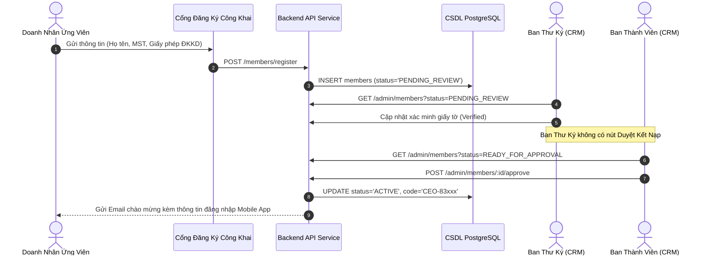

# TÀI LIỆU ĐẶC TẢ YÊU CẦU PHẦN MỀM (SRS) — PHÂN HỆ 01
## QUẢN TRỊ TỔ CHỨC, HỒ SƠ DOANH NHÂN & PHÂN QUYỀN VAI TRÒ
*CLB Doanh Nhân CEO 1983 — Trực thuộc Hội Doanh Nghiệp Trẻ Hà Nội (HanoiBA)*

---

### 1. Sơ Đồ Luồng Xử Lý & Phân Quyền (Process Flow)

### 2. Đặc Tả Chức Năng Chi Tiết (Functional Requirements)

#### 2.1. Quản trị Danh Sách & Tìm Kiếm Hội Viên (FR-MEM-01)
* **Giao diện:** Bảng danh sách hội viên đa cột, hỗ trợ sắp xếp theo ngày tham gia, ban chuyên môn, tình trạng hoạt động.
* **Bộ lọc:** Lọc theo 6 ban chuyên trách, tình trạng nộp hội phí (Đã hoàn thành / Chưa nộp), trạng thái hồ sơ.
* **Thanh tìm kiếm:** Áp dụng cơ chế trì hoãn (Debounce 300ms) để không gửi truy vấn liên tục khi người dùng đang gõ từng ký tự hoặc phím khoảng trắng.

#### 2.2. Phê Duyệt Kết Nạp Độc Lập (FR-MEM-02)
* Nút "Phê duyệt kết nạp" chỉ hiển thị với người dùng có vai trò `admin`, `president`, `vice_president`, `board_member_membership`.
* Tự động sinh mã `CEO-83xxx` theo thứ tự tự tăng trong CSDL, không cho phép trùng lặp.
* Tạo bản ghi tài khoản đăng nhập với mật khẩu được mã hóa an toàn qua thuật toán Bcrypt.

#### 2.3. Quản Trị Phân Quyền Vai Trò (FR-MEM-03)
* Trên màn hình Quản lý Tài khoản (`accounts.tsx`), cột "VAI TRÒ" hiển thị dưới dạng nhãn huy hiệu (Badge) với biểu tượng khiên bảo vệ, không sử dụng thẻ chọn trực tiếp trên ô.
* Nút "Lưu Quyền" chỉ thu thập danh sách những tài khoản có thay đổi thực tế (`changedAccounts`), hiển thị thông báo thân thiện và ngăn chặn việc gửi request rỗng.

### 3. Quy Tắc Dữ Liệu & Ràng Buộc Kỹ Thuật
* **DR-01:** Số điện thoại và Email của hội viên là duy nhất trên toàn hệ thống.
* **DR-02:** Mọi mật khẩu lưu trữ trong bảng `public.users` bắt buộc băm bằng thuật toán Bcrypt với độ phức tạp (salt rounds) tối thiểu 10.

