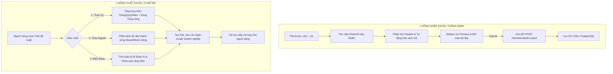

# TÀI LIỆU ĐẶC TẢ YÊU CẦU PHẦN MỀM (SRS) — PHÂN HỆ 02
## THỐNG KÊ GIAO THƯƠNG, ĐỐI SOÁT & NHẬP XUẤT DỮ LIỆU EXCEL
*CLB Doanh Nhân CEO 1983 — Trực thuộc Hội Doanh Nghiệp Trẻ Hà Nội (HanoiBA)*

---

### 1. Sơ Đồ Luồng Xử Lý Xuất Nhập Excel (Data Processing Flow)

### 2. Đặc Tả Chức Năng Chi Tiết (Functional Requirements)

#### 2.1. Cấu Hình 3 Chế Độ Xuất Báo Cáo Excel (FR-EXC-01)
* **Modal Xuất Excel (`CrmExcelExportModal.tsx`):**
  - Cung cấp 3 nút chọn chế độ:
    1. `ALL_PERIOD`: Xuất toàn bộ dữ liệu giao thương theo mốc Tháng, Quý, Năm.
    2. `PER_MEMBER`: Xuất phân tích chi tiết của từng hội viên thành các sheet độc lập.
    3. `GROWTH_DELTA`: Xuất biến động chỉ số và phân loại hội viên tích cực / chưa kích hoạt.
  - Tự động định dạng các ô số tiền theo chuẩn Việt Nam (phân tách hàng nghìn bằng dấu chấm, đơn vị VNĐ).

#### 2.2. Nhập Dữ Liệu Bảng Tính Tự Bóc Tách (FR-EXC-02)
* **Modal Nhập Excel (`CrmExcelImportModal.tsx`):**
  - Kéo thả tệp hoặc chọn file từ máy tính.
  - Tự động nhận diện trường: Họ tên (`fullName`, `name`), Điện thoại (`phone`), Email (`email`), Công ty (`company`), Ngành nghề (`industry`), Chức vụ (`position`).
  - Hiển thị bảng xem trước (Live Preview): Đánh dấu màu đỏ các dòng thiếu dữ liệu bắt buộc (họ tên, điện thoại) và màu vàng cảnh báo số điện thoại đã tồn tại trong CSDL.
  - Nút "Tải file mẫu Excel" tải xuống tệp mẫu chuẩn `.xlsx` có hướng dẫn điền chi tiết.

#### 2.3. Báo Cáo Thống Kê & Bảng Điều Khiển BI (FR-EXC-03)
* Biểu đồ Recharts thể hiện trực quan xu hướng giao thương, tỷ trọng cơ hội theo ngành nghề (Donut Chart).
* Bộ lọc khoảng giá trị ngân sách: Dưới 500 triệu, Từ 500 triệu đến 2 tỷ, Từ 2 tỷ đến 10 tỷ, Trên 10 tỷ VNĐ.

### 3. Quy Tắc Kỹ Thuật & Hiệu Năng
* **NFR-01:** Thời gian phân tích và bóc tách tệp Excel 1.000 dòng không vượt quá 2 giây.
* **NFR-02:** Xử lý nhập hàng loạt qua transaction trong CSDL để đảm bảo tính toàn vẹn (ACID), nếu có lỗi hệ thống tự động hoàn tác (rollback).

