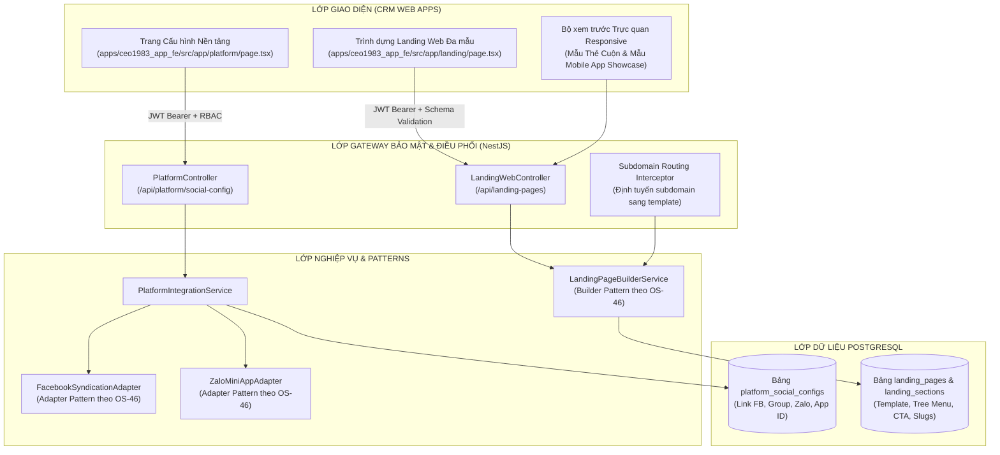
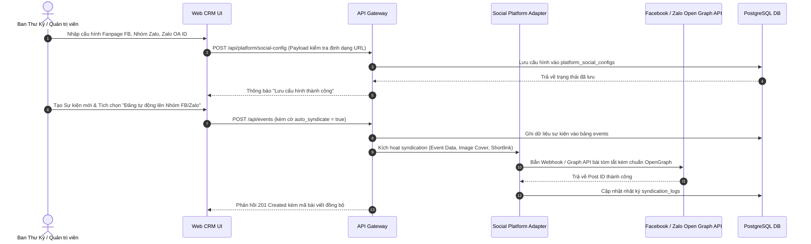

# TÀI LIỆU ĐẶC TẢ YÊU CẦU PHẦN MỀM (SRS)
## PHÂN HỆ QUẢN TRỊ TÍCH HỢP ĐA NỀN TẢNG & LANDING WEB (SUB-03)
**HỆ THỐNG QUẢN TRỊ HIỆP HỘI DOANH NHÂN CEO 1983 (HANOIBA)**

---

### THÔNG TIN TÀI LIỆU
- **Mã tài liệu:** `CEO1983-SRS-SUB-03`
- **Mã định danh Functional Node:** `[NODE-CRM-011]` (Cấu hình Nền tảng & Zalo Mini App) & `[NODE-CRM-016]` (Quản trị Landing Web Đa mẫu)
- **Tiêu chuẩn áp dụng:** IEEE 830 Software Requirements Specification, OS-46 (Design Pattern Pragmatism - Adapter & Builder), OS-47 (Security 6-Layer Gate), OS-49 (Monorepo Feature Architecture)
- **Ngày ban hành:** 06/11/2026 (Phiên bản 5.2 - Chuẩn hóa Kỹ thuật)

---

### 1. KIẾN TRÚC TỔNG QUAN PHÂN HỆ (SYSTEM ARCHITECTURE)



---

### 2. LUỒNG XỬ LÝ DỮ LIỆU ĐỒNG BỘ ĐA NỀN TẢNG (END-TO-END DATA FLOW)



---

### 3. ĐẶC TẢ YÊU CẦU CHỨC NĂNG CHI TIẾT (FUNCTIONAL SPECIFICATIONS)

#### 3.1 Cấu hình Tích hợp Mạng xã hội & Zalo Mini App `[NODE-CRM-011]`
- **Mã chức năng:** `SPEC-CRM-PLT-001`
- **Mục tiêu:** Cung cấp biểu mẫu quản trị các trường thông tin tích hợp:
  - `facebook_fanpage_url`: Đường dẫn Fanpage chính thức CEO 1983.
  - `facebook_group_url`: Đường dẫn Nhóm giao thương kín của Hội viên.
  - `zalo_oa_id`: Mã Zalo Official Account chính thức.
  - `zalo_group_url`: Đường dẫn nhóm Zalo trao đổi thông tin nhanh.
  - `zalo_miniapp_id`: Định danh ứng dụng nhỏ Zalo được cấp phép.
  - `auto_post_events`: Cờ bật/tắt tự động đăng bài khi có sự kiện mới.
  - `auto_post_meetings`: Cờ bật/tắt tự động thông báo lịch họp câu lạc bộ.
- **Ràng buộc an toàn:** Mọi URL đều được regex kiểm tra chống URL giả mạo hoặc chèn mã độc.

#### 3.2 Quản trị Landing Web Đa Mẫu Thiết kế `[NODE-CRM-016]`
- **Mã chức năng:** `SPEC-CRM-LND-001`
- **Mục tiêu:** Cho phép tạo lập, cấu hình và kích hoạt các trang đích với 2 mẫu thiết kế độc quyền:
  1. **Mẫu 1 - Thẻ Chuyển Động Theo Trục Cuộn (Scroll Timed Cards Opening):**
     - Thiết kế chuyển động toàn trang khi người dùng cuộn chuột (Mouse Wheel / Touch Scroll).
     - Không cần nút bấm trái phải; giao diện tự tính toán ngưỡng cuộn để chuyển thẻ thông tin mượt mà.
     - 4 khối nội dung chính: Bối cảnh thành lập 1983, Sứ mệnh phụng sự, Giá trị giao thương, Đăng ký tham gia.
  2. **Mẫu 2 - Trưng bày Ứng dụng Di động Hội viên (Startup Mobile Showcase):**
     - Mô phỏng mô hình điện thoại iPhone 16 viền siêu mỏng, hiển thị giao diện động của Mobile App CEO 1983.
     - Khối 4 Chỉ số vàng: Tổng doanh nhân kết nối, Tổng giá trị cơ hội giao thương đã chốt, Số lượt kết nối 1-on-1 thành công, Tỷ lệ gắn kết hoạt động.
     - Khối Thẻ Tính Năng 3D với hiệu ứng bóng đổ và chuyển động thị giác chiều sâu.
     - Khối Câu hỏi thường gặp (FAQ) dạng mở rộng/thu gọn (Accordion) thân thiện.
- **Quản trị Menu Cây Đa Cấp (Tree Menu Management):**
  - Người dùng có thể thêm mục menu cấp 1, cấp 2 linh hoạt.
  - Thiết lập hành vi menu: Cuộn đến thẻ nội dung (Anchor Link) hoặc Mở trang con độc lập.
- **Quản lý Nút Kêu Gọi Hành Động (CTA Buttons):**
  - Tùy chỉnh màu sắc nút (ưu tiên sắc đỏ son HANOIBA và vàng kim), nhãn văn bản, biểu tượng và đích đến (Mở cổng đăng ký hội viên, mở Zalo Mini App, gọi hotline).

---

### 4. ĐẶC TẢ HỢP ĐỒNG API (API CONTRACTS)

#### 4.1 Cập nhật Thông số Cấu hình Mạng xã hội
- **Đường dẫn:** `PUT /api/platform/social-config`
- **Yêu cầu Xác thực:** Bearer JWT (Chỉ cấp quyền cho Quản trị viên cấp cao `system_admin`)
- **Body Request (JSON):**
```json
{
  "facebook_fanpage_url": "https://www.facebook.com/ceo1983hanoiba",
  "facebook_group_url": "https://www.facebook.com/groups/ceo1983connection",
  "zalo_oa_id": "382910394829102",
  "zalo_group_url": "https://zalo.me/g/ceo1983vietnam",
  "zalo_miniapp_id": "zma_ceo1983_official_prod",
  "auto_post_events": true,
  "auto_post_meetings": false
}
```
- **Response Success (200 OK):**
```json
{
  "success": true,
  "data": {
    "id": "cfg_social_1983",
    "updated_at": "2026-11-06T08:45:00.000Z",
    "status": "ACTIVE"
  },
  "message": "Cập nhật cấu hình tích hợp đa nền tảng thành công"
}
```

#### 4.2 Lưu Trữ Cấu Hình Trang Đích (Landing Web)
- **Đường dẫn:** `POST /api/landing-pages`
- **Body Request (JSON):**
```json
{
  "title": "CEO 1983 - Kỷ nguyên Giao thương Số",
  "slug": "kyn-nguyen-so-1983",
  "subdomain": "kyn-nguyen.ceo1983.com",
  "template_type": "STARTUP_MOBILE_SHOWCASE",
  "navigation_tree": [
    {
      "label": "Giới thiệu",
      "href": "#about",
      "children": [
        { "label": "Lịch sử 1983", "href": "#history" },
        { "label": "Ban Điều Hành", "href": "#board" }
      ]
    },
    { "label": "Hệ sinh thái Số", "href": "#app-showcase" },
    { "label": "Chỉ số Vàng", "href": "#metrics" },
    { "label": "Hỏi đáp", "href": "#faq" }
  ],
  "metrics": {
    "members_count": "500+",
    "deals_value_billion": "1,250",
    "meetings_count": "3,400+",
    "retention_rate": "98.5%"
  },
  "cta_config": {
    "label": "Gia nhập CLB CEO 1983",
    "target_url": "/register",
    "theme_color": "PRIMARY_RED"
  },
  "is_published": true
}
```

---

### 5. YÊU CẦU PHI CHỨC NĂNG (NON-FUNCTIONAL REQUIREMENTS)
1. **Hiệu năng & Tối ưu Băng thông:**
   - Landing Web công khai phải đạt điểm Google Lighthouse tối thiểu 90 điểm về Performance và SEO.
   - Toàn bộ ảnh nền và mô hình điện thoại được tối ưu định dạng WebP với kích thước dưới 250KB.
2. **Tuân thủ Bảo mật OS-47 & OS-49:**
   - Cấm lưu trữ API Secret của Facebook/Zalo ở Frontend. Mọi lệnh gọi API nền tảng thứ ba bắt buộc ủy thác cho Backend thông qua `Adapter Pattern`.
   - Ngăn chặn triệt để lỗ hổng XSS khi lưu trữ nội dung Rich Text thông qua bộ lọc `DOMPurify` trước khi kết xuất.
   - Thiết lập CSP (Content Security Policy) chặt chẽ, chỉ cho phép nạp tài nguyên từ các tên miền hợp lệ của Facebook và Zalo.

