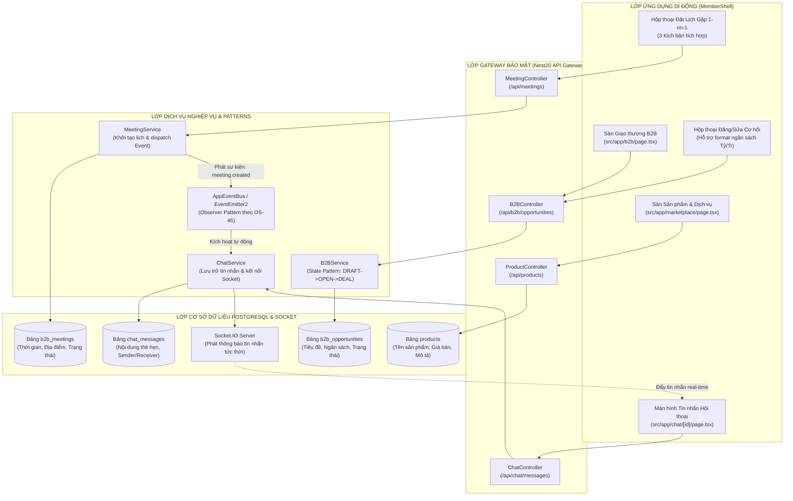
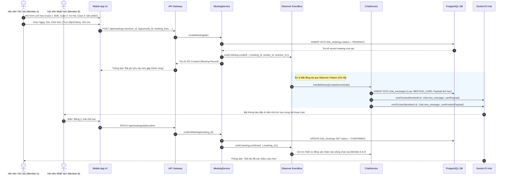

# TÀI LIỆU ĐẶC TẢ YÊU CẦU PHẦN MỀM (SRS)
## PHÂN HỆ GIAO THƯƠNG B2B, SÀN THƯƠNG MẠI & LÊN LỊCH HẸN 1-ON-1 (SUB-04)
**HỆ THỐNG QUẢN TRỊ HIỆP HỘI DOANH NHÂN CEO 1983 (HANOIBA)**

---

### THÔNG TIN TÀI LIỆU
- **Mã tài liệu:** `CEO1983-SRS-SUB-04`
- **Mã định danh Functional Node:**
  - `[NODE-APP-003]`: Sàn Giao thương B2B & Quản lý Luồng Cơ hội
  - `[NODE-APP-004]`: Kết nối Doanh nhân & Lên lịch hẹn 1-on-1 kèm Tự động Nhắn tin
  - `[NODE-APP-012]`: Sàn Thương mại Sản phẩm & Dịch vụ Doanh nghiệp
- **Tiêu chuẩn áp dụng:** IEEE 830, OS-46 (Observer & State Patterns), OS-47 (Zero-Trust Security Gate), OS-49 (Mobile Feature Slice Architecture)
- **Ngày ban hành:** 06/11/2026 (Phiên bản 5.2 - Chuẩn hóa Kỹ thuật)

---

### 1. KIẾN TRÚC TỔNG QUAN PHÂN HỆ (SYSTEM ARCHITECTURE)



---

### 2. LUỒNG TỰ ĐỘNG HÓA LÊN LỊCH HẸN VÀ BẮN TIN NHẮN (SEQUENCE FLOW)



---

### 3. ĐẶC TẢ YÊU CẦU CHỨC NĂNG CHI TIẾT (FUNCTIONAL SPECIFICATIONS)

#### 3.1 Quản trị Dòng chảy Cơ hội & Định dạng Ngân sách `[NODE-APP-003]`
- **Mã chức năng:** `SPEC-APP-B2B-001`
- **Mục tiêu:** Cung cấp giải pháp đăng tải, quản lý và theo dõi tiến độ cơ hội giao thương.
- **Quy tắc định dạng ngân sách (Budget Formatter):**
  - Input số nguyên nguyên thủy từ DB: `budget_value` (Kiểu số thực `DECIMAL(15,2)`).
  - Hàm hiển thị Display-Ready trên UI:
    ```typescript
    export function formatOpportunityBudget(value?: number | null): string {
      if (!value || value <= 0) return 'Thỏa thuận B2B';
      if (value >= 1_000_000_000) {
        const billions = (value / 1_000_000_000).toFixed(1).replace(/\.0$/, '');
        return `${billions} Tỷ VNĐ`;
      }
      if (value >= 1_000_000) {
        const millions = (value / 1_000_000).toFixed(0);
        return `${millions} Tr VNĐ`;
      }
      return `${value.toLocaleString('vi-VN')} VNĐ`;
    }
    ```
- **Máy trạng thái Cơ hội (State Pattern theo OS-46):**
  - `OPEN`: Cơ hội đang mở chào kết nối.
  - `NEGOTIATING`: Đang trong tiến trình đàm phán hợp đồng.
  - `DEAL_WON`: Đã chốt thương vụ thành công, ghi nhận doanh thu hiệp hội.
  - `DEAL_LOST`: Hủy bỏ hoặc dừng thương lượng.
- **Cơ chế Cập nhật Tức thì (Realtime Refresh):**
  - Khi người dùng gửi lệnh `PATCH /api/b2b/opportunities/{id}`, client lập tức invalidate cache query (`queryClient.invalidateQueries(['opportunities'])`) và cập nhật lạc quan (Optimistic Update) giúp giá tiền và thông tin mới xuất hiện ngay mà không cần tải lại ứng dụng.

#### 3.2 Bộ Ba Kịch bản Lên Lịch Hẹn & Tự Động Nhắn Tin `[NODE-APP-004]`
- **Mã chức năng:** `SPEC-APP-MEET-001`
- **Kịch bản 1 (Tự do từ Kết nối B2B):** Hội viên mở tab Kết nối, chọn doanh nhân mục tiêu, bấm "Lên lịch gặp 1-on-1".
- **Kịch bản 2 (Gắn với Cơ hội):** Tại chi tiết cơ hội, bấm "Hẹn gặp thảo luận cơ hội". Hệ thống tự trích xuất `opportunity_id` và tiêu đề cơ hội gắn vào thẻ hẹn.
- **Kịch bản 3 (Gắn với Sản phẩm Thương mại):** Tại trang chi tiết sản phẩm trên sàn, bấm "Hẹn gặp tư vấn sản phẩm". Hệ thống tự gắn `product_id` và giá niêm yết vào thẻ hẹn.
- **Payload Tin nhắn Tự động (Card Payload):**
  - Tin nhắn được lưu dạng cấu trúc JSON đặc biệt trong bảng `chat_messages` với thuộc tính `message_type: 'MEETING_INVITATION'`.
  - Hiển thị trực quan: Icon lịch hẹn trang trọng, Họ tên người hẹn, Thời gian, Hình thức, Nút tương tác bấm nhanh (Chấp nhận / Từ chối / Đổi lịch).

---

### 4. ĐẶC TẢ HỢP ĐỒNG API (API CONTRACTS)

#### 4.1 Khởi tạo Lịch Hẹn 1-on-1 Đa Nguồn
- **Đường dẫn:** `POST /api/meetings`
- **Headers:** `Authorization: Bearer <jwt_token>`
- **Request Body (JSON):**
```json
{
  "receiver_id": "usr_983_businessman_02",
  "source_type": "OPPORTUNITY",
  "reference_id": "opp_construction_building_77",
  "title": "Trao đổi gói thầu phần mềm quản lý tòa nhà",
  "meeting_time": "2026-11-12T09:30:00.000Z",
  "meeting_format": "OFFLINE",
  "location": "Văn phòng CEO 1983, Tầng 5 Tháp Doanh Nhân, Hà Nội",
  "note": "Kính mời Anh thảo luận chi tiết báo giá và giải pháp kỹ thuật"
}
```
- **Response Success (201 Created):**
```json
{
  "success": true,
  "data": {
    "meeting_id": "meet_b2b_20261112_001",
    "status": "PENDING",
    "created_at": "2026-11-06T08:50:00.000Z",
    "chat_message_id": "msg_sys_card_9982"
  },
  "message": "Đã tạo lịch hẹn và gửi tin nhắn tự động đến đối tác thành công"
}
```

#### 4.2 Cập nhật Trạng thái Thương vụ (Deal Progress)
- **Đường dẫn:** `PATCH /api/b2b/opportunities/{id}/status`
- **Request Body (JSON):**
```json
{
  "status": "DEAL_WON",
  "actual_value": 3500000000,
  "partner_id": "usr_983_businessman_02",
  "evidence_notes": "Đã ký kết hợp đồng số 1983/2026/HĐ-CN vào ngày 05/11/2026"
}
```

---

### 5. YÊU CẦU BẢO MẬT & CHẤT LƯỢNG (QUALITY & SECURITY)
- **Chống Lỗ hổng IDOR (OS-47):** Kiểm tra nghiêm ngặt `auth_user.id === opportunity.created_by` trước khi cho phép chỉnh sửa hoặc xóa cơ hội. Nếu vi phạm, lập tức trả về mã lỗi `403 Forbidden`.
- **Ràng buộc Quyền riêng tư:** Thẻ lịch hẹn 1-on-1 chỉ hiển thị cho 2 thành viên trong cuộc gặp và Ban Điều hành có thẩm quyền.
- **Toàn vẹn Dữ liệu Tài chính:** Mọi thay đổi về trạng thái `DEAL_WON` kèm giá trị thực tế đều ghi nhận vào sổ cái lịch sử để phục vụ module Báo cáo Thống kê đối soát.

