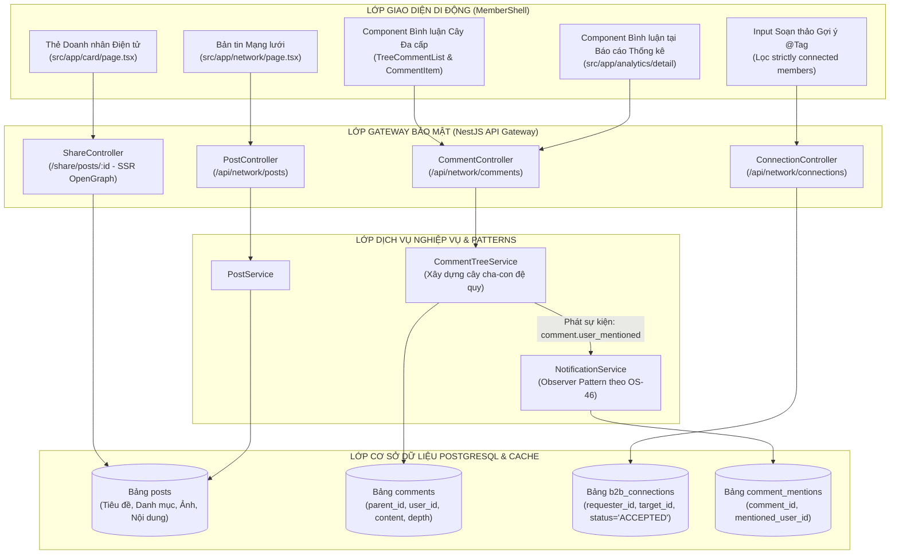
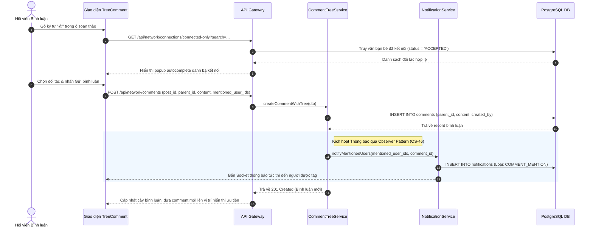

# TÀI LIỆU ĐẶC TẢ YÊU CẦU PHẦN MỀM (SRS)
## PHÂN HỆ BẢN TIN MẠNG LƯỚI, BÌNH LUẬN DẠNG CÂY & THẺ ĐIỆN TỬ HỘI VIÊN (SUB-05)
**HỆ THỐNG QUẢN TRỊ HIỆP HỘI DOANH NHÂN CEO 1983 (HANOIBA)**

---

### THÔNG TIN TÀI LIỆU
- **Mã tài liệu:** `CEO1983-SRS-SUB-05`
- **Mã định danh Functional Node:**
  - `[NODE-APP-001]`: Bảng tin Mạng lưới & Danh mục Bài đăng (bao gồm danh mục 'Khác')
  - `[NODE-APP-005]`: Thẻ Doanh nhân Điện tử & Chia sẻ Mạng xã hội OpenGraph
  - `[NODE-APP-013]`: Bình luận Đa cấp (Tree Comments), Tự động gợi ý `@tag` & Thông báo
- **Tiêu chuẩn áp dụng:** IEEE 830, OS-46 (Observer Pattern), OS-47 (IDOR Prevention & XSS Sanitize), OS-49 (Monorepo Feature Architecture)
- **Ngày ban hành:** 06/11/2026 (Phiên bản 5.2 - Chuẩn hóa Kỹ thuật)

---

### 1. KIẾN TRÚC TỔNG QUAN PHÂN HỆ (SYSTEM ARCHITECTURE)



---

### 2. LUỒNG XỬ LÝ BÌNH LUẬN DẠNG CÂY & THÔNG BÁO NHẮC TÊN (`@TAG`)



---

### 3. ĐẶC TẢ YÊU CẦU KỸ THUẬT CHI TIẾT (FUNCTIONAL SPECIFICATIONS)

#### 3.1 Cấu trúc Dữ liệu Bình luận Phân nhánh (Tree Structure) `[NODE-APP-013]`
- Mỗi bản ghi bình luận có thuộc tính `parent_id` (UUID nullable).
- Thuộc tính `depth` giới hạn tối đa mức 3 (`0, 1, 2`) để chống tràn giao diện màn hình điện thoại di động:
  - `depth = 0`: Bình luận gốc (Root comment).
  - `depth = 1`: Phản hồi bình luận gốc (Reply 1).
  - `depth = 2`: Phản hồi bình luận cấp 1 (Reply 2 - cấp tối đa). Nếu người dùng phản hồi một bình luận cấp 2, `parent_id` sẽ được gán bằng `parent_id` của bình luận đó để duy trì mức thụt lề chuẩn.
- Thuật toán dựng cây đệ quy trên Backend:
  ```typescript
  export function buildCommentTree(comments: CommentEntity[]): TreeCommentDto[] {
    const map = new Map<string, TreeCommentDto>();
    const roots: TreeCommentDto[] = [];

    comments.forEach(c => map.set(c.id, { ...c, replies: [] }));
    comments.forEach(c => {
      const node = map.get(c.id)!;
      if (c.parent_id && map.has(c.parent_id)) {
        map.get(c.parent_id)!.replies.push(node);
      } else {
        roots.push(node);
      }
    });
    return roots;
  }
  ```

#### 3.2 Quy chế Gợi ý `@tag` Chỉ Lấy Đối tác Đã Kết Nối
- **Truy vấn CSDL (Strict Connected Member Only):**
  ```sql
  SELECT u.id, u.full_name, u.avatar_url, u.company_name
  FROM users u
  INNER JOIN b2b_connections c 
    ON (c.target_id = u.id AND c.requester_id = $1)
    OR (c.requester_id = u.id AND c.target_id = $1)
  WHERE c.status = 'ACCEPTED' 
    AND (u.full_name ILIKE $2 OR u.company_name ILIKE $2)
  ORDER BY u.full_name ASC
  LIMIT 10;
  ```
- Tuyệt đối không truy vấn danh sách toàn bộ hội viên hệ thống. Người dùng có thể xóa nhanh đối tác đã chọn bằng cách nhấn nút icon close `x` trên tag chip.

#### 3.3 Thao tác Ba Chấm & Giữ Lâu để Sửa / Xóa Bình luận
- Tích hợp menu tùy chọn `...` và cử chỉ chạm giữ (Long Press) trên thiết bị di động:
  - Nếu `current_user.id === comment.created_by`: Hiển thị 2 tùy chọn "Chỉnh sửa bình luận" và "Xóa bình luận".
  - Nếu `current_user.role === 'admin'`: Có thêm quyền "Xóa vi phạm chính sách".
  - Mọi thao tác đều có hộp thoại xác nhận (Modal Confirmation) để chống chạm nhầm.

#### 3.4 Chia sẻ Thẻ Doanh nhân & Bài viết OpenGraph SSR
- Endpoint phục vụ mạng xã hội: `GET /share/posts/:id`
- Phản hồi mã HTML thuần chứa đầy đủ các thẻ meta OpenGraph theo chuẩn quốc tế:
  ```html
  <meta property="og:type" content="article" />
  <meta property="og:site_name" content="CLB Doanh nhân CEO 1983 — HANOIBA" />
  <meta property="og:title" content="Xây dựng phần mềm quản lý tòa nhà" />
  <meta property="og:description" content="Cơ hội hợp tác B2B độc quyền dành cho Hội viên CLB CEO 1983..." />
  <meta property="og:image" content="https://ceo1983.viconnect.vn/uploads/cover_building.jpg" />
  <meta property="og:image:width" content="1200" />
  <meta property="og:image:height" content="630" />
  ```
- Đảm bảo khi gửi link vào Facebook Chat hoặc Zalo, thẻ hiển thị đầy đủ hình ảnh đại diện và tiêu đề, không bị vỡ giao diện.

---

### 4. ĐẶC TẢ HỢP ĐỒNG API (API CONTRACTS)

#### 4.1 Lấy Danh Sách Đối Tác Đã Kết Nối Cho Autocomplete `@tag`
- **Đường dẫn:** `GET /api/network/connections/connected-only?search=nam`
- **Response Success (200 OK):**
```json
{
  "success": true,
  "data": [
    {
      "id": "usr_983_nam_01",
      "full_name": "Nguyễn Hoàng Nam",
      "avatar_url": "/avatars/nam.jpg",
      "company_name": "Công ty CP Công Nghệ Nam Việt"
    }
  ]
}
```

#### 4.2 Xóa Bình Luận (Tuân thủ Chống IDOR - OS-47)
- **Đường dẫn:** `DELETE /api/network/comments/{id}`
- **Bảo mật:** Backend kiểm tra `req.user.id === comment.created_by` hoặc kiểm tra quyền quản trị viên. Nếu không hợp lệ trả về `403 Forbidden`.

---

### 5. YÊU CẦU PHI CHỨC NĂNG & THẨM MỸ GIAO DIỆN
1. **Quy chuẩn Màu sắc Đơn sắc Doanh nhân:**
   - Loại bỏ 100% các nút màu gradient (`bg-gradient-to-r`).
   - Sử dụng màu xanh doanh nhân thương hiệu `bg-[#0047AB]` (Blue Primary) với trạng thái hover `bg-[#1E40AF]` và active `bg-[#0369a1]`.
2. **Hiệu năng Render Danh sách Bình luận:**
   - Hỗ trợ cuộn ảo (Virtual Scrolling) cho các bài viết có trên 500 bình luận để tránh hiện tượng giật lag trên thiết bị di động cấu hình trung bình.

