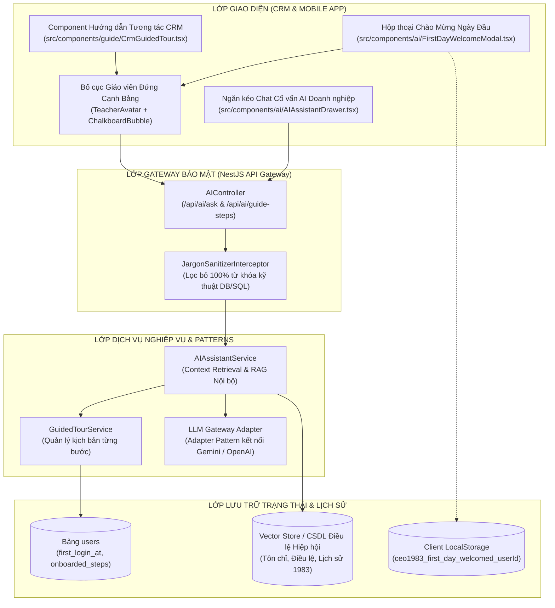
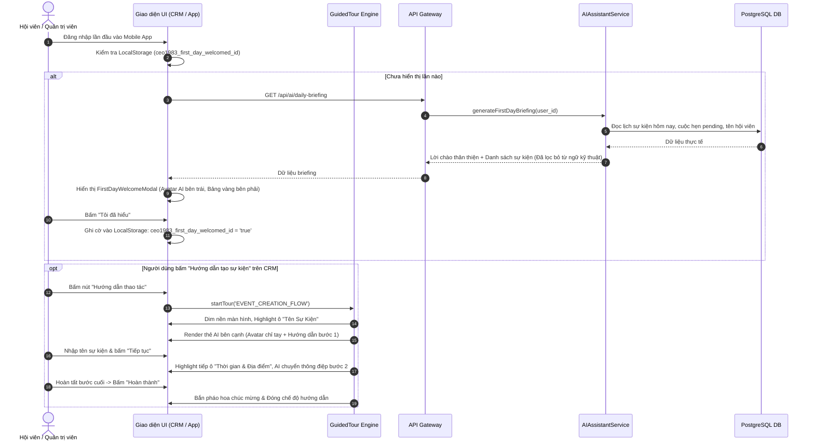

# TÀI LIỆU ĐẶC TẢ YÊU CẦU PHẦN MỀM (SRS)
## PHÂN HỆ TRỢ LÝ AI CỐ VẤN & HƯỚNG DẪN TƯƠNG TÁC (ONBOARDING) (SUB-06)
**HỆ THỐNG QUẢN TRỊ HIỆP HỘI DOANH NHÂN CEO 1983 (HANOIBA)**

---

### THÔNG TIN TÀI LIỆU
- **Mã tài liệu:** `CEO1983-SRS-SUB-06`
- **Mã định danh Functional Node:**
  - `[NODE-CORE-005]`: Trợ lý Trí tuệ Nhân tạo (AI Core & Context-Aware Engine)
  - `[NODE-CRM-017]`: Hệ thống Hướng dẫn Trực quan Cổng Quản trị CRM (Banking-Grade Tour)
  - `[NODE-APP-014]`: Hộp thoại Chào mừng Ngày Đầu Đăng nhập & Spotlight Tính năng Di động
- **Tiêu chuẩn áp dụng:** IEEE 830, OS-46 (Strategy Pattern cho AI Responses), OS-47 (Prompt Injection & Data Sanitization), OS-49 (Monorepo Feature Architecture)
- **Ngày ban hành:** 06/11/2026 (Phiên bản 5.2 - Chuẩn hóa Kỹ thuật)

---

### 1. KIẾN TRÚC TỔNG QUAN PHÂN HỆ (SYSTEM ARCHITECTURE)



---

### 2. LUỒNG TƯƠNG TÁC HƯỚNG DẪN DẠNG "GIÁO VIÊN ĐỨNG CẠNH BẢNG"



---

### 3. ĐẶC TẢ YÊU CẦU KỸ THUẬT CHI TIẾT (FUNCTIONAL SPECIFICATIONS)

#### 3.1 Bố cục Thị giác "Giáo viên Đứng Cạnh Bảng" (Teacher-Chalkboard UI Component)
- **Tên Component:** `TeacherChalkboardGuide`
- **Quy chuẩn CSS/Tailwind Bắt buộc:**
  ```tsx
  <div className="flex items-start gap-4 p-4 bg-slate-900/95 text-white rounded-2xl shadow-2xl border border-amber-500/30 max-w-lg">
    {/* Bên trái: Linh vật AI giáo viên */}
    <div className="flex-shrink-0 relative">
      <div className="w-14 h-14 rounded-full bg-gradient-to-tr from-amber-500 to-red-600 p-0.5 shadow-lg flex items-center justify-center animate-pulse">
        <AITutorAvatar className="w-12 h-12 rounded-full" />
      </div>
      <span className="absolute -bottom-1 -right-1 px-1.5 py-0.5 bg-blue-600 text-[10px] font-bold rounded-full">
        AI 1983
      </span>
    </div>

    {/* Bên phải: Bảng phấn thông điệp */}
    <div className="flex-1 bg-slate-800/80 rounded-xl p-3 border border-slate-700">
      <h4 className="text-amber-400 font-semibold text-sm mb-1">{stepTitle}</h4>
      <p className="text-slate-200 text-xs leading-relaxed">{stepMessage}</p>
      
      <div className="flex justify-end gap-2 mt-3">
        <button onClick={onNext} className="px-3 py-1 bg-blue-700 hover:bg-blue-600 text-white text-xs font-medium rounded-lg">
          {isLastStep ? 'Tôi đã hiểu' : 'Tiếp tục'}
        </button>
      </div>
    </div>
  </div>
  ```

#### 3.2 Bộ Lọc Loại Bỏ Ngôn Từ Kỹ Thuật (Jargon Sanitizer Interceptor)
- Để đáp ứng chỉ thị nghiệp vụ tuyệt đối không hiển thị ngôn từ máy chủ lên giao diện doanh nhân, Backend triển khai Interceptor lọc nội dung phản hồi của AI trước khi gửi về Client:
  ```typescript
  export class JargonSanitizerInterceptor implements NestInterceptor {
    private forbiddenTerms = [
      /100%\s*dữ liệu sống\s*PostgreSQL/gi,
      /PostgreSQL\s*realtime/gi,
      /PostgreSQL/gi,
      /Database/gi,
      /Cơ sở dữ liệu sống/gi,
      /REST API/gi,
      /JSON Payload/gi,
      /Docker Container/gi,
    ];

    intercept(context: ExecutionContext, next: CallHandler): Observable<any> {
      return next.handle().pipe(
        map(data => {
          if (typeof data === 'string') return this.sanitize(data);
          if (data && typeof data === 'object') return this.sanitizeObject(data);
          return data;
        })
      );
    }

    private sanitize(text: string): string {
      let cleaned = text;
      cleaned = cleaned.replace(/100%\s*dữ liệu sống\s*PostgreSQL\.?/gi, 'Dữ liệu giao thương chính thức và minh bạch.');
      cleaned = cleaned.replace(/PostgreSQL\s*realtime\.?/gi, 'Hệ thống cập nhật tức thời.');
      cleaned = cleaned.replace(/PostgreSQL/gi, 'Hệ thống Quản trị');
      cleaned = cleaned.replace(/Database/gi, 'Dữ liệu Hiệp hội');
      return cleaned;
    }
    // ... sanitizeObject implementation
  }
  ```

#### 3.3 Cơ chế Nhận diện Ngày Đầu Đăng Nhập (First-Day Login Logic)
- **Kiểm tra đa tầng (Hybrid State Check):**
  1. *Tầng Client:* Kiểm tra khóa `localStorage.getItem(`ceo1983_first_day_welcomed_${userId}`)`. Nếu đã tồn tại giá trị `true`, bỏ qua modal chào mừng.
  2. *Tầng Máy chủ:* Bản ghi người dùng trong bảng `users` có trường `first_login_at`. Nếu ngày hiện tại trùng với ngày của `first_login_at` và trường `welcome_modal_dismissed` mang giá trị `false`, trả về chỉ báo `show_welcome = true`.
  3. Khi người dùng nhấn "Tôi đã hiểu" hoặc "Khám phá ngay", Client gửi yêu cầu ghi nhận và đồng thời lưu vào LocalStorage để không bao giờ hiện lại ở các phiên tiếp theo.

---

### 4. ĐẶC TẢ HỢP ĐỒNG API (API CONTRACTS)

#### 4.1 Lấy Lời Chào Mừng & Điểm Tin Ngày Đầu (First-Day Briefing)
- **Đường dẫn:** `GET /api/ai/daily-briefing`
- **Headers:** `Authorization: Bearer <jwt_token>`
- **Response Success (200 OK):**
```json
{
  "success": true,
  "data": {
    "greeting": "Chào mừng Anh Nguyễn Văn Hưng đã gia nhập Ngôi nhà chung CEO 1983!",
    "health_wish": "Chúc Anh một ngày tràn đầy năng lượng và gặt hái nhiều thương vụ thành công.",
    "today_highlights": {
      "upcoming_events_count": 2,
      "pending_meetings_count": 1,
      "next_event_title": "Hội nghị Xúc tiến Thương mại Mùa Thu 1983"
    },
    "show_first_day_dialog": true
  }
}
```

#### 4.2 Gửi Câu Hỏi Cho Trợ Lý Cố Vấn Doanh Nghiệp
- **Đường dẫn:** `POST /api/ai/ask`
- **Request Body (JSON):**
```json
{
  "question": "Làm thế nào để tôi có thể gửi lời mời hẹn gặp 1-on-1 với Chủ tịch CLB?",
  "context_scope": "CRM_NAVIGATION"
}
```
- **Response Success (200 OK):**
```json
{
  "success": true,
  "data": {
    "answer": "Để hẹn gặp 1-on-1 với Chủ tịch CLB, Anh/Chị vui lòng vào mục 'Kết nối B2B', tìm kiếm tên Chủ tịch trong danh bạ và nhấn nút 'Lên lịch gặp 1-on-1'. Hệ thống sẽ tự động gửi thông điệp đặt lịch trân trọng đến hộp thoại của Chủ tịch.",
    "guided_tour_trigger": "MEETING_SETUP_TOUR"
  }
}
```

---

### 5. YÊU CẦU BẢO MẬT & HIỆU NĂNG
- **Bảo vệ Prompt & Chống Tiết lộ Bí mật Hệ thống (OS-47):** Prompt của AI được bọc trong bộ tiền xử lý và hậu xử lý, cấm tuyệt đối việc tiết lộ mật khẩu, cấu trúc bảng CSDL, token, hoặc hướng dẫn kỹ thuật hạ tầng cho người dùng cuối.
- **Thời gian Phản hồi:** API Lời chào ngày đầu phải phản hồi trong thời gian dưới 200ms bằng kỹ thuật Pre-computation (tính toán sẵn khi đăng nhập thành công).

